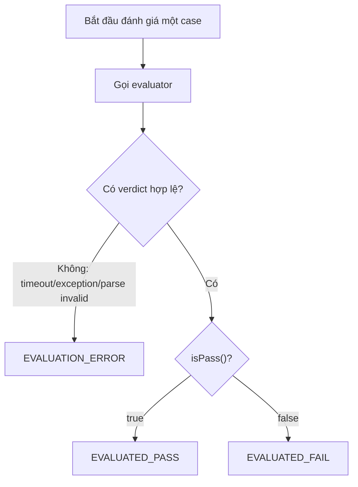

# Phân biệt ý nghĩa isPass và score của từng implementation

## 1. Cùng là EvaluationResponse nhưng không phải cùng một thang điểm

Hãy xét ứng dụng RAG trả lời câu hỏi: “Thời hạn hoàn tiền là bao lâu?”. Văn bản được truy xuất ghi “Trong vòng 30 ngày kể từ ngày nhận hàng”, còn hệ thống trả lời: “Bạn có thể yêu cầu hoàn tiền trong 30 ngày”.

Khi đánh giá câu trả lời này, một evaluator có thể trả:

```text
isPass() = true
getScore() = 1.0
```

Một evaluator khác có thể trả:

```text
isPass() = true
getScore() = 0.0
```

Hai phản hồi trên **không nhất thiết mâu thuẫn**. Trong Spring AI, `isPass()` là **kết luận đạt/trượt của một implementation**, còn `getScore()` là **giá trị do implementation đó chọn cách tạo ra**. Không có hợp đồng chung yêu cầu mọi evaluator trả điểm trong khoảng `[0, 1]`, đặt ngưỡng `0.5`, hoặc dùng điểm bằng xác suất đúng.

Bài này thuộc chương **API Evaluator** của module **SPRING_AI_EVALUATION_OBSERVABILITY**. Mục tiêu của module là đánh giá chất lượng ứng dụng Spring AI bằng dataset, tiêu chí relevance, fact checking, kiểm thử RAG và tool flow; đồng thời liên kết với metrics, traces, chi phí và độ trễ để phân tích suy giảm chất lượng theo phiên bản prompt, model và pipeline.

**Mục tiêu học tập**

1. Nêu rõ `isPass()` và `getScore()` diễn tả những gì, và những gì chúng không tự diễn tả.
2. Đọc đúng giá trị từ `RelevancyEvaluator` và `FactCheckingEvaluator` được Spring AI cung cấp.
3. Thiết kế quy ước `pass` và `score` cho evaluator tự viết; phân biệt điểm định lượng với tiêu chí bắt buộc.
4. Tổng hợp kết quả nhiều ca/nhiều tiêu chí mà không trộn các thang đo.
5. Tránh phân loại lỗi judge, thiếu dữ liệu hoặc thay đổi rubric thành suy giảm chất lượng không có căn cứ.

## 2. Hợp đồng API không ấn định quy tắc tính điểm

Spring AI cung cấp giao diện:

```java
package org.springframework.ai.evaluation;

@FunctionalInterface
public interface Evaluator {
    EvaluationResponse evaluate(EvaluationRequest evaluationRequest);
}
```

Đầu vào `EvaluationRequest` có thể gồm câu hỏi người dùng, danh sách `Document` làm ngữ cảnh và nội dung câu trả lời cần đánh giá. Đầu ra `EvaluationResponse` có các getter:

```java
boolean isPass();
float getScore();
String getFeedback();
Map<String, Object> getMetadata();
```

Hai constructor của `EvaluationResponse` trong Javadoc Spring AI 2.1.0 là:

```java
// Có tham số điểm:
new EvaluationResponse(
    boolean pass,
    float score,
    String feedback,
    Map<String, Object> metadata
);

// Không có tham số điểm:
new EvaluationResponse(
    boolean pass,
    String feedback,
    Map<String, Object> metadata
);
```

Các dòng `new EvaluationResponse(boolean ...)` ở trên mô tả **chữ ký API**, không phải lệnh Java có thể biên dịch nguyên văn.

| Thành phần | Được hợp đồng API bảo đảm | Không được hợp đồng bảo đảm |
|---|---|---|
| `isPass()` | Là giá trị boolean mà evaluator đưa ra | Mọi tiêu chí khác cũng đạt; judge chắc chắn đúng |
| `getScore()` | Là một giá trị `float` có thể đọc | Cùng một thang điểm/ngưỡng/ý nghĩa giữa mọi evaluator |
| `getFeedback()` | Có getter cho phản hồi dạng văn bản | Luôn có giải thích hoặc luôn là chứng cứ đáng tin |
| `getMetadata()` | Có getter cho map metadata | Luôn có `runId`, rubric hoặc danh sách claim bị lỗi |

**Quy tắc thiết kế quan trọng:** khi một API không định nghĩa cách tính điểm, người sử dụng phải tra implementation hoặc hợp đồng do đội phát triển công bố trước khi đưa `score` vào dashboard hay cổng kiểm thử.

### 2.1. Cách đọc một kết quả

Xét:

```java
EvaluationResponse verdict = evaluator.evaluate(request);

boolean passed = verdict.isPass();
float score = verdict.getScore();
String feedback = verdict.getFeedback();
```

Không nên viết điều kiện tổng quát:

```java
// SAI khi áp dụng bừa bãi cho mọi Evaluator:
boolean passed = verdict.getScore() >= 0.5f;
```

Điều kiện này âm thầm **thay quy tắc của evaluator** bằng một ngưỡng do caller tự tưởng tượng. Nó có thể biến kết quả pass thành fail, hoặc ngược lại. Nếu ứng dụng muốn áp ngưỡng khác, phải định nghĩa rõ đó là **chính sách mới** của tầng sử dụng, lưu version và xác minh thang điểm tương thích.

## 3. Phân biệt năm khái niệm thường bị trộn lẫn

| Thuật ngữ | Cách hiểu đúng | Ví dụ |
|---|---|---|
| **Verdict / pass** | Phán quyết cuối cùng của evaluator theo một tiêu chí | Câu trả lời được xem là bám context |
| **Raw score** | Điểm do implementation trả về | `0.0`, `1.0`, `4.0`, `0.75` |
| **Rubric / scale** | Quy ước tạo score và chiều tốt/xấu | `1–5`, càng cao càng tốt |
| **Threshold** | Ngưỡng hoặc quy tắc chuyển điểm thành pass | `score >= 0.8` và không vi phạm điều kiện bắt buộc |
| **Confidence / probability** | Xác suất đã được định nghĩa và hiệu chỉnh | Xác suất lỗi 20% sau kiểm định hiệu chuẩn |

**Raw score khác confidence.** Trả về `0.8f` không biến kết quả thành “80% chắc chắn đúng”. Một tỷ lệ 4/5 điều kiện đạt, một đánh giá rubric 4/5 và xác suất 80% là ba đại lượng hoàn toàn khác nhau.

**Pass khác correctness tuyệt đối.** Nếu chỉ chấm relevance, `isPass()==true` nói rằng câu trả lời đạt tiêu chí relevance theo phương pháp judge đã dùng; nó không chứng minh mọi mệnh đề trong câu trả lời là đúng.

**Threshold khác chất lượng của model.** Việc thay ngưỡng từ `0.7` sang `0.9` có thể làm tỷ lệ pass giảm ngay cả khi toàn bộ output không đổi. Cần lưu threshold/rubric version khi so sánh các lần chạy.

## 4. RelevancyEvaluator: pass và score đồng biến theo phán quyết nhị phân

`org.springframework.ai.chat.evaluation.RelevancyEvaluator` là implementation tích hợp của Spring AI để hỏi model judge xem câu trả lời có phù hợp câu hỏi và context được cấp hay không.

Ở cách triển khai Spring AI 2.1.x được đối chiếu từ mã nguồn, evaluator gửi ba thành phần tới prompt judge:

```text
query    = câu hỏi gốc (userText)
response = câu trả lời cần chấm (responseContent)
context  = nội dung Document trong dataList
```

Prompt mặc định yêu cầu judge chỉ trả lời `YES` hoặc `NO`. Implementation chuẩn hóa chuỗi đầu ra và so sánh với `yes` (không phân biệt chữ hoa/thường). Logic minh họa tương đương:

```java
// PSEUDOCODE tóm tắt implementation;
// không phải bản sao nguyên văn mã nguồn Spring AI.
String judgeText = callJudgeWithQueryResponseContext(request);
String normalized = judgeText == null ? "" : judgeText.strip();

boolean passing = "yes".equalsIgnoreCase(normalized);
float score = passing ? 1.0f : 0.0f;

return new EvaluationResponse(
    passing, score, "", Map.of()
);
```

**Diễn giải theo implementation này:**

| Judge trả lời | `isPass()` | `getScore()` | Cách hiểu |
|---|---:|---:|---|
| `YES` | `true` | `1.0` | Judge đưa phán quyết phù hợp |
| `NO` | `false` | `0.0` | Judge đưa phán quyết không phù hợp |
| `yes`, sau khi xử lý khoảng trắng | `true` | `1.0` | Không phân biệt hoa/thường |
| `YES, vì câu trả lời đúng chủ đề` | Có thể `false` | `0.0` | Parser nghiêm ngặt không nhận toàn chuỗi là `YES` |
| Không có nội dung trả lời | `false` trong logic parser có xử lý null | `0.0` | Không đồng nghĩa chắc chắn câu trả lời ứng dụng sai |

Điểm `1.0` ở đây là **mã hóa verdict dương**, không phải một điểm relevance liên tục. Không có giá trị kiểu `0.73` để diễn giải câu trả lời “liên quan 73%” từ evaluator này.

### 4.1. Hệ quả của parser nghiêm ngặt

Model judge có thể gửi:

```text
Yes, the answer is relevant because it matches the context.
```

Một người đọc thấy đây là lời xác nhận. Nhưng nếu parser yêu cầu **toàn bộ câu** bằng `YES`, kết quả có thể là `pass=false` và `score=0`.

Đó có thể là **lỗi tương thích định dạng đầu ra của judge**, không nhất thiết là lỗi chất lượng của câu trả lời được chấm.

Cách xử lý:

1. Dùng prompt buộc trả lời đúng một token `YES`/`NO`; điều chỉnh giới hạn output token nếu provider hỗ trợ.
2. Tạo các test có judge giả lập trả `YES`, `NO`, `YES.`, chuỗi rỗng và các dạng ngoại lệ để hiểu parser của phiên bản dependency.
3. Khi cần feedback/JSON nhiều trường, viết evaluator hoặc adapter chuyên biệt với cấu trúc đầu ra rõ ràng thay vì thay prompt rồi giả định parser chuẩn đọc được.
4. Ghi nhận riêng lỗi thực thi/định dạng của judge nếu ứng dụng có đủ dữ liệu để xác định; không tự giải thích mọi `false` là “LLM ứng dụng trả lời lạc đề”.

### 4.2. Khi nào được dùng trung bình score?

Vì score của `RelevancyEvaluator` chuẩn là `0` hoặc `1` theo pass, nếu có **N ca đã đánh giá thành công, cùng phiên bản parser/rubric**, ta có:

\[
\operatorname{mean(score)}=\frac{\#\text{pass}}{N}=\operatorname{passRate}
\]

Đây là một **đẳng thức do cách gán score cụ thể**. Không mang kết luận đó sang `FactCheckingEvaluator` hoặc evaluator tự viết khi chúng không dùng cách gán điểm giống vậy.

Ví dụ: 7 ca pass, 3 ca fail ⇒ pass rate `7/10=70%` và mean(score) cũng bằng `0.7` cho chính nhóm kết quả nhị phân này. Điều đó **không** có nghĩa mỗi câu trả lời đạt độ chính xác 70%.

## 5. FactCheckingEvaluator: dùng isPass, không lấy score làm proxy

`org.springframework.ai.chat.evaluation.FactCheckingEvaluator` kiểm tra một claim trong câu trả lời có được tài liệu ngữ cảnh hỗ trợ hay không.

Input mặc định tập trung vào:

```text
document = nội dung tài liệu hỗ trợ
claim    = phát biểu/câu trả lời cần kiểm tra
```

Spring AI có cách tạo evaluator cho model thông thường và biến thể prompt dành cho Bespoke Minicheck:

```java
import org.springframework.ai.chat.client.ChatClient;
import org.springframework.ai.chat.evaluation.FactCheckingEvaluator;
import org.springframework.ai.chat.model.ChatModel;

public final class JudgeConfigurationExample {

    public static FactCheckingEvaluator create(ChatModel judgeModel) {
        return FactCheckingEvaluator
            .builder(ChatClient.builder(judgeModel))
            .build();
    }

    public static FactCheckingEvaluator createForMinicheck(
            ChatModel minicheckModel) {
        return FactCheckingEvaluator.forBespokeMinicheck(
            ChatClient.builder(minicheckModel)
        );
    }
}
```

Lưu ý: biến thể `forBespokeMinicheck` dùng một prompt đặc thù cho mô hình đó; cần cấu hình provider/model phù hợp. Ví dụ trên chỉ khởi tạo evaluator, chưa gọi API model.

Trong nhánh triển khai đã kiểm tra ở Spring AI 2.0.x/2.1.x, `FactCheckingEvaluator` tạo `EvaluationResponse` bằng **constructor ba đối số không truyền score**:

```java
// PSEUDOCODE thể hiện đặc tính kết quả:
boolean passing = judgeSaidYes;
return new EvaluationResponse(passing, "", Map.of());
```

Constructor không truyền score khởi tạo `score` mặc định là `0.0f` ở triển khai nói trên. Vì thế:

| Phán quyết fact checking | `isPass()` | `getScore()` | Cách hiểu |
|---|---:|---:|---|
| Claim được judge xem là có căn cứ | `true` | `0.0` | Pass về fact checking; **không có score định lượng hữu ích** |
| Claim được judge xem là không có căn cứ | `false` | `0.0` | Fail về fact checking; score vẫn bằng 0 |
| Judge đưa định dạng ngoài `YES`/`NO` | Có thể `false` tùy parser | `0.0` | Cần kiểm tra output judge và phiên bản triển khai |

**Bẫy lớn nhất của bài:** `FactCheckingEvaluator.isPass() == true` đồng thời `getScore() == 0.0f` vẫn có thể là hành vi bình thường. Đừng tự đổi kết quả pass thành fail vì “điểm bằng 0”.

Một dashboard tính điểm fact checking trung bình từ `getScore()` có thể luôn hiển thị `0` dù hệ thống có nhiều ca pass. Để báo cáo tỷ lệ thành công fact checking, hãy **đếm `isPass()`** và chia cho số ca đã chấm thành công.

> Việc gán score và parser là **chi tiết implementation**, có thể thay đổi giữa các release. Khi nâng cấp Spring AI, đối chiếu source/bytecode hoặc viết regression test với version khóa cụ thể trước khi dựa vào hành vi này. Phần “score mặc định bằng 0” mô tả nhánh triển khai đã kiểm tra; Javadoc công bố constructor/getter nhưng không tự diễn giải ý nghĩa điểm của mọi evaluator.

### 5.1. Ví dụ minh chứng không cần gọi LLM

Ta có thể thấy ngay sự khác biệt giữa constructor ba và bốn đối số bằng chính API `EvaluationResponse`:

```java
import java.util.Map;

import org.springframework.ai.evaluation.EvaluationResponse;

public class ScoreConstructorExample {

    public static void main(String[] args) {
        EvaluationResponse passWithoutScore =
            new EvaluationResponse(true, "supported", Map.of());

        EvaluationResponse passWithBinaryScore =
            new EvaluationResponse(true, 1.0f, "supported", Map.of());

        System.out.println(passWithoutScore.isPass()); // true
        System.out.println(passWithoutScore.getScore()); // 0.0

        System.out.println(passWithBinaryScore.isPass()); // true
        System.out.println(passWithBinaryScore.getScore()); // 1.0
    }
}
```

Hai đối tượng đều pass. Chúng khác nhau ở **quyết định cung cấp điểm** khi tạo response. Trong cách triển khai không truyền score, `0.0` nên được xử lý như **điểm không có ngữ nghĩa được công bố**, thay vì xem nó là bằng chứng chất lượng thấp.

## 6. Ma trận so sánh từng implementation

| Implementation | `isPass()` nghĩa là gì? | Quy tắc score tiêu biểu | Có thể lấy trung bình `getScore()` để báo cáo chất lượng? |
|---|---|---|---|
| `RelevancyEvaluator` tích hợp | Judge trả lời `YES` khi xét query, response, context | `1.0` nếu pass, `0.0` nếu không | Chỉ tương đương pass rate cho cùng implementation/rubric và tập ca đã chấm |
| `FactCheckingEvaluator` tích hợp | Claim được judge xem là được nguồn hỗ trợ | Có nhánh trả `0.0` dù `pass=true` vì không cấp score | **Không**; dùng pass rate từ `isPass()` |
| Evaluator kiểm tra độ dài tự viết | Chiều dài đáp ứng giới hạn | Có thể `1/0` hoặc tỷ lệ ký tự, tùy thiết kế | Chỉ khi có quy ước score rõ ràng và phù hợp mục tiêu |
| Evaluator kiểm tra JSON schema tự viết | Nội dung khớp schema | Có thể chỉ `1/0`; hoặc không cung cấp score | Không mặc định |
| Evaluator rubric tự viết | Điểm rubric và điều kiện bắt buộc đạt | Ví dụ: số `1–5` hoặc chuẩn hóa `0–1` | Chỉ trong cùng rubric/scale/version |
| Evaluator kết hợp tự viết | Đạt quy tắc kết hợp, ví dụ relevance **và** factuality cùng pass | Phải do ứng dụng định nghĩa, không có mặc định | Không tự lấy trung bình điểm khác thang |
| Evaluator kiểm tra tool flow tự viết | Tool selection/arguments/result đúng theo case | Có thể nhiều tiêu chí con, mỗi tiêu chí một nhãn | Phải định nghĩa cách tổng hợp và lưu chi tiết |

Trong bảng, các evaluator tự viết chỉ là **ví dụ về thiết kế**, không phải class built-in bắt buộc của Spring AI. Bản thân giao diện `Evaluator` chỉ quy định cách nhận request và trả response, không giới hạn cách tính điểm.

## 7. Hai evaluator chấm cùng một câu trả lời có thể cho pass khác nhau

Giả sử:

```text
userText:
  "Thời hạn yêu cầu hoàn tiền là bao lâu?"

dataList:
  "Chính sách hiện tại: yêu cầu hoàn tiền trong 30 ngày kể từ khi nhận hàng."

responseContent:
  "Bạn có 90 ngày để yêu cầu hoàn tiền."
```

Câu trả lời vẫn nói **đúng chủ đề thời hạn hoàn tiền**, nhưng số ngày **không được tài liệu hỗ trợ**.

| Cách chấm | Kết quả mong đợi từ người gắn nhãn | Giới hạn diễn giải |
|---|---|---|
| Relevance theo chủ đề | Có thể đạt vì trả lời đúng loại thông tin được hỏi | Không khẳng định con số 90 là chính xác |
| Relevance có xét context chặt | Có thể không đạt do không phù hợp ngữ cảnh 30 ngày | Phụ thuộc rubric và judge |
| Factual support | Không đạt vì “90 ngày” trái nguồn “30 ngày” | Không tự xác minh nguồn có phải chính sách mới nhất |
| Correctness so với đáp án chuẩn 30 ngày | Không đạt | Cần ground truth độc lập |
| Format “một câu ngắn” | Có thể đạt | Chỉ đánh giá định dạng |

Lưu ý: `RelevancyEvaluator` tích hợp **có đưa context vào prompt**, nên không thể khẳng định nó chắc chắn pass cho câu “90 ngày” trong tình huống này. Điểm cần nắm là **các tiêu chí đo những khía cạnh khác nhau**; kết quả thực tế phải được kiểm chứng bằng dataset đã gắn nhãn.

### 7.1. Ví dụ gọi hai evaluator tích hợp

```java
import java.util.List;

import org.springframework.ai.chat.client.ChatClient;
import org.springframework.ai.chat.evaluation.FactCheckingEvaluator;
import org.springframework.ai.chat.evaluation.RelevancyEvaluator;
import org.springframework.ai.chat.model.ChatModel;
import org.springframework.ai.document.Document;
import org.springframework.ai.evaluation.EvaluationRequest;
import org.springframework.ai.evaluation.EvaluationResponse;

public final class BuiltInEvaluatorComparison {

    public static void compare(ChatModel judgeModel) {
        EvaluationRequest request = new EvaluationRequest(
            "Thời hạn hoàn tiền?",
            List.of(new Document(
                "Chính sách: thời hạn hoàn tiền 30 ngày từ khi nhận hàng."
            )),
            "Bạn có 90 ngày để yêu cầu hoàn tiền."
        );

        var relevance = new RelevancyEvaluator(
            ChatClient.builder(judgeModel)
        );
        var factuality = FactCheckingEvaluator
            .builder(ChatClient.builder(judgeModel))
            .build();

        EvaluationResponse r = relevance.evaluate(request);
        EvaluationResponse f = factuality.evaluate(request);

        System.out.printf(
            "relevance: pass=%s score=%s%n",
            r.isPass(), r.getScore()
        );

        System.out.printf(
            "factuality: pass=%s score=%s%n",
            f.isPass(), f.getScore()
        );
    }
}
```

Đây là integration example cần `ChatModel` và kết nối model judge hợp lệ. **Không được hardcode kết quả thực tế** vì phản hồi judge phụ thuộc model, prompt, context và cách parser xử lý. Chương trình chỉ minh họa việc đọc verdict/score riêng từng implementation.

## 8. Thiết kế score và pass cho evaluator tự viết

Một implementation tốt nên công bố ít nhất:

| Thành phần hợp đồng riêng | Cần mô tả |
|---|---|
| `criterion` | Đánh giá tính chất gì? |
| `scale` | Giá trị nào hợp lệ? `0–1`, `1–5` hay `0/1`? |
| `direction` | Càng cao càng tốt hay càng thấp càng tốt? |
| `threshold` | Điểm bao nhiêu thì đạt? |
| `hardConstraints` | Điều kiện nào thất bại sẽ chặn pass bất kể điểm? |
| `missingDataPolicy` | Thiếu dữ liệu thì fail, skip hay evaluation error? |
| `rubricVersion` | Cách tính điểm được áp dụng ở phiên bản nào? |

### 8.1. Ví dụ: chấm hai yêu cầu với điểm tỷ lệ và điều kiện bắt buộc

Bài toán: câu trả lời phải chứa **mã chính sách** và **thời hạn**, trong đó thời hạn là điều kiện bắt buộc. Cho điểm bằng tỷ lệ trong hai điều kiện có mặt; pass chỉ khi cả hai có mặt.

```java
import java.util.Map;
import java.util.Objects;

import org.springframework.ai.evaluation.EvaluationRequest;
import org.springframework.ai.evaluation.EvaluationResponse;
import org.springframework.ai.evaluation.Evaluator;

public final class PolicyFieldsEvaluator implements Evaluator {

    @Override
    public EvaluationResponse evaluate(EvaluationRequest request) {
        Objects.requireNonNull(request, "request");

        String content = Objects.requireNonNull(
            request.getResponseContent(),
            "responseContent"
        );

        boolean hasPolicyCode = content.contains("RF-30");
        boolean hasDeadline = content.contains("30 ngày");

        int matched = (hasPolicyCode ? 1 : 0)
            + (hasDeadline ? 1 : 0);

        float score = matched / 2.0f;

        // Cả hai đều bắt buộc: threshold ở đây tương đương 1.0.
        boolean pass = hasPolicyCode && hasDeadline;

        String feedback = pass
            ? "Đủ mã chính sách và thời hạn."
            : "Thiếu mã RF-30 hoặc thời hạn 30 ngày.";

        return new EvaluationResponse(
            pass,
            score,
            feedback,
            Map.of(
                "criterion", "policy-required-fields",
                "rubricVersion", "v1",
                "scale", "0-to-1",
                "threshold", 1.0f,
                "hasPolicyCode", hasPolicyCode,
                "hasDeadline", hasDeadline
            )
        );
    }
}
```

Các kết quả điển hình:

| Nội dung `responseContent` | `score` | `pass` |
|---|---:|---:|
| “Theo RF-30, thời hạn là 30 ngày.” | `1.0` | `true` |
| “Theo RF-30, bạn có thể yêu cầu hoàn tiền.” | `0.5` | `false` |
| “Thời hạn là 30 ngày.” | `0.5` | `false` |
| “Bạn có thể yêu cầu hoàn tiền.” | `0.0` | `false` |

Đây là evaluator **kiểm tra sự hiện diện chuỗi**, không đánh giá tính đúng của một phát biểu. “Không áp dụng thời hạn 30 ngày” vẫn chứa cụm `30 ngày`, nên muốn kiểm tra nghĩa cần thêm rubric/logic phù hợp.

### 8.2. Ví dụ: điểm cao nhưng pass vẫn false

Giả sử bộ kiểm định có năm tiêu chí về phong cách và một điều kiện cứng **không chứa thông tin trái nguồn**:

```text
styleScore = 0.96              // Điểm phong cách do evaluator riêng xác định
grounded = false               // Điều kiện bắt buộc về căn cứ
pass = styleScore >= 0.80 AND grounded
     = false
```

`isPass()==false` dù `score==0.96` **không phải mâu thuẫn**: điểm và verdict kiểm tra những thứ khác nhau. Nhưng nếu thiết kế một `EvaluationResponse` chứa cả hai, phải ghi rõ trong metadata rằng `score` ở đây là **style score**, còn `pass` bao gồm groundedness.

Thực tiễn rõ ràng hơn thường là **giữ riêng hai EvaluationResponse**, rồi tổng hợp verdict ở tầng test, vì một điểm đơn lẻ dễ che mất tiêu chí nào đã trượt.

### 8.3. Ví dụ: điểm thấp hơn vẫn pass khi rubric cho phép

Một evaluator kiểm tra “ít nhất 3 trong 4 trường tùy chọn” có thể trả:

```java
EvaluationResponse result = new EvaluationResponse(
    true,
    0.75f,
    "Đạt 3/4 điều kiện, ngưỡng cho phép là 3.",
    Map.of(
        "criterion", "optional-fields",
        "rubricVersion", "v1",
        "requiredMinimum", 3,
        "matched", 3,
        "total", 4
    )
);
```

Điểm 0.75 là **tỷ lệ điều kiện thỏa mãn**, không phải mức tin cậy 75%.

## 9. Khi nào không nên cung cấp score?

Có những phép kiểm có bản chất **đạt hoặc trượt** và không có thứ tự chất lượng có ý nghĩa: “JSON có hợp lệ không?”, “tool đã gọi đúng mã đơn hàng chưa?”, “có vượt giới hạn nghiêm ngặt không?”.

Với evaluator đó, có hai lựa chọn minh bạch:

1. **Chỉ biểu diễn verdict**; dùng constructor không truyền score và công bố rằng `getScore()` không phải metric có nghĩa.
2. **Biểu diễn score nhị phân `0/1`**; công bố `score=1` khi pass, `0` khi fail.

Không thể thay hai cách này cho nhau khi đã xây báo cáo dựa trên score.

Ví dụ cho phép kiểm JSON:

```java
EvaluationResponse formatResult =
    new EvaluationResponse(
        true,
        "JSON hợp lệ theo schema hiện tại.",
        Map.of(
            "criterion", "json-schema",
            "schemaVersion", "1.4"
        )
    );
```

Ở đây, kết quả đạt được đọc bằng `formatResult.isPass()`. Không tự quy ra kết quả trượt chỉ vì `getScore()` mặc định bằng 0.

Nếu báo cáo cần cột điểm chung, hãy để `score` ở mức **không khả dụng/không áp dụng** tại tầng báo cáo khi implementation không cung cấp ý nghĩa điểm; đừng tự cho `0` là chất lượng kém. Đặc tính API `float` không thể tự biểu diễn `null` nên ứng dụng cần **metadata hoặc cấu hình evaluator** để phân biệt “không có điểm” với “điểm 0 thực sự”.

## 10. Tổng hợp nhiều implementation: không cộng trừ score tùy tiện

Giả sử một ca có kết quả:

| Criterion | `pass` | `score` | Ý nghĩa |
|---|---:|---:|---|
| Relevance tích hợp | `true` | `1.0` | Mã hóa verdict YES |
| Fact checking tích hợp | `true` | `0.0` | Score không có giá trị phân biệt |
| Độ dài tự viết | `true` | `1.0` | Đạt giới hạn |
| Đầy đủ ý tự viết | `false` | `0.75` | Đạt 3/4 ý nhưng cần đủ 4 |

Một phép tính sai:

```text
averageScore = (1.0 + 0.0 + 1.0 + 0.75) / 4
             = 0.6875
pass = averageScore >= 0.7
     = false
```

Kết luận này **không đáng tin** vì một điểm `0` thực ra không mang ý nghĩa “thất bại”, và `0.75` thuộc rubric khác. Ngưỡng `0.7` cũng không được định nghĩa trong bất kỳ evaluator nào.

### 10.1. Cách tổng hợp an toàn: giữ verdict theo từng tiêu chí

Nếu tất cả tiêu chí đều bắt buộc:

```java
import java.util.Map;

import org.springframework.ai.evaluation.EvaluationResponse;

public final class GatePolicy {

    public static boolean allRequiredPass(
            Map<String, EvaluationResponse> results) {

        if (results.isEmpty()) {
            throw new IllegalArgumentException(
                "Thiếu kết quả cho các tiêu chí bắt buộc"
            );
        }

        return results.values().stream()
            .allMatch(EvaluationResponse::isPass);
    }
}
```

Đoạn trên chỉ đúng nếu caller đã bảo đảm `results` chứa **đủ mọi tiêu chí bắt buộc** và từng phần tử là verdict hợp lệ. Nếu thiếu một tiêu chí mà vẫn truyền map không đầy đủ, `allMatch` có thể cho pass sai. Trong hệ thống thực tế, kiểm tra tập khóa bắt buộc trước khi tổng hợp.

Ví dụ chính sách ứng dụng:

```text
casePass =
    relevancePass
    AND factCheckingPass
    AND toolUsePass
```

Đây là quy tắc **AND do ứng dụng đặt ra**, không phải tính năng mặc định của Spring AI. Có thể thay bằng chính sách mức độ nghiêm trọng (critical/non-critical), nhưng cần version hóa và lưu lý do.

### 10.2. Khi bắt buộc có điểm tổng hợp

Chỉ nên tính khi đã định nghĩa đầy đủ:

- Thang điểm hợp lệ và chiều tối ưu cho từng criterion.
- Cách chuẩn hóa score; tiêu chí nào không có score phải được loại hoặc ánh xạ bằng quy tắc được công bố.
- Trọng số và ý nghĩa nghiệp vụ của trọng số.
- Hard constraints được đánh giá **độc lập** với điểm tổng hợp.
- Cách xử lý evaluator lỗi, bị skip, thiếu tài liệu và giá trị ngoài khoảng hợp lệ.

Ví dụ có hai evaluator **tự viết**, đều cung cấp score `[0,1]` cho các đại lượng có thể so sánh theo rubric đã hiệu chỉnh:

\[
S=0.6S_{\text{accuracy}}+0.4S_{\text{completeness}}
\]

Nếu `accuracy=0.9`, `completeness=0.7` thì `S=0.82`. Nhưng đây là **hàm số do ứng dụng quy định**. Có thể vẫn cần `accuracyPass==true` làm điều kiện chặn; nếu không, điểm completeness cao có thể che một lỗi fact checking nghiêm trọng.

Không áp công thức này cho `score` của `FactCheckingEvaluator` tích hợp khi score của nó không mang thang đo như giả định.

## 11. Phân biệt evaluation fail với lỗi của judge hoặc pipeline đánh giá

Tầng orchestration cần theo dõi ba trạng thái độc lập:



Đây là **mô hình báo cáo của ứng dụng**, không phải enum tích hợp sẵn. Nhiều built-in evaluator có thể trả `pass=false` khi judge đưa output sai format mà không báo lỗi riêng; để phân biệt, phải lấy/kiểm tra raw judge response qua adapter hoặc cơ chế quan sát phù hợp.

| Tình huống | Có `EvaluationResponse` đáng tin? | Ghi nhận khuyến nghị |
|---|---|---|
| Judge trả `NO` hợp lệ | Có | `EVALUATED_FAIL` |
| Judge trả `YES` hợp lệ | Có | `EVALUATED_PASS` |
| Judge trả `YES, because...` làm parser không khớp | Có thể có `false` từ parser; chưa đủ để khẳng định chất lượng fail | Kiểm tra judge output và đánh dấu lỗi định dạng nếu có bằng chứng |
| Model judge timeout hoặc HTTP error | Không có verdict bình thường | `EVALUATION_ERROR` |
| Không đủ tài liệu cho tiêu chí fact checking | Không đủ căn cứ để kết luận theo rubric | `SKIPPED` hoặc lỗi dữ liệu theo chính sách |
| Tool bị lỗi, ứng dụng không sinh được câu trả lời | Không thể chấm answer bình thường | Ghi lỗi pipeline ứng dụng riêng |

Nếu ép mọi lỗi vào `pass=false`, pass rate của ứng dụng sẽ giảm vào ngày dịch vụ judge gặp sự cố. Nếu loại bỏ hết lỗi mà không báo coverage, kết quả có thể quá lạc quan. Nên công bố cả **quality pass rate** lẫn **evaluation coverage/error rate**.

## 12. Báo cáo trên dataset: mẫu số và nhãn phải nhất quán

Giả sử có 100 case kiểm thử:

```text
Tổng số case:             100
Chấm thành công, pass:     78
Chấm thành công, fail:     12
Lỗi judge:                  8
Bỏ qua do thiếu dữ liệu:    2
```

Khi đó:

\[
\operatorname{qualityPassRate}=\frac{78}{78+12}=86.67\%
\]

\[
\operatorname{evaluationCoverage}=\frac{78+12}{100}=90\%
\]

\[
\operatorname{judgeErrorRate}=\frac{8}{100}=8\%
\]

Đừng báo một mình “pass rate 78%” nếu không làm rõ denominator và 10 case chưa có verdict.

### 12.1. Hàm tính pass rate độc lập với score

Ví dụ Java sử dụng kết quả đã được lọc thành các ca **thật sự có phán quyết**:

```java
import java.util.List;

import org.springframework.ai.evaluation.EvaluationResponse;

public final class QualityMetrics {

    private QualityMetrics() {}

    public static double passRate(List<EvaluationResponse> evaluated) {
        if (evaluated.isEmpty()) {
            throw new IllegalArgumentException(
                "Không có case được đánh giá hợp lệ"
            );
        }

        long count = evaluated.stream()
            .filter(EvaluationResponse::isPass)
            .count();

        return (double) count / evaluated.size();
    }
}
```

Hàm này cho cùng một định nghĩa đối với relevance, fact checking và các evaluator tự viết. Cần báo cáo pass rate **riêng theo criterion**, bởi cùng một câu trả lời có thể đạt relevance nhưng trượt factuality.

### 12.2. Bản ghi tiêu chí có đủ ngữ nghĩa

Ví dụ schema báo cáo **do ứng dụng thiết kế**:

```json
{
  "runId": "run-2026-11-27-01",
  "caseId": "refund-010",
  "criterion": "fact-check",
  "evaluatorImplementation": "FactCheckingEvaluator",
  "springAiVersion": "2.1.0",
  "judgeModel": "judge-model-id",
  "judgePromptVersion": "fact-yes-no-v1",
  "status": "EVALUATED_PASS",
  "pass": true,
  "rawScore": 0.0,
  "scoreSemantics": "not-applicable",
  "normalizedScore": null,
  "rubricVersion": "policy-fact-v1",
  "retrievalIndexVersion": "refund-index-v3"
}
```

Ở đây `rawScore=0.0` là giá trị kỹ thuật đọc được; `scoreSemantics="not-applicable"` và `normalizedScore=null` giúp người xem **không hiểu nhầm 0 là điểm chất lượng kém**. Các trường version, ID và trạng thái do hệ thống đánh giá lưu ở tầng báo cáo, không tự xuất hiện từ `EvaluationResponse`.

Nếu đổi `evaluatorImplementation` hoặc parser giữa hai lần chạy, so sánh score trực tiếp có thể mất ý nghĩa. Nên giữ một tập câu trả lời cố định để kiểm tra **bản thân judge** trước và sau nâng cấp.

## 13. Ví dụ kiểm thử quy tắc điểm trước khi đưa vào CI

Với API `EvaluationResponse`, có thể viết một unit test deterministic để khóa lại ý nghĩa constructor:

```java
import java.util.Map;

import org.junit.jupiter.api.Test;
import org.springframework.ai.evaluation.EvaluationResponse;

import static org.junit.jupiter.api.Assertions.assertEquals;
import static org.junit.jupiter.api.Assertions.assertTrue;

class EvaluationResponseScoreContractTest {

    @Test
    void booleanPassCanBeTrueWhileScoreIsDefaultZero() {
        EvaluationResponse response =
            new EvaluationResponse(
                true,
                "Đã được nguồn hỗ trợ.",
                Map.of("criterion", "fact-support")
            );

        assertTrue(response.isPass());
        assertEquals(0.0f, response.getScore(), 0.00001f);
    }

    @Test
    void binaryScoreMustBeProvidedExplicitly() {
        EvaluationResponse response =
            new EvaluationResponse(
                true,
                1.0f,
                "Đạt tiêu chí nhị phân.",
                Map.of("criterion", "boolean-rule")
            );

        assertTrue(response.isPass());
        assertEquals(1.0f, response.getScore(), 0.00001f);
    }
}
```

Test trên **không gọi model**, giúp chứng minh rằng `isPass` và `score` là hai giá trị riêng biệt. Nó không thay thế integration test đo parser và logic của `FactCheckingEvaluator` trên dependency/version thực tế.

### 13.1. Checklist kiểm tra khi nâng cấp Spring AI

- Khóa phiên bản Spring AI/Judge trong báo cáo khi so sánh.
- Kiểm tra constructor `EvaluationResponse` có đổi quy tắc score mặc định không.
- Kiểm tra `RelevancyEvaluator` có tiếp tục chuyển `YES` thành `pass=true, score=1` không.
- Kiểm tra `FactCheckingEvaluator` có bắt đầu xuất score hữu ích hay vẫn dùng constructor không truyền score.
- Kiểm tra parser xử lý `YES`, `NO`, khoảng trắng, dấu câu, null và output ngoài định dạng ra sao.
- So lại rubric/prompt, phiên bản model judge và các lời giải thích metadata/feedback.
- Kiểm tra ca regression trên tập gold labels, tránh kết luận đổi score là đổi chất lượng pipeline.

## 14. Liên hệ score với traces, metrics, chi phí và độ trễ

Trong module **SPRING_AI_EVALUATION_OBSERVABILITY**, chất lượng và vận hành cần được quan sát song song:

| Dữ liệu | Đo điều gì? | Có nên lấy từ `getScore()`? |
|---|---|---|
| `isPass()` relevance | Tỷ lệ đáp ứng câu hỏi/context theo rubric | Không; đếm verdict |
| `isPass()` fact checking | Tỷ lệ claim được context hỗ trợ theo judge | Không; đếm verdict |
| Điểm rubric tự viết | Mức đánh giá theo scale công bố | Có, nếu score có ngữ nghĩa rõ |
| Token input/output | Lượng tài nguyên model tiêu thụ | Không; lấy usage |
| Chi phí request | Ước tính dựa trên tokens, model và đơn giá | Không |
| Latency | Thời gian retrieval/generation/judge | Không; đo timer/span |
| Tool invocation correctness | Tool name/arguments/result hợp lệ | Phải có log/trace hoặc evaluator riêng |
| Lỗi judge | Thất bại khi thực thi phép chấm | Không; track outcome riêng |

Ví dụ, sau khi thay prompt, pass rate fact checking giảm nhưng latency và chi phí cũng giảm. Để kiểm tra đây là trade-off thật hay chỉ là judge bị thay đổi, cần gắn cùng `caseId`/`runId` với prompt version, model version, retrieval context snapshot và judge version, rồi mở traces của các case chuyển từ pass thành fail.

**Không gắn chuỗi câu hỏi hay feedback làm metric label** vì cardinality cao và có thể chứa dữ liệu nhạy cảm. Chỉ nên dùng nhãn hữu hạn như `criterion`, `outcome` và `evaluatorVersion`; lưu văn bản chi tiết ở kho báo cáo/log được bảo vệ.

### 14.1. Theo dõi trade-off bằng các thước đo riêng

Một bảng so sánh hợp lệ có thể là:

| Phiên bản | Relevance pass rate | Fact-check pass rate | P95 latency | Chi phí ước tính/lượt |
|---|---:|---:|---:|---:|
| Prompt v1 | 91% | 84% | 1,8 s | $0.004 |
| Prompt v2 | 93% | 79% | 1,4 s | $0.003 |

Các số chỉ mang tính minh họa. Ở đây **fact-check pass rate được tính từ `isPass()`**, không phải mean(`getScore()`). P95 latency và chi phí được đo riêng. Để kết luận, cần kiểm tra cùng dataset, đủ cỡ mẫu, cùng rubric/judge và tính tin cậy của nguồn.

Không nên tự chọn prompt v2 chỉ vì rẻ và nhanh hơn khi tỷ lệ fact checking có khả năng giảm. Mức chấp nhận trade-off là quyết định nghiệp vụ dựa trên rủi ro và ngưỡng chất lượng.

## 15. Sai lầm điển hình và cách tránh

| Sai lầm | Kết luận sai có thể xuất hiện | Cách xử lý |
|---|---|---|
| `getScore()==0` ⇒ fail | Kết quả `FactCheckingEvaluator` pass bị tính thành fail | Dùng `isPass()` và metadata mô tả score semantics |
| `isPass()==true` ⇒ factual correctness | Relevance pass bị xem là không có hallucination | Chấm factuality/correctness riêng |
| `score=0.8` ⇒ độ chính xác 80% | Mất ý nghĩa rubric và độ tin cậy | Ghi scale, threshold, calibration nếu muốn xác suất |
| Trung bình mọi evaluator score | Thang điểm khác nhau bị trộn | Báo cáo theo criterion, composite chỉ khi có thiết kế |
| Đặt `score>=0.5` cho mọi evaluator | Ghi đè phán quyết của implementation | Dùng `isPass()`; chỉ override theo chính sách minh bạch |
| Judge trả `YES.` mà parser trả fail | Coi lỗi định dạng là lỗi nội dung | Kiểm tra judge output và parser |
| Timeout judge bị gán `pass=false` | Chất lượng app bị quy trách nhiệm oan | Theo dõi evaluation error/coverage riêng |
| Không lưu rubric/judge version | “Regression” do chính bộ chấm thay đổi | Gắn version và chạy bộ mẫu cố định |
| Dùng `getScore()` làm metric token/latency | Nhầm chất lượng với vận hành | Đo usage/timers/traces độc lập |
| Chỉ xem mean score, bỏ qua case fail quan trọng | Lỗi nghiệp vụ nghiêm trọng bị che | Hard gate theo tiêu chí critical và phân tích từng case |

## 16. Tự kiểm tra kiến thức

**Câu 1.** `FactCheckingEvaluator` trả `isPass()==true` và `getScore()==0.0f`. Có phải response bị lỗi không?

**Đáp án:** Không nhất thiết. Trong nhánh triển khai dùng constructor không truyền score, `0.0f` là giá trị mặc định không mang ý nghĩa điểm chất lượng; pass là phán quyết cần đọc.

**Câu 2.** Điểm `1.0` của `RelevancyEvaluator` có nghĩa độ liên quan đạt đúng 100% không?

**Đáp án:** Không. Với implementation nhị phân, `1.0` mã hóa judge trả `YES`. Nó không phải xác suất hoặc mức độ liên quan được hiệu chuẩn.

**Câu 3.** Một evaluator tự viết trả `pass=false` và `score=0.95`. Điều đó có hợp lệ không?

**Đáp án:** Có, nếu điểm đo một đại lượng liên tục và verdict còn phụ thuộc điều kiện bắt buộc hoặc ngưỡng lớn hơn. Tuy nhiên, ứng dụng phải công bố rõ quy tắc để tránh hiểu nhầm.

**Câu 4.** Có thể lấy trung bình score của RelevancyEvaluator và FactCheckingEvaluator để tính “điểm chất lượng RAG” không?

**Đáp án:** Không nên. Score của relevance là nhị phân, còn fact checking tích hợp có thể không cấp score hữu ích. Nên báo cáo pass rate riêng theo tiêu chí; composite cần quy tắc được thiết kế và kiểm định riêng.

**Câu 5.** Judge timeout, không trả `EvaluationResponse`. Có nên gán `score=0` và tính vào quality fail không?

**Đáp án:** Không mặc định. Theo dõi lỗi chấm riêng, công bố coverage và error rate; chỉ kết luận chất lượng khi có phán quyết có căn cứ.

**Câu 6.** Vì sao đổi prompt judge có thể làm pass rate thay đổi khi answer model không đổi?

**Đáp án:** Prompt judge và parser quyết định cách diễn giải output. Thay rubric hoặc định dạng `YES`/`NO` có thể thay phán quyết. Cần version hóa judge và đánh giá trên tập output cố định.

## 17. Tài liệu tham khảo

- [Spring AI 2.1.0 — EvaluationResponse Javadoc](https://docs.spring.io/spring-ai/docs/current/api/org/springframework/ai/evaluation/EvaluationResponse.html): constructor có/không có score và các getter.
- [Spring AI — Evaluators (2.1)](https://docs.spring.io/spring-ai/reference/2.1-SNAPSHOT/evaluation/evaluators.html): mục đích của `RelevancyEvaluator`, `FactCheckingEvaluator`, các prompt và ví dụ RAG. Khi cần tài liệu ổn định, chọn nhánh 2.1.0 trên trang Spring AI.
- [Spring AI — RelevancyEvaluator source](https://github.com/spring-projects/spring-ai/blob/main/spring-ai-client-chat/src/main/java/org/springframework/ai/chat/evaluation/RelevancyEvaluator.java): cách chuyển `YES` thành `pass=true, score=1`, những chuỗi khác thành `pass=false, score=0`.
- [Spring AI — FactCheckingEvaluator source](https://github.com/spring-projects/spring-ai/blob/main/spring-ai-client-chat/src/main/java/org/springframework/ai/chat/evaluation/FactCheckingEvaluator.java): cách xây prompt claim/document và tạo verdict. Đối chiếu đúng tag release mà dự án đang dùng.
- [Spring AI — Evaluator Javadoc](https://docs.spring.io/spring-ai/docs/current/api/org/springframework/ai/evaluation/Evaluator.html): hợp đồng `evaluate(EvaluationRequest)`.
- [Spring AI — Evaluation Testing](https://docs.spring.io/spring-ai/reference/api/testing.html): kiểm thử và vận dụng evaluator cho RAG.
- [Spring AI — Observability](https://docs.spring.io/spring-ai/reference/observability/index.html): thông tin vận hành cần nối với kết quả đánh giá.

*Các bảng score cụ thể mô tả cách triển khai Spring AI được đối chiếu khi biên soạn; đây là chi tiết của implementation chứ không phải bất biến của interface. Với mọi phiên bản Spring AI khác, hãy kiểm tra source tương ứng và chạy test cho judge/parser trước khi so sánh dữ liệu giữa các phiên bản.*
