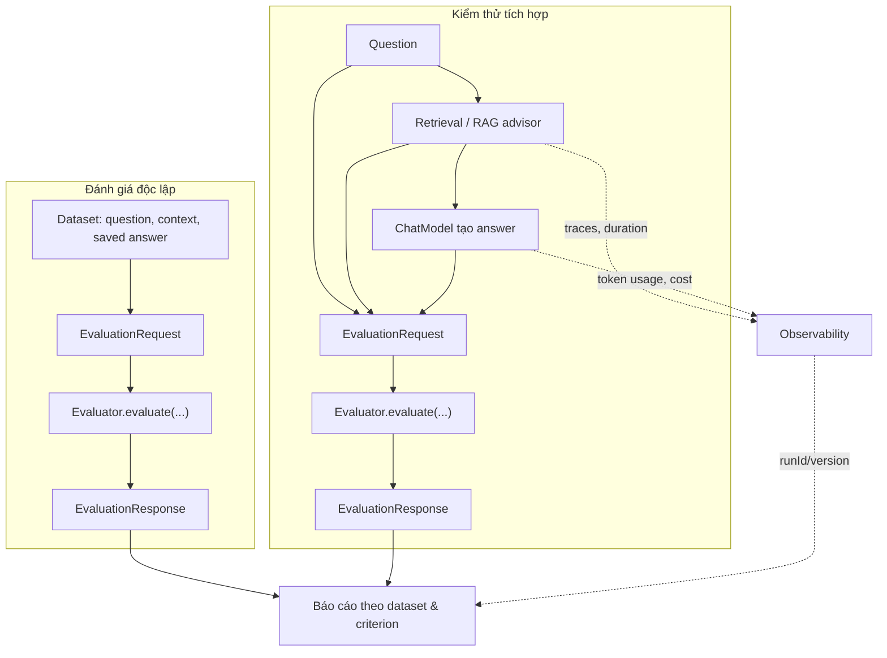
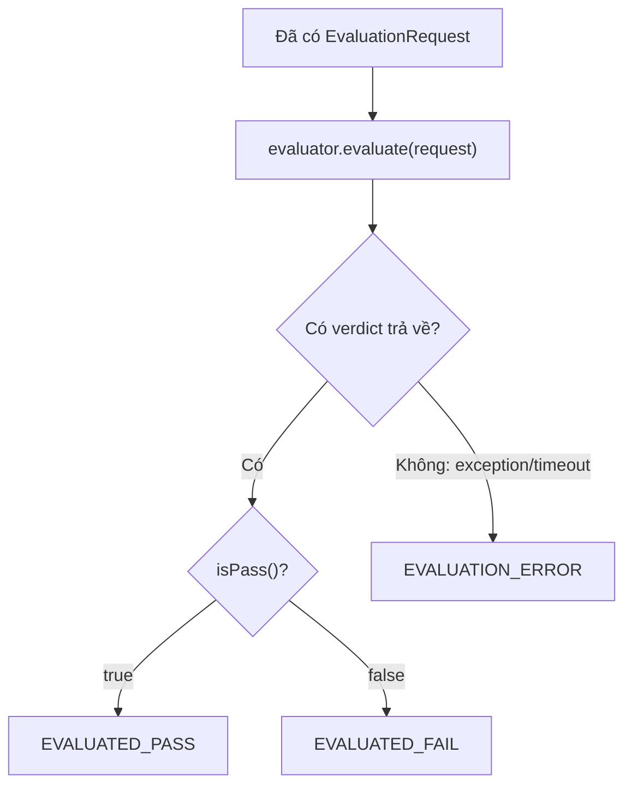

# Gọi evaluator độc lập hoặc trong kiểm thử tích hợp

## 1. Hai cách dùng cùng một hợp đồng Evaluator

Giả sử ứng dụng trả lời câu hỏi “Thời hạn yêu cầu hoàn tiền là bao lâu?” bằng câu “Bạn có 30 ngày kể từ khi nhận hàng”. Có ít nhất hai cách đánh giá:

1. **Đánh giá độc lập (standalone/offline):** câu hỏi, ngữ cảnh và câu trả lời đã có sẵn từ dataset hoặc một lần chạy trước. Ta tạo `EvaluationRequest` và gọi evaluator mà không cần chạy lại pipeline sinh câu trả lời.
2. **Đánh giá trong kiểm thử tích hợp (integration test):** kiểm thử thực sự chạy các thành phần của ứng dụng, chẳng hạn truy xuất tài liệu, ghép prompt, gọi model và nhận câu trả lời. Sau đó tạo `EvaluationRequest` từ **chính lượt chạy ấy**, gọi evaluator và kiểm tra kết quả.

Cả hai dùng chung phương thức:

```java
EvaluationResponse evaluate(EvaluationRequest evaluationRequest);
```

Điểm khác là **dữ liệu đầu vào lấy từ đâu, những thành phần nào được chạy, và một phép kiểm không đạt nói lên điều gì**.

Trong chương **API Evaluator** của module **SPRING_AI_EVALUATION_OBSERVABILITY**, kiến thức này giúp thiết kế dataset cho relevance/fact checking, kiểm thử luồng RAG hoặc gọi công cụ, rồi đối chiếu với metrics, traces, chi phí và độ trễ khi so sánh phiên bản prompt, model và pipeline.

### Mục tiêu học tập

Sau bài này, bạn có thể:

- Tạo và gọi một evaluator độc lập bằng Java, gồm loại deterministic và loại dùng model làm judge.
- Viết JUnit test hoặc Spring Boot integration test với `RelevancyEvaluator` và `FactCheckingEvaluator`.
- Lấy đúng câu hỏi, ngữ cảnh `Document` và câu trả lời từ một lần chạy RAG.
- Tách lỗi chất lượng ứng dụng khỏi lỗi chạy judge, lỗi cấu hình, lỗi truy xuất và lỗi dữ liệu.
- Tổ chức nhiều ca đánh giá trên dataset; báo cáo kết quả theo tiêu chí, phiên bản, chi phí và độ trễ.

## 2. Sơ đồ luồng đánh giá



Ở nhánh standalone, có thể gọi judge LLM nhưng không cần chạy **model sinh câu trả lời**. Ở nhánh integration, thông thường có cả chi phí/độ trễ generation và chi phí/độ trễ judge. Nếu dùng retrieval thật, còn có chi phí embedding, vector store hoặc dịch vụ truy vấn.

| Thuộc tính | Standalone deterministic | Standalone với LLM judge | Integration test RAG |
|---|---|---|---|
| Đầu vào | Fixture cố định | Fixture cố định | Từ pipeline đang chạy |
| Gọi model sinh câu trả lời | Không | Không | Có |
| Gọi model judge | Không | Có | Có nếu dùng LLM evaluator |
| Kiểm tra được retrieval | Không | Không, trừ khi đánh giá riêng fixture retrieval | Có thể, nếu lưu/kiểm tra context thật |
| Nhanh và ổn định | Thường rất cao | Phụ thuộc judge/provider | Phụ thuộc generation, retrieval và judge |
| Lỗi thường gặp | Logic/rubric custom | Judge trả kết quả sai, parser, timeout | Mọi lỗi của pipeline cộng với lỗi judge |
| Phù hợp | Unit test, kiểm quy tắc nghiệp vụ | Dataset offline, đánh giá theo batch | Smoke/regression test end-to-end |

**Standalone không đồng nghĩa với unit test:** standalone gọi judge thật vẫn là một phép kiểm tích hợp với dịch vụ model. Tên gọi thể hiện **đầu vào có sẵn hay được tạo bằng pipeline**, trong khi unit/integration phản ánh **phụ thuộc thực thi**.

## 3. Chuẩn bị hợp đồng và môi trường

Spring AI định nghĩa:

- `org.springframework.ai.evaluation.Evaluator`: interface có `evaluate(EvaluationRequest)`.
- `org.springframework.ai.evaluation.EvaluationRequest`: chứa `userText`, `List<Document> dataList` và `responseContent`.
- `org.springframework.ai.evaluation.EvaluationResponse`: có `isPass()`, `getScore()`, `getFeedback()`, `getMetadata()`.
- `org.springframework.ai.chat.evaluation.RelevancyEvaluator`: chấm mức độ phù hợp của câu trả lời với câu hỏi và context.
- `org.springframework.ai.chat.evaluation.FactCheckingEvaluator`: xem claim/câu trả lời có được ngữ cảnh nguồn hỗ trợ không.

Spring AI 2.1.x có các cách tạo request:

```java
new EvaluationRequest(question, answer);
new EvaluationRequest(documents, answer);
new EvaluationRequest(question, documents, answer);
```

Ba dòng trên mô tả **overload**, trong đó `question`, `documents` và `answer` là các biến đã có; `documents` dùng kiểu `List<Document>`. Khi chấm RAG nên ưu tiên constructor ba đối số để giữ đủ câu hỏi, nguồn và phản hồi.

### 3.1. Phụ thuộc cho từng tình huống

| Trường hợp | Cần có |
|---|---|
| Custom evaluator chạy độc lập | Spring AI evaluation/document API trong classpath |
| Unit test JUnit 5 | Các API trên + JUnit Jupiter |
| LLM evaluator offline | Spring AI ChatClient/ChatModel + model/provider được cấu hình |
| Integration RAG | Spring Boot Test + ChatModel + retrieval advisor + VectorStore/nguồn truy xuất + dữ liệu test |
| Lưu metrics/traces | Thành phần observability của ứng dụng (ví dụ Micrometer/OpenTelemetry) |

Với Spring Boot, một cách phổ biến là dùng BOM của Spring AI đồng bộ phiên bản với starter model và starter vector store đang sử dụng. Tên artifact/starter có thể khác giữa các phiên bản; phải dùng dependency tương ứng với **Spring AI thực tế của dự án**, không ghép API của 1.x và 2.1.x.

Các test gọi model cần API key, dịch vụ đã bật hoặc model chạy cục bộ. **Không đưa bí mật kết nối vào mã test, fixture hay bản ghi báo cáo.**

### 3.2. Xác định rõ tính chất của phép đánh giá

Trước khi gọi `evaluate(...)`, hãy trả lời:

1. Đang chấm **relevance**, **groundedness/fact checking**, **correctness**, cấu trúc, quy tắc nghiệp vụ hay tool flow?
2. Đáp án/nhãn chuẩn là gì, và ai xác nhận?
3. Judge lấy bằng chứng từ tài liệu **model đã nhìn thấy**, hay từ **gold source** độc lập?
4. Lần chạy lỗi là do câu trả lời không đạt hay do judge/retrieval không hoạt động?
5. Tiêu chí có đủ ổn định để chặn CI hay phù hợp hơn với báo cáo xu hướng?

Bảng tiêu chí và bối cảnh này phải được định nghĩa trước, bởi kết quả `isPass()` chỉ có ý nghĩa **trong một rubric nhất định**.

## 4. Cách 1: gọi một evaluator deterministic độc lập

Với quy tắc xác định, không cần dùng LLM làm judge. Ví dụ ứng dụng yêu cầu phản hồi không rỗng và tối đa 200 ký tự Unicode (tính theo code point).

```java
import java.util.Map;
import java.util.Objects;

import org.springframework.ai.evaluation.EvaluationRequest;
import org.springframework.ai.evaluation.EvaluationResponse;
import org.springframework.ai.evaluation.Evaluator;

public final class AnswerLengthEvaluator implements Evaluator {

    private final int maxCodePoints;

    public AnswerLengthEvaluator(int maxCodePoints) {
        if (maxCodePoints < 1) {
            throw new IllegalArgumentException("Giới hạn phải dương");
        }
        this.maxCodePoints = maxCodePoints;
    }

    @Override
    public EvaluationResponse evaluate(EvaluationRequest request) {
        Objects.requireNonNull(request, "request");

        String answer = request.getResponseContent();
        if (answer == null) {
            throw new IllegalArgumentException("Thiếu responseContent");
        }

        int length = answer.codePointCount(0, answer.length());
        boolean pass = !answer.isBlank() && length <= maxCodePoints;

        return new EvaluationResponse(
            pass,
            pass ? 1.0f : 0.0f,
            pass ? "Đáp ứng giới hạn độ dài" : "Câu trả lời rỗng hoặc quá dài",
            Map.of(
                "criterion", "nonblank-and-max-length",
                "rubricVersion", "v1",
                "length", length,
                "maxLength", maxCodePoints
            )
        );
    }
}
```

Dùng trong một chương trình:

```java
import org.springframework.ai.evaluation.EvaluationRequest;
import org.springframework.ai.evaluation.EvaluationResponse;
import org.springframework.ai.evaluation.Evaluator;

public final class StandaloneEvaluationDemo {

    public static void main(String[] args) {
        Evaluator evaluator = new AnswerLengthEvaluator(200);

        EvaluationRequest request = new EvaluationRequest(
            "Hãy nói ngắn gọn chính sách hoàn tiền.",
            "Bạn có thể yêu cầu hoàn tiền trong 30 ngày."
        );

        EvaluationResponse result = evaluator.evaluate(request);

        System.out.println("Pass = " + result.isPass());
        System.out.println("Score = " + result.getScore());
        System.out.println("Feedback = " + result.getFeedback());
    }
}
```

Kết quả trong ví dụ có thể dự đoán vì kiểm tra chuỗi không phụ thuộc model. Tuy nhiên, **qua kiểm tra độ dài không đồng nghĩa đúng sự thật**. Câu “Hoàn tiền trong 90 ngày” vẫn có thể pass nếu đủ ngắn; phải dùng tiêu chí bổ sung cho tính đúng.

### 4.1. Gọi trong JUnit mà không khởi động Spring

Một unit test deterministic giúp phát hiện lỗi của chính quy tắc Java:

```java
import org.junit.jupiter.api.Test;
import org.springframework.ai.evaluation.EvaluationRequest;
import org.springframework.ai.evaluation.EvaluationResponse;
import org.springframework.ai.evaluation.Evaluator;

import static org.junit.jupiter.api.Assertions.assertFalse;
import static org.junit.jupiter.api.Assertions.assertTrue;

class AnswerLengthEvaluatorTest {

    private final Evaluator evaluator = new AnswerLengthEvaluator(40);

    @Test
    void acceptsShortAnswer() {
        EvaluationResponse result = evaluator.evaluate(
            new EvaluationRequest("Hạn hoàn tiền?", "30 ngày.")
        );

        assertTrue(result.isPass());
    }

    @Test
    void rejectsBlankAnswer() {
        EvaluationResponse result = evaluator.evaluate(
            new EvaluationRequest("Hạn hoàn tiền?", "   ")
        );

        assertFalse(result.isPass());
    }

    @Test
    void rejectsAnswerLongerThanLimit() {
        EvaluationResponse result = evaluator.evaluate(
            new EvaluationRequest("Hạn hoàn tiền?", "A".repeat(41))
        );

        assertFalse(result.isPass());
    }
}
```

Ở đây test chỉ kiểm tra logic của `AnswerLengthEvaluator`, **không cần `@SpringBootTest`, VectorStore hay provider model**. Đây là lớp kiểm thử nên chạy thường xuyên trong CI vì nhanh và ổn định.

## 5. Cách 2: chấm câu trả lời có sẵn bằng evaluator dùng LLM

Giả sử bộ dataset đã lưu sẵn:

```text
caseId: REFUND-01
question: Thời hạn yêu cầu hoàn tiền?
context: Chính sách có hiệu lực: 30 ngày kể từ ngày nhận hàng.
savedAnswer: Bạn có thể yêu cầu hoàn tiền trong 30 ngày.
```

Không cần chạy lại ứng dụng RAG. Chỉ tạo request và chạy judge:

```java
import java.util.List;
import java.util.Map;

import org.springframework.ai.chat.client.ChatClient;
import org.springframework.ai.chat.evaluation.FactCheckingEvaluator;
import org.springframework.ai.chat.evaluation.RelevancyEvaluator;
import org.springframework.ai.chat.model.ChatModel;
import org.springframework.ai.document.Document;
import org.springframework.ai.evaluation.EvaluationRequest;
import org.springframework.ai.evaluation.EvaluationResponse;
import org.springframework.ai.evaluation.Evaluator;

public final class OfflineJudgeExample {

    public static Map<String, EvaluationResponse> evaluateSavedAnswer(
            ChatModel judgeModel) {

        String question = "Thời hạn yêu cầu hoàn tiền?";

        List<Document> context = List.of(
            new Document(
                "refund-policy-v3",
                "Chính sách: 30 ngày kể từ ngày nhận hàng.",
                Map.of("version", "v3", "source", "refund-policy")
            )
        );

        String savedAnswer =
            "Bạn có thể yêu cầu hoàn tiền trong 30 ngày.";

        EvaluationRequest request = new EvaluationRequest(
            question, context, savedAnswer
        );

        Evaluator relevance = new RelevancyEvaluator(
            ChatClient.builder(judgeModel)
        );

        Evaluator factuality = FactCheckingEvaluator
            .builder(ChatClient.builder(judgeModel))
            .build();

        EvaluationResponse relevanceResult =
            relevance.evaluate(request);

        EvaluationResponse factualityResult =
            factuality.evaluate(request);

        return Map.of(
            "relevance", relevanceResult,
            "factuality", factualityResult
        );
    }
}
```

Đây là **một phương thức có thể gọi trong service, command-line runner hoặc test** khi đã có `ChatModel`. Nó thực hiện **hai lần chấm** trên cùng input. Lời gọi model judge là hành vi ngoài mạng hoặc phụ thuộc mô hình cục bộ, có thể chậm, phát sinh token/chi phí và gặp lỗi provider.

Ưu điểm của offline evaluation là **câu trả lời ứng dụng đã cố định**. Nhờ vậy, có thể thay judge model hoặc rubric và xem sự khác biệt đến từ bộ chấm, trong khi output của ứng dụng không thay đổi.

Để so sánh prompt sinh A và B một cách công bằng, có thể lưu hai câu trả lời (cùng `question` và các nguồn liên quan đến từng lượt), rồi chạy **cùng một judge/rubric version**. Không đổi judge đồng thời với model sinh mà lại quy mọi thay đổi pass rate cho model sinh.

### 5.1. Không đọc score như một tiêu chuẩn chung

Cùng kiểu `EvaluationResponse` nhưng `getScore()` không bắt buộc có thang điểm thống nhất. Một số implementation có thể trả score nhị phân, implementation khác dùng constructor không cung cấp điểm nên `getScore()` không có ý nghĩa chất lượng rõ ràng.

Khi tổng hợp relevance và fact checking, **dùng `isPass()` theo từng tiêu chí**. Chỉ phân tích `score` nếu đã xác nhận cách tính, phạm vi và phiên bản evaluator. Không lấy trung bình điểm giữa hai evaluator có semantics khác nhau rồi gọi đó là “độ chính xác toàn hệ thống”.

### 5.2. Khi nào nên dùng mô hình judge riêng?

Trong thực tế, model tạo phản hồi và model chấm có thể khác nhau:

- Judge chuyên biệt có thể rẻ hoặc nhanh hơn model tổng quát.
- Việc dùng model độc lập giúp giảm bớt sự phụ thuộc vào cùng một hệ thống tạo và chấm.
- Judge cần được hiệu chỉnh bằng bộ mẫu có nhãn người đánh giá; đổi model chấm có thể đổi pass rate ngay cả khi output được giữ nguyên.
- Fact checking có thể dùng model thiên về kiểm chứng theo nguồn, nhưng vẫn cần dữ liệu tham chiếu tin cậy.

**Độc lập về model không tự đảm bảo khách quan.** Prompt đánh giá, nguồn, bản dịch và dataset vẫn có thể tạo sai lệch.

## 6. Cách 3: gọi evaluator trong Spring Boot integration test

Integration test có mục tiêu rộng hơn: kiểm tra việc **retrieval → ghép context → generation → evaluation** có chạy đúng với dữ liệu và cấu hình dự kiến.

Ví dụ dưới đây theo luồng `RetrievalAugmentationAdvisor` trong Spring AI 2.1.x. Nó cần một `VectorStore` dành riêng cho test và các `ChatModel`/embedding model được cấu hình bằng dependency + môi trường thích hợp.

```java
import java.util.List;
import java.util.Map;

import org.junit.jupiter.api.Tag;
import org.junit.jupiter.api.Test;

import org.springframework.ai.chat.client.ChatClient;
import org.springframework.ai.chat.evaluation.FactCheckingEvaluator;
import org.springframework.ai.chat.evaluation.RelevancyEvaluator;
import org.springframework.ai.chat.model.ChatModel;
import org.springframework.ai.chat.model.ChatResponse;
import org.springframework.ai.document.Document;
import org.springframework.ai.evaluation.EvaluationRequest;
import org.springframework.ai.evaluation.EvaluationResponse;
import org.springframework.ai.rag.advisor.RetrievalAugmentationAdvisor;
import org.springframework.ai.rag.retrieval.search.VectorStoreDocumentRetriever;
import org.springframework.ai.vectorstore.VectorStore;

import org.springframework.beans.factory.annotation.Autowired;
import org.springframework.boot.test.context.SpringBootTest;

import static org.junit.jupiter.api.Assertions.assertFalse;
import static org.junit.jupiter.api.Assertions.assertNotNull;
import static org.junit.jupiter.api.Assertions.assertTrue;

@SpringBootTest
@Tag("llm-evaluation")
class RagEvaluationIT {

    @Autowired
    ChatModel chatModel;

    @Autowired
    VectorStore vectorStore; // Chỉ trỏ tới kho test đã được cô lập

    @Test
    void generatedAnswerShouldFollowRetrievedPolicy() {
        String question = "Thời hạn yêu cầu hoàn tiền là bao lâu?";
        String policyId = "eval-refund-policy-v3";

        // Fixture được chèn vào vector store dành riêng cho test.
        vectorStore.add(List.of(
            new Document(
                policyId,
                "Chính sách hoàn tiền: khách hàng có 30 ngày "
                    + "kể từ khi nhận hàng để gửi yêu cầu.",
                Map.of("dataset", "eval-it", "version", "v3")
            )
        ));

        var retriever = VectorStoreDocumentRetriever.builder()
            .vectorStore(vectorStore)
            .topK(3)
            .build();

        var ragAdvisor = RetrievalAugmentationAdvisor.builder()
            .documentRetriever(retriever)
            .build();

        ChatResponse generated = ChatClient.builder(chatModel)
            .build()
            .prompt(question)
            .advisors(ragAdvisor)
            .call()
            .chatResponse();

        assertNotNull(generated);
        assertNotNull(generated.getResult());

        // Context thuộc đúng lượt RAG vừa sinh câu trả lời.
        Object rawContext = generated.getMetadata()
            .get(RetrievalAugmentationAdvisor.DOCUMENT_CONTEXT);

        assertTrue(rawContext instanceof List<?>);

        List<?> rawList = (List<?>) rawContext;
        assertFalse(rawList.isEmpty());
        assertTrue(rawList.stream().allMatch(Document.class::isInstance));

        List<Document> context = rawList.stream()
            .map(Document.class::cast)
            .toList();

        assertTrue(
            context.stream().anyMatch(d -> policyId.equals(d.getId())),
            "Retrieval không lấy được tài liệu chính sách của fixture"
        );

        String answer = generated.getResult().getOutput().getText();
        assertNotNull(answer);

        EvaluationRequest request = new EvaluationRequest(
            question, context, answer
        );

        EvaluationResponse relevance =
            new RelevancyEvaluator(ChatClient.builder(chatModel))
                .evaluate(request);

        EvaluationResponse factuality = FactCheckingEvaluator
            .builder(ChatClient.builder(chatModel))
            .build()
            .evaluate(request);

        assertTrue(
            relevance.isPass(),
            () -> "Relevance không đạt: " + relevance.getFeedback()
        );

        assertTrue(
            factuality.isPass(),
            () -> "Factuality không đạt: " + factuality.getFeedback()
        );
    }
}
```

**Đọc ví dụ đúng phạm vi:** đây là integration test mẫu, cần Spring Boot context, model generation, model judge, dịch vụ embedding và vector store đã nối đúng cấu hình. Các provider có thể cần credential/cấu hình hoặc container riêng. `@Tag("llm-evaluation")` **chỉ gắn nhãn test**; nó không tự làm test được bỏ qua hoặc tự bật môi trường model. Cấu hình JUnit/Maven/Gradle của dự án quyết định tag nào được thực thi.

**Cô lập dữ liệu:** dùng vector store test độc lập với production và các test khác. Đoạn mã thêm fixture có ID cố định để dễ kiểm tra; trong suite thực tế nên thiết lập môi trường sạch/fixture nhất quán, lọc theo dataset nếu cần và dọn dữ liệu test theo chính sách của môi trường cô lập. Không chạy đoạn chèn fixture vào kho production.

### 6.1. Tại sao phải đọc context từ response metadata?

Nếu viết:

```java
EvaluationRequest request = new EvaluationRequest(
    question,
    List.of(new Document("Đúng ra chính sách phải là 30 ngày")),
    answer
);
```

trong khi pipeline thực tế đã truy xuất nguồn khác, bạn đang chấm câu trả lời dựa trên **tài liệu do test tự bịa sau khi nhận output**, không phải nguồn model đã thấy. Phép kiểm có thể che lỗi retrieval hoặc đưa ra phán quyết thiếu căn cứ.

Với `RetrievalAugmentationAdvisor` và phiên bản API phù hợp, `DOCUMENT_CONTEXT` cho phép lấy tài liệu gắn với lượt RAG. Tuy nhiên, nếu pipeline dùng advisor tự viết, cắt token thêm ở một bước ngoài advisor, retry hoặc nhiều vòng retrieval, bạn cần tự lưu **context cuối cùng được cấp cho lượt sinh**. Không giả định metadata này luôn xuất hiện với mọi loại advisor.

### 6.2. Kiểm tra cả retrieval và answer generation

Trong test trên có ba checkpoint:

| Checkpoint | Assertion | Lỗi giúp phân biệt |
|---|---|---|
| Context tồn tại | Metadata chứa danh sách `Document` không rỗng | Advisor/context collection không hoạt động |
| Tìm được fixture | Danh sách context có `policyId` | Retrieval/embedding/index/filter sai |
| Câu trả lời đạt tiêu chí | `relevance.isPass()` và `factuality.isPass()` | Generation hoặc context utilization không đạt rubric |

Nếu chỉ assert `factuality.isPass()` mà không kiểm tra ID tài liệu, nguồn được chấm có thể sai dù judge nói có căn cứ. Nếu chỉ assert tài liệu được truy xuất mà không kiểm tra câu trả lời, model có thể phớt lờ nguồn và đưa ra kết luận sai.

Một test integration có model thật cũng có thể dao động; nên lưu `caseId`, prompt/model/index/judge version và nguồn để tái hiện thất bại.

## 7. Phân biệt ba cấp kiểm thử trong dự án

| Cấp | Kiểu kiểm tra | Điều nên kiểm tra | Có nên chạy mọi commit? |
|---|---|---|---|
| **Unit test** | Evaluator deterministic, mock/stub pipeline | Logic quy tắc, dữ liệu đầu vào, mapping verdict | Có, thường phù hợp |
| **Integration test có service thật** | ChatModel/VectorStore/LLM judge | Tích hợp endpoint/advisor, retrieval, generation, judge | Tùy chi phí, độ ổn định và môi trường |
| **Dataset evaluation/regression** | Nhiều case, nhãn người và nhiều tiêu chí | Pass rate, false pass/false fail, biến động giữa phiên bản | Theo lịch hoặc ở cổng phát hành phù hợp |

JUnit `@SpringBootTest` không tự đồng nghĩa **end-to-end**: nếu test chỉ tạo `EvaluationRequest` rồi gọi judge, đó vẫn là kiểm thử tích hợp với model judge nhưng **không hề kiểm tra retrieval/generation của ứng dụng**. Cần quan sát các thành phần thực sự được gọi mới xác định phạm vi.

### 7.1. Test có model thật và tính không xác định

Kết quả phụ thuộc vào:

- Model sinh và judge model, phiên bản provider, tùy chọn sinh, tải dịch vụ.
- Prompt version, câu hỏi, context, thứ tự tài liệu, giới hạn token.
- Hành vi retrieval, embeddings, index, reranker và dữ liệu mới bị cập nhật.
- Cách judge phân tích prompt và parse output.
- Mạng, quota, rate limit và lỗi provider.

Giảm temperature có thể tăng tính lặp lại trong một số cấu hình nhưng **không bảo đảm deterministic tuyệt đối**. Không hứa một integration test chấm bằng LLM sẽ luôn pass 100% trên mọi môi trường.

### 7.2. Tách test nhanh khỏi test tốn chi phí

Một cách tổ chức phù hợp:

- Unit tests chạy trong mỗi lần build/commit, không yêu cầu API key.
- Các test mang tag `llm-evaluation` chạy trong pipeline CI có credential được quản lý an toàn hoặc trước phát hành; quy tắc bật/tắt tag được định nghĩa rõ trong build.
- Dataset đầy đủ chạy thành một đợt riêng và xuất báo cáo theo version; không buộc mỗi commit phải gọi judge cho hàng nghìn case.

Đây là **đề xuất tổ chức**, không phải quy ước mặc định của Spring AI. Nếu ứng dụng dùng cho tác vụ rủi ro cao, ngưỡng và tần suất đánh giá cần theo yêu cầu thực tế.

## 8. Chạy nhiều ca dữ liệu có nhãn mà không chạy lại generation

Một dataset offline có thể cố định câu hỏi, context và câu trả lời để đánh giá riêng judge. Ví dụ kiểm tra hai ca rõ ràng:

```java
import java.util.List;

import org.junit.jupiter.api.Tag;
import org.junit.jupiter.api.Test;

import org.springframework.ai.chat.client.ChatClient;
import org.springframework.ai.chat.evaluation.FactCheckingEvaluator;
import org.springframework.ai.chat.model.ChatModel;
import org.springframework.ai.document.Document;
import org.springframework.ai.evaluation.EvaluationRequest;
import org.springframework.ai.evaluation.EvaluationResponse;
import org.springframework.ai.evaluation.Evaluator;

import org.springframework.beans.factory.annotation.Autowired;
import org.springframework.boot.test.context.SpringBootTest;

import static org.junit.jupiter.api.Assertions.assertEquals;

@SpringBootTest
@Tag("llm-evaluation")
class SavedDatasetFactCheckIT {

    @Autowired
    ChatModel judgeModel;

    record Case(
        String caseId,
        String question,
        String context,
        String savedAnswer,
        boolean expectedPass
    ) {}

    @Test
    void judgeShouldAgreeWithLabeledCases() {
        List<Case> cases = List.of(
            new Case(
                "refund-positive",
                "Hạn hoàn tiền?",
                "Có thể hoàn tiền trong 30 ngày từ ngày nhận hàng.",
                "Hạn yêu cầu hoàn tiền là 30 ngày.",
                true
            ),
            new Case(
                "refund-negative",
                "Hạn hoàn tiền?",
                "Có thể hoàn tiền trong 30 ngày từ ngày nhận hàng.",
                "Hạn yêu cầu hoàn tiền là 90 ngày.",
                false
            )
        );

        Evaluator judge = FactCheckingEvaluator
            .builder(ChatClient.builder(judgeModel))
            .build();

        for (Case row : cases) {
            EvaluationRequest request = new EvaluationRequest(
                row.question(),
                List.of(new Document(row.context())),
                row.savedAnswer()
            );

            EvaluationResponse result = judge.evaluate(request);

            assertEquals(
                row.expectedPass(),
                result.isPass(),
                "Judge bất đồng với nhãn tại case: " + row.caseId()
            );
        }
    }
}
```

Ở đây test **không chạy model sinh câu trả lời**; nó chạy LLM judge trên hai câu trả lời cố định và so sánh với nhãn do con người đặt. Nếu case “90 ngày” vẫn pass, điều cần điều tra có thể là judge, prompt, dữ liệu nguồn hoặc parser, không thể mặc định pipeline sinh đã lỗi vì pipeline sinh không được gọi trong test này.

Bộ mẫu thực tế nên có nhiều tình huống hơn: thiếu nguồn, số liệu, phủ định, câu trả lời có nhiều claim, tài liệu mâu thuẫn, câu từ chối, ngữ cảnh đã lỗi thời và các nhóm câu hỏi có mức độ khó khác nhau.

### 8.1. Đánh giá theo dataset thay vì vài assertion đơn lẻ

Một báo cáo chất lượng nên chứa:

| Trường | Ý nghĩa |
|---|---|
| `caseId` và nhãn mong đợi | Cho phép tìm đúng case đã chấm |
| `applicationVersion` và `promptVersion` | Biết phiên bản nào sinh câu trả lời |
| `modelId`, `retrieverVersion`, `contextIds` | Khoanh vùng generation/retrieval |
| `judgeModel` và `rubricVersion` | Biết phán quyết được tạo bằng bộ chấm nào |
| `criterion`, `isPass`, `feedback` | Kết quả theo từng tiêu chí |
| `evaluationStatus` | Pass/fail/error/skip ở tầng thực thi |
| `runId`, `traceId` | Liên kết tới traces/metrics và dữ liệu vận hành |

**Lưu ý:** `runId` và các version không phải trường chuẩn của `EvaluationResponse`; phải được hệ thống dataset hoặc orchestration giữ cùng kết quả.

## 9. Phân loại lỗi đúng khi gọi evaluator

Một kết quả `isPass() == false` và một lần gọi `evaluate(...)` ném exception là hai trường hợp khác nhau.



Các nhãn `EVALUATED_PASS`, `EVALUATED_FAIL` và `EVALUATION_ERROR` là **trạng thái báo cáo do ứng dụng định nghĩa**, không phải enum tích hợp trong Spring AI.

Ví dụ helper không nuốt exception:

```java
import org.springframework.ai.evaluation.EvaluationRequest;
import org.springframework.ai.evaluation.EvaluationResponse;
import org.springframework.ai.evaluation.Evaluator;

public final class EvaluationRunner {

    public enum Status {
        EVALUATED_PASS, EVALUATED_FAIL, EVALUATION_ERROR
    }

    public record Outcome(
        Status status,
        EvaluationResponse response,
        String errorMessage
    ) {}

    public static Outcome run(
            Evaluator evaluator,
            EvaluationRequest request) {
        try {
            EvaluationResponse response = evaluator.evaluate(request);

            if (response == null) {
                return new Outcome(
                    Status.EVALUATION_ERROR,
                    null,
                    "Evaluator không trả kết quả"
                );
            }

            return new Outcome(
                response.isPass()
                    ? Status.EVALUATED_PASS
                    : Status.EVALUATED_FAIL,
                response,
                null
            );
        }
        catch (RuntimeException ex) {
            // Cần log/trace exception an toàn ở tầng điều phối.
            return new Outcome(
                Status.EVALUATION_ERROR,
                null,
                ex.getClass().getSimpleName()
            );
        }
    }
}
```

Helper dùng trong **batch reporting** có thể cần kết quả lỗi riêng. Còn trong **JUnit integration test**, nên để exception làm test fail có thông tin để chẩn đoán; không chuyển mọi exception thành `isPass()==false` rồi đổ lỗi cho chất lượng câu trả lời.

Một số evaluator tích hợp có thể trả `false` khi judge xuất chuỗi không đúng định dạng mà không ném exception. Nếu muốn phân biệt lỗi parser với lỗi chất lượng, cần thu thập output judge hoặc dùng adapter kiểm soát định dạng/validation riêng. Chỉ nhìn `isPass()` đôi khi không đủ để chẩn đoán nguyên nhân.

## 10. Đánh giá tool calling: không chỉ chấm câu trả lời cuối

Với câu hỏi “Đơn hàng A123 đang ở trạng thái nào?”, ứng dụng có thể cần gọi `lookupOrder(orderId="A123")`. Một integration test đúng phạm vi cần lưu:

1. **Tool selection:** có chọn đúng `lookupOrder` không?
2. **Tool arguments:** có truyền `A123` đúng không?
3. **Tool result:** công cụ trả mã/trạng thái gì?
4. **Final answer:** câu trả lời cuối có bám kết quả tool không?

Có thể dùng kết quả tool làm bằng chứng cho **fact checking câu trả lời**:

```java
EvaluationRequest responseCheck = new EvaluationRequest(
    "Đơn hàng A123 đang ở trạng thái nào?",
    List.of(
        new Document(
            "lookupOrder(A123) trả status=DELIVERING."
        )
    ),
    "Đơn hàng A123 đang được giao."
);

EvaluationResponse verdict = factualityEvaluator.evaluate(responseCheck);
```

Nhưng `EvaluationRequest` **không chứa tool calls, arguments và event timeline**. Để xác nhận công cụ thật sự được gọi đúng, phải đối chiếu actual tool invocation từ trace/mock spy/event log với expected tool invocation do dataset định nghĩa. Đừng dùng fact checking pass làm bằng chứng chắc chắn rằng tool selection hoặc tham số đã đúng.

Khi tool có tác dụng ghi dữ liệu (tạo đơn, gửi thanh toán), integration test phải dùng môi trường cô lập hoặc stub/sandbox phù hợp; bài kiểm tra nội dung không tự xác minh tác động nghiệp vụ.

## 11. Đo latency, token và chi phí theo đúng nguồn

Dùng evaluator độc lập hay integration ảnh hưởng đến **tổng chi phí phép thử**:

| Thành phần | Standalone deterministic | Standalone LLM judge | Integration RAG + judge |
|---|---:|---:|---:|
| Generation model | Không | Không | Thường có |
| Retrieval/embedding | Không | Không, nếu dùng context đã lưu | Có nếu chạy truy xuất thật |
| Judge model | Không | Có | Có |
| Gọi tool | Không | Không, nếu chỉ chấm output đã lưu | Tùy pipeline |
| Chi phí/độ trễ | Chủ yếu tính toán Java | Judge + mạng/provider | Generation + retrieval/tool + judge |

Đừng lấy `EvaluationResponse.getScore()` làm chỉ số token, latency hoặc chi phí. Đó là điểm theo tiêu chí đánh giá và có thể không có thang đo hữu ích.

Có thể đo thời lượng một phép đánh giá bằng code Java đơn giản:

```java
long start = System.nanoTime();

EvaluationResponse verdict = evaluator.evaluate(request);

long judgeDurationNanos = System.nanoTime() - start;
double judgeDurationMs = judgeDurationNanos / 1_000_000.0;
```

Đây là phép đo **elapsed time ở phía caller**, phù hợp cho phân tích đơn giản. Trong ứng dụng Spring AI thực tế, metrics/traces từ Micrometer/OpenTelemetry hoặc telemetry của provider giúp phân chia thời gian model, retrieval, tool calls và retry chi tiết hơn. Muốn tính chi phí phải dựa trên token usage thực tế (nếu provider cung cấp), tên model, phiên bản và bảng đơn giá tương ứng.

**Tách span của generation với span của judge.** Nếu gộp cả hai, dashboard có thể hiểu sai rằng ứng dụng phục vụ người dùng đã tăng latency do generation, trong khi phần tăng chỉ đến từ chạy evaluator trong môi trường test.

## 12. Xử lý kết quả và so sánh các phiên bản

Giả sử dataset gồm 100 ca:

```text
Bộ mẫu:                   100
Chấm thành công, pass:     81
Chấm thành công, fail:     11
Lỗi gọi judge:              5
Bỏ qua do thiếu nguồn:      3
```

Các chỉ số nên phân biệt:

\[
\text{Quality pass rate}
=\frac{81}{81+11}
\approx 88.0\%
\]

\[
\text{Evaluation coverage}
=\frac{81+11}{100}
=92\%
\]

\[
\text{Judge error rate}
=\frac{5}{100}
=5\%
\]

Để so sánh prompt v1 với v2, hãy dùng cùng một dataset và quy tắc tính. Nếu thay judge model/rubric giữa hai lần, nên chạy judge trên **cùng bộ output cố định** để tách thay đổi bộ chấm khỏi thay đổi ứng dụng.

Một bản ghi kết quả tự thiết kế có thể như sau:

```json
{
  "runId": "eval-2026-11-27-01",
  "caseId": "refund-01",
  "criterion": "factual-support",
  "applicationPromptVersion": "p8",
  "generationModel": "model-a",
  "retrievalIndexVersion": "index-v4",
  "judgeModel": "judge-b",
  "rubricVersion": "fact-v2",
  "status": "EVALUATED_PASS",
  "pass": true,
  "feedback": "Claim được context hỗ trợ.",
  "evidenceIds": ["refund-policy-v3"],
  "generationLatencyMs": 840,
  "judgeLatencyMs": 410
}
```

**Đây là schema do ứng dụng thiết kế**, không phải JSON mặc định của Spring AI. Muốn lưu đủ chi phí, cần thêm token usage và giá model của từng lượt, tránh đưa con số giả định vào báo cáo thật.

### 12.1. Khi nào nên chặn CI?

Nên dùng tiêu chí có tính quyết định cao:

- Với quy tắc deterministic: chặn nếu JSON invalid, thiếu trường bắt buộc, dữ liệu vi phạm quy tắc nghiệp vụ.
- Với integration RAG: chặn nếu retrieval không có nguồn bắt buộc trong fixture hoặc pipeline báo lỗi.
- Với LLM judge: chỉ chặn ở quy mô và ngưỡng đã được hiệu chỉnh trên dataset có nhãn; kiểm tra các ca có thể dao động và giới hạn số lần retry.

**Không lặp lại judge liên tục cho đến khi ra pass** rồi ghi đó là kết quả chính. Nếu có retry vì lỗi mạng, cần phân biệt retry kỹ thuật với chạy lại phép đánh giá do bất đồng về chất lượng.

## 13. Những lỗi thường gặp

| Sai lầm | Hệ quả | Cách khắc phục |
|---|---|---|
| Gọi evaluator trên câu trả lời mẫu thay vì output thật | Báo cáo ứng dụng tốt giả tạo | Lưu output thực tế hoặc lấy từ `ChatResponse` |
| Dùng fixture context không thuộc lượt RAG | Che lỗi retrieval hoặc đưa kết luận thiếu căn cứ | Lấy context từ metadata/trace của cùng lượt |
| Chỉ test evaluator, rồi nói đã test toàn bộ RAG | Bỏ qua vector store/advisor/generation | Viết integration test chạy những thành phần cần kiểm tra |
| Bật LLM judge trong mọi unit test | Build chậm, tốn tiền, dễ flake | Tách test deterministic và test có tag/service thật |
| Dùng chung một `ChatModel` sinh và chấm mà không hiệu chỉnh | Khó phát hiện thiên lệch và lỗi judge | Dùng dữ liệu có nhãn và cân nhắc judge độc lập |
| Dùng `getScore()` để suy ra pass cho mọi evaluator | Sai với các implementation khác thang/không cấp score | Dùng `isPass()`; giữ rubric riêng |
| Judge timeout bị tính là lỗi chất lượng | Tỷ lệ pass ứng dụng sai | Theo dõi evaluation error và coverage riêng |
| Không quản lý fixture/version | Test thay đổi khi vector store hoặc prompt thay | Cô lập môi trường và lưu version/snapshot |
| Chỉ chấm một câu dễ | Không phát hiện sai số, phủ định, thiếu nguồn | Dùng dataset dương, âm, biên và case không thể trả lời |
| Không theo dõi độ trễ judge | Hiểu sai chi phí serving của ứng dụng | Đo generation và evaluation tách biệt |
| Ghi câu hỏi/PII vào metric label | Nổ cardinality hoặc lộ dữ liệu | Dùng nhãn hữu hạn, lưu chi tiết trong kho được bảo vệ |
| Test tool flow chỉ dựa vào final answer | Không phát hiện sai tool/arguments | Kiểm tra actual tool-call events và kết quả nghiệp vụ |

## 14. Bài tập thực hành

### Bài 1 — Chọn kiểu kiểm thử

Bạn có bộ dữ liệu gồm 200 câu trả lời đã được lưu từ prompt v3 và muốn thử judge mới. Nên chọn standalone hay integration RAG?

**Gợi ý:** dùng **standalone với dataset cố định**. Không cần chạy lại RAG, vì mục tiêu là so sánh bộ chấm trên cùng input. Giữ nhãn người, rubric và judge version để đo false pass/false fail.

### Bài 2 — Phát hiện lỗi retrieval

Vector store đáng lẽ trả tài liệu “hoàn tiền trong 30 ngày”, nhưng context trả về ghi “90 ngày”. Judge xem câu “90 ngày” là có căn cứ. Integration test có nên pass không?

**Gợi ý:** nếu mục tiêu kiểm thử toàn RAG theo chính sách, **không nên kết luận thành công** chỉ từ fact checking. Cần assertion về document ID/version hoặc đánh giá retrieval với gold documents để phát hiện nguồn sai.

### Bài 3 — Timeout của judge

Trong 100 case, 15 case gặp lỗi judge và 70 case pass. Có thể báo “pass rate 70%” mà không nêu các case khác không?

**Đáp án:** không đủ thông tin; cần số case đã có phán quyết fail và số case bị skip. Báo pass rate trên tổng case đã chấm thành công, kèm coverage và judge error rate.

### Bài 4 — Lỗi gọi công cụ

Model trả lời “Đơn A123 đang được giao”, đúng theo một chuỗi context lưu sẵn. Nhưng trace cho thấy nó đã gọi `lookupOrder("A132")`. Vì sao chỉ dùng `FactCheckingEvaluator` có thể bỏ sót lỗi?

**Đáp án:** fact checking chấm **câu trả lời theo chứng cứ được truyền**, còn `EvaluationRequest` không xác nhận tên tool và tham số thực tế. Cần thêm evaluator/kiểm tra trên tool invocation.

### Bài 5 — Chạy cả hai tiêu chí

Hãy sửa bài mẫu offline để có một case sai số ngày, rồi lưu hai kết quả:

```text
caseId = refund-negative
relevance.pass = ?
factuality.pass = ?
```

**Gợi ý:** không mặc định kết luận relevance chắc chắn pass hay fail vì còn phụ thuộc rubric/context. Với fact checking, phản hồi “90 ngày” trái tài liệu “30 ngày” là nhãn kỳ vọng **không được hỗ trợ**; kết quả judge thực tế cần được đối chiếu.

## 15. Tài liệu tham khảo

- [Spring AI 2.1.0 — Evaluation Testing](https://docs.spring.io/spring-ai/reference/api/testing.html): hợp đồng Evaluator và ví dụ tích hợp `RetrievalAugmentationAdvisor` với `RelevancyEvaluator`.
- [Javadoc 2.1.x — Evaluator](https://docs.spring.io/spring-ai/docs/2.1.x/api/org/springframework/ai/evaluation/Evaluator.html): chữ ký `evaluate(EvaluationRequest)`.
- [Javadoc 2.1.x — EvaluationRequest](https://docs.spring.io/spring-ai/docs/2.1.x/api/org/springframework/ai/evaluation/EvaluationRequest.html): constructor và kiểu `List<Document>`.
- [Javadoc 2.1.x — EvaluationResponse](https://docs.spring.io/spring-ai/docs/2.1.x/api/org/springframework/ai/evaluation/EvaluationResponse.html): verdict, score, feedback và metadata.
- [Javadoc 2.1.x — RelevancyEvaluator](https://docs.spring.io/spring-ai/docs/2.1.x/api/org/springframework/ai/chat/evaluation/RelevancyEvaluator.html): evaluator chấm relevance.
- [Javadoc 2.1.x — FactCheckingEvaluator](https://docs.spring.io/spring-ai/docs/2.1.x/api/org/springframework/ai/chat/evaluation/FactCheckingEvaluator.html): evaluator chấm claim theo nguồn.
- [Spring AI — Retrieval Augmented Generation](https://docs.spring.io/spring-ai/reference/api/retrieval-augmented-generation.html): `VectorStoreDocumentRetriever`, advisor và các bước RAG.
- [Spring AI — Chat Client API](https://docs.spring.io/spring-ai/reference/api/chatclient.html): gọi model bằng `ChatClient`.
- [Spring AI — Observability](https://docs.spring.io/spring-ai/reference/observability/index.html): cơ chế thu thập metrics/traces cho ứng dụng AI.

*Ví dụ Java lấy Spring AI 2.1.x làm mốc và giả định dependency/provider phù hợp. Chúng minh họa cách tổ chức kiểm thử; độ ổn định, chi phí và tính đúng của LLM judge cần được kiểm chứng trên model, dataset và môi trường thực tế.*
