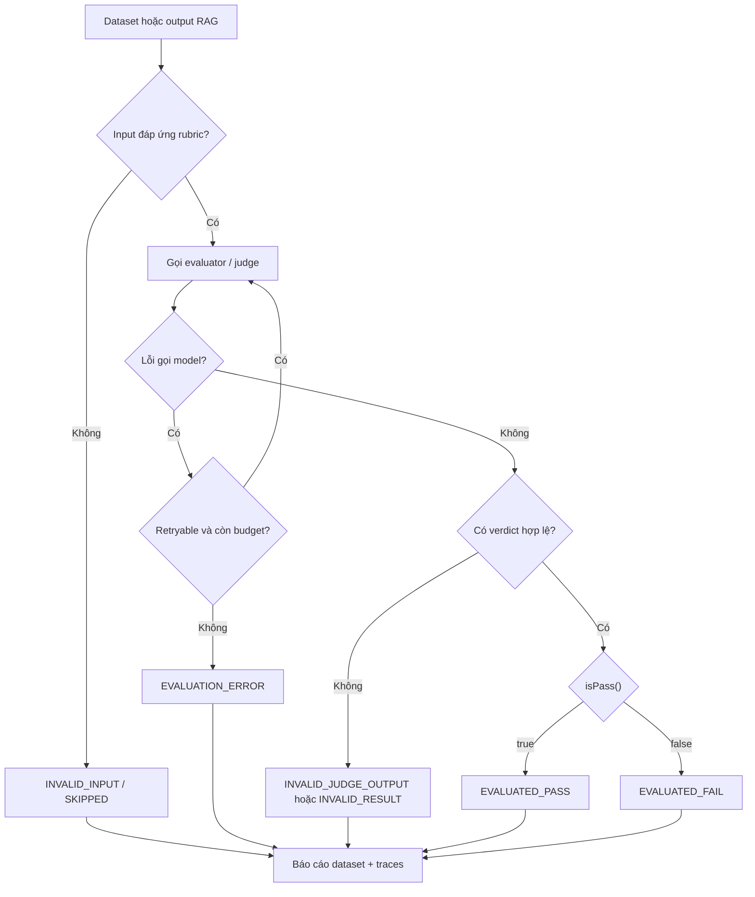
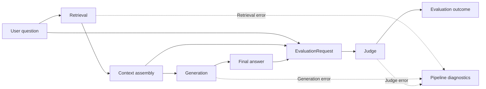

# Xử lý lỗi gọi mô hình và kết quả đánh giá không hợp lệ

## 1. Khi nào một phép đánh giá thực sự thất bại?

Giả sử ứng dụng RAG nhận câu hỏi “Thời hạn hoàn tiền là bao lâu?”, tài liệu truy xuất ghi 30 ngày và câu trả lời của model cũng ghi 30 ngày. Để đo chất lượng, ứng dụng tạo `EvaluationRequest` rồi gọi `RelevancyEvaluator` hoặc `FactCheckingEvaluator`. Có thể xảy ra những kết quả rất khác nhau:

- Judge đánh giá câu trả lời không đạt một tiêu chí và trả phán quyết `NO` hợp lệ.
- Nhà cung cấp model judge trả mã HTTP 429 hoặc 503, không có phán quyết nào.
- Judge hết thời gian chờ, trong khi câu trả lời gốc vẫn có thể đúng.
- Judge trả câu “YES, because ...” nhưng parser chỉ chấp nhận chính xác `YES` hoặc `NO`.
- Một evaluator tự viết trả `null` hoặc điểm `Float.NaN` trái quy ước chấm điểm của chính nó.
- Bộ đánh giá nhận tài liệu nguồn của lượt khác hoặc thiếu chứng cứ bắt buộc.

Nếu xem tất cả là “câu trả lời ứng dụng sai”, tỷ lệ pass có thể giảm vì **lỗi hệ thống đánh giá**, thay vì vì chất lượng model sinh giảm.

Bài học thuộc chương **API Evaluator** của module **SPRING_AI_EVALUATION_OBSERVABILITY**. Phạm vi module gồm đánh giá ứng dụng Spring AI bằng dataset, tiêu chí relevance/fact checking, kiểm thử RAG và tool calling, đồng thời kết hợp metrics, traces, chi phí và độ trễ để điều tra regression giữa các phiên bản prompt, model và pipeline.

**Sau bài này, bạn có thể** phân loại lỗi, kiểm tra request và response, kiểm soát lỗi provider/timeout, đọc đúng kết quả evaluator, thiết kế retry có giới hạn, viết test giả lập lỗi và tổng hợp chất lượng mà không đưa lỗi judge vào mẫu số một cách sai lệch.

## 2. Hợp đồng Evaluator và những gì nó không mô tả

Trong Spring AI, một evaluator triển khai giao diện:

```java
package org.springframework.ai.evaluation;

@FunctionalInterface
public interface Evaluator {
    EvaluationResponse evaluate(EvaluationRequest evaluationRequest);
}
```

Theo Javadoc Spring AI 2.1.0:

- `EvaluationRequest` mang câu hỏi `userText`, tài liệu hỗ trợ `List<Document> dataList` và nội dung trả lời `responseContent`.
- `EvaluationResponse.isPass()` trả về `boolean`.
- `getScore()` trả về `float`, ý nghĩa phụ thuộc từng implementation.
- `getFeedback()` trả về `String`; `getMetadata()` trả về `Map<String, Object>`.
- `EvaluationResponse` có constructor bốn đối số khi cấp score, hoặc ba đối số khi không cấp score riêng.

Hợp đồng này **không tự quy định** enum `TIMEOUT`, `INVALID_OUTPUT`, `MISSING_CONTEXT`, `RATE_LIMITED` hoặc `RETRYABLE`. Phải định nghĩa trạng thái lỗi ở tầng điều phối nếu cần phân tích chi tiết.

Một phép chấm có hai khả năng quan trọng cần tách:

1. **Đã chấm được:** có phán quyết hợp lệ `isPass()==true` hoặc `isPass()==false` theo tiêu chí cụ thể.
2. **Chưa chấm được:** không có phán quyết đáng tin vì lỗi input, lỗi gọi judge hoặc kết quả judge sai schema.

Lời gọi `evaluate(...)` có thể ném exception, khiến caller không nhận được `EvaluationResponse`. Mặt khác, một implementation đơn giản cũng có thể chuyển chuỗi judge không đúng định dạng thành `false` và vẫn trả response. Vì vậy, chỉ nhìn `isPass()` không luôn đủ để chẩn đoán.

### 2.1. Điểm số bằng 0 không có nghĩa model lỗi

Không viết:

```java
// Không đúng cho mọi implementation:
if (result.getScore() == 0.0f) {
    throw new IllegalStateException("Judge bị lỗi");
}
```

Một evaluator có thể dùng `score=0` cho phán quyết không đạt; evaluator khác có thể không cấp điểm có ý nghĩa nhưng vẫn có `pass=true`. Không suy luận trạng thái hạ tầng từ score. Cần quy tắc riêng về score của từng implementation và dữ liệu trạng thái của tầng chạy.

## 3. Ma trận phân loại lỗi

| Tình huống | Loại trạng thái ở tầng ứng dụng | Đưa vào quality fail? |
|---|---|---|
| Judge trả `YES` hợp lệ và tiêu chí đạt | `EVALUATED_PASS` | Không |
| Judge trả `NO` hợp lệ và tiêu chí không đạt | `EVALUATED_FAIL` | Có |
| Request thiếu câu hỏi/context bắt buộc | `INVALID_INPUT` | Không |
| Ca được thiết kế thiếu chứng cứ để kiểm thử abstention | Ca hợp lệ theo rubric riêng | Theo kết quả rubric |
| API key sai, model ID không tồn tại | `EVALUATION_ERROR` | Không |
| Rate limit, HTTP 503, timeout khi gọi judge | `EVALUATION_ERROR` | Không |
| Judge xuất nội dung sai định dạng | `INVALID_JUDGE_OUTPUT` nếu adapter phát hiện được | Không |
| Custom evaluator trả `null` hoặc score không hợp lệ theo hợp đồng | `INVALID_RESULT` | Không |
| Retrieval hoặc generation lỗi trước khi có output | `PIPELINE_ERROR` | Không có câu trả lời để chấm |
| Tool gọi sai tham số | Lỗi tool-flow theo tiêu chí riêng | Có thể là fail của phép kiểm tool |

Các mã trạng thái ở đây là **quy ước minh họa của ứng dụng**, không phải enum mặc định của Spring AI.

**Quality failure** là verdict không đạt từ một phép đánh giá được thực thi đúng. **Evaluation failure** là trường hợp phép đánh giá không chạy xong hoặc không tạo được verdict đáng tin. **Pipeline failure** thuộc retrieval, model sinh, tool execution hay bước tiền xử lý của ứng dụng, cần được ghi riêng để xác định nguyên nhân.

## 4. Luồng xử lý có kiểm soát



Đây là luồng do ứng dụng tổ chức. Không phải tất cả evaluator tích hợp đều để lộ raw judge output để phân biệt `NO` với nội dung sai định dạng. Khi điều đó quan trọng, phải có adapter/validator xử lý **trước khi** tạo phán quyết hoặc truy vết output judge bằng cơ chế có kiểm soát.

## 5. Kiểm tra đầu vào theo ngữ nghĩa của evaluator

Một `EvaluationRequest` hợp lệ về mặt Java chưa chắc đủ dữ liệu để chấm. Đặc biệt:

- **Relevance:** cần biết câu hỏi gốc và câu trả lời; nếu rubric xét context, phải có đúng ngữ cảnh của lượt đang chấm.
- **Fact checking:** cần claim/câu trả lời và bằng chứng tin cậy; nguồn phải có phạm vi, phiên bản và thời điểm hiệu lực phù hợp.
- **Abstention:** context thiếu dữ kiện có thể là tình huống **hợp lệ** để kiểm tra model có từ chối suy đoán không.
- **Format:** tiêu chí kiểm tra JSON/độ dài có thể chỉ cần nội dung phản hồi, không cần tài liệu.
- **Tool calling:** ngoài nội dung phản hồi còn cần actual tool calls, arguments và kết quả; các giá trị này không nằm sẵn trong `EvaluationRequest`.

### 5.1. Ví dụ validator cho bộ kiểm tra RAG yêu cầu đủ dữ kiện

```java
import java.util.List;

import org.springframework.ai.document.Document;
import org.springframework.ai.evaluation.EvaluationRequest;

public final class EvaluationInputValidator {

    private EvaluationInputValidator() {}

    // Trả null nếu hợp lệ, ngược lại trả mã lỗi.
    public static String firstProblem(
            EvaluationRequest request,
            boolean requireQuestion,
            boolean requireEvidence,
            boolean requireAnswer) {

        if (request == null) {
            return "MISSING_REQUEST";
        }

        String question = request.getUserText();
        if (requireQuestion &&
                (question == null || question.isBlank())) {
            return "MISSING_QUESTION";
        }

        String answer = request.getResponseContent();
        if (requireAnswer &&
                (answer == null || answer.isBlank())) {
            return "MISSING_ANSWER";
        }

        List<Document> documents = request.getDataList();

        if (requireEvidence &&
                (documents == null || documents.isEmpty())) {
            return "MISSING_EVIDENCE";
        }

        if (requireEvidence) {
            for (Document document : documents) {
                if (document == null
                        || document.getText() == null
                        || document.getText().isBlank()) {
                    return "EMPTY_EVIDENCE_DOCUMENT";
                }
            }
        }

        return null;
    }
}
```

Cách sử dụng với một tiêu chí yêu cầu cả câu hỏi, tài liệu và câu trả lời:

```java
String invalidInput = EvaluationInputValidator.firstProblem(
    request, true, true, true
);

if (invalidInput != null) {
    // Ghi trạng thái INVALID_INPUT và mã lỗi,
    // không gọi model judge cho request sai.
}
```

Validator này là **quy tắc riêng do ứng dụng thiết kế**. Đừng dùng nó chung cho mọi evaluator: ví dụ, nếu muốn chấm một câu trả lời rỗng, việc chặn `responseContent=""` ở đầu vào sẽ che mất ca kiểm thử. Nếu muốn kiểm tra hành vi từ chối khi không có nguồn, `dataList=[]` không nhất thiết là lỗi.

### 5.2. Chất lượng nguồn quan trọng hơn một danh sách không rỗng

Cần phân biệt:

| Dữ liệu | Dùng cho |
|---|---|
| Retrieved candidates | Đánh giá retrieval trước khi lọc/rerank |
| Final prompt context | Chấm câu trả lời theo những gì model thật sự đã nhìn thấy |
| Gold/reference documents | Chấm retrieval correctness hoặc đối chiếu nguồn chuẩn |
| Câu hỏi gốc | Đánh giá intent/relevance |
| Câu hỏi đã rewrite | Chẩn đoán retrieval, không mặc định thay câu gốc |
| Actual response | Nội dung câu trả lời cần chấm |

Không lấy nguồn “đáng lẽ được truy xuất” để thay context model đã dùng. Lỗi retrieval có thể bị che nếu judge nhìn thấy tài liệu tốt hơn tài liệu mà model sinh thực sự nhìn thấy.

## 6. Phân loại lỗi gọi model và lựa chọn xử lý

Các SDK/provider có thể có những lớp exception khác nhau. Không giả định tất cả lỗi đều là một exception loại HTTP hay có chung mã.

| Nhóm | Biểu hiện thường gặp | Xử lý |
|---|---|---|
| Sai credential hoặc quyền | 401/403 | Sửa cấu hình, không retry nguyên trạng |
| Request không hợp lệ | 400, prompt vượt context window | Sửa input/options |
| Model không tồn tại/không hỗ trợ | Sai model ID, feature không được hỗ trợ | Sửa model/config |
| Rate limit | 429, có thể có `Retry-After` | Retry có giới hạn nếu provider cho phép |
| Provider tạm lỗi | 500/502/503/504 | Backoff và kiểm soát deadline |
| Mạng/timeout | Không kết nối, read timeout | Phân loại nguyên nhân; có thể retry |
| Output judge không đúng schema | `YES because...`, JSON hỏng | Phân loại lỗi định dạng, điều chỉnh prompt/parser |
| Đứt pipeline trước khi đến judge | Vector store hay tool lỗi | Ghi lỗi generation/retrieval/tool riêng |

Mã HTTP chỉ là dấu hiệu định hướng. Một số provider dùng mã lỗi riêng cho hết quota cố định hoặc giới hạn tạm thời; adapter cần đọc cả error code/headers của nhà cung cấp.

### 6.1. Lỗi gọi model không đồng nghĩa với verdict fail

Nếu `evaluate(...)` ném exception thì về mặt ứng dụng không có `EvaluationResponse` hợp lệ cho lượt đó. Trong JUnit integration test đơn lẻ, nên để exception làm test thất bại và xem stack trace (với cơ chế che secrets). Trong batch nhiều case, có thể bắt exception để ghi lỗi theo case và chấm tiếp phần còn lại.

Không nên chuyển mọi exception thành:

```java
// Không nên làm như một quy tắc mặc định:
return new EvaluationResponse(
    false, 0.0f, "Model judge timeout", Map.of()
);
```

Việc đó tạo một **quality fail giả** dù chất lượng câu trả lời chưa được xác định.

## 7. Đầu ra judge không hợp lệ: vấn đề của parser

Tài liệu Spring AI mô tả `RelevancyEvaluator` sử dụng prompt yêu cầu judge chọn `YES` hoặc `NO`. Mã nguồn của một nhánh Spring AI so sánh **toàn chuỗi đã strip khoảng trắng** với `yes`, không phân biệt chữ hoa/thường. Nếu model trả một câu giải thích dài hơn, implementation ấy có thể trả `isPass()==false` và `score=0` dù nội dung có chữ `YES`.

| Raw judge output | Parser chỉ nhận YES/NO | Diễn giải phù hợp |
|---|---|---|
| `YES` | Pass | Verdict dương |
| `NO` | Fail | Verdict âm |
| ` yes ` | Pass | Chỉ khác hoa/thường/khoảng trắng |
| `YES, the answer is supported` | Không hợp lệ | Output sai schema |
| `I cannot decide` | Không hợp lệ | Judge không đưa verdict yêu cầu |
| `""` hoặc null | Không hợp lệ | Không có verdict |

Cảnh báo: khi evaluator tích hợp đã biến chuỗi sai định dạng thành `EvaluationResponse(false, ...)`, chỉ nhìn `isPass()` và `getFeedback()` không đủ để biết nguyên nhân. Muốn tách lỗi parser, cần kiểm soát luồng raw judge output ở một adapter riêng và validate trước khi tạo response.

### 7.1. Parser strict có trạng thái không xác định

```java
import java.util.Locale;
import java.util.Optional;

public final class StrictYesNoParser {

    private StrictYesNoParser() {}

    public static Optional<Boolean> parse(String raw) {
        if (raw == null) {
            return Optional.empty();
        }

        String value = raw.strip().toUpperCase(Locale.ROOT);

        return switch (value) {
            case "YES" -> Optional.of(true);
            case "NO" -> Optional.of(false);
            default -> Optional.empty();
        };
    }
}
```

Kiểm tra nhanh:

```java
Optional<Boolean> yes = StrictYesNoParser.parse(" YES ");
Optional<Boolean> no = StrictYesNoParser.parse("No");
Optional<Boolean> invalid = StrictYesNoParser.parse("YES, because...");

// yes     = Optional.of(true)
// no      = Optional.of(false)
// invalid = Optional.empty()
```

Ưu điểm của `Optional.empty()` là phân biệt rõ “không có verdict hợp lệ” với “verdict âm”. Không dùng `startsWith("YES")` để chấp nhận nội dung mơ hồ như “YES and NO”.

Nếu dùng structured output (ví dụ JSON chứa `verdict`, `reason`), hãy kiểm tra schema, enum được cho phép, kiểu dữ liệu và giới hạn độ dài sau khi nhận. Yêu cầu “trả JSON” trong prompt không thay thế validation của Java.

### 7.2. Khi nào cần sửa prompt, parser hoặc model?

- Judge thường xuyên trả thêm giải thích: yêu cầu định dạng chặt hơn, giới hạn output phù hợp hoặc dùng structured output.
- Judge trả phủ định bằng nhiều từ hoặc ngôn ngữ khác: xác định lại schema, không suy đoán bằng substring.
- Judge phản hồi mâu thuẫn: kiểm tra context, rubric và nhãn chuẩn.
- Dữ liệu truy xuất chứa prompt injection: tách instruction cố định khỏi tài liệu; đưa trường hợp này vào dataset kiểm thử.
- Provider bị lỗi: xử lý ở lớp gọi model, không sửa parser.

## 8. Kiểm tra EvaluationResponse theo hợp đồng riêng

Ngoài lỗi raw judge, evaluator tự viết có thể tạo ra output bất thường:

- Trả `null`.
- Trả `score=NaN` hoặc vô cực khi hệ thống yêu cầu số hữu hạn.
- Trả score `1.5` trong khi rubric đã công bố miền `[0,1]`.
- Thiếu feedback hoặc metadata **khi rubric riêng yêu cầu**.
- Cho `pass=true` trong khi các điều kiện bắt buộc của rubric không đạt.

Đặc biệt, **score bằng 0 không mặc định là lỗi** và metadata rỗng/feedback rỗng không mặc định là không hợp lệ. Phải biết từng implementation.

Một validator dành riêng cho evaluator có score chuẩn hóa:

```java
import org.springframework.ai.evaluation.EvaluationResponse;

public final class UnitScoreValidator {

    private UnitScoreValidator() {}

    public static String firstProblem(EvaluationResponse response) {
        if (response == null) {
            return "NULL_RESULT";
        }

        float score = response.getScore();

        if (!Float.isFinite(score)) {
            return "NON_FINITE_SCORE";
        }

        if (score < 0.0f || score > 1.0f) {
            return "OUT_OF_RANGE_SCORE";
        }

        return null;
    }
}
```

**Chỉ áp dụng** validator trên khi evaluator cam kết thang `[0,1]`. Với evaluator không xuất score có nghĩa, đừng diễn giải số 0 như điểm thất bại hoặc dùng nó để đặt quality gate.

## 9. Nguyên tắc khi xây tầng điều phối

Tầng orchestration cần đảm nhận:

1. Kiểm tra input theo rubric trước khi gọi judge.
2. Phân biệt exception, đầu ra invalid và verdict hợp lệ.
3. Lưu case ID, tên tiêu chí, model judge, prompt/rubric version.
4. Giữ số lần retry, thời gian và chi phí (nếu có).
5. Cho batch tiếp tục nếu một ca lỗi, nhưng không che stack trace khi cần điều tra.
6. Cung cấp trạng thái ổn định để báo cáo coverage và pass rate.

Một lớp `EvaluationRunner` minh họa các nguyên tắc trên sẽ được dùng trong phần tiếp theo. Mỗi trạng thái của runner là **một quy ước ứng dụng**, không phải một enum Spring AI.

## 10. Ví dụ Java: EvaluationRunner phân biệt các trạng thái

Đối với batch evaluation, một evaluator có thể lỗi ở một case nhưng những case còn lại vẫn cần được chấm. Lớp sau lưu kết quả phân loại theo từng ca.

```java
import java.util.Objects;

import org.springframework.ai.evaluation.EvaluationRequest;
import org.springframework.ai.evaluation.EvaluationResponse;
import org.springframework.ai.evaluation.Evaluator;

public final class EvaluationRunner {

    public enum Status {
        EVALUATED_PASS,
        EVALUATED_FAIL,
        INVALID_INPUT,
        INVALID_RESULT,
        EVALUATION_ERROR
    }

    public record Outcome(
        Status status,
        EvaluationResponse response,
        String errorCode,
        long durationNanos
    ) {}

    public static Outcome run(
            Evaluator evaluator,
            EvaluationRequest request) {

        Objects.requireNonNull(evaluator, "evaluator");

        // Ví dụ này dùng chính sách cần đủ query, context và answer.
        String inputError = EvaluationInputValidator.firstProblem(
            request, true, true, true
        );

        if (inputError != null) {
            return new Outcome(
                Status.INVALID_INPUT, null, inputError, 0L
            );
        }

        long started = System.nanoTime();

        try {
            EvaluationResponse response = evaluator.evaluate(request);
            long elapsed = System.nanoTime() - started;

            if (response == null) {
                return new Outcome(
                    Status.INVALID_RESULT, null, "NULL_RESULT", elapsed
                );
            }

            // Đây là validation của ứng dụng: yêu cầu điểm hữu hạn.
            // Không áp ngưỡng 0.5 hoặc yêu cầu score luôn > 0.
            if (!Float.isFinite(response.getScore())) {
                return new Outcome(
                    Status.INVALID_RESULT,
                    null,
                    "NON_FINITE_SCORE",
                    elapsed
                );
            }

            return new Outcome(
                response.isPass()
                    ? Status.EVALUATED_PASS
                    : Status.EVALUATED_FAIL,
                response,
                null,
                elapsed
            );
        }
        catch (RuntimeException ex) {
            // Ghi trace/stack trace trong hệ thống nội bộ được bảo vệ.
            // Tránh xuất message tùy ý chứa secrets/PII ra public report.
            return new Outcome(
                Status.EVALUATION_ERROR,
                null,
                ex.getClass().getSimpleName(),
                System.nanoTime() - started
            );
        }
    }
}
```

Điều quan trọng khi sử dụng:

- `EVALUATED_FAIL` là verdict do evaluator trả, **khác** `EVALUATION_ERROR` khi có exception.
- `INVALID_INPUT` chặn việc gọi model cho request không đủ dữ kiện theo chính sách được cấu hình.
- `INVALID_RESULT` ghi nhận một kết quả trả về không đáp ứng contract riêng.
- `durationNanos` chỉ đo phần gọi evaluator, không bao gồm generation/retrieval đã hoàn tất trước đó.
- Runner **không thể phát hiện mọi output judge sai định dạng** nếu implementation tích hợp đã chuyển nó thành `false`. Khi cần, kiểm tra raw output trước.
- Bắt `RuntimeException` giúp batch tiếp tục, nhưng có thể bắt cả bug lập trình. Cần ghi exception vào log/trace nội bộ và theo dõi nhóm lỗi chi tiết, không âm thầm bỏ qua.
- Nếu dùng để chạy một integration test JUnit đơn lẻ, có thể để exception nổi lên để test báo lỗi và giữ stack trace.

### 10.1. Cách dùng Outcome

```java
EvaluationRunner.Outcome outcome =
    EvaluationRunner.run(evaluator, request);

switch (outcome.status()) {
    case EVALUATED_PASS -> {
        // Tăng số ca chấm đạt.
    }
    case EVALUATED_FAIL -> {
        // Tăng số ca chất lượng chưa đạt.
    }
    case INVALID_INPUT, INVALID_RESULT, EVALUATION_ERROR -> {
        // Tăng số ca chưa có verdict chất lượng đáng tin.
    }
}
```

Trong ví dụ này, `evaluator` và `request` đã được cấu hình ở tầng gọi; đây là đoạn tích hợp vào service hoặc test runner.

Nếu dùng một parser riêng, có thể mở rộng `Status` bằng `INVALID_JUDGE_OUTPUT`. Hãy **chỉ gán trạng thái đó khi có bằng chứng đầu ra judge sai schema**; không gán mọi `isPass()==false` vào nhóm invalid.

## 11. Retry: chỉ dùng cho lỗi có thể phục hồi

Retry có thể làm bộ chấm ổn định hơn khi gặp lỗi tạm thời, nhưng cũng làm tăng độ trễ, token và chi phí. Cần đặt chính sách:

| Sự cố | Retry? | Vì sao? |
|---|---|---|
| 429 tạm thời, có `Retry-After` | Có thể, trong budget | Provider yêu cầu giảm tốc độ |
| 502/503 hoặc mạng chập chờn | Có thể, có giới hạn | Có khả năng tự phục hồi |
| Read timeout | Tùy nguyên nhân và deadline | Attempt trước có thể đã bị tính phí |
| 401/403 | Thường không | Credential/quyền không tự đúng sau retry |
| 400 do prompt quá lớn | Không | Cần sửa request |
| Input thiếu context | Không | Cần sửa fixture hoặc phân loại abstention |
| Judge trả verdict `NO` hợp lệ | **Không** | Đây là kết luận chất lượng |
| Judge trả sai JSON/YES-NO schema | Không retry vô hạn | Sửa prompt/parser, kiểm soát số lần thử |

Pseudocode cho một chiến lược có giới hạn:

```text
maxAttempts = 3
totalDeadline = 12 seconds
retry only when provider error is classified as transient

for attempt in 1..maxAttempts:
    if remainingDeadline <= 0:
        return EVALUATION_ERROR
    try:
        raw = callJudgeWithFixedQuestionContextAndAnswer()
        return validateAndParse(raw)
    catch transientProviderError:
        if attempt == maxAttempts:
            return EVALUATION_ERROR
        respect Retry-After, or use bounded exponential backoff + jitter
    catch nonRetryableError:
        return EVALUATION_ERROR
```

Đây là **giả mã minh họa**, không phải cấu hình mặc định của Spring AI. Giới hạn lần gọi, thời hạn và khoảng chờ phụ thuộc provider, SLAs và chi phí chấp nhận được.

**Không thử lại chỉ vì evaluator trả `isPass()==false`.** Việc lặp cho đến khi judge nói `YES` tạo thiên lệch và phá hỏng thống kê. Chỉ retry khi có lỗi thực thi hoặc một chính sách được thiết kế rõ cho output sai định dạng, đồng thời lưu số attempts.

### 11.1. Retry judge khác retry generation và tool calls

- Retry judge trên một **câu trả lời đã cố định** giúp giữ nguyên đối tượng đang chấm.
- Retry generation có thể tạo câu trả lời khác; nên cấp attempt ID mới và lưu cả hai phiên bản output.
- Retry tool có side effect như tạo đơn/thu tiền có thể gây thao tác lặp; phải dùng idempotency key hoặc bảo vệ giao dịch, và thường không cần chạy lại tool chỉ vì judge lỗi.
- Timeout không đảm bảo provider chưa xử lý request; một attempt bị timeout vẫn có thể phát sinh token/chi phí.

Nên ghi `attemptCount`, nhóm lỗi, tổng thời gian, token usage và tổng phí ước tính theo mỗi case. Đừng tính ba attempts như ba câu trả lời độc lập.

### 11.2. Các tầng thời gian chờ

Hệ thống có thể có:

1. Timeout kết nối/đọc của HTTP client.
2. Deadline mỗi lần gọi judge.
3. Deadline tổng cho một case sau các retry.
4. Deadline của batch/CI job.

Deadline ngoài phải bao trùm deadline bên trong. Một test có năm attempts, mỗi attempt tối đa 30 giây, sẽ rất dễ vượt thời gian CI cho phép nếu không có deadline tổng.

## 12. Unit test mô phỏng lỗi không cần API key

Vì `Evaluator` là functional interface, ta dùng lambda để giả lập verdict hoặc exception. Điều này kiểm tra **logic phân loại**, không cần gọi model thật.

```java
import java.util.List;
import java.util.Map;

import org.junit.jupiter.api.Test;
import org.springframework.ai.document.Document;
import org.springframework.ai.evaluation.EvaluationRequest;
import org.springframework.ai.evaluation.EvaluationResponse;
import org.springframework.ai.evaluation.Evaluator;

import static org.junit.jupiter.api.Assertions.assertEquals;
import static org.junit.jupiter.api.Assertions.assertNull;

class EvaluationRunnerTest {

    private EvaluationRequest validRequest() {
        return new EvaluationRequest(
            "Thời hạn hoàn tiền là bao lâu?",
            List.of(new Document(
                "Chính sách: 30 ngày từ ngày nhận hàng."
            )),
            "Thời hạn là 30 ngày."
        );
    }

    @Test
    void validNegativeVerdictIsQualityFail() {
        Evaluator judge = request -> new EvaluationResponse(
            false, 0.0f, "Không đạt fact checking", Map.of()
        );

        EvaluationRunner.Outcome outcome =
            EvaluationRunner.run(judge, validRequest());

        assertEquals(
            EvaluationRunner.Status.EVALUATED_FAIL,
            outcome.status()
        );
    }

    @Test
    void exceptionIsEvaluationError() {
        Evaluator judge = request -> {
            throw new IllegalStateException("simulated timeout");
        };

        EvaluationRunner.Outcome outcome =
            EvaluationRunner.run(judge, validRequest());

        assertEquals(
            EvaluationRunner.Status.EVALUATION_ERROR,
            outcome.status()
        );
        assertNull(outcome.response());
    }

    @Test
    void nullResultIsInvalid() {
        Evaluator judge = request -> null;

        EvaluationRunner.Outcome outcome =
            EvaluationRunner.run(judge, validRequest());

        assertEquals(
            EvaluationRunner.Status.INVALID_RESULT,
            outcome.status()
        );
    }

    @Test
    void missingEvidenceIsBlockedForThisRubric() {
        EvaluationRequest invalid = new EvaluationRequest(
            "Thời hạn hoàn tiền?",
            List.of(),
            "30 ngày."
        );

        Evaluator judge = request -> {
            throw new AssertionError("Không được gọi judge");
        };

        EvaluationRunner.Outcome outcome =
            EvaluationRunner.run(judge, invalid);

        assertEquals(
            EvaluationRunner.Status.INVALID_INPUT,
            outcome.status()
        );
    }

    @Test
    void nonFiniteScoreIsNotAllowedByRunner() {
        Evaluator judge = request -> new EvaluationResponse(
            true, Float.NaN, "Có verdict", Map.of()
        );

        EvaluationRunner.Outcome outcome =
            EvaluationRunner.run(judge, validRequest());

        assertEquals(
            EvaluationRunner.Status.INVALID_RESULT,
            outcome.status()
        );
    }
}
```

Đây là các unit test cho lớp điều phối. Chúng không chứng minh `RelevancyEvaluator` hoặc `FactCheckingEvaluator` tích hợp xử lý parser/exception giống hệt lambda tự viết. Nếu phụ thuộc vào hành vi parser của một phiên bản, cần integration test riêng với model output cố định hoặc judge adapter có thể giả lập.

### 12.1. Kiểm thử parser

```java
import org.junit.jupiter.api.Test;

import static org.junit.jupiter.api.Assertions.assertEquals;
import static org.junit.jupiter.api.Assertions.assertTrue;

class StrictYesNoParserTest {

    @Test
    void acceptsOnlyExplicitVerdicts() {
        assertEquals(
            true, StrictYesNoParser.parse(" YES ").orElseThrow()
        );
        assertEquals(
            false, StrictYesNoParser.parse("no").orElseThrow()
        );
        assertTrue(
            StrictYesNoParser.parse("YES, because...").isEmpty()
        );
        assertTrue(StrictYesNoParser.parse("").isEmpty());
        assertTrue(StrictYesNoParser.parse(null).isEmpty());
    }
}
```

Các ca nên mở rộng cho output bằng tiếng Việt, dấu câu, JSON thiếu trường, mâu thuẫn `YES/NO`, chuỗi rất dài và nội dung prompt injection trong tài liệu tham chiếu.

## 13. RAG và tool calling: không quy mọi lỗi cho judge

Trong một pipeline RAG, lỗi có thể xuất hiện trước bước đánh giá:



| Bước | Dấu hiệu | Cách phân loại |
|---|---|---|
| Retrieval | Vector store timeout, tài liệu không thuộc dataset | Pipeline/retrieval error |
| Context assembly | Lấy tài liệu từ run khác, mất đoạn chứa đáp án | Input/pipeline error |
| Generation | Provider lỗi, không sinh được answer | Pipeline/generation error |
| Evaluation | Judge hết quota hoặc lỗi xác thực | Evaluation error |
| Parser | Judge trả sai schema | Invalid judge output |
| Tool selection | Chọn tool sai so với yêu cầu | Tool-flow quality fail khi test có đủ expected/actual calls |
| Tool execution | Công cụ timeout, không trả kết quả | Tool/pipeline execution error |

Spring AI có ví dụ lấy context của `RetrievalAugmentationAdvisor` qua metadata `DOCUMENT_CONTEXT` trên `ChatResponse`. Tuy nhiên, không phải mọi advisor đều có metadata giống nhau. Với pipeline tự viết hoặc nhiều vòng RAG, phải tự lưu các `Document` thực sự được cấp cho model ở từng bước.

### 13.1. Khi không có nguồn, không thể tự kết luận sai

Nếu hỏi về một chính sách chưa có trong kho:

- Có thể đây là ca test **abstention** hợp lệ, và câu trả lời “Tôi chưa có đủ thông tin” đáng được đánh giá tích cực.
- Có thể đây là **retrieval failure** nếu gold document tồn tại nhưng pipeline không truy xuất được.
- Có thể người dùng không có quyền xem nguồn; không được vượt quyền để cung cấp chứng cứ cho judge.
- Có thể người tạo fixture quên cung cấp context.

Muốn phân biệt, cần nhãn `answerable`, tập nguồn chuẩn, thông tin quyền truy cập và quy tắc rubric. Không dùng `dataList.isEmpty()` làm tín hiệu duy nhất.

### 13.2. Kiểm thử tool calling cần dấu vết hành động

Ví dụ người dùng hỏi trạng thái đơn hàng A123 và model gọi `lookupOrder(orderId="A132")`. Sau đó, câu trả lời cuối vô tình vẫn đúng.

Chấm câu trả lời cuối có thể pass, nhưng **tool arguments** vẫn sai. Ngoài `EvaluationRequest`, cần actual tool name, arguments, result, expected call và trace/event log để chấm riêng tool-use correctness.

Khi một công cụ có tác dụng phụ, không nên tự gọi lại tool thật chỉ vì judge thiếu kết quả; dùng môi trường test cô lập, mock hoặc cơ chế bảo đảm idempotency phù hợp.

## 14. Quan sát metrics, traces, token và chi phí

Spring AI có observability cho các thành phần như `ChatClient`, `ChatModel`, Advisor, VectorStore và tool calling. Tuy nhiên, **mỗi `EvaluationResponse` không tự tạo dashboard pass/fail của ứng dụng**. Cần xây kết quả đánh giá có cấu trúc hoặc metric riêng ở tầng điều phối.

Một bảng đề xuất:

| Metric do ứng dụng định nghĩa | Mục đích |
|---|---|
| `evaluation_cases_total` | Số case trong dataset |
| `evaluation_attempts_total` | Tổng số lần thử, gồm retry |
| `evaluation_evaluated_total` | Số case có pass/fail hợp lệ |
| `evaluation_errors_total` | Lỗi thực thi khi gọi judge |
| `evaluation_invalid_total` | Input/output/response không hợp lệ |
| `evaluation_duration_seconds` | Thời lượng gọi judge |
| `evaluation_coverage` | Tỷ lệ case có verdict đáng tin |
| `evaluation_quality_pass_rate` | Tỷ lệ pass trên số case có verdict |

Đây là **tên metric đề xuất**, không phải danh sách metric có sẵn của Spring AI. Observability của ChatModel có thể cung cấp metric token usage, với tên trong tài liệu là `gen_ai.client.token.usage`. Token/chi phí cần được xác định từ provider và bảng giá áp dụng, không phải từ `EvaluationResponse.getScore()`.

### 14.1. Ví dụ dùng Micrometer cho kết quả từng ca

```java
import java.util.concurrent.TimeUnit;

import io.micrometer.core.instrument.Counter;
import io.micrometer.core.instrument.MeterRegistry;
import io.micrometer.core.instrument.Timer;

public final class EvaluationTelemetry {

    private EvaluationTelemetry() {}

    public static void record(
            MeterRegistry registry,
            String criterion,
            EvaluationRunner.Outcome outcome) {

        String status = outcome.status().name();

        Counter.builder("app.ai.evaluation.cases")
            .description("Số ca theo trạng thái")
            .tag("criterion", criterion)
            .tag("status", status)
            .register(registry)
            .increment();

        Timer.builder("app.ai.evaluation.duration")
            .description("Thời gian gọi evaluator")
            .tag("criterion", criterion)
            .tag("status", status)
            .register(registry)
            .record(outcome.durationNanos(), TimeUnit.NANOSECONDS);
    }
}
```

Cần kiểm soát tập giá trị của `criterion` và `status`. Không đưa nguyên văn câu hỏi, feedback, tài liệu, `caseId` hay từng `runId` vào metric labels; đây là dữ liệu có cardinality cao, đôi khi nhạy cảm. Muốn mở nguyên nhân một ca lỗi, dùng correlation ID ở bản ghi report/log/trace có kiểm soát truy cập.

### 14.2. Tách thời gian của generation và judge

Theo dõi ít nhất:

```text
retrievalDuration
generationDuration
toolExecutionDuration
judgeDuration
generationTokens
judgeTokens
generationEstimatedCost
judgeEstimatedCost
evaluationAttemptCount
```

Không gộp toàn bộ judge duration vào latency phục vụ người dùng rồi kết luận model sinh trả lời chậm. Retry judge có thể tiêu thụ tiền dù request timeout ở phía client. Lưu usage theo **mỗi attempt** nếu provider cung cấp.

### 14.3. Tránh lộ dữ liệu khi ghi log

Prompt, completion, tài liệu truy xuất và tool arguments có thể chứa PII hoặc bí mật. Tài liệu Spring AI cảnh báo việc bật log nội dung prompt/completion và tool-call arguments/results có rủi ro làm lộ dữ liệu; nhiều loại nội dung không được xuất theo mặc định.

Nên ghi lỗi đã chuẩn hóa, stage, status, attempt, version và trace ID. Chỉ bật raw judge output ở môi trường có kiểm soát, giới hạn thời gian lưu, che PII/secrets và không in exception message thô ra người dùng.

## 15. Tính quality pass rate và coverage đúng mẫu số

Giả sử có 100 case:

| Trạng thái | Số lượng |
|---|---:|
| `EVALUATED_PASS` | 81 |
| `EVALUATED_FAIL` | 9 |
| `INVALID_INPUT` | 5 |
| `EVALUATION_ERROR` | 3 |
| `INVALID_JUDGE_OUTPUT` | 2 |
| **Tổng** | **100** |

Chỉ có `81 + 9 = 90` ca có verdict chất lượng hợp lệ.

\[
\text{Quality pass rate}=\frac{81}{81+9}=90\%
\]

\[
\text{Evaluation coverage}=\frac{81+9}{100}=90\%
\]

\[
\text{Judge error rate}=\frac{3}{100}=3\%
\]

\[
\text{Invalid judge output rate}=\frac{2}{100}=2\%
\]

Nếu gọi `81/100=81%` là quality pass rate thì lỗi đánh giá đã bị trộn vào lỗi ứng dụng. Nếu chỉ báo 90% pass mà không nêu coverage 90% thì báo cáo bỏ qua 10 case chưa có verdict. Vì vậy, luôn công bố **pass rate, coverage, error rate, kích thước dataset và tiêu chí**.

Một case được retry ba lần nhưng cuối cùng pass vẫn là **một case pass**, còn ba lần thử được ghi vào metric attempts, latency và chi phí. Không nhân mẫu số số ca theo số lần retry.

### 15.1. So sánh các phiên bản

Khi tỷ lệ fail tăng từ prompt v10 sang v11:

1. Xác nhận cùng dataset, gold sources và điều kiện chấm.
2. Giữ hoặc ghi rõ judge model, judge prompt/parser và rubric version.
3. So sánh case chuyển từ pass sang fail, không chỉ nhìn điểm trung bình.
4. Kiểm tra những case lỗi judge hoặc thiếu dữ liệu; chúng không phải bằng chứng chất lượng giảm.
5. Mở traces retrieval/generation/tool cho các case cụ thể.
6. Nếu chỉ đổi judge, chạy lại cùng bộ câu trả lời cố định để tách ảnh hưởng của judge khỏi ứng dụng.

Việc tăng hoặc giảm token/latency có thể là manh mối, nhưng không chứng minh nguyên nhân trực tiếp nếu chưa xem dữ liệu từng case.

## 16. Cách vận hành theo môi trường

| Môi trường | Chiến lược phù hợp |
|---|---|
| Unit test | Để bug Java/validator xuất hiện rõ; dùng evaluator giả, không gọi model |
| Integration test | Để lỗi provider hoặc RAG làm test báo lỗi; giữ stack trace an toàn |
| Batch evaluation | Bắt lỗi theo case để tiếp tục, ghi status và coverage |
| Quality gate CI/CD | Quy định ngưỡng pass **và** độ phủ/độ tin cậy của judge |
| Production monitoring | Lấy mẫu hoặc đánh giá bất đồng bộ khi phù hợp với độ trễ/chi phí |
| Tool có side effect | Cô lập môi trường, không retry mù quáng; kiểm tra idempotency |

Nếu đánh giá dùng để chặn một tác vụ quan trọng, chính sách xử lý khi judge không sẵn sàng (dừng hay cho tiếp tục) phải phụ thuộc rủi ro nghiệp vụ. Không tự mặc định fail-open hoặc fail-closed cho mọi sản phẩm.

## 17. Tình huống thực hành

### Tình huống 1 — Đổi judge mà chất lượng có vẻ giảm

Phiên bản ứng dụng và dataset giữ nguyên. Sau khi thay judge model, pass rate relevance giảm mạnh. Một số raw judge output có dạng `YES, this is relevant`.

**Phân tích:** trước tiên kiểm tra hợp đồng định dạng và parser. Nếu parser chỉ chấp nhận chính xác `YES`, đây có thể là lỗi tương thích đầu ra judge. Hãy xử lý ở tầng judge/prompt/parser, thêm test hồi quy và chạy lại trên cùng bộ output cố định trước khi quy lỗi cho model sinh.

### Tình huống 2 — Chỉ có score bằng 0

Một custom evaluator trả `isPass()==true, getScore()==0.0f`.

**Phân tích:** đây không nhất thiết là lỗi. Kiểm tra constructor và scale của implementation. Có evaluator không cung cấp score có ý nghĩa nhưng vẫn trả verdict pass. Không dùng score bằng 0 để suy ra provider lỗi.

### Tình huống 3 — Hết quota giữa batch

Bộ dataset 200 case, 150 case đã có verdict; 50 case còn lại gặp rate limit.

**Phân tích:** báo quality pass rate **trên 150 case có verdict**, đồng thời báo coverage 75% và số ca lỗi/đã dừng. Nếu có retry, ghi số attempts và chi phí. Không kết luận bộ prompt kém hơn chỉ vì 50 ca chưa chấm.

### Tình huống 4 — Fact checking thiếu context

Tài liệu tham chiếu không được đưa vào request; judge không thể xác nhận câu trả lời.

**Phân tích:** kiểm tra mục tiêu. Nếu là đánh giá fact checking với nguồn bắt buộc, báo thiếu chứng cứ. Nếu đang chấm khả năng từ chối khi không có dữ liệu, đây là một case hợp lệ và cần rubric abstention riêng.

### Câu hỏi tự kiểm tra

**Câu 1.** Có nên retry khi evaluator trả `isPass()==false` hợp lệ?  
**Đáp án:** Không. Đó là phán quyết chất lượng, không phải lỗi tạm thời.

**Câu 2.** Lỗi HTTP 429 có được coi là quality fail không?  
**Đáp án:** Không. Đây là lỗi khả năng thực thi đánh giá; có thể retry có giới hạn theo chính sách provider.

**Câu 3.** Chỉ nhìn `EvaluationResponse(false,...)` có phân biệt được judge trả `NO` với judge trả `YES because...` không?  
**Đáp án:** Không chắc. Nếu implementation đã gom cả hai về false, cần raw judge output hoặc adapter/parser riêng mới chẩn đoán được.

**Câu 4.** Vì sao phải tách generation latency khỏi judge latency?  
**Đáp án:** Để không quy thời gian của phép đánh giá vào thời gian phục vụ người dùng và tính đúng chi phí/độ trễ của từng thành phần.

**Câu 5.** Một case có ba attempts và cuối cùng pass, nên đếm bao nhiêu quality cases?  
**Đáp án:** Một case pass, ba attempts trong chỉ số vận hành.

## 18. Checklist và tài liệu tham khảo

Trước khi công bố kết quả đánh giá, hãy xác nhận:

- [ ] Input đúng rubric và đúng context của lượt RAG.
- [ ] Tách verdict pass/fail khỏi lỗi gọi judge, invalid input/output.
- [ ] Test parser với `YES`, `NO`, null, chuỗi rỗng và output dài.
- [ ] Có giới hạn retry và deadline tổng, không retry để ép ra pass.
- [ ] Version hóa judge, prompt, parser, rubric và dataset.
- [ ] Báo quality pass rate đi kèm coverage/error rate.
- [ ] Phân biệt token, latency và chi phí generation với evaluation.
- [ ] Bảo vệ prompt, context, raw output và log khỏi lộ dữ liệu.

**Tài liệu chính thức:**

1. [Spring AI Reference — Evaluation Testing](https://docs.spring.io/spring-ai/reference/api/testing.html): `Evaluator`, `RelevancyEvaluator`, `FactCheckingEvaluator` và ví dụ RAG.
2. [Javadoc — EvaluationRequest](https://docs.spring.io/spring-ai/docs/current/api/org/springframework/ai/evaluation/EvaluationRequest.html): dữ liệu đầu vào và constructor.
3. [Javadoc — EvaluationResponse](https://docs.spring.io/spring-ai/docs/current/api/org/springframework/ai/evaluation/EvaluationResponse.html): `isPass()`, `getScore()`, `getFeedback()`, `getMetadata()`.
4. [Javadoc — Evaluator](https://docs.spring.io/spring-ai/docs/current/api/org/springframework/ai/evaluation/Evaluator.html): hợp đồng `evaluate(EvaluationRequest)`.
5. [Spring AI — RelevancyEvaluator source](https://github.com/spring-projects/spring-ai/blob/main/spring-ai-client-chat/src/main/java/org/springframework/ai/chat/evaluation/RelevancyEvaluator.java): kiểm tra logic parser ở nhánh source tương ứng với phiên bản dependency.
6. [Spring AI Reference — Observability](https://docs.spring.io/spring-ai/reference/observability/index.html): metrics/traces của model, advisor, tool calling và bảo mật dữ liệu quan sát.
7. [Spring AI Reference — Tool Calling](https://docs.spring.io/spring-ai/reference/api/tools.html): hành vi tool execution và các tín hiệu chẩn đoán.

*Các trạng thái lỗi, parser, runner, validator, retry policy, schema báo cáo và tên metric trong bài là ví dụ do ứng dụng thiết kế. Chúng không phải tính năng mặc định của interface Evaluator. Hãy kiểm tra source/Javadoc tương ứng với version Spring AI thực tế trước khi biên dịch và triển khai.*

