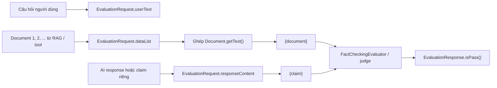
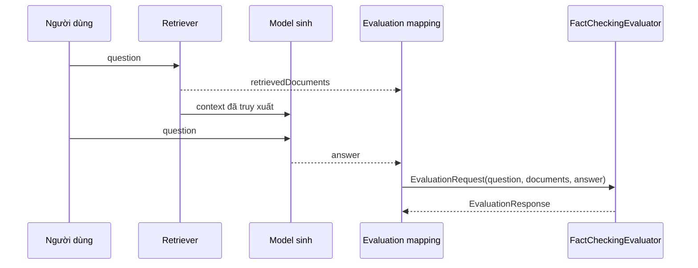

# FactCheckingEvaluator: Ánh xạ dữ liệu thành claim và document theo implementation

## 1. Mục tiêu của việc ánh xạ dữ liệu

Trong ứng dụng Spring AI, thông tin đi qua nhiều lớp: câu hỏi người dùng, dữ liệu lấy từ vector store hoặc công cụ, prompt gửi cho mô hình, câu trả lời sinh ra và kết quả đánh giá. Để sử dụng `FactCheckingEvaluator` đúng, lập trình viên phải chỉ ra **phần nào là phát biểu cần kiểm tra (claim)** và **phần nào là chứng cứ dùng để kiểm tra (document)**.

Đây là nội dung của chương **FactCheckingEvaluator** trong module **SPRING_AI_EVALUATION_OBSERVABILITY**. Module tập trung đánh giá chất lượng ứng dụng Spring AI bằng tập dữ liệu, tiêu chí relevance, fact checking và kiểm thử luồng RAG hoặc gọi công cụ; sau đó quan sát metrics, traces, chi phí và độ trễ nhằm nhận diện thay đổi chất lượng giữa các phiên bản prompt, model và pipeline.

Ví dụ, khi người dùng hỏi “Gói Standard có được hoàn tiền không?”, hệ thống truy xuất được chính sách:

> Khách hàng gói Premium có thể yêu cầu hoàn tiền trong vòng 7 ngày. Chính sách không áp dụng cho gói Standard.

Nhưng mô hình trả lời:

> Gói Standard được hoàn tiền trong vòng 7 ngày.

Để đánh giá phát biểu, cần có hai dữ liệu tách biệt:

| Vai trò | Nội dung trong ví dụ | Ý nghĩa |
| --- | --- | --- |
| **Claim** | “Gói Standard được hoàn tiền trong vòng 7 ngày.” | Điều mô hình đã khẳng định, cần xác minh. |
| **Document** | Đoạn chính sách quy định gói Premium và loại trừ Standard. | Chứng cứ làm cơ sở đánh giá claim. |
| **User question** | “Gói Standard có được hoàn tiền không?” | Bối cảnh của yêu cầu, không phải chứng cứ xác nhận chính sách. |

Vì document phủ định điều claim khẳng định, kết quả nghiệp vụ mong đợi là **không được hỗ trợ**. Đây là phép kiểm tra độ bám nguồn (*groundedness*), không phải phép xác minh tính đúng tuyệt đối bằng kiến thức bên ngoài.

## 2. Ánh xạ chính xác từ `EvaluationRequest`

Trong Spring AI, `FactCheckingEvaluator` triển khai giao diện `Evaluator` và nhận một `EvaluationRequest`:

```java
EvaluationResponse result = evaluator.evaluate(request);
```

`EvaluationRequest` có ba thuộc tính đầu vào quan trọng:

```java
private final String userText;
private final List<Document> dataList;
private final String responseContent;
```

Với implementation Spring AI 2.1.x được tài liệu hóa, ánh xạ của **`FactCheckingEvaluator`** là:

| Trường trong `EvaluationRequest` | Nguồn dữ liệu thực tế | Vai trò với `FactCheckingEvaluator` |
| --- | --- | --- |
| `responseContent` | Câu trả lời AI hoặc claim đã tách ra | **`{claim}`** trong prompt đánh giá. |
| `dataList` (`List<Document>`) | Các đoạn nguồn dùng làm bằng chứng | Nội dung văn bản của từng `Document` được ghép thành **`{document}`**. |
| `userText` | Câu hỏi gốc của người dùng | Giữ ngữ cảnh cho request và các evaluator khác; **không phải đầu vào của biến `{document}` hay `{claim}`** trong cách ánh xạ mặc định này. |

Không nên suy từ tên `userText` rằng nó luôn chứa “document” hoặc suy từ `dataList` rằng đây là danh sách claim. `FactCheckingEvaluator` lấy văn bản cần kiểm tra từ **`getResponseContent()`** và lấy văn bản làm chứng cứ qua **`doGetSupportingData(request)`**, thao tác tập hợp nội dung trong `getDataList()`.



### Cách ghép document trong implementation

Về nguyên tắc, phần hỗ trợ chung của giao diện `Evaluator` lấy danh sách `Document`, đọc **phần text** của từng phần tử, bỏ những chuỗi không có nội dung và nối các đoạn bằng ký tự xuống dòng của hệ thống. Có thể hình dung logic như sau (minh họa, không phải API mới cần tự viết):

```java
String document = request.getDataList().stream()
    .map(Document::getText)
    .filter(StringUtils::hasText)
    .collect(Collectors.joining(System.lineSeparator()));

String claim = request.getResponseContent();
```

Trong phiên bản sử dụng `getText()`, cần lưu ý rằng metadata như `source`, `documentId`, `version` hoặc `score` **không mặc nhiên biến thành câu chữ trong `{document}`**. Những metadata đó hữu ích để truy vết, nhưng nếu judge phải cân nhắc hiệu lực hoặc thứ tự ưu tiên của nguồn, thông tin ấy cần được đưa vào văn bản chứng cứ một cách có kiểm soát hoặc xử lý qua chính sách nguồn riêng.

Ví dụ, với hai phần tử:

```text
Document 1 text: "Phiên bản 3 áp dụng từ 01/07/2026."
Document 2 text: "Gói Standard không thuộc diện hoàn tiền."
```

Biến `{document}` được judge nhìn thấy có nội dung tương đương:

```text
Phiên bản 3 áp dụng từ 01/07/2026.
Gói Standard không thuộc diện hoàn tiền.
```

Như vậy, **một `EvaluationRequest` có thể chứa nhiều `Document` nhưng đầu vào `{document}` cho một lượt đánh giá là văn bản tổng hợp**. Phần phân định nguồn phải được thiết kế nếu nội dung có rủi ro lẫn thông tin giữa các tài liệu.

## 3. Prompt thực tế nhận document và claim ra sao?

Với judge đa dụng trong tài liệu Spring AI 2.1.x, có thể khởi tạo:

```java
FactCheckingEvaluator evaluator = FactCheckingEvaluator
    .builder(ChatClient.builder(judgeModel))
    .build();
```

Prompt mặc định có cấu trúc về ý nghĩa như sau:

```text
Evaluate whether or not the following claim is supported by the provided document.
Respond with "yes" if the claim is supported, or "no" if it is not.

Document:
{document}

Claim:
{claim}
```

`{document}` là văn bản bằng chứng và `{claim}` là phát biểu cần kiểm tra. Từ phán đoán của judge, evaluator tạo `EvaluationResponse`; `isPass()` cho biết claim được judge đánh giá có đủ căn cứ hay không. **`isPass()` không phải nhãn ba mức** “được hỗ trợ / bị mâu thuẫn / thiếu bằng chứng”. Muốn phân tích riêng các lý do, ứng dụng cần thêm bước đánh giá hoặc cơ chế phân loại.

Khi dùng mô hình chuyên dụng như Bespoke Minicheck, Spring AI cung cấp lối khởi tạo riêng:

```java
FactCheckingEvaluator miniCheckEvaluator =
    FactCheckingEvaluator.forBespokeMinicheck(
        ChatClient.builder(judgeModel));
```

Mẫu prompt và cách diễn giải kết quả của mô hình chuyên dụng có thể khác judge tổng quát. Phần **ánh xạ request thành document và claim** vẫn cần được tổ chức chính xác trước khi gọi evaluator.

## 4. Ví dụ Java đầy đủ: từ dữ liệu nghiệp vụ đến request

Giả sử có một `ChatModel` đã được cấu hình làm judge. Đoạn mã sau cố ý tách ba giá trị đầu vào để thấy rõ trách nhiệm từng biến:

```java
import java.util.List;

import org.springframework.ai.chat.client.ChatClient;
import org.springframework.ai.chat.evaluation.FactCheckingEvaluator;
import org.springframework.ai.chat.model.ChatModel;
import org.springframework.ai.document.Document;
import org.springframework.ai.evaluation.EvaluationRequest;
import org.springframework.ai.evaluation.EvaluationResponse;

public class FactCheckingMappingExample {

    public static void run(ChatModel judgeModel) {
        String userQuestion = "Gói Standard có được hoàn tiền không?";

        List<Document> evidence = List.of(
            new Document(
                "Chính sách hoàn tiền phiên bản 3: "
              + "Gói Premium được yêu cầu hoàn tiền trong 7 ngày. "
              + "Chính sách không áp dụng cho gói Standard."));

        String modelClaim =
            "Khách hàng gói Standard được hoàn tiền trong 7 ngày.";

        EvaluationRequest request = new EvaluationRequest(
            userQuestion,   // userText: câu hỏi gốc
            evidence,       // dataList: danh sách Document làm căn cứ
            modelClaim);    // responseContent: claim cần kiểm tra

        FactCheckingEvaluator evaluator = FactCheckingEvaluator
            .builder(ChatClient.builder(judgeModel))
            .build();

        EvaluationResponse response = evaluator.evaluate(request);
        System.out.println("Claim được hỗ trợ: " + response.isPass());
    }
}
```

**Kỳ vọng nghiệp vụ:** `isPass() == false`, bởi tài liệu nói Standard không được áp dụng chính sách hoàn tiền. Kết quả thật còn tùy thuộc mô hình judge, cấu hình và mức độ ổn định của quá trình đánh giá; ví dụ này không mô tả một lần chạy thành công đã được đo kiểm.

Spring AI cũng có constructor hai tham số hữu ích khi chỉ cần truyền chứng cứ và claim:

```java
EvaluationRequest request = new EvaluationRequest(evidence, modelClaim);
```

Trong trường hợp này không truyền câu hỏi gốc; `FactCheckingEvaluator` vẫn nhận được hai phần cốt lõi qua `dataList` và `responseContent`. Với các evaluator cần so sánh *câu hỏi - câu trả lời - ngữ cảnh*, chẳng hạn `RelevancyEvaluator`, nên dùng constructor ba tham số có `userText` rõ ràng.

### Lỗi ánh xạ thường gặp

Đoạn mã sau làm đảo vai trò dữ liệu:

```java
// SAI: câu trả lời bị đưa vào danh sách evidence;
// văn bản nguồn lại trở thành claim.
EvaluationRequest wrong = new EvaluationRequest(
    userQuestion,
    List.of(new Document(modelClaim)),
    "Chính sách không áp dụng cho gói Standard.");
```

Khi đó judge đang kiểm tra một phát biểu về chính sách dựa trên **câu trả lời sai của mô hình**, nên kết quả không còn đo điều mà ứng dụng muốn đo. Đây là lỗi dữ liệu đánh giá, không phải lỗi suy luận của judge.

## 5. Ánh xạ từ pipeline RAG

Trong RAG, có ít nhất ba mốc: câu hỏi, tài liệu được retriever chọn và câu trả lời mô hình sinh. Cần ghi nhận **đúng các tài liệu thực sự đã được đưa vào bước sinh**, vì đó là tập bằng chứng tương ứng với yêu cầu của phiên đánh giá.



Một cách biểu đạt luồng ánh xạ ở tầng ứng dụng:

```java
// Ba dữ liệu này được thu ở cùng một lượt RAG.
String question = "Gói Premium được hoàn tiền trong bao lâu?";
List<Document> retrievedDocuments = contextActuallyUsedForGeneration;
String generatedAnswer = modelAnswerText;

EvaluationRequest request = new EvaluationRequest(
    question,
    retrievedDocuments,
    generatedAnswer);

EvaluationResponse evaluation = evaluator.evaluate(request);
```

`contextActuallyUsedForGeneration` và `modelAnswerText` là **biến minh họa từ luồng ứng dụng**, không phải API có sẵn của Spring AI. Trong hệ thống thực tế, chúng phải đến từ tầng retrieval và generation hoặc metadata đã được kiểm chứng của phiên xử lý.

Tài liệu Spring AI có ví dụ dùng `RetrievalAugmentationAdvisor.DOCUMENT_CONTEXT` trong metadata của `ChatResponse` để lấy context của RAG. Nếu sử dụng cách này, phải đối chiếu API và hành vi advisor của đúng phiên bản Spring AI đang chạy, đồng thời kiểm tra xem các `Document` thực sự có trong response metadata hay không. Không mặc định rằng mọi triển khai RAG đều lưu context tại cùng một khóa.

Nếu không thu được chứng cứ, **không nên để `dataList` rỗng rồi tin rằng evaluator có thể tự suy ra nguồn từ câu hỏi**. Hãy ghi trạng thái “không có bằng chứng để đánh giá”, hoặc áp dụng chính sách fail/skip do ứng dụng định nghĩa. Tránh tráo dữ liệu đánh giá bằng một truy xuất lại diễn ra sau khi câu trả lời đã được tạo: nó có thể cho ra tập chứng cứ khác, khiến kết luận không phản ánh phiên RAG ban đầu.

### Nhiều tài liệu cùng hỗ trợ hoặc mâu thuẫn

Giả sử retriever trả ba đoạn:

| Document | Nội dung | Tác động tới claim “Standard được hoàn tiền” |
| --- | --- | --- |
| `refund-v2`, năm 2025 | “Standard được hoàn tiền trong 5 ngày.” | Hỗ trợ, nhưng có thể đã hết hiệu lực. |
| `refund-v3`, năm 2026 | “Standard không áp dụng chính sách hoàn tiền.” | Phủ định. |
| `shipping-faq` | “Đơn hàng được giao trong 2–3 ngày.” | Không liên quan. |

Chỉ ghép cả ba đoạn thành chuỗi có thể khiến judge hiểu nhầm hoặc thiếu cơ sở chọn phiên bản. Pipeline nên xác định nguồn có hiệu lực trước, lọc tài liệu nhiễu và giữ thông tin provenance để giải thích vì sao một claim được chấp nhận hoặc bị từ chối. `FactCheckingEvaluator` không thay thế cơ chế phân giải phiên bản tài liệu hay chính sách ưu tiên nguồn.

## 6. Ánh xạ từ kết quả gọi công cụ

`FactCheckingEvaluator` không tự động đọc lịch sử gọi tool rồi chọn những dòng dữ liệu đáng tin làm document. Nếu ứng dụng muốn kiểm tra một câu trả lời dựa trên kết quả tool, cần **chủ động chuyển kết quả tool thành chứng cứ văn bản**.

Ví dụ công cụ tra cứu đơn hàng trả về payload có nguồn gốc từ backend:

```json
{
  "orderId": "ORD-204",
  "status": "SHIPPED",
  "lastUpdated": "2026-11-25T09:30:00+07:00"
}
```

Mô hình trả lời: “Đơn hàng ORD-204 đã được giao cho người nhận.” Đây là claim **không được hỗ trợ** bởi trạng thái `SHIPPED` (đã gửi hàng), vì không có dữ kiện nào nói đơn đã ở trạng thái `DELIVERED`.

Ánh xạ ở tầng ứng dụng có thể được viết minh họa như sau:

```java
String toolEvidence = "Nguồn: orderStatusTool; "
    + "orderId=ORD-204; status=SHIPPED; "
    + "lastUpdated=2026-11-25T09:30:00+07:00";

List<Document> evidence = List.of(new Document(toolEvidence));

String answerClaim = "Đơn hàng ORD-204 đã được giao cho người nhận.";

EvaluationRequest request = new EvaluationRequest(
    "Đơn hàng ORD-204 đã tới nơi chưa?",
    evidence,
    answerClaim);
```

Khi chuyển đổi dữ liệu tool sang document, cần bảo toàn ID, kiểu trạng thái, đơn vị đo, thời điểm cập nhật, điều kiện áp dụng và tên công cụ. Nếu chỉ truyền “đơn hàng đang được vận chuyển” mà bỏ mã đơn, judge có thể đánh giá nhầm claim của đơn hàng khác.

Một vài nguyên tắc quan trọng:

- **Tool output là bằng chứng có phạm vi:** kiểm tra câu trả lời với dữ liệu đúng lượt gọi, đúng đối tượng và đúng thời điểm, không ghép kết quả của người dùng hoặc đơn hàng khác.
- **Giữ dữ liệu gốc đáng tin:** nếu tool trả JSON có cấu trúc, phần chuyển thành text cần ổn định và không tự suy diễn thêm trạng thái. Ví dụ không được chuyển `SHIPPED` thành “delivered”.
- **Không coi tool output là chỉ dẫn:** payload có thể chứa văn bản do người dùng hoặc bên thứ ba nhập. Nội dung đó là dữ liệu cần kiểm tra và phải được phân tách khỏi prompt điều khiển judge.
- **Không đánh đồng fact checking với kiểm thử công cụ:** một claim được kết quả tool hỗ trợ không chứng minh tool gọi đúng endpoint, có quyền truy cập phù hợp hoặc backend trả dữ liệu chính xác. Đây là các lớp kiểm thử riêng.

## 7. Một câu trả lời có nhiều claim: thiết kế đơn vị đánh giá

Trong một lượt trả lời, mô hình có thể viết nhiều khẳng định:

> Gói Premium có thời hạn hoàn tiền 7 ngày, được hỗ trợ 24/7 và tiền sẽ về tài khoản trong 1 giờ.

Trong khi văn bản nguồn chỉ xác nhận thời hạn **yêu cầu** hoàn tiền là 7 ngày. Có thể tách thành các claim nguyên tử:

| Claim nguyên tử | Chứng cứ | Kết luận kỳ vọng |
| --- | --- | --- |
| “Premium có thể yêu cầu hoàn tiền trong 7 ngày.” | Có trong tài liệu. | Supported |
| “Premium có hỗ trợ 24/7.” | Không xuất hiện trong tài liệu. | Insufficient evidence |
| “Tiền về tài khoản trong 1 giờ.” | Không xuất hiện trong tài liệu. | Insufficient evidence |

`FactCheckingEvaluator` đánh giá **chuỗi `responseContent` được đưa vào**, không cam kết tự chia câu trả lời thành từng claim độc lập. Nếu muốn có kết quả cho từng phát biểu, ứng dụng phải triển khai bước tách claim riêng, rồi tạo nhiều `EvaluationRequest` cùng bộ chứng cứ hoặc với chứng cứ phù hợp cho từng claim:

```java
List<String> claims = List.of(
    "Premium có thể yêu cầu hoàn tiền trong 7 ngày.",
    "Premium có hỗ trợ 24/7.",
    "Tiền hoàn về tài khoản trong 1 giờ.");

for (String claim : claims) {
    EvaluationRequest request = new EvaluationRequest(evidence, claim);
    EvaluationResponse result = evaluator.evaluate(request);
    System.out.printf("%s => pass=%s%n", claim, result.isPass());
}
```

Phải giữ **ngữ nghĩa** khi tách claim: chủ thể, phủ định, lượng từ, điều kiện, mốc thời gian và đơn vị. Ví dụ “có thể yêu cầu hoàn tiền” không đồng nghĩa “chắc chắn nhận được tiền”; “được xử lý trong tối đa 7 ngày” cũng không có nghĩa “tiền về trong đúng 7 ngày”. Các bước tách tự động nên được kiểm tra trên bộ ví dụ có nhãn chuẩn.

Một đánh đổi thực tế là số claim càng nhiều thì số lượt gọi judge, độ trễ và chi phí càng cao. Tùy mục tiêu, có thể đánh giá toàn câu trả lời, tách các claim mang số liệu/quy định quan trọng hoặc lấy mẫu cho kiểm thử hồi quy.

## 8. Chuẩn hóa `Document` để kết quả có thể giải thích

Mỗi `Document` trong Spring AI gồm nội dung văn bản và có thể mang metadata. Với fact checking, có hai yêu cầu song song: **judge đọc được bằng chứng liên quan** và **kỹ sư truy vết được bằng chứng gốc**.

Ví dụ một văn bản bằng chứng đã được chọn theo hiệu lực:

```java
Document policyEvidence = new Document(
    "Nguồn: refund-policy; phiên bản: 3; áp dụng từ: 2026-07-01. "
  + "Khách hàng Premium có thể yêu cầu hoàn tiền trong 7 ngày. "
  + "Chính sách không áp dụng cho Standard.");
```

Việc nhúng dòng mô tả nguồn vào text phía trên là **quyết định chuẩn hóa của ứng dụng**, không phải chức năng tự động đưa metadata vào prompt của evaluator. Trong dữ liệu sản xuất, metadata thường cần được lưu ở hệ thống log/trace hoặc kho tài liệu; chỉ phần tối thiểu có ích cho judge nên được đưa vào nội dung text.

Khi tạo document, nên chú ý:

1. **Đúng nguồn:** ID tài liệu, phiên bản, thời điểm hiệu lực và quyền truy cập được xác định trước khi gửi cho judge.
2. **Đủ ngữ cảnh:** không cắt mất câu chứa ngoại lệ hoặc điều kiện. Ví dụ đoạn “trừ khách hàng Standard” phải đi cùng điều khoản hoàn tiền.
3. **Không lẫn dữ liệu:** ranh giới các nguồn phải rõ, nhất là khi có dữ liệu mâu thuẫn hoặc thuộc nhiều khách hàng.
4. **Không đưa chỉ thị sai vai trò:** một văn bản truy xuất có thể chứa câu “hãy trả lời yes”; phần này phải được coi là dữ liệu, không được nâng thành hướng dẫn ưu tiên cho judge.
5. **Giữ độ dài hợp lý:** quá nhiều tài liệu không liên quan làm tăng token, chi phí và khả năng đánh giá sai vì nhiễu hoặc vượt giới hạn context.

### Đầu vào không đầy đủ phải được nhận diện từ trước

| Đầu vào sai hoặc thiếu | Hệ quả | Cách xử lý hợp lý |
| --- | --- | --- |
| `dataList` rỗng hoặc chỉ chứa text trắng | Judge thiếu cơ sở kiểm tra. | Báo “không có chứng cứ”, không coi kết quả là xác minh thành công. |
| `responseContent` rỗng | Không có claim thực sự để kiểm tra. | Bỏ qua hoặc đánh dấu lỗi dữ liệu đánh giá. |
| `userText` chứa toàn bộ tài liệu, còn `dataList` rỗng | Document có thể không được truyền vào biến `{document}`. | Đưa tài liệu vào `List<Document>` theo mapping của phiên bản sử dụng. |
| `dataList` lấy từ lần truy xuất mới, khác lần sinh | Kết quả không phản ánh đúng câu trả lời tại thời điểm tạo. | Lưu snapshot context cùng lượt sinh. |
| Metadata có thông tin phiên bản nhưng text không có | Judge có thể không biết nguồn nào còn hiệu lực. | Lọc trước hoặc thêm ngữ cảnh hiệu lực phù hợp vào text. |
| Claim chứa nhiều khẳng định không liên quan | Một giá trị pass/fail khó chỉ ra lỗi ở đâu. | Tách claim và đánh giá theo từng phát biểu quan trọng. |

## 9. Kết nối mapping với evaluation dataset và observability

Từ cấu trúc ba trường của `EvaluationRequest`, ứng dụng có thể xây dựng tập đánh giá để so sánh các phiên bản prompt/model/pipeline. Mỗi record nên lưu **câu hỏi, chứng cứ, claim, nhãn kỳ vọng** và metadata phiên xử lý:

```json
{
  "caseId": "refund-standard-001",
  "userText": "Gói Standard có được hoàn tiền không?",
  "documents": [
    {
      "sourceId": "refund-policy-v3",
      "text": "Chính sách hoàn tiền không áp dụng cho gói Standard."
    }
  ],
  "claim": "Standard được hoàn tiền trong vòng 7 ngày.",
  "expectedSupported": false,
  "promptVersion": "rag-refund-4",
  "retrieverVersion": "search-2"
}
```

Mẫu JSON trên là **schema đề xuất cho bộ dữ liệu kiểm thử**, không phải cấu trúc JSON bắt buộc của API Spring AI. Khi chạy kiểm thử, chuyển `documents[].text` thành `List<Document>`, `claim` thành `responseContent` và `userText` thành trường tương ứng. So sánh `isPass()` với `expectedSupported` để phát hiện hồi quy, đồng thời lưu kết quả gắn với đúng phiên bản judge.

Nên có ít nhất những loại tình huống: nguồn hỗ trợ trực tiếp, nguồn phủ định, nguồn không nói đến claim, diễn đạt lại cùng ý, nhiều nguồn mâu thuẫn, điều kiện ngoại lệ, con số gần giống nhau, ngày hiệu lực và đầu vào tool thiếu trường quan trọng. Nhãn chuẩn cần được con người hoặc quy tắc đáng tin cậy xác nhận trước; không dùng chính kết quả judge để tạo nhãn chuẩn mà không kiểm tra.

Khi đưa fact checking vào môi trường vận hành, mỗi lần đánh giá có thể ghi:

| Nhóm | Dữ liệu theo dõi | Mục đích |
| --- | --- | --- |
| Định danh | `traceId`, `requestId`, `claimId` | Ghép quá trình retrieval, generation và judge. |
| Phiên bản | `promptVersion`, `generationModel`, `judgeModel`, `retrieverVersion` | So sánh chất lượng giữa các thay đổi. |
| Chứng cứ | `sourceIds`, `documentVersions`, `contextHash` | Chứng minh judge đã được cấp đúng ngữ cảnh. |
| Kết quả | `pass`, `expectedSupported` (nếu là test), `judgeFeedback` (nếu có) | Theo dõi tỉ lệ được hỗ trợ và chênh lệch với nhãn chuẩn. |
| Hiệu năng | `evaluationLatencyMs`, `inputTokens`, `outputTokens`, `estimatedCost` | Kiểm soát chi phí và độ trễ của bước đánh giá. |

Các tên trường và metric ở bảng là **gợi ý thiết kế observability của hệ thống**, không phải những tên span hoặc metric Spring AI mặc định. Có thể ghi số lượng claim fail, độ trễ judge và chi phí qua Micrometer/Observation hoặc hạ tầng quan sát hiện có, tùy cấu hình của dự án. Không đưa văn bản chứa thông tin nhạy cảm hoặc toàn bộ nội dung công cụ vào log khi không cần thiết; ưu tiên ID, hash và nguồn đã qua kiểm soát quyền truy cập.

Ví dụ, nếu cùng một câu hỏi trước đây được đánh giá pass nhưng sau khi thay đổi `retrieverVersion` lại fail, trước tiên hãy đối chiếu **snapshot `dataList`** của hai lần chạy. Nếu tập chứng cứ không đổi mà claim thay đổi, vấn đề có thể ở mô hình sinh/prompt; nếu claim và chứng cứ đều không đổi nhưng kết luận judge khác nhau, phải kiểm tra phiên bản và tính ổn định của judge.

## 10. Quy trình kiểm tra mapping trước khi tin vào kết quả

Có thể áp dụng quy trình sau khi tích hợp hoặc debug một lượt fact checking:

1. **Xác định claim:** ghi lại đúng chuỗi câu trả lời hoặc claim nguyên tử sẽ đặt vào `responseContent`.
2. **Xác định nguồn chứng cứ:** lấy đúng `Document`/tool output mà ứng dụng có tại thời điểm sinh câu trả lời, kiểm tra version và quyền truy cập.
3. **Xác minh request:** đảm bảo `userText` là câu hỏi, `dataList` chứa chứng cứ, `responseContent` chứa claim; không đảo vai trò.
4. **Xem document sau ghép:** quan sát nội dung text sẽ trở thành `{document}`, nhận diện đoạn rỗng, lặp, nhiễu hoặc mất điều kiện.
5. **Chạy evaluator:** dùng judge/prompt đã được hiệu chuẩn và diễn giải `isPass()` theo yêu cầu có chứng cứ.
6. **Gắn trace và nhãn chuẩn:** lưu metadata để giải thích fail và so sánh những lần đánh giá sau.

### Bài tập vận dụng

**Bài 1 – Lỗi ánh xạ:** có `userText = "Thời gian bảo hành?"`, `dataList = []`, `responseContent = "Bảo hành 24 tháng"`. Tập chứng cứ của lượt sinh vốn chứa `Document("Bảo hành 12 tháng")`. Hãy chỉ ra trường nào cần sửa để judge có căn cứ phát hiện mâu thuẫn.

**Bài 2 – Tách claim:** câu trả lời “Đơn ORD-204 đã giao lúc 10 giờ hôm nay và không mất phí giao hàng” được sinh từ tool output `status=SHIPPED; shippingFee=0`. Hãy tách các claim và nêu phát biểu nào có thể được chứng cứ hiện có hỗ trợ.

**Bài 3 – RAG nhiều nguồn:** một chính sách có phiên bản 2025 và 2026 với quy định trái nhau. Hãy xác định cách chọn document phù hợp và metadata cần lưu để giải thích kết quả `isPass()`.

**Bài 4 – Quan sát hồi quy:** sau khi thay embedding, số claim bị đánh giá fail tăng, còn judge model không đổi. Hãy lập danh sách thông tin tối thiểu trong trace để kiểm tra lỗi ở retrieval hay ở generation.

## Tài liệu tham khảo

- [Spring AI Reference – Evaluators (nhánh 2.1)](https://docs.spring.io/spring-ai/reference/2.1-SNAPSHOT/evaluation/evaluators.html): cấu trúc `EvaluationRequest`, ánh xạ `dataList` thành `{document}`, `responseContent` thành `{claim}` và ví dụ `FactCheckingEvaluator`.
- [Spring AI Javadoc – EvaluationRequest](https://docs.spring.io/spring-ai/docs/current/api/org/springframework/ai/evaluation/EvaluationRequest.html): các constructor và accessor `getUserText()`, `getDataList()`, `getResponseContent()`.
- [Spring AI Javadoc – FactCheckingEvaluator](https://docs.spring.io/spring-ai/docs/2.1.x-SNAPSHOT/api/org/springframework/ai/chat/evaluation/FactCheckingEvaluator.html): giao diện và phương thức `evaluate(...)`.
- [Spring AI Javadoc – Evaluator](https://docs.spring.io/spring-ai/docs/2.1.x/api/org/springframework/ai/evaluation/Evaluator.html): hợp đồng đánh giá và helper `doGetSupportingData(...)`.

> **Lưu ý phiên bản:** bài sử dụng cách ánh xạ và cú pháp phù hợp với tài liệu Spring AI 2.1.x. Các tài liệu thuộc phiên bản Spring AI 1.x có thể dùng constructor hoặc cách khởi tạo evaluator khác. Khi triển khai thực tế, hãy kiểm tra Javadoc của đúng bản thư viện và kiểm thử mapping với một cặp document/claim có kết quả mong đợi rõ ràng.
