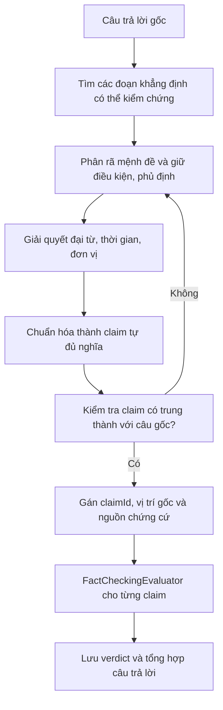
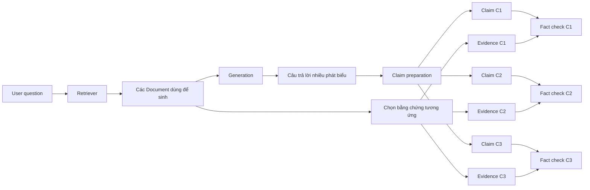

# FactCheckingEvaluator: Chuẩn bị phát biểu đơn và câu trả lời chứa nhiều phát biểu

## 1. Bối cảnh: từ câu trả lời tự nhiên đến đơn vị có thể kiểm chứng

Trong hệ thống hỏi đáp sử dụng Spring AI, người dùng thường nhận được **một câu trả lời gồm nhiều khẳng định**. Chẳng hạn:

> Khách hàng Premium có thể yêu cầu hoàn tiền trong vòng 7 ngày. Gói Standard cũng được yêu cầu hoàn tiền. Khoản tiền hoàn sẽ về tài khoản trong 24 giờ.

Giả sử nguồn được truy xuất chỉ ghi:

> Khách hàng Premium được quyền yêu cầu hoàn tiền trong vòng 7 ngày kể từ lúc thanh toán. Chính sách này không áp dụng cho Standard.

Từ nguồn trên, chỉ câu đầu tiên được hỗ trợ; câu thứ hai **mâu thuẫn**, câu thứ ba **thiếu bằng chứng**. Nếu đưa cả đoạn trả lời vào một lượt `FactCheckingEvaluator`, một giá trị `isPass()` khó cho biết phần nào gây ra lỗi và hướng sửa nội dung nào là phù hợp.

Vì vậy, trước khi fact checking cần giải quyết hai bài toán:

1. **Phát biểu đơn (atomic claim)**: xác định một nhận định cụ thể, đủ ngữ cảnh và có thể so sánh với tài liệu.
2. **Câu trả lời nhiều phát biểu (multi-claim answer)**: phân rã thành tập claim phù hợp, kiểm tra từng claim, sau đó tổng hợp kết quả mà không đánh mất thông tin gốc.

Bài này thuộc chương **FactCheckingEvaluator** của module **SPRING_AI_EVALUATION_OBSERVABILITY**. Module hướng đến đánh giá chất lượng ứng dụng Spring AI bằng tập dữ liệu và tiêu chí relevance, fact checking, kiểm thử RAG hoặc gọi công cụ; đồng thời đo metrics, traces, chi phí và độ trễ để tìm nguyên nhân suy giảm qua từng phiên bản prompt, model và pipeline.

**Ý chính:** `FactCheckingEvaluator` kiểm tra một chuỗi claim với các `Document` được cung cấp. Việc nhận diện, tách, viết lại và gắn nguồn cho nhiều claim là phần chuẩn bị dữ liệu do ứng dụng hoặc quy trình kiểm thử thiết kế.

## 2. Phát biểu đơn là gì?

Một **claim** là một mệnh đề mà ta có thể đặt câu hỏi: “Tài liệu tham chiếu có đủ cơ sở hỗ trợ nhận định này không?”. Claim đơn đủ nhỏ để kết quả đánh giá phản ánh **một nhóm thông tin nhất quán**, nhưng vẫn giữ trọn ý nghĩa cần kiểm chứng.

Ví dụ từ chính sách hoàn tiền:

| Câu văn | Claim đơn phù hợp? | Nhận xét |
| --- | --- | --- |
| “Premium có thể yêu cầu hoàn tiền trong 7 ngày.” | Có | Một quyền lợi, một chủ thể, một điều kiện thời gian. |
| “Premium có thể hoàn tiền trong 7 ngày và được hỗ trợ 24/7.” | Nên tách | Hai quyền lợi khác nhau, có thể nhận hai kết quả đánh giá khác nhau. |
| “Có được hoàn tiền không?” | Không | Câu hỏi, chưa phải khẳng định. |
| “Dịch vụ này thật tuyệt!” | Thường không | Ý kiến chủ quan, không có tiêu chí thực tế rõ ràng để đối chiếu tài liệu. |
| “Tôi nghĩ chắc là có thể hoàn tiền.” | Cần phân tích | Có sự dè dặt/ước đoán; không được tự đổi thành khẳng định chắc chắn. |
| “Đơn ORD-204 đã giao thành công.” | Có | Một trạng thái có thể so với kết quả công cụ tra cứu đơn hàng. |
| “Standard không áp dụng chính sách hoàn tiền.” | Có | Một mệnh đề phủ định cần giữ nguyên từ “không”. |

Không nên coi “càng ngắn càng tốt” là tiêu chuẩn duy nhất. Claim “Được hoàn tiền sau 7 ngày” ngắn nhưng thiếu chủ thể, điểm bắt đầu và điều kiện. Claim “Khách hàng gói Premium có thể **yêu cầu** hoàn tiền trong vòng 7 ngày **kể từ khi thanh toán**” dài hơn nhưng dễ kiểm chứng đúng nghĩa.

### Ba đặc điểm của claim tốt

- **Đơn vị kiểm chứng rõ:** có thể đối chiếu với một hoặc một nhóm đoạn bằng chứng liên quan và diễn giải lý do pass/fail.
- **Tự đủ ngữ cảnh:** nêu chủ thể, đối tượng, giá trị, đơn vị và điều kiện khi chúng quyết định tính đúng của mệnh đề.
- **Trung thành với câu gốc:** giữ các giới hạn, phủ định và sắc thái xác suất; không thêm sự kiện mới trong lúc chuẩn hóa.

Một claim không nhất thiết chỉ có một vế ngữ pháp. Ví dụ “Nếu đơn hàng bị hủy trước khi đóng gói thì phí giao hàng được hoàn lại” là một khẳng định có điều kiện; cắt bỏ vế “nếu” sẽ làm hỏng nội dung cần kiểm tra.

## 3. Phân loại thông tin trước khi tách claim

Câu trả lời của AI có thể gồm phần sự kiện, khuyến nghị, suy đoán, liên kết và lời lịch sự. Không phải mọi chuỗi trong câu trả lời đều là một claim phù hợp cho `FactCheckingEvaluator`.

| Loại thông tin | Ví dụ | Cách chuẩn bị |
| --- | --- | --- |
| Sự kiện cụ thể | “Bảo hành sản phẩm A là 24 tháng.” | Tạo claim để đối chiếu nguồn. |
| Quy định có điều kiện | “Premium được đổi trả nếu yêu cầu trong 7 ngày.” | Giữ cả điều kiện rồi kiểm chứng. |
| Phép tính từ số liệu | “12 tháng phí 50.000 đồng/tháng là 600.000 đồng.” | Kiểm tra dữ kiện nguồn và phép tính; có thể dùng mã kiểm tra số học. |
| Dự báo | “Đơn hàng sẽ tới trước 18:00 ngày mai.” | Chỉ có thể xem nguồn hiện tại có hỗ trợ **dự báo**; không đánh đồng dự báo với sự kiện đã xảy ra. |
| Ý kiến | “Gói này là lựa chọn tốt nhất.” | Xác định tiêu chí/nguồn so sánh hoặc xếp ngoài phạm vi kiểm chứng sự kiện. |
| Khuyến nghị | “Bạn nên liên hệ tổng đài.” | Nếu dựa vào chính sách cụ thể thì trích claim quy định tương ứng; phần lời khuyên thường cần tiêu chí đánh giá khác. |
| Lời xã giao | “Cảm ơn bạn đã đặt câu hỏi.” | Không cần tạo fact-check claim. |
| Trích dẫn nguồn | “Theo trang FAQ, đổi trả trong 7 ngày.” | Kiểm tra **nội dung lẫn tính đúng của việc dẫn nguồn**, không chỉ sự xuất hiện của liên kết. |

Nếu không có claim nào mang tính thực tế, hệ thống nên ghi nhận **không có claim cần kiểm tra**. Không nên lấy một câu chào rồi đánh giá fail và tính nó như hallucination.

## 4. Những yếu tố bắt buộc giữ lại khi chuẩn hóa

Tách claim thường đi kèm viết lại từ ngữ để mỗi phát biểu tự đủ nghĩa. Đây cũng là lúc dễ làm sai lệch nhất.

| Thành phần | Câu gốc | Lỗi khi chuẩn hóa | Cách giữ đúng |
| --- | --- | --- | --- |
| Chủ thể | “Gói Premium được giảm 10%.” | “Khách hàng được giảm 10%.” | Nêu rõ **gói Premium**. |
| Động từ/khả năng | “Có thể yêu cầu hoàn tiền.” | “Được hoàn tiền.” | Giữ “**có thể yêu cầu**”. |
| Thời điểm | “Áp dụng từ 01/07/2026.” | “Luôn áp dụng.” | Giữ ngày có hiệu lực. |
| Giới hạn | “Tối đa 7 ngày.” | “Chính xác 7 ngày.” | Giữ “**tối đa**”. |
| Phủ định | “Không áp dụng cho Standard.” | “Áp dụng cho Standard.” | Giữ “**không**”. |
| Điều kiện | “Miễn phí nếu đơn trên 500.000 đồng.” | “Giao hàng miễn phí.” | Giữ điều kiện đơn hàng. |
| Số liệu | “Phí 50.000 đồng/tháng.” | “Phí 50.000 đồng.” | Giữ đơn vị **/tháng**. |
| Mức độ chắc chắn | “Dự kiến giao ngày 28/11.” | “Đã giao ngày 28/11.” | Giữ từ “**dự kiến**”. |
| Đối tượng tham chiếu | “Nó được bảo hành 24 tháng.” | “Tất cả sản phẩm được bảo hành 24 tháng.” | Giải quyết “nó” theo đúng đối tượng trong văn cảnh. |

**Đặc biệt với câu phủ định:** “Không có tài liệu nào xác nhận X” khác “Tài liệu xác nhận X là sai”. Nếu nguồn không nói đến thời gian hoàn tiền, claim “Hoàn tiền trong 24 giờ” là **không đủ bằng chứng**, chưa hẳn “bị nguồn khẳng định ngược lại”.

Với các cụm “hôm nay”, “tháng sau”, “đã”, “sắp”, “mới nhất”, cần lưu **mốc thời gian gốc** của lượt trao đổi và không tự suy từ ngày hiện tại khi tái chạy evaluation. Với các đại từ “nó”, “họ”, “dịch vụ này”, phải dùng ngữ cảnh gốc để xác định thực thể trước khi tách.

### Khi nào không nên tách nhỏ hơn?

Xét câu “Premium được yêu cầu hoàn tiền trong 7 ngày **nếu dịch vụ chưa được sử dụng**”. Không được tạo hai claim “Premium được yêu cầu hoàn tiền trong 7 ngày” và “Dịch vụ chưa được sử dụng” rồi kiểm tra độc lập: câu thứ hai trở thành một sự kiện được khẳng định, còn câu thứ nhất làm mất điều kiện. Hợp lý hơn là giữ nguyên một mệnh đề có điều kiện.

Tương tự, “Hai điều kiện A và B phải cùng đúng để được miễn phí” có thể là một chính sách **liên hợp** không nên chẻ thành hai quyền lợi độc lập.

## 5. Quy trình chuẩn bị câu trả lời chứa nhiều phát biểu

Một quy trình có thể áp dụng cho RAG, tool calling và bộ dữ liệu kiểm thử:



**Bước 1 — Giữ bản gốc.** Lưu câu trả lời nguyên văn tại thời điểm mô hình sinh cùng định danh request, phiên bản prompt/model và tập tài liệu thực sự đã được cung cấp cho mô hình. Không chuẩn hóa bằng cách thay đổi bản gốc.

**Bước 2 — Nhận diện đoạn mang thông tin.** Đánh dấu câu hoặc vế câu có mệnh đề cần xác minh. Lời chào và các nhãn trình bày không phải claim. Lời khuyên có thể cần tiêu chí kiểm thử khác.

**Bước 3 — Tách theo sự độc lập của bằng chứng.** Nếu mỗi vế có thể đúng/sai khác nhau, nên tách: “A bảo hành 12 tháng **và** có miễn phí vận chuyển” thường là hai claim. Nếu vế sau bổ nghĩa điều kiện cho vế đầu, giữ chung.

**Bước 4 — Khôi phục ngữ cảnh.** Thay đại từ bằng chủ thể xác định, thêm điều kiện thời gian/đơn vị từ câu gốc khi cần, nhưng tuyệt đối không tự phát minh điều kiện.

**Bước 5 — Xác minh việc tách.** Có thể dùng người kiểm tra hoặc tiêu chí tự động để bảo đảm tất cả khẳng định quan trọng được giữ lại và không có claim mới phát sinh từ việc viết lại.

**Bước 6 — Gắn chứng cứ.** Chọn `List<Document>` thích hợp cho từng claim; bảo đảm quyền truy cập và phiên bản nguồn. Trong một lượt RAG, ưu tiên tập nguồn thực sự dùng để sinh câu trả lời.

**Bước 7 — Đánh giá và tổng hợp.** Chạy `FactCheckingEvaluator` lần lượt hoặc song song theo chính sách tài nguyên; lưu verdict riêng của từng claim, trạng thái lỗi, thời gian và nguồn chứng cứ.

## 6. Ví dụ từng bước với câu trả lời về hoàn tiền

**Document chính sách:**

```text
Nguồn: refund-policy-v3, hiệu lực từ 01/07/2026.
Khách hàng gói Premium có thể yêu cầu hoàn tiền trong 7 ngày
tính từ lúc thanh toán.
Chính sách không áp dụng cho gói Standard.
```

**Câu trả lời AI:**

> Với Premium, bạn có thể yêu cầu hoàn tiền trong 7 ngày sau thanh toán. Standard cũng được yêu cầu hoàn tiền. Tiền sẽ về tài khoản trong 24 giờ. Cảm ơn bạn đã liên hệ.

Tách thành:

| Claim ID | Claim đủ ngữ cảnh | Nhãn nghiệp vụ kỳ vọng |
| --- | --- | --- |
| C1 | “Khách hàng Premium có thể yêu cầu hoàn tiền trong 7 ngày sau thanh toán.” | **Supported** |
| C2 | “Khách hàng Standard có thể yêu cầu hoàn tiền theo chính sách này.” | **Contradicted** |
| C3 | “Khoản tiền hoàn sẽ về tài khoản trong 24 giờ.” | **Insufficient evidence** |
| — | “Cảm ơn bạn đã liên hệ.” | Không phải claim cần fact checking |

Khi áp chính sách **chỉ cho phép phát biểu được tài liệu hỗ trợ**, C1 kỳ vọng `yes`, C2 và C3 kỳ vọng `no`. Đây là **nhãn chuẩn do người biên soạn xác định**, không phải kết quả thực tế của một judge đã được chạy.

Chú ý không biến C1 thành “Premium được hoàn tiền trong 7 ngày”: tài liệu chỉ cho phép **yêu cầu**, không bảo đảm hoàn tất trả tiền. C3 thiếu bằng chứng về thời gian tiền về, dù người đọc có thể thấy “24 giờ” hợp lý.

### Lưu quan hệ giữa claim và câu trả lời gốc

Để phục vụ kiểm toán và debug, mỗi record nên có ít nhất:

```json
{
  "claimId": "C2",
  "answerId": "answer-204",
  "originalSpan": "Standard cũng được yêu cầu hoàn tiền.",
  "normalizedClaim": "Khách hàng Standard có thể yêu cầu hoàn tiền theo chính sách này.",
  "documentIds": ["refund-policy-v3"],
  "expectedLabel": "CONTRADICTED",
  "evaluated": false
}
```

Đây là **schema dữ liệu minh họa do ứng dụng định nghĩa**, không phải kiểu JSON mà Spring AI bắt buộc. `originalSpan` giữ đoạn gốc để người xem kiểm tra việc chuẩn hóa; `normalizedClaim` là chuỗi đưa vào evaluator. `documentIds` trỏ tới snapshot bằng chứng dùng cho lần đánh giá. Nếu lưu offsets ký tự thay vì chuỗi, phải thống nhất quy ước mã hóa, chỉ số bắt đầu/kết thúc và cách xử lý Unicode.

## 7. Đưa từng claim vào `FactCheckingEvaluator` với Java

Trong cách dùng Spring AI 2.1.x, `EvaluationRequest` nhận `List<Document>` làm chứng cứ và `String` làm nội dung cần đánh giá. Lập trình viên có thể lặp qua các claim đã chuẩn bị rồi gọi evaluator cho từng claim.

Ví dụ sau **sử dụng danh sách claim đã được tách thủ công** để tập trung vào cách ánh xạ và tổng hợp. Nó không giả định `FactCheckingEvaluator` có API tự phân rã câu trả lời:

```java
import java.util.ArrayList;
import java.util.List;

import org.springframework.ai.chat.client.ChatClient;
import org.springframework.ai.chat.evaluation.FactCheckingEvaluator;
import org.springframework.ai.chat.model.ChatModel;
import org.springframework.ai.document.Document;
import org.springframework.ai.evaluation.EvaluationRequest;
import org.springframework.ai.evaluation.EvaluationResponse;

// Java 17+; bản ghi ứng dụng, không phải class do Spring AI cung cấp.
record ClaimSpec(String id, String originalSpan, String text) { }

record ClaimResult(String id, Boolean supported, String error) {
    boolean completed() {
        return error == null && supported != null;
    }
}

public final class MultiClaimFactChecking {

    private final FactCheckingEvaluator evaluator;

    public MultiClaimFactChecking(ChatModel judgeModel) {
        this.evaluator = FactCheckingEvaluator
                .builder(ChatClient.builder(judgeModel))
                .build();
    }

    public List<ClaimResult> evaluate(
            List<Document> evidence,
            List<ClaimSpec> claims) {

        if (evidence == null || evidence.isEmpty()) {
            throw new IllegalArgumentException("Thiếu tài liệu chứng cứ");
        }
        if (claims == null || claims.isEmpty()) {
            return List.of(); // Không có claim để đánh giá.
        }

        List<ClaimResult> results = new ArrayList<>();

        for (ClaimSpec claim : claims) {
            if (claim.text() == null || claim.text().isBlank()) {
                results.add(new ClaimResult(
                        claim.id(), null, "EMPTY_CLAIM"));
                continue;
            }

            try {
                EvaluationRequest request =
                        new EvaluationRequest(evidence, claim.text());
                EvaluationResponse response = evaluator.evaluate(request);
                results.add(new ClaimResult(
                        claim.id(), response.isPass(), null));
            }
            catch (RuntimeException ex) {
                // Với hệ thống thật, ghi loại lỗi vào trace có kiểm soát.
                results.add(new ClaimResult(
                        claim.id(), null, "EVALUATION_ERROR"));
            }
        }

        return results;
    }
}
```

Áp dụng với ví dụ chính sách:

```java
List<Document> evidence = List.of(
    new Document(
        "Premium có thể yêu cầu hoàn tiền trong 7 ngày sau thanh toán. "
      + "Chính sách không áp dụng cho Standard."));

List<ClaimSpec> claims = List.of(
    new ClaimSpec(
        "C1",
        "Với Premium, bạn có thể yêu cầu hoàn tiền trong 7 ngày sau thanh toán.",
        "Khách hàng Premium có thể yêu cầu hoàn tiền "
      + "trong 7 ngày sau thanh toán."),
    new ClaimSpec(
        "C2",
        "Standard cũng được yêu cầu hoàn tiền.",
        "Khách hàng Standard có thể yêu cầu hoàn tiền "
      + "theo chính sách này."),
    new ClaimSpec(
        "C3",
        "Tiền sẽ về tài khoản trong 24 giờ.",
        "Khoản tiền hoàn sẽ về tài khoản trong 24 giờ.")
);

MultiClaimFactChecking checker = new MultiClaimFactChecking(judgeModel);
List<ClaimResult> reviews = checker.evaluate(evidence, claims);

boolean allChecked = reviews.size() == claims.size()
    && reviews.stream().allMatch(ClaimResult::completed);

boolean allSupported = allChecked
    && reviews.stream().allMatch(r -> Boolean.TRUE.equals(r.supported()));
```

**Cách đọc kết quả:**

- Mỗi `ClaimResult` gắn lại với `claimId` và giữ riêng trạng thái **đánh giá thành công** hay **lỗi kỹ thuật**.
- `supported = true` nghĩa judge đánh giá claim được nguồn hỗ trợ.
- `supported = false` chỉ nghĩa judge không chấp nhận claim theo prompt và parser đang dùng; bản thân boolean không phân biệt bị phủ định hay thiếu chứng cứ.
- `supported = null` kèm `error` là lỗi đầu vào/gọi judge, không được đếm thành một kết luận `no` về chất lượng mô hình sinh.
- `allSupported` là **quy tắc tổng hợp do ứng dụng đặt ra**: chỉ đúng khi mọi claim đã kiểm tra thành công và đều được đánh giá pass. Đây không phải phương thức gộp verdict có sẵn của Spring AI.

Trong code sản xuất, cần bổ sung xử lý dữ liệu trắng trong từng `Document`, giới hạn concurrency, retry có backoff, kiểm soát quota, trace và thông tin nguồn. Không nên in toàn bộ tài liệu nhạy cảm hoặc exception chứa prompt vào log.

### Phân biệt hai cách đưa đầu vào

```java
// Claim riêng; thích hợp khi đã tách các phát biểu.
EvaluationRequest oneClaim =
        new EvaluationRequest(evidence, claims.get(0).text());

// Cả câu trả lời gốc; cho kết luận tổng thể một lượt,
// nhưng khó biết đoạn nào gây ra kết quả không pass.
EvaluationRequest wholeAnswer = new EvaluationRequest(
        "Gói Standard có được hoàn tiền không?",
        evidence,
        "Premium có thể yêu cầu hoàn tiền trong 7 ngày. "
      + "Standard cũng được hoàn tiền.");
```

`FactCheckingEvaluator` ánh xạ `responseContent` thành claim và `dataList` thành document. `userText` chứa câu hỏi nhưng không phải nguồn bằng chứng trong mapping mặc định. Cần dùng đúng constructor theo phiên bản thư viện. Hai cách đánh giá trên phục vụ mục tiêu khác nhau, vì thế nên ghi rõ đơn vị đo khi so sánh số liệu.

## 8. Khi sử dụng mô hình để tự động tách claim

Đối với câu trả lời dài, tách thủ công không phù hợp vận hành ở quy mô lớn. Có thể dùng một bước xử lý riêng (quy tắc ngôn ngữ, mô hình có cấu trúc, hoặc kết hợp cả hai) để **đề xuất** danh sách claim.

Một yêu cầu ở mức thiết kế cho bộ tách claim:

```text
Nhiệm vụ: Tách câu trả lời sau thành các phát biểu thực tế
có thể kiểm chứng độc lập.

Yêu cầu:
- Không thêm sự kiện không có trong câu trả lời.
- Giữ nguyên chủ thể, phủ định, điều kiện, mức độ chắc chắn,
  số liệu, đơn vị và mốc thời gian.
- Chuyển đại từ thành tên thực thể chỉ khi đủ ngữ cảnh;
  nếu không đủ ngữ cảnh, đánh dấu ambiguous.
- Bỏ qua lời chào, câu hỏi và ý kiến thuần túy.
- Trả về danh sách {id, originalSpan, normalizedClaim, flag}.
- Không tự quyết định supported/unsupported ở bước tách.
```

**Tách claim và fact checking là hai bài toán khác nhau.** Bộ tách claim trả những gì cần kiểm tra; judge xác định claim có được chứng cứ hỗ trợ hay không. Không dùng kết luận của cùng một mô hình để tự tạo nhãn chuẩn rồi lấy đó làm thước đo độ chính xác của chính mô hình ấy.

Ví dụ một bản ghi bộ tách đề xuất:

```json
{
  "id": "C7",
  "originalSpan": "Gói này được hỗ trợ bất cứ lúc nào.",
  "normalizedClaim": "Gói Premium được hỗ trợ 24 giờ mỗi ngày.",
  "flag": "NEEDS_REVIEW"
}
```

Trong ví dụ, nếu văn cảnh không xác nhận “gói này” là Premium hoặc “bất cứ lúc nào” đồng nghĩa cam kết 24/7 thì nên gắn `NEEDS_REVIEW`; không chấp nhận bản viết lại như sự thật hiển nhiên. Nhãn `flag` là quy ước của ứng dụng.

### Những kiểm tra cần có sau khi tách tự động

1. **Coverage:** mọi khẳng định thực tế đáng chú ý trong câu gốc đều được đại diện bởi claim; không bỏ sót ý khó.
2. **Faithfulness:** claim không tự thêm chủ thể, điều kiện, con số hay mức chắc chắn.
3. **Atomicity:** một claim không chứa nhiều phát biểu độc lập dễ dẫn tới nhiều kết quả trái nhau.
4. **Context completeness:** claim được chuẩn hóa giữ đủ đại từ đã giải quyết, mốc thời gian và điều kiện.
5. **Deduplication:** các ý lặp tương đương có thể gộp khi tổng hợp metric, nhưng vẫn lưu vị trí xuất hiện nếu cần chỉ ra chỗ cần sửa.
6. **Source alignment:** mỗi claim trỏ về đúng tài liệu hoặc kết quả công cụ có khả năng chứng minh nó.

Các phép kiểm này không mặc nhiên được `FactCheckingEvaluator` thực hiện. Chúng thuộc tầng chuẩn bị dữ liệu và QA của pipeline.

## 9. Gắn chứng cứ cho từng claim trong RAG

Có hai chiến lược phổ biến:

**(A) Cùng một tập chứng cứ:** dùng toàn bộ các `Document` mà mô hình sinh đã nhận để đánh giá từng claim. Cách này gần với mục tiêu “câu trả lời có bám vào context được cung cấp không?”, dễ tái hiện lượt RAG ban đầu.

**(B) Tập chứng cứ theo claim:** chọn các đoạn liên quan cho từng claim để giảm nhiễu và chi phí token. Cách này giúp judge tập trung hơn nhưng bổ sung rủi ro: bước lọc có thể **loại mất bằng chứng quan trọng** hoặc điều khoản ngoại lệ. Phải ghi nhận tập nguồn được chọn và đánh giá riêng chất lượng gắn nguồn.



Ví dụ retriever trả:

- `policy-v2`: chính sách năm 2025 cho phép Standard hoàn tiền.
- `policy-v3`: chính sách có hiệu lực từ 2026, không áp dụng cho Standard.
- `shipping-faq`: điều khoản về vận chuyển không liên quan.

Nếu đưa cả ba vào prompt mà không có ngày hiệu lực hoặc nguồn ưu tiên, judge có thể hiểu sai quan hệ giữa claim và bằng chứng. Pipeline cần xác định phiên bản đáng tin và tránh trộn dữ liệu đã hết hiệu lực. **Tài liệu do judge thấy chỉ tốt khi upstream retrieval và chọn nguồn đúng.**

### Claim nói về nguồn khác với claim nói về thực tế

“Trang FAQ nói rằng Standard được hoàn tiền” là claim về **nội dung một trang FAQ**. “Standard được hoàn tiền” là claim về **quyền lợi thực tế**. Hai câu có thể cho kết luận khác nhau, nhất là khi trang FAQ cũ. Khi chuẩn hóa, không được tự bỏ cụm “Trang FAQ nói rằng” nếu đó là phần của thông tin đang được khẳng định.

## 10. Trường hợp gọi công cụ: từ kết quả máy sang claim

Trong luồng tool calling, nguồn chứng cứ có thể là một phản hồi API:

```json
{
  "orderId": "ORD-204",
  "status": "SHIPPED",
  "estimatedDelivery": "2026-11-29",
  "shippingFee": 0
}
```

Giả sử mô hình viết:

> Đơn ORD-204 đã được giao thành công. Phí vận chuyển là 0 đồng. Dự kiến giao vào ngày 29/11/2026.

Các claim cần kiểm chứng:

| Claim | Quan hệ với tool output | Kỳ vọng |
| --- | --- | --- |
| “ORD-204 đã được giao thành công.” | `SHIPPED` là đã gửi/đang vận chuyển, không xác nhận `DELIVERED`. | **Không được hỗ trợ** |
| “Phí vận chuyển của ORD-204 là 0 đồng.” | Trường `shippingFee=0` trực tiếp hỗ trợ, nếu đơn vị là VND và payload đáng tin. | **Supported** |
| “Thời gian giao dự kiến của ORD-204 là 29/11/2026.” | Trường `estimatedDelivery` hỗ trợ tính chất **dự kiến**. | **Supported** |
| “ORD-204 chắc chắn được giao ngày 29/11/2026.” | Không được chứng minh từ ETA dự kiến. | **Không được hỗ trợ** |

Ứng dụng cần chuyển kết quả tool thành `Document` có text rõ nguồn, ID, đơn vị và thời điểm. Không để formatter tự dịch `SHIPPED` thành “đã giao”. Với JSON có nested fields, cần giữ quan hệ các đối tượng; một số liệu tiền của đơn hàng A không được áp cho đơn B.

Giới hạn quan trọng: `FactCheckingEvaluator` có thể kiểm tra câu nói **có tương thích với kết quả tool được cung cấp hay không**, nhưng không tự chứng minh tool đã gọi đúng endpoint, đúng quyền truy cập, đúng thời điểm hay dữ liệu backend chính xác.

## 11. Tổng hợp kết quả nhiều claim

Một câu trả lời có thể chứa ba claim: hai được hỗ trợ, một không được hỗ trợ. Cần quyết định cách tổng hợp phù hợp mục tiêu, nhưng luôn giữ kết quả riêng để truy nguyên nguyên nhân.

| Chính sách | Cách tính | Khi hữu ích |
| --- | --- | --- |
| **All claims supported** | Pass tổng thể chỉ khi **mọi claim cần kiểm tra** đều pass và không có lỗi đánh giá. | Nội dung chính sách hoặc câu trả lời bắt buộc bám nguồn nghiêm ngặt. |
| **Supported claim ratio** | Số claim pass / số claim đã đánh giá hợp lệ. | Theo dõi xu hướng chất lượng hoặc dashboard. |
| **Weighted claim score** | Tính điểm theo trọng số rủi ro đã định trước của từng claim. | Claim về số tiền, điều kiện pháp lý quan trọng hơn mô tả chung. |
| **Critical claim gate** | Nếu bất cứ claim trọng yếu nào không được hỗ trợ, yêu cầu xem lại câu trả lời. | Quy trình có hậu quả cao, ví dụ điều kiện quyền lợi hoặc thời hạn bắt buộc. |
| **Human review** | Chuyển trường hợp mâu thuẫn nguồn, thiếu dữ liệu hoặc judge bất ổn cho người kiểm tra. | Khi quyết định cần giải thích và chịu trách nhiệm. |

Ví dụ 4 claim có kết quả `true, true, false, true`:

```text
validClaims = 4
supportedClaims = 3
supportedRatio = 3 / 4 = 75%
allClaimsSupported = false
```

Nếu claim thứ tư bị timeout, cần đánh dấu **chưa đánh giá đầy đủ** và trình bày phần kết quả hợp lệ (ví dụ 2/3), không ghi timeout thành một claim `unsupported`.

Một vấn đề thống kê cần chú ý: câu trả lời dài có nhiều claim hơn thường tạo nhiều cơ hội fail. Vì vậy, **pass rate theo claim** và **tỷ lệ câu trả lời hoàn toàn pass** đo hai khía cạnh khác nhau; không nên so sánh trực tiếp nếu độ dài và chiến lược tách claim khác nhau.

Ngoài ra, nếu người tách claim bỏ sót ba khẳng định sai, pass rate trên các claim còn lại sẽ cao một cách giả tạo. Bởi vậy, cần giám sát **coverage của bước tách** song song với chất lượng fact checking.

## 12. Thiết kế dữ liệu kiểm thử cho phát biểu đơn và nhiều phát biểu

Một bộ kiểm thử đủ hữu ích nên chứa:

| Nhóm | Bài thử | Điều kiện qua |
| --- | --- | --- |
| Một claim đúng | Diễn đạt lại một chính sách đã cho | Claim được nhận diện và judge pass. |
| Một claim phủ định | “Không áp dụng Standard” | Không đảo dấu phủ định khi chuẩn hóa. |
| Hai claim độc lập | Bảo hành 12 tháng và miễn phí vận chuyển | Tách thành hai claim vì có thể có kết quả khác nhau. |
| Điều kiện gắn chặt | “Miễn phí nếu hóa đơn trên 500.000 đồng” | Giữ điều kiện trong cùng claim. |
| Chuỗi đại từ | “Sản phẩm A có bảo hành. Nó kéo dài 24 tháng.” | “Nó” gắn đúng với thời hạn bảo hành của A. |
| Thời gian tương đối | “Ngày mai sẽ giao” trong phiên chat đã lưu | Có mốc thời gian của phiên gốc hoặc đánh dấu mơ hồ. |
| Câu dài nhiều ý | Có một claim sai xen giữa các claim đúng | Không để một phần đúng làm toàn bộ câu được pass. |
| Lời xã giao | “Cảm ơn bạn” | Không tạo claim fact checking. |
| Thiếu nguồn | Không có tài liệu liên quan | Đánh dấu không đủ chứng cứ, không tự tạo thông tin. |
| Nguồn mâu thuẫn | Hai chính sách khác ngày hiệu lực | Chọn đúng phiên bản hoặc yêu cầu xử lý xung đột. |
| Tool output | `status=SHIPPED` và `estimatedDelivery` | Phân biệt đã giao với dự kiến giao. |

Tập dữ liệu nên lưu **câu trả lời gốc, danh sách claim chuẩn do người xác nhận, vị trí từng claim trong câu gốc, chứng cứ, nhãn Supported/Contradicted/Insufficient evidence và phiên bản nguồn**. Đây là cơ sở để đánh giá **hai tầng khác nhau**:

1. Chất lượng *claim extraction*: coverage, mức độ trung thành và khả năng tách.
2. Chất lượng *fact checking*: khả năng nhận diện claim được/không được tài liệu hỗ trợ.

Muốn so sánh judge hoặc prompt theo thời gian, cần cố định cả tập claim chuẩn và chứng cứ. Nếu thay đổi bộ tách claim và judge đồng thời, khó biết mức tăng/giảm đến từ thành phần nào.

### Một vài chỉ số nên theo dõi

- **Claim extraction recall:** trong những mệnh đề thực tế do người đánh giá gắn nhãn, có bao nhiêu mệnh đề được bước tách giữ lại?
- **Unsupported detection recall:** trong những claim thật sự không được hỗ trợ, judge đánh dấu `no` bao nhiêu trường hợp?
- **False alarm rate:** trong claim thật sự được hỗ trợ, judge đánh dấu `no` bao nhiêu trường hợp?
- **Per-answer all-supported rate:** tỷ lệ câu trả lời mà toàn bộ claim đã đánh giá đều pass, chỉ tính các lượt đánh giá hoàn chỉnh.
- **Claims per answer:** số lượng claim mỗi câu; giúp hiểu tác động của độ dài câu trả lời lên tần suất fail.
- **Evaluation latency and cost:** tổng thời gian, token và chi phí khi số claim tăng.

Cần báo cáo mẫu số rõ ràng. Ví dụ “90% claim pass” khác với “90% câu trả lời hoàn toàn pass”, và cả hai đều phụ thuộc chất lượng judge lẫn bước tách claim.

## 13. Tracing, metrics và rủi ro vận hành

Trong một hệ thống RAG, mỗi claim nên liên kết được với request sinh ra nó và tài liệu dùng làm bằng chứng. Một record đề xuất:

```json
{
  "traceId": "rag-204",
  "answerId": "a-204",
  "claimId": "C2",
  "originalSpan": "Standard cũng được yêu cầu hoàn tiền.",
  "normalizedClaim": "Khách hàng Standard có thể yêu cầu hoàn tiền theo chính sách này.",
  "documentIds": ["refund-policy-v3"],
  "generationModelVersion": "gen-v5",
  "extractorVersion": "claim-extractor-v2",
  "judgeModelVersion": "judge-v3",
  "factCheckPromptVersion": "factcheck-yesno-v1",
  "result": "NOT_SUPPORTED",
  "evaluationLatencyMs": 230
}
```

Đây là **dữ liệu minh họa do ứng dụng tự thiết kế**, không phải payload mặc định của Spring AI hoặc số đo đã thu được. Khi triển khai, cần kiểm soát quyền truy cập và tránh lưu nguyên văn tài liệu có thông tin cá nhân hoặc bí mật nếu không cần thiết. Có thể lưu mã nguồn, hash của chứng cứ và trích đoạn đã được làm sạch.

Quan sát một lỗi thường gặp: sau khi cập nhật prompt sinh, **số claim trung bình tăng**. Dù chất lượng mỗi claim giữ nguyên, tỷ lệ câu trả lời hoàn toàn pass vẫn có thể giảm do một câu chứa nhiều mệnh đề hơn. Nếu chỉ xem dashboard tỷ lệ pass tổng thể, nhóm vận hành có thể nhầm thành “retriever xuống cấp”. Traces về số claim, nội dung từng claim, nguồn và phiên bản bộ tách sẽ giúp phân biệt:

- **Retrieval thay đổi:** chứng cứ đầu vào khác hoặc mất đoạn quan trọng.
- **Generation thay đổi:** số lượng claim hoặc cách phát biểu khác.
- **Claim extraction thay đổi:** một câu bị tách khác hoặc thiếu điều kiện.
- **Judge/prompt thay đổi:** cùng cặp document–claim nhưng verdict khác.
- **Hệ thống vận hành có lỗi:** timeout, giới hạn token, quá quota hoặc tài liệu quá dài.

Không nên chạy fact checking cho mọi claim trong một request thời gian thực nếu nó vượt độ trễ ngân sách. Có thể kiểm tra claim trọng yếu theo thời gian thực, kiểm tra toàn bộ trong pipeline offline hoặc lấy mẫu cho giám sát. Hạn chế số lượt judge gọi song song theo quota; đánh giá nên có cơ chế timeout và ghi lỗi rõ ràng.

## 14. Các sai lầm cần tránh

**Dùng dấu chấm để tách máy móc.** Một câu có thể chứa nhiều claim nối bằng “và”, hoặc một claim có nhiều câu phụ thuộc. Cắt theo dấu câu thường làm mất chủ thể hoặc điều kiện.

**Thay đổi mức cam kết khi tách.** “Có thể”, “dự kiến”, “ít nhất”, “không quá” và “trừ khi” là thành phần của claim, không phải từ ngữ có thể lược bỏ cho đẹp.

**Không giữ câu gốc.** Khi claim mới có lỗi, thiếu `originalSpan` sẽ rất khó xác định lỗi đến từ mô hình sinh hay bộ tách claim.

**Đưa câu hỏi của người dùng làm document.** Câu hỏi không chứng minh một chính sách. Trong mapping thông thường của `FactCheckingEvaluator`, bằng chứng đi qua `dataList`, claim đi qua `responseContent`.

**Gộp unsupported với lỗi kỹ thuật.** Nếu judge không phản hồi hoặc trả sai định dạng, phải ghi rõ lỗi để có cơ chế kiểm thử và retry; không suy diễn đó là bằng chứng phủ định.

**Cho rằng nhiều claim có thể kiểm tra cùng một cách tổng hợp.** Một câu gồm ba claim độc lập và một chính sách với ba điều kiện gắn chặt là hai trường hợp khác nhau. Việc phân rã phải theo quan hệ ngữ nghĩa và mục tiêu kiểm chứng.

**Đánh giá dựa trên nguồn truy xuất lại sau khi sinh.** Tập nguồn mới có thể khác snapshot lúc generation, khiến chỉ số không đo đúng lỗi ban đầu. Hãy lưu tài liệu thực tế dùng ở lượt sinh.

## 15. Bài tập tự thực hành

1. Cho tài liệu: “Gói A có bảo hành 24 tháng nếu đăng ký trong 30 ngày từ khi mua.” AI trả lời: “Gói A bảo hành 24 tháng và khách hàng có thể đăng ký bất cứ lúc nào.” Hãy tạo các claim đủ ngữ cảnh, rồi xác định phần được hỗ trợ và phần thiếu/mâu thuẫn.
2. Một câu trả lời viết: “Đơn đã gửi hôm qua, dự kiến giao ngày mai và chắc chắn không mất phí.” Tool trả `status=SHIPPED`, `estimatedDelivery=2026-11-29`, `shippingFee=null`. Hãy xác định ba claim và dữ liệu còn thiếu để đánh giá.
3. Giải thích vì sao tách “Chỉ miễn phí vận chuyển nếu hóa đơn vượt 500.000 đồng” thành “Miễn phí vận chuyển” và “Hóa đơn vượt 500.000 đồng” là sai ngữ nghĩa.
4. Một hệ thống đánh giá 100 câu trả lời; mỗi câu có 3 claim. Trong đó có 270 claim được hỗ trợ, 30 claim không được hỗ trợ, nhưng 20 claim không được hỗ trợ nằm ở 20 câu khác nhau. Tính supported claim ratio và tỷ lệ câu trả lời hoàn toàn pass, giả định không có lỗi judge và mọi câu đều được tách đủ.
5. Thiết kế một record `ClaimSpec` có khả năng truy vết bản gốc, nguồn chứng cứ, ngày hiệu lực và phiên bản bộ tách. Nêu thông tin nào cần ẩn khi lưu production log.

## Tài liệu tham khảo

- [Spring AI Reference – Evaluators](https://docs.spring.io/spring-ai/reference/2.1-SNAPSHOT/evaluation/evaluators.html): cách cung cấp document, claim, request và cấu hình `FactCheckingEvaluator`.
- [Spring AI Javadoc – EvaluationRequest](https://docs.spring.io/spring-ai/docs/current/api/org/springframework/ai/evaluation/EvaluationRequest.html): constructor với `List<Document>` và nội dung phản hồi cần đánh giá.
- [Spring AI Javadoc – FactCheckingEvaluator](https://docs.spring.io/spring-ai/docs/current/api/org/springframework/ai/chat/evaluation/FactCheckingEvaluator.html): giao diện đánh giá và factory/builder trên phiên bản liên quan.
- [Spring AI Reference – Testing](https://docs.spring.io/spring-ai/reference/api/testing.html): khái niệm đánh giá câu trả lời AI theo tiêu chí chất lượng và nguồn.

> **Lưu ý:** Ví dụ Java thể hiện cách tổ chức đánh giá dựa trên API Spring AI 2.1.x; cách khởi tạo và package có thể thay đổi giữa các phiên bản. Đây là tài liệu thiết kế và minh họa, chưa phải kết quả chạy kiểm thử với một judge cụ thể. Việc tách claim, chuẩn hóa và tổng hợp verdict phải được kiểm chứng riêng trên dữ liệu thực của ứng dụng.
