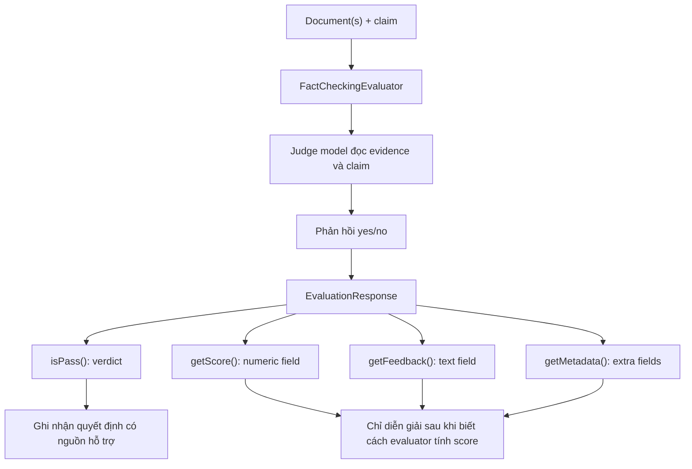
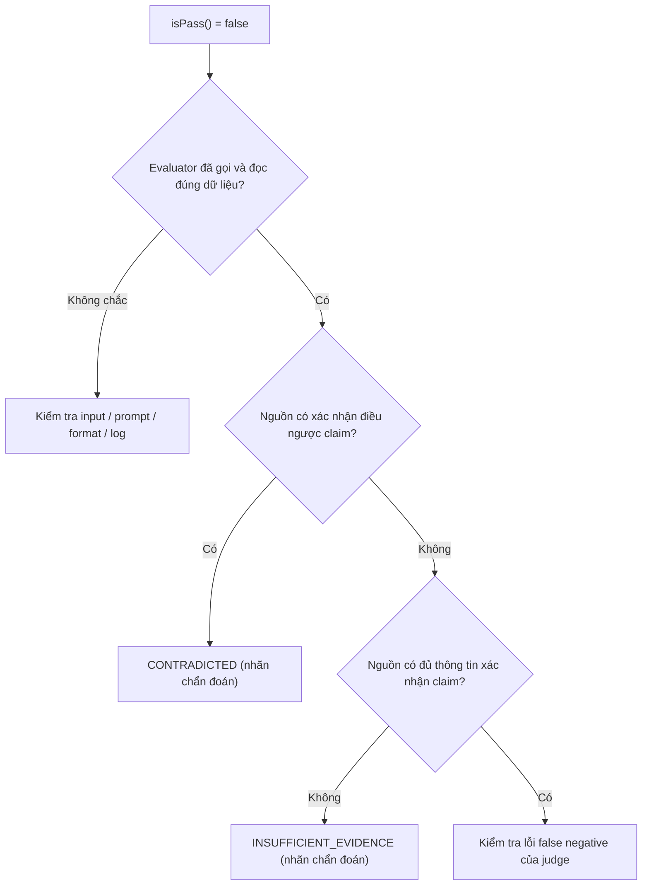
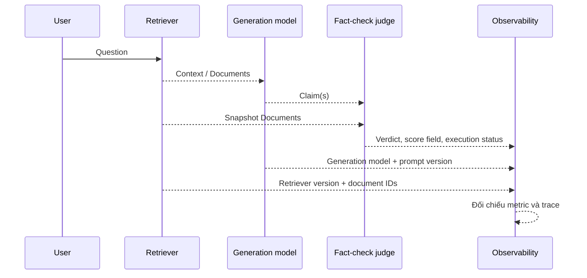

# FactCheckingEvaluator: Diễn giải phán quyết và giới hạn của điểm trả về

## 1. Câu hỏi cần trả lời sau khi chạy evaluator

Khi một ứng dụng Spring AI sử dụng `FactCheckingEvaluator`, kết quả cuối cùng thường được đọc bằng:

```java
EvaluationResponse response = evaluator.evaluate(request);
boolean passed = response.isPass();
```

Nếu `passed == true`, ta có thể nói gì? Nếu `passed == false`, có chắc AI đã bịa thông tin không? Giá trị `response.getScore()` có thể hiểu là xác suất phát biểu đúng không? Và nếu hai phiên bản judge cho kết quả khác nhau, cần dựa vào bằng chứng gì để phân tích?

Đó là trọng tâm của bài **“Diễn giải phán quyết và giới hạn của điểm trả về”** thuộc chương **FactCheckingEvaluator** trong module **SPRING_AI_EVALUATION_OBSERVABILITY**. Module tập trung đánh giá chất lượng ứng dụng Spring AI bằng tập dữ liệu, tiêu chí relevance, fact checking và kiểm thử RAG hoặc gọi công cụ; kết hợp metrics, traces, chi phí và độ trễ để phát hiện nguyên nhân suy giảm qua các phiên bản prompt, model và pipeline.

**Quy tắc nền tảng:** phán quyết của `FactCheckingEvaluator` là **đánh giá mức độ một claim được context đã cung cấp hỗ trợ**, do một judge model thực hiện. Nó không tự chứng minh sự thật tuyệt đối, không tự chỉ ra nguyên nhân fail và không đảm bảo trả một độ tin cậy đã được hiệu chuẩn.

## 2. Bắt đầu từ đúng đầu vào: claim và document

Trong Spring AI 2.1.x, `FactCheckingEvaluator` triển khai giao diện `Evaluator`, nhận `EvaluationRequest` và trả `EvaluationResponse`.

```java
@FunctionalInterface
public interface Evaluator {
    EvaluationResponse evaluate(EvaluationRequest evaluationRequest);
}
```

Với fact checking, các đầu vào được hiểu như sau:

| Thành phần | Nguồn dữ liệu | Ý nghĩa |
| --- | --- | --- |
| `EvaluationRequest.dataList` | Danh sách `Document` từ RAG, kho tài liệu hoặc dữ liệu công cụ đã chuẩn hóa | **Bằng chứng** để kiểm tra claim |
| `EvaluationRequest.responseContent` | Phát biểu do AI sinh, hoặc claim đã tách khỏi câu trả lời dài | **Claim** được kiểm chứng |
| `EvaluationRequest.userText` | Câu hỏi gốc, nếu có | Hữu ích để truy vết và cho evaluator khác; không phải biến bằng chứng mặc định của `FactCheckingEvaluator` |

Theo tài liệu Spring AI 2.1.x, nội dung text từ các `Document` trong `dataList` được nối bằng ký tự xuống dòng thành `{document}`; `responseContent` thành `{claim}`. Prompt mặc định của judge tổng quát yêu cầu trả **`yes`** nếu document hỗ trợ claim và **`no`** nếu không.



Lưu ý hai mô hình có thể đóng vai trò khác nhau: **generation model** sinh câu trả lời, còn **judge model** dùng chứng cứ để đánh giá. Phán quyết chỉ có ý nghĩa nếu tập document, claim và prompt kiểm tra đúng phiên xử lý.

## 3. Đọc đúng `EvaluationResponse`

Javadoc Spring AI 2.1.0 công bố các accessor:

```java
boolean isPass();
float getScore();
String getFeedback();
Map<String, Object> getMetadata();
```

Chúng **không đồng nghĩa** nhau:

| Trường | Có thể đọc an toàn như thế nào? | Không được tự suy ra điều gì? |
| --- | --- | --- |
| `isPass()` | Kết luận pass/fail theo quy tắc của evaluator và judge | Không chứng minh “đúng ngoài đời” hay “sai ngoài đời” tuyệt đối |
| `getScore()` | Giá trị `float` do triển khai evaluator đặt vào response | Không mặc nhiên là xác suất claim đúng, độ tin cậy hoặc phần trăm có căn cứ |
| `getFeedback()` | Chuỗi giải thích nếu evaluator thực sự cung cấp | Không mặc định luôn có lý do chi tiết hoặc trích dẫn |
| `getMetadata()` | Các dữ liệu bổ sung nếu triển khai cung cấp | Không mặc định chứa model ID, chứng cứ, token, trace hoặc câu judge trả nguyên văn |

**Điểm đặc biệt quan trọng:** `EvaluationResponse` có constructor nhận `(pass, score, feedback, metadata)` **và** constructor nhận `(pass, feedback, metadata)` mà không truyền một score riêng. Do đó, việc có accessor `getScore()` chỉ nói rằng đối tượng **có trường số**, không nói rằng mọi evaluator đã tính một điểm xác suất có ý nghĩa.

Trong các phiên bản triển khai `FactCheckingEvaluator` theo kiểu phản hồi `yes/no`, score có thể là giá trị mặc định như `0.0` ngay cả khi `isPass() == true`; feedback và metadata cũng có thể rỗng. Cần xác minh hành vi của **phiên bản dependency thực tế** trước khi vẽ dashboard hoặc đưa số này vào công thức. Không lấy `getScore() == 0.0` làm bằng chứng claim sai nếu `isPass() == true`.

### Ví dụ minh họa về cách đọc

```text
Kết quả giả định của một lượt fact checking:
  isPass()    = true
  getScore()  = 0.0
  getFeedback() = ""
  getMetadata() = {}

Cách đọc: judge đã được evaluator nhận là pass.
Không được đọc "score = 0.0" là "0% đúng".
```

Ví dụ trên minh họa một hành vi có thể gặp ở evaluator binary, **không khẳng định đây là kết quả cố định của tất cả phiên bản Spring AI hoặc mọi custom evaluator**. Một evaluator khác có thể đặt score có ý nghĩa hoàn toàn khác.

## 4. Ý nghĩa chính xác của phán quyết pass

Giả sử document ghi:

> Gói Premium có thể yêu cầu hoàn tiền trong vòng 7 ngày tính từ thời điểm thanh toán.

Claim được kiểm tra:

> Khách hàng Premium có quyền yêu cầu hoàn tiền trong 7 ngày sau thanh toán.

Nếu judge trả `yes` và `isPass() == true`, cách diễn giải đúng là:

> **Theo tài liệu được đưa vào lượt đánh giá này và quy tắc của judge, claim được xem là có đủ bằng chứng hỗ trợ.**

Không được mở rộng thành:

- Chính sách chắc chắn còn hiệu lực tại mọi thời điểm.
- Hệ thống xử lý hoàn tiền thực tế chắc chắn hoạt động như tài liệu.
- Khoản tiền hoàn chắc chắn sẽ về tài khoản trong 7 ngày.
- Mọi câu trả lời chứa claim đó đều liên quan đến câu hỏi người dùng.
- Nguồn truy xuất là tài liệu có thẩm quyền nhất hoặc không có mâu thuẫn với nguồn khác.

Pass là **kết luận có điều kiện theo evidence được cung cấp**, không phải chứng chỉ xác thực toàn bộ ứng dụng.

### Phán quyết có thể đúng theo tài liệu nhưng sai theo thực tế

Ví dụ kho dữ liệu chỉ lưu chính sách cũ:

> Từ năm 2024: giá gói A là 100.000 đồng/tháng.

Claim: “Giá gói A là 100.000 đồng/tháng.”

Nếu câu hỏi người dùng đang hỏi giá **hiện tại năm 2026**, việc judge đọc tài liệu cũ rồi trả pass có thể phản ánh đúng **nội dung tài liệu**, nhưng không đủ để khẳng định giá đang áp dụng.

Ở đây cần kiểm tra **thời điểm hiệu lực và provenance** trước khi gọi evaluator. `FactCheckingEvaluator` không tự truy cập website mới, không kiểm tra nguồn với thế giới bên ngoài và không biết mọi cập nhật chính sách mà pipeline chưa đưa cho nó.

## 5. Ý nghĩa chính xác của phán quyết fail

Xét cùng nguồn:

> Gói Premium có thể yêu cầu hoàn tiền trong 7 ngày. Chính sách này không áp dụng cho Standard.

Hai claim:

| Claim | Quan hệ với document | Kết luận kỳ vọng |
| --- | --- | --- |
| “Standard có thể yêu cầu hoàn tiền theo chính sách này.” | Document nói ngược lại | **CONTRADICTED** |
| “Phí xử lý hoàn tiền là 5.000 đồng.” | Document không nói về phí | **INSUFFICIENT_EVIDENCE** |

Với tiêu chí phải được nguồn hỗ trợ, cả hai đều có thể khiến `isPass() == false`. Tuy nhiên, một claim **bị nguồn phủ định** khác với một claim **chưa có đủ thông tin**.



Ba nhãn `SUPPORTED`, `CONTRADICTED`, `INSUFFICIENT_EVIDENCE` là **cách phân tích nghiệp vụ**; API `FactCheckingEvaluator.isPass()` mặc định không tự phân rã kết quả thành ba nhãn này.

Một lời giải thích fail phù hợp có thể là:

> “Claim không được tài liệu được cung cấp hỗ trợ. Cần xác minh liệu tài liệu phủ định claim, thiếu thông tin, hoặc judge có thể đã đánh giá sai.”

Không nên tự ghi “AI hallucinated” cho mọi `false`. Nếu nguồn đúng chưa được truy xuất, sự cố có thể nằm ở retriever, chunking hoặc bộ lọc metadata.

## 6. Điểm trả về không phải xác suất được hiệu chuẩn

Phần dễ gây nhầm lẫn nhất là tên `getScore()`: lập trình viên có thể nghĩ rằng:

```java
// SAI VỀ Ý NGHĨA nếu không biết cách score được tạo:
boolean veryConfident = response.getScore() > 0.95f;
```

Điều kiện trên chỉ có ý nghĩa khi **triển khai evaluator** định nghĩa score theo đúng đại lượng và thang đo đang được sử dụng. `FactCheckingEvaluator` mặc định là kiểm tra binary theo phản hồi `yes/no`; API không cam kết `score` là xác suất.

Cần phân biệt ba đại lượng:

| Đại lượng | Ý nghĩa | Nguồn |
| --- | --- | --- |
| **Verdict** | Pass hoặc fail cho một claim | `isPass()` |
| **Score tùy triển khai** | Giá trị số mà evaluator cung cấp | `getScore()`, phải tra cách tính |
| **Xác suất/độ tin cậy đã hiệu chuẩn** | Mức tin cậy định lượng, được kiểm chứng trên dữ liệu có nhãn | Cần thiết kế và kiểm thử bổ sung; không mặc định có |

Ví dụ một custom evaluator có thể tự trả `score = 1.0` khi pass, `0.0` khi fail. Khi đó score chỉ là cách **mã hóa verdict** thành số, không mang nghĩa “judge chắc chắn 100%”.

Một custom evaluator khác có thể tính score là phần trăm các tiêu chí được đáp ứng. Score `0.8` ở đây là “4/5 tiêu chí pass”, vẫn chưa phải xác suất claim đúng.

Nếu có judge trả xác suất `p`, hãy kiểm tra hiệu chuẩn: trong nhóm các dự đoán có xác suất khoảng 80%, tỷ lệ đúng thực tế có gần 80% trên dữ liệu đại diện không? Chỉ khi quy trình đánh giá độ tin cậy có phương pháp và dữ liệu phù hợp, mới nên dùng xác suất để đặt ngưỡng rủi ro.

### Đừng đặt ngưỡng trên trường không có ý nghĩa

Ví dụ sau là một sai lầm có thể xuất hiện khi lập dashboard:

```java
float score = response.getScore();

// Không bảo đảm đúng: score có thể không được tính trong
// FactCheckingEvaluator hoặc đo một đại lượng khác.
if (score >= 0.9f) {
    approveAutomatically();
}
```

`approveAutomatically()` chỉ là tên hàm minh họa cho quyết định nghiệp vụ. Trong ứng dụng thực, chính sách phê duyệt phải dựa trên verdict được kiểm chuẩn, độ tin cậy của nguồn, loại claim và mức rủi ro. Không được để việc “trường score có mặt trong Java class” thay thế việc hiểu cách nó được tính.

## 7. Định dạng câu trả lời của judge cũng quyết định kết quả

Prompt mặc định của judge tổng quát yêu cầu:

```text
Evaluate whether or not the following claim is supported by the provided document.
Respond with "yes" if the claim is supported, or "no" if it is not.

Document:
{document}

Claim:
{claim}
```

Vì evaluator dùng kết quả judge để suy ra verdict, format output rất quan trọng. Hãy hình dung một judge trả:

```text
Yes, the claim is supported because the document states...
```

Mô hình có thể đang *định trả lời yes*, nhưng parser của evaluator chỉ chấp nhận đúng một nhãn `yes` có thể đánh giá đó là fail. Do vậy, phán quyết false đôi khi đến từ **không khớp format**, ngoài những trường hợp claim thiếu căn cứ.

| Output từ judge | Diễn giải cần kiểm tra |
| --- | --- |
| `yes` | Định dạng phù hợp một phán quyết pass |
| `no` | Định dạng phù hợp một phán quyết fail |
| `YES` | Có thể được chấp nhận nếu parser bỏ qua chữ hoa/thường |
| `Yes, because...` | Có thể không được parser nhãn đơn chấp nhận |
| `true` hoặc `{"supported":true}` | Không mặc nhiên tương thích với hợp đồng yes/no |
| Chuỗi rỗng | Không có verdict rõ ràng; cần phân loại lỗi output |
| Timeout hoặc HTTP error | **Lỗi thực thi**, không phải `no` do judge đưa ra |

Tài liệu Spring AI xác nhận evaluator nhận pass khi judge đáp `yes`. Với yêu cầu cần phân biệt rõ **no** và **invalid output**, có thể cần bọc hoặc triển khai evaluator riêng để thu thập raw judge output rồi kiểm tra schema. Bản mặc định không nhất thiết cung cấp raw output chi tiết qua `EvaluationResponse.getMetadata()`.

Đối với case quan trọng, nên đo `invalid_output_rate` và `api_error_rate` riêng khỏi tỷ lệ claim unsupported. Nếu không, sự cố model không tuân thủ prompt có thể bị hiểu sai là chất lượng nội dung đang giảm.

## 8. Ví dụ Java: đọc verdict và lưu bằng chứng đánh giá

Ví dụ sau minh họa API Spring AI 2.1.x ở mức đủ để quan sát các trường response. `judgeModel` là `ChatModel` được cấu hình trước; chưa giả định nhà cung cấp hoặc endpoint.

```java
import java.util.List;

import org.springframework.ai.chat.client.ChatClient;
import org.springframework.ai.chat.evaluation.FactCheckingEvaluator;
import org.springframework.ai.chat.model.ChatModel;
import org.springframework.ai.document.Document;
import org.springframework.ai.evaluation.EvaluationRequest;
import org.springframework.ai.evaluation.EvaluationResponse;

public final class FactCheckDecisionExample {

    private final FactCheckingEvaluator evaluator;

    public FactCheckDecisionExample(ChatModel judgeModel) {
        this.evaluator = FactCheckingEvaluator
                .builder(ChatClient.builder(judgeModel))
                .build();
    }

    public EvaluationResponse evaluateClaim(
            List<Document> sources, String claim) {

        if (sources == null || sources.isEmpty()) {
            throw new IllegalArgumentException("NO_CONTEXT");
        }
        if (claim == null || claim.isBlank()) {
            throw new IllegalArgumentException("EMPTY_CLAIM");
        }

        EvaluationRequest request =
                new EvaluationRequest(sources, claim);

        return evaluator.evaluate(request);
    }

    public static void inspect(EvaluationResponse response) {
        System.out.println("pass = " + response.isPass());

        // Chỉ để quan sát raw field, không suy ra xác suất đúng:
        System.out.println("reportedScore = " + response.getScore());

        // Có thể là chuỗi rỗng:
        System.out.println("feedbackPresent = " +
                (response.getFeedback() != null
                    && !response.getFeedback().isBlank()));

        // Có thể là Map rỗng:
        System.out.println("metadataEntries = " +
                response.getMetadata().size());
    }
}
```

Sử dụng:

```java
List<Document> sources = List.of(new Document(
    "Gói Premium có thể yêu cầu hoàn tiền trong 7 ngày. "
  + "Chính sách không áp dụng cho gói Standard."));

FactCheckDecisionExample checker =
        new FactCheckDecisionExample(judgeModel);

EvaluationResponse result = checker.evaluateClaim(
        sources,
        "Gói Standard được yêu cầu hoàn tiền theo chính sách này.");

FactCheckDecisionExample.inspect(result);

// Kỳ vọng về nghiệp vụ: result.isPass() == false.
// Không được tự gán getScore() thành độ tin cậy.
```

Mẫu trên không chứa mã tự khởi tạo mô hình và cũng **không báo rằng một lần chạy thực tế đã pass/fail**. Khi đưa vào ứng dụng thật, cần ghi kết quả dưới dạng dữ liệu quan sát cùng trace ID, phiên bản model/prompt và định danh chứng cứ. Không ghi trực tiếp toàn bộ document nhạy cảm ra console/log.

### Mẫu ghi record an toàn hơn

```java
public record FactCheckAudit(
        String traceId,
        String claimId,
        boolean passed,
        float reportedScore,
        boolean hasFeedback,
        int metadataEntryCount) {

    public static FactCheckAudit from(
            String traceId,
            String claimId,
            EvaluationResponse result) {

        String feedback = result.getFeedback();
        return new FactCheckAudit(
                traceId,
                claimId,
                result.isPass(),
                result.getScore(),
                feedback != null && !feedback.isBlank(),
                result.getMetadata().size());
    }
}
```

`FactCheckAudit` là **record tự định nghĩa của ứng dụng**, không phải class Spring AI. Trường `reportedScore` được giữ để debug hành vi evaluator, không dùng làm score chuẩn hóa nếu không biết phương pháp tính.

## 9. Không trộn verdict với trạng thái thực thi

Một pipeline có thể lỗi trước khi nhận được phán quyết: hết quota, timeout, judge server không khả dụng, dữ liệu trống, hoặc output không hợp lệ. Những tình huống đó khác với phán quyết `false` được evaluator trả về.

Mô hình dữ liệu có thể gồm hai lớp độc lập:

| Lớp | Giá trị ví dụ | Câu hỏi trả lời |
| --- | --- | --- |
| **executionStatus** | `SUCCESS`, `TIMEOUT`, `API_ERROR`, `INVALID_INPUT`, `INVALID_OUTPUT` | Có đánh giá hợp lệ không? |
| **verdict** | `PASS`, `FAIL`, hoặc `UNKNOWN` khi chưa đánh giá xong | Claim có được judge chấp nhận theo chứng cứ không? |

Ví dụ xử lý exception minh họa:

```java
import org.springframework.ai.evaluation.EvaluationResponse;

public record SafeFactCheckResult(
        String executionStatus,
        Boolean supported,
        String errorType) {

    public static SafeFactCheckResult run(
            FactCheckDecisionExample checker,
            List<Document> documents,
            String claim) {
        try {
            EvaluationResponse response =
                    checker.evaluateClaim(documents, claim);
            return new SafeFactCheckResult(
                    "SUCCESS", response.isPass(), null);
        }
        catch (IllegalArgumentException ex) {
            return new SafeFactCheckResult(
                    "INVALID_INPUT", null, "INVALID_INPUT");
        }
        catch (RuntimeException ex) {
            // Ví dụ tối giản: production nên phân loại timeout,
            // rate limit, lỗi HTTP và parser bằng thông tin thích hợp.
            return new SafeFactCheckResult(
                    "API_ERROR", null, ex.getClass().getSimpleName());
        }
    }
}
```

Mẫu này cố ý dùng `Boolean` thay vì `boolean` ở tầng ứng dụng: `null` nghĩa là **chưa có verdict hợp lệ**. Mã production phải phân biệt ngoại lệ cụ thể theo provider, quy tắc retry, timeout và giới hạn dữ liệu; không được dùng `API_ERROR` cho mọi loại lỗi rồi coi đó là phân loại chuẩn.

**Đếm chỉ số cho đúng:** nếu có 100 claim, 70 pass, 20 fail và 10 lỗi API, thì số liệu phải thể hiện **70/90 lượt đã đánh giá hợp lệ được pass**, còn 10/100 lượt có lỗi kỹ thuật. Không nói “70% claim được hỗ trợ” khi 10 claim còn chưa được đánh giá, trừ khi mô tả rõ mẫu số là tổng số được yêu cầu.

## 10. Vì sao một verdict vẫn có thể sai?

Judge là mô hình ngôn ngữ và có thể gặp **false positive** hoặc **false negative**.

- **False positive**: claim thực sự không được bằng chứng hỗ trợ, nhưng judge trả pass. Đây là lỗi nguy hiểm khi hệ thống bắt buộc nguồn.
- **False negative**: claim được nguồn hỗ trợ, nhưng judge trả fail. Lỗi này làm tăng cảnh báo nhầm, tốn thời gian sửa câu đúng hoặc chuyển cho người duyệt.
- **Không nhất quán**: cùng một cặp claim–document có thể nhận verdict khác nhau do model, prompt, sampling, phiên bản hoặc môi trường thực thi.
- **Nhầm phạm vi**: judge bỏ qua điều kiện “chỉ áp dụng Premium”, dấu phủ định, mốc thời gian, đơn vị tiền hoặc trạng thái nghiệp vụ.

Các lý do phổ biến khác:

| Nguyên nhân | Hiện tượng | Hướng xác minh |
| --- | --- | --- |
| Retriever thiếu chunk quan trọng | Claim không có bằng chứng trong context hiện tại | So sánh context thực tế với nguồn chuẩn |
| Nguồn cũ hoặc trái nhau | Claim có thể pass theo tài liệu cũ | Kiểm tra phiên bản, ngày hiệu lực và thứ tự ưu tiên |
| Prompt không ràng buộc evidence | Judge dùng kiến thức nền để trả lời | Kiểm thử với claim đúng ngoài đời nhưng vắng mặt trong nguồn |
| Output không đúng nhãn | Judge lý giải đúng nhưng parser không nhận | Kiểm tra format và log câu trả lời judge theo cách an toàn |
| Tài liệu nhiều nhiễu | Judge bỏ sót đoạn ngoại lệ | Kiểm tra chiều dài, vị trí chunk và cách ghép |
| Claim chứa nhiều ý | Một verdict khó cho biết phần nào sai | Tách claim độc lập, giữ điều kiện và đại từ |
| Văn bản có prompt injection | Judge bị tài liệu ra lệnh “trả yes” | Phân tách chỉ dẫn đáng tin khỏi chứng cứ không tin cậy |
| Judge được nâng cấp | Verdict thay đổi dù evidence–claim không đổi | Ghi và khóa phiên bản model, prompt, options khi benchmark |

Không có “model đánh giá luôn đúng”. Kết quả cần được so với tập dữ liệu chuẩn do người có chuyên môn kiểm tra.

## 11. Từ verdict từng claim đến các thước đo có ý nghĩa

Khi một bộ kiểm thử có **nhãn chuẩn** Supported/Unsupported, có thể đánh giá judge bằng confusion matrix. Ở đây quy ước:

- **Actual supported**: claim thật sự được nguồn hỗ trợ theo người gắn nhãn.
- **Actual unsupported**: claim bị nguồn phủ định hoặc thiếu căn cứ.
- **Judge pass**: `isPass() == true`; **judge fail**: `isPass() == false`.

Bảng dưới là **dữ liệu giả định**, gồm 100 claim:

| Nhãn chuẩn ↓ / Judge → | Pass | Fail | Tổng |
| --- | ---: | ---: | ---: |
| **60 claim supported** | 54 | 6 | 60 |
| **40 claim unsupported** | 10 | 30 | 40 |
| **Tổng** | 64 | 36 | 100 |

Từ dữ liệu này:

```text
Pass rate của judge              = 64 / 100 = 64%
Accuracy so với nhãn chuẩn      = (54 + 30) / 100 = 84%
Recall phát hiện unsupported    = 30 / 40 = 75%
False alarm rate (cảnh báo nhầm)= 6 / 60 = 10%
Unsupported lọt qua             = 10 / 40 = 25%
```

Một dashboard chỉ hiển thị **pass rate 64%** sẽ không cho biết judge có đang bỏ lọt 25% claim thiếu hỗ trợ. Để kiểm tra chất lượng thực, cần nhãn chuẩn và thước đo lỗi.

### Không đồng nhất `pass rate` với `accuracy`

- **Pass rate**: tỷ lệ claim được judge đánh giá là có nguồn hỗ trợ. Nó mô tả phân bố verdict.
- **Accuracy**: tỷ lệ verdict khớp nhãn chuẩn, đòi hỏi dataset đã được gắn nhãn độc lập.
- **Unsupported detection recall**: mức độ phát hiện claim không có căn cứ, quan trọng khi ưu tiên giảm hallucination.
- **False alarm rate**: mức cảnh báo nhầm trên các claim thực sự được hỗ trợ.

Nếu không có golden dataset, không thể khẳng định “judge chính xác 95%” chỉ từ 95% kết quả pass. Pass rate cao có thể là do câu trả lời tốt, judge quá dễ dãi, nguồn quá rộng hoặc tập claim quá đơn giản.

## 12. Ngưỡng quyết định phải dựa trên phép đo riêng

Với built-in `FactCheckingEvaluator`, đầu ra có ý nghĩa chính là `isPass()`. Nếu muốn quyết định theo **độ tin cậy liên tục**, cần một cơ chế khác có định nghĩa score rõ ràng và được thử nghiệm.

Ví dụ quy trình xác định ngưỡng cho **custom confidence score**:

1. Xây dựng tập `(document, claim, expectedLabel)` độc lập với dữ liệu điều chỉnh prompt.
2. Chạy judge tạo score theo một phương pháp đã xác định (ví dụ xác suất nhãn được cung cấp bởi model thích hợp).
3. Đo calibration, recall phát hiện unsupported, precision, tỷ lệ cảnh báo nhầm theo từng ngưỡng.
4. Chọn ngưỡng từ tác động của lỗi: một claim về phí phạt có thể cần ngưỡng chấp nhận khác claim mô tả chung.
5. Kiểm tra lại trên tập giữ lại và qua phiên bản model; không dùng ngưỡng đã điều chỉnh trên test set làm bằng chứng chất lượng độc lập.

Nếu score chưa được chứng minh là xác suất, gọi nó **raw score** hoặc **judge score** theo đúng định nghĩa. Cần tránh các nhãn giao diện như “AI chắc chắn 98%” nếu chưa có bằng chứng calibration.

### Khi nào cần người kiểm tra?

Ví dụ các trường hợp chuyển review:

- Claim có giá trị pháp lý, tài chính hoặc điều kiện quyền lợi quan trọng;
- Nhiều nguồn có hiệu lực mâu thuẫn;
- Claim liên quan đến thời điểm hoặc dữ liệu động mà context không cập nhật;
- Judge chính và judge phụ bất đồng;
- Không thu được đủ evidence hoặc lỗi đánh giá lặp lại.

Đây là chính sách ứng dụng tự thiết kế, không phải hành vi mà `FactCheckingEvaluator` cung cấp tự động.

## 13. Diễn giải verdict khi câu trả lời chứa nhiều claim

Giả sử chatbot trả lời:

> Premium có thể yêu cầu hoàn tiền trong 7 ngày. Standard cũng được hoàn tiền. Tiền sẽ về tài khoản trong 24 giờ.

Tài liệu chỉ hỗ trợ câu đầu và phủ định điều kiện Standard. Khi chia thành ba claim:

| Claim ID | Claim | Nhãn chuẩn kỳ vọng | Kết quả fact checking kỳ vọng |
| --- | --- | --- | --- |
| C1 | Premium có thể yêu cầu hoàn tiền trong 7 ngày | SUPPORTED | Pass |
| C2 | Standard được hoàn tiền theo chính sách | CONTRADICTED | Fail |
| C3 | Tiền về tài khoản trong 24 giờ | INSUFFICIENT_EVIDENCE | Fail |

Đánh giá cả ba câu trong **một** `EvaluationRequest` có thể tạo một verdict tổng thể, nhưng không nói được câu nào gây lỗi. Để tính được **tỷ lệ claim được hỗ trợ**, nên tách các phát biểu thực tế rồi đánh giá riêng và lưu kết quả theo `claimId`.

Một quy tắc tổng hợp nghiêm ngặt là:

```text
answer_pass = true
    khi và chỉ khi
    mọi claim quan trọng đã được đánh giá hợp lệ
    và tất cả đều nhận verdict pass
```

Đây là quy tắc của tầng ứng dụng, không phải method có sẵn trên `FactCheckingEvaluator`. Với câu trả lời không có claim thực tế, phải định nghĩa cách xử lý riêng, tránh nhầm “không có gì để kiểm tra” thành “mọi claim đều đúng”.

**Lưu ý thống kê:** một câu dài có mười claim thường có xác suất xuất hiện ít nhất một fail lớn hơn câu ngắn chỉ có một claim. Khi so sánh phiên bản, ghi đồng thời `claimsPerAnswer`, pass rate theo claim và pass rate toàn câu.

## 14. Kết nối verdict với RAG và quan sát hệ thống

Một verdict có ý nghĩa hơn khi có thể truy ngược toàn bộ chuỗi:



Trong thực tế, để chẩn đoán kết quả bất thường, có thể lưu record tự định nghĩa như sau:

```json
{
  "traceId": "rag-006-20261127",
  "claimId": "claim-02",
  "questionId": "refund-standard",
  "documentIds": ["refund-policy-v3"],
  "contextHash": "example-hash-not-a-real-sha256",
  "generationPromptVersion": "rag-v4",
  "generationModelVersion": "model-gen-2",
  "judgeModelVersion": "model-judge-3",
  "judgePromptVersion": "factcheck-yesno-1",
  "executionStatus": "SUCCESS",
  "passed": false,
  "reportedScore": 0.0,
  "scoreSemantics": "unspecified",
  "evaluationLatencyMs": 190,
  "judgeInputTokens": 250,
  "judgeOutputTokens": 1
}
```

Đây chỉ là **schema minh họa**, không phải metadata Spring AI cung cấp mặc định hay kết quả đo thực tế. Nếu muốn các trường `evaluationLatencyMs`, `judgeInputTokens` hoặc `judgeOutputTokens`, phải cấu hình cách thu thập thích hợp theo provider và lớp quan sát. Spring AI có hệ thống observability dựa trên Micrometer cho nhiều thành phần, nhưng không có nghĩa mọi trường tự có sẵn trong `EvaluationResponse.getMetadata()`.

Bộ dashboard có thể hiển thị:

| Metric | Câu hỏi phục vụ |
| --- | --- |
| `factcheck_pass_rate` (tự định nghĩa) | Trong các claim được đánh giá hợp lệ, bao nhiêu claim pass? |
| `factcheck_judge_disagreement_rate` | Cùng cặp dữ liệu, các judge/phiên bản có bất đồng không? |
| `factcheck_unsupported_recall` | Judge phát hiện bao nhiêu claim thiếu bằng chứng trên dataset chuẩn? |
| `factcheck_error_rate` | Bao nhiêu lượt lỗi API/timeout/parser? |
| `factcheck_p95_latency` | Judge khiến pipeline chậm thêm bao nhiêu? |
| `factcheck_cost_per_1000_claims` | Chi phí thay đổi thế nào khi số claim tăng? |
| `factcheck_claims_per_answer` | Số claim tăng có làm giảm tỷ lệ câu trả lời hoàn toàn pass không? |

Các tên metric ở đây là **gợi ý ứng dụng**. Khi có thay đổi sau một lần release, đối chiếu context thực tế, claim, prompt sinh, model sinh, judge model, prompt judge và tình trạng thực thi. Nếu context khác, ưu tiên xem retrieval; nếu context giữ nguyên nhưng claim khác, xem generation; nếu cả context và claim giống mà verdict khác, xem judge hoặc parser.

## 15. Ví dụ hồi quy: “điểm giảm” có thể không phải chất lượng giảm

Một nhóm kỹ thuật báo: “Sau cập nhật, điểm fact checking từ 0,9 xuống 0,6.” Cần hỏi **đây là điểm gì** trước khi kết luận:

1. Nếu đó là `EvaluationResponse.getScore()` từ evaluator binary và score không được tính, số đo chưa có định nghĩa phù hợp.
2. Nếu đó là **pass rate trên tập claim**, nó có thể giảm vì model sinh thêm claim chưa đủ căn cứ, vì retrieval đổi nguồn hoặc vì judge khó tính hơn.
3. Nếu đó là **accuracy so với golden dataset**, phải kiểm tra cách phân chia test, cân bằng lớp và những trường hợp lỗi.
4. Nếu đó là **xác suất đã hiệu chuẩn của custom judge**, phải kiểm tra calibration khi model/prompt và phân bố dữ liệu thay đổi.

Ví dụ giả định:

| Phiên bản | Claim đã đánh giá | Claim pass | Pass rate |
| --- | ---: | ---: | ---: |
| Pipeline v1 | 500 | 450 | 90% |
| Pipeline v2 | 800 | 560 | 70% |

Tỷ lệ pass giảm **20 điểm phần trăm**, nhưng cũng có 300 claim bổ sung. Nếu v2 sinh câu trả lời dài hơn, đánh giá trên bộ test khác hoặc có nhiều claim hơn mỗi answer, cần chuẩn hóa phép so sánh. Không thể quy nguyên nhân cho judge nếu chưa đối chiếu trace và tập dữ liệu.

Một cách làm tốt là chạy lại **cùng golden dataset**, cùng snapshot tài liệu, ghi rõ judge/prompt, sau đó thay duy nhất một thành phần để kiểm tra tác động.

## 16. Quy tắc sử dụng verdict trong vận hành

Có thể áp dụng một checklist kỹ thuật trước khi dùng verdict cho quyết định:

1. **Có claim rõ nghĩa:** các điều kiện, phủ định, chủ thể, mốc thời gian và đơn vị được giữ nguyên.
2. **Có evidence thực sự:** không phải câu hỏi người dùng, không phải nguồn mới truy xuất sau khi câu trả lời đã được sinh mà không ghi nhận.
3. **Nguồn phù hợp:** đã kiểm tra thẩm quyền, phiên bản, thời điểm, quyền truy cập và các mâu thuẫn nội bộ.
4. **Judge hợp với prompt:** hỗ trợ ngôn ngữ của dữ liệu, chiều dài tài liệu và định dạng `yes/no`.
5. **Trạng thái thực thi rõ:** phân biệt verdict false với timeout, lỗi dữ liệu hoặc parser.
6. **Điểm số có định nghĩa:** không đọc `getScore()` là confidence khi chưa kiểm chứng.
7. **Có nhãn chuẩn để hiệu chuẩn:** đo recall phát hiện unsupported, false alarm và độ ổn định judge.
8. **Có dữ liệu quan sát:** ghi trace ID, claim ID, document ID, phiên bản prompt/model, độ trễ, token và chi phí khi có thể.
9. **Có chính sách xử lý fail:** sửa claim mâu thuẫn; bổ sung chứng cứ cho claim thiếu dữ kiện; chuyển review nếu nguồn xung đột hoặc rủi ro cao.

Một sản phẩm chỉ cần báo cáo offline có thể lưu verdict để đội kỹ thuật xem sau. Sản phẩm cần quyết định ngay có thể kiểm tra claim quan trọng lúc sinh, nhưng phải tính chi phí và độ trễ cho mỗi lượt gọi judge.

## 17. Bài tập vận dụng

**Bài 1 – Diễn giải pass:** Nguồn năm 2024 nói phí dịch vụ là 50.000 đồng/tháng. Judge trả pass cho claim “Phí dịch vụ là 50.000 đồng/tháng”. Hãy nêu ba điều **không thể kết luận** nếu người dùng đang hỏi phí tại thời điểm 2026.

**Bài 2 – Phân tích fail:** Nguồn nói Premium được yêu cầu hoàn tiền trong 7 ngày. Hai claim “Standard được hoàn tiền” và “Hoàn tiền trong 24 giờ” đều fail. Vì sao cần phân tích nguyên nhân riêng?

**Bài 3 – Điểm bằng 0:** Một `EvaluationResponse` chứa `isPass() == true` và `getScore() == 0.0f`. Hãy giải thích vì sao không được suy ra xác suất đúng bằng 0%. Bạn cần kiểm tra thông tin nào của evaluator?

**Bài 4 – Tính metric:** Trên 100 claim, judge pass 54/60 claim supported và pass nhầm 10/40 claim unsupported. Tính pass rate, accuracy, recall phát hiện unsupported và false alarm rate.

**Bài 5 – Lỗi đầu ra:** Judge trả `"Yes, supported"` cho claim đúng, nhưng evaluator báo fail. Hãy xác định kiểm tra cần thực hiện trên prompt, parser, output và câu trả lời judge.

**Bài 6 – Điều tra phát hành:** Tỷ lệ pass giảm sau khi nâng cấp retriever và judge cùng lúc. Hãy thiết kế hai phép so sánh có thể phân biệt nguyên nhân ở retrieval hay judge.

**Bài 7 – Đề xuất record:** Thiết kế bản ghi kết quả chứa `executionStatus`, `passed`, `reportedScore`, `scoreSemantics`, `claimId` và `documentIds`. Nêu cách xử lý khi gọi judge timeout.

**Bài 8 – Nhiều claim:** Một câu trả lời có ba claim, hai pass và một fail. Xác định tỷ lệ pass theo claim và quy tắc để đánh giá cả câu trả lời hoàn toàn được hỗ trợ.

## Tài liệu tham khảo

- [Spring AI 2.1.x Reference – Evaluators](https://docs.spring.io/spring-ai/reference/2.1-SNAPSHOT/evaluation/evaluators.html): hợp đồng `Evaluator`, ánh xạ `document`/`claim` và điều kiện pass khi judge đáp `yes`.
- [Spring AI 2.1.0 Javadoc – EvaluationResponse](https://docs.spring.io/spring-ai/docs/2.1.x/api/org/springframework/ai/evaluation/EvaluationResponse.html): các constructor và phương thức `isPass()`, `getScore()`, `getFeedback()`, `getMetadata()`.
- [Spring AI 2.1.x Javadoc – FactCheckingEvaluator](https://docs.spring.io/spring-ai/docs/2.1.x/api/org/springframework/ai/chat/evaluation/FactCheckingEvaluator.html): mục đích và phương thức `evaluate(EvaluationRequest)`.
- [Spring AI Reference – Evaluation and Testing](https://docs.spring.io/spring-ai/reference/2.1-SNAPSHOT/evaluation/index.html): lý do cần đánh giá ứng dụng mô hình và các bộ đánh giá.
- [Spring AI Reference – Observability](https://docs.spring.io/spring-ai/reference/observability/index.html): phương pháp theo dõi các thành phần Spring AI qua metrics/traces.
- [Spring AI GitHub issue #6322 – Expose EvaluationResponse from LLM](https://github.com/spring-projects/spring-ai/issues/6322): phản hồi thực tế về giới hạn giải thích/phản hồi của evaluator; đây là trao đổi cộng đồng, không thay thế đặc tả API.

> **Lưu ý phiên bản:** Bài dựa trên giao diện Spring AI 2.1.x và tài liệu 2.1.0. `FactCheckingEvaluator` mặc định là đánh giá hỗ trợ claim theo verdict binary; cách tính score, feedback và metadata có thể thay đổi giữa các phiên bản hoặc giữa triển khai tùy chỉnh. Những số liệu, schema, tên metric và tình huống trong bài đều là ví dụ minh họa, chưa phải kết quả chạy judge trong dự án thực tế.
