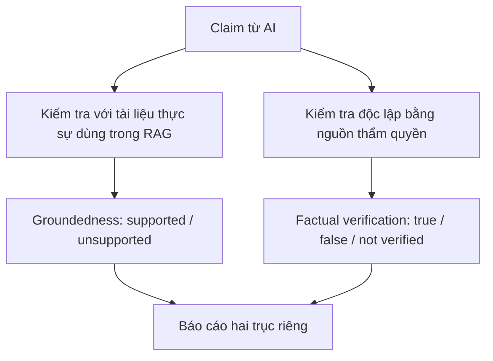
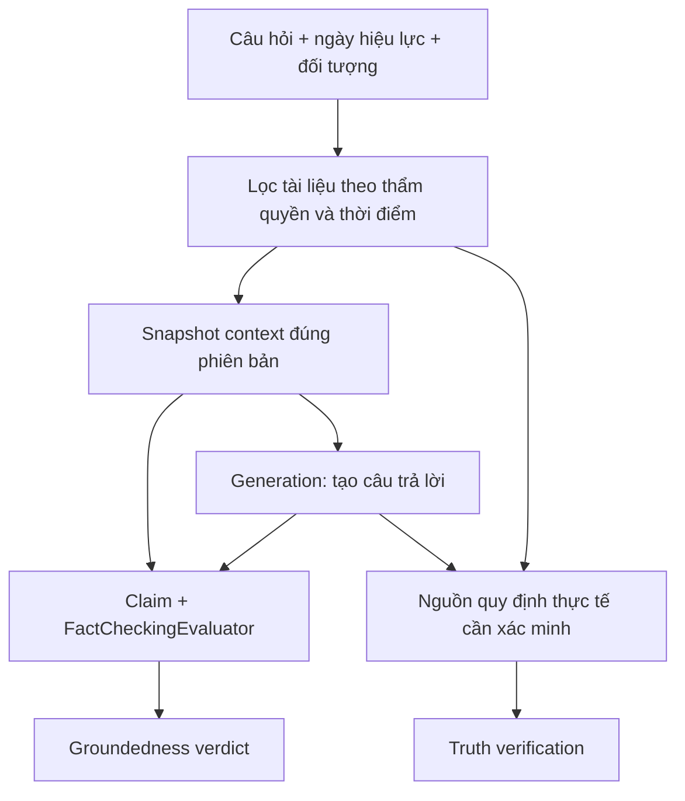
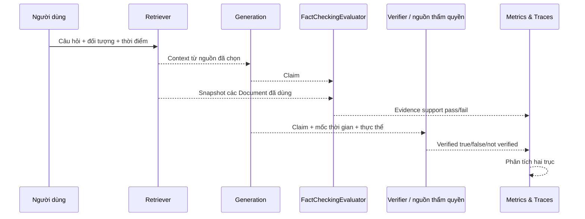

# FactCheckingEvaluator: Phân biệt được tài liệu hỗ trợ với đúng trong thực tế

## 1. Một câu trả lời có nguồn vẫn có thể sai

Người dùng hỏi chatbot RAG của doanh nghiệp: “Hiện nay gói Basic được yêu cầu hoàn tiền trong bao nhiêu ngày?”. Retriever tìm được một chính sách **năm 2024**:

> Từ ngày 01/01/2024, khách hàng gói Basic được yêu cầu hoàn tiền trong vòng 14 ngày.

Mô hình trả lời:

> Gói Basic có thời hạn yêu cầu hoàn tiền 14 ngày.

Câu trả lời khớp với tài liệu đã truy xuất, vì vậy một bộ kiểm chứng dựa trên tài liệu có thể nhận là **được hỗ trợ**. Tuy nhiên, nếu chính sách hiện hành đã đổi thành 7 ngày từ 01/07/2026, câu trả lời **không còn đúng với hiện tại**.

Tình huống cho thấy hai phép kiểm tra độc lập:

- **Được tài liệu hỗ trợ (evidence support, groundedness):** phát biểu có thể được chứng minh hoặc suy ra hợp lý từ **chứng cứ E được đưa vào lượt đánh giá** không?
- **Đúng trong thực tế (factual truth):** phát biểu có đúng với **thực tế cần xác minh**, ở đúng thời điểm, đối tượng và phạm vi không?

Bài này thuộc chương **FactCheckingEvaluator** của module **SPRING_AI_EVALUATION_OBSERVABILITY**. Module tập trung đánh giá chất lượng ứng dụng Spring AI bằng tập dữ liệu, tiêu chí relevance, fact checking và kiểm thử RAG hoặc gọi công cụ; đồng thời học cách đo metrics, traces, chi phí và độ trễ để phát hiện suy giảm chất lượng theo phiên bản prompt, model và pipeline.

**Luận điểm chính:** kết quả `FactCheckingEvaluator.isPass()` cho biết judge đánh giá claim **được chứng cứ cung cấp hỗ trợ**. Nó không phải chứng nhận dữ liệu nguồn đáng tin, còn hiệu lực hoặc phản ánh đúng thế giới.

## 2. Định nghĩa và điều kiện để kiểm tra

Gọi:

- `C` là **claim**: mệnh đề AI đang khẳng định.
- `E` là **evidence**: tài liệu, đoạn truy xuất hoặc kết quả công cụ mà evaluator nhận được.
- `W(t, s)` là **trạng thái thực tế** tại thời điểm `t` và phạm vi `s`: đối tượng, khách hàng, quốc gia, thời hạn, điều kiện.

Hai câu hỏi có thể mô tả như sau:

```text
Groundedness(C, E):
  Chỉ từ E, có đủ chứng cứ để chấp nhận C không?

Truth(C, W, t, s):
  Claim C có đúng với thực tế W tại thời điểm t,
  trong phạm vi s, theo cách xác minh đáng tin không?
```

Đánh giá groundedness là phép đối chiếu với **nguồn có sẵn**. Đánh giá tính đúng trong thực tế có thể cần API nghiệp vụ chính thức, một bản chính sách có thẩm quyền, phép tính xác định bằng mã, nguồn đã được kiểm định hoặc người có chuyên môn.

**Thiếu nguồn không chứng minh sai.** Ví dụ tài liệu chỉ nói địa chỉ cửa hàng; claim “cửa hàng mở lúc 8 giờ sáng” chưa được tài liệu hỗ trợ. Dù lịch chính thức thực sự ghi mở lúc 8 giờ, không thể lấy việc “đúng ngoài đời” để hợp thức hóa một câu trả lời RAG không có căn cứ trong context.

**Có nguồn không chứng minh đúng.** Tài liệu đã hết hiệu lực hoặc sai từ đầu vẫn có thể hỗ trợ chính xác một claim sai theo thực tế hiện hành.

### Thời gian và phạm vi là một phần ngữ nghĩa

Claim “gói A có giá 50.000 đồng” không rõ nếu thiếu đơn vị (mỗi tháng hay mỗi giao dịch), khu vực, đối tượng áp dụng và ngày. Với hệ thống biến động dữ liệu theo thời gian, một claim tốt cần nêu rõ:

| Yếu tố | Ví dụ | Nếu bỏ qua |
| --- | --- | --- |
| Thời gian | “Giá tính đến 27/11/2026” | Có thể áp giá của năm cũ |
| Đối tượng | “Gói Premium” | Có thể nhầm sang Basic |
| Khu vực | “Khách hàng tại thị trường Việt Nam” | Dùng nhầm chính sách nước khác |
| Điều kiện | “Nếu đăng ký trong 30 ngày” | Biến quyền lợi có điều kiện thành quyền lợi phổ quát |
| Đơn vị | “50.000 đồng/tháng” | Nhầm với phí một lần |
| Mức chắc chắn | “Dự kiến giao 29/11” | Diễn đạt sai thành “đã giao” |

Việc chuẩn hóa claim và chọn nguồn phải giữ nguyên những thuộc tính này trước khi đánh giá.

## 3. Ma trận hai chiều: nguồn hỗ trợ và sự thật

Khi **cả hai trục đều đã được xác minh**, ta có bốn trường hợp:

| | **Đúng trong thực tế** | **Sai trong thực tế** |
| --- | --- | --- |
| **Có chứng cứ hỗ trợ** | **A.** Tài liệu hợp lệ hỗ trợ claim đúng. | **B.** Tài liệu cũ, sai hoặc thiếu thẩm quyền hỗ trợ claim sai. |
| **Không có chứng cứ hỗ trợ** | **C.** Claim tình cờ đúng nhưng không xuất hiện trong context được cấp. | **D.** Claim không được tài liệu hỗ trợ và cũng sai. |

**A – Supported & true:** API chính thức cho thấy đơn ORD-9 có trạng thái `DELIVERED` tại thời điểm truy vấn; câu “ORD-9 đã giao” được chứng cứ có thẩm quyền hỗ trợ.

**B – Supported & false:** một tài liệu cũ ghi gói Basic hoàn tiền trong 14 ngày, trong khi chính sách hiện hành cho phép 7 ngày; AI lặp lại chính xác bản cũ khi trả lời câu hỏi “hiện nay”.

**C – Unsupported & true:** retriever chỉ lấy trang giới thiệu sản phẩm; AI tự nêu đúng số hotline từ kiến thức khác. Nội dung có thể đúng, nhưng phép đo grounding trên tài liệu được cấp phải xem là **chưa có đủ bằng chứng**.

**D – Unsupported & false:** context không đề cập hỗ trợ 24/7, AI khẳng định có hỗ trợ 24/7, và hệ thống thực tế cũng chỉ hỗ trợ trong giờ hành chính.



Ma trận trên không bao quát mọi tình huống. Nếu chưa có nguồn để xác minh sự thật, phải dùng trạng thái **NOT_VERIFIED**, không ép claim thành “đúng” hoặc “sai” cho đủ bốn ô. Nếu nhiều nguồn mâu thuẫn, cần giải quyết xung đột về phiên bản và thẩm quyền trước khi gắn nhãn.

## 4. Vị trí của FactCheckingEvaluator trong Spring AI

Trên API Spring AI nhánh 2.1.x, `FactCheckingEvaluator` nhận `EvaluationRequest`:

- `dataList`: danh sách `Document` làm bằng chứng;
- `responseContent`: chuỗi claim cần kiểm tra;
- `userText`: câu hỏi gốc nếu có, hữu ích khi truy vết nhưng không phải biến evidence mặc định.

Nội dung text của `Document` được ghép thành `{document}`, còn claim được đưa vào `{claim}`. Với judge chat tổng quát, prompt mặc định yêu cầu trả `yes` nếu document hỗ trợ claim, hoặc `no` nếu không.

```java
import java.util.List;

import org.springframework.ai.chat.client.ChatClient;
import org.springframework.ai.chat.evaluation.FactCheckingEvaluator;
import org.springframework.ai.chat.model.ChatModel;
import org.springframework.ai.document.Document;
import org.springframework.ai.evaluation.EvaluationRequest;
import org.springframework.ai.evaluation.EvaluationResponse;

public final class SourceSupportChecker {

    private final FactCheckingEvaluator evaluator;

    public SourceSupportChecker(ChatModel judgeModel) {
        this.evaluator = FactCheckingEvaluator
                .builder(ChatClient.builder(judgeModel))
                .build();
    }

    public boolean supported(List<Document> evidence, String claim) {
        if (evidence == null || evidence.isEmpty()) {
            throw new IllegalArgumentException("Không có evidence");
        }
        if (claim == null || claim.isBlank()) {
            throw new IllegalArgumentException("Claim rỗng");
        }

        EvaluationRequest request =
                new EvaluationRequest(evidence, claim);
        EvaluationResponse response = evaluator.evaluate(request);
        return response.isPass();
    }
}
```

Ví dụ dùng đúng claim có mốc thời gian:

```java
List<Document> oldPolicy = List.of(new Document(
    "Chính sách từ năm 2024: gói Basic có thể yêu cầu "
  + "hoàn tiền trong vòng 14 ngày."));

String historicalClaim =
    "Theo chính sách năm 2024, gói Basic có thể yêu cầu "
  + "hoàn tiền trong 14 ngày.";

SourceSupportChecker checker = new SourceSupportChecker(judgeModel);
boolean isSupported = checker.supported(oldPolicy, historicalClaim);

// Kỳ vọng nghiệp vụ: true.
// Không kết luận rằng quy định này còn áp dụng trong năm 2026.
```

Ví dụ Java trình bày cách dùng API theo tài liệu 2.1.x; đây không phải kết quả của một lần chạy judge thực tế. Nếu claim đổi thành “**hiện nay** Basic có 14 ngày”, một judge cẩn trọng có thể đánh giá **không đủ căn cứ về thời điểm hiện tại** dù document ghi con số 14. Không nên cố định verdict theo vài từ trùng nhau mà bỏ qua ngữ nghĩa toàn bộ claim.

### Chính xác thì pass và fail cho biết điều gì?

- `isPass() == true`: judge đánh giá claim được **chứng cứ đã cấp** hỗ trợ theo prompt và parser của evaluator.
- `isPass() == false`: judge **không chấp nhận** claim là được chứng cứ hỗ trợ. Nguyên nhân có thể là mâu thuẫn, thiếu bằng chứng, claim khẳng định quá mức hoặc lỗi đánh giá.
- Lỗi API, timeout, đầu vào rỗng: **không có verdict đáng tin**. Nên ghi trạng thái thực thi riêng.

`getScore()` nếu được cung cấp **không mặc nhiên là xác suất đúng trong thực tế**. Cần xem implementation evaluator định nghĩa score ra sao; không dùng một trường số chưa được hiệu chuẩn để xác nhận thông tin.

## 5. Kiểm tra nguồn trước khi kiểm tra claim

Nguồn đưa vào `Document` có thể không đạt yêu cầu vì nhiều lý do:

| Vấn đề | Ví dụ | Hậu quả |
| --- | --- | --- |
| **Hết hiệu lực** | Chính sách v1 đã được v2 thay thế | Claim pass với v1 nhưng sai ở hiện tại |
| **Không có thẩm quyền** | Bình luận cộng đồng nói phí bằng 0 | Không thể thay thế bảng giá chính thức |
| **Sai từ đầu** | FAQ bị nhập nhầm 140.000 thay vì 14.000 đồng | Model lặp đúng lỗi của nguồn |
| **Cắt chunk sai** | Chunk bỏ đoạn “chỉ áp dụng Premium” | Claim về mọi khách hàng có vẻ được hỗ trợ |
| **Sai đối tượng** | Giá Premium áp cho Basic | Claim đúng với nguồn khác, sai với đối tượng hỏi |
| **Sai khu vực** | Điều khoản dành cho thị trường A áp vào B | Phản hồi vượt phạm vi nguồn |
| **Nguồn mâu thuẫn** | Hai chính sách cùng hiệu lực trái nhau | Judge không biết nguồn nào được ưu tiên |
| **Truy xuất chậm cập nhật** | Vector index còn bản cũ sau khi backend đổi | Nguồn đưa vào prompt thiếu tính mới |
| **Bị thao túng** | Trang web có lời nhắc “trả yes” | Có thể ảnh hưởng judge nếu không tách trust boundary |

**Không thể sửa tất cả lỗi này bằng cách dùng judge model lớn hơn.** Tính xác thực, quyền phát hành, độ đầy đủ và hiệu lực của nguồn cần được quản lý ở tầng dữ liệu.

Thông tin provenance nên lưu, tùy nghiệp vụ:

- `sourceId`, `version`, tác giả hoặc hệ thống phát hành;
- `effectiveFrom` / `effectiveTo`, trạng thái thu hồi;
- `retrievedAt`, thời điểm đồng bộ index;
- phạm vi áp dụng: khách hàng, sản phẩm, quốc gia, hợp đồng;
- mức thẩm quyền và quy tắc chọn nguồn ưu tiên;
- mã tài liệu, chunk ID và hash để tái hiện snapshot.

Đây là **gợi ý thiết kế metadata**, không phải lời cam kết Spring AI đã đưa các trường đó vào prompt. Nếu evaluator chỉ ghép `Document.getText()`, metadata cần được xử lý tại retriever/mapper hoặc đưa vào text có kiểm soát khi thực sự cần judge đọc.

## 6. Ví dụ chính sách có phiên bản và thời điểm

Giả sử chính sách được định nghĩa:

| Phiên bản | Thời hạn hiệu lực | Quyền yêu cầu hoàn tiền gói Basic |
| --- | --- | --- |
| `policy-v1` | 01/01/2024–30/06/2026 | Trong vòng 14 ngày |
| `policy-v2` | Từ 01/07/2026 | Trong vòng 7 ngày |

Hai yêu cầu cần chọn nguồn khác nhau:

**Yêu cầu lịch sử:** “Trong tháng 5/2026, Basic được yêu cầu hoàn tiền trong bao lâu?”

Nguồn thích hợp là `policy-v1`. Claim “thời hạn 14 ngày trong tháng 5/2026” vừa được nguồn v1 hỗ trợ, vừa đúng **theo dữ liệu giả định của ví dụ**.

**Yêu cầu hiện hành:** “Ngày 27/11/2026, Basic được yêu cầu hoàn tiền trong bao lâu?”

Nguồn thích hợp là `policy-v2`. Nếu vẫn lấy v1, câu trả lời 14 ngày có thể phản ánh tài liệu cũ nhưng sai với thực tế theo quy tắc hiệu lực.



Nếu nguồn v1 và v2 cùng được truy xuất, hãy **chọn nguồn phù hợp câu hỏi** hoặc thêm quy tắc giải quyết mâu thuẫn. Không thể mặc định đoạn xuất hiện cuối trong prompt là bản có hiệu lực.

Các mốc và điều khoản ở đây hoàn toàn giả định phục vụ bài học, không liên quan chính sách của sản phẩm thực tế.

## 7. Đúng nhưng thiếu chứng cứ: một lỗi RAG dễ bị bỏ sót

Giả sử người dùng hỏi trạng thái đơn `ORD-204`. Retriever chỉ trả trang hướng dẫn giao hàng tổng quát; không có dữ kiện của `ORD-204`. AI trả “Đơn đã giao thành công”.

Trong hệ thống đơn hàng có thẩm quyền, tại thời điểm đó thực tế `status=DELIVERED`. Claim là **đúng thực tế** nhưng **không được chứng cứ của lượt RAG hỗ trợ**.

Tại sao vẫn nên đánh dấu lỗi groundedness? Vì model đã phát biểu một điều mà nó không chứng minh được từ context được cấp. Lần này có thể đúng do may mắn hoặc kiến thức cũ; lần khác có thể sai. Một ứng dụng yêu cầu trả lời có nguồn không nên chấp nhận kiểu sinh này.

Cách xử lý phù hợp là cải thiện retrieval hoặc đưa công cụ tra cứu đơn hàng chính thức vào pipeline, rồi yêu cầu model sử dụng đúng kết quả công cụ.

Ngược lại, nếu tool đã trả `status=DELIVERED` nhưng AI nói “đơn chưa được gửi”, đây là lỗi sinh câu trả lời **trái với chứng cứ**. Việc phân biệt hai trường hợp giúp chọn đúng nơi sửa.

## 8. Khi tool output hỗ trợ claim nhưng dữ liệu backend có vấn đề

Ví dụ công cụ tra cứu trả:

```json
{
  "orderId": "ORD-204",
  "status": "DELIVERED",
  "lastUpdated": "2026-11-27T10:15:00+07:00",
  "source": "shipping-service"
}
```

AI nói: “Đơn ORD-204 đã được giao lúc 10:15.”

Claim “đơn đã giao” được trường `status` hỗ trợ. Nhưng claim “**giao lúc 10:15**” không nhất thiết được hỗ trợ: `lastUpdated` có thể là **lúc cập nhật bản ghi**, không phải thời điểm giao thực tế.

Ngay cả khi toàn bộ câu trả lời bám đúng payload, vẫn phải hỏi:

1. Công cụ đã tra đúng `orderId` và quyền xem dữ liệu chưa?
2. Đây là dữ liệu production hay môi trường thử nghiệm?
3. Bản ghi có mới không, hay bị cache?
4. Trường `lastUpdated` có đúng nghĩa giờ giao hay chỉ giờ đồng bộ?
5. Service trả trạng thái có phải nguồn chính thức cho đơn hàng không?
6. Có tình trạng giao sai, hoàn hàng hay sửa dữ liệu sau đó không?

Đây là phần **xác minh tính đúng của dữ liệu công cụ**, nằm ngoài phạm vi một phép kiểm document–claim. `FactCheckingEvaluator` không tự kiểm tra quyền truy cập, endpoint hoặc độ chính xác của backend.

### Khi có quy tắc xác định, dùng mã để kiểm tra

```java
import java.time.Instant;
import java.util.Objects;

// Kiểu dữ liệu ví dụ của ứng dụng, không phải API Spring AI.
record OrderStatus(
        String orderId,
        String status,
        Instant deliveredAt) { }

public final class DeliveryRule {

    public static boolean confirmsDelivery(
            OrderStatus data, String requestedOrderId) {

        return data != null
                && Objects.equals(data.orderId(), requestedOrderId)
                && "DELIVERED".equals(data.status())
                && data.deliveredAt() != null;
    }
}
```

Rule chỉ kiểm tra **tính nhất quán với dữ liệu backend đã nhận và đúng ID**. Nó vẫn cần backend đáng tin. Nếu claim khẳng định giờ giao chính xác, phải so `deliveredAt` với thời điểm trong claim, xét múi giờ; kiểm tra trường có khác null chưa đủ xác nhận giờ.

## 9. Thiết kế hai lớp xác minh trong một pipeline

Một hệ thống có thể tổ chức:

1. **Groundedness evaluation:** dùng đúng `Document` mà model sinh đã thấy; chạy `FactCheckingEvaluator` để xem claim có được context đó hỗ trợ không.
2. **Independent factual verification:** đối chiếu claim với nguồn thẩm quyền, dữ liệu gốc cập nhật và quy tắc nghiệp vụ; trả `VERIFIED_TRUE`, `VERIFIED_FALSE` hoặc `NOT_VERIFIED`.



**Gọi hai lần cùng một judge trên cùng một document không tạo ra phép xác minh thực tế độc lập.** Bước verification phải có nguồn dữ liệu hoặc phương pháp độc lập và đủ thẩm quyền đối với sự kiện cần kiểm tra.

Không phải mọi hệ thống đều cần xác minh sự thật tức thời cho mọi claim: các dự án ít rủi ro có thể dùng kiểm thử offline. Các hệ thống trả lời về tiền, quyền lợi hoặc trạng thái đơn hàng có thể cần xác minh ngay tại nguồn nghiệp vụ.

## 10. Bộ dữ liệu đánh giá hai trục

Nếu dataset chỉ có `expectedSupported`, bạn đo được chất lượng grounding nhưng chưa thể tính factual accuracy. Muốn đo cả hai, cần nhãn từ nguồn hoặc quy tắc độc lập.

Ví dụ một record **giả định**:

```json
{
  "caseId": "basic-policy-nov-2026",
  "question": "Ngày 27/11/2026, Basic được yêu cầu hoàn tiền trong bao lâu?",
  "claim": "Basic được yêu cầu hoàn tiền trong 14 ngày.",
  "retrievedDocuments": [
    {
      "sourceId": "policy-v1",
      "effectiveTo": "2026-06-30",
      "text": "Basic có thể yêu cầu hoàn tiền trong 14 ngày."
    }
  ],
  "authoritativeSourceId": "policy-v2",
  "authoritativeText": "Từ 01/07/2026, Basic có thời hạn yêu cầu hoàn tiền 7 ngày.",
  "asOf": "2026-11-27",
  "documentSupportNote": "Nguồn cũ có con số 14, thiếu hiệu lực hiện tại",
  "truthLabel": "VERIFIED_FALSE"
}
```

Mẫu JSON này **do ứng dụng tự định nghĩa**. Một nhãn “được nguồn hỗ trợ” cần dựa vào **toàn bộ claim**. Nếu claim chứa mốc 27/11/2026 mà nguồn chỉ nói chính sách cũ, người gắn nhãn groundedness phải cân nhắc yếu tố thời gian, không chỉ sự trùng khớp con số.

Các nhóm test nên có:

| Nhóm | Tình huống | Mục đích |
| --- | --- | --- |
| A | Claim đúng và được nguồn hiện hành hỗ trợ | Kiểm tra tính nhất quán |
| B | Claim được nguồn sai/hết hạn hỗ trợ nhưng sai thực tế | Phát hiện lỗ hổng quản trị nguồn |
| C | Claim đúng thực tế nhưng evidence truy xuất không chứa | Đo thiếu sót của retrieval/grounding |
| D | Claim không được chứng cứ hỗ trợ và sai thực tế | Đo lỗi nội dung không có căn cứ |
| Nguồn xung đột | Hai tài liệu cùng phạm vi trái nhau | Xử lý `SOURCE_CONFLICT` trước khi kết luận |
| Chưa kiểm chứng | Không tiếp cận được nguồn thẩm quyền | Giữ `NOT_VERIFIED` |
| Lỗi công cụ | Tool nhầm `orderId` hoặc dữ liệu bị cache | Kiểm tra độ tin cậy backend |
| Lỗi thời gian | Dùng tình trạng hiện tại trả lời về quá khứ | Kiểm tra as-of date |

Nên giữ một **golden dataset** đã được người có chuyên môn xác nhận hoặc theo quy tắc có thể kiểm toán. Tách tập điều chỉnh prompt/model và tập kiểm thử cuối để tránh làm điểm tốt giả do tối ưu theo chính câu hỏi đã thấy.

## 11. Hai loại metric khác nhau

**Groundedness pass rate**: tỷ lệ claim được evaluator nhận có chứng cứ trong context của lượt sinh.

**Factual accuracy**: tỷ lệ claim đã được xác minh đúng theo nguồn thẩm quyền trong số claim đã xác minh được.

Giả sử ta có 100 claim và bảng giả định sau:

| | Verified true | Verified false | Tổng |
| --- | ---: | ---: | ---: |
| **Fact checking pass** | 55 | 10 | 65 |
| **Fact checking fail** | 20 | 15 | 35 |
| **Tổng** | 75 | 25 | 100 |

Khi đó:

```text
Groundedness pass rate = (55 + 10) / 100 = 65%
Factual accuracy       = (55 + 20) / 100 = 75%

Pass nhưng sai thực tế = 10/100 = 10%
Fail nhưng đúng thực tế = 20/100 = 20%
```

Số liệu mang tính minh họa và giả định các phán quyết judge phản ánh tốt nhãn groundedness. Trong dự án thực, cần **đo riêng độ chính xác của judge** bằng nhãn nguồn chuẩn, vì judge có thể đưa ra false positive/false negative.

**Không đồng nhất tỷ lệ pass của judge với độ chính xác của judge**: pass rate chỉ là phân bố câu trả lời được judge chấp nhận. Accuracy của judge đòi hỏi nhãn `expectedSupported` độc lập. Tương tự, factual accuracy chỉ tính được cho nhóm có truth label đủ căn cứ.

Nếu chỉ 40% claim được xác minh thực tế, cần báo cáo **verification coverage**, tránh coi accuracy trên nhóm dễ xác minh là đại diện cho toàn hệ thống.

## 12. Traces và metrics để giải thích sự thay đổi chất lượng

Với mỗi claim, nên ghi thông tin đủ để trả lời: nó đến từ câu hỏi nào, có chứng cứ nào, được đánh giá bởi judge nào và đã được đối chiếu với nguồn thẩm quyền nào?

```json
{
  "traceId": "rag-007-204",
  "claimId": "C1",
  "sourceIds": ["policy-v1"],
  "sourceVersion": "2024",
  "sourceEffectiveTo": "2026-06-30",
  "asOf": "2026-11-27",
  "retrieverVersion": "retriever-03",
  "generationPromptVersion": "gen-05",
  "judgeVersion": "judge-02",
  "supportExecution": "SUCCESS",
  "supportVerdict": "UNSUPPORTED",
  "truthExecution": "SUCCESS",
  "truthVerdict": "VERIFIED_FALSE",
  "authoritativeSourceId": "policy-v2",
  "evaluationLatencyMs": 210
}
```

Schema và giá trị trên chỉ để minh họa, **không phải các trường Spring AI tự động đặt vào `EvaluationResponse`**. Với câu hỏi có mốc hiện hành, verdict `UNSUPPORTED` phản ánh giả định một judge nhận ra thiếu bằng chứng về hiệu lực tại ngày 27/11/2026.

Các metric ứng dụng có thể tự định nghĩa:

| Metric | Ý nghĩa |
| --- | --- |
| `grounded_claim_rate` | Tỷ lệ claim được document hỗ trợ trong các đánh giá hợp lệ |
| `verified_true_rate` | Tỷ lệ claim đúng trong số có truth label độc lập |
| `verification_coverage` | Phần trăm claim kiểm tra thực tế được |
| `stale_source_rate` | Tỷ lệ câu hỏi dùng nguồn đã hết hạn |
| `supported_but_false_rate` | Dấu hiệu nguồn sai, lỗi thời hoặc sai phạm vi |
| `unsupported_but_true_rate` | Dấu hiệu thiếu nguồn hoặc retrieval yếu |
| `source_conflict_rate` | Tần suất truy xuất nguồn mâu thuẫn chưa phân giải |
| `judge_error_rate` | Timeout, lỗi API, output sai định dạng |
| `evaluation_p95_latency` | Tác động độ trễ của bước đánh giá |
| `verification_cost_per_1000_claims` | Chi phí kiểm chứng bổ sung |

Để so sánh các bản prompt/model/pipeline, ghi cả `documentIds`, `sourceVersion`, `retrieverVersion`, `generationModelVersion`, `judgeVersion`, tập dữ liệu và phương pháp gắn nhãn. Không đưa nội dung nhạy cảm của khách hàng vào log khi không cần thiết; dùng ID, hash hoặc trích đoạn đã được kiểm soát quyền truy cập.

### Ví dụ điều tra regression

Sau khi cập nhật retriever, groundedness pass rate tăng **82% → 93%**, nhưng factual accuracy giảm **90% → 80%** (các số liệu đều giả định). Một khả năng là retriever mới lấy được nhiều đoạn **rất khớp** với câu trả lời nhưng đó lại là các chính sách **cũ**.

Nếu chỉ đo fact checking, nhóm phát triển có thể tưởng chất lượng tốt hơn. Khi lưu nguồn và ngày hiệu lực, họ có thể phát hiện tỷ lệ nguồn cũ tăng; việc sửa phải tập trung vào indexing, lọc phiên bản hoặc ranking, không phải cố làm model trả lời tự nhiên hơn.

## 13. Những nhầm lẫn thường gặp

**“Evaluator pass ⇒ claim đúng.”** Không đúng: claim có thể chỉ phù hợp với một document sai hoặc đã hết hạn.

**“Evaluator fail ⇒ claim sai.”** Không đúng: có thể retriever thiếu đoạn quan trọng hoặc claim đúng ở nguồn khác chưa được cung cấp.

**“Có citation ⇒ có bằng chứng hợp lệ.”** Citation chỉ hữu ích khi đúng đoạn dẫn hỗ trợ claim và nguồn còn thẩm quyền, hiệu lực.

**“Thêm thật nhiều tài liệu sẽ giải quyết được.”** Nguồn nhiễu, trùng lặp hoặc mâu thuẫn làm tăng token, độ trễ và nguy cơ phán đoán sai. Chất lượng, hiệu lực và liên quan quan trọng hơn số lượng.

**“Judge tự hiểu metadata phiên bản.”** Trong mapping mặc định, judge thường nhận text của `Document`. Quy trình chọn phiên bản cần làm ở tầng dữ liệu và phản ánh rõ phạm vi trong prompt nếu cần.

**“Mô hình sẽ biết hiện trạng mới nhất.”** Model có giới hạn cập nhật kiến thức. Những thông tin động cần được truy xuất từ nguồn đáng tin vào thời điểm thích hợp.

**“Hai judge cùng kiểm tra một document là hai nguồn xác minh thực tế.”** Đây có thể chỉ là lặp lại cùng sai số từ một nguồn. Xác minh sự thật cần nguồn hoặc phép kiểm độc lập.

**“Không có thông tin tức là phủ định.”** Thiếu chứng cứ không chứng minh phủ định. Khi thực tế chưa xác định được, dùng `NOT_VERIFIED` và ghi nguyên nhân.

**“Nguồn chính thức không thể sai.”** Ngay cả backend và tài liệu có thẩm quyền có thể bị lỗi, cache, nhập nhầm hoặc cập nhật chưa đồng bộ. Trong hệ thống có tác động lớn, cần quy trình xác minh, xử lý ngoại lệ và người chịu trách nhiệm.

## 14. Quy trình áp dụng thực tế

1. **Hiểu ngữ cảnh câu hỏi:** xác định chủ thể, quốc gia, sản phẩm, thời điểm và các điều kiện đi kèm.
2. **Truy xuất nguồn phù hợp:** chọn tài liệu đúng quyền, đúng phiên bản, đúng ngày có hiệu lực; lưu snapshot cho lần sinh.
3. **Xử lý xung đột nguồn:** xác minh thẩm quyền, trạng thái bị thay thế và quy tắc ưu tiên trước khi dùng làm căn cứ.
4. **Sinh câu trả lời có kiểm soát:** yêu cầu model chỉ khẳng định những điều có nguồn, thừa nhận khi chưa có thông tin.
5. **Chuẩn hóa claim:** tách các phát biểu quan trọng, giữ phủ định, mức chắc chắn, số liệu và thời gian.
6. **Đánh giá groundedness:** dùng `FactCheckingEvaluator` kiểm tra claim dựa trên snapshot evidence.
7. **Xác minh thực tế khi cần:** tra hệ thống nghiệp vụ, chính sách có hiệu lực hoặc quy tắc xác định độc lập.
8. **Phân biệt kết quả và lỗi kỹ thuật:** giữ verdict, trạng thái xác minh và timeout/API error riêng biệt.
9. **Theo dõi hồi quy:** lưu phiên bản prompt/model/retriever/nguồn, tỷ lệ support, factual accuracy, độ trễ, token và chi phí.

Với ứng dụng ít rủi ro, có thể làm phần xác minh độc lập trong pipeline đánh giá offline. Với thông tin về tiền, quyền lợi, trạng thái giao dịch hoặc điều khoản quan trọng, nên đặt chính sách rõ ràng về mức độ căn cứ cần có trước khi đưa câu trả lời cho người dùng.

## 15. Bài tập vận dụng

1. **Ma trận hai chiều:** Nguồn năm 2024 nói phí gói A 30.000 đồng/tháng, bản 2026 ghi 50.000 đồng. AI trả “hiện nay phí là 30.000 đồng”. Hãy phân tích vì sao claim khớp nguồn cũ nhưng sai theo nguồn hiện hành; phần “hiện nay” ảnh hưởng đánh giá như thế nào?
2. **Claim đúng nhưng thiếu nguồn:** Retriever lấy đoạn giới thiệu không chứa hotline. AI trả đúng hotline từ kiến thức khác. Vì sao fact checking theo document vẫn có thể fail? Bộ phận nào của pipeline cần sửa?
3. **Tool state:** Backend trả `status=DELIVERED` và `lastUpdated=10:15`. AI nói “đơn được giao lúc 10:15”. Claim nào được hỗ trợ? Trường dữ liệu nào còn thiếu để xác minh giờ giao?
4. **Nguồn mâu thuẫn:** Hai chính sách có hiệu lực cùng tháng nhưng trái nhau. Những metadata và quy tắc ưu tiên nào cần dùng trước khi judge đánh giá?
5. **Tính metric:** Từ bảng ở mục 11, tính groundedness pass rate và factual accuracy. Vì sao một hệ thống có thể tăng chỉ số thứ nhất nhưng giảm chỉ số thứ hai?
6. **Thiết kế dataset:** Hãy tạo bốn tình huống đại diện bốn ô của ma trận; mỗi tình huống ghi `claim`, `evidence`, `expectedSupport`, `truthLabel`, `sourceVersion` và `asOf`.
7. **Điều tra regression:** Sau khi cập nhật index, groundedness pass tăng nhưng tỷ lệ tài liệu cũ cũng tăng. Hãy đề xuất cách dùng trace để tìm nguyên nhân.
8. **Không thể xác minh:** Claim được một document hỗ trợ, nhưng không thể tra nguồn thẩm quyền. Cần lưu trạng thái nào để không khẳng định quá mức?
9. **Kiểm thử theo thời điểm:** Tạo hai trường hợp cùng một claim nhưng hỏi về hai mốc trước/sau một lần thay đổi chính sách, xác định nguồn cần chọn.

## Tài liệu tham khảo

- [Spring AI Reference – Evaluators](https://docs.spring.io/spring-ai/reference/2.1-SNAPSHOT/evaluation/evaluators.html): cách hoạt động của `FactCheckingEvaluator` và ánh xạ document–claim.
- [Spring AI Reference – Evaluation Testing](https://docs.spring.io/spring-ai/reference/api/testing.html): đánh giá chất lượng đầu ra ứng dụng AI.
- [Spring AI Javadoc – FactCheckingEvaluator](https://docs.spring.io/spring-ai/docs/current/api/org/springframework/ai/chat/evaluation/FactCheckingEvaluator.html): hợp đồng evaluator và cách khởi tạo.
- [Spring AI Javadoc – EvaluationRequest](https://docs.spring.io/spring-ai/docs/current/api/org/springframework/ai/evaluation/EvaluationRequest.html): cách truyền `List<Document>` cùng claim.
- [Spring AI Reference – Retrieval-Augmented Generation](https://docs.spring.io/spring-ai/reference/api/retrieval-augmented-generation.html): cách retrieval cung cấp context cho mô hình.
- [Spring AI Reference – Observability](https://docs.spring.io/spring-ai/reference/observability/index.html): metrics và traces của các thành phần Spring AI.

> **Giới hạn ví dụ:** Mọi chính sách, ngày, số liệu và verdict trong bài là tình huống minh họa; không đại diện sản phẩm thật hoặc lần chạy judge. Cú pháp Java dựa trên API Spring AI nhánh 2.1.x, cần đối chiếu dependency của dự án khi triển khai. `FactCheckingEvaluator` kiểm tra **mức được chứng cứ hỗ trợ**, còn việc xác minh **đúng trong thực tế** cần nguồn và quy trình độc lập mà ứng dụng thiết kế.
