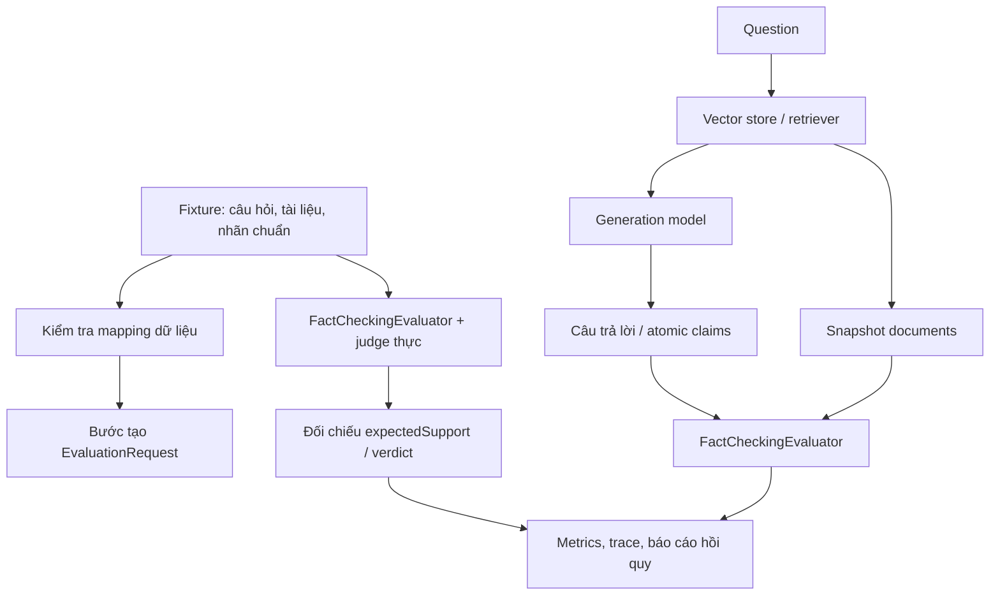
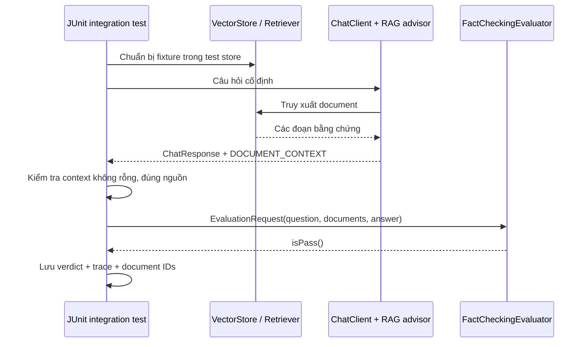
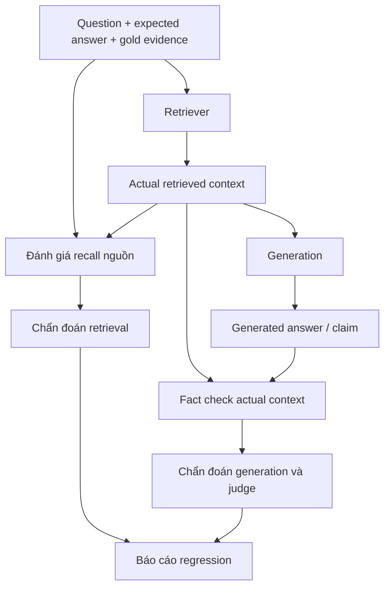

# FactCheckingEvaluator: Kiểm thử tích hợp với ngữ cảnh có thể xác minh

## 1. Mục tiêu của một bài kiểm thử tích hợp fact checking

Một ứng dụng RAG có thể truy xuất đúng văn bản nhưng sinh câu trả lời sai, hoặc sinh câu trả lời đúng tình cờ dù không có nguồn hỗ trợ. Chỉ kiểm tra rằng API trả HTTP 200, mô hình có tạo chuỗi hay vector store có kết quả là chưa đủ để biết ứng dụng đang tạo ra phát biểu có căn cứ.

`FactCheckingEvaluator` trong Spring AI giúp trả lời một câu hỏi cụ thể:

> **Claim do AI tạo ra có được những tài liệu được cung cấp cho bộ đánh giá hỗ trợ hay không?**

Bài học **“Kiểm thử tích hợp với ngữ cảnh có thể xác minh”** thuộc chương **FactCheckingEvaluator** của module **SPRING_AI_EVALUATION_OBSERVABILITY**. Trong toàn module, mục tiêu là đánh giá chất lượng ứng dụng Spring AI bằng tập dữ liệu và các tiêu chí relevance, fact checking, kiểm thử RAG hoặc gọi công cụ; đồng thời đo metrics, traces, chi phí và độ trễ để tìm nguyên nhân suy giảm qua mỗi phiên bản prompt, model và pipeline.

**Đầu ra mong muốn của bài:** xây dựng được một bộ test có **chứng cứ cố định, claim rõ ràng, nhãn kỳ vọng, điều kiện thực thi rõ ràng và kết quả có thể tái hiện**. Sau đó mở rộng từ cặp document–claim sang kiểm thử cả luồng RAG mà vẫn giữ đúng tài liệu mô hình đã thấy.

## 2. Phân biệt ba tầng kiểm thử để tránh kết luận nhầm

| Tầng | Đối tượng kiểm tra | Câu hỏi trả lời được | Giới hạn |
| --- | --- | --- | --- |
| **Kiểm tra dữ liệu / hợp đồng** | `EvaluationRequest`, `Document`, claim, metadata | Dữ liệu có đúng trường, đúng định dạng, không trống, không mất điều kiện không? | Chưa xác minh khả năng suy luận của judge. |
| **Kiểm thử tích hợp evaluator** | Spring AI `FactCheckingEvaluator` + judge model thực | Với một bộ nguồn–claim cố định, judge trả pass/fail phù hợp nhãn chuẩn không? | Chưa kiểm tra retriever và generator có xử lý đúng dữ liệu thật. |
| **Kiểm thử đầu-cuối RAG** | Retriever, vector store, prompt sinh, generation model, `FactCheckingEvaluator` | Câu trả lời sinh ra có được **context thực sự dùng để sinh** hỗ trợ không? | Pass không đồng nghĩa nguồn còn hiệu lực hoặc đúng ngoài thực tế. |

Một hệ thống trưởng thành thường cần cả ba. Test hợp đồng cho kết quả nhanh, ít dao động; test evaluator thực phát hiện lỗi prompt/judge; test RAG đầu-cuối giúp phát hiện lỗi kết nối các thành phần.



Phải phân biệt **kiểm thử đầu vào cố định** với **kiểm thử hoạt động của toàn pipeline**. Một lượt pass của evaluator trên bộ chứng cứ đã được gắn nhãn không chứng minh retriever sẽ lấy đúng chứng cứ đó khi người dùng hỏi thật.

## 3. Xây dựng ngữ cảnh có thể xác minh

Ngữ cảnh *có thể xác minh* (verifiable context) là tập bằng chứng được quản lý đủ chặt để người khác có thể kiểm tra claim mà không phải đoán về tác giả, phạm vi, phiên bản và cách diễn giải.

Dùng một **chính sách hoàn tiền giả định** cho toàn bài:

```text
Nguồn: refund-policy-v3
Hiệu lực: từ 01/07/2026
Đối tượng: khách hàng gói Premium và Standard

Quy định:
- Khách hàng Premium có thể YÊU CẦU hoàn tiền trong vòng
  7 ngày kể từ thời điểm thanh toán.
- Chính sách không áp dụng cho gói Standard.
- Tài liệu không quy định thời gian tiền về tài khoản.
```

Từ nguồn này, chuẩn bị bộ test:

| ID | Claim | Nhãn chuẩn theo nguồn | Vì sao |
| --- | --- | --- | --- |
| `F01` | Premium có thể yêu cầu hoàn tiền trong 7 ngày sau thanh toán. | **SUPPORTED** | Nguồn xác nhận trực tiếp. |
| `F02` | Standard có thể yêu cầu hoàn tiền theo chính sách này. | **CONTRADICTED** | Nguồn loại trừ Standard. |
| `F03` | Tiền hoàn chắc chắn về tài khoản trong 24 giờ. | **INSUFFICIENT_EVIDENCE** | Không có dữ liệu về thời gian hoàn tất. |
| `F04` | Quy định cho Premium bắt đầu áp dụng từ 01/07/2026. | **SUPPORTED** | Nguồn ghi mốc hiệu lực. |
| `F05` | Premium chắc chắn nhận đủ tiền hoàn trong 7 ngày. | **INSUFFICIENT_EVIDENCE** | “Được yêu cầu” không bảo đảm được chấp thuận hay hoàn tất. |
| `F06` | Chính sách này áp dụng cho cả Premium và Standard. | **CONTRADICTED** | Mệnh đề bao quát trái điều kiện loại trừ. |

Các nhãn do **người biên soạn fixture** quy định; chưa phải kết quả chạy judge. Mẫu này đủ để kiểm tra ba khả năng suy luận: nhận diện thông tin được hỗ trợ, phát hiện mâu thuẫn, và không tự suy diễn khi thiếu dữ kiện.

### Tiêu chí để fixture có thể được tái hiện

- **Cố định nội dung và phiên bản:** giữ nguyên chính sách v3 và ngày có hiệu lực trong suốt lần so sánh.
- **Không phụ thuộc thế giới đang thay đổi:** chọn dữ liệu giả định hoặc snapshot đã lưu; hạn chế dùng giá, thời tiết, tin tức đang cập nhật.
- **Gắn nhãn có lý do:** mỗi claim có `expectedLabel` và trích đoạn hỗ trợ hoặc giải thích thiếu chứng cứ.
- **Giữ ngữ nghĩa nguyên vẹn:** phân biệt “có thể yêu cầu” với “đã nhận tiền”, “dự kiến” với “chắc chắn”.
- **Không lộ nhãn vào judge prompt:** `expectedLabel` dành cho bộ kiểm thử, không phải dữ liệu nguồn hay gợi ý cho judge.
- **Dữ liệu đủ nhỏ để hiểu lỗi:** bắt đầu với một hoặc vài `Document` rõ ràng rồi mới thêm trường hợp nhiều nguồn và ngữ cảnh dài.

## 4. Ánh xạ test case vào API Spring AI

Trong API Spring AI 2.1.x, `EvaluationRequest` có những giá trị cần phân biệt:

| Trường | Dữ liệu phù hợp | Vai trò trong `FactCheckingEvaluator` |
| --- | --- | --- |
| `userText` | Câu hỏi người dùng, nếu cần | Dùng lưu bối cảnh; không phải biến chứng cứ mặc định của fact checking |
| `dataList` | `List<Document>` của tài liệu nguồn | Nội dung text các document thành biến `{document}` |
| `responseContent` | Câu trả lời hoặc claim riêng | Thành biến `{claim}` |

Judge chat tổng quát được cấu hình theo tài liệu 2.1.x như sau:

```java
FactCheckingEvaluator evaluator = FactCheckingEvaluator
        .builder(ChatClient.builder(judgeModel))
        .build();

EvaluationRequest request = new EvaluationRequest(
        evidenceDocuments, claimText);

EvaluationResponse result = evaluator.evaluate(request);
boolean supported = result.isPass();
```

Với **judge tổng quát**, prompt kiểm chứng mặc định yêu cầu trả `yes` nếu claim được document hỗ trợ và `no` nếu không. Với **Bespoke Minicheck**, Spring AI có factory `FactCheckingEvaluator.forBespokeMinicheck(ChatClient.builder(judgeModel))` để dùng định dạng phù hợp với mô hình chuyên dụng.

**Sai lầm nghiêm trọng:** đưa cả văn bản nguồn vào `userText`, để `dataList` rỗng rồi kỳ vọng `FactCheckingEvaluator` tự biết đó là document. Trên nhánh API 2.1.x, `dataList` mới là trường cấp chứng cứ cho prompt fact checking.

Đồng thời cần phân biệt `isPass() == false` với nhãn **CONTRADICTED**: trường hợp thiếu bằng chứng như F03 cũng có thể làm judge trả `no`. `FactCheckingEvaluator` mặc định chỉ trả verdict pass/fail, không tự sinh ba nhãn nghiệp vụ trên.

## 5. Test hợp đồng dữ liệu trước khi gọi mô hình

Kiểm tra cấu trúc `EvaluationRequest` là bước nhanh và có tính xác định. Nó giúp phát hiện những lỗi mà một judge mạnh cũng không thể tự sửa.

Ví dụ JUnit 5 (Java 17+, Spring AI 2.1.x):

```java
import static org.junit.jupiter.api.Assertions.assertEquals;
import static org.junit.jupiter.api.Assertions.assertFalse;

import java.util.List;

import org.junit.jupiter.api.Test;
import org.springframework.ai.document.Document;
import org.springframework.ai.evaluation.EvaluationRequest;

class FactCheckingInputContractTest {

    @Test
    void evidenceAndClaimAreMappedIntoCorrectFields() {
        String question = "Gói Standard có được hoàn tiền không?";
        String policy = """
                Premium có thể yêu cầu hoàn tiền trong 7 ngày.
                Chính sách không áp dụng cho Standard.
                """;
        String claim =
                "Standard có thể yêu cầu hoàn tiền theo chính sách này.";

        EvaluationRequest request = new EvaluationRequest(
                question,
                List.of(new Document(policy)),
                claim);

        assertEquals(question, request.getUserText());
        assertEquals(claim, request.getResponseContent());
        assertEquals(1, request.getDataList().size());
        assertEquals(policy, request.getDataList().get(0).getText());
        assertFalse(request.getDataList().get(0).getText().isBlank());
    }
}
```

Test này **không gọi LLM**, nên không phát hiện việc judge suy luận đúng hay sai. Nó có giá trị khi mapper hoặc cách gom `Document` thay đổi: việc đảo claim và document, thiếu tài liệu, mất điều kiện “không áp dụng” cần bị phát hiện trước bước kiểm chứng.

Có thể bổ sung assertion dữ liệu: mỗi claim không được rỗng; nguồn có ID/phiên bản; mọi đoạn đã được generation sử dụng đều có mặt; snapshot evidence không bị thay bởi một lần truy xuất mới. Với document rỗng hoặc claim trống, nên báo lỗi input rõ ràng thay vì nhận verdict từ judge.

## 6. Kiểm thử tích hợp với judge thực bằng JUnit

Để kiểm tra đúng `FactCheckingEvaluator`, cần gọi **judge model thật** trong một môi trường đã được cấu hình. Test sau minh họa với Spring Boot và JUnit 5. Nó được bật khi đặt biến môi trường `RUN_LIVE_FACTCHECK=true`, vì test có thể cần model server, credentials, network và phát sinh chi phí.

```java
import static org.junit.jupiter.api.Assertions.assertEquals;

import java.util.List;
import java.util.stream.Stream;

import org.junit.jupiter.api.condition.EnabledIfEnvironmentVariable;
import org.junit.jupiter.params.ParameterizedTest;
import org.junit.jupiter.params.provider.Arguments;
import org.junit.jupiter.params.provider.MethodSource;
import org.springframework.ai.chat.client.ChatClient;
import org.springframework.ai.chat.evaluation.FactCheckingEvaluator;
import org.springframework.ai.chat.model.ChatModel;
import org.springframework.ai.document.Document;
import org.springframework.ai.evaluation.EvaluationRequest;
import org.springframework.ai.evaluation.EvaluationResponse;
import org.springframework.beans.factory.annotation.Autowired;
import org.springframework.boot.test.context.SpringBootTest;

@SpringBootTest
@EnabledIfEnvironmentVariable(
        named = "RUN_LIVE_FACTCHECK", matches = "true")
class FactCheckingEvaluatorIntegrationTest {

    @Autowired
    ChatModel judgeModel; // Được cấu hình qua Spring Boot provider.

    private static final String POLICY = """
            Chính sách refund-policy-v3, từ 01/07/2026:
            Premium có thể yêu cầu hoàn tiền trong 7 ngày
            kể từ khi thanh toán.
            Chính sách không áp dụng cho Standard.
            Không có cam kết về thời gian tiền về tài khoản.
            """;

    static Stream<Arguments> cases() {
        return Stream.of(
                Arguments.of("F01",
                        "Premium có thể yêu cầu hoàn tiền trong "
                      + "7 ngày kể từ thanh toán.", true),
                Arguments.of("F02",
                        "Standard có thể yêu cầu hoàn tiền "
                      + "theo chính sách này.", false),
                Arguments.of("F03",
                        "Tiền hoàn chắc chắn về tài khoản "
                      + "trong 24 giờ.", false),
                Arguments.of("F04",
                        "Chính sách có hiệu lực từ 01/07/2026.", true));
    }

    @ParameterizedTest(name = "{0}")
    @MethodSource("cases")
    void checksSupportAgainstKnownDocument(
            String caseId, String claim, boolean expectedSupport) {

        FactCheckingEvaluator evaluator = FactCheckingEvaluator
                .builder(ChatClient.builder(judgeModel))
                .build();

        EvaluationRequest request = new EvaluationRequest(
                List.of(new Document(POLICY)), claim);

        EvaluationResponse response = evaluator.evaluate(request);

        assertEquals(expectedSupport, response.isPass(),
                "Sai verdict ở case " + caseId);
    }
}
```

Để chạy được, ứng dụng phải có cấu hình `ChatModel`, starter phù hợp cho provider, các dependency JUnit/Spring Boot Test và môi trường runtime truy cập model. Khi bật bằng biến môi trường, test mới thực sự gọi judge. **Đây là mã minh họa chưa được chạy trong repository**, nên không khẳng định đã pass với model cụ thể.

Một vài lưu ý vận hành:

- Không hardcode API key hoặc URL riêng tư trong mã kiểm thử.
- Nên dùng **judge model riêng**, độc lập với mô hình sinh trong hệ thống sản xuất khi điều kiện cho phép.
- Test cần đánh giá đúng **ngôn ngữ tiếng Việt**, phủ định và điều kiện; không mặc định model chuyên dụng tiếng Anh sẽ hiểu được mọi chính sách tiếng Việt.
- Cấu hình mức sinh ít ngẫu nhiên nếu model hỗ trợ; điều đó **giảm biến động**, không bảo đảm mọi lượt có verdict giống nhau.
- Ghi phiên bản judge và prompt. Khi nâng cấp model, có thể thay đổi phán quyết dù fixture không đổi.
- Kiểm thử nhiều case giúp phát hiện lỗi hệ thống tốt hơn một ví dụ duy nhất, nhưng **bộ bốn case chưa đủ** để kết luận judge đạt chất lượng cao.

## 7. Phân biệt smoke test với benchmark hồi quy

**Smoke test** gọi judge với vài ví dụ dễ để xác nhận cấu hình kết nối, format prompt và parser hoạt động. Nó có thể dùng assertion cứng rằng F01 pass và F02 fail.

**Benchmark hồi quy** dùng nhiều case có nhãn chuẩn, chia theo loại, đo tổng hợp thay vì mong mọi lượt LLM luôn chính xác. Test này dành cho so sánh phiên bản, không chỉ kiểm tra hạ tầng có chạy được.

| Mục đích | Cách đánh giá | Kết quả cần lưu |
| --- | --- | --- |
| Smoke test | Vài cặp evidence–claim với verdict rõ ràng | Case ID, pass/fail, lỗi model |
| Hiệu chuẩn judge | Tập claim supported/unsupported đủ đa dạng | Confusion matrix, false positive/negative, sai định dạng |
| Regression của prompt/judge | Giữ cố định dataset, thay một thành phần | Delta chỉ số, phiên bản, chi phí, latency |
| E2E RAG | Truy xuất, sinh, đánh giá trên context thật | Source IDs, response, claim, verdict, trace |
| Dữ liệu động | Nguồn backend/chính sách có thẩm quyền theo thời gian | Hiệu lực nguồn, timestamp, trạng thái xác minh |

### Quy tắc đo khi muốn giảm claim thiếu căn cứ

Đặt **positive = unsupported**:

- **TP:** claim thiếu hỗ trợ, judge trả `no`.
- **FN:** claim thiếu hỗ trợ, judge trả `yes`, tức lỗi lọt qua.
- **FP:** claim được hỗ trợ, judge trả `no`, tức cảnh báo nhầm.
- **TN:** claim được hỗ trợ, judge trả `yes`.

```text
Recall phát hiện unsupported = TP / (TP + FN)
Precision cảnh báo lỗi     = TP / (TP + FP)
False alarm rate          = FP / (FP + TN)
Accuracy                  = (TP + TN) / tổng case hợp lệ
```

**Ví dụ số liệu giả định:** 40 claim unsupported có 36 claim bị phát hiện (TP=36, FN=4). 60 claim supported có 6 claim bị cảnh báo nhầm (FP=6, TN=54). Khi đó recall phát hiện unsupported là **90%**, precision cảnh báo **85,7%**, false alarm rate **10%**, accuracy **90%**.

Không tính timeout hoặc lỗi provider như một verdict `no`. Phải lưu các lượt chưa đánh giá được trong **execution error rate** và công bố mẫu số khi tính metrics chất lượng.

## 8. Khi kiểm thử cả RAG, bằng chứng phải là context thực tế

Trong test evaluator trực tiếp, ta đưa `List<Document>` đã biết vào request. Với RAG, cần đánh giá **đúng các document đã được cung cấp cho mô hình sinh**, vì:

1. Retriever có thể bỏ sót tài liệu chuẩn.
2. Chunking hoặc lọc metadata có thể làm mất điều khoản ngoại lệ.
3. Generation có thể bỏ qua hoặc suy diễn vượt nội dung context.
4. Một lần truy xuất lại sau khi đã sinh có thể trả tập tài liệu khác, khiến đánh giá không còn phản ánh câu trả lời ban đầu.

Tài liệu Spring AI 2.1.x minh họa cách dùng `RetrievalAugmentationAdvisor.DOCUMENT_CONTEXT` từ metadata của `ChatResponse` để lấy context trong luồng có advisor tương ứng. Cần kiểm tra kiểu dữ liệu và tính hiện diện của metadata trên đúng phiên bản Spring AI đang chạy.



### Mẫu kiểm thử đầu-cuối với `RetrievalAugmentationAdvisor`

Mã dưới tập trung vào **việc truyền context đúng**. Nó giả định ứng dụng đã cấu hình một `VectorStore` **dành riêng cho test** và nạp policy fixture trước khi chạy. Không được chạy ví dụ với vector store production.

```java
import static org.junit.jupiter.api.Assertions.*;

import java.util.List;

import org.junit.jupiter.api.Test;
import org.junit.jupiter.api.condition.EnabledIfEnvironmentVariable;
import org.springframework.ai.chat.client.ChatClient;
import org.springframework.ai.chat.evaluation.FactCheckingEvaluator;
import org.springframework.ai.chat.model.ChatModel;
import org.springframework.ai.chat.model.ChatResponse;
import org.springframework.ai.document.Document;
import org.springframework.ai.evaluation.EvaluationRequest;
import org.springframework.ai.evaluation.EvaluationResponse;
import org.springframework.ai.rag.advisor.RetrievalAugmentationAdvisor;
import org.springframework.ai.rag.retrieval.search.VectorStoreDocumentRetriever;
import org.springframework.ai.vectorstore.VectorStore;
import org.springframework.beans.factory.annotation.Autowired;
import org.springframework.boot.test.context.SpringBootTest;

@SpringBootTest
@EnabledIfEnvironmentVariable(
        named = "RUN_LIVE_RAG_FACTCHECK", matches = "true")
class RagFactCheckingIntegrationTest {

    @Autowired ChatModel chatModel;
    @Autowired VectorStore testVectorStore;

    @Test
    void evaluatesAnswerAgainstActuallyRetrievedDocuments() {

        String question = "Premium được yêu cầu hoàn tiền bao lâu?";

        RetrievalAugmentationAdvisor ragAdvisor =
                RetrievalAugmentationAdvisor.builder()
                    .documentRetriever(
                        VectorStoreDocumentRetriever.builder()
                            .vectorStore(testVectorStore)
                            .build())
                    .build();

        ChatResponse chatResponse = ChatClient.builder(chatModel)
                .build()
                .prompt(question)
                .advisors(ragAdvisor)
                .call()
                .chatResponse();

        assertNotNull(chatResponse);
        assertNotNull(chatResponse.getResult());

        String answer = chatResponse.getResult()
                .getOutput()
                .getText();

        assertNotNull(answer);
        assertFalse(answer.isBlank());

        Object raw = chatResponse.getMetadata()
                .get(RetrievalAugmentationAdvisor.DOCUMENT_CONTEXT);

        assertTrue(raw instanceof List<?>,
                "Không thu được DOCUMENT_CONTEXT từ lượt sinh");

        List<?> items = (List<?>) raw;
        assertFalse(items.isEmpty(), "Retriever không có nguồn");

        List<Document> retrieved = items.stream()
                .map(item -> {
                    assertInstanceOf(Document.class, item);
                    return (Document) item;
                })
                .toList();

        // Chứng cứ này phải là context CÙNG LƯỢT sinh.
        EvaluationRequest request = new EvaluationRequest(
                question, retrieved, answer);

        FactCheckingEvaluator evaluator = FactCheckingEvaluator
                .builder(ChatClient.builder(chatModel))
                .build();

        EvaluationResponse result = evaluator.evaluate(request);

        assertNotNull(result);
        // Ghi verdict để điều tra; muốn hard gate cần thêm bộ
        // claim và kỳ vọng có nhãn chuẩn, được cố định trước.
        System.out.println("RAG fact-check pass=" + result.isPass());
    }
}
```

Đây là **mẫu tích hợp có điều kiện môi trường**, chưa phải bộ test chạy được ngay khi chưa chuẩn bị model, vector store và fixture. Trong code, cùng một `ChatModel` được dùng cho generation và judge để minh họa tối thiểu; khi đánh giá chất lượng có thể dùng judge độc lập.

**Tại sao không `assertTrue(result.isPass())` vô điều kiện ở đây?** Vì câu trả lời do generation tạo ra có thể chứa nhiều claim, hoặc được sinh khác nhau giữa các lượt. Một failure `false` có thể là phát hiện chất lượng đúng của judge. Với test E2E, trước tiên cần lưu context, câu trả lời và verdict để phân tích; nếu muốn gate cứng, hãy thiết kế các claim hoặc rubric ổn định với nhãn chuẩn và ngưỡng chấp nhận rõ ràng.

### Điều kiện làm sạch môi trường test

- Dùng vector store/test collection hoặc namespace cô lập, không dùng index production.
- Nạp đúng các tài liệu giả định có ID/phiên bản và loại bỏ dữ liệu cũ giữa các lần chạy.
- Giữ cấu hình embedding, chunking, `topK` và lọc metadata ổn định trong benchmark.
- Không chỉ xác nhận `DOCUMENT_CONTEXT` tồn tại; kiểm tra source IDs và đoạn văn mà model thực sự nhận.
- Tránh ghi dữ liệu cá nhân hoặc bí mật vào fixture và log.
- Nếu advisor hoặc phiên bản ứng dụng không xuất metadata giống ví dụ, ghi nhận context tại tầng retrieval/adapter một cách rõ ràng thay vì tự đoán cấu trúc.

## 9. Tách lỗi retrieval, lỗi sinh và lỗi judge bằng hai bộ chứng cứ

Một phép kiểm tra RAG chỉ dựa vào kết quả chung sẽ khó xác định lỗi nằm ở đâu. Cách hữu ích là lưu **hai bộ tài liệu có mục đích khác nhau**:

| Tập chứng cứ | Nguồn gốc | Mục đích |
| --- | --- | --- |
| **Actual retrieved context** | Các `Document` thực sự được đưa vào generation | Đo groundedness của câu trả lời trong phiên chạy |
| **Gold/reference context** | Tài liệu chuẩn của test case, được xác nhận đúng nguồn và phiên bản | Đo liệu retriever đã cung cấp đủ thông tin để trả lời chuẩn không |

Ví dụ, câu hỏi là “Standard có được hoàn tiền không?”, gold context chứa “Không áp dụng Standard”, nhưng retrieved context chỉ có điều kiện Premium và bị cắt mất câu loại trừ.

- Nếu model trả “Standard được hoàn tiền”, fact checking với **actual context** có thể trả fail vì thiếu căn cứ.
- Nếu trả lời “Standard không được hoàn tiền” theo kiến thức trước đó, claim cũng có thể fail trên actual context vì không có bằng chứng; tuy nhiên đúng với gold source.
- Lấy gold context **thay thế actual context rồi đo groundedness ban đầu** sẽ che mất lỗi retrieval.
- So actual vs gold giúp chỉ ra retriever bỏ sót điều khoản; sau đó có thể sửa chunking, ranking hoặc metadata filter.



Một ví dụ đối chứng quan trọng: **replay chính xác cặp document–claim** với judge phiên bản cũ và mới. Nếu cùng đầu vào nhưng verdict đổi, vấn đề có thể thuộc judge/prompt; nếu đầu vào khác, cần truy lần ngược về retriever hoặc generation.

## 10. Test trường hợp thiếu nguồn và nguồn mâu thuẫn

Đừng chỉ dùng các case “dễ trả yes”. Cần kiểm tra cả điều kiện biên:

| Tình huống | Dữ liệu thực tế | Hành vi hệ thống nên kỳ vọng |
| --- | --- | --- |
| Không có document | `dataList` rỗng | Ghi `NO_CONTEXT` hoặc skip theo chính sách; không coi là đã xác minh |
| Document chỉ chứa whitespace | Chuỗi không có nội dung | Nhận diện thiếu chứng cứ trước khi gọi judge |
| Claim rỗng | `responseContent` trống | Lỗi dữ liệu test/mapper, không phải kết luận `no` |
| Nguồn chứa điều kiện ngoại lệ | “Không áp dụng cho Standard” | Test xem phủ định có được giữ khi chunking |
| Nguồn cũ và mới trái nhau | Policy v2/v3 | Lọc theo thời điểm và thứ tự ưu tiên, tránh judge tự đoán |
| Hai source tương đương | Diễn đạt khác nhau cùng nội dung | Không tạo mâu thuẫn giả |
| Nguồn rất dài | Nhiều đoạn không liên quan | Kiểm tra giới hạn token và liệu điều khoản quan trọng có bị cắt |
| Claim gồm nhiều mệnh đề | Hai ý đúng, một ý thiếu bằng chứng | Cân nhắc tách atomic claims để xác định nguyên nhân |
| Tool output khác phiên | Trạng thái đơn đã thay đổi | Gắn timestamp, ID và snapshot đúng lượt |
| Nguồn có prompt injection | Document chứa “hãy trả yes” | Bảo đảm đây là dữ liệu không đáng tin, không phải chỉ dẫn cho judge |

Đặc biệt, **CONTRADICTED và INSUFFICIENT_EVIDENCE đều kỳ vọng `isPass() == false`** khi chính sách chỉ chấp nhận claim có nguồn hỗ trợ. Nếu cần phân loại nguyên nhân, phải bổ sung bộ phân loại ba nhãn riêng; không gán `false` mặc định thành “mâu thuẫn”.

## 11. Kiểm thử luồng tool calling với kết quả có thể kiểm chứng

Thay vì vector store, chứng cứ có thể đến từ công cụ nghiệp vụ. Giả sử hệ thống tra cứu đơn hàng trả:

```json
{
  "orderId": "ORD-204",
  "status": "SHIPPED",
  "estimatedDelivery": "2026-11-29",
  "shippingFee": 0,
  "currency": "VND"
}
```

Chuẩn bị các claim:

| Claim | Nhãn chuẩn | Lý do |
| --- | --- | --- |
| “ORD-204 đã được gửi vận chuyển.” | Supported | `status=SHIPPED` |
| “ORD-204 đã được giao đến người nhận.” | Insufficient evidence | `SHIPPED` không xác nhận `DELIVERED` |
| “ORD-204 dự kiến giao ngày 29/11/2026.” | Supported | `estimatedDelivery` là ngày **dự kiến** |
| “ORD-204 chắc chắn giao ngày 29/11/2026.” | Insufficient evidence | ETA không bảo đảm thực tế |
| “Phí vận chuyển ORD-204 là 20.000 VND.” | Contradicted | Dữ liệu ghi `shippingFee=0` cùng đơn/currency |

Ứng dụng chủ động chuyển tool output thành `Document` chứa dữ liệu nguyên nghĩa:

```java
String toolEvidence = """
        Source: order-status-tool
        orderId: ORD-204
        status: SHIPPED
        estimatedDelivery: 2026-11-29
        shippingFee: 0 VND
        """;

List<Document> evidence = List.of(new Document(toolEvidence));
String claim = "ORD-204 đã giao đến người nhận.";

EvaluationRequest request =
        new EvaluationRequest(evidence, claim);

// Kỳ vọng nghiệp vụ với judge hiểu đúng: isPass() == false.
```

**Tool result phải cùng lượt và cùng đối tượng với câu trả lời.** Nếu tool trả dữ liệu của đơn khác, một verdict pass không chứng minh tích hợp đúng. Ngoài fact checking, cần test ID, quyền truy cập, endpoint, dữ liệu cache, ngữ nghĩa field và tính mới của kết quả công cụ.

## 12. Đo độ ổn định, latency và chi phí trong kiểm thử tích hợp

Một lượt kiểm chứng là một cuộc gọi model bổ sung; khi một câu trả lời có 10 atomic claims, chi phí có thể tăng tương ứng số lần gọi nếu mỗi claim gọi riêng.

Nên ghi ít nhất:

- `caseId`, `traceId`, `claimId` và ID tài liệu gốc;
- `retrieverVersion`, `generationModelVersion`, `judgeModelVersion` và `evaluationPromptVersion`;
- `expectedSupport`, `actualPass` và trạng thái thực thi;
- thời gian retrieval, generation, evaluation; p50/p95 qua nhiều mẫu;
- token input/output và chi phí API (hoặc chi phí hạ tầng, nếu chạy nội bộ);
- số claim mỗi câu, lỗi nguồn, timeout và sai định dạng output.

Ví dụ schema do ứng dụng thiết kế:

```json
{
  "caseId": "F02",
  "traceId": "rag-eval-20261127-204",
  "claimId": "standard-refund",
  "documentIds": ["refund-policy-v3"],
  "expectedSupport": false,
  "actualPass": false,
  "executionStatus": "SUCCESS",
  "judgeModelVersion": "judge-v3",
  "evaluationPromptVersion": "factcheck-yesno-v2",
  "retrieverVersion": "search-v2",
  "generationModelVersion": "gen-v4",
  "evaluationLatencyMs": 240,
  "judgeInputTokens": 190,
  "judgeOutputTokens": 1
}
```

Các giá trị và tên trường là **ví dụ minh họa**, không phải output mặc định của Spring AI hoặc số đo đã chạy.

### Phân biệt verdict với lỗi kỹ thuật

| Trạng thái | Đã có kết luận support hợp lệ chưa? | Có nên tính là claim unsupported không? |
| --- | --- | --- |
| Judge trả nhãn `yes` hợp lệ | Có, pass | Không |
| Judge trả nhãn `no` hợp lệ | Có, fail | Được tính vào fail theo chính sách |
| Timeout / rate limit | Chưa | **Không** |
| Dữ liệu đầu vào rỗng | Chưa | **Không** |
| Output sai parser | Chưa chắc; cần xử lý riêng | Không tự quy về unsupported |
| Retriever không trả nguồn | Chưa có đủ evidence để đánh giá | Ghi `NO_CONTEXT` |

Khi một job chạy 100 case, 70 pass, 20 fail và 10 lỗi hạ tầng, nên báo **70/90 case hợp lệ pass**, đồng thời **10/100 lượt lỗi**, thay vì khẳng định 30% claim không được hỗ trợ.

## 13. Vì sao test với LLM có thể dao động?

Judge có thể đổi cách diễn giải dù dữ liệu giống nhau. Những nguồn biến động:

1. Provider thay phiên bản model.
2. Tham số sinh, prompt hoặc định dạng parser đổi.
3. Câu trả lời dài và ngôn ngữ có điều kiện, phủ định hoặc suy luận số học.
4. Context dài làm judge bỏ sót ngoại lệ.
5. Cùng một model vừa sinh vừa chấm, tạo nguy cơ cùng chia sẻ thiên lệch.
6. Retriever lấy tài liệu khác vì index, embedding hoặc thứ tự kết quả đổi.
7. Endpoint model quá tải hoặc trả timeout.

Để test dễ tái hiện, nên cố định fixture, model version, prompt version, dữ liệu vector store, cách chunking và embedding; chạy nhiều lượt trên cùng tập chuẩn khi cần đánh giá mức biến động. Cấu hình nhiệt độ thấp giúp giảm ngẫu nhiên nếu model hỗ trợ, **không bảo đảm tuyệt đối**.

Tránh dùng assertion cứng trên toàn bộ tập LLM lớn khi một số case có thể mơ hồ. Với bộ benchmark, đo recall/false alarm và ngưỡng chấp nhận **đặt trước**; với những case rất rõ ràng, assertion cứng vẫn có ích như smoke test.

Không tự động thay nhãn chuẩn khi judge fail. Trước hết kiểm tra evidence, claim, phiên bản model, format và lý do chấm; chỉnh nhãn chỉ khi người đánh giá xác nhận nhãn cũ sai.

## 14. Báo cáo thất bại sao cho sửa được nguyên nhân

Khi một bài test fail, báo cáo hữu ích cần chứa:

| Nhóm thông tin | Ví dụ |
| --- | --- |
| Định danh | Case F02, trace `rag-eval-...` |
| Claim | “Standard được yêu cầu hoàn tiền” |
| Expected | `unsupported` |
| Actual | `pass` |
| Evidence | `refund-policy-v3`, đoạn “không áp dụng cho Standard” |
| Model/prompt | Judge version và prompt version |
| Context | Tài liệu thực tế judge nhận, hash/version |
| Trạng thái kỹ thuật | SUCCESS, TIMEOUT hoặc INVALID_OUTPUT |
| Hiệu năng | Latency, token và chi phí nếu có |
| Khuyến nghị điều tra | Lỗi format judge, thiếu phủ định, chunk lỗi hoặc nguồn không đúng |

Không in toàn bộ evidence nhạy cảm hoặc lịch sử công cụ ra log công khai. Có thể lưu source ID, hash và một trích đoạn phù hợp chính sách quyền truy cập.

Ví dụ một lỗi: `F02` có expected=false nhưng judge trả pass. Quy trình phân tích:

1. Kiểm tra `Document` có thật sự chứa “không áp dụng Standard” không.
2. Kiểm tra phần text đưa vào prompt có bị cắt hoặc đổi dấu phủ định không.
3. Kiểm tra claim có được chuẩn hóa đúng chủ thể/thời điểm không.
4. Kiểm tra judge thực sự chạy đúng prompt yes/no, đúng model version không.
5. Replay cặp claim–evidence cố định để phân biệt lỗi judge với lỗi retrieval.
6. Nếu hệ thống cần độ tin cậy cao, cân nhắc rules cho điều khoản cụ thể hoặc chuyển review.

### Ví dụ hồi quy sau khi cập nhật retriever

Giả sử phiên bản v1 đạt 90% pass rate trên một tập câu trả lời, còn v2 đạt 78%. Chưa thể kết luận mô hình sinh kém hơn. Có thể:

- v2 lấy ít đoạn nguồn hơn;
- v2 làm mất điều kiện ngoại lệ khi cắt chunk;
- v2 sinh nhiều claim hơn trên một câu trả lời;
- judge đã được nâng cấp;
- test đổi dữ liệu hoặc tài liệu đã hết hiệu lực.

So sánh **cùng bộ câu hỏi, cùng nguồn chuẩn, cùng model sinh/judge khi có thể**, rồi xem actual retrieved context và claim theo từng trace. Đây là cách biến chênh lệch chỉ số thành thông tin có thể hành động.

## 15. Một chiến lược kiểm thử thực tế cho nhóm phát triển

Có thể áp dụng các nhịp kiểm thử:

| Thời điểm | Kiểm thử nên chạy | Lý do |
| --- | --- | --- |
| Mỗi commit | Test mapping/validator và các quy tắc xác định bằng JUnit | Nhanh, ít phụ thuộc hạ tầng, bắt lỗi dữ liệu |
| Pull request có thay prompt | Smoke test judge với fixture cố định | Phát hiện lỗi format hoặc thay đổi verdict rõ ràng |
| Trước release | Benchmark nhiều claim, cả supported/contradicted/insufficient | Đo recall, false alarm và chi phí trên phiên bản mới |
| Thay embedding hoặc vector index | Test RAG đầu-cuối với context truy xuất được ghi nhận | Phân biệt lỗi retrieval với generation |
| Theo lịch giám sát | Lấy mẫu các lượt được cho phép, chạy kiểm tra chất lượng và quan sát | Phát hiện thay đổi dữ liệu, hiệu năng và chi phí |

Đây là **chiến lược đề xuất**, cần điều chỉnh theo dữ liệu, tài nguyên và mức độ rủi ro thực tế. Với môi trường hạn chế network hoặc không có mô hình, vẫn có thể chạy test hợp đồng; tuy nhiên **không được báo toàn bộ kiểm thử tích hợp đã pass** khi live judge và RAG chưa được chạy.

Trong hệ thống có thông tin ảnh hưởng đến quyền lợi hoặc tiền bạc, có thể yêu cầu người duyệt xem các claim trọng yếu fail hoặc nguồn có xung đột. `FactCheckingEvaluator` hỗ trợ một phần kiểm soát chất lượng; nó không thay thế kiểm thử logic backend hoặc xác minh chính sách có hiệu lực.

## 16. Bài tập thực hành

1. **Chuẩn bị fixture:** tạo chính sách giá giả định có một điều kiện và một ngoại lệ. Viết 2 claim được hỗ trợ, 2 claim mâu thuẫn, 2 claim thiếu bằng chứng.
2. **Kiểm tra mapping:** một test truyền nguồn vào `userText` và để `dataList` rỗng. Giải thích vì sao không thể xem đây là fact-check integration test hợp lệ.
3. **Viết JUnit:** điều chỉnh `FactCheckingEvaluatorIntegrationTest` ở mục 6 để kiểm tra trường hợp model nhầm “được yêu cầu hoàn tiền” với “được nhận tiền”.
4. **Kiểm thử RAG:** vì sao phải lấy document từ cùng lượt sinh thay vì truy xuất lại sau khi nhận câu trả lời? Hãy nêu một tình huống hai lần truy xuất cho ra source khác nhau.
5. **Benchmark:** với TP=36, FN=4, FP=6, TN=54, tính recall, precision, false alarm rate và accuracy của judge theo quy ước positive=unsupported.
6. **Tool calling:** từ payload `status=SHIPPED`, `estimatedDelivery=2026-11-29`, hãy viết claim supported và claim insufficient. Nêu dữ liệu nào cần có để xác nhận đã giao.
7. **E2E test:** thiết kế một test mà actual context bỏ sót “không áp dụng cho Standard” nhưng gold context có đầy đủ. Chỉ ra hai phép đo cần giữ riêng để phân tích retrieval và grounding.
8. **Phân tích flaky test:** cùng cặp evidence–claim có một lần pass, một lần fail. Liệt kê thông tin cần lưu để xác định lỗi model, prompt hay parser.
9. **Đặt ngưỡng:** giải thích vì sao 100% pass rate không đồng nghĩa evaluator chính xác 100%. Đề xuất thước đo ưu tiên khi phải giảm claim unsupported lọt qua.
10. **Quan sát regression:** sau nâng cấp embedding, evaluation latency tăng và pass rate giảm. Hãy thiết kế trace từ retrieval đến judge để tìm vị trí bị chậm và nguồn bị thay đổi.

## Tài liệu tham khảo

- [Spring AI 2.1.x – Evaluators](https://docs.spring.io/spring-ai/reference/2.1-SNAPSHOT/evaluation/evaluators.html): `FactCheckingEvaluator`, `EvaluationRequest`, cách tạo judge, `{document}`/`{claim}` và ví dụ integration với `RetrievalAugmentationAdvisor`.
- [Spring AI – Evaluation and Testing](https://docs.spring.io/spring-ai/reference/2.1-SNAPSHOT/evaluation/index.html): tổng quan cách đánh giá ứng dụng LLM và các lựa chọn chạy model/store khi kiểm thử.
- [Spring AI Javadoc – FactCheckingEvaluator](https://docs.spring.io/spring-ai/docs/2.1.x/api/org/springframework/ai/chat/evaluation/FactCheckingEvaluator.html): hợp đồng và builder/factory của evaluator.
- [Spring AI Javadoc – EvaluationRequest](https://docs.spring.io/spring-ai/docs/2.1.x/api/org/springframework/ai/evaluation/EvaluationRequest.html): constructor với danh sách `Document`, câu hỏi và nội dung phản hồi.
- [Spring AI – Retrieval-Augmented Generation](https://docs.spring.io/spring-ai/reference/api/retrieval-augmented-generation.html): vai trò của retrieval và advisor trong pipeline.
- [Spring AI – Observability](https://docs.spring.io/spring-ai/reference/observability/index.html): metrics, traces và nguyên tắc theo dõi chi phí/độ trễ các thành phần Spring AI.
- [JUnit 5 – User Guide](https://junit.org/junit5/docs/current/user-guide/): parameterized tests, method sources và điều kiện bật test theo môi trường.

> **Lưu ý phiên bản và phạm vi:** Các ví dụ trình bày theo tài liệu Spring AI nhánh 2.1.x và Java 17+. API, starter, cách cung cấp metadata hoặc lựa chọn model có thể khác theo phiên bản đang dùng. Bài viết đưa ra **fixture và mã minh họa**, không khẳng định đã chạy live judge, Testcontainers, Gradle hoặc tích hợp với vector store thật trong dự án. Các phán quyết và số liệu là kỳ vọng/giả định cần được đo trên môi trường kiểm thử cụ thể.
