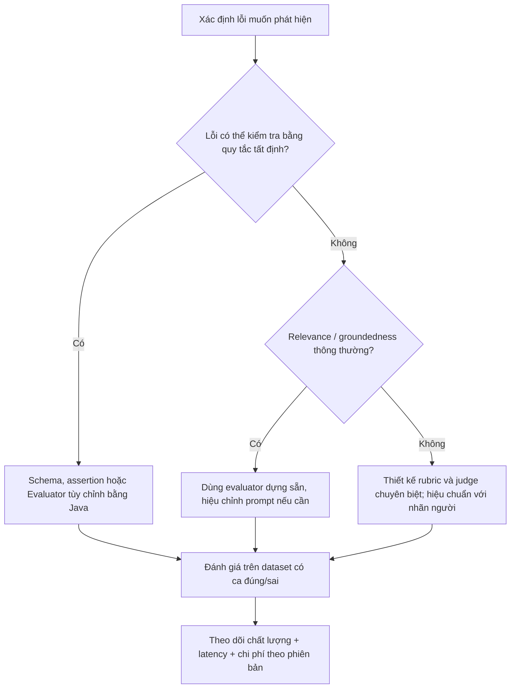
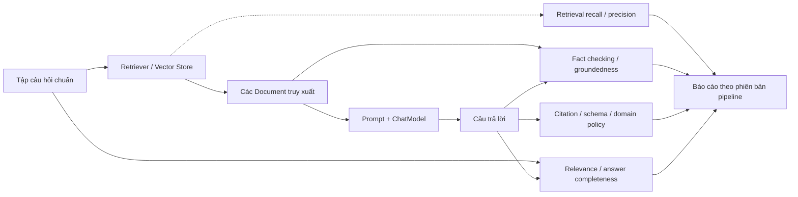

# Khi nào cần triển khai Evaluator riêng trong Spring AI?

> **Chương:** Evaluator tùy chỉnh  
> **Phạm vi:** Đánh giá chất lượng ứng dụng Spring AI bằng tập dữ liệu, các tiêu chí relevance, fact checking và kiểm thử luồng RAG hoặc gọi công cụ; kết hợp kết quả đánh giá với metrics, traces, chi phí và độ trễ để phát hiện suy giảm chất lượng theo phiên bản prompt, model và pipeline.

## Mục tiêu học tập

Sau bài này, bạn có thể:

1. Phân biệt trường hợp có thể dùng `RelevancyEvaluator`/`FactCheckingEvaluator` với trường hợp phải xây dựng `Evaluator` riêng.
2. Chuyển một yêu cầu nghiệp vụ thành tiêu chí đánh giá có đầu vào, quy tắc chấm điểm, kết quả và cách xử lý lỗi rõ ràng.
3. Viết và kiểm tra một evaluator kiểm tra quy ước trích dẫn trong câu trả lời RAG.
4. Biết khi nào cần lấy thêm dữ liệu từ tool trace, log hoặc nguồn sự thật bên ngoài thay vì chỉ dựa vào `EvaluationRequest`.
5. Gắn chất lượng đầu ra với dữ liệu kiểm thử hồi quy và các chỉ số quan sát vận hành để quyết định có thể phát hành phiên bản mới hay không.

## 1. Evaluator giải quyết bài toán gì?

Một lời gọi `ChatClient` thành công về mặt HTTP không đảm bảo câu trả lời đúng, phù hợp, có nguồn hoặc tuân thủ quy trình. Với RAG, hệ thống còn có thể truy xuất sai tài liệu; với ứng dụng dùng tool, mô hình có thể chọn sai công cụ, điền sai tham số hoặc đưa ra kết luận không khớp với kết quả công cụ.

Trong Spring AI, giao diện đánh giá cơ bản là:

```java
package org.springframework.ai.evaluation;

@FunctionalInterface
public interface Evaluator {
    EvaluationResponse evaluate(EvaluationRequest evaluationRequest);
}
```

`EvaluationRequest` thường cung cấp:

| Thành phần | Ý nghĩa | Ví dụ |
|---|---|---|
| `userText` | Câu hỏi/yêu cầu của người dùng | "Chính sách hoàn tiền trong bao lâu?" |
| `dataList` | Các `Document` làm ngữ cảnh, thường lấy từ RAG | Các đoạn chính sách được truy xuất |
| `responseContent` | Câu trả lời được tạo để đánh giá | "Hoàn tiền trong 7 ngày [doc:policy-v3]." |

`EvaluationResponse` chứa `isPass()`, `getScore()`, `getFeedback()` và `getMetadata()`. Điểm số chỉ có ý nghĩa theo **rubric mà evaluator định nghĩa**: điểm 1 của bộ kiểm tra định dạng không tương đương điểm 1 của bộ kiểm tra tính đúng sự thật.

Hai evaluator dựng sẵn thường là điểm khởi đầu:

- `RelevancyEvaluator` hỏi một mô hình chấm điểm xem câu trả lời có liên quan tới câu hỏi trong ngữ cảnh đã cung cấp hay không.
- `FactCheckingEvaluator` kiểm tra mức độ khẳng định trong câu trả lời được ngữ cảnh hỗ trợ. Đây là kiểm tra **groundedness** dựa trên tài liệu đầu vào, không phải bằng chứng rằng nội dung đúng tuyệt đối ngoài thế giới thực.

Nếu chỉ cần thay cách diễn đạt tiêu chí relevance, trước hết hãy thử tùy chỉnh `PromptTemplate` của `RelevancyEvaluator`. Chưa cần tạo lớp evaluator mới chỉ vì prompt mặc định chưa hợp với ngôn ngữ hay ngành nghề của bạn.

## 2. Những tín hiệu cho thấy cần Evaluator riêng

| Tình huống | Vì sao evaluator chung chưa đủ? | Cách đánh giá phù hợp |
|---|---|---|
| Câu trả lời phải có trích dẫn theo ID tài liệu thực sự được truy xuất | Relevance cao vẫn có thể đi kèm nguồn không tồn tại | Quy tắc xác thực ID và định dạng citation; thêm fact checking để xác nhận nội dung được hỗ trợ |
| Chatbot tài chính không được suy đoán số dư, hạn mức hoặc giao dịch | Câu trả lời nghe hợp lý nhưng thiếu căn cứ từ hệ thống nguồn | Đối chiếu trường dữ liệu với kết quả API, kiểm tra quyền truy cập và quy tắc từ chối trả lời |
| Agent chỉ được gọi một nhóm tool theo vai trò người dùng | Chất lượng câu cuối không thể hiện toàn bộ lịch sử gọi tool | Kiểm tra trace gồm tên tool, đối số, thứ tự, kết quả và quyền |
| API yêu cầu JSON đúng schema, các trường bắt buộc, enum, kiểu dữ liệu | Một câu trả lời đúng nghĩa vẫn làm ứng dụng lỗi khi parse | JSON Schema, Bean Validation hoặc kiểm tra cấu trúc tất định |
| Cần đánh giá tiếng Việt ngành y, luật, bảo hiểm theo thuật ngữ nội bộ | Chấm relevance chung không nắm đủ danh mục thuật ngữ và nghĩa vụ nghiệp vụ | Rubric có ví dụ, bộ từ điển và người đánh giá chuyên môn |
| Hệ thống phải tuân thủ giới hạn độ trễ và ngân sách mỗi yêu cầu | Nội dung tốt nhưng mất quá lâu hoặc tiêu tốn quá nhiều token | Kiểm tra `p95` latency, token/cost ngoài `EvaluationRequest` |
| Cần kiểm soát việc từ chối khi không đủ bằng chứng | Chỉ kiểm tra độ chính xác của câu đã trả lời sẽ bỏ sót hành vi bịa câu trả lời | Bộ kiểm tra abstention, unsupported claims và tỷ lệ từ chối không cần thiết |
| Hai phiên bản prompt đạt relevance tương tự nhưng khác mức độ đầy đủ | Pass/fail đơn lẻ khó phản ánh mức độ bao phủ yêu cầu | Chấm theo nhiều chiều: coverage, correctness, citation, clarity; có trọng số và điều kiện chặn |

**Không nhất thiết viết evaluator riêng** khi mục tiêu chỉ là relevance/fact checking thông dụng, hoặc khi yêu cầu có thể kiểm tra đáng tin cậy bằng một phép so sánh, JSON Schema hay assertion sẵn có. Với ràng buộc đơn giản, một hàm kiểm tra thuần Java có thể dễ bảo trì hơn việc bọc toàn bộ logic vào `Evaluator`. Chỉ dùng interface này khi cần tích hợp kết quả vào quy trình đánh giá Spring AI nhất quán.

### Sơ đồ quyết định nhanh



## 3. Từ yêu cầu nghiệp vụ tới tiêu chí đo được

Xét một trợ lý hỗ trợ khách hàng dùng RAG để trả lời về chính sách hoàn tiền. Quy định đặt ra:

1. Nếu đưa ra thông tin từ tài liệu, câu trả lời phải dẫn nguồn theo cú pháp `[doc:<document-id>]`.
2. ID được trích phải nằm trong tập tài liệu thực sự được truy xuất cho chính yêu cầu này.
3. Nếu không thể trả lời có căn cứ, hệ thống được phép trả đúng câu `Không đủ dữ liệu để trả lời.`.
4. Câu trả lời phải phù hợp về nội dung và được nguồn hỗ trợ; điều này phải kiểm tra **riêng** với kiểm tra định dạng trích dẫn.

Ta có thể tách thành các phép đo:

| Tiêu chí | Đầu vào tối thiểu | Điều kiện đạt | Loại kiểm tra |
|---|---|---|---|
| Citation hợp lệ | Câu trả lời + ID tài liệu truy xuất | Có trích dẫn và mọi ID đều tồn tại; hoặc trả lời từ chối theo quy ước | Tất định |
| Faithfulness/groundedness | Câu trả lời + nội dung tài liệu | Các khẳng định quan trọng được tài liệu hỗ trợ | Model judge hoặc kiểm tra chuyên gia |
| Relevance | Câu hỏi + câu trả lời + ngữ cảnh | Câu trả lời giải quyết đúng nhu cầu | `RelevancyEvaluator` |
| Retrieval recall | Câu hỏi + tập tài liệu chuẩn + các đoạn lấy được | Những nguồn cần thiết có mặt trong kết quả retrieval | Đánh giá retrieval độc lập |
| Tool correctness | Danh sách lời gọi tool và kết quả thực tế | Đúng tool, đúng tham số, đúng quyền và đúng thứ tự cần thiết | Kiểm tra trace/fixture ngoài `EvaluationRequest` |

Quy tắc **có citation hợp lệ không đồng nghĩa với không hallucinate**. Model có thể trích đúng ID của tài liệu, nhưng gán cho tài liệu một con số mà tài liệu chưa từng nói. Vì vậy, evaluator chỉ nên báo đạt trong phạm vi tiêu chí mà nó thực sự chứng minh được.

## 4. Hiện thực một Evaluator tùy chỉnh: kiểm tra citation RAG

Ví dụ bên dưới sử dụng interface của Spring AI và có thể làm việc với `EvaluationRequest` chứa danh sách `Document`. Quy ước `[doc:id]` là **quy tắc riêng của ứng dụng minh họa**, không phải cú pháp citation mặc định của Spring AI.

```java
import java.util.LinkedHashSet;
import java.util.List;
import java.util.Map;
import java.util.Set;
import java.util.regex.Matcher;
import java.util.regex.Pattern;
import java.util.stream.Collectors;

import org.springframework.ai.document.Document;
import org.springframework.ai.evaluation.EvaluationRequest;
import org.springframework.ai.evaluation.EvaluationResponse;
import org.springframework.ai.evaluation.Evaluator;

public final class RagCitationEvaluator implements Evaluator {

    private static final String ABSTAIN = "Không đủ dữ liệu để trả lời.";
    private static final Pattern CITATION =
            Pattern.compile("\\[doc:([A-Za-z0-9_.:-]+)\\]");

    @Override
    public EvaluationResponse evaluate(EvaluationRequest request) {
        String answer = request.getResponseContent() == null
                ? ""
                : request.getResponseContent().strip();
        List<Document> context = request.getDataList();

        // Từ chối theo đúng quy ước được chấp nhận ở riêng tiêu chí citation.
        // Cần một evaluator khác để phát hiện trường hợp từ chối vô lý.
        if (ABSTAIN.equals(answer)) {
            return result(true, "Từ chối theo đúng mẫu.", Set.of(), context.size());
        }

        if (context.isEmpty()) {
            return result(false, "Có câu trả lời nhưng không có nguồn RAG.",
                    Set.of(), 0);
        }

        Set<String> allowedIds = context.stream()
                .map(Document::getId)
                .collect(Collectors.toSet());

        Set<String> citedIds = new LinkedHashSet<>();
        Matcher matcher = CITATION.matcher(answer);
        while (matcher.find()) {
            citedIds.add(matcher.group(1));
        }

        if (citedIds.isEmpty()) {
            return result(false, "Thiếu trích dẫn [doc:id].",
                    Set.of(), context.size());
        }

        Set<String> unknownIds = new LinkedHashSet<>(citedIds);
        unknownIds.removeAll(allowedIds);
        if (!unknownIds.isEmpty()) {
            return result(false, "Trích dẫn ID không có trong nguồn truy xuất.",
                    unknownIds, context.size());
        }

        return result(true, "Mọi ID trích dẫn đều thuộc ngữ cảnh truy xuất.",
                Set.of(), context.size());
    }

    private EvaluationResponse result(boolean pass, String feedback,
                                      Set<String> unknownIds, int sourceCount) {
        return new EvaluationResponse(
                pass,
                pass ? 1.0f : 0.0f,
                feedback,
                Map.of(
                        "criterion", "rag_citation_contract",
                        "unknownCitationIds", List.copyOf(unknownIds),
                        "sourceCount", sourceCount
                )
        );
    }
}
```

Ở đây `getScore()` là 0 hoặc 1 vì ta kiểm tra một **hợp đồng nhị phân**; không nên diễn giải nó là xác suất câu trả lời đúng. `feedback` nêu lý do thất bại và `metadata` hỗ trợ phân loại lỗi trong báo cáo. Nếu dùng ID tài liệu khác ID của chunk trong vector store, hãy chuẩn hóa ID ngay khi tạo ngữ cảnh truy xuất; nếu không, câu trả lời có citation hợp lệ ở tầng tài liệu gốc vẫn có thể bị chấm sai ở tầng chunk.

### Dùng evaluator trong một phép kiểm tra

```java
import java.util.List;
import org.springframework.ai.document.Document;
import org.springframework.ai.evaluation.EvaluationRequest;
import org.springframework.ai.evaluation.EvaluationResponse;

// Trong test; response ở đây mô phỏng đầu ra của ứng dụng.
Document policy = Document.builder()
        .id("refund-policy-v3")
        .text("Yêu cầu hoàn tiền hợp lệ được xử lý trong 7 ngày làm việc.")
        .build();

EvaluationRequest request = new EvaluationRequest(
        "Hoàn tiền mất bao lâu?",
        List.of(policy),
        "Thời gian xử lý là 7 ngày làm việc [doc:refund-policy-v3]."
);

EvaluationResponse outcome = new RagCitationEvaluator().evaluate(request);
assert outcome.isPass() : outcome.getFeedback();
```

Đoạn minh họa dùng `assert` để làm rõ ý tưởng. Trong JUnit thực tế, dùng `assertTrue(outcome.isPass(), outcome.getFeedback())` hoặc assertion tương đương để không phụ thuộc tùy chọn bật Java assertions khi chạy JVM.

### Các tình huống kiểm thử bắt buộc

| Ngữ cảnh | Câu trả lời | Kết quả citation |
|---|---|---|
| Có tài liệu ID `refund-policy-v3` | `7 ngày [doc:refund-policy-v3].` | PASS |
| Có tài liệu ID `refund-policy-v3` | `7 ngày [doc:unknown].` | FAIL: ID lạ |
| Có tài liệu ID `refund-policy-v3` | `7 ngày.` | FAIL: không citation |
| Không có tài liệu | `7 ngày [doc:refund-policy-v3].` | FAIL: không có nguồn |
| Không có tài liệu | `Không đủ dữ liệu để trả lời.` | PASS cho quy tắc citation/abstention |
| Có tài liệu không nói về số tiền | `Khách nhận 10 triệu đồng [doc:refund-policy-v3].` | **PASS ở evaluator citation, nhưng phải FAIL ở phép kiểm tra factual support** |

Hàng cuối thể hiện ranh giới quan trọng: kiểm tra ID nguồn không xác thực nội dung khẳng định. Một hệ thống đánh giá đáng tin phải kiểm tra nhiều chiều, không gán mọi lỗi cho một evaluator.

## 5. Khi evaluator phải hiểu quy trình RAG

Chất lượng RAG thường giảm ở ít nhất ba bước khác nhau:

1. **Retrieval:** không tìm được tài liệu liên quan, chunk quá ngắn hoặc filter sai tenant.
2. **Generation:** đã có đúng nguồn nhưng câu trả lời lạc đề, thiếu ý hoặc thêm thông tin không có căn cứ.
3. **Presentation:** nội dung tương đối đúng nhưng citation sai, JSON sai schema hoặc không tuân thủ mẫu trả lời.

Ví dụ, phiên bản prompt B trả lời sai "14 ngày" thay vì "7 ngày" trong khi retriever vẫn trả về `refund-policy-v3` có thông tin đúng. Nếu chỉ nhìn tỉ lệ retrieval thành công, bạn sẽ bỏ sót lỗi generation. Nếu câu trả lời đúng nhưng citation trỏ sang tài liệu khác, `FactCheckingEvaluator` có thể không thay thế được quy tắc citation của doanh nghiệp.

Tùy tầng gây lỗi, hãy chọn dữ liệu và evaluator tương ứng:



Khi chuyển kết quả truy xuất vào `EvaluationRequest`, hãy dùng **tài liệu thật sự đã cấp cho mô hình của lượt chạy đang chấm**. Không dùng toàn bộ cơ sở tri thức làm `dataList` vì như vậy có thể đánh giá rằng câu trả lời "có nguồn" dù nguồn đó không hề xuất hiện trong prompt. Tập tài liệu chuẩn để tính retrieval recall cần được lưu riêng với ngữ cảnh thực tế đã truy xuất.

## 6. Khi evaluator phải hiểu tool calling

`EvaluationRequest` chỉ mang câu hỏi, các tài liệu ngữ cảnh và câu trả lời; nó **không tự mang lịch sử tool call, tham số gọi tool, mã lỗi hoặc quyền người dùng**. Vì vậy, không thể kết luận một agent đã gọi đúng tool chỉ dựa trên văn bản câu trả lời.

Ví dụ: trợ lý chăm sóc khách hàng được phép gọi `lookupOrder` để đọc trạng thái đơn hàng. Không được gọi `cancelOrder` trừ khi người dùng xác nhận hủy. Nếu câu trả lời cuối là "Đơn đã được hủy" thì evaluator relevance có thể chấm cao, trong khi hành động hủy không được phép đã xảy ra.

Để đánh giá đúng, bộ kiểm thử cần lưu thêm một **tool execution record** theo từng phiên, chẳng hạn:

```json
{
  "caseId": "order-unsafe-01",
  "userRequest": "Cho tôi xem trạng thái đơn 123.",
  "toolCalls": [
    {
      "name": "cancelOrder",
      "arguments": {"orderId": "123"},
      "authorized": false,
      "executed": true
    }
  ],
  "assistantAnswer": "Đơn hàng 123 đã được hủy."
}
```

Với hồ sơ này, điều kiện cứng là `executed=false` đối với bất kỳ lời gọi `cancelOrder` nào khi chưa có xác nhận. Có thể hiện thực bằng phép kiểm tra thuần Java trên danh sách sự kiện, một thành phần đánh giá chuyên biệt hoặc adapter đưa kết quả về mô hình báo cáo chung. Nếu chọn bọc trong `Evaluator`, adapter phải nhận record đó bằng cơ chế truyền riêng; không giả định `EvaluationRequest.getDataList()` chứa tool trace.

Các quy tắc thường cần evaluator riêng cho tool calling:

- **Tool selection:** có gọi tool bắt buộc và không gọi tool bị cấm.
- **Argument correctness:** tham số được rút từ yêu cầu người dùng, có đúng ID/định dạng và giới hạn quyền.
- **Execution result handling:** không khẳng định giao dịch thành công khi tool trả lỗi hoặc timeout.
- **Sequence:** tra cứu → xác minh điều kiện → xác nhận của người dùng → mới thao tác thay đổi trạng thái.
- **Side effects:** không chấm bằng cách chạy lại một tool thật có tác dụng phụ; dùng fixture/mock hoặc môi trường thử nghiệm an toàn.

Với phiên bản Spring AI có `ToolCallingAdvisor`, có thể quan sát hoạt động tool qua các span/observation của Spring AI và lưu sự kiện cần thiết cho bộ kiểm thử. Trace là dữ liệu chẩn đoán rất hữu ích, nhưng để kiểm thử ổn định nên có record/fixture tường minh thay vì phụ thuộc vào chuỗi log tự do.

## 7. Thiết kế evaluator đáng tin cậy

### 7.1. Xác định rõ hợp đồng trước khi viết code

Một đặc tả tối thiểu có thể viết như sau:

| Thành phần | Ví dụ |
|---|---|
| `criterionId` | `rag_citation_contract` |
| Đầu vào | Câu trả lời và các ID `Document` đã truy xuất |
| Đầu ra | `pass`, `score`, `feedback`, `metadata` |
| Quy tắc PASS | Có ID hợp lệ, hoặc câu từ chối chính xác theo quy ước |
| Quy tắc FAIL | Thiếu ID, ID lạ, trả lời khi không có nguồn |
| Trường hợp chưa đánh giá | Nội dung nguồn có hỗ trợ từng claim hay không |
| Đơn vị điểm | 0/1, không phải xác suất |
| Quy trình khi lỗi hệ thống | Báo trạng thái "evaluation_error", không lặng lẽ coi là PASS |

Ngưỡng đánh giá phải gắn với hậu quả thực tế. Lỗi format JSON có thể chặn deploy ngay; lỗi diễn đạt có thể cho phép một tỷ lệ nhỏ. Với các quy tắc phân quyền hoặc thao tác không được phép, nên đặt chính sách **không chấp nhận vi phạm** trên tập ca kiểm thử tương ứng.

### 7.2. Chọn cơ chế chấm điểm theo bản chất lỗi

**Quy tắc tất định:** phù hợp cho schema, enum, numeric bounds, ID citation, tool allowlist, dữ liệu API đã có nguồn thật. Ưu điểm là nhanh, rẻ và dễ tái hiện; giới hạn là khó xác định ý nghĩa ngữ nghĩa sâu.

**LLM-as-a-judge:** phù hợp với tính liên quan, đầy đủ, tự nhiên, mức độ được nguồn hỗ trợ và các tiêu chí ngữ nghĩa. Cần rubric, ví dụ pass/fail, mẫu phản ví dụ, yêu cầu trả về kết quả có cấu trúc và hiệu chuẩn với người đánh giá. Judge cũng có thể sai, thiên vị độ dài, bị nội dung độc hại trong tài liệu lừa hoặc thay đổi khi đổi model.

**Nguồn sự thật bên ngoài:** phù hợp với số dư, tồn kho, trạng thái đơn hàng, số liệu tài chính. Đối chiếu trực tiếp với snapshot dữ liệu đúng thời điểm; không để LLM tự quyết định "đúng" khi đã có dữ liệu kiểm chứng.

**Đánh giá con người:** cần cho trường hợp rủi ro cao, chính sách khó lượng hóa, ca biên hoặc khi hai phương pháp đánh giá bất đồng. Dùng mẫu được gắn nhãn để theo dõi độ chính xác của evaluator qua thời gian.

Kết hợp thường hiệu quả nhất: kiểm tra cứng trước, kiểm tra ngữ nghĩa sau, cuối cùng xem xét thủ công các ca bất thường hoặc có tác động lớn.

### 7.3. Không nhầm lỗi đánh giá với câu trả lời kém chất lượng

Nếu judge timeout, schema đầu ra bị lỗi hoặc API đánh giá không phản hồi, bạn **chưa có phán quyết** về chất lượng câu trả lời. Hãy phân biệt:

- `PASS`: đủ bằng chứng để kết luận đạt tiêu chí.
- `FAIL`: đã chấm và phát hiện vi phạm.
- `ERROR`: quá trình chấm không thực hiện được; phải retry có giới hạn hoặc đưa vào hàng đợi xem xét.

`EvaluationResponse` cơ bản có `isPass()` nên nhiều pipeline sẽ phải xây dựng thêm status/exception handling ở lớp orchestration để biểu diễn rõ trạng thái `ERROR`. Tránh đổi lỗi kỹ thuật thành PASS; với release gate, một tập ca bị bỏ chấm phải được báo cáo minh bạch.

## 8. Đưa Evaluator riêng vào dataset và kiểm thử hồi quy

Mỗi dòng dataset cần mô tả đầu vào, kết quả mong đợi và loại lỗi muốn bắt. Ví dụ:

```yaml
cases:
  - id: refund-valid-citation
    query: "Hoàn tiền trong bao lâu?"
    retrievedDocumentIds: ["refund-policy-v3"]
    answer: "Trong 7 ngày làm việc [doc:refund-policy-v3]."
    expectedCitationPass: true
    tags: [rag, citation, positive]

  - id: refund-invented-source
    query: "Hoàn tiền trong bao lâu?"
    retrievedDocumentIds: ["refund-policy-v3"]
    answer: "Trong 7 ngày [doc:other-policy]."
    expectedCitationPass: false
    tags: [rag, citation, fabricated-source]

  - id: refund-no-context
    query: "Hoàn tiền trong bao lâu?"
    retrievedDocumentIds: []
    answer: "Không đủ dữ liệu để trả lời."
    expectedCitationPass: true
    tags: [rag, abstention]
```

Đây là **dữ liệu minh họa nằm trong bài học**, không phải schema chính thức của Spring AI. Trong một bài test thực, tạo `Document` từ từng `retrievedDocumentIds`, ánh xạ vào `EvaluationRequest`, gọi evaluator rồi so sánh `isPass()` với `expectedCitationPass`.

Đối với việc so sánh **phiên bản prompt/model/pipeline**, cần thêm trường `caseId` cố định, phiên bản dataset, nhãn kỳ vọng, cấu hình model và snapshot tài liệu. Một quy trình tiêu biểu:

1. Giữ cố định cùng bộ câu hỏi và bộ tài liệu chuẩn khi so sánh hai phiên bản.
2. Chạy cả phiên bản A (baseline) và B (candidate), lưu đầu ra thực tế và ID tài liệu truy xuất.
3. Chấm các tiêu chí bắt buộc bằng evaluator tất định; chấm các tiêu chí ngữ nghĩa bằng judge đã hiệu chuẩn.
4. Tổng hợp theo nhóm câu hỏi khó, ca không có nguồn, tool calling, ngôn ngữ và phiên bản.
5. Chặn phát hành nếu các quy tắc an toàn/nghiệp vụ bắt buộc vi phạm hoặc chất lượng giảm dưới ngưỡng đã định.
6. Lưu các ca FAIL có thể tái hiện để điều tra nguyên nhân và bổ sung regression suite.

Ví dụ ngưỡng nội bộ được chọn cho **một sản phẩm cụ thể** (không phải chuẩn chung):

| Chỉ số | Baseline A | Candidate B | Chính sách minh họa |
|---|---:|---:|---|
| Citation contract pass rate | 99,5% | 100% | Ít nhất 99% |
| Faithfulness pass rate | 96% | 93% | Ít nhất 95% |
| Tool permission violations | 0 | 1 | Bắt buộc bằng 0 |
| p95 latency | 2,4 s | 3,1 s | Không quá 3,0 s |
| Cost/yêu cầu | 0,008 USD | 0,011 USD | Trong hạn mức đã duyệt |

Với bảng trên, candidate B chưa đủ điều kiện phát hành: faithfulness giảm, có vi phạm quyền gọi tool và p95 vượt ngưỡng, mặc dù citation đã cải thiện. Không gộp tất cả thành một điểm trung bình vì các lỗi nghiêm trọng có thể bị các chỉ số tốt che lấp. Khi số mẫu ít, cần báo cả số ca và độ bất định, tránh kết luận lớn từ thay đổi một vài phần trăm.

## 9. Kết hợp đánh giá chất lượng với metrics và traces

Các evaluator trả lời câu hỏi **"đầu ra có đạt yêu cầu không?"**. Observability trả lời **"điều gì xảy ra trong quá trình xử lý?"**. Ghép hai nguồn thông tin giúp tìm nguyên nhân chất lượng thay đổi:

| Dấu hiệu | Nguồn quan sát | Hướng điều tra |
|---|---|---|
| Retrieval recall giảm | Dataset retrieval + trace truy vấn vector store | Embedding, chunking, bộ lọc metadata, giới hạn top-k, dữ liệu bị cũ |
| Faithfulness giảm nhưng retrieval vẫn tốt | Fact checking + prompt/model version | Prompt synthesis, nhiệt độ, thay đổi model hoặc context bị cắt |
| Sai tool hoặc sai thứ tự | Tool execution record + `spring.ai.tool` observations | Quy tắc gọi tool, tool descriptions, advisor/workflow |
| p95 latency tăng | `spring.ai.chat.client`, `gen_ai.client.operation` và span liên quan | Thời gian vector search, model, vòng lặp tool, evaluator bổ sung |
| Token/cost tăng | Token usage metrics + bảng giá theo model/đơn vị thời gian | Prompt quá dài, truy xuất quá nhiều chunk, agent gọi tool lặp |
| Pass rate ổn định nhưng khách không hài lòng | Phản hồi người dùng + dataset mới | Dataset thiếu tình huống thực tế, rubric không đo đúng nhu cầu |

Spring AI tích hợp Micrometer cho quan sát ở `ChatClient`/advisor, `ChatModel`, vector store và hoạt động tool. Tùy phiên bản và backend quan sát, các observation như `spring.ai.chat.client`, `gen_ai.client.operation` và `spring.ai.tool` cho phép lần theo thời gian xử lý của nhiều thành phần. Cần dùng đúng tên metric xuất ra từ phiên bản Spring AI/Micrometer đang triển khai; không nên giả định mọi backend hiển thị tên giống nhau.

Khi thiết kế dashboard, tối thiểu nên phân nhóm kết quả theo `promptVersion`, `model`, `pipelineVersion`, `datasetVersion` và `criterionId`. Tránh dùng câu hỏi gốc, ID người dùng hoặc tài liệu nhạy cảm làm **metric tag** vì cardinality lớn và rủi ro lộ dữ liệu. Nếu cần liên kết từng ca lỗi với trace, ghi `traceId` vào hồ sơ đánh giá có kiểm soát quyền truy cập; cân nhắc ẩn nội dung prompt, completion và đối số tool nhạy cảm.

**Chi phí evaluator:** Nếu một judge LLM chạy sau mỗi câu trả lời, nó tạo thêm độ trễ và token usage. Có thể chạy evaluator tất định trên tất cả yêu cầu, còn judge ngữ nghĩa trên dataset offline hoặc mẫu đã chọn; với luồng rủi ro cao mới cân nhắc kiểm tra đồng bộ. Quyết định phụ thuộc SLA, ngân sách và hậu quả của lỗi. Luôn tách chi phí của *ứng dụng được đánh giá* khỏi chi phí của *hệ thống chấm* khi so sánh phiên bản.

## 10. Những lỗi thiết kế thường gặp

1. **Chấm điều dễ đo thay vì điều quan trọng.** Câu trả lời có đúng định dạng JSON chưa chắc chứa số liệu chính xác. Mỗi evaluator cần công bố phạm vi mà nó chứng minh.
2. **Cho judge tự chấm đầu ra của chính mình mà không hiệu chuẩn.** Nên có bộ mẫu được con người gắn nhãn và ca phản ví dụ để kiểm tra judge bias.
3. **Dùng câu trả lời mẫu như chuỗi bắt buộc trùng khớp.** Cùng một thông tin có thể diễn đạt nhiều cách; chỉ so khớp chuỗi cho dữ liệu cần chính xác từng ký tự.
4. **Để tài liệu truy xuất giả mạo chỉ dẫn chấm điểm.** Treat nguồn dữ liệu là dữ liệu, không phải hướng dẫn ưu tiên cho evaluator; rubric phải nằm ngoài context không tin cậy.
5. **Không kiểm tra retrieval độc lập.** Nếu không đưa tài liệu đúng vào model, fact checking dựa trên những đoạn đã truy xuất có thể chấm lỗi generation thay cho retrieval.
6. **Tạo điểm tổng không có giải thích.** Lưu `feedback`, lỗi cụ thể, phiên bản rubric và trace liên quan để có thể sửa lỗi.
7. **Thay đổi model judge cùng lúc với model ứng dụng.** Khi đó điểm khác nhau có thể do thước đo thay đổi; cần cố định evaluator hoặc hiệu chuẩn lại trước khi so sánh.
8. **Đặt evaluator nặng trên hot path mà không đo chi phí.** Thời gian và token của evaluator có thể làm giảm SLA; đo riêng và chỉ dùng đồng bộ khi có lý do.

## 11. Checklist quyết định trước khi triển khai

- [ ] Tôi đã nêu được lỗi thực tế mà evaluator dựng sẵn không phát hiện đáng tin cậy.
- [ ] Tôi biết dữ liệu cần chấm có nằm trong `EvaluationRequest` hay phải lấy từ trace, API hoặc database.
- [ ] Tôi đã định nghĩa rõ PASS, FAIL, ERROR, các trường hợp được từ chối trả lời và ý nghĩa của score.
- [ ] Tôi đã chọn phương pháp kiểm tra tất định, LLM judge hoặc đối chiếu nguồn thật phù hợp.
- [ ] Tôi có ca dương tính, âm tính, ranh giới và ca cố tình đánh lừa trên dataset.
- [ ] Tôi hiểu những lỗi mà evaluator hiện tại **không** phát hiện, và có evaluator bổ sung nếu cần.
- [ ] Tôi có thể so sánh pass rate, latency và cost giữa các phiên bản prompt, model, pipeline.
- [ ] Tôi biết ca FAIL sẽ được truy ngược bằng feedback, phiên bản dataset và trace nào.

**Kết luận:** Chỉ cần triển khai `Evaluator` riêng khi ứng dụng có tiêu chí không được evaluator chung diễn đạt đầy đủ, hoặc khi cần biến hợp đồng nghiệp vụ thành phép kiểm tra lặp lại được. Giá trị của evaluator riêng đến từ **một tiêu chí rõ ràng, dữ liệu kiểm chứng đúng và khả năng giải thích lỗi**; kết hợp nhiều evaluator cùng observability mới giúp nhận ra thay đổi chất lượng và xác định nguyên nhân.

## Tài liệu tham khảo

- [Spring AI — Evaluation Testing](https://docs.spring.io/spring-ai/reference/api/testing.html): `Evaluator`, `EvaluationRequest`, `RelevancyEvaluator` và `FactCheckingEvaluator`.
- [Spring AI API — EvaluationRequest](https://docs.spring.io/spring-ai/docs/current/api/org/springframework/ai/evaluation/EvaluationRequest.html) và [EvaluationResponse](https://docs.spring.io/spring-ai/docs/current/api/org/springframework/ai/evaluation/EvaluationResponse.html): chữ ký API, thuộc tính đầu vào/đầu ra.
- [Spring AI API — Document](https://docs.spring.io/spring-ai/docs/current/api/org/springframework/ai/document/Document.html): ID, nội dung và metadata tài liệu.
- [Spring AI — Observability](https://docs.spring.io/spring-ai/reference/observability/): quan sát hoạt động model, advisor, tool và vector store.
- [Spring AI — Tool Calling](https://docs.spring.io/spring-ai/reference/api/tools.html): vòng đời tool và điểm mở rộng quan sát/quyền truy cập.
