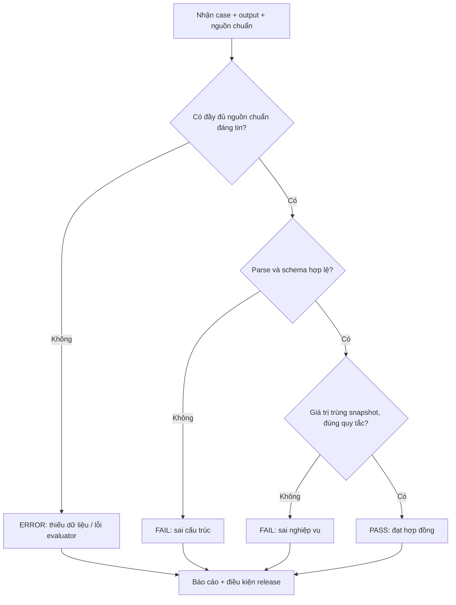
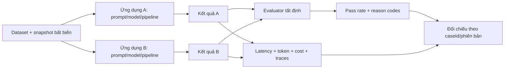

# Kiểm tra có tính xác định bằng quy tắc, schema và dữ liệu nghiệp vụ

> **Chương:** Evaluator tùy chỉnh  
> **Ngữ cảnh module:** `SPRING_AI_EVALUATION_OBSERVABILITY` — đánh giá chất lượng ứng dụng Spring AI với dataset, relevance, fact checking, kiểm thử RAG/tool calling và quan sát metrics, traces, chi phí, độ trễ qua các phiên bản prompt, model, pipeline.

## Mục tiêu học tập

Sau bài này, bạn có thể:

1. Giải thích thế nào là một phép đánh giá **có tính xác định** (deterministic evaluation), lợi ích và giới hạn của nó trong hệ thống dùng mô hình ngôn ngữ.
2. Thiết kế các điều kiện kiểm tra từ **quy tắc nghiệp vụ**, **cấu trúc JSON/schema** và **dữ liệu chuẩn** tại đúng thời điểm phát sinh yêu cầu.
3. Xây dựng một `Evaluator` Spring AI bằng Java để kiểm tra đầu ra có cấu trúc và đối chiếu với snapshot nghiệp vụ.
4. Tạo tập ca dương tính, âm tính và ca biên để phát hiện lỗi định dạng, lỗi số liệu, vi phạm chính sách và dữ liệu không nhất quán.
5. Kết hợp kết quả đánh giá tất định với đánh giá ngữ nghĩa, traces và chỉ số vận hành để xác định nguyên nhân hồi quy chất lượng.

## 1. Kiểm tra có tính xác định là gì?

Một evaluator có tính xác định áp dụng **cùng một quy tắc lên cùng một đầu vào và cùng một trạng thái dữ liệu tham chiếu để luôn cho cùng một kết quả**. Nó không cần hỏi thêm một mô hình AI để quyết định nên chấm PASS hay FAIL.

Ví dụ, trợ lý trả về số tiền phải thanh toán cho đơn hàng. Nếu database tại phiên bản dữ liệu được dùng cho lượt đó ghi `amountVnd = 1_250_000`, còn câu trả lời JSON ghi `amountVnd = 1_450_000`, phép so sánh số nguyên cho kết quả FAIL. Không cần LLM-as-a-judge để nhận ra hai số khác nhau.

Mục tiêu của kiểm tra tất định là chứng minh một **điều kiện cụ thể** được đáp ứng. Điều kiện phải được viết rõ ràng: kiểu dữ liệu, phạm vi giá trị, nguồn sự thật, cách xử lý trường hợp thiếu dữ liệu và thông báo lỗi.

| Cách đánh giá | Câu hỏi phù hợp | Kết quả | Giới hạn |
|---|---|---|---|
| Rule/regex/assertion | Có đủ trường, đúng mã định danh, không gọi tool bị cấm? | Tái lập, rẻ, rất nhanh | Có thể bỏ sót lỗi ngữ nghĩa |
| JSON Schema/Bean Validation | Đầu ra có đúng cấu trúc và ràng buộc kiểu/enum? | Dễ tự động hóa, lỗi rõ | JSON hợp lệ vẫn có thể nói sai sự thật |
| Đối chiếu dữ liệu nghiệp vụ | Giá, trạng thái, quyền, hạn mức có khớp nguồn chuẩn? | Chính xác trong phạm vi snapshot tin cậy | Phải quản lý nguồn, phiên bản, thời điểm |
| `RelevancyEvaluator` / judge ngữ nghĩa | Câu trả lời có đúng trọng tâm, đủ ý và được tài liệu hỗ trợ? | Đánh giá được ý nghĩa ngôn ngữ | Judge có thể sai, tốn token/độ trễ |
| Đánh giá con người | Ca phức tạp, gây tranh cãi, rủi ro cao | Phát hiện những yếu tố khó mã hóa | Khó mở rộng và có bất đồng giữa người chấm |

**Tính xác định của phép chấm không bảo đảm bản thân quy tắc hoặc dữ liệu chuẩn là đúng.** Nếu snapshot nghiệp vụ đã lỗi thời, evaluator vẫn có thể trả kết quả ổn định nhưng đánh giá sai thực tế. Vì vậy phải kiểm soát cả quy tắc lẫn nguồn tham chiếu.

### 1.1. Phân biệt output schema và sự thật nghiệp vụ

Giả sử người dùng hỏi: "Đơn ORD-2042 đã thanh toán chưa, số tiền bao nhiêu?".

```json
{
  "orderId": "ORD-2042",
  "status": "PAID",
  "amountVnd": 1450000,
  "currency": "VND"
}
```

Đầu ra có thể là **JSON hợp lệ** và cũng có thể **đúng JSON Schema**, nhưng không chính xác nếu nguồn dữ liệu đáng tin cậy ghi số tiền là 1.250.000 VND. Ta cần tối thiểu hai phép đánh giá độc lập:

- **Schema validity:** dữ liệu đúng hình dạng, kiểu, enum, không có trường lạ.
- **Business correctness:** các giá trị bắt buộc khớp với snapshot nghiệp vụ có thẩm quyền cho đơn hàng đó.

Nếu hệ thống còn yêu cầu câu trả lời tự nhiên, cần thêm đánh giá relevance/groundedness; không nên coi một kiểm tra JSON là thước đo toàn bộ chất lượng.

## 2. Chuyển yêu cầu thành hợp đồng đánh giá

Trước khi viết code, biến một câu mô tả nghiệp vụ thành các điều kiện có thể kiểm chứng. Ví dụ hợp đồng phản hồi của trợ lý tra cứu đơn hàng:

| Mã quy tắc | Yêu cầu | Phương pháp | Mức độ |
|---|---|---|---|
| `ORD-JSON-01` | Đầu ra là **một JSON object**, không kèm prose hoặc Markdown fence | JSON parser | Bắt buộc |
| `ORD-JSON-02` | Chỉ có `orderId`, `status`, `amountVnd`, `currency` | Schema `required` + `additionalProperties: false` | Bắt buộc |
| `ORD-JSON-03` | `status` là một trong `PENDING`, `PAID`, `CANCELLED`; `amountVnd` là số nguyên không âm | Schema/validator | Bắt buộc |
| `ORD-DATA-01` | `orderId` và `status` trùng bản ghi đúng phiên bản | So sánh với snapshot | Bắt buộc |
| `ORD-DATA-02` | `amountVnd` và `currency` trùng snapshot; không chuyển đổi/ước lượng | So sánh số nguyên, enum | Bắt buộc |
| `ORD-ACCESS-01` | Chỉ dùng dữ liệu của đơn mà người dùng được phép truy cập | Kiểm tra quyền trong luồng service/tool | Bắt buộc, độc lập với JSON |
| `ORD-SLA-01` | Lượt chạy đáp ứng ngân sách chi phí và p95 latency | Metrics ngoài `EvaluationRequest` | Ngưỡng vận hành |

Hai quy tắc `ORD-JSON-*` và `ORD-DATA-*` có thể chạy sau generation. Quy tắc `ORD-ACCESS-01` cần dữ liệu xác thực/quyền từ ứng dụng; **không** suy quyền từ một `orderId` do mô hình tự ghi vào câu trả lời. Cần kiểm tra quyền trước khi truy xuất dữ liệu, ngoài bước đánh giá hậu kiểm.

Một bản đặc tả evaluator có thể dùng cấu trúc sau:

```yaml
criterionId: order_summary_contract
version: 1
input:
  generatedAnswer: "Chuỗi trả lời của mô hình"
  expectedSnapshot: "Snapshot lấy từ service đáng tin, gắn với case"
pass:
  - validJsonObject
  - exactExpectedFieldsAndTypes
  - validStatusAndNonNegativeAmount
  - allFieldsEqualExpectedSnapshot
fail:
  - invalidJsonOrSchema
  - unknownOrMissingField
  - mismatchedOrderData
error:
  - missingTrustedSnapshot
  - databaseUnavailableDuringSnapshotCapture
score:
  kind: binary
  pass: 1
  fail: 0
```

Đây là hợp đồng minh họa do ứng dụng tự thiết kế, không phải format cấu hình của Spring AI. Tách `FAIL` (đã xác định vi phạm) và `ERROR` (không đủ điều kiện đánh giá) giúp tránh báo chất lượng tốt giả khi hệ thống kiểm thử không lấy được dữ liệu chuẩn.

## 3. Kiểm tra bằng JSON Schema

Với một kết quả có cấu trúc, JSON Schema quy định trước các thuộc tính được phép, kiểu dữ liệu và giới hạn giá trị. Đặt hợp đồng ở phía ứng dụng/test, **không để mô hình viết lại schema dùng để tự chấm**.

Ví dụ schema sử dụng JSON Schema Draft 2020-12:

```json
{
  "$schema": "https://json-schema.org/draft/2020-12/schema",
  "title": "OrderSummary",
  "type": "object",
  "required": ["orderId", "status", "amountVnd", "currency"],
  "properties": {
    "orderId": {
      "type": "string",
      "pattern": "^ORD-[0-9]{4,}$"
    },
    "status": {
      "type": "string",
      "enum": ["PENDING", "PAID", "CANCELLED"]
    },
    "amountVnd": {
      "type": "integer",
      "minimum": 0
    },
    "currency": {
      "const": "VND"
    }
  },
  "additionalProperties": false
}
```

Một số ca dễ bỏ sót:

| Đầu ra | Kết quả schema | Giải thích |
|---|---|---|
| `{"orderId":"ORD-2042","status":"PAID","amountVnd":1250000,"currency":"VND"}` | PASS | Đủ trường và đúng kiểu |
| `{"amountVnd":"1250000", ...}` | FAIL | Chuỗi không phải số nguyên |
| `{"amountVnd":1250000.5, ...}` | FAIL | Số thập phân không hợp lệ |
| `{"status":"DELIVERED", ...}` | FAIL | Không thuộc enum |
| `{"customerName":"An", ...}` cùng các trường hợp lệ | FAIL | Có trường ngoài hợp đồng |
| `{"orderId":null, ...}` | FAIL | Giá trị null không phù hợp kiểu string |
| `{"orderId":"ORD-2042","orderId":"ORD-9999", ...}` | Phải từ chối theo chính sách parser | Khóa trùng có thể được các parser xử lý khác nhau |
| Câu trả lời bọc trong khối mã Markdown | FAIL nếu yêu cầu trả về JSON thuần | Markdown fence là văn bản thừa |

Trong thực tế, bạn có thể dùng một thư viện JSON Schema validator tương thích với draft đã chọn. Một số dịch vụ chọn schema qua validator ở gateway; một số khác chọn mapping sang DTO và Bean Validation. **`@NotNull`, `@Pattern` và các annotation Bean Validation không tự thay thế mọi ràng buộc JSON Schema**: kiểm tra `additionalProperties`, kiểu dữ liệu trước coercion và khóa JSON trùng cần cấu hình parser/mapper cụ thể.

### 3.1. Đừng để deserialization tự động "hợp thức hóa" dữ liệu

Một số bộ deserializer có thể ép `"1250000"` thành số nguyên, bỏ qua trường lạ hoặc nhận trường trùng theo giá trị cuối cùng. Nếu hợp đồng đòi **đúng kiểu JSON ban đầu**, phải dùng validator/parser được cấu hình nghiêm ngặt trước khi tạo đối tượng Java.

Đặc biệt với tiền:

- Tránh dùng `double` để so sánh số tiền đòi hỏi đúng tuyệt đối do sai số biểu diễn nhị phân.
- Với VND nguyên đồng, có thể dùng `long` và kiểm tra tràn số. Với tiền có phần thập phân, dùng `BigDecimal` cùng quy tắc làm tròn và đơn vị rõ ràng.
- Thông tin tiền tệ phải có mã `currency`; không so sánh hai số tiền khác đơn vị chỉ vì trị số bằng nhau.

## 4. Kiểm tra bằng dữ liệu nghiệp vụ có thẩm quyền

Schema trả lời câu hỏi "**có đúng hình dạng không?**"; dữ liệu chuẩn trả lời "**giá trị có đúng không?**". Trong ứng dụng RAG hoặc tool calling, nguồn chuẩn thường là:

1. Bản ghi database/service đã được ứng dụng kiểm tra quyền truy cập.
2. Snapshot kết quả tool thực tế ở lượt chạy đang kiểm thử.
3. Fixture được chuẩn bị cho từng ca kiểm thử với phiên bản và thời điểm rõ ràng.
4. Bộ đáp án chuẩn gắn với `caseId` và dữ liệu đầu vào cố định.

Ví dụ snapshot tin cậy:

```json
{
  "caseId": "order-summary-001",
  "snapshotVersion": 37,
  "capturedAt": "2026-11-27T10:00:00Z",
  "order": {
    "orderId": "ORD-2042",
    "status": "PAID",
    "amountVnd": 1250000,
    "currency": "VND"
  }
}
```

Đối chiếu theo **cùng snapshot** tránh một lỗi rất khó điều tra: mô hình trả lời dựa trên trạng thái `PENDING` ở thời điểm T1, nhưng evaluator đọc database sau khi thanh toán và thấy `PAID` ở T2. Chênh lệch này chưa đủ để kết luận mô hình hallucinate; có thể do dữ liệu đã thay đổi giữa hai thời điểm.

Để có kết quả tái lập, hãy gắn `caseId`, `snapshotVersion`/thời điểm và ID nguồn cho mỗi ca; với test hồi quy, dùng fixture bất biến hoặc replay dữ liệu đã lưu. Nếu buộc đọc dữ liệu live, cần ghi rõ quy ước so sánh theo thời gian và cách xử lý dữ liệu bị thay đổi.

## 5. Ví dụ Java: Evaluator kiểm tra schema và giá trị đơn hàng

Spring AI cung cấp giao diện `org.springframework.ai.evaluation.Evaluator`, nhận `EvaluationRequest` và trả về `EvaluationResponse`. `EvaluationRequest` chứa yêu cầu, các `Document` ngữ cảnh và câu trả lời được sinh ra; nó **không tự mang theo snapshot nghiệp vụ có thẩm quyền**. Ví dụ này truyền snapshot vào constructor của evaluator từ bộ kiểm thử/service đã xác minh.

Để tập trung vào logic, ta dùng Jackson đọc cây JSON và viết các ràng buộc tương đương schema bằng Java. Trong ứng dụng lớn, có thể thay phần kiểm tra schema thủ công bằng thư viện JSON Schema validator được cấu hình chặt, giữ phần đối chiếu dữ liệu ở bước riêng.

```java
import java.util.HashSet;
import java.util.Map;
import java.util.Objects;
import java.util.Set;

import com.fasterxml.jackson.core.JsonFactory;
import com.fasterxml.jackson.core.JsonProcessingException;
import com.fasterxml.jackson.core.StreamReadFeature;
import com.fasterxml.jackson.databind.DeserializationFeature;
import com.fasterxml.jackson.databind.JsonNode;
import com.fasterxml.jackson.databind.ObjectMapper;

import org.springframework.ai.evaluation.EvaluationRequest;
import org.springframework.ai.evaluation.EvaluationResponse;
import org.springframework.ai.evaluation.Evaluator;

public final class OrderSummaryEvaluator implements Evaluator {

    public record OrderSnapshot(
            String orderId,
            String status,
            long amountVnd,
            String currency,
            long version) {}

    private static final Set<String> FIELDS =
            Set.of("orderId", "status", "amountVnd", "currency");

    private static final Set<String> STATUSES =
            Set.of("PENDING", "PAID", "CANCELLED");

    // Không chấp nhận khóa JSON trùng hoặc nội dung thừa sau object.
    private final ObjectMapper mapper = new ObjectMapper(
            JsonFactory.builder()
                    .enable(StreamReadFeature.STRICT_DUPLICATE_DETECTION)
                    .build()
    ).enable(DeserializationFeature.FAIL_ON_TRAILING_TOKENS);
    private final OrderSnapshot expected;

    public OrderSummaryEvaluator(OrderSnapshot expected) {
        this.expected = Objects.requireNonNull(expected, "expected snapshot");
    }

    @Override
    public EvaluationResponse evaluate(EvaluationRequest request) {
        if (request == null || request.getResponseContent() == null) {
            return fail("EMPTY_RESPONSE", "Thiếu câu trả lời cần chấm.");
        }

        final JsonNode root;
        try {
            root = mapper.readTree(request.getResponseContent());
        }
        catch (JsonProcessingException ex) {
            return fail("INVALID_JSON",
                    "Đầu ra không phải một JSON hợp lệ hoặc có khóa trùng.");
        }

        if (root == null || !root.isObject()) {
            return fail("INVALID_ROOT", "Đầu ra phải là JSON object.");
        }

        Set<String> actualFields = new HashSet<>();
        root.fieldNames().forEachRemaining(actualFields::add);
        if (!FIELDS.equals(actualFields)) {
            return fail("INVALID_FIELDS",
                    "Trường thiếu/thừa so với hợp đồng.");
        }

        JsonNode orderId = root.get("orderId");
        JsonNode status = root.get("status");
        JsonNode amount = root.get("amountVnd");
        JsonNode currency = root.get("currency");

        if (!orderId.isTextual()
                || !status.isTextual()
                || !amount.isIntegralNumber()
                || !amount.canConvertToLong()
                || !currency.isTextual()) {
            return fail("INVALID_TYPES", "Sai kiểu dữ liệu hoặc số quá lớn.");
        }

        if (!orderId.asText().matches("ORD-[0-9]{4,}")
                || !STATUSES.contains(status.asText())
                || amount.longValue() < 0
                || !"VND".equals(currency.asText())) {
            return fail("INVALID_VALUES", "Giá trị ngoài quy tắc schema.");
        }

        if (!expected.orderId().equals(orderId.asText())
                || !expected.status().equals(status.asText())
                || expected.amountVnd() != amount.longValue()
                || !expected.currency().equals(currency.asText())) {
            return fail("BUSINESS_MISMATCH",
                    "Dữ liệu trả lời không khớp snapshot nghiệp vụ.");
        }

        return new EvaluationResponse(
                true, 1.0f,
                "JSON hợp lệ và toàn bộ dữ liệu trùng snapshot.",
                Map.of("criterion", "order_summary_contract",
                        "reasonCode", "OK",
                        "snapshotVersion", expected.version())
        );
    }

    private EvaluationResponse fail(String code, String feedback) {
        return new EvaluationResponse(
                false, 0.0f, feedback,
                Map.of("criterion", "order_summary_contract",
                        "reasonCode", code,
                        "snapshotVersion", expected.version())
        );
    }
}
```

**Lưu ý về phạm vi:** Đoạn mã trên đánh giá một phản hồi đơn hàng, không gọi database, không phân quyền và không xác minh người dùng. Những bước đó thuộc luồng nghiệp vụ đáng tin cậy sinh ra `OrderSnapshot`. Code cũng không gọi LLM judge: đây là evaluator tất định, nên kết quả lặp lại được khi `request` và `expected` không đổi.

### 5.1. Thử evaluator bằng một case

```java
import java.util.List;
import org.springframework.ai.evaluation.EvaluationRequest;
import org.springframework.ai.evaluation.EvaluationResponse;

var snapshot = new OrderSummaryEvaluator.OrderSnapshot(
        "ORD-2042", "PAID", 1_250_000L, "VND", 37L
);

var evaluator = new OrderSummaryEvaluator(snapshot);
String generatedAnswer = """
        {
          "orderId": "ORD-2042",
          "status": "PAID",
          "amountVnd": 1250000,
          "currency": "VND"
        }
        """;

var request = new EvaluationRequest(
        "Đơn ORD-2042 đã thanh toán chưa, số tiền bao nhiêu?",
        List.of(),
        generatedAnswer
);

EvaluationResponse result = evaluator.evaluate(request);
System.out.println(result.isPass());     // true
System.out.println(result.getScore());   // 1.0
System.out.println(result.getFeedback());
```

`List.of()` là hợp lệ trong ví dụ này vì kết quả kỳ vọng đến từ `OrderSnapshot` do test cấp, không lấy từ `Document` của RAG. Ở một evaluator kiểm tra factual grounding trên tài liệu, `request.getDataList()` lại là thành phần đầu vào cốt lõi.

### 5.2. Trường hợp PASS, FAIL và nguyên nhân

Giữ snapshot `ORD-2042`, `PAID`, `1_250_000 VND` như trên:

| Đầu ra được sinh | Kết quả | `reasonCode` |
|---|---|---|
| JSON đúng 4 trường, mọi giá trị trùng snapshot | PASS | `OK` |
| Số tiền `1450000`, vẫn đúng kiểu integer | FAIL | `BUSINESS_MISMATCH` |
| `status = "CANCELLED"`, snapshot là `PAID` | FAIL | `BUSINESS_MISMATCH` |
| `status = "DONE"` | FAIL | `INVALID_VALUES` |
| `amountVnd = "1250000"` | FAIL | `INVALID_TYPES` |
| Thiếu `currency` | FAIL | `INVALID_FIELDS` |
| Có thêm `customerEmail` | FAIL | `INVALID_FIELDS` |
| JSON thiếu dấu đóng ngoặc | FAIL | `INVALID_JSON` |
| Cả hai khóa `status` xuất hiện trong JSON | FAIL | `INVALID_JSON` với parser bật duplicate detection |

Mỗi lỗi đều có mã ổn định để làm thống kê và gắn với trace. Chỉ số `score = 1.0` ở đây nghĩa là **đạt toàn bộ hợp đồng đã viết**, không có nghĩa câu trả lời hay nhất, hữu ích nhất hoặc được người dùng ưa thích nhất.

### 5.3. Những chỗ cần gia cố khi đưa vào sản phẩm

- **Giới hạn kích thước đầu vào:** từ chối payload quá lớn và đặt giới hạn độ sâu JSON để tránh tốn tài nguyên parser.
- **Phiên bản hóa hợp đồng:** khi thêm trạng thái như `REFUNDED`, thay đổi schema/evaluator và dataset đồng bộ; không so sánh tỷ lệ pass của hai bộ quy tắc khác nhau như thể cùng thước đo.
- **Snapshot phải hợp lệ:** khi thiếu nguồn chuẩn, lỗi quyền hoặc timeout database, đưa case vào trạng thái đánh giá `ERROR` ở orchestration; không gọi constructor với dữ liệu tự đoán.
- **Không lộ dữ liệu nhạy cảm qua feedback:** chỉ đưa `reasonCode` hoặc chênh lệch đã được che; tránh log nguyên payload chứa thông tin khách hàng.
- **Tách tiêu chí khi cần:** trong hệ thống phức tạp, để schema validator và business validator trả kết quả độc lập sẽ giúp báo cáo chính xác tỷ lệ lỗi của từng tầng.

## 6. Kiểm tra quy tắc ở RAG và tool calling

Kiểm tra tất định không chỉ dành cho JSON. Nhiều lỗi phát sinh từ quy trình lấy thông tin hoặc hành động của agent.

### 6.1. RAG: kiểm tra ID nguồn và giới hạn truy xuất

Ví dụ một ứng dụng yêu cầu mỗi lời khẳng định quan trọng kèm nguồn theo `[doc:<id>]`. Bạn có thể kiểm tra:

1. Câu trả lời có citation đúng cú pháp.
2. ID được trích thực sự có trong danh sách `Document` đã đưa vào prompt.
3. Tài liệu truy xuất có thỏa điều kiện tenant/permission đã được kiểm tra từ hệ thống.
4. Không có thông tin vượt quá phạm vi cho phép, dựa trên những quy tắc kiểm tra được xác định rõ.

Tuy nhiên, **citation hợp lệ không chứng minh nội dung câu trả lời được tài liệu hỗ trợ**. Một mô hình có thể viết "Hoàn tiền trong 2 ngày [doc:refund-policy]" dù tài liệu `refund-policy` nói 7 ngày. Khi đó kiểm tra citation tất định vẫn PASS; cần fact checking, rule trích xuất con số đáng tin cậy hoặc đánh giá chuyên môn để bắt lỗi nội dung.

Một số rule RAG có thể tái lập:

| Rule | Nguồn dữ liệu | Ví dụ FAIL |
|---|---|---|
| Citation thuộc tập nguồn truy xuất | Citation + danh sách ID `Document` | Trích `doc:unknown` khi ID này không được truy xuất |
| Metadata đúng phạm vi | Tenant/role đã xác thực + metadata tài liệu | Truy xuất tài liệu của tenant khác |
| Retrieval coverage | Tập tài liệu chuẩn theo `caseId` + kết quả truy xuất | Thiếu tài liệu bắt buộc cho ca hỏi |
| Độ dài ngữ cảnh | Số token/giới hạn cấu hình | Ghép context làm vượt budget |
| Trích xuất số có cấu trúc | Bản ghi/số liệu chuẩn, đơn vị | Trả 14 ngày thay vì 7 ngày |

Nếu tài liệu có văn bản tự do, không thể suy ra mọi mệnh đề đúng/sai chỉ bằng regex. Chỉ sử dụng quy tắc số liệu khi nguồn đã có cấu trúc hoặc có phép trích xuất được xác nhận đủ tin cậy.

### 6.2. Tool calling: kiểm tra chuỗi hành động thực tế

Ví dụ người dùng yêu cầu "Kiểm tra trạng thái đơn ORD-2042", nhưng agent gọi `cancelOrder`. Đây là vi phạm quy trình dù câu trả lời cuối nghe hợp lý. Cần lưu **bản ghi lời gọi tool thực tế** từ runtime/test harness, không dựa vào lời kể của mô hình.

```java
import java.util.List;

record ToolCall(
        String name,
        String orderId,
        boolean executed,
        boolean userConfirmed,
        boolean authorized) {}

static boolean noUnauthorizedCancellation(List<ToolCall> calls) {
    return calls.stream().noneMatch(call ->
            call.executed()
                    && "cancelOrder".equals(call.name())
                    && (!call.userConfirmed() || !call.authorized())
    );
}
```

Ví dụ `executed = true`, `userConfirmed = false`, `authorized = true` là FAIL; một lần hủy thực thi cần **cả xác nhận của người dùng lẫn quyền hợp lệ**. Các cờ phải do hệ thống kiểm soát quyền và ghi sự kiện xác nhận cung cấp. Nếu các giá trị này do mô hình tự báo, phép kiểm tra không có giá trị an toàn.

Ví dụ trên chỉ kiểm tra một vi phạm cụ thể; chưa đảm bảo toàn bộ thao tác đúng. Với agent phức tạp, bổ sung các assertion về danh sách tool được phép, thứ tự call, tham số so với dữ liệu đầu vào, mã lỗi tool và side effect.

`EvaluationRequest` mặc định không chứa một danh sách trace của các tool call. Nếu muốn dùng `Evaluator` interface cho tiêu chí này, phải cung cấp trace qua adapter/phần context chuyên biệt do ứng dụng định nghĩa; không giả định `getDataList()` là nơi có lịch sử tool. Cách đơn giản khác là viết rule evaluator thuần Java trên event records rồi chuẩn hóa kết quả chung với các tiêu chí khác.

## 7. Xây dựng dataset kiểm tra tất định

Một bộ kiểm thử tốt phải chứa nhiều ca **vi phạm có chủ đích**, thay vì chỉ ca thành công. Với mỗi case, lưu ít nhất:

- `caseId` cố định, mục tiêu kiểm thử, query và quyền/định danh test.
- Dữ liệu đầu vào, phiên bản snapshot và các nguồn đã cấp cho mô hình.
- Đầu ra cần chấm hoặc cấu hình để chạy lại ứng dụng.
- Kỳ vọng PASS/FAIL theo từng tiêu chí, trong đó ca FAIL có `expectedReasonCode`.
- `promptVersion`, `model`, `pipelineVersion`, `datasetVersion` để so sánh các lần chạy.

Dataset minh họa (schema riêng cho bài học):

```yaml
datasetVersion: "order-contract-v1"
cases:
  - id: order-valid
    query: "Thông tin đơn ORD-2042?"
    snapshotVersion: 37
    snapshot:
      orderId: ORD-2042
      status: PAID
      amountVnd: 1250000
      currency: VND
    generatedAnswer: '{"orderId":"ORD-2042","status":"PAID","amountVnd":1250000,"currency":"VND"}'
    expectedPass: true
    expectedReasonCode: OK

  - id: order-wrong-amount
    query: "Thông tin đơn ORD-2042?"
    snapshotVersion: 37
    snapshot:
      orderId: ORD-2042
      status: PAID
      amountVnd: 1250000
      currency: VND
    generatedAnswer: '{"orderId":"ORD-2042","status":"PAID","amountVnd":1450000,"currency":"VND"}'
    expectedPass: false
    expectedReasonCode: BUSINESS_MISMATCH

  - id: order-wrong-type
    query: "Thông tin đơn ORD-2042?"
    snapshotVersion: 37
    snapshot:
      orderId: ORD-2042
      status: PAID
      amountVnd: 1250000
      currency: VND
    generatedAnswer: '{"orderId":"ORD-2042","status":"PAID","amountVnd":"1250000","currency":"VND"}'
    expectedPass: false
    expectedReasonCode: INVALID_TYPES
```

Dataset này dùng để **kiểm tra chính evaluator**: cho đầu vào dựng sẵn và đối chiếu nhãn dự kiến. Để **kiểm tra ứng dụng AI**, cần chạy prompt/model/retriever thật hoặc bản dựng được cố định, thu `generatedAnswer` từ lượt chạy rồi chấm bằng cùng bộ rule. Không nên nhầm hai loại test này.

### 7.1. Ví dụ kiểm thử hồi quy bằng JUnit 5

```java
import static org.junit.jupiter.api.Assertions.assertEquals;
import org.junit.jupiter.api.Test;
import java.util.List;
import org.springframework.ai.evaluation.EvaluationRequest;

class OrderSummaryEvaluatorTest {

    @Test
    void rejectsAmountMismatch() {
        var truth = new OrderSummaryEvaluator.OrderSnapshot(
                "ORD-2042", "PAID", 1_250_000L, "VND", 37L);
        var evaluator = new OrderSummaryEvaluator(truth);

        var request = new EvaluationRequest(
                "Thông tin đơn ORD-2042?",
                List.of(),
                """
                {"orderId":"ORD-2042","status":"PAID",
                 "amountVnd":1450000,"currency":"VND"}
                """
        );

        var result = evaluator.evaluate(request);
        assertEquals(false, result.isPass());
        assertEquals("BUSINESS_MISMATCH",
                result.getMetadata().get("reasonCode"));
    }
}
```

Với các rule quan trọng, bổ sung ca cho giá trị biên (`amountVnd = 0`, số âm, giá trị lớn hơn `Long.MAX_VALUE`), khóa JSON trùng, null, field thừa, unicode/case khác quy ước, bản ghi thay đổi phiên bản và dữ liệu nguồn thiếu. Không nhất thiết kiểm thử các chi tiết nội bộ của thư viện JSON; hãy ưu tiên những trường hợp thực sự có thể làm kết quả nghiệp vụ sai.

## 8. Những yếu tố có thể làm mất tính tái lập

Phép so sánh trong Java là tất định nhưng toàn bộ **quy trình** có thể không như vậy nếu đầu vào thay đổi ngầm:

| Yếu tố | Rủi ro | Biện pháp |
|---|---|---|
| Database live | Dữ liệu thay đổi sau khi model đọc | Gắn snapshot/version và sử dụng bản ghi của cùng lượt |
| Đồng hồ/timezone | Hôm nay, ngày hết hạn thay đổi theo thời điểm | Truyền `Clock` được cố định và timezone tường minh trong test |
| Tỷ giá/thuế | Dùng mức giá khác ngày hoặc khu vực | Gắn hiệu lực chính sách và đơn vị đo |
| Số thực/rounding | `double` gây sai số, nhiều quy tắc làm tròn | Dùng `BigDecimal` hoặc đơn vị nguyên nhỏ nhất; quy định scale |
| Chuẩn hóa chuỗi | Cùng ký tự hiển thị nhưng khác mã Unicode, khoảng trắng | Quy định trim, normalization, case sensitivity khi nghiệp vụ cho phép |
| JSON parser | Chấp nhận khóa trùng, ép kiểu, bỏ trường lạ | Bật strict mode và dùng schema rõ ràng |
| Quy tắc thay đổi | Pass rate tăng/giảm do thay thước đo | Version hóa evaluator, schema và dataset |
| Truy xuất RAG | Chunk/top-k/embedding thay đổi | Lưu danh sách tài liệu truy xuất và phiên bản index |
| Tool side effects | Gọi lại tool làm thay đổi trạng thái | Dùng fixture/mocks, replay sự kiện, sandbox phù hợp |
| Hạ tầng chấm lỗi | Mất kết nối đến nguồn chuẩn bị hiểu thành FAIL | Báo `ERROR` riêng, không biến thành kết quả nội dung |

**Nguyên tắc:** cùng `caseId + input + reference snapshot + criterionVersion` phải dẫn đến cùng phán quyết. Khi một trong các yếu tố đó thay đổi, kết quả cũ và mới phải được đánh dấu khác cấu hình.

## 9. Phân biệt PASS, FAIL và ERROR

`EvaluationResponse` của Spring AI có thể thể hiện PASS/FAIL bằng `isPass()`, `score`, `feedback` và `metadata`. Nhưng ở mức điều phối nhiều phép chấm, cần phân biệt ba kết quả:



Một cách tổ chức:

- **PASS:** đã thực thi phép chấm và đủ bằng chứng rằng điều kiện đạt.
- **FAIL:** đã thực thi phép chấm và tìm được vi phạm; lưu `reasonCode`, `criterionVersion`.
- **ERROR:** không có điều kiện để kết luận, ví dụ thiếu snapshot, lỗi đọc nguồn, lỗi validator; cần retry có giới hạn hoặc chuyển điều tra.

Không đưa `ERROR` vào mẫu số PASS/FAIL như một ca chất lượng kém mà không ghi chú; đồng thời không loại bỏ lỗi chấm một cách âm thầm. Dashboard cần biểu diễn **evaluation coverage** (số case chấm được/tổng số case) và số ca ERROR. Quy tắc release có thể chặn khi có ERROR ở nhóm tiêu chí bắt buộc, vì hệ thống không chứng minh được điều kiện đạt.

## 10. Tổng hợp kết quả theo phiên bản và quan sát nguyên nhân

Một evaluator chạy trên một câu trả lời chỉ cung cấp một lát cắt. Để xem chất lượng thực sự cải thiện hay suy giảm, cần chạy cùng dataset qua các cấu hình và tổng hợp:



Một báo cáo minh họa:

| Chỉ số / 200 case | Baseline A | Candidate B | Ý nghĩa |
|---|---:|---:|---|
| JSON schema pass | 196/200 | 200/200 | B có cấu trúc ổn định hơn |
| Business data match | 193/200 | 189/200 | B trả số liệu/trạng thái sai nhiều hơn |
| Vi phạm quy tắc tool bắt buộc | 0 | 2 | B có lỗi nghiêm trọng ở luồng gọi tool |
| Case chưa chấm được (ERROR) | 0 | 3 | Cần kiểm tra nguồn/evaluator trước khi kết luận đầy đủ |
| p95 độ trễ | 2,3 giây | 3,2 giây | B chậm hơn; cần xem các span |
| Chi phí trung bình/yêu cầu | 0,009 USD | 0,012 USD | B tốn thêm ngân sách |

Các con số chỉ nhằm minh họa cách đọc báo cáo, không phải ngưỡng chung của Spring AI. Không gộp mọi tiêu chí thành một điểm duy nhất khi có điều kiện phải đạt tuyệt đối như phân quyền, không được hủy đơn ngoài ý muốn, hoặc sai số tiền.

### 10.1. Liên kết với observability

Spring AI có hỗ trợ quan sát hoạt động ChatClient, ChatModel, advisor, vector store và tool qua Micrometer. Metrics/traces giúp điều tra:

| Kết quả đánh giá | Dữ liệu quan sát cần xem | Nguyên nhân khả dĩ |
|---|---|---|
| `INVALID_JSON` tăng | Prompt/response format, model version, token usage | Prompt đầu ra yếu, model thêm lời giải thích, output bị cắt |
| `BUSINESS_MISMATCH` tăng | Tool spans, snapshot version, dữ liệu truy xuất | Gọi sai API, cache cũ, dùng dữ liệu không đúng phiên bản |
| Citation valid nhưng fact checking giảm | Retrieval trace, chunk và metadata, token budget | Nguồn đúng ID nhưng thiếu đoạn hỗ trợ, câu trả lời suy diễn |
| Tool policy FAIL | Tool invocation record, user confirmation, role/permission | Thiếu bước kiểm tra quyền, tool descriptions không rõ |
| p95 tăng | Traces của retriever/model/tool và số lần gọi | Tăng top-k, context dài, gọi tool lặp, model chậm |
| Cost tăng | Token input/output, số call, giá model theo thời điểm | Prompt dài, thêm judge đồng bộ, nhiều retries |

Ứng dụng cần lưu thông tin đánh giá do mình tổ chức; **Spring AI không tự tạo dashboard pass rate nghiệp vụ** chỉ vì đã viết `Evaluator`. Có thể ghi một bản ghi theo case:

```json
{
  "caseId": "order-summary-001",
  "datasetVersion": "order-contract-v1",
  "criterionId": "order_summary_contract",
  "criterionVersion": 1,
  "promptVersion": "order-prompt-v4",
  "model": "model-b",
  "pipelineVersion": "rag-v7",
  "snapshotVersion": 37,
  "outcome": "FAIL",
  "reasonCode": "BUSINESS_MISMATCH",
  "traceId": "trace-placeholder"
}
```

`traceId` ở đây chỉ là giá trị minh họa. Nếu có trace thực, nó cho phép đối chiếu một ca FAIL với lời gọi model và tool đã diễn ra. Không dùng payload chứa số tài khoản, thông tin khách hàng hay câu hỏi gốc làm metric tag vì vừa nhạy cảm vừa làm tăng cardinality. Có thể giữ chi tiết trong kho lưu trữ có phân quyền, còn metric chỉ chứa nhãn ít biến thể như `criterionId` và `reasonCode`.

### 10.2. Chi phí của chính evaluator

Kiểm tra Java tất định thường không phát sinh token LLM và có độ trễ nhỏ so với model judge. Tuy nhiên, truy vấn thêm database, gọi service đối chiếu hoặc kiểm schema quá lớn vẫn tiêu tốn tài nguyên. Cần đo:

- Thời gian chấm riêng của evaluator, bao gồm cả việc lấy snapshot nếu có.
- Tỷ lệ ERROR và timeout khi truy cập nguồn chuẩn.
- Chi phí của ứng dụng được chấm tách khỏi chi phí của luồng đánh giá.
- Tác động lên SLA nếu evaluator chạy đồng bộ sau mỗi câu trả lời; nhiều kiểm tra có thể chạy offline trên dataset khi thích hợp.

**Quy tắc an toàn phải được thực thi tại thời điểm hành động.** Ví dụ kiểm tra hậu kiểm rằng agent đã gọi `cancelOrder` trái phép sẽ giúp tìm lỗi, nhưng không thể đảo ngược một thao tác hủy đã xảy ra. Phải có kiểm soát quyền, xác nhận và kiểm tra tham số trước khi thực thi tool.

## 11. Khi nào kết hợp với evaluator ngữ nghĩa?

Deterministic evaluation là nền tảng phù hợp với những điều kiện "đúng/sai có thể chứng minh bằng dữ liệu". Nó cần được kết hợp với các phép chấm khác khi yêu cầu liên quan đến nghĩa câu:

| Yêu cầu | Dùng kiểm tra tất định? | Cần thêm gì? |
|---|---|---|
| JSON đúng schema | Có | Không nếu chỉ yêu cầu cú pháp |
| Tổng tiền đúng theo API | Có | Kiểm nguồn dữ liệu và quyền truy cập trước khi chấm |
| Không gọi tool nguy hiểm khi thiếu xác nhận | Có, từ event log đáng tin | Enforcement trước khi thực thi |
| Trả lời có liên quan câu hỏi | Chỉ với một số rule đơn giản | `RelevancyEvaluator`/judge được hiệu chuẩn |
| Một kết luận có được tài liệu RAG hỗ trợ | Không thể khẳng định chỉ bằng ID citation | `FactCheckingEvaluator`, đối chiếu nguồn hoặc người chấm |
| Câu trả lời đủ ý, dễ hiểu, đúng giọng điệu | Khó bao phủ bằng schema | Rubric, LLM judge, đánh giá con người |

Một pipeline hợp lý thường chạy **kiểm tra tất định trước** để loại những lỗi schema và dữ liệu rõ ràng, sau đó mới chạy kiểm tra ngữ nghĩa cho những đầu ra cần phân tích thêm. Nếu business contract là điều kiện chặn, không cho một điểm relevance cao bù cho lỗi giao dịch hoặc quyền truy cập.

## 12. Bài thực hành tự luyện

**Bối cảnh:** Một trợ lý Spring AI trả lời hạn mức rút tiền. Service nội bộ trả `dailyLimitVnd = 20_000_000` và `remainingVnd = 5_000_000`, có dấu thời gian. Trợ lý phải trả JSON gồm `accountAlias`, `dailyLimitVnd`, `remainingVnd`, `currency`.

**Yêu cầu thực hành:**

1. Viết JSON Schema: đúng bốn trường, số nguyên không âm, `currency = "VND"`, không cho trường khác.
2. Thiết kế `LimitSnapshot` từ fixture đáng tin có `snapshotVersion` và thời điểm ghi nhận.
3. Viết `Evaluator` trả FAIL khi model nói `remainingVnd = 15_000_000` dù schema hợp lệ.
4. Tạo ít nhất 8 ca test: đúng; thiếu trường; thêm trường; sai kiểu; số âm; sai currency; sai hạn mức; snapshot không sẵn có.
5. Thiết kế báo cáo theo `criterionId`, `reasonCode`, `snapshotVersion`, `promptVersion` và `traceId` để phân biệt lỗi format với lỗi dữ liệu.

**Câu hỏi suy ngẫm:** Nếu khách hàng vừa rút 2 triệu trong khi model đang tạo câu trả lời, evaluator phải so với số dư còn lại ở thời điểm nào? Câu trả lời phải chỉ rõ chính sách snapshot của hệ thống; so với database "hiện tại" một cách tùy tiện sẽ tạo kết luận sai.

## 13. Checklist triển khai

- [ ] Tiêu chí được mô tả thành điều kiện đạt/rớt cụ thể, có mã rule và phiên bản.
- [ ] Các ràng buộc kiểu, enum, trường bắt buộc/thừa đã được kiểm tra trước khi so sánh giá trị.
- [ ] Giá trị nghiệp vụ được đối chiếu với snapshot đáng tin, cùng đơn vị và thời điểm.
- [ ] Kiểm tra quyền diễn ra trước truy xuất/tool side effect; log hậu kiểm chỉ dùng để phát hiện vi phạm.
- [ ] Phân biệt `PASS`, `FAIL`, `ERROR` trong báo cáo và điều kiện release.
- [ ] Có dataset chứa ca đúng, sai, biên, cố tình gian lận, nguồn bị thiếu và thay đổi phiên bản.
- [ ] Không dùng parser ép kiểu âm thầm hay số thực thiếu kiểm soát cho tiền.
- [ ] Lưu `criterionVersion`, `datasetVersion`, `promptVersion`, `model` và `pipelineVersion` khi so sánh.
- [ ] Có thể liên kết ca lỗi với metrics/traces để tìm nguyên nhân và chi phí.
- [ ] Biết rõ tiêu chí nào còn cần relevance, fact checking hoặc đánh giá con người.

## Tổng kết

**Kiểm tra có tính xác định** là cách đánh giá có chi phí thấp, dễ giải thích và dễ kiểm thử hồi quy cho các yêu cầu mà hệ thống đã có **quy tắc rõ ràng, hợp đồng schema hoặc nguồn sự thật nghiệp vụ**. Để kết quả đáng tin, evaluator phải dùng dữ liệu đúng phiên bản, chặn các trường hợp parser bỏ qua lỗi, và phân biệt vi phạm thực sự với lỗi hạ tầng chấm. Trong ứng dụng Spring AI, các kiểm tra này bổ sung cho relevance/fact checking và kết hợp với observability để chỉ ra chính xác lỗi xuất hiện ở schema, dữ liệu nguồn, retrieval, generation hay tool flow.

## Tài liệu tham khảo

- [Spring AI — Evaluation Testing](https://docs.spring.io/spring-ai/reference/api/testing.html): giao diện `Evaluator`, `EvaluationRequest` và các evaluator đánh giá ngữ nghĩa.
- [Spring AI — Tool Calling](https://docs.spring.io/spring-ai/reference/api/tools.html): vòng đời gọi công cụ và các điểm cần kiểm soát hành động.
- [Spring AI — Observability](https://docs.spring.io/spring-ai/reference/observability/): quan sát model, client, tool và các thành phần Spring AI.
- [JSON Schema — Understanding JSON Schema](https://json-schema.org/understanding-json-schema/): kiểu dữ liệu, `required`, `enum` và `additionalProperties`.
- [Jakarta Bean Validation](https://beanvalidation.org/): xác thực giá trị/đối tượng sau khi parse.
- [Jackson Databind API](https://javadoc.io/doc/com.fasterxml.jackson.core/jackson-databind/): xử lý JSON trong Java.
