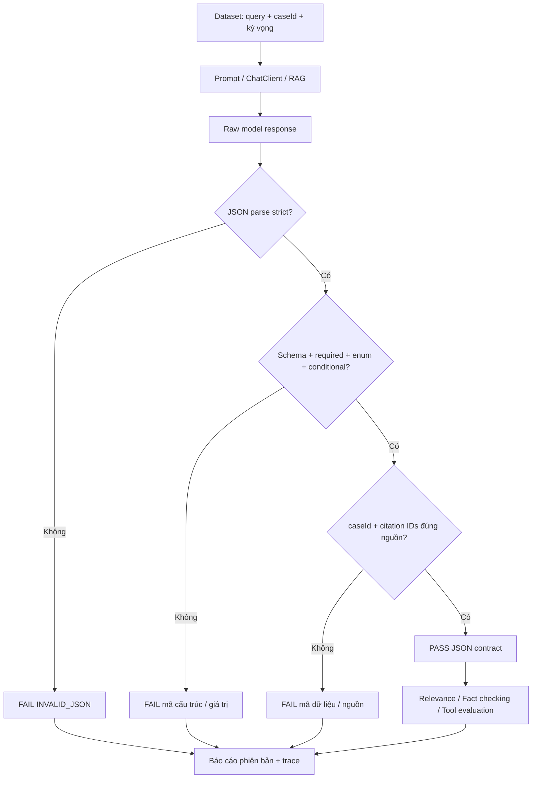

# Đánh giá định dạng JSON, trường bắt buộc và giá trị cho phép

> **Chương:** Evaluator tùy chỉnh  
> **Module:** `SPRING_AI_EVALUATION_OBSERVABILITY` — đánh giá chất lượng ứng dụng Spring AI bằng dataset, relevance, fact checking, kiểm thử RAG/tool calling, đồng thời sử dụng metrics, traces, chi phí và độ trễ để phát hiện suy giảm chất lượng theo phiên bản prompt, model và pipeline.

## Mục tiêu học tập

Sau khi hoàn thành bài này, bạn có thể:

1. Phân biệt **JSON hợp lệ về cú pháp**, **JSON đúng hợp đồng dữ liệu** và **nội dung đúng theo bằng chứng nghiệp vụ**.
2. Viết JSON Schema để kiểm tra trường bắt buộc, kiểu dữ liệu, tập giá trị cho phép, trường thừa, mảng, giá trị biên và quy tắc có điều kiện.
3. Hiện thực một `Evaluator` riêng trong Spring AI để kiểm tra câu trả lời JSON bằng Jackson, trả về mã lỗi có thể tổng hợp.
4. Xây dựng dataset có ca PASS/FAIL, kiểm tra hồi quy khi đổi prompt/model/pipeline, và đọc kết quả theo từng nguyên nhân.
5. Biết khi nào cần bổ sung fact checking, kiểm soát truy xuất RAG, kiểm tra tool call và observability dù JSON đã qua kiểm tra.

## 1. Vì sao cần đánh giá JSON của ứng dụng AI?

Ứng dụng Spring AI thường yêu cầu mô hình tạo dữ liệu để một chương trình khác xử lý: kết quả phân loại, thông tin đơn hàng, báo cáo kiểm chứng trích dẫn, tham số gọi công cụ hoặc tóm tắt dưới dạng DTO. Dù câu trả lời có vẻ hữu ích với người đọc, chương trình vẫn có thể thất bại nếu:

- Mô hình bọc dữ liệu trong khối mã Markdown thay vì trả JSON thuần.
- JSON có dấu phẩy cuối, thiếu dấu ngoặc, ghi chú dạng comment hoặc có hai đối tượng nối tiếp nhau.
- Thiếu một trường bắt buộc như `decision` hoặc trả `null` nơi yêu cầu chuỗi.
- Dùng `"0.9"` thay vì số `0.9`; dùng giá trị ngoài enum, ví dụ `"MAYBE"` thay vì `"SUPPORTED"`.
- Thêm khóa không được phép, chẳng hạn `internalReasoning` hoặc `customerEmail`.
- Vi phạm logic giữa các trường: báo `INSUFFICIENT_EVIDENCE` nhưng vẫn cung cấp danh sách nguồn được xem là đã chứng minh kết luận.
- JSON hoàn toàn đúng định dạng nhưng trích dẫn một tài liệu chưa từng được truy xuất, hoặc đưa ra kết luận không được tài liệu hỗ trợ.

Các lỗi đầu tiên có thể được kiểm tra bằng **quy tắc có tính xác định**, không cần một mô hình khác chấm. Những lỗi liên quan sự thật hay ý nghĩa cần thêm bằng chứng hoặc evaluator ngữ nghĩa.

| Tầng kiểm tra | Câu hỏi | Cách thực hiện | Giới hạn |
|---|---|---|---|
| Cú pháp JSON | Parser có đọc được chính xác một JSON value không? | JSON parser ở chế độ strict | Chưa biết cấu trúc nghiệp vụ |
| Hợp đồng schema | Có đủ field, đúng type, enum và điều kiện liên trường không? | JSON Schema / validator / Java rule | Chưa biết nội dung đúng sự thật không |
| Dữ liệu tham chiếu | ID nguồn, mã khách hàng, giá trị số có khớp dữ liệu đáng tin? | Đối chiếu snapshot hoặc ngữ cảnh thực tế | Cần nguồn tham chiếu đúng phiên bản |
| Ý nghĩa/groundedness | Kết luận có được tài liệu hỗ trợ không? | `FactCheckingEvaluator`, bộ quy tắc chuyên biệt hoặc người đánh giá | Judge cũng cần được hiệu chuẩn |
| Luồng vận hành | Công cụ được gọi đúng quyền, đúng tham số và đủ nhanh không? | Event/trace + metrics + policy engine | Không suy ra từ JSON cuối cùng |

### 1.1. Hợp lệ không đồng nghĩa chính xác

Giả sử ứng dụng RAG cung cấp tài liệu nói rằng một yêu cầu hoàn tiền được xử lý trong **7 ngày làm việc**. Mô hình trả:

```json
{
  "caseId": "CASE-0007",
  "decision": "SUPPORTED",
  "answer": "Thời gian xử lý hoàn tiền là 14 ngày làm việc.",
  "citations": ["refund-policy-v3"],
  "confidence": 0.96
}
```

Nếu cấu trúc và ID nguồn đều hợp lệ, một evaluator định dạng vẫn có thể PASS. Kết luận "14 ngày" trái với nguồn "7 ngày" phải được bắt ở **tầng kiểm tra nội dung**. Vì thế cần đặt tên tiêu chí chính xác: `json_contract_pass` khác `fact_check_pass`.

## 2. Thiết kế hợp đồng đầu ra trước khi viết code

Ta xây dựng một trợ lý RAG trả JSON có **năm trường bắt buộc**:

| Trường | Kiểu JSON | Quy tắc |
|---|---|---|
| `caseId` | string | Theo mẫu `CASE-` và đúng 4 chữ số, ví dụ `CASE-0007` |
| `decision` | string | Chỉ nhận `SUPPORTED`, `REFUTED` hoặc `INSUFFICIENT_EVIDENCE` |
| `answer` | string | Không rỗng; nội dung kiểm chứng ở evaluator khác |
| `citations` | array of string | Mỗi ID không rỗng, không lặp, tối đa 8 phần tử |
| `confidence` | number | Từ 0 đến 1, gồm cả hai đầu mút |

Quy tắc kết hợp:

- Nếu `decision = INSUFFICIENT_EVIDENCE` thì `citations` phải là mảng rỗng.
- Nếu `decision = SUPPORTED` hoặc `REFUTED` thì phải có **ít nhất một citation**.
- Mỗi citation (nếu có) phải nằm trong những `Document` thực tế được đưa vào ngữ cảnh của lượt RAG đó.
- Mọi trường ngoài năm trường đã định nghĩa đều bị từ chối.
- `caseId` phải trùng ID của ca kiểm thử/phiên do hệ thống cung cấp, không chỉ hợp regex.

Với hợp đồng trên, đánh giá JSON có thể diễn ra riêng với đánh giá nội dung claim. Không nên ghi quy tắc "chính xác tuyệt đối" khi chỉ kiểm tra được định dạng và ID nguồn.

### 2.1. Quy tắc về cấu trúc và quy tắc về giá trị

Giả sử câu trả lời:

```json
{
  "caseId": "CASE-0007",
  "decision": "SUPPORTED",
  "answer": "Theo tài liệu, hoàn tiền trong 7 ngày làm việc.",
  "citations": ["refund-policy-v3"],
  "confidence": 0.88
}
```

Từ đây, định nghĩa riêng những điều kiện có thể kiểm tra mà không gọi LLM:

1. `JSON_SYNTAX`: parse thành **duy nhất một** JSON object, không có đoạn giải thích sau object.
2. `REQUIRED_FIELDS`: không thiếu `caseId`, `decision`, `answer`, `citations` hay `confidence`.
3. `NO_EXTRA_FIELDS`: không có khóa lạ, kể cả khóa được mô hình thêm "cho hữu ích".
4. `FIELD_TYPES`: giữ nguyên kiểu JSON gốc, không tự ép chuỗi sang số.
5. `ALLOWED_VALUES`: `decision` thuộc enum, `confidence` trong đoạn 0..1, `caseId` đúng mẫu.
6. `CROSS_FIELD_RULE`: số citation phụ thuộc quyết định.
7. `SOURCE_MEMBERSHIP`: ID citation thuộc tập tài liệu truy xuất đã được cung cấp.
8. `CASE_MATCH`: ID ca trong phản hồi trùng với ca cần chấm.

`SOURCE_MEMBERSHIP` có thể đạt ngay cả khi nội dung của tài liệu không hỗ trợ câu trả lời; còn `CASE_MATCH` chỉ đáng tin nếu ID kỳ vọng đến từ test harness/service, không phải từ một trường khác do mô hình tự tạo.

## 3. JSON Schema: cách khai báo hợp đồng một cách tường minh

JSON Schema Draft 2020-12 diễn tả các điều kiện cấu trúc và giá trị bằng một tài liệu JSON. Ví dụ:

```json
{
  "$schema": "https://json-schema.org/draft/2020-12/schema",
  "$id": "https://example.org/schemas/rag-evaluation-v1",
  "title": "RagEvaluationOutput",
  "type": "object",
  "required": [
    "caseId",
    "decision",
    "answer",
    "citations",
    "confidence"
  ],
  "properties": {
    "caseId": {
      "type": "string",
      "pattern": "^CASE-[0-9]{4}$"
    },
    "decision": {
      "type": "string",
      "enum": [
        "SUPPORTED",
        "REFUTED",
        "INSUFFICIENT_EVIDENCE"
      ]
    },
    "answer": {
      "type": "string",
      "minLength": 1
    },
    "citations": {
      "type": "array",
      "maxItems": 8,
      "uniqueItems": true,
      "items": {
        "type": "string",
        "pattern": "^[A-Za-z0-9_.:-]+$"
      }
    },
    "confidence": {
      "type": "number",
      "minimum": 0,
      "maximum": 1
    }
  },
  "additionalProperties": false,
  "if": {
    "properties": {
      "decision": {
        "const": "INSUFFICIENT_EVIDENCE"
      }
    },
    "required": ["decision"]
  },
  "then": {
    "properties": {
      "citations": {
        "maxItems": 0
      }
    }
  },
  "else": {
    "properties": {
      "citations": {
        "minItems": 1
      }
    }
  }
}
```

`$id` ở đây là URI nhận diện schema ví dụ, không phải địa chỉ bắt buộc tải schema qua mạng. Tại runtime, hãy giữ schema trong tài nguyên được kiểm soát phiên bản. Cần dùng một thư viện validator hỗ trợ **đúng Draft 2020-12**, vì một số tính năng điều kiện hoạt động khác nhau giữa các draft.

### 3.1. Hiểu đúng các từ khóa quan trọng

| Từ khóa | Ý nghĩa thực tế | Lỗi thường gặp |
|---|---|---|
| `type: "object"` | Đầu ra phải là object | Chỉ kiểm tra parser thành công, bỏ qua array/string |
| `properties` | Định nghĩa schema cho các khóa đã biết | Nhầm `properties` với bắt buộc có mặt |
| `required` | Chỉ tên các khóa **phải xuất hiện** | Nghĩ rằng `required` cấm `null` |
| `additionalProperties: false` | Từ chối các khóa ngoài `properties`/`patternProperties` cùng cấp | Không áp dụng lại cho object lồng nhau |
| `type: "integer"` | Giá trị số nguyên theo quy tắc JSON Schema | Mặc định xem JSON number có phần lẻ là hợp lệ |
| `enum` | Giá trị phải trùng chính xác một trong các lựa chọn | Tự tiện chuyển `SUPPORTED` thành `supported` |
| `const` | Giá trị phải bằng một hằng duy nhất | Dùng cho cả danh sách khi thực ra cần `enum` |
| `pattern` | Chuỗi khớp biểu thức chính quy | Quên `^` và `$` khi cần kiểm tra toàn chuỗi |
| `minimum`, `maximum` | Ràng buộc giá trị số | Nhầm với độ dài chuỗi |
| `minLength`, `maxLength` | Ràng buộc độ dài chuỗi | Hiểu `minLength: 1` là "không được chỉ có dấu cách" |
| `items` | Mọi phần tử của array phải tuân schema | Chỉ kiểm phần tử đầu tiên |
| `minItems`, `maxItems` | Số phần tử | Không kiểm array trống trong nhánh bắt buộc có nguồn |
| `uniqueItems` | Các phần tử array không được trùng nhau | Dùng khi nghiệp vụ cho phép lặp có ý nghĩa |
| `if` / `then` / `else` | Ràng buộc theo điều kiện | Quên phân nhánh cho trạng thái không có bằng chứng |

**Phân biệt trường thiếu và trường null:**

```json
{}
```

Object này **thiếu** `answer`. Trái lại:

```json
{"answer": null}
```

Object thứ hai **có** khóa `answer`, nên chỉ xét `required` thì thỏa yêu cầu có mặt; nhưng **không** thỏa `"type": "string"`. Để cho phép null ở một trường cụ thể, cần ghi rõ, chẳng hạn `"type": ["string", "null"]`. Không vô tình cho phép null ở tất cả field.

### 3.2. Phân biệt kiểu số và kiểu chuỗi

| Giá trị JSON | `type: "number"` | `type: "integer"` | `type: "string"` |
|---|---|---|---|
| `0.88` | PASS | FAIL | FAIL |
| `1` | PASS | PASS | FAIL |
| `1.0` | PASS | PASS theo ngữ nghĩa JSON Schema | FAIL |
| `"0.88"` | FAIL | FAIL | PASS |
| `true` | FAIL | FAIL | FAIL |
| `null` | FAIL | FAIL | FAIL |

Theo JSON Schema, số có giá trị toán học nguyên như `1.0` có thể thỏa `integer`; vì vậy **không** đánh đồng từ khóa `integer` với quy định bắt buộc biểu diễn JSON theo cú pháp không có dấu chấm. Nếu ứng dụng cần định dạng số nguyên một cách đặc biệt ở mức ký tự, phải có quy tắc serialization/parser riêng và kiểm thử rõ ràng.

### 3.3. Quy tắc ở object lồng nhau

`additionalProperties: false` chỉ kiểm soát các khóa ngoài khai báo ở **object đang được đánh giá**. Nếu phản hồi có:

```json
{
  "customer": {
    "id": "C-42",
    "privateToken": "should-not-appear"
  }
}
```

Muốn cấm `privateToken`, phải định nghĩa schema cho `customer` và đặt `additionalProperties: false` ở schema con. Điều này đặc biệt quan trọng với đầu ra AI vì mô hình có thể thêm trường nhạy cảm theo suy đoán. Nếu hợp đồng sử dụng `allOf`, `oneOf` hay nhiều schema kết hợp, cần hiểu khác biệt giữa `additionalProperties` và `unevaluatedProperties` theo draft đang dùng.

## 4. Bảng kiểm thử định dạng trước khi viết evaluator

Giả sử ngữ cảnh RAG chứa `Document` có ID `refund-policy-v3` và `caseId` kỳ vọng là `CASE-0007`:

| Biến thể câu trả lời | Kết quả hợp đồng | Nguyên nhân |
|---|---|---|
| JSON mẫu ở mục 2.1 | PASS | Đúng cú pháp, field, enum, quan hệ và nguồn |
| Đầu ra là array `[{"caseId":"CASE-0007"}]` | FAIL | Root không phải object |
| JSON được bọc bằng Markdown code fence | FAIL | Không phải JSON thuần |
| Thêm văn bản "Tôi đã kiểm tra" sau JSON | FAIL | Có nội dung thừa |
| Có hai khóa `decision` trong cùng object | FAIL | Khóa trùng cần được chặn ngay khi parse |
| Thiếu `confidence` | FAIL | Trường bắt buộc |
| `confidence: null` | FAIL | Sai type |
| `confidence: "0.88"` | FAIL | Chuỗi thay vì number |
| `confidence: 1.25` | FAIL | Ngoài khoảng 0..1 |
| `decision: "UNKNOWN"` | FAIL | Ngoài enum |
| `citations: ["refund-policy-v3", "refund-policy-v3"]` | FAIL | Phần tử trùng |
| `decision: "SUPPORTED", citations: []` | FAIL | Thiếu nguồn ở nhánh bắt buộc |
| `decision: "INSUFFICIENT_EVIDENCE", citations: ["refund-policy-v3"]` | FAIL | Mâu thuẫn giữa trạng thái và nguồn |
| `citations: ["unknown-doc"]` | FAIL ở bước đối chiếu | ID không thuộc nguồn truy xuất |
| `caseId: "CASE-0008"` | FAIL ở bước đối chiếu | Khác ca kiểm thử yêu cầu |
| `answer` chứa kết luận sai nhưng JSON và ID đúng | Có thể PASS ở hợp đồng JSON | Cần thêm fact checking |

Một evaluator tốt cần thông báo **vi phạm nào** đã xảy ra, thay vì chỉ trả `false`. Khi nhiều điều kiện cùng sai, có thể áp dụng thứ tự lỗi như **parse → cấu trúc → kiểu → giá trị → điều kiện → nguồn** để mỗi case có mã lỗi đầu tiên ổn định. Nếu cần nhiều lỗi cùng lúc để sửa prompt, có thể trả danh sách violations, nhưng phải giữ cấu trúc kết quả nhất quán.

## 5. Xây dựng Evaluator JSON tùy chỉnh trong Spring AI

Spring AI cung cấp `org.springframework.ai.evaluation.Evaluator`:

```java
@FunctionalInterface
public interface Evaluator {
    EvaluationResponse evaluate(EvaluationRequest evaluationRequest);
}
```

`EvaluationRequest` chứa `userText`, `dataList` (ngữ cảnh, thường là các `Document` của RAG) và `responseContent` (chuỗi trả lời). `EvaluationResponse` có `isPass()`, `getScore()`, `getFeedback()` và `getMetadata()`. Chúng ta tận dụng API này để đưa kết quả hợp đồng JSON vào cùng hệ thống đánh giá với relevance và fact checking.

Ví dụ sau sử dụng Jackson để thể hiện các rule trực tiếp trong Java. Mục đích là minh họa **một evaluator thật có thể chạy mà không gọi LLM judge**; khi schema lớn hoặc dùng nhiều keyword, thay phần kiểm tra thủ công bằng JSON Schema validator tương thích Draft 2020-12.

### 5.1. Mã Java: `RagJsonContractEvaluator`

```java
import java.util.HashSet;
import java.util.List;
import java.util.Map;
import java.util.Objects;
import java.util.Set;
import java.util.stream.Collectors;

import com.fasterxml.jackson.core.JsonFactory;
import com.fasterxml.jackson.core.JsonProcessingException;
import com.fasterxml.jackson.core.StreamReadFeature;
import com.fasterxml.jackson.databind.DeserializationFeature;
import com.fasterxml.jackson.databind.JsonNode;
import com.fasterxml.jackson.databind.ObjectMapper;
import org.springframework.ai.document.Document;
import org.springframework.ai.evaluation.EvaluationRequest;
import org.springframework.ai.evaluation.EvaluationResponse;
import org.springframework.ai.evaluation.Evaluator;

public final class RagJsonContractEvaluator implements Evaluator {

    private static final Set<String> FIELDS = Set.of(
            "caseId", "decision", "answer", "citations", "confidence");
    private static final Set<String> DECISIONS = Set.of(
            "SUPPORTED", "REFUTED", "INSUFFICIENT_EVIDENCE");
    private final String expectedCaseId;

    // Chặn khóa JSON trùng và mọi token thừa sau giá trị JSON đầu tiên.
    private final ObjectMapper mapper = new ObjectMapper(
            JsonFactory.builder()
                    .enable(StreamReadFeature.STRICT_DUPLICATE_DETECTION)
                    .build())
            .enable(DeserializationFeature.FAIL_ON_TRAILING_TOKENS);

    public RagJsonContractEvaluator(String expectedCaseId) {
        this.expectedCaseId = Objects.requireNonNull(expectedCaseId);
    }

    @Override
    public EvaluationResponse evaluate(EvaluationRequest request) {
        if (request == null || request.getResponseContent() == null
                || request.getResponseContent().isBlank()) {
            return fail("EMPTY_RESPONSE", "Không có nội dung để đánh giá.");
        }

        final JsonNode root;
        try {
            root = mapper.readTree(request.getResponseContent());
        }
        catch (JsonProcessingException ex) {
            return fail("INVALID_JSON",
                    "JSON sai cú pháp, có khóa trùng hoặc token thừa.");
        }

        if (root == null || !root.isObject()) {
            return fail("NOT_OBJECT", "Cần đúng một JSON object.");
        }

        Set<String> names = new HashSet<>();
        root.fieldNames().forEachRemaining(names::add);
        if (!names.equals(FIELDS)) {
            return fail("INVALID_FIELDS",
                    "Thiếu trường bắt buộc hoặc xuất hiện trường lạ.");
        }

        JsonNode caseId = root.get("caseId");
        JsonNode decision = root.get("decision");
        JsonNode answer = root.get("answer");
        JsonNode citations = root.get("citations");
        JsonNode confidence = root.get("confidence");

        if (!caseId.isTextual() || !decision.isTextual()
                || !answer.isTextual() || !citations.isArray()
                || !confidence.isNumber()) {
            return fail("INVALID_TYPES", "Một hoặc nhiều trường sai kiểu.");
        }

        if (!caseId.asText().matches("CASE-[0-9]{4}")
                || !DECISIONS.contains(decision.asText())
                || answer.asText().isEmpty()
                || !Double.isFinite(confidence.asDouble())
                || confidence.asDouble() < 0.0
                || confidence.asDouble() > 1.0) {
            return fail("INVALID_VALUES", "Giá trị không theo hợp đồng.");
        }

        if (!caseId.asText().equals(expectedCaseId)) {
            return fail("CASE_MISMATCH",
                    "caseId không khớp mã ca do hệ thống cung cấp.");
        }

        if (citations.size() > 8) {
            return fail("INVALID_CITATIONS", "Vượt quá 8 trích dẫn.");
        }

        Set<String> cited = new HashSet<>();
        for (JsonNode citation : citations) {
            if (!citation.isTextual()
                    || !citation.asText().matches("[A-Za-z0-9_.:-]+")
                    || !cited.add(citation.asText())) {
                return fail("INVALID_CITATIONS",
                        "Citation sai kiểu, ID sai mẫu hoặc bị trùng.");
            }
        }

        boolean insufficient = "INSUFFICIENT_EVIDENCE"
                .equals(decision.asText());
        if ((insufficient && !cited.isEmpty())
                || (!insufficient && cited.isEmpty())) {
            return fail("CROSS_FIELD_RULE",
                    "Số citation không phù hợp với decision.");
        }

        List<Document> documents = request.getDataList();
        Set<String> allowedIds = documents == null
                ? Set.of()
                : documents.stream()
                        .map(Document::getId)
                        .collect(Collectors.toSet());

        if (!allowedIds.containsAll(cited)) {
            return fail("UNKNOWN_SOURCE",
                    "Citation chứa ID không thuộc nguồn RAG đã truy xuất.");
        }

        return new EvaluationResponse(
                true, 1.0f, "Đạt hợp đồng JSON và ID nguồn tham chiếu.",
                Map.of("criterion", "rag_json_contract",
                        "reasonCode", "OK",
                        "caseId", expectedCaseId));
    }

    private EvaluationResponse fail(String code, String message) {
        return new EvaluationResponse(
                false, 0.0f, message,
                Map.of("criterion", "rag_json_contract",
                        "reasonCode", code,
                        "caseId", expectedCaseId));
    }
}
```

Mã trên giả định `expectedCaseId` được tạo từ hệ thống/test harness và `dataList` chứa **đúng tài liệu đã cấp cho mô hình** ở lần tạo câu trả lời đó. Hàm `getDataList()` không phải lịch sử tool calls và không nên chứa tất cả tài liệu của kho tri thức chỉ để "tăng khả năng pass".

**Những điều đoạn code thực sự kiểm tra:** cú pháp, root, tập trường, loại dữ liệu, enum, khoảng số, quy tắc có điều kiện, ID ca và tính hợp lệ của ID citation. **Những điều chưa kiểm tra:** nội dung câu trả lời có chứng cứ hỗ trợ, mức độ phù hợp câu hỏi, tài liệu có còn hiệu lực, người dùng được phép đọc tài liệu hay không. Các điều này phải được kiểm soát ở bước khác.

### 5.2. Khi dùng JSON Schema validator thực thụ

Mã Java trên lặp lại một phần quy tắc của JSON Schema bằng điều kiện thủ công để người học thấy rõ luồng logic. Một ứng dụng dùng nhiều schema nên:

1. Lưu schema theo `schemaVersion` trong mã nguồn/tài nguyên test.
2. Parse JSON với chế độ strict trước khi ánh xạ sang DTO.
3. Chạy validator tương thích với draft được khai báo trong `$schema`.
4. Chuẩn hóa validation errors thành `reasonCode` và đường dẫn field (ví dụ `/citations/1`, `/confidence`).
5. Sau khi schema PASS, chạy các quy tắc không thể biểu diễn bằng schema tĩnh: ID đúng case, ID citation thuộc tập nguồn đã truy xuất, giá trị trùng snapshot nghiệp vụ.

Không cần cố diễn đạt tất cả luật động bằng JSON Schema. Kiểm tra "citation có trong `Set<String> allowedIds` của lượt này" là quy tắc dữ liệu ở runtime; dùng Java hoặc một validator mở rộng sẽ rõ ràng hơn. Có thể dùng Jakarta Bean Validation sau khi deserialize DTO, nhưng phải đặc biệt chú ý các trường lạ, ép kiểu, khóa trùng và tính nghiêm ngặt của parser.

## 6. Ví dụ chạy evaluator và kiểm thử JUnit

### 6.1. Một lượt đánh giá có tài liệu RAG

```java
import java.util.List;

import org.springframework.ai.document.Document;
import org.springframework.ai.evaluation.EvaluationRequest;
import org.springframework.ai.evaluation.EvaluationResponse;

Document refundPolicy = Document.builder()
        .id("refund-policy-v3")
        .text("Chính sách: xử lý yêu cầu hoàn tiền trong 7 ngày làm việc.")
        .build();

String output = """
        {
          "caseId": "CASE-0007",
          "decision": "SUPPORTED",
          "answer": "Hoàn tiền trong 7 ngày làm việc.",
          "citations": ["refund-policy-v3"],
          "confidence": 0.88
        }
        """;

var evaluationRequest = new EvaluationRequest(
        "Cần bao lâu để xử lý hoàn tiền?",
        List.of(refundPolicy),
        output
);

EvaluationResponse result =
        new RagJsonContractEvaluator("CASE-0007").evaluate(evaluationRequest);

System.out.println(result.isPass());                  // true
System.out.println(result.getMetadata().get("reasonCode")); // OK
```

`EvaluationRequest` có thể được tạo trong integration test sau khi chạy `ChatClient`. Nếu sử dụng advisor RAG, hãy lấy tài liệu thực tế từ ngữ cảnh/metadata mà advisor trả về (tùy cách tích hợp và phiên bản Spring AI), thay vì dựng lại một tập tài liệu khác sau khi đã có câu trả lời.

### 6.2. Kiểm thử các nhánh lỗi bằng JUnit 5

```java
import static org.junit.jupiter.api.Assertions.assertEquals;
import static org.junit.jupiter.api.Assertions.assertFalse;
import static org.junit.jupiter.api.Assertions.assertTrue;

import java.util.List;
import org.junit.jupiter.api.Test;
import org.springframework.ai.document.Document;
import org.springframework.ai.evaluation.EvaluationRequest;

class RagJsonContractEvaluatorTest {

    private final Document policy = Document.builder()
            .id("refund-policy-v3")
            .text("Thời gian hoàn tiền: 7 ngày làm việc.")
            .build();

    private final RagJsonContractEvaluator evaluator =
            new RagJsonContractEvaluator("CASE-0007");

    @Test
    void acceptsValidJsonAndCitation() {
        String json = """
                {"caseId":"CASE-0007","decision":"SUPPORTED",
                 "answer":"7 ngày làm việc.",
                 "citations":["refund-policy-v3"],"confidence":0.8}
                """;
        var result = evaluator.evaluate(new EvaluationRequest(
                "Hoàn tiền bao lâu?", List.of(policy), json));

        assertTrue(result.isPass(), result.getFeedback());
        assertEquals("OK", result.getMetadata().get("reasonCode"));
    }

    @Test
    void rejectsUnknownCitationEvenWhenSchemaIsValid() {
        String json = """
                {"caseId":"CASE-0007","decision":"SUPPORTED",
                 "answer":"7 ngày làm việc.",
                 "citations":["invented-doc"],"confidence":0.8}
                """;
        var result = evaluator.evaluate(new EvaluationRequest(
                "Hoàn tiền bao lâu?", List.of(policy), json));

        assertFalse(result.isPass());
        assertEquals("UNKNOWN_SOURCE",
                result.getMetadata().get("reasonCode"));
    }

    @Test
    void rejectsDuplicateField() {
        String json = """
                {"caseId":"CASE-0007","caseId":"CASE-0008",
                 "decision":"INSUFFICIENT_EVIDENCE",
                 "answer":"Không đủ dữ liệu.",
                 "citations":[],"confidence":0.0}
                """;
        var result = evaluator.evaluate(new EvaluationRequest(
                "Hoàn tiền bao lâu?", List.of(), json));

        assertFalse(result.isPass());
        assertEquals("INVALID_JSON",
                result.getMetadata().get("reasonCode"));
    }
}
```

Ngoài ba ca này, một bộ kiểm thử đủ mạnh phải bao phủ cả giá trị ranh giới: `confidence = 0`, `confidence = 1`, giá trị âm, số trên 1, chuỗi thay cho number, mảng trống ở hai nhánh quyết định, mảng quá dài, citation trùng, thiếu field, field null, field lạ, JSON có token sau object và dữ liệu không parse được.

**Không cần gọi model thật trong unit test của evaluator.** Với các ca JSON giả lập, phép kiểm thử nhanh và ổn định. Để kiểm tra toàn bộ hệ thống AI, một bộ integration/evaluation test riêng cần chạy prompt/model/RAG thật và dùng cùng evaluator để chấm đầu ra thực tế.

## 7. Tạo dataset để phát hiện lỗi theo phiên bản

Khi đánh giá prompt A và prompt B, cần lưu dataset gồm những trường hợp mà hệ thống có thể sai. Một file dataset minh họa:

```yaml
datasetVersion: rag-json-contract-v1
schemaVersion: rag-evaluation-v1
cases:
  - caseId: CASE-0007
    query: "Cần bao lâu để xử lý hoàn tiền?"
    retrievedDocumentIds: [refund-policy-v3]
    generatedAnswer: |
      {"caseId":"CASE-0007","decision":"SUPPORTED",
       "answer":"7 ngày làm việc.",
       "citations":["refund-policy-v3"],"confidence":0.88}
    expectedPass: true
    expectedReasonCode: OK
    tags: [json, rag, valid]

  - caseId: CASE-0008
    query: "Chính sách bảo hành có hiệu lực chưa?"
    retrievedDocumentIds: []
    generatedAnswer: |
      {"caseId":"CASE-0008","decision":"INSUFFICIENT_EVIDENCE",
       "answer":"Không đủ thông tin.",
       "citations":[],"confidence":0.2}
    expectedPass: true
    expectedReasonCode: OK
    tags: [json, abstention, empty-context]

  - caseId: CASE-0009
    query: "Chính sách hoàn tiền?"
    retrievedDocumentIds: [refund-policy-v3]
    generatedAnswer: |
      {"caseId":"CASE-0009","decision":"SUPPORTED",
       "answer":"7 ngày làm việc.",
       "citations":["nonexistent-source"],"confidence":0.88}
    expectedPass: false
    expectedReasonCode: UNKNOWN_SOURCE
    tags: [json, fabricated-citation]

  - caseId: CASE-0010
    query: "Chính sách hoàn tiền?"
    retrievedDocumentIds: [refund-policy-v3]
    generatedAnswer: |
      {"caseId":"CASE-0010","decision":"SUPPORTED",
       "answer":"7 ngày làm việc.",
       "citations":[],"confidence":0.88}
    expectedPass: false
    expectedReasonCode: CROSS_FIELD_RULE
    tags: [json, missing-citation]
```

Đây là định dạng dữ liệu ví dụ do bài học đặt ra, **không** phải định dạng dataset mặc định của Spring AI. Có thể dùng `expectedPass` và `expectedReasonCode` để kiểm thử chính evaluator; với kiểm thử ứng dụng, `generatedAnswer` cần được thay bằng đầu ra thu từ lần chạy model tương ứng.

### 7.1. Những thành phần bắt buộc khi so sánh phiên bản

| Trường báo cáo | Dùng để làm gì? |
|---|---|
| `caseId` và `datasetVersion` | So sánh đúng cùng tập trường hợp |
| `schemaVersion` / `criterionVersion` | Biết luật chấm có thay đổi không |
| `promptVersion` | Phát hiện thay đổi hướng dẫn định dạng |
| `model` / model version | Phân biệt ảnh hưởng của model |
| `pipelineVersion` | Theo dõi thay đổi retrieval, parser, tool hoặc advisor |
| `retrievedDocumentIds` | Xác minh ngữ cảnh thực sự cấp cho model |
| `pass`, `reasonCode`, `feedback` | Tổng hợp lỗi theo nguyên nhân |
| `traceId` | Truy vết lỗi trong luồng model/RAG/tool |

Khi `schemaVersion` thay đổi, một tỷ lệ PASS khác không nhất thiết chứng minh chất lượng mô hình thay đổi. Ví dụ, thêm `additionalProperties: false` làm nhiều case trước đây PASS trở thành FAIL; đó là thước đo đã nghiêm ngặt hơn. Giữ schema bất biến trong so sánh A/B, hoặc đánh giá lại cả hai phiên bản dưới cùng luật mới.

## 8. Kiểm tra đầu ra định dạng trong luồng Spring AI

Một workflow đánh giá hợp lý:



Ở tầng generation, có thể yêu cầu mô hình trả về JSON hoặc dùng khả năng **structured output** của model/provider khi được hỗ trợ. Điều đó giúp tăng tỷ lệ đầu ra hợp lệ nhưng không thay thế đánh giá ở phía ứng dụng. Model có thể tạo JSON hợp schema nhưng sai dữ liệu, và định dạng được provider hỗ trợ có thể khác giữa các model.

**Vị trí nên đặt kiểm tra:**

1. **Trước khi gửi yêu cầu:** xác thực input của người dùng và quyền truy cập; tạo `caseId` đáng tin.
2. **Khi gọi model:** cung cấp hướng dẫn/schema rõ ràng và xử lý khả năng từ chối, timeout hoặc đầu ra bị cắt.
3. **Ngay sau khi nhận raw response:** parse strict, kiểm tra schema, trước khi sử dụng dữ liệu để ra quyết định hoặc gọi tool.
4. **Trước khi thực thi side effect:** đối chiếu tham số với quyền và dữ liệu nghiệp vụ; không dùng mỗi kết quả `isPass()` hậu kiểm làm rào chắn bảo mật.
5. **Trong test offline/CI:** chạy cùng dataset, tổng hợp theo phiên bản prompt/model/pipeline, bảo đảm các ca bắt buộc không hồi quy.

Nếu framework trả trực tiếp một DTO qua cơ chế structured output, cần quyết định rõ bạn muốn chấm **raw JSON** hay **DTO sau chuyển đổi**. Kiểm thử raw JSON bắt được tình huống coercion, trường lạ và khóa trùng; kiểm thử DTO phát hiện sai dữ liệu nghiệp vụ sau mapping. Chỉ đánh giá DTO có thể bỏ sót lỗi xảy ra ở bước chuyển đổi.

## 9. Ranh giới quan trọng: JSON contract, RAG và tool calling

### 9.1. Khi câu trả lời liên quan đến RAG

Một JSON có `citations: ["refund-policy-v3"]` chỉ chứng minh mô hình biết viết ID đó. Để biết câu trả lời có căn cứ, ta cần:

- **Citation membership:** ID nằm trong `Document` đã đưa vào prompt của đúng lượt chạy, như evaluator Java kiểm tra.
- **Retrieval quality:** nguồn được lấy có thực sự liên quan? Có bỏ sót tài liệu cần thiết? Đo retrieval recall/precision trên dataset có nhãn nguồn chuẩn.
- **Fact checking:** nội dung khẳng định có được nguồn hỗ trợ hay không? Dùng `FactCheckingEvaluator` hoặc đánh giá ngữ nghĩa được hiệu chuẩn.
- **Data freshness:** chính sách/tài liệu có còn hiệu lực? Cần metadata hoặc nguồn xác thực theo thời điểm.

Không nên gọi một evaluator kiểm tra field là "factual correctness evaluator". Chất lượng RAG có nhiều chiều; chỉ ghép kết quả khi hiểu từng chiều đang đo cái gì.

### 9.2. Khi JSON dùng làm tham số tool

Giả sử model đề xuất:

```json
{
  "tool": "cancelOrder",
  "arguments": {
    "orderId": "ORD-2042"
  }
}
```

JSON này có thể đạt schema của lời gọi tool nhưng vẫn **không được phép thực thi** nếu người dùng chỉ hỏi trạng thái đơn. Validator định dạng có thể từ chối thiếu `orderId`, tool không nằm allowlist hoặc tham số sai type; kiểm tra quyền và xác nhận phải dựa trên trạng thái người dùng được hệ thống xác thực, không dựa vào một trường `confirmed` do model tự đưa ra.

Để đánh giá luồng tool, cần lưu một **tool execution record** từ runtime hoặc fixture: tên tool, đối số, quyền, xác nhận, kết quả và các side effect. `EvaluationRequest` chỉ chứa câu hỏi, ngữ cảnh và câu trả lời; không tự có lịch sử tool call. Bởi vậy, kiểm tra output JSON và kiểm tra tool flow là **hai bước khác nhau**.

## 10. Theo dõi lỗi JSON bằng metrics và traces

Đánh giá đơn lẻ cho biết một ca PASS hay FAIL; observability giúp biết **vì sao tỷ lệ lỗi thay đổi** khi đổi prompt, model, retriever hoặc pipeline.

| Tín hiệu suy giảm | Metric / log cần xem | Cách điều tra |
|---|---|---|
| `INVALID_JSON` tăng | Tỷ lệ lỗi parse, finish reason, token output | Phản hồi bị cắt, mô hình thêm Markdown/prose, prompt hướng dẫn kém rõ |
| `INVALID_FIELDS` tăng | Mã rule, schemaVersion, promptVersion | Prompt mới quên field, schema đổi, model tạo trường không được phép |
| `INVALID_TYPES` tăng | Mã rule, format của raw output | Model dùng số dưới dạng chuỗi, parser ép kiểu trong môi trường khác |
| `INVALID_VALUES` tăng | Phân bố enum/confidence, model | Enum thiếu ví dụ, model thay tên trạng thái |
| `CROSS_FIELD_RULE` tăng | Decision + số citation theo từng case | Prompt thiếu giải thích quan hệ các trường |
| `UNKNOWN_SOURCE` tăng | ID tài liệu truy xuất, RAG trace, metadata | Trích dẫn bịa, chunk ID không nhất quán, retrieval thay đổi |
| `fact_check_pass` giảm nhưng JSON pass ổn định | Fact checking + retrieval traces | Nội dung chưa được nguồn hỗ trợ dù schema vẫn đúng |
| p95 latency hoặc cost tăng | ChatModel spans, token usage, tool spans | Context dài, retry nhiều, thêm judge/model đắt |

Spring AI hỗ trợ tích hợp Micrometer để quan sát các bước gọi ChatClient/ChatModel, advisor, vector store và tool. Trong báo cáo đánh giá, nên liên kết `reasonCode` với `traceId` và các phiên bản. Tuy nhiên, **viết `Evaluator` không tự sinh báo cáo nghiệp vụ**: ứng dụng hoặc test harness cần thu thập và tổng hợp kết quả.

Một bản ghi kết quả mẫu:

```json
{
  "caseId": "CASE-0007",
  "datasetVersion": "rag-json-contract-v1",
  "schemaVersion": "rag-evaluation-v1",
  "criterionId": "rag_json_contract",
  "promptVersion": "prompt-v5",
  "modelVersion": "model-b",
  "pipelineVersion": "rag-v4",
  "result": "FAIL",
  "reasonCode": "UNKNOWN_SOURCE",
  "latencyMs": 1340,
  "traceId": "example-trace-id"
}
```

Các giá trị chỉ là ví dụ, không đại diện cho dữ liệu vận hành thật. Trên metrics có số lượng nhãn giới hạn, chỉ đưa `criterionId`, `reasonCode` và version với cardinality phù hợp; giữ chi tiết từng case trong kho dữ liệu được phân quyền. Không đưa PII, raw prompt, output hoặc tài liệu nhạy cảm vào metric tags.

### 10.1. Đặt điều kiện chặn phát hành

Trên dataset cố định, có thể đặt chính sách minh họa:

| Tiêu chí | Ví dụ ngưỡng | Ý nghĩa |
|---|---|---|
| Tỷ lệ parse JSON hợp lệ | ≥ 99,5% | Giảm lỗi định dạng gây gián đoạn |
| Tỷ lệ đạt schema | ≥ 99% | Hợp đồng cấu trúc ổn định |
| Ca vi phạm quyền tool | 0 | Điều kiện bắt buộc |
| Citation ID hợp lệ | ≥ 99% | Không tạo nguồn bịa theo hợp đồng |
| Fact checking | Theo yêu cầu sản phẩm | Kiểm tra chất lượng nội dung độc lập |
| Evaluation coverage | 100% ca bắt buộc đã chấm hoặc báo ERROR | Không bỏ qua lỗi hệ thống kiểm thử |
| p95 latency và chi phí | Theo SLA/ngân sách thực tế | Không cải thiện format bằng chi phí không chấp nhận được |

Các ngưỡng chỉ để minh họa cách xác định release gate; không phải chuẩn của Spring AI. Khi nhóm ca có rủi ro cao (ví dụ sửa dữ liệu tài chính hoặc gọi tool có side effect), có thể bắt buộc **0 vi phạm**, không gộp lỗi vào điểm trung bình để che khuất.

### 10.2. Phân biệt FAIL với ERROR

Một câu trả lời thiếu `decision` là **FAIL** vì evaluator đã đánh giá và tìm thấy lỗi. Nếu test harness không lấy được tài liệu nguồn, mất metadata hoặc validator bị lỗi hạ tầng, đó là **ERROR**: chưa có đủ điều kiện để kết luận chất lượng.

`EvaluationResponse` cơ bản có trạng thái pass/fail; phần điều phối nên quản lý thêm `ERROR`, retry có giới hạn hoặc đánh dấu ca cần điều tra. Không biến các lỗi thực thi thành PASS và cũng không âm thầm loại chúng khỏi mẫu số mà không công bố tỷ lệ ca chấm được.

## 11. Các lỗi thiết kế evaluator JSON thường gặp

1. **Tin rằng "JSON mode" đã đảm bảo dữ liệu đúng.** Chế độ sinh JSON/structured output giúp giảm lỗi cú pháp nhưng không chứng minh nội dung đúng nghiệp vụ.
2. **Chỉ gọi `ObjectMapper.readTree()` rồi cho PASS.** Parser thành công không chứng minh có đủ field, đúng enum hoặc đúng root.
3. **Bỏ qua khóa JSON trùng.** Một số parser chấp nhận giá trị cuối cùng, làm đầu ra không thống nhất giữa dịch vụ; cần quyết định chính sách và cấu hình parser.
4. **Cho phép thêm trường ngoài hợp đồng mà không chủ ý.** Có thể rò thông tin hoặc phá vỡ consumer; cân nhắc `additionalProperties: false`.
5. **Nhầm `required` với non-null.** Trường hiện diện nhưng `null` vẫn có thể vi phạm kiểu.
6. **Ép `"0.88"` thành `0.88` trước khi chấm.** Nếu mục tiêu đo raw JSON, việc này che mất lỗi sinh định dạng.
7. **Không kiểm tra quan hệ liên trường.** Các field độc lập đúng kiểu vẫn có thể tạo trạng thái mâu thuẫn.
8. **Không tách ID citation hợp lệ với nội dung grounded.** Trích dẫn có thật có thể được dùng để hỗ trợ một kết luận sai.
9. **Dùng cùng một thước đo khi schema thay đổi âm thầm.** Phải phiên bản hóa schema/rubric và chấm lại baseline nếu thay tiêu chí.
10. **Không lưu mã lỗi chi tiết.** Chỉ đo pass rate sẽ không cho biết phải sửa prompt, parser, retriever hay tool.

## 12. Bài tập tự luyện

**Tình huống:** Một trợ lý Spring AI hỗ trợ khách hàng phân loại yêu cầu bảo hành. Nó phải trả JSON:

```json
{
  "ticketId": "TCK-2026-0042",
  "category": "WARRANTY",
  "priority": "HIGH",
  "needsHumanReview": true,
  "references": ["warranty-policy-v2"]
}
```

Đặt hợp đồng: `ticketId` theo mẫu `TCK-YYYY-NNNN`; `category` thuộc `WARRANTY`, `REFUND`, `SHIPPING`; `priority` thuộc `LOW`, `MEDIUM`, `HIGH`; `needsHumanReview` là boolean; `references` là mảng string không trùng, tối đa 5 nguồn; không có field lạ.

**Yêu cầu:**

1. Viết JSON Schema và liệt kê điều kiện PASS/FAIL.
2. Thêm điều kiện: nếu `priority = HIGH` thì `needsHumanReview = true`. Dùng `if`/`then` hoặc rule Java.
3. Tạo 10 ca kiểm thử gồm thiếu field, null, sai kiểu, enum không hợp lệ, field lạ, mảng trùng, JSON sai cú pháp, khóa trùng và nguồn không truy xuất.
4. Thiết kế evaluator dùng `EvaluationRequest` và một bộ `Document` thực tế để kiểm tra `references`.
5. Vẽ một báo cáo gồm tỷ lệ PASS theo phiên bản prompt/model, phân bố `reasonCode`, p95 latency và cost.

**Câu hỏi mở:** Nếu mô hình xuất `category = WARRANTY` hợp lệ nhưng nội dung ticket thực tế là yêu cầu hoàn tiền, evaluator schema có nên PASS không? Hãy nêu tiêu chí cần bổ sung để kiểm chứng phân loại theo nội dung.

## 13. Checklist trước khi dùng trong ứng dụng

- [ ] Định nghĩa rõ root JSON, field bắt buộc, field tùy chọn, kiểu, enum và giá trị giới hạn.
- [ ] Xác định chính sách với `null`, trường lạ, khóa trùng, token sau JSON và Markdown fence.
- [ ] Quy tắc cross-field được biểu diễn bằng schema hoặc mã kiểm tra tất định.
- [ ] Dữ liệu đối chiếu ngoài JSON (case ID, citation, giá trị nghiệp vụ) đến từ nguồn tin cậy.
- [ ] Evaluator có `criterionId`, `reasonCode`, `feedback` và kết quả PASS/FAIL rõ ràng.
- [ ] Dataset có ca đúng, ca sai, biên và ca cố ý khai thác sự khác biệt của parser.
- [ ] Theo dõi `schemaVersion`, `datasetVersion`, `promptVersion`, `modelVersion` và `pipelineVersion`.
- [ ] Có cách xử lý riêng lỗi evaluator/hạ tầng (`ERROR`).
- [ ] Tách JSON contract với fact checking, relevance, retrieval và tool permission.
- [ ] Kết hợp kết quả lỗi với traces, latency và cost trước khi đánh giá phiên bản mới.

## Tổng kết

Kiểm tra JSON bằng quy tắc có tính xác định là bước nền tảng khi ứng dụng Spring AI cần xuất dữ liệu để hệ thống khác sử dụng. Hãy kiểm tra theo thứ tự **cú pháp → schema → giá trị/quan hệ → dữ liệu tham chiếu**, trả mã lỗi cụ thể và giữ tập kiểm thử có thể lặp lại. Điều này giúp phát hiện hồi quy nhanh với chi phí thấp, nhưng một JSON hợp lệ vẫn cần các đánh giá relevance, fact checking, retrieval và tool flow tương ứng với mục tiêu ứng dụng.

## Tài liệu tham khảo

- [Spring AI — Evaluation Testing](https://docs.spring.io/spring-ai/reference/api/testing.html): `Evaluator`, `EvaluationRequest` và các evaluator tích hợp.
- [Spring AI API — EvaluationRequest](https://docs.spring.io/spring-ai/docs/current/api/org/springframework/ai/evaluation/EvaluationRequest.html): chữ ký constructor và các getter.
- [Spring AI API — EvaluationResponse](https://docs.spring.io/spring-ai/docs/current/api/org/springframework/ai/evaluation/EvaluationResponse.html): `isPass()`, `getScore()`, `getFeedback()`, `getMetadata()`.
- [JSON Schema — Objects](https://json-schema.org/understanding-json-schema/reference/object): `properties`, `required` và `additionalProperties`.
- [JSON Schema Draft 2020-12](https://json-schema.org/draft/2020-12/json-schema-core): ngữ nghĩa các keyword, schema kết hợp và điều kiện.
- [Spring AI — Observability](https://docs.spring.io/spring-ai/reference/observability/): metrics và traces cho các thành phần Spring AI.
- [Jackson Databind](https://javadoc.io/doc/com.fasterxml.jackson.core/jackson-databind/): parser và JSON tree trong Java.
