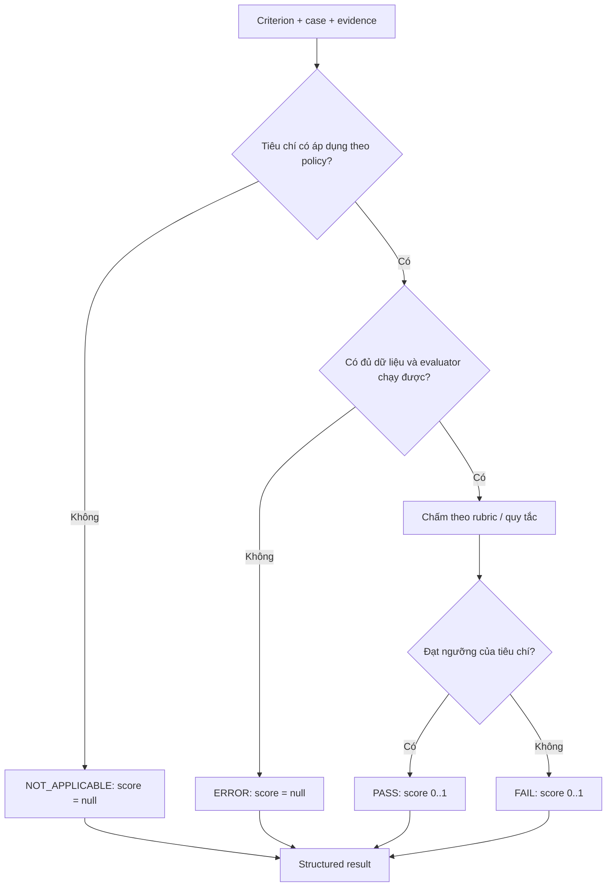

# Thiết kế thang điểm, trạng thái không áp dụng và phản hồi có cấu trúc

> **Chương:** Evaluator tùy chỉnh  
> **Module:** `SPRING_AI_EVALUATION_OBSERVABILITY` — đánh giá chất lượng ứng dụng Spring AI qua dataset, relevance, fact checking, kiểm thử RAG/tool calling; kết hợp metrics, traces, chi phí và độ trễ để phân tích suy giảm chất lượng giữa các phiên bản prompt, model và pipeline.

## Mục tiêu học tập

Sau bài này, bạn có thể:

1. Thiết kế **rubric** gồm tiêu chí, mô tả mức điểm, quy tắc đạt và ví dụ đối chiếu để nhiều lần chấm có ý nghĩa nhất quán.
2. Phân biệt rõ `PASS`, `FAIL`, `NOT_APPLICABLE` và `ERROR`; không biến một tiêu chí không áp dụng thành điểm 0 hoặc điểm tối đa.
3. Chuẩn hóa điểm giữa các rubric khác thang, tổng hợp theo trọng số và áp dụng **hard gate** cho các yêu cầu bắt buộc.
4. Thiết kế phản hồi có cấu trúc đủ để xác định nguyên nhân lỗi, truy nguyên bằng chứng và liên kết với trace, phiên bản dataset/prompt/model.
5. Xây dựng ví dụ Java kết nối kết quả chấm chi tiết với API `Evaluator` / `EvaluationResponse` của Spring AI mà không đánh mất ý nghĩa trạng thái.

## 1. Tại sao boolean PASS/FAIL chưa đủ?

Trong ứng dụng Spring AI, cùng một câu trả lời có thể:

- Liên quan tới câu hỏi nhưng bỏ sót một phần yêu cầu.
- Có nội dung đúng nhưng trích dẫn thiếu nguồn.
- Đúng với ngữ cảnh RAG song không tuân thủ cấu trúc JSON dành cho hệ thống phía sau.
- Không sử dụng công cụ vì ca kiểm thử vốn không cần tool; lúc này "đúng tool chưa?" có thể **không áp dụng**.
- Chưa thể đánh giá vì dịch vụ kiểm chứng hoặc LLM judge bị timeout; lúc này **không có phán quyết**.

Một cờ `isPass()` đơn lẻ không phản ánh đủ các tình huống này. Đánh giá tin cậy phải cho biết **tiêu chí**, **mức độ đạt**, **trạng thái áp dụng**, **bằng chứng** và **nguyên nhân**. Đó là lý do cần thiết kế thang điểm và bản ghi phản hồi trước khi triển khai nhiều evaluator.

| Câu hỏi về một tiêu chí | Thông tin cần có |
|---|---|
| Tiêu chí có liên quan tới case này không? | Điều kiện áp dụng, phiên bản quy tắc |
| Đã chấm được chưa? | `status`: PASS / FAIL / NOT_APPLICABLE / ERROR |
| Chất lượng đạt mức nào? | `score`, miền giá trị, mốc chấm và ngưỡng |
| Vì sao đạt hoặc không đạt? | `reasonCode`, `feedback`, bằng chứng tham chiếu |
| Có thể so sánh với lần chấm khác không? | `caseId`, `criterionVersion`, `datasetVersion`, model/judge version |
| Cần điều tra ở bước nào? | `traceId` và thông tin retrieval/tool/chi phí/độ trễ |

**Nguyên tắc cốt lõi:** Điểm số phải có diễn giải. `0.8` không tự động nghĩa là "80% câu trả lời đúng", cũng không nhất thiết là xác suất mô hình phát biểu đúng. Đó là một giá trị trên thang đo do người thiết kế evaluator xác định.

## 2. Phân loại trạng thái đánh giá

Với một tiêu chí đơn lẻ, nên tách bốn trạng thái sau:

| Trạng thái | Ý nghĩa | Có score? | Ví dụ |
|---|---|---|---|
| `PASS` | Đã đánh giá và đáp ứng ngưỡng/điều kiện của tiêu chí | Có, có thể từ 0 đến 1 | Citation đúng nguồn, hoặc relevance đạt 0.9 với ngưỡng 0.7 |
| `FAIL` | Đã đánh giá và phát hiện không đáp ứng điều kiện | Có, kể cả 0 hay 0.5 tùy rubric | Gọi tool trái quyền, kết luận không được tài liệu hỗ trợ |
| `NOT_APPLICABLE` | Theo quy tắc đã công bố, tiêu chí không thuộc phạm vi case này | **Không: `null`** | Không có yêu cầu hay hành vi gọi tool trong một case thuần hỏi đáp |
| `ERROR` | Tiêu chí có liên quan nhưng **không thể chấm** do lỗi hệ thống, thiếu bằng chứng hoặc dữ liệu kiểm chứng | **Không: `null`** | Judge timeout, mất snapshot dùng để đối chiếu, trace tool bị mất |

Để tránh nhập nhằng, không dùng "SKIP", "UNKNOWN" và "N/A" thay thế nhau khi chưa định nghĩa rõ. Trong bài này, `NOT_APPLICABLE` (viết tắt N/A) chỉ có nghĩa **tiêu chí không liên quan theo điều kiện áp dụng**; `ERROR` có nghĩa **cần chấm nhưng không thể kết luận**.

### 2.1. N/A không đồng nghĩa với trả lời từ chối

Xét câu hỏi RAG: "Chính sách có cho phép hoàn tiền sau 90 ngày không?". Hệ thống không tìm được bằng chứng. Mô hình trả: "Tôi chưa có đủ dữ liệu để kết luận".

- **Abstention behavior** (biết từ chối khi không đủ chứng cứ) là hành vi cần chấm: có thể PASS hoặc FAIL tùy câu trả lời có phù hợp hay không.
- **Citation correctness** có thể N/A *nếu rubric quy định rõ rằng câu từ chối không khẳng định sự kiện thì không cần citation*.
- **Retrieval quality** vẫn có thể cần chấm: thiếu tài liệu có phải lỗi truy xuất hay dữ liệu thật sự không tồn tại?
- **Tool use** có thể N/A nếu không có tool nào được yêu cầu, được phép hoặc được gọi trong ca này.

Không được đánh dấu toàn bộ case là N/A chỉ vì mô hình từ chối. Nếu dataset đòi hỏi câu trả lời có căn cứ, từ chối thiếu lý do có thể là FAIL về completeness. Nếu mô hình đã thực thi một tool không được phép dù không cần tool, kiểm tra quyền/tool **phải FAIL**, không được gán N/A.

### 2.2. N/A khác với thiếu dữ liệu

Giả sử evaluator kiểm tra tham số gọi tool:

| Dữ liệu thực tế | Trạng thái đúng | Giải thích |
|---|---|---|
| Ca không yêu cầu tool, runtime xác nhận không có tool call | `NOT_APPLICABLE` | Không có hành vi tool cần chấm |
| Ca cần gọi `lookupOrder` nhưng mô hình không gọi | `FAIL` | Đây là lỗi bỏ qua hành động bắt buộc |
| Ca không cho phép gọi tool nhưng mô hình đã gọi `cancelOrder` | `FAIL` | Vi phạm chính sách; không được miễn chấm |
| Ca có gọi tool nhưng hệ thống mất execution trace | `ERROR` | Không đủ bằng chứng để xác minh đối số/hành động |
| Ca gọi tool thành công, đúng quyền và tham số | `PASS` | Có dữ liệu đủ và điều kiện được đáp ứng |

Quy tắc **có áp dụng hay không** nên dựa trên metadata của dataset, chính sách của ứng dụng và dữ liệu runtime đáng tin cậy. Không nên giao cho chính mô hình bị đánh giá quyền tự quyết mọi tiêu chí nào được chấm, vì nó có thể làm giảm số phép chấm khó.

## 3. Thiết kế rubric có các mốc điểm rõ ràng

Một rubric tốt trả lời bốn câu hỏi: **đo cái gì**, **khi nào áp dụng**, **điểm từng mức nghĩa là gì**, và **bằng chứng nào cho phép chấm**.

### 3.1. Ví dụ rubric relevance trên thang 0–4

| Điểm gốc | Mô tả có thể kiểm chứng | Ví dụ với câu hỏi "Thời hạn hoàn tiền là bao lâu?" |
|---:|---|---|
| **0** | Không trả lời đúng vấn đề; chủ đề khác | "Bạn có thể đổi mật khẩu ở trang tài khoản." |
| **1** | Nhắc tới chủ đề nhưng không cung cấp thông tin cần thiết | "Hoàn tiền có thể phụ thuộc chính sách." |
| **2** | Trả lời một phần, thiếu điều kiện quan trọng | "Thông thường là 7 ngày." (thiếu "ngày làm việc") |
| **3** | Đáp ứng phần lớn yêu cầu; thiếu chi tiết phụ không làm đổi nghĩa chính | "7 ngày làm việc" nhưng chưa nêu từ mốc tiếp nhận hợp lệ, nếu mốc này là thông tin phụ của yêu cầu |
| **4** | Trả lời đầy đủ, đúng trọng tâm và dễ hiểu theo phạm vi đề bài | "Trong 7 ngày làm việc kể từ khi yêu cầu hợp lệ được tiếp nhận." |

Những ví dụ trên minh họa **mức độ đáp ứng câu hỏi**, không tự khẳng định factual correctness. Nếu tài liệu chính sách thực tế quy định "10 ngày", câu trả lời "7 ngày" có thể rất relevant nhưng **fact checking phải FAIL**.

Cách chuẩn hóa điểm thang 0–4 về đoạn [0, 1]:

\[
s_{\text{normalized}}=\frac{s_{\text{raw}}-s_{\min}}{s_{\max}-s_{\min}}
\]

Với điểm gốc `3/4`, điểm chuẩn hóa là `0.75`. Chỉ dùng công thức khi các mức điểm đã được định nghĩa có thứ tự và việc nội suy là chấp nhận được trong chính sách đánh giá. Nếu rubric chỉ là nhãn không có khoảng cách định lượng (chẳng hạn `LOW`, `MEDIUM`, `HIGH`), việc gán 0, 0.5, 1 chỉ là lựa chọn thiết kế, không phải hệ quả toán học bắt buộc.

### 3.2. Định nghĩa điều kiện PASS theo từng tiêu chí

Không nên mặc định "score trên 0 là PASS". Ví dụ:

| Tiêu chí | Thang | Ngưỡng hoặc điều kiện PASS | Ý nghĩa điểm |
|---|---|---|---|
| Relevance | 0–4, chuẩn hóa 0–1 | Ít nhất **3/4** (0.75) | Mức độ đáp ứng yêu cầu |
| Groundedness | 0–1 theo tỷ lệ claim được chứng minh | Ít nhất 0.95; quy tắc định nghĩa rõ thế nào là claim | Tỷ lệ claim được nguồn hỗ trợ theo cách chấm đã chọn |
| Citation integrity | 0 hoặc 1 | Bắt buộc **1** nếu áp dụng | Mọi ID trích dẫn có tồn tại và đáp ứng hợp đồng |
| JSON contract | 0 hoặc 1 | Bắt buộc **1** | Parse/schema và quy tắc cấu trúc hợp lệ |
| Tool permission | 0 hoặc 1 | Bắt buộc **1** nếu áp dụng | Không có hành động ngoài quyền/quy trình |
| Clarity | 0–4, chuẩn hóa 0–1 | Từ 2/4 trở lên tùy sản phẩm | Mức độ dễ hiểu theo rubric |

Các ngưỡng chỉ là **chính sách minh họa cho một ứng dụng**, không phải giá trị mặc định của Spring AI. Các tiêu chí liên quan an toàn giao dịch, quyền truy cập và dữ liệu nhạy cảm thường cần điều kiện chặn độc lập, ngay cả khi chất lượng tổng thể rất cao.

### 3.3. Cố định ý nghĩa điểm và phiên bản rubric

Một rubric có thể tiến hóa. Ví dụ bản `relevance-v1` chấm "trả lời đúng trọng tâm" là 4, nhưng bản `relevance-v2` yêu cầu thêm tính đầy đủ của các điều kiện ngoại lệ mới được 4. Nếu hai lần đánh giá dùng phiên bản rubric khác nhau, so sánh `0.9` với `0.8` không chứng minh model đi xuống.

Hãy lưu:

- `criterionId` và `criterionVersion` để định danh thang đo.
- Các **mốc chấm** kèm ví dụ PASS, FAIL và ca ranh giới.
- `judgeModelVersion` và `judgePromptVersion` nếu dùng LLM-as-a-judge.
- `datasetVersion`, chính sách gắn nhãn và bản tài liệu tham chiếu.
- Quy tắc xử lý trường hợp nhiều người/judge bất đồng.

Với judge ngữ nghĩa, nên có một tập ca được người đánh giá gắn nhãn và so sánh kết quả judge với tập này trước khi dùng làm thước đo release. Cần thử các ca câu trả lời dài nhưng thiếu nội dung, dẫn nguồn giả, phủ định tinh vi và các câu nói "nghe tự tin" nhưng không có bằng chứng.

## 4. Thiết kế điều kiện áp dụng trước khi tính điểm

Không phải mọi tiêu chí đều áp dụng cho mọi ca. Trước khi gọi evaluator, bộ điều phối cần quyết định **applicability** từ quy tắc và bằng chứng đáng tin.

| Tiêu chí | Khi áp dụng | Khi có thể N/A | Khi phải FAIL/ERROR |
|---|---|---|---|
| Citation contract | Câu trả lời có claim bắt buộc trích dẫn theo hợp đồng | Case phân loại thuần túy, không yêu cầu citation | FAIL nếu có claim nhưng không citation; ERROR nếu mất bản ghi ngữ cảnh cần thiết |
| Tool arguments | Case yêu cầu tool hoặc runtime xác nhận có tool call | Không yêu cầu, không gọi tool và log đầy đủ | FAIL nếu sai đối số/gọi trái phép; ERROR nếu thiếu execution record |
| Fact checking | Có claim có thể đối chiếu với nguồn | Đầu ra thuần cấu trúc không có claim cần kiểm tra theo rubric | FAIL khi claim sai; ERROR khi nguồn chuẩn bị mất |
| JSON contract | Consumer yêu cầu phản hồi JSON | Đầu ra chủ đích là văn bản tự do | FAIL nếu consumer cần JSON nhưng model xuất prose |
| Grounded refusal | Ca không đủ chứng cứ yêu cầu biết từ chối | Ca có đáp án rõ và không phải thử hành vi từ chối | FAIL nếu bịa nội dung ở ca không đủ chứng cứ |
| Latency SLA | Chạy trong môi trường/điểm đo có SLA xác định | Bài kiểm tra offline không đặt yêu cầu độ trễ | ERROR nếu cần đo nhưng hệ thống giám sát mất dữ liệu |

Mỗi tiêu chí N/A cần có `reasonCode` có ý nghĩa, ví dụ `NO_TOOL_ACTIVITY` hay `NO_CITATION_REQUIREMENT`. Không dùng lý do mơ hồ như "không có điểm" vì không thể phân biệt N/A hợp lệ và evaluator đã lỗi.

### 4.1. Quy trình lựa chọn trạng thái



Trình tự có thể khác nhau nếu cần xác minh bằng chứng để biết applicability, nhưng **không được tự động suy N/A chỉ vì dữ liệu của evaluator bị thiếu**. Nếu một hành động đã xảy ra mà log bị mất, đó là `ERROR` chứ không phải "không có hành động".

## 5. Thiết kế điểm tổng có trọng số

Một ứng dụng RAG có thể muốn xem nhiều chiều cùng lúc. Ví dụ bốn tiêu chí:

| Tiêu chí | Trọng số | Loại |
|---|---:|---|
| Relevance | 0.30 | Chấm ngữ nghĩa |
| Groundedness | 0.35 | Chấm claim theo nguồn |
| Citation integrity | 0.20 | Kiểm tra quy tắc, **hard gate** |
| Tool correctness | 0.15 | Kiểm tra tool, **hard gate khi áp dụng** |

Khi tất cả tiêu chí áp dụng, các trọng số cộng lại bằng 1. Khi một tiêu chí **N/A**, phải bỏ nó khỏi cả tử số và mẫu số, rồi chuẩn hóa trên tổng trọng số còn áp dụng:

\[
S_{\text{aggregate}}=
\frac{\sum_{i\in A} w_i\,s_i}{\sum_{i\in A} w_i}
\]

Trong đó `A` là tập các tiêu chí **đã chấm được và có áp dụng**, `w_i` là trọng số, `s_i` là điểm chuẩn hóa trong đoạn [0, 1]. Nếu có `ERROR` ở một tiêu chí bắt buộc, không được áp dụng công thức như thể tiêu chí đó N/A; cần chặn kết luận cho tới khi sửa lỗi đánh giá. Nếu `A` rỗng, điểm tổng **không xác định**, không bằng 0 hay 1.

### 5.1. Ví dụ tính điểm khi tool correctness không áp dụng

Một câu hỏi RAG chỉ cần giải thích chính sách, không gọi tool. Kết quả:

| Tiêu chí | Trạng thái | Score | Trọng số |
|---|---|---:|---:|
| Relevance | PASS | 0.75 | 0.30 |
| Groundedness | PASS | 1.00 | 0.35 |
| Citation | PASS | 1.00 | 0.20 |
| Tool correctness | NOT_APPLICABLE | null | 0.15 |

Vì tool N/A, trọng số có hiệu lực bằng `0.30 + 0.35 + 0.20 = 0.85`. Điểm tổng:

\[
S = \frac{0.30\times0.75+0.35\times1+0.20\times1}{0.85}
=\frac{0.775}{0.85}\approx0.9118.
\]

Nếu đưa N/A thành điểm 0, kết quả chỉ còn `0.775`, khiến một case không cần tool bị phạt vô lý. Nếu đưa N/A thành điểm 1, case lại được thưởng chỉ vì không phải làm gì. Cả hai cách đều làm mất ý nghĩa của thang.

### 5.2. Hard gate không thể bị điểm tốt bù trừ

Giả sử relevance và groundedness đều 1.0 nhưng agent đã gọi `cancelOrder` khi người dùng chỉ hỏi trạng thái đơn hàng. Nếu tiêu chí `tool_permission` là hard gate, cả case phải **FAIL** dù điểm trung bình các tiêu chí khác rất cao.

Một chính sách tổng hợp minh họa:

1. Nếu có **FAIL ở hard gate** → kết quả tổng `FAIL`, ghi rõ gate bị vi phạm.
2. Nếu chưa có hard-gate FAIL nhưng có **ERROR ở tiêu chí bắt buộc** → tổng `ERROR`, chưa công bố điểm để làm release gate.
3. Nếu không có hai trường hợp trên và tất cả tiêu chí `NOT_APPLICABLE` → tổng `NOT_APPLICABLE`, không có score.
4. Nếu có tiêu chí áp dụng: chuẩn hóa trọng số, so với ngưỡng chất lượng tổng (ví dụ `0.85`).
5. Trong báo cáo giữ **tất cả kết quả chi tiết** kể cả khi đã có một hard gate FAIL hoặc ERROR, để không che mất các lỗi đồng thời.

Với nhóm chỉ có hard gate mà không có tiêu chí cộng điểm, có thể quy định rằng tất cả gate PASS thì case đạt điều kiện chặn, nhưng **không sinh điểm tổng định lượng**. Chính sách này phải công bố rõ trong rubric.

**Cẩn trọng:** Việc đổi trọng số theo applicability khiến điểm tổng của hai nhóm ca có thể không hoàn toàn tương đương. Khi so sánh các phiên bản prompt/model, hãy so sánh trên **cùng tập case và cùng ma trận tiêu chí áp dụng**, đồng thời báo cáo điểm theo từng tiêu chí thay vì chỉ một điểm tổng.

## 6. Thiết kế phản hồi có cấu trúc (structured feedback)

Một evaluator hữu ích không chỉ nói "thấp" hoặc "sai"; nó cho người phát triển biết **sai ở đâu**, **bằng chứng nào**, **thước đo nào** và **cần điều tra gì**.

Ví dụ kết quả cho một tiêu chí factual support:

```json
{
  "caseId": "rag-refund-017",
  "datasetVersion": "refund-dataset-v3",
  "criterionId": "groundedness",
  "criterionVersion": "v2",
  "status": "FAIL",
  "score": 0.5,
  "scoreScale": {"min": 0, "max": 1},
  "threshold": 0.95,
  "reasonCode": "UNSUPPORTED_CLAIMS",
  "feedback": "Có 1 trong 2 khẳng định không được tài liệu hỗ trợ.",
  "evidence": [
    {
      "claimId": "claim-2",
      "documentId": "refund-policy-v3",
      "issue": "Tài liệu nêu 7 ngày làm việc; câu trả lời nêu 14 ngày."
    }
  ],
  "evaluator": {
    "type": "llm_judge",
    "version": "groundedness-judge-v2"
  },
  "promptVersion": "refund-prompt-v6",
  "modelVersion": "model-c",
  "pipelineVersion": "rag-pipeline-v4",
  "traceId": "example-trace-id"
}
```

Đây là **định dạng báo cáo do ứng dụng tự thiết kế**, không phải JSON mặc định của Spring AI. Các giá trị chỉ minh họa. Có thể bổ sung thời điểm, mã lỗi retrieval, độ bất định hoặc người đánh giá nếu phù hợp.

### 6.1. Kết quả N/A và ERROR phải có cấu trúc rõ

Một tiêu chí không áp dụng:

```json
{
  "caseId": "rag-refund-017",
  "criterionId": "tool_correctness",
  "criterionVersion": "v1",
  "status": "NOT_APPLICABLE",
  "score": null,
  "reasonCode": "NO_TOOL_ACTIVITY",
  "feedback": "Case không yêu cầu tool và runtime ghi nhận không có tool call.",
  "evidence": []
}
```

Một tiêu chí cần chấm nhưng thất bại vì hạ tầng:

```json
{
  "caseId": "rag-refund-018",
  "criterionId": "groundedness",
  "criterionVersion": "v2",
  "status": "ERROR",
  "score": null,
  "reasonCode": "JUDGE_TIMEOUT",
  "feedback": "Dịch vụ chấm groundedness không phản hồi trong giới hạn.",
  "evidence": []
}
```

Nếu gán `score = 0` cho `JUDGE_TIMEOUT`, dashboard sẽ tưởng chất lượng model giảm. Nếu gán `NOT_APPLICABLE`, dashboard sẽ che mất sự cố hạ tầng. Dùng `null` cùng trạng thái riêng giúp phân biệt hai trường hợp.

### 6.2. Tối thiểu cần những trường nào?

| Nhóm | Trường nên có | Mục đích |
|---|---|---|
| Định danh | `caseId`, `criterionId`, `criterionVersion` | Khớp case và rubric |
| Kết quả | `status`, `score`, `threshold`, `reasonCode` | PASS/FAIL/N/A/ERROR và mức độ |
| Giải thích | `feedback`, `evidence`, `applicabilityReason` | Người sửa lỗi hiểu nguyên nhân |
| Phiên bản | `datasetVersion`, `promptVersion`, `modelVersion`, `pipelineVersion` | So sánh phiên bản có cơ sở |
| Judge | `judgeType`, `judgeModelVersion`, `judgePromptVersion` | Phát hiện thước đo thay đổi |
| Vận hành | `traceId`, `latencyMs`, `tokenUsage`, `estimatedCost` | Liên hệ lỗi với trace và ngân sách |

Không phải mọi evaluator đều có đầy đủ các trường: ví dụ một quy tắc kiểm tra JSON không cần `judgeModelVersion`. Những trường không có ngữ nghĩa hoặc không sẵn nên để trống/không có theo schema, tránh tự bịa giá trị.

### 6.3. Thiết kế `reasonCode` ổn định

`feedback` dành cho con người, có thể thay đổi câu chữ; `reasonCode` là mã máy dùng để thống kê. Nên đặt mã cụ thể:

- `MISSING_CITATION` — câu trả lời thuộc phạm vi phải trích nguồn nhưng thiếu.
- `UNKNOWN_SOURCE` — citation không có trong tập tài liệu thực tế.
- `UNSUPPORTED_CLAIM` — claim được chấm và không có căn cứ theo rubric.
- `NO_TOOL_ACTIVITY` — N/A hợp lệ cho tiêu chí tool.
- `UNAUTHORIZED_TOOL_CALL` — hard gate FAIL.
- `MISSING_REFERENCE_SNAPSHOT` hoặc `JUDGE_TIMEOUT` — ERROR do thiếu dữ liệu kiểm chứng hoặc dịch vụ chấm.

Một mã có thể có phần thông tin đi kèm (ví dụ `fieldPath`, `documentId`, `toolName`). Đừng thay `reasonCode` tùy ý giữa các lần deploy nếu dashboard hoặc chương trình phân loại lỗi đang phụ thuộc vào nó.

## 7. Cài đặt mẫu Java: trạng thái chi tiết và tổng hợp điểm

### 7.1. Mô hình kết quả riêng của ứng dụng

API đánh giá cơ bản của Spring AI là:

```java
package org.springframework.ai.evaluation;

@FunctionalInterface
public interface Evaluator {
    EvaluationResponse evaluate(EvaluationRequest request);
}
```

`EvaluationResponse` biểu diễn `isPass()`, `getScore()`, `getFeedback()` và `getMetadata()`. Trong một hệ thống cần phân biệt `NOT_APPLICABLE`, `ERROR` và `FAIL`, nên có **kiểu dữ liệu trung gian** đủ bốn trạng thái. Không giả định `isPass() == false` có nghĩa duy nhất là "đã chấm và FAIL".

Ví dụ dùng Java 17+ với record:

```java
import java.util.List;
import java.util.Objects;

enum OutcomeStatus {
    PASS, FAIL, NOT_APPLICABLE, ERROR
}

record CriterionOutcome(
        OutcomeStatus status,
        Double score,        // null khi NOT_APPLICABLE hoặc ERROR
        String reasonCode,
        String feedback) {

    public CriterionOutcome {
        Objects.requireNonNull(status);
        Objects.requireNonNull(reasonCode);
        Objects.requireNonNull(feedback);

        boolean wasScored = status == OutcomeStatus.PASS
                || status == OutcomeStatus.FAIL;

        if (wasScored != (score != null)) {
            throw new IllegalArgumentException(
                    "PASS/FAIL phải có điểm; N/A/ERROR không có điểm.");
        }
        if (score != null
                && (!Double.isFinite(score) || score < 0 || score > 1)) {
            throw new IllegalArgumentException("score phải nằm trong [0,1]");
        }
    }
}

record WeightedCriterion(
        String criterionId,
        double weight,
        boolean hardGate,
        CriterionOutcome outcome) {

    public WeightedCriterion {
        Objects.requireNonNull(criterionId);
        Objects.requireNonNull(outcome);
        if (!Double.isFinite(weight) || weight < 0) {
            throw new IllegalArgumentException("Trọng số không hợp lệ.");
        }
        if (weight == 0 && !hardGate) {
            throw new IllegalArgumentException(
                    "Chỉ hard gate được phép có trọng số 0.");
        }
    }
}

record AggregateOutcome(
        OutcomeStatus status,
        Double score,
        int evaluatedCount,
        int notApplicableCount,
        int errorCount,
        String reasonCode) {}

final class ScoreAggregator {
    private ScoreAggregator() {}

    static AggregateOutcome aggregate(
            List<WeightedCriterion> criteria, double minimumScore) {

        if (!Double.isFinite(minimumScore)
                || minimumScore < 0 || minimumScore > 1) {
            throw new IllegalArgumentException("Ngưỡng phải nằm trong [0,1]");
        }

        int naCount = (int) criteria.stream()
                .filter(c -> c.outcome().status()
                        == OutcomeStatus.NOT_APPLICABLE).count();
        int errorCount = (int) criteria.stream()
                .filter(c -> c.outcome().status()
                        == OutcomeStatus.ERROR).count();
        int evaluatedCount = criteria.size() - naCount - errorCount;

        boolean failedGate = criteria.stream().anyMatch(c ->
                c.hardGate() && c.outcome().status() == OutcomeStatus.FAIL);
        if (failedGate) {
            return new AggregateOutcome(OutcomeStatus.FAIL, null,
                    evaluatedCount, naCount, errorCount, "HARD_GATE_FAILED");
        }

        if (errorCount > 0) {
            return new AggregateOutcome(OutcomeStatus.ERROR, null,
                    evaluatedCount, naCount, errorCount, "INCOMPLETE_EVALUATION");
        }

        if (evaluatedCount == 0) {
            return new AggregateOutcome(OutcomeStatus.NOT_APPLICABLE, null,
                    0, naCount, 0, "NO_APPLICABLE_CRITERIA");
        }

        double denominator = criteria.stream()
                .filter(c -> c.outcome().score() != null)
                .mapToDouble(WeightedCriterion::weight)
                .sum();

        // Chỉ có hard gates trọng số 0: các gate đều không FAIL.
        if (denominator == 0) {
            return new AggregateOutcome(OutcomeStatus.PASS, null,
                    evaluatedCount, naCount, 0, "ONLY_ZERO_WEIGHT_GATES");
        }

        double numerator = criteria.stream()
                .filter(c -> c.outcome().score() != null)
                .mapToDouble(c -> c.weight() * c.outcome().score())
                .sum();
        double normalized = numerator / denominator;

        return new AggregateOutcome(
                normalized >= minimumScore
                        ? OutcomeStatus.PASS : OutcomeStatus.FAIL,
                normalized, evaluatedCount, naCount, 0,
                normalized >= minimumScore ? "THRESHOLD_MET" : "LOW_SCORE");
    }
}
```

Trong ví dụ này, `FAIL` ở **hard gate** chặn toàn bộ case; một tiêu chí mềm không đạt ngưỡng riêng vẫn có thể đóng góp điểm một phần vào điểm tổng nếu chính sách cho phép. Nếu yêu cầu sản phẩm nói rằng "mọi tiêu chí đều bắt buộc PASS", hãy dùng chính sách chặn tương ứng. Không tự suy rằng một công thức trung bình là đủ cho mọi quy trình.

Nhánh `ONLY_ZERO_WEIGHT_GATES` là lựa chọn minh họa khi toàn bộ tiêu chí có thể chấm được đều là gate có trọng số 0. Constructor `WeightedCriterion` kiểm tra quy ước rằng **chỉ hard gate được có weight = 0**; kết quả `PASS` ở trường hợp này không có điểm tổng. Với hệ thống lớn, nên còn xác thực sự nhất quán của toàn bộ danh mục tiêu chí khi đăng ký rubric.

### 7.2. Áp dụng trên một tập tiêu chí

```java
var results = List.of(
        new WeightedCriterion("relevance", 0.30, false,
                new CriterionOutcome(OutcomeStatus.PASS, 0.75,
                        "RELEVANT", "Đáp ứng phần lớn yêu cầu.")),
        new WeightedCriterion("groundedness", 0.35, false,
                new CriterionOutcome(OutcomeStatus.PASS, 1.0,
                        "SUPPORTED", "Các claim đều có căn cứ.")),
        new WeightedCriterion("citation", 0.20, true,
                new CriterionOutcome(OutcomeStatus.PASS, 1.0,
                        "VALID_CITATIONS", "Nguồn hợp lệ.")),
        new WeightedCriterion("tool_correctness", 0.15, true,
                new CriterionOutcome(OutcomeStatus.NOT_APPLICABLE, null,
                        "NO_TOOL_ACTIVITY", "Case không dùng tool."))
);

AggregateOutcome outcome = ScoreAggregator.aggregate(results, 0.85);
System.out.println(outcome.status()); // PASS
System.out.printf("%.4f%n", outcome.score()); // 0.9118
System.out.println(outcome.notApplicableCount()); // 1
```

Nếu tool correctness bị FAIL do `UNAUTHORIZED_TOOL_CALL`, tổng là FAIL bất kể điểm của ba tiêu chí còn lại. Nếu groundedness là ERROR do judge timeout, tổng là ERROR khi không có hard gate vi phạm rõ ràng.

### 7.3. Cầu nối với `EvaluationResponse` của Spring AI

`EvaluationResponse` hữu ích khi tiêu chí thực sự đã được chấm PASS hoặc FAIL. Không nên ép `NOT_APPLICABLE`/`ERROR` thành `isPass() = false` rồi để bộ tổng hợp hiểu nhầm là FAIL. Ví dụ một adapter chỉ chuyển **kết quả đã chấm**:

```java
import java.util.Map;
import java.util.Optional;
import org.springframework.ai.evaluation.EvaluationResponse;

final class SpringAiEvaluationAdapter {
    private SpringAiEvaluationAdapter() {}

    static Optional<EvaluationResponse> asSpringResponse(
            String criterionId, CriterionOutcome outcome) {

        if (outcome.status() == OutcomeStatus.NOT_APPLICABLE
                || outcome.status() == OutcomeStatus.ERROR) {
            return Optional.empty();
        }

        return Optional.of(new EvaluationResponse(
                outcome.status() == OutcomeStatus.PASS,
                outcome.score().floatValue(),
                outcome.feedback(),
                Map.of("criterionId", criterionId,
                        "status", outcome.status().name(),
                        "reasonCode", outcome.reasonCode())
        ));
    }
}
```

Ở lớp điều phối, **luôn lưu nguyên `CriterionOutcome`** trước khi thử tạo `EvaluationResponse`. Giá trị `Optional.empty()` ở adapter chỉ có nghĩa "không chuyển được sang dạng PASS/FAIL"; nó **không thay thế** bản ghi chi tiết dùng để phân biệt N/A với ERROR. Nếu thư viện hoặc pipeline nhận `EvaluationResponse` mà không hỗ trợ trạng thái mở rộng, bộ điều phối phải lọc và xử lý N/A/ERROR riêng.

Đối với một custom `Evaluator` chỉ chấm điều kiện nhị phân, bạn vẫn có thể triển khai `evaluate(EvaluationRequest)` trả `EvaluationResponse` trực tiếp. Mô hình bốn trạng thái cần thiết khi bài toán của hệ thống thực sự có trường hợp không áp dụng hoặc không chấm được.

## 8. Ví dụ thiết kế Evaluator có điều kiện áp dụng

Một evaluator kiểm tra citation có thể dùng metadata đáng tin của dataset để xác định case nào yêu cầu nguồn:

```java
record CasePolicy(
        String caseId,
        boolean citationRequired,
        String policyVersion) {}

// Mã giả mô tả luồng điều phối:
CriterionOutcome evaluateCitation(
        CasePolicy policy,
        EvaluationRequest request,
        Set<String> retrievedDocumentIds) {

    if (!policy.citationRequired()) {
        return new CriterionOutcome(OutcomeStatus.NOT_APPLICABLE, null,
                "NO_CITATION_REQUIREMENT",
                "Bài kiểm thử không đặt yêu cầu trích dẫn.");
    }

    if (retrievedDocumentIds == null) {
        return new CriterionOutcome(OutcomeStatus.ERROR, null,
                "MISSING_RETRIEVAL_EVIDENCE",
                "Thiếu bản ghi tập tài liệu đã cung cấp cho model.");
    }

    String answer = request.getResponseContent();
    if (answer == null || answer.isBlank()) {
        return new CriterionOutcome(OutcomeStatus.FAIL, 0.0,
                "EMPTY_ANSWER", "Không có nội dung để đánh giá citation.");
    }

    // containsCitation và allCitationsBelongTo được ứng dụng hiện thực
    // bằng parser/regex cùng tập ID đã được ghi nhận cho lượt chạy.
    if (!containsCitation(answer)
            || !allCitationsBelongTo(answer, retrievedDocumentIds)) {
        return new CriterionOutcome(OutcomeStatus.FAIL, 0.0,
                "INVALID_CITATIONS", "Thiếu nguồn hoặc trích dẫn nguồn lạ.");
    }

    return new CriterionOutcome(OutcomeStatus.PASS, 1.0,
            "VALID_CITATIONS", "Các ID trích dẫn thuộc ngữ cảnh RAG.");
}
```

Đây là **mã giả** về áp dụng trạng thái, có hai hàm placeholder `containsCitation` và `allCitationsBelongTo` cần hiện thực trước khi chạy. Khi viết production code, hãy tách việc kiểm tra **ID tồn tại** khỏi việc xác minh **claim được hỗ trợ bởi nội dung tài liệu**. Một ID đúng không chứng minh câu trả lời đúng sự thật.

Nếu `citationRequired == false` nhưng có hành động khác vi phạm quyền, evaluator citation có thể N/A theo hợp đồng, trong khi evaluator **tool permission** phải FAIL. Các tiêu chí độc lập không được che lỗi của nhau.

## 9. Tạo dataset để kiểm tra điểm và trạng thái

Một dataset kiểm thử evaluator phải có ca PASS/FAIL/N/A/ERROR có chủ ý. Ví dụ YAML sau là **định dạng minh họa của ứng dụng**, không phải schema dữ liệu chuẩn do Spring AI quy định:

```yaml
datasetVersion: rag-eval-rubric-v2
criterionVersion: citation-v1
cases:
  - caseId: rag-refund-001
    scenario: "Có yêu cầu dẫn nguồn"
    citationRequired: true
    retrievedDocumentIds: [refund-policy-v3]
    answer: "Hoàn tiền trong 7 ngày [doc:refund-policy-v3]."
    expectedStatus: PASS
    expectedScore: 1.0
    expectedReasonCode: VALID_CITATIONS

  - caseId: rag-refund-002
    scenario: "Thiếu citation dù quy tắc yêu cầu"
    citationRequired: true
    retrievedDocumentIds: [refund-policy-v3]
    answer: "Hoàn tiền trong 7 ngày."
    expectedStatus: FAIL
    expectedScore: 0.0
    expectedReasonCode: INVALID_CITATIONS

  - caseId: classify-001
    scenario: "Chỉ phân loại nhãn, không yêu cầu citation"
    citationRequired: false
    retrievedDocumentIds: []
    answer: "REFUND"
    expectedStatus: NOT_APPLICABLE
    expectedScore: null
    expectedReasonCode: NO_CITATION_REQUIREMENT

  - caseId: rag-refund-003
    scenario: "Thiếu bản ghi retrieval do lỗi test harness"
    citationRequired: true
    retrievedDocumentIds: null
    answer: "Hoàn tiền trong 7 ngày [doc:refund-policy-v3]."
    expectedStatus: ERROR
    expectedScore: null
    expectedReasonCode: MISSING_RETRIEVAL_EVIDENCE
```

Để kiểm thử **chính evaluator**, truyền dữ liệu từ từng case và so sánh `expectedStatus`, `expectedScore`, `expectedReasonCode`. Để kiểm thử **ứng dụng AI**, tạo câu trả lời bằng prompt/model/pipeline đang thử nghiệm, giữ nguyên dataset và rubric để chấm đầu ra của từng cấu hình.

### 9.1. Những ca biên cần có

| Tình huống | Điều cần xác minh |
|---|---|
| Score nhỏ hơn 0, lớn hơn 1 hoặc là `NaN`/`Infinity` | Đầu vào sai phải bị từ chối, không đưa vào tổng hợp |
| N/A nhưng `score = 0` | Phản hồi bị coi không hợp lệ theo hợp đồng bốn trạng thái |
| ERROR nhưng `score = 1` | Không công bố điểm khi evaluator chưa chạy được |
| Hard gate FAIL, các tiêu chí khác 1.0 | Tổng FAIL |
| Một tiêu chí cần chấm nhưng lỗi judge | Tổng ERROR nếu không có hard-gate FAIL đã biết |
| Tất cả tiêu chí N/A | Tổng N/A, `score = null` |
| Một tiêu chí N/A giữa các tiêu chí còn lại | Chuẩn hóa lại mẫu số |
| Chỉ có hard gate weight 0 được chấm PASS | Không phát minh điểm trung bình, báo pass theo gate |
| Hai rubric cùng tên nhưng khác version | Không so sánh điểm như cùng thước đo |
| Judge trả về văn bản không parse được | ERROR của hệ thống chấm, không phải FAIL chất lượng ứng dụng |

## 10. Đo chất lượng ở cấp bộ dữ liệu

Khi tổng hợp hàng trăm case, phải tách **số ca đã chấm** khỏi số ca N/A và ERROR. Ví dụ:

| Kết quả | Số ca trên 100 |
|---|---:|
| PASS | 70 |
| FAIL | 10 |
| NOT_APPLICABLE | 15 |
| ERROR | 5 |

Tỷ lệ PASS **trong số ca đã đánh giá được và có áp dụng** là:

\[
\text{Pass rate}_{\text{evaluated}} = \frac{70}{70+10} = 87.5\%.
\]

Tỷ lệ hoàn tất chấm trên toàn bộ case là `(70 + 10) / 100 = 80%`. Tỷ lệ N/A là `15%`, ERROR là `5%`. Cả bốn con số đều cần hiển thị: chỉ ghi "87.5% pass" có thể che thực tế 20% dataset chưa có phán quyết PASS/FAIL.

Với mỗi tiêu chí riêng, báo cáo **applicability rate**, **evaluation coverage**, **pass rate trong tập đã chấm**, **score distribution**, **số ERROR** và **nhóm reasonCode phổ biến**. Nếu một phiên bản prompt khiến mô hình luôn từ chối để né câu hỏi khó, có thể làm số case "có claim" giảm; báo cáo cần giữ cả **abstention correctness** và các tiêu chí khác để không thưởng cho hành vi né trả lời.

### 10.1. So sánh prompt/model/pipeline có kiểm soát

Một quy trình đánh giá hồi quy:

1. Cố định `caseId`, đầu vào, dataset, rubric, ngưỡng và chính sách applicability.
2. Chạy cả phiên bản A và B, lưu câu trả lời cùng tập `Document` thực sự truy xuất và bản ghi tool nếu có.
3. Chấm mỗi tiêu chí, ghi rõ PASS/FAIL/N/A/ERROR, score, feedback và bằng chứng.
4. Ghép kết quả A/B theo `caseId` và `criterionId`; so các nhóm có cùng điều kiện áp dụng.
5. Chặn phát hành nếu hard gate vi phạm, tỷ lệ ERROR vượt mức cho phép hoặc chất lượng giảm dưới ngưỡng.
6. Tìm nguyên nhân bằng traces, retrieval events, output token, tool errors và cấu hình model.

Ví dụ chính sách phát hành minh họa:

| Điều kiện | Baseline A | Candidate B | Quyết định |
|---|---:|---:|---|
| Citation hard-gate FAIL | 0 case | 0 case | Đạt điều kiện này |
| Tool permission hard-gate FAIL | 0 case | 1 case | **B chặn phát hành** |
| Relevance mean score trong case tương đương | 0.88 | 0.91 | B cải thiện chiều này |
| Groundedness pass rate | 97% | 94% | B suy giảm so với ngưỡng 95% |
| Evaluation ERROR | 0 | 4 case | Cần giải quyết lỗi chấm |
| p95 latency | 2.2 s | 2.9 s | Xem SLA thực tế |
| Chi phí trung bình/yêu cầu | 0.008 USD | 0.011 USD | Xem ngân sách thực tế |

Đây là số liệu giả định nhằm minh họa phương pháp, không phải benchmark hoặc ngưỡng mặc định của Spring AI. B chưa thể phát hành dù relevance tăng vì có vi phạm quyền tool, groundedness giảm và còn ca ERROR chưa đánh giá xong.

## 11. Kết hợp kết quả với metrics, traces và chi phí

Evaluator trả lời "**có đạt tiêu chí không?**". Observability giúp trả lời "**lỗi xuất hiện ở bước nào và tốn bao nhiêu tài nguyên?**". Trong Spring AI, có thể dùng Micrometer để quan sát các hoạt động ChatClient/ChatModel, advisor, vector store và tool tùy thành phần tích hợp.

| Tín hiệu trong kết quả đánh giá | Dữ liệu nên đối chiếu | Hướng điều tra |
|---|---|---|
| Relevance score giảm | Prompt/version, retrieval query, nguồn trả về | Câu hỏi bị rewrite sai, prompt lạc hướng, retrieval sai nguồn |
| Groundedness FAIL tăng | ID/chunk truy xuất, token input, model generation | Context bị cắt, thiếu nguồn, model thêm claim |
| Citation integrity FAIL | Citation IDs, metadata nguồn, danh sách chunk | ID không ổn định, tài liệu truy xuất không trùng ngữ cảnh chấm |
| Tool correctness FAIL | Tool execution record, quyền người dùng, thứ tự call | Gọi sai tool/tham số, thiếu xác nhận, xử lý lỗi tool sai |
| N/A rate tăng bất thường | Applicability policy version, loại case, hành vi abstention | Dữ liệu phân nhóm thay đổi hoặc mô hình né trả lời |
| ERROR rate tăng | Judge timeout, exception, trace xuất đánh giá, nguồn chuẩn | Hệ thống chấm bị lỗi; chưa phải lỗi ứng dụng |
| p95 latency tăng | Span model/retriever/tool, số vòng gọi tool, retry | Model chậm, retrieval lâu, quá nhiều retries |
| Cost tăng | Token usage, số model calls, giá model theo phiên bản | Context dài, thêm nhiều judge, tool agent lặp |

Nên giữ `traceId` và `caseId` trong **bản ghi đánh giá có quyền truy cập phù hợp**, còn metric tags chỉ dùng nhãn có số giá trị hữu hạn như `criterionId`, `status`, `reasonCode` hoặc `pipelineVersion` đã được quản lý cardinality. Tránh đưa PII, nguyên văn prompt, output hoặc ID giao dịch nhạy cảm vào metric tags.

### 11.1. Chi phí của việc chấm điểm

Một evaluator JSON/regex thường rẻ và nhanh. LLM judge dùng token, có thể tăng độ trễ và chính nó cũng có tỷ lệ ERROR. Nếu chạy nhiều judge cho mỗi request trong luồng thời gian thực, SLA có thể bị ảnh hưởng.

Có thể tổ chức:

- **Online:** kiểm tra cấu trúc, phân quyền và các quy tắc bắt buộc trước khi thực thi hành động; ghi lại dữ liệu cần cho đánh giá.
- **Offline:** chạy rubric relevance/groundedness trên dataset hoặc mẫu được chọn; so sánh phiên bản.
- **Đánh giá con người:** xem các ca bất đồng, ca rủi ro cao và nhóm mà judge chưa đáng tin.

Khi so sánh chi phí giữa hai phiên bản, nên phân biệt **chi phí vận hành ứng dụng** với **chi phí chạy hệ thống đánh giá**, tránh kết luận rằng pipeline B tốn hơn chỉ vì lần đánh giá B sử dụng nhiều judge hơn.

## 12. Các sai lầm thường gặp

1. **Cho N/A bằng 0 hoặc 1.** Làm méo điểm tổng; cần `score = null` và loại khỏi mẫu số.
2. **Dùng N/A thay cho ERROR.** Mất trace hoặc judge timeout không có nghĩa tiêu chí không áp dụng.
3. **Dùng FAIL thay cho ERROR.** Chấm hạ tầng lỗi thành lỗi chất lượng sẽ gây báo động sai.
4. **Cho model tự quyết phạm vi chấm mọi tiêu chí.** Có thể khiến mô hình tự tránh những phép kiểm tra khó; applicability phải có policy rõ.
5. **Tính trung bình tất cả tiêu chí mà bỏ hard gate.** Vi phạm quyền hoặc hành động có side effect có thể bị điểm cao ở các mục khác che khuất.
6. **Đổi rubric nhưng vẫn so điểm như cũ.** Cần version hóa tiêu chí, prompt judge và đánh giá lại baseline khi thước đo thay đổi.
7. **Không định nghĩa các mốc điểm.** Hai judge hoặc hai người chấm sẽ hiểu 0.7 khác nhau; cần anchor examples.
8. **Báo score không có reasonCode/evidence.** Khó tìm nguyên nhân suy giảm theo phiên bản.
9. **Chỉ báo pass rate và giấu N/A/ERROR.** Dashboard có thể "cải thiện" trong khi phần lớn case không được chấm.
10. **Lấy metadata từ câu trả lời AI làm nguồn xác thực.** Model có thể tự bịa case ID, quyền truy cập và tool logs; phải dùng dữ liệu từ hệ thống tin cậy.
11. **Gộp nhiều đơn vị đo thành một số không giải thích.** Điểm chất lượng, thời gian phản hồi và chi phí khác đơn vị; thường nên đặt ngưỡng vận hành riêng.
12. **Dùng `EvaluationResponse.isPass()` như trạng thái bốn nhánh.** Phải có lớp kết quả chi tiết hoặc cơ chế điều phối riêng để giữ N/A/ERROR.

## 13. Bài tập thực hành

**Bối cảnh:** Một agent Spring AI trả lời câu hỏi về chính sách bảo hành; có thể sử dụng RAG và khi cần mới gọi `lookupWarranty`. Nhóm cần đánh giá các phiên bản prompt/model trước khi phát hành.

Hãy xây dựng một rubric với bốn tiêu chí: `relevance` (0–4), `groundedness` (0–1), `citation_integrity` (0/1) và `tool_correctness` (0/1). Chọn trọng số, điều kiện áp dụng, ngưỡng PASS và các hard gate, rồi hoàn thành:

1. Tạo ít nhất **8 ca kiểm thử**: câu hỏi đơn giản, câu hỏi cần RAG, không có nguồn, buộc phải gọi tool, không cần tool, tool gọi trái phép, câu trả lời có nguồn giả và lỗi judge timeout.
2. Gán `expectedStatus`, `expectedScore` (hoặc null), `expectedReasonCode` cho từng tiêu chí trong mỗi ca.
3. Viết bộ tổng hợp loại N/A khỏi mẫu số nhưng chặn ERROR và hard-gate FAIL.
4. Xuất phản hồi JSON có `criterionId`, `criterionVersion`, `status`, `score`, `feedback`, `reasonCode` và `evidence`.
5. So sánh hai bộ kết quả A/B theo `caseId`, phân biệt thay đổi chất lượng với thay đổi rubric hoặc tập case áp dụng.
6. Liên kết ít nhất một ca FAIL với trace retrieval hoặc tool; giải thích vì sao score thay đổi và cách khắc phục.

**Câu hỏi tự kiểm tra:**

- Vì sao "không có tool call" có thể là N/A trong case này nhưng FAIL trong case khác?
- Nếu câu trả lời có điểm relevance 1.0 nhưng vi phạm quyền gọi tool, kết quả tổng nên ra sao?
- Khi dịch vụ fact checking lỗi 503, điểm groundedness nên là 0, 1, hay null? Status nào phù hợp?
- Nếu chỉ một nửa dataset được chấm, tại sao pass rate trong số ca đã chấm chưa đủ để kết luận phiên bản tốt?

## 14. Checklist triển khai

- [ ] Mỗi tiêu chí có mục tiêu đo, điều kiện áp dụng, thang điểm, anchor và ngưỡng PASS.
- [ ] Phân biệt `PASS`, `FAIL`, `NOT_APPLICABLE`, `ERROR` bằng trạng thái chính thức.
- [ ] `score` là null cho N/A/ERROR; kiểm tra không nhận NaN, Infinity hoặc điểm ngoài thang.
- [ ] Có `reasonCode` và `feedback` mô tả đúng nguyên nhân; evidence phù hợp quyền truy cập.
- [ ] Có chính sách hard gate cho ràng buộc bắt buộc và cách xử lý lỗi đánh giá.
- [ ] Công thức weighted aggregate chỉ tính tiêu chí áp dụng và đã chấm; không bỏ qua ERROR âm thầm.
- [ ] Báo cáo tách pass rate, applicability, coverage và error rate; tránh kết luận chỉ từ điểm tổng.
- [ ] Phiên bản hóa criterion, dataset, judge prompt/model và pipeline trước khi so sánh.
- [ ] Có test cases PASS/FAIL/N/A/ERROR và các ca biên về thang điểm, quyền, tài liệu truy xuất.
- [ ] Có thể đối chiếu kết quả với metrics/traces, latency, token và cost để tìm nguyên nhân.

## Tổng kết

Thiết kế evaluator chất lượng cao bắt đầu từ **định nghĩa rõ phạm vi đo và ý nghĩa của từng điểm**. `PASS` và `FAIL` phản ánh kết quả đã chấm; `NOT_APPLICABLE` là tiêu chí không thuộc case; `ERROR` cho biết không thể kết luận vì lỗi hệ thống hoặc bằng chứng. Khi tổng hợp, phải loại N/A khỏi trọng số, xử lý ERROR minh bạch và giữ hard gate cho yêu cầu bắt buộc. Phản hồi có cấu trúc với `criterionVersion`, `reasonCode`, `feedback`, bằng chứng và `traceId` giúp nhóm phát triển tìm nguyên nhân suy giảm chất lượng trong ứng dụng Spring AI qua từng phiên bản prompt, model và pipeline.

## Tài liệu tham khảo

- [Spring AI — Evaluation Testing](https://docs.spring.io/spring-ai/reference/api/testing.html): `Evaluator`, `EvaluationRequest`, `EvaluationResponse` và các evaluator tích hợp.
- [Spring AI API — EvaluationResponse](https://docs.spring.io/spring-ai/docs/current/api/org/springframework/ai/evaluation/EvaluationResponse.html): dữ liệu pass/score/feedback/metadata.
- [Spring AI — Observability](https://docs.spring.io/spring-ai/reference/observability/): quan sát hoạt động của mô hình, advisor, vector store và tool.
- [Spring AI — Tool Calling](https://docs.spring.io/spring-ai/reference/api/tools.html): điều khiển và quan sát lời gọi công cụ.
- [Google Research — G-Eval: NLG Evaluation using GPT-4 with Better Human Alignment](https://arxiv.org/abs/2303.16634): một hướng nghiên cứu đánh giá ngữ nghĩa theo rubric/judge.
- [NIST AI Risk Management Framework](https://www.nist.gov/itl/ai-risk-management-framework): bối cảnh quản trị tiêu chí, mức độ rủi ro và đo lường hệ thống AI.
