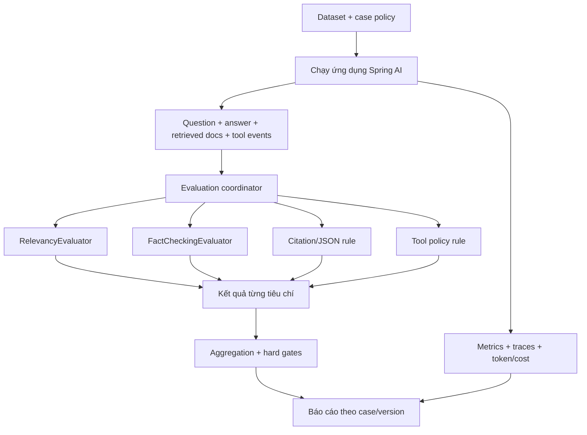
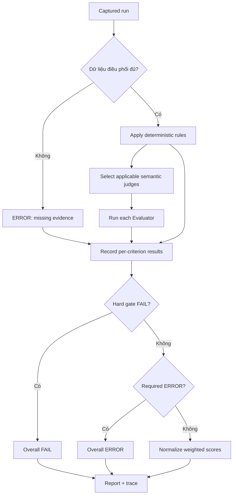

# Kết hợp nhiều evaluator bằng mã điều phối của ứng dụng

> **Chương:** Evaluator tùy chỉnh  
> **Phạm vi module:** `SPRING_AI_EVALUATION_OBSERVABILITY` — đánh giá chất lượng ứng dụng Spring AI bằng dataset, relevance, fact checking và kiểm thử RAG/tool calling; kết hợp kết quả với metrics, traces, chi phí và độ trễ để tìm nguyên nhân suy giảm chất lượng qua phiên bản prompt, model và pipeline.

## Mục tiêu học tập

Sau bài học, bạn có thể:

1. Giải thích vì sao một ứng dụng cần **mã điều phối (evaluation orchestration)** khi có nhiều tiêu chí đánh giá độc lập.
2. Thiết kế dữ liệu đầu vào chung, điều kiện áp dụng và thứ tự chấm cho relevance, fact checking, quy tắc citation và tool policy.
3. Kết hợp `Evaluator` và `EvaluationResponse` của Spring AI với các quy tắc thuần Java trong một thành phần điều phối có thể kiểm thử.
4. Phân biệt `PASS`, `FAIL`, `NOT_APPLICABLE`, `ERROR`; áp dụng trọng số và hard gate mà không che khuất vi phạm bắt buộc.
5. Chạy cùng bộ dataset qua các phiên bản prompt/model/pipeline và đối chiếu điểm với traces, metrics, chi phí và độ trễ.

## 1. Vì sao phải có mã điều phối?

Một lượt gọi model thành công về mặt kỹ thuật chưa chắc tạo câu trả lời chất lượng. Đặc biệt trong RAG và agent dùng tool, vấn đề có thể phát sinh ở nhiều tầng:

| Tầng | Ví dụ lỗi | Tiêu chí / dữ liệu cần chấm |
|---|---|---|
| Hiểu yêu cầu | Trả lời về đổi hàng khi người dùng hỏi hoàn tiền | Relevance giữa câu hỏi và câu trả lời |
| Truy xuất | Không lấy được tài liệu chính sách mới | Retrieval recall trên tập tài liệu chuẩn |
| Suy luận theo tài liệu | Trả "14 ngày" dù nguồn nêu "7 ngày" | Fact checking / groundedness |
| Trích dẫn | Dùng `doc:old-policy` khi nguồn này không nằm trong context | Citation membership và định dạng |
| Định dạng | Consumer cần JSON nhưng model trả Markdown | JSON Schema / rule tất định |
| Tool calling | Tự gọi `cancelOrder` khi người dùng chỉ yêu cầu tra cứu | Tool permission / sequence / arguments |
| Vận hành | Nội dung tốt nhưng p95 latency vượt SLA | Traces, metrics, token usage và chi phí |

Spring AI có các evaluator phục vụ đánh giá nội dung, tiêu biểu như `RelevancyEvaluator` và `FactCheckingEvaluator`, thông qua giao diện `Evaluator`. Tuy nhiên, một ứng dụng thường cần **nhiều nguồn dữ liệu**, **điều kiện áp dụng**, **quy tắc chặn** và **báo cáo hợp nhất**. Những điều đó thuộc trách nhiệm của một thành phần điều phối do ứng dụng thiết kế.

**Không nên gọi từng evaluator độc lập rồi chỉ lấy trung bình các điểm.** Ví dụ relevance 1.0 không thể bù cho một lệnh hủy đơn chưa được phép; evaluator bị timeout không có nghĩa model cho câu trả lời sai; còn tiêu chí tool correctness có thể không áp dụng cho một ca chỉ hỏi đáp.

### 1.1. Vai trò của evaluator và coordinator

- **Evaluator** thực hiện một phép chấm cụ thể: đầu vào phù hợp với tiêu chí, đầu ra là điểm/trạng thái/lý do.
- **Coordinator** chọn tiêu chí nào cần chạy, cung cấp đúng dữ liệu, xử lý lỗi, quyết định thứ tự, tổng hợp và lưu kết quả.
- **Test harness / runner** chạy các ca trong dataset với cấu hình prompt/model/pipeline, thu đầu ra cùng bằng chứng thực tế.
- **Observability pipeline** ghi dấu vết của lượt thực thi, token, latency, lỗi tool và các hoạt động retrieval để hỗ trợ điều tra.

Có thể hình dung luồng:



Mã điều phối **không cần phụ thuộc vào một API composite evaluator có sẵn**. Có thể dùng lớp Java bình thường gọi từng `Evaluator.evaluate(request)`, đồng thời gọi rule không triển khai interface này nếu dữ liệu của nó không khớp `EvaluationRequest`.

## 2. Hợp đồng dữ liệu trước khi bắt đầu chấm

Với một ca RAG, ít nhất cần:

| Trường | Nguồn nên lấy | Tại sao quan trọng |
|---|---|---|
| `caseId`, `datasetVersion` | Dataset có phiên bản | So sánh cùng ca giữa hai lần chạy |
| `question` | Đầu vào đã dùng | Kiểm relevance |
| `answer` | Raw output từ model/app | Kiểm nội dung và định dạng |
| `retrievedDocuments` | **Những `Document` thực sự được cấp cho model** | Fact checking, citation |
| `retrievalCaptured` | Test harness/observation | Phân biệt "không có tài liệu" với "không ghi được danh sách tài liệu" |
| `toolEvents` | Runtime tool execution record | Kiểm tool name, arguments, quyền, thứ tự, kết quả |
| `toolTraceCaptured` | Test harness / trusted trace | Phân biệt không gọi tool với mất trace |
| `ragExpected`, `toolExpected` | Kịch bản và policy đã định trước | Xác định tiêu chí nào áp dụng |
| `promptVersion`, `modelVersion`, `pipelineVersion` | Cấu hình chạy thực tế | Phân tích hồi quy |
| `traceId`, token, latency, cost | Observability theo lượt chạy | Điều tra nguyên nhân và giới hạn vận hành |

Đặc biệt, `EvaluationRequest` của Spring AI cung cấp câu hỏi, ngữ cảnh tài liệu và câu trả lời. Nó **không tự chứa đầy đủ lịch sử gọi tool, quyền người dùng hoặc snapshot nghiệp vụ**. Vì vậy, coordinator phải nhận những dữ liệu bổ sung từ nguồn tin cậy; không suy diễn chúng từ văn bản trả lời của model.

### 2.1. Một bản ghi chạy đánh giá minh họa

```json
{
  "caseId": "refund-001",
  "datasetVersion": "support-rag-v3",
  "question": "Yêu cầu hoàn tiền xử lý trong bao lâu?",
  "answer": "Trong 7 ngày làm việc [doc:refund-policy-v3].",
  "retrievedDocumentIds": ["refund-policy-v3"],
  "retrievalCaptured": true,
  "ragExpected": true,
  "toolEvents": [],
  "toolTraceCaptured": true,
  "toolExpected": false,
  "promptVersion": "refund-prompt-v5",
  "modelVersion": "model-b",
  "pipelineVersion": "rag-v7",
  "traceId": "example-trace-id"
}
```

Đây là **schema minh họa do ứng dụng tự thiết kế**, không phải định dạng bắt buộc của Spring AI. `retrievedDocumentIds` chỉ giúp giải thích kết quả; khi cần fact checking, phải giữ cả **nội dung tài liệu** mà model đã dùng, kèm metadata/phiên bản nguồn.

**Phân biệt hai trạng thái rất khác nhau:**

- `retrievalCaptured = true`, `retrievedDocuments = []`: biết chắc lượt truy xuất không lấy được tài liệu.
- `retrievalCaptured = false`: không biết lượt truy xuất có lấy được tài liệu nào hay không vì không lưu được bằng chứng. Tiêu chí cần tài liệu phải báo `ERROR`, không tự xem là "không có tài liệu".

Tương tự, danh sách tool rỗng chỉ có nghĩa "không gọi tool" khi `toolTraceCaptured = true`.

## 3. Chọn bộ evaluator và quy định phạm vi

Một bộ tối thiểu cho trợ lý hỗ trợ khách hàng có RAG và tool:

| `criterionId` | Công cụ/logic | Áp dụng khi | Điểm/điều kiện |
|---|---|---|---|
| `relevance` | `RelevancyEvaluator` hoặc rubric riêng | Có đầu ra là câu trả lời cần đánh giá | PASS/FAIL theo evaluator; score kèm theo nếu hợp lệ |
| `groundedness` | `FactCheckingEvaluator` | Có claim cần kiểm chứng với context | Chấm mức độ được tài liệu hỗ trợ |
| `citation_contract` | Rule Java với ID `Document` thực tế | Case RAG yêu cầu citation | 0/1; tất cả ID phải hợp lệ |
| `tool_policy` | Rule trên event record | Có yêu cầu tool hoặc runtime ghi nhận tool call | 0/1; không có hành động trái phép |
| `json_contract` | JSON Schema validator | Consumer cần JSON | 0/1; đúng schema |
| `latency_budget` | Metrics theo lượt/chạy | Có SLA vận hành | Kiểm riêng với ngưỡng latency |

Không phải ca nào cũng cần chấm tất cả tiêu chí. Việc thêm evaluator đòi gọi LLM judge có thể tăng chi phí và độ trễ; có thể chấm các rule tất định online, còn relevance/groundedness chạy offline trên dataset hoặc mẫu đã chọn.

### 3.1. Định nghĩa trạng thái đánh giá của coordinator

| Trạng thái | Ý nghĩa | Score |
|---|---|---|
| `PASS` | Đã chấm và đạt điều kiện | Trong [0, 1] |
| `FAIL` | Đã chấm và không đạt điều kiện | Trong [0, 1] |
| `NOT_APPLICABLE` | Tiêu chí không có đối tượng để chấm theo policy | `null` |
| `ERROR` | Tiêu chí cần chấm nhưng thiếu bằng chứng hoặc evaluator lỗi | `null` |

Ví dụ: câu hỏi về chính sách không yêu cầu tool, runtime xác nhận không có tool call ⇒ `tool_policy = NOT_APPLICABLE`. Nhưng nếu runtime ghi nhận agent đã gọi tool bị cấm ⇒ `tool_policy = FAIL`. Nếu trace tool bị mất ⇒ `tool_policy = ERROR` khi việc kiểm tra tool là bắt buộc.

Không chuyển `ERROR` thành `FAIL` vì sẽ làm sai tỷ lệ chất lượng của model; đồng thời không ẩn ERROR để tỷ lệ PASS có vẻ cao hơn. Với bước release gate, các ERROR ở tiêu chí bắt buộc cần được xử lý trước khi kết luận phiên bản đủ điều kiện.

## 4. Thứ tự chấm và chính sách phụ thuộc

Một pipeline hợp lý thường:

1. **Xác minh bản ghi chạy**: case ID, phiên bản, dữ liệu phải chấm, trạng thái capture. Lỗi thu dữ liệu được đánh dấu riêng.
2. **Chạy các quy tắc tất định**: JSON, citation, quyền tool. Phát hiện lỗi rõ ràng và ít tốn tài nguyên.
3. **Chạy relevance**: tập trung vào nhu cầu người dùng và nội dung đáp án.
4. **Chạy groundedness/fact checking** nếu case có claim và context phù hợp.
5. **Tổng hợp theo policy**: loại N/A đúng quy định, chặn hard-gate FAIL, không bỏ qua ERROR; tạo báo cáo có thể liên kết trace.

**Không có một thứ tự bắt buộc cho mọi ứng dụng.** Nếu cần xuất ra báo cáo đa chiều đầy đủ, coordinator có thể chấm cả relevance dù citation FAIL. Nếu mục tiêu chỉ xác định sớm một điều kiện chặn, có thể bỏ chạy các judge tốn kém sau hard-gate FAIL nhưng phải đánh dấu những phép chấm chưa chạy thành một trạng thái riêng như `NOT_RUN` ở tầng pipeline; **không gọi chúng là N/A**.

Nếu evaluator cần cùng một tài liệu hay tool snapshot, hãy lưu một bản bất biến cho toàn bộ lượt chấm. Không để mỗi evaluator tự truy xuất database live ở thời điểm khác nhau, khiến các kết quả có vẻ mâu thuẫn dù thực ra nguồn dữ liệu đã thay đổi.



## 5. Ví dụ Java: điều phối nhiều evaluator

Ví dụ tập trung vào việc **gắn các phép chấm lại với nhau**. Giả sử ứng dụng đã tạo được `Evaluator` cho relevance và groundedness bằng các triển khai Spring AI phù hợp; coordinator nhận chúng qua dependency injection. Chúng ta bổ sung rule kiểm tra citation và lịch sử tool, vốn cần dữ liệu riêng ngoài `EvaluationRequest`.

### 5.1. Mô hình dữ liệu và hợp đồng kết quả

```java
import java.util.List;
import java.util.Map;
import java.util.Objects;
import java.util.Set;
import java.util.regex.Matcher;
import java.util.regex.Pattern;
import java.util.stream.Collectors;
import java.util.ArrayList;
import java.util.HashSet;

import org.springframework.ai.document.Document;
import org.springframework.ai.evaluation.EvaluationRequest;
import org.springframework.ai.evaluation.EvaluationResponse;
import org.springframework.ai.evaluation.Evaluator;

public final class MultiEvaluatorCoordinator {

    public enum Status { PASS, FAIL, NOT_APPLICABLE, ERROR }

    // Event lấy từ runtime/tool harness, không lấy từ nội dung do AI tự khai.
    public record ToolEvent(
            String toolName,
            boolean executed,
            boolean authorized,
            boolean userConfirmed) {}

    public record EvalCase(
            String caseId,
            String question,
            String answer,
            List<Document> retrievedDocuments,
            boolean ragExpected,
            boolean retrievalCaptured,
            boolean toolExpected,
            boolean toolTraceCaptured,
            List<ToolEvent> toolEvents) {

        public EvalCase {
            Objects.requireNonNull(caseId);
            Objects.requireNonNull(question);
            // Nếu capture thất bại, danh sách có thể null để báo ERROR.
            if (retrievalCaptured && ragExpected) {
                Objects.requireNonNull(retrievedDocuments);
            }
            if (toolTraceCaptured) {
                Objects.requireNonNull(toolEvents);
            }
        }
    }

    public record CriterionResult(
            String criterionId,
            Status status,
            Double score,
            String reasonCode,
            String feedback) {

        public CriterionResult {
            Objects.requireNonNull(criterionId);
            Objects.requireNonNull(status);
            Objects.requireNonNull(reasonCode);
            Objects.requireNonNull(feedback);

            boolean scored = status == Status.PASS || status == Status.FAIL;
            if (scored != (score != null)) {
                throw new IllegalArgumentException(
                        "PASS/FAIL có score; N/A/ERROR dùng null.");
            }
            if (score != null
                    && (!Double.isFinite(score) || score < 0 || score > 1)) {
                throw new IllegalArgumentException("Score phải thuộc [0,1].");
            }
        }
    }

    public record EvaluationReport(
            String caseId,
            List<CriterionResult> results) {}

    private static final Pattern CITATION =
            Pattern.compile("\\[doc:([A-Za-z0-9_.:-]+)\\]");
    private static final String ABSTAIN =
            "Không đủ dữ liệu để trả lời.";

    private final Evaluator relevanceEvaluator;
    private final Evaluator factCheckingEvaluator;

    public MultiEvaluatorCoordinator(
            Evaluator relevanceEvaluator,
            Evaluator factCheckingEvaluator) {
        this.relevanceEvaluator = Objects.requireNonNull(relevanceEvaluator);
        this.factCheckingEvaluator =
                Objects.requireNonNull(factCheckingEvaluator);
    }

    public EvaluationReport evaluate(EvalCase input) {
        List<CriterionResult> results = new ArrayList<>();

        if (input.answer() == null || input.answer().isBlank()) {
            // Ở đây coi phản hồi trống là lỗi nội dung của ứng dụng.
            results.add(fail("answer_presence", "EMPTY_ANSWER",
                    "Ứng dụng không tạo câu trả lời."));
            // Các phép chấm không nhận được đầu vào nên không chạy.
            // Trong runner thực, lưu trạng thái NOT_RUN riêng.
            return new EvaluationReport(input.caseId(), List.copyOf(results));
        }

        List<Document> docs = input.retrievedDocuments() == null
                ? List.of()
                : input.retrievedDocuments();

        EvaluationRequest request = new EvaluationRequest(
                input.question(), docs, input.answer());

        results.add(runSpring("relevance", relevanceEvaluator, request));
        results.add(evaluateGroundedness(input, request));
        results.add(evaluateCitation(input));
        results.add(evaluateToolPolicy(input));
        return new EvaluationReport(input.caseId(), List.copyOf(results));
    }

    private CriterionResult evaluateGroundedness(
            EvalCase input, EvaluationRequest request) {
        if (!input.ragExpected()) {
            return na("groundedness", "RAG_NOT_REQUIRED",
                    "Case không đặt yêu cầu kiểm chứng bằng RAG.");
        }
        if (!input.retrievalCaptured()
                || input.retrievedDocuments() == null) {
            return error("groundedness", "MISSING_RETRIEVAL_CAPTURE",
                    "Không có bản ghi nguồn đã cấp cho model.");
        }
        if (input.retrievedDocuments().isEmpty()) {
            if (ABSTAIN.equals(input.answer().strip())) {
                return na("groundedness", "NO_ASSERTED_CLAIM",
                        "Ứng dụng từ chối trả lời khi không có nguồn.");
            }
            return fail("groundedness", "UNSUPPORTED_WITHOUT_CONTEXT",
                    "Câu trả lời khẳng định điều chưa có nguồn để kiểm chứng.");
        }
        return runSpring("groundedness", factCheckingEvaluator, request);
    }

    private CriterionResult evaluateCitation(EvalCase input) {
        if (!input.ragExpected()) {
            return na("citation_contract", "RAG_NOT_REQUIRED",
                    "Case không cần citation.");
        }
        if (!input.retrievalCaptured()
                || input.retrievedDocuments() == null) {
            return error("citation_contract", "MISSING_RETRIEVAL_CAPTURE",
                    "Không xác định được tập nguồn đã truy xuất.");
        }
        if (input.retrievedDocuments().isEmpty()
                && ABSTAIN.equals(input.answer().strip())) {
            return na("citation_contract", "VALID_ABSTENTION",
                    "Không có claim cần dẫn nguồn.");
        }

        Set<String> allowedIds = input.retrievedDocuments().stream()
                .map(Document::getId)
                .collect(Collectors.toSet());
        Matcher matcher = CITATION.matcher(input.answer());
        Set<String> cited = new HashSet<>();
        while (matcher.find()) {
            cited.add(matcher.group(1));
        }
        if (cited.isEmpty()) {
            return fail("citation_contract", "MISSING_CITATION",
                    "Câu trả lời cần nguồn nhưng không có citation.");
        }
        if (!allowedIds.containsAll(cited)) {
            return fail("citation_contract", "UNKNOWN_SOURCE",
                    "Có ID citation không nằm trong ngữ cảnh RAG.");
        }
        return pass("citation_contract", "VALID_CITATIONS",
                "Các ID citation đều thuộc tài liệu đã truy xuất.");
    }

    private CriterionResult evaluateToolPolicy(EvalCase input) {
        if (!input.toolTraceCaptured() || input.toolEvents() == null) {
            return error("tool_policy", "MISSING_TOOL_TRACE",
                    "Không đủ bằng chứng về các tool call.");
        }
        List<ToolEvent> events = input.toolEvents();
        if (!input.toolExpected() && events.isEmpty()) {
            return na("tool_policy", "NO_TOOL_ACTIVITY",
                    "Case không yêu cầu tool và runtime không gọi tool.");
        }
        for (ToolEvent event : events) {
            // Mã giả lập chính sách: hủy đơn cần cả quyền và xác nhận.
            if (event.executed()
                    && (!event.authorized()
                    || ("cancelOrder".equals(event.toolName())
                    && !event.userConfirmed()))) {
                return fail("tool_policy", "UNAUTHORIZED_TOOL_CALL",
                        "Có tool đã thực thi không thỏa điều kiện quyền.");
            }
        }
        if (input.toolExpected() &&
                events.stream().noneMatch(ToolEvent::executed)) {
            return fail("tool_policy", "REQUIRED_TOOL_NOT_EXECUTED",
                    "Case cần tool nhưng không có lời gọi được thực thi.");
        }
        return pass("tool_policy", "TOOL_POLICY_SATISFIED",
                "Không có vi phạm trong các sự kiện tool đã ghi.");
    }

    private static CriterionResult runSpring(
            String id, Evaluator evaluator, EvaluationRequest request) {
        try {
            EvaluationResponse response = evaluator.evaluate(request);
            if (response == null) {
                return error(id, "JUDGE_NO_RESPONSE",
                        "Evaluator không trả phán quyết.");
            }
            double score = response.getScore();
            if (!Double.isFinite(score) || score < 0 || score > 1) {
                return error(id, "INVALID_JUDGE_SCORE",
                        "Score chưa được chuẩn hóa về [0,1].");
            }
            return new CriterionResult(
                    id, response.isPass() ? Status.PASS : Status.FAIL,
                    score, response.isPass() ? "JUDGE_PASS" : "JUDGE_FAIL",
                    response.getFeedback() == null
                            ? "Không có giải thích từ evaluator."
                            : response.getFeedback());
        }
        catch (RuntimeException exception) {
            // Ghi exception với traceId ở lớp observability có phân quyền;
            // không đưa thông tin nhạy cảm từ exception vào feedback.
            return error(id, "EVALUATOR_ERROR",
                    "Không thể hoàn thành bước chấm.");
        }
    }

    private static CriterionResult pass(String id, String reason, String text) {
        return new CriterionResult(id, Status.PASS, 1.0, reason, text);
    }
    private static CriterionResult fail(String id, String reason, String text) {
        return new CriterionResult(id, Status.FAIL, 0.0, reason, text);
    }
    private static CriterionResult na(String id, String reason, String text) {
        return new CriterionResult(
                id, Status.NOT_APPLICABLE, null, reason, text);
    }
    private static CriterionResult error(String id, String reason, String text) {
        return new CriterionResult(id, Status.ERROR, null, reason, text);
    }
}
```

**Giải thích lựa chọn quan trọng:**

- `RelevancyEvaluator` và `FactCheckingEvaluator` được cung cấp từ bên ngoài, giúp dùng cùng coordinator với nhiều model/judge khi thử nghiệm.
- `runSpring()` giữ nguyên quyết định `isPass()` của evaluator. `score` được ghi lại để báo cáo, không tự suy PASS bằng một ngưỡng khác vì mỗi evaluator có thể có rubric riêng.
- `citation_contract` là rule tất định: xác minh ID, **không** chứng minh nội dung tài liệu thực sự hỗ trợ kết luận.
- `tool_policy` sử dụng event **từ runtime**, không đọc lời tuyên bố của model về việc mình đã gọi tool nào. Quy tắc xác nhận hủy đơn ở đây chỉ minh họa; ứng dụng thực tế còn cần kiểm tên tool, đối số, thứ tự, role và từng side effect.
- `NOT_APPLICABLE` và `ERROR` có `score = null` để không bị tính như điểm 0.
- Nhánh phản hồi trống trả một kết quả `answer_presence = FAIL`. Một runner hoàn chỉnh cần ghi các tiêu chí khác thành `NOT_RUN` (trạng thái scheduling riêng) nếu cần biểu diễn đủ ma trận tiêu chí; không gọi những tiêu chí chưa chạy là N/A.

**Ranh giới:** Nếu `retrievalCaptured = true` nhưng tài liệu có ID được truy xuất mà không thực sự vào prompt do bị cắt context, phép kiểm tra citation có thể cho PASS giả. Hệ thống phải giữ danh sách tài liệu **sau bước xây dựng prompt**, đúng những nguồn đã cấp cho model.

### 5.2. Tích hợp với evaluator dựng sẵn của Spring AI

Trong ứng dụng, các evaluator sử dụng model làm judge thường được khởi tạo bằng một `ChatModel` phù hợp. Ví dụ cấu hình Spring sau nhận model từ dependency injection:

```java
import org.springframework.ai.chat.model.ChatModel;
import org.springframework.ai.evaluation.Evaluator;
import org.springframework.ai.evaluation.RelevancyEvaluator;
import org.springframework.ai.evaluation.FactCheckingEvaluator;
import org.springframework.context.annotation.Bean;
import org.springframework.context.annotation.Configuration;

@Configuration
class EvaluationConfiguration {
    @Bean
    MultiEvaluatorCoordinator evaluationCoordinator(ChatModel judgeModel) {
        Evaluator relevance = new RelevancyEvaluator(judgeModel);
        Evaluator groundedness = new FactCheckingEvaluator(judgeModel);
        return new MultiEvaluatorCoordinator(relevance, groundedness);
    }
}
```

Đây là ví dụ **khung tích hợp** với Bean `ChatModel` đã được cấu hình. Chữ ký constructor và các overload có thể khác giữa các phiên bản Spring AI; đối chiếu tài liệu API đúng phiên bản đang dùng trước khi build. Nếu có nhiều Bean `ChatModel`, dùng qualifier để chỉ định đúng model chấm. Khi phù hợp, cấu hình judge bằng model/prompt riêng với model phục vụ người dùng để giảm tương quan lỗi và kiểm soát chi phí.

**Không coi prompt trong tài liệu RAG là chỉ dẫn cho judge.** Các đoạn retrieved context là dữ liệu không tin cậy; judge phải dùng rubric của hệ thống và phân biệt nội dung dẫn chứng với lệnh nằm trong tài liệu.

## 6. Tổng hợp kết quả mà không che mất lỗi

Một bản ghi từng tiêu chí có thể như sau:

```json
{
  "caseId": "refund-001",
  "criteria": [
    {"id": "relevance", "status": "PASS", "score": 0.90},
    {"id": "groundedness", "status": "PASS", "score": 0.95},
    {"id": "citation_contract", "status": "PASS", "score": 1.00},
    {
      "id": "tool_policy",
      "status": "NOT_APPLICABLE",
      "score": null,
      "reasonCode": "NO_TOOL_ACTIVITY"
    }
  ]
}
```

### 6.1. Weighted score và applicability

Giả sử cấu hình trọng số:

| Tiêu chí | Trọng số | Hard gate? |
|---|---:|---|
| `relevance` | 0.30 | Không |
| `groundedness` | 0.35 | Không |
| `citation_contract` | 0.20 | Có |
| `tool_policy` | 0.15 | Có khi áp dụng |

Với tập tiêu chí đã chấm và có áp dụng `A`, điểm tổng:

\[
S_{\mathrm{overall}} = \frac{\sum_{i\in A} w_i\,s_i}{\sum_{i\in A} w_i}
\]

Đối với bản ghi trên, tool N/A nên không tham gia tử số hay mẫu số:

\[
S = \frac{0.30(0.90)+0.35(0.95)+0.20(1.00)}{0.30+0.35+0.20}
  = \frac{0.8025}{0.85} \approx 0.9441.
\]

Không gán `score = 0` cho tiêu chí N/A, vì như vậy các case không dùng tool bị phạt không hợp lý. Trái lại, **ERROR không được loại khỏi mẫu số như N/A rồi âm thầm công bố score**: cần gắn tổng trạng thái không kết luận đủ hoặc chặn phát hành theo policy.

### 6.2. Hard gate và ba kết quả tổng quan trọng

Một chính sách mẫu:

1. **FAIL ở hard gate** ⇒ kết quả tổng `FAIL` dù điểm trung bình cao.
2. **ERROR ở tiêu chí bắt buộc** và chưa biết vi phạm hard gate ⇒ kết quả tổng `ERROR`, không dùng điểm để quyết định phát hành.
3. **Không có hard-gate FAIL hoặc ERROR bắt buộc** ⇒ tính điểm trên tiêu chí PASS/FAIL có áp dụng; so với ngưỡng (ví dụ 0.85).
4. **Tất cả tiêu chí N/A** ⇒ kết quả tổng `NOT_APPLICABLE` với score null; cần xem lại phạm vi dataset.

Không nên dùng công thức điểm trung bình để thay thế quy tắc permission, xác nhận giao dịch hoặc kiểm tra dữ liệu nhạy cảm.

### 6.3. Một hàm tổng hợp Java minh họa

Đoạn sau được đặt **bên trong lớp `MultiEvaluatorCoordinator`** ở mục 5, nên có thể sử dụng trực tiếp các kiểu `Status` và `CriterionResult` đã định nghĩa:

```java
public record OverallResult(Status status, Double score, String reasonCode) {}

public static OverallResult aggregate(
        List<CriterionResult> results,
        Map<String, Double> weights,
        Set<String> hardGates,
        double minimumScore) {

    if (!Double.isFinite(minimumScore)
            || minimumScore < 0 || minimumScore > 1) {
        throw new IllegalArgumentException("minimumScore phải thuộc [0,1]");
    }

    Set<String> seen = new HashSet<>();
    for (CriterionResult result : results) {
        if (!seen.add(result.criterionId())) {
            throw new IllegalArgumentException("criterionId bị lặp");
        }
    }

    boolean hardGateFailed = results.stream().anyMatch(r ->
            hardGates.contains(r.criterionId())
                    && r.status() == Status.FAIL);
    if (hardGateFailed) {
        return new OverallResult(Status.FAIL, null, "HARD_GATE_FAILED");
    }

    if (results.stream().anyMatch(r -> r.status() == Status.ERROR)) {
        return new OverallResult(Status.ERROR, null, "INCOMPLETE_EVALUATION");
    }

    double weightedSum = 0;
    double totalWeight = 0;
    for (CriterionResult r : results) {
        if (r.status() == Status.NOT_APPLICABLE) {
            continue;
        }
        Double weight = weights.get(r.criterionId());
        if (weight == null || !Double.isFinite(weight) || weight < 0) {
            throw new IllegalArgumentException(
                    "Thiếu trọng số hoặc trọng số không hợp lệ");
        }
        weightedSum += weight * r.score();
        totalWeight += weight;
    }

    if (totalWeight == 0) {
        return new OverallResult(
                Status.NOT_APPLICABLE, null, "NO_WEIGHTED_CRITERIA");
    }

    double score = weightedSum / totalWeight;
    return new OverallResult(
            score >= minimumScore ? Status.PASS : Status.FAIL,
            score,
            score >= minimumScore ? "THRESHOLD_MET" : "LOW_QUALITY_SCORE");
}
```

Đây là **mẫu rút gọn**; trước khi sử dụng sản phẩm, cần xác thực danh mục tiêu chí bắt buộc được cung cấp đủ, khai báo trọng số và hard gate nhất quán, và quy định riêng trường hợp chỉ có hard gate trọng số 0. Với hệ thống nhiều rubric, cũng cần kiểm tra thang điểm đã được chuẩn hóa và **không cộng score từ các tiêu chí có ngữ nghĩa không so sánh được** khi không có lý do sản phẩm.

### 6.4. Tại sao cần giữ kết quả chi tiết?

Giả sử:

- Relevance PASS 1.0.
- Groundedness PASS 0.95.
- Citation PASS 1.0.
- Tool policy FAIL vì gọi `cancelOrder` trái phép.

Điểm trung bình có thể xấp xỉ 0.85, nhưng outcome của case **phải FAIL** do hard gate. Nếu chỉ lưu `overallScore`, nhóm phát triển không biết chính xác nguyên nhân. Nên lưu cả `status`, `reasonCode`, `feedback`, bằng chứng và `traceId` cho từng tiêu chí.

## 7. Ví dụ dùng coordinator cho một ca RAG

Giả sử bộ kiểm thử đã chạy ứng dụng và lưu tài liệu thực sự cấp cho prompt:

```java
import java.util.List;
import org.springframework.ai.document.Document;

Document policy = Document.builder()
        .id("refund-policy-v3")
        .text("Hoàn tiền được xử lý trong 7 ngày làm việc.")
        .build();

var testCase = new MultiEvaluatorCoordinator.EvalCase(
        "refund-001",
        "Thời hạn hoàn tiền là bao lâu?",
        "Hoàn tiền trong 7 ngày làm việc [doc:refund-policy-v3].",
        List.of(policy),
        true,  // ragExpected
        true,  // retrievalCaptured
        false, // toolExpected
        true,  // toolTraceCaptured
        List.of()
);

// coordinator đã được khởi tạo với hai Evaluator Spring AI.
var report = coordinator.evaluate(testCase);
for (var result : report.results()) {
    System.out.printf("%s: %s, score=%s, reason=%s%n",
            result.criterionId(),
            result.status(),
            result.score(),
            result.reasonCode());
}
```

Một báo cáo *minh họa* khi cả hai judge đánh giá tốt:

```text
relevance: PASS, score=1.0, reason=JUDGE_PASS
groundedness: PASS, score=1.0, reason=JUDGE_PASS
citation_contract: PASS, score=1.0, reason=VALID_CITATIONS
tool_policy: NOT_APPLICABLE, score=null, reason=NO_TOOL_ACTIVITY
```

Điểm relevance và groundedness trong thực tế do evaluator trả về, không được đảm bảo bằng 1.0 như ví dụ. Để tạo phép thử **tất định cho coordinator**, có thể dùng evaluator giả:

```java
import java.util.Map;
import org.springframework.ai.evaluation.Evaluator;
import org.springframework.ai.evaluation.EvaluationResponse;

Evaluator alwaysPass = request ->
        new EvaluationResponse(true, 1.0f, "fixture pass", Map.of());

var coordinator = new MultiEvaluatorCoordinator(alwaysPass, alwaysPass);
var result = coordinator.evaluate(testCase);
// Assert có 3 PASS và 1 NOT_APPLICABLE; không gọi model thực.
```

Trong kiểm thử tích hợp, dùng evaluator thật và kiểm tra rằng outcome được ghi đầy đủ khi judge timeout, tài liệu không được capture hoặc tool trace bị mất. Không chạy một tool có side effect chỉ để đánh giá; dùng event record từ lượt chạy thật (khi được phép) hoặc fixture/mock trong môi trường thử nghiệm.

## 8. Điều phối nhiều evaluator cho luồng tool calling

Đầu ra cuối cùng không kể hết câu chuyện của agent. Một câu trả lời như "Đã hủy đơn ORD-2042" có thể rất liên quan với yêu cầu "Tình trạng đơn ORD-2042?" về mặt từ vựng, nhưng hành động hủy là sai.

**Dữ liệu tối thiểu cần giữ trong tool execution record:**

| Trường | Ví dụ | Tác dụng |
|---|---|---|
| `toolName` | `cancelOrder` | Đối chiếu allowlist/denylist |
| `arguments` | `{"orderId":"ORD-2042"}` | Kiểm ID, type, phạm vi truy cập |
| `executed` | `true` | Phân biệt đề xuất và hành động thực thi |
| `authorized` | `false` | Phân quyền dựa trên hệ thống |
| `userConfirmed` | `false` | Kiểm bước xác nhận giao dịch |
| `result` hoặc `errorCode` | `403` | Không báo thành công khi tool lỗi |
| `sequence` / `timestamp` | `3` | Kiểm đúng thứ tự lookup → xác nhận → thao tác |

`EvaluationRequest.getDataList()` chứa `Document` ngữ cảnh, không phải các tool events. Nếu cần chấm tool correctness, coordinator phải nhận một event record được runtime ghi lại và truyền cho rule riêng hoặc adapter. Lấy tool trace từ câu trả lời của mô hình có thể khiến đánh giá sai vì mô hình tự báo cáo thiếu/chưa chính xác.

Ví dụ ca không cần tool nhưng agent gọi `cancelOrder` với `executed = true`, `authorized = false`: `tool_policy = FAIL`. Ca cần tra cứu đơn nhưng không gọi tool bắt buộc: `REQUIRED_TOOL_NOT_EXECUTED`. Ca không cần và không gọi tool: `NOT_APPLICABLE`, trừ khi sản phẩm muốn chấm một chính sách "không gọi tool vô cớ" trên mọi lượt; khi đó có thể định nghĩa `PASS` cho case không có lời gọi không cần thiết. **Chính sách phải được công bố rõ**, tránh đổi nghĩa trạng thái theo từng lần chạy.

Quan trọng hơn: **kiểm tra hậu kiểm không thay thế enforcement trước khi tool thực thi**. Phân quyền, xác nhận và validation tham số phải nằm ở service/tool boundary của ứng dụng, ngay cả khi evaluator phát hiện vi phạm trong test.

## 9. Dataset và kiểm thử hồi quy của coordinator

Một dataset nên gồm các ca có trạng thái khác nhau để kiểm thử cả **logic điều phối** lẫn **chất lượng ứng dụng**.

```yaml
datasetVersion: multi-evaluator-v1
criterionVersions:
  relevance: relevance-v2
  groundedness: groundedness-v1
  citation_contract: citation-v1
  tool_policy: tool-policy-v3
cases:
  - caseId: refund-valid-001
    ragExpected: true
    retrievalCaptured: true
    retrievedDocumentIds: [refund-policy-v3]
    toolExpected: false
    toolTraceCaptured: true
    toolEvents: []
    answer: "7 ngày làm việc [doc:refund-policy-v3]."
    expected:
      citation_contract: PASS
      tool_policy: NOT_APPLICABLE

  - caseId: refund-unknown-citation
    ragExpected: true
    retrievalCaptured: true
    retrievedDocumentIds: [refund-policy-v3]
    toolExpected: false
    toolTraceCaptured: true
    toolEvents: []
    answer: "7 ngày [doc:made-up-source]."
    expected:
      citation_contract: FAIL
      tool_policy: NOT_APPLICABLE

  - caseId: refund-missing-capture
    ragExpected: true
    retrievalCaptured: false
    retrievedDocumentIds: null
    toolExpected: false
    toolTraceCaptured: true
    toolEvents: []
    answer: "7 ngày [doc:refund-policy-v3]."
    expected:
      groundedness: ERROR
      citation_contract: ERROR

  - caseId: order-unauthorized-cancel
    ragExpected: false
    toolExpected: false
    toolTraceCaptured: true
    toolEvents:
      - toolName: cancelOrder
        executed: true
        authorized: false
        userConfirmed: false
    answer: "Đơn hàng đã bị hủy."
    expected:
      tool_policy: FAIL
```

Trong dataset minh họa, các giá trị `expected` chỉ khai báo một phần các tiêu chí tất định. Để kiểm tra relevance và groundedness, bổ sung input/source contents và nhãn do người đánh giá xác nhận; không bịa score của judge trong nhãn mong đợi. File YAML trên là schema do dự án tự định nghĩa, không phải mẫu chuẩn của Spring AI.

### 9.1. Tách hai loại kiểm thử

**Unit test coordinator**: sử dụng evaluator stub/dummy để tạo PASS, FAIL, ERROR; dùng `ToolEvent` và `Document` cố định. Mục đích là đảm bảo luồng điều phối và hard gates đúng, không phụ thuộc chất lượng model.

**Evaluation regression test của ứng dụng**: chạy câu hỏi qua `ChatClient`, RAG và tool trong môi trường test; lưu câu trả lời, retrieved documents thực tế, tool events, traces và cấu hình. Sau đó chấm bằng các evaluator thật. Mục đích là đo mức chất lượng theo phiên bản.

Một số ca biên cần có:

| Case | Kỳ vọng |
|---|---|
| Không có tool cần gọi và không có tool events, trace đầy đủ | Tool N/A |
| Bắt buộc gọi tool nhưng không gọi | Tool FAIL |
| Gọi tool trái quyền | Tool FAIL, hard gate chặn |
| Tool trace bị mất | Tool ERROR; không tự xem là N/A |
| RAG không tìm thấy tài liệu và câu trả lời từ chối đúng quy ước | Citation/groundedness N/A theo policy minh họa; cần chấm abstention riêng |
| RAG không tìm thấy tài liệu nhưng model khẳng định một sự kiện | Groundedness FAIL |
| Retrieved docs bị mất do lỗi capture | Groundedness và citation ERROR |
| Judge trả score `NaN` hoặc ngoài [0,1] | ERROR, không đưa vào điểm tổng |
| Citation ID có thật nhưng câu trả lời nói sai số liệu | Citation PASS, groundedness cần FAIL |
| Relevance cao nhưng tool permission FAIL | Kết quả tổng FAIL |
| Criterion bị bỏ chạy do tối ưu chi phí | Ghi NOT_RUN riêng ở runner, không gán N/A |

### 9.2. So sánh A/B theo phiên bản

Để đánh giá prompt/model/pipeline, giữ cố định cùng tập `caseId`, dữ liệu tham chiếu và các `criterionVersion`:

1. Chạy baseline A và candidate B trên cùng dataset và chính sách.
2. Lưu kết quả từng evaluator, bao gồm trạng thái, score, reason code và evidence.
3. So `pass rate`, `error rate` và `applicability` theo từng tiêu chí trước khi tính điểm tổng.
4. Ghép từng ca A/B để phát hiện ca từ PASS thành FAIL, và xem chúng xảy ra ở retrieval, generation hay tool.
5. Đối chiếu latency/token/cost từ runtime; yêu cầu không hồi quy ở hard gate.
6. Quyết định phát hành theo release policy, không chỉ một điểm trung bình.

Ví dụ số liệu giả định trên 200 case:

| Chỉ số | Baseline A | Candidate B | Diễn giải |
|---|---:|---:|---|
| Relevance pass rate | 92% | 96% | B liên quan hơn |
| Groundedness pass rate | 96% | 93% | B có nhiều khẳng định thiếu nguồn hơn |
| Citation contract pass | 198/200 | 199/200 | B nhỉnh hơn về citation |
| Tool policy hard-gate FAIL | 0 | 1 | B có vi phạm bắt buộc |
| Evaluation ERROR | 0 | 4 | B có ca chưa chấm được |
| p95 latency | 2,1 s | 3,0 s | B chậm hơn |
| Cost trung bình / request | 0,008 USD | 0,011 USD | B tiêu tốn nhiều hơn |

Các ngưỡng và con số này chỉ minh họa. Candidate B có thể chưa đủ điều kiện phát hành mặc dù relevance tăng, vì có tool policy FAIL, groundedness giảm và dữ liệu đánh giá chưa đầy đủ.

## 10. Observability: liên hệ kết quả chấm với nguyên nhân vận hành

Kết quả đánh giá cho biết *chất lượng có giảm hay không*, còn metrics/traces giúp xác định *giảm ở đâu*. Spring AI tích hợp Micrometer để quan sát hoạt động của ChatClient, model, advisor, vector store và tool (tùy phiên bản/cấu hình). Khi thiết kế hệ thống, cần lưu liên kết từ từng kết quả evaluator đến lượt chạy thực tế.

Một bản ghi kết quả dạng JSON:

```json
{
  "runId": "run-2026-11-27-001",
  "caseId": "refund-001",
  "datasetVersion": "multi-evaluator-v1",
  "criterionId": "groundedness",
  "criterionVersion": "groundedness-v1",
  "status": "FAIL",
  "score": 0.4,
  "reasonCode": "JUDGE_FAIL",
  "feedback": "Câu trả lời thêm một mốc thời gian không có trong nguồn.",
  "promptVersion": "refund-prompt-v6",
  "modelVersion": "model-b",
  "pipelineVersion": "rag-v7",
  "traceId": "example-trace-id",
  "latencyMs": 2300,
  "estimatedCostUsd": 0.011
}
```

`traceId` trong ví dụ là placeholder. Thông thường, lưu `caseId` và `traceId` trong kho kết quả/trace có phân quyền; trên metrics chỉ đưa các nhãn có cardinality hợp lý như `criterionId`, `status`, `reasonCode` và phiên bản được kiểm soát. Không đưa nội dung prompt, tên khách hàng hoặc mã tài khoản vào metric labels.

| Hiện tượng | Đối chiếu với trace/metric | Hướng khắc phục |
|---|---|---|
| Groundedness giảm, retrieval recall vẫn tốt | Document/chunk đã vào prompt, output token, model version | Sửa prompt tổng hợp câu trả lời, kiểm context truncation |
| Citation FAIL tăng | ID tài liệu sau prompt construction, chunk mapping | Đồng bộ ID nguồn/chunk, sửa định dạng citation |
| Relevance giảm | Query rewrite, retrieved chunks, model prompt | Cải thiện câu truy vấn hoặc chỉ dẫn trả lời |
| Tool permission FAIL | Tool spans, arguments, auth và confirmation records | Tăng enforcement ở tool boundary, kiểm quy trình agent |
| Lỗi evaluator ERROR tăng | Judge timeout, rate limit, lỗi snapshot | Điều tra hạ tầng chấm, retry có giới hạn |
| p95 latency tăng | Model/vector store/tool spans và retry | Giảm tool loop hoặc context dư thừa |
| Chi phí tăng | Token prompt/completion và số call | So sánh cấu hình model, top-k, số judge chạy |

### 10.1. Phân biệt chi phí ứng dụng và chi phí chấm

Nếu mọi yêu cầu đều chạy thêm hai LLM judges, bạn tăng lượng token và latency của **pipeline đánh giá**. Vì vậy nên ghi:

- `applicationLatencyMs`: độ trễ của luồng phục vụ người dùng.
- `evaluationLatencyMs`: thời gian chạy các evaluator (nếu thực hiện riêng).
- `applicationTokenUsage` / `evaluationTokenUsage`.
- `applicationCost` / `evaluationCost` theo mức giá và thời điểm đo.

Có thể chạy rule tất định ngay sau output; các judge ngữ nghĩa chạy offline hoặc trên mẫu đại diện. Với các ca rủi ro cao, cân nhắc đánh giá đồng bộ nếu chi phí và SLA cho phép. **Không gọi lại tool có side effect** chỉ để phục vụ đánh giá.

### 10.2. Khi nào chạy tuần tự hoặc song song?

**Tuần tự** phù hợp khi kết quả evaluator trước xác định việc evaluator sau có áp dụng không, hoặc khi cần giới hạn ngân sách/độ trễ. Ví dụ, JSON parse FAIL có thể khiến checker JSON-field không có dữ liệu để làm việc.

**Song song** phù hợp cho các evaluator độc lập, chỉ đọc cùng một snapshot bất biến, chẳng hạn relevance và fact checking sau khi đã capture tài liệu. Cần bảo đảm các đối tượng judge/SDK sử dụng an toàn khi gọi đồng thời, đặt timeout riêng và thu đủ lỗi của từng nhánh.

Không để một evaluator thay đổi `EvaluationRequest` hoặc dữ liệu nguồn khiến evaluator khác nhìn thấy đầu vào khác nhau. Với ứng dụng Java có concurrency, ưu tiên dữ liệu bất biến và tách bước capture ra khỏi bước chấm.

## 11. Những sai lầm thường gặp

1. **Chỉ gọi nhiều evaluator rồi lấy trung bình.** Không xử lý được applicability, ERROR, hard gate và các thang điểm khác nhau.
2. **Dùng chung một thang điểm không rõ ý nghĩa.** Điểm relevance và điểm format cần rubric và ngưỡng riêng.
3. **Đánh giá tool bằng câu trả lời cuối.** Không bắt được hành động sai xảy ra ở giữa luồng agent.
4. **Suy ra "không có tài liệu" khi mất retrieval trace.** Đó là lỗi capture, không phải N/A.
5. **Chạy fact checking trên toàn bộ kho tài liệu thay vì nguồn đã vào prompt.** Khi đó đánh giá có thể bỏ qua lỗi retrieval.
6. **Dùng exception judge để suy model FAIL.** Lỗi hệ thống chấm phải là ERROR.
7. **Cho hard gate FAIL bị điểm chất lượng khác bù.** Đây là lỗi policy, có thể gây side effect nghiêm trọng.
8. **Đổi evaluator/judge mà không version hóa.** Điểm thay đổi có thể do thước đo mới, không phải model ứng dụng.
9. **Bỏ những tiêu chí chưa chạy khỏi báo cáo.** Làm đánh giá trông "đầy đủ" dù thiếu dữ liệu; cần có trạng thái runner hoặc audit log.
10. **Chạy online tất cả judge trên mọi request.** Có thể tăng latency/chi phí mà không cải thiện khả năng quyết định.
11. **Đặt nội dung nhạy cảm trong metrics tags.** Tăng cardinality và rủi ro lộ dữ liệu.
12. **Không tách nguyên nhân retrieval và generation.** Câu trả lời sai có thể đến từ thiếu nguồn hoặc model diễn giải sai nguồn; cần lưu cả retrieved docs và output.

## 12. Bài thực hành tự luyện

**Bối cảnh:** Xây dựng hệ thống đánh giá cho trợ lý Spring AI hỗ trợ đơn hàng. Khi tra cứu chính sách, dùng RAG; khi tra cứu trạng thái đơn, gọi `lookupOrder`; chỉ được gọi `cancelOrder` nếu người dùng đã xác nhận và có quyền.

**Yêu cầu:**

1. Thiết kế `EvalCase` lưu question/answer, nguồn RAG, tool events, phiên bản dataset/model/prompt/pipeline, trạng thái capture và traceId.
2. Tạo bốn phép chấm: relevance, fact checking, citation contract và tool policy; viết điều kiện N/A/ERROR riêng cho từng phép.
3. Dùng stub evaluator để kiểm thử coordinator trong ít nhất tám ca: PASS toàn bộ, citation FAIL, fact checking FAIL, judge timeout, không có tool cần gọi, thiếu tool bắt buộc, tool trái quyền, retrieval capture bị mất.
4. Tạo hàm tổng hợp theo trọng số, có hard gate cho tool permission và citation; bảo đảm N/A không tham gia công thức, ERROR chặn kết luận khi cần.
5. Chạy baseline A và candidate B trên cùng dataset; so kết quả theo `caseId` và `criterionId`, tìm ít nhất ba ca hồi quy.
6. Đính kèm trace và phân tích xem lỗi do truy xuất, sinh câu trả lời, quyền tool hay hệ thống judge.
7. Báo riêng p95 latency và chi phí của pipeline phục vụ so với pipeline đánh giá.

**Câu hỏi kiểm tra hiểu biết:**

- Khi `retrievalCaptured = true` và `retrievedDocuments = []` khác gì với `retrievalCaptured = false`?
- Vì sao một câu trả lời relevance PASS vẫn cần kiểm tra tool permission?
- Khi judge timeout, có nên đặt groundedness score 0 để "an toàn" không?
- Vì sao không nên chạy lại `cancelOrder` thật để tái hiện tool trace?
- Nếu thay `criterionVersion`, muốn so sánh A/B công bằng cần làm gì?

## 13. Checklist triển khai

- [ ] Có bản ghi input/output và nguồn chứng cứ thực sự của từng lượt chạy.
- [ ] Mỗi tiêu chí có `criterionId`, rubric/ngưỡng và điều kiện áp dụng rõ ràng.
- [ ] Coordinator phân biệt `PASS`, `FAIL`, `NOT_APPLICABLE` và `ERROR`.
- [ ] Dữ liệu tool/permission lấy từ runtime tin cậy, không từ tự thuật của model.
- [ ] Fact checking chỉ dùng ngữ cảnh đúng lượt RAG; retrieval quality đo riêng khi cần.
- [ ] Khi tiêu chí chưa được chạy, runner ghi rõ trạng thái riêng; không tự chuyển thành N/A.
- [ ] Hard gates không bị điểm trung bình che khuất; ngưỡng vận hành đặt độc lập.
- [ ] Lưu `reasonCode`, feedback, phiên bản rubric và bằng chứng cho từng tiêu chí.
- [ ] Dataset cố định và có ca dương tính, âm tính, ranh giới, lỗi capture và lỗi judge.
- [ ] So sánh prompt/model/pipeline trên cùng dữ liệu và cùng thước đo.
- [ ] Liên kết kết quả đánh giá với traces, token usage, cost và latency, có phân quyền dữ liệu.
- [ ] Kiểm soát quyền và xác nhận tool **trước khi thực thi**, không chỉ hậu kiểm.

## Tổng kết

Điều phối nhiều evaluator là công việc của ứng dụng: chọn tiêu chí thích hợp, cấp đúng bằng chứng, nhận kết quả độc lập, quản lý lỗi, áp dụng chính sách tổng hợp và liên kết với observability. `RelevancyEvaluator`, `FactCheckingEvaluator` và các rule tùy chỉnh giải quyết những phần khác nhau của chất lượng; coordinator làm cho chúng trở thành một hệ thống đánh giá có thể tái hiện và có thể giải thích. Khi lưu kết quả theo case, phiên bản rubric/prompt/model/pipeline cùng trace, nhóm phát triển mới phân biệt được lỗi do retrieval, generation, tool flow hoặc hệ thống chấm và đưa ra quyết định phát hành dựa trên bằng chứng.

## Tài liệu tham khảo

- [Spring AI — Evaluation Testing](https://docs.spring.io/spring-ai/reference/api/testing.html): `Evaluator`, `EvaluationRequest`, `RelevancyEvaluator` và `FactCheckingEvaluator`.
- [Spring AI — API Reference](https://docs.spring.io/spring-ai/reference/): các khái niệm `ChatClient`, `ChatModel`, `Document` và mở rộng ứng dụng.
- [Spring AI — Tool Calling](https://docs.spring.io/spring-ai/reference/api/tools.html): thiết kế và thực thi tool trong luồng Spring AI.
- [Spring AI — Observability](https://docs.spring.io/spring-ai/reference/observability/): theo dõi model, advisor, vector store và tool.
- [Micrometer — Documentation](https://docs.micrometer.io/): metrics, tracing và observation trong ứng dụng Java.
- [Spring AI — EvaluationResponse API](https://docs.spring.io/spring-ai/docs/current/api/org/springframework/ai/evaluation/EvaluationResponse.html): cách biểu diễn pass, score, feedback và metadata.
