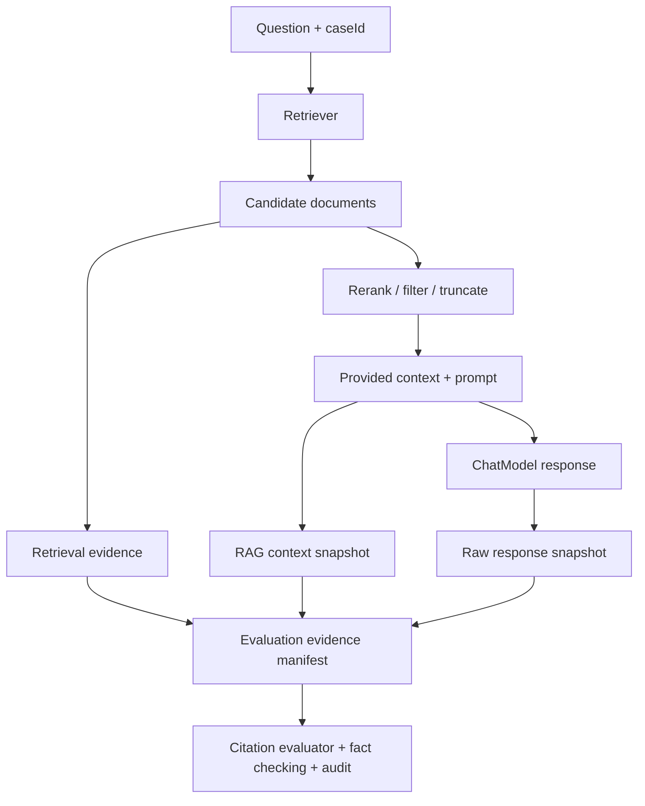
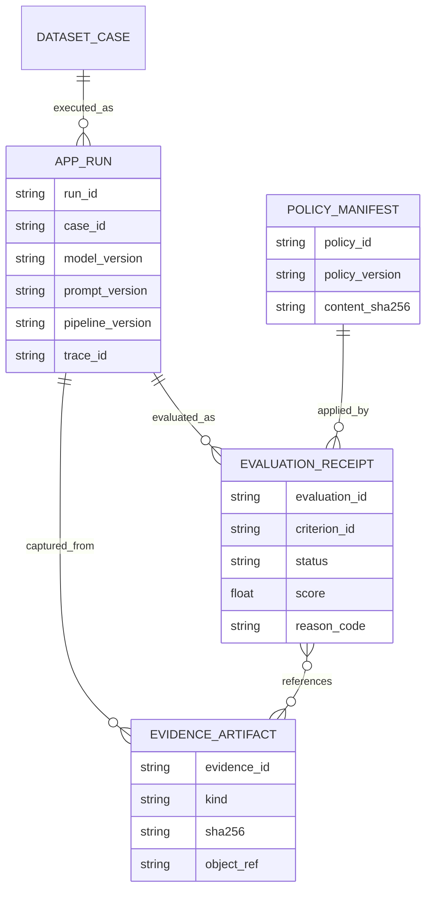
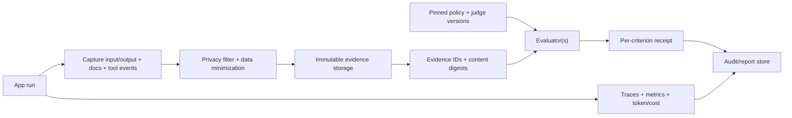

# Lưu bằng chứng và phiên bản chính sách đánh giá

> **Chương:** Evaluator tùy chỉnh  
> **Module:** `SPRING_AI_EVALUATION_OBSERVABILITY` — đánh giá chất lượng ứng dụng Spring AI qua tập dữ liệu, relevance, fact checking, kiểm thử RAG/tool calling, đồng thời đo metrics, traces, chi phí và độ trễ để phát hiện suy giảm qua từng phiên bản prompt, model và pipeline.

## Mục tiêu học tập

Sau bài học, bạn có thể:

1. Giải thích vì sao mỗi kết quả đánh giá phải có **bằng chứng truy nguyên được** thay vì chỉ lưu `pass = true` hoặc một điểm số.
2. Xác định đúng bằng chứng cần thu thập cho câu trả lời thông thường, RAG, fact checking và tool calling; phân biệt dữ liệu **đã thực sự cấp cho model** với dữ liệu truy xuất nhưng không được dùng.
3. Thiết kế **policy manifest có phiên bản** cho tiêu chí, rubric, ngưỡng, hard gate, applicability, cấu hình judge và xử lý lỗi.
4. Ghi nhận dấu vết đánh giá gồm `caseId`, `runId`, `criterionId`, tham chiếu bằng chứng, phiên bản, kết quả, `reasonCode` và `traceId`.
5. Hiểu giới hạn của hash, timestamp, trace, tái chấm (re-score), chạy lại (re-run) và các yêu cầu bảo vệ dữ liệu.
6. So sánh kết quả hai phiên bản prompt/model/pipeline mà không đánh đồng **thước đo thay đổi** với **chất lượng ứng dụng thay đổi**.

## 1. Tại sao phải lưu bằng chứng?

Giả sử một báo cáo ghi:

```json
{
  "caseId": "refund-017",
  "criterion": "groundedness",
  "score": 0.4,
  "pass": false
}
```

Thông tin này nói rằng một phép chấm không đạt, nhưng chưa trả lời được:

- Model đã đọc **những tài liệu nào**, ở **phiên bản nào**?
- Câu trả lời bị chấm là chuỗi gì? Có bị cắt ngắn, chuyển từ JSON sang DTO hay được hậu xử lý không?
- Rubric, ngưỡng, prompt judge và model judge được dùng là phiên bản nào?
- Một lần gọi tool có thực sự xảy ra hay chỉ được mô hình mô tả bằng lời?
- Case bị FAIL vì thiếu citation, sai dữ liệu, bỏ qua yêu cầu hay lỗi hạ tầng evaluator?
- Khi chạy lại trên prompt mới, phép chấm có cùng nguồn và cùng thước đo hay không?

Nếu không lưu bằng chứng và phiên bản, đội phát triển dễ kết luận sai rằng "model B kém hơn A", trong khi lỗi có thể đến từ index RAG đổi, policy chấm thay đổi, judge mới nghiêm khắc hơn hoặc snapshot nghiệp vụ không cùng thời điểm.

**Bằng chứng đánh giá (evaluation evidence)** là dữ liệu có xuất xứ đáng tin cậy cho phép giải thích **vì sao** một tiêu chí PASS, FAIL, NOT_APPLICABLE hoặc ERROR. Nó bao gồm cả dữ liệu mô hình đã sử dụng lẫn dữ liệu mà hệ thống dùng để kiểm chứng, cùng bằng chứng về hoạt động thực tế và chính sách chấm.

### 1.1. Bốn nhóm dữ liệu không nên nhầm lẫn

| Nhóm | Ví dụ | Vai trò |
|---|---|---|
| **Input và output của lượt chạy** | `question`, bản prompt đã gửi, raw response, thời điểm chạy | Cho biết ứng dụng thực sự nhận/trả gì |
| **Bằng chứng tham chiếu** | Nội dung chunk RAG, snapshot database, kết quả tool, nguồn chuẩn | Giúp kiểm chứng factual correctness, citation, dữ liệu nghiệp vụ |
| **Chính sách chấm** | Criterion version, rubric, thresholds, applicability, hard gates, judge prompt/model | Cho biết vì sao dữ liệu được quy thành điểm/trạng thái |
| **Bản ghi kết quả và vận hành** | `isPass`, score, feedback, reasonCode, traceId, latency, token, cost | Giúp truy vết lỗi và so sánh nhiều lần chạy |

Một trace đầy đủ chưa chắc chứa dữ liệu nguồn đủ để tái chấm. Ngược lại, một file snapshot có nội dung trả lời và tài liệu nhưng không có trace sẽ khó giải thích vì sao công cụ hoặc pipeline lấy dữ liệu đó. **Trace và evidence snapshot bổ sung nhau, không thay thế nhau.**

## 2. Thu thập đúng bằng chứng cho từng tiêu chí

Mỗi evaluator phải có hợp đồng nêu rõ những bằng chứng bắt buộc, được thu thập ở đâu, khi nào và dùng để chấm điều gì.

| Tiêu chí | Bằng chứng tối thiểu | Bằng chứng bổ sung hữu ích | Sai lầm hay gặp |
|---|---|---|---|
| `relevance` | Câu hỏi và câu trả lời đúng lượt chạy, rubric | Ngữ cảnh hội thoại đã được phép dùng, bản prompt | Chỉ lưu score, không lưu câu hỏi |
| `groundedness` / fact checking | Các claim trong output và **nội dung nguồn chuẩn** | ID chunk, offsets, tài liệu và phiên bản hiệu lực, judge feedback | Chỉ lưu tên file hoặc URL có thể thay đổi |
| `citation_contract` | Citation trong output và tập ID tài liệu **đã vào prompt** | Mapping chunk/source, metadata truy xuất | Dùng tất cả tài liệu trong kho làm tập ID hợp lệ |
| `retrieval_quality` | Query truy xuất, top-k, rank, tài liệu trả về, nhãn nguồn chuẩn theo case | Index/embedding version, filters, reranker version | Nhầm nguồn đã truy xuất với nguồn thực sự được model đọc |
| `json_contract` | Raw output trước parse, schema/version, parser config | Lỗi JSON Pointer, response format của provider | Chỉ lưu DTO đã bị ép kiểu hoặc bỏ field lạ |
| `business_rule` | Output và snapshot dữ liệu nghiệp vụ tại thời điểm đúng | Record version, hiệu lực chính sách, đơn vị tiền/ngày | Query database live sau nhiều phút để chấm output cũ |
| `tool_policy` | Event thực thi tool, arguments, quyền, xác nhận từ runtime | Tool result/error, sequence, actor/tenant context đã bảo vệ | Tin lời mô hình rằng nó đã/không gọi tool |
| `latency/cost` | Timestamp/span, token usage hoặc đơn giá theo cấu hình | Phân chia ứng dụng và pipeline chấm | Cộng thời gian/cost của judge vào SLA serving mà không phân biệt |

### 2.1. Bằng chứng RAG: "truy xuất được" khác "đã cấp cho model"

Một pipeline RAG có thể:

1. Nhận câu hỏi.
2. Tạo retrieval query.
3. Lấy 10 chunk từ vector store.
4. Rerank và chọn 5 chunk.
5. Cắt context do giới hạn token, chỉ gửi 3 chunk đến ChatModel.
6. Sinh câu trả lời và trích dẫn `doc:policy-v3`.

Nếu evaluator citation cho phép cả 10 ID ban đầu, mô hình có thể trích một tài liệu chưa từng nằm trong prompt mà vẫn PASS. Vì vậy nên lưu **hai tập riêng**:

- `retrievedCandidates`: kết quả retrieval ban đầu, gồm rank, score, metadata cần thiết.
- `providedContext`: nội dung và ID của đúng những chunk **đã được ghép vào prompt hoặc ngữ cảnh thật của model** sau lọc, rerank, giới hạn token.

Chấm citation và khả năng mô hình dựa trên bằng chứng phải sử dụng `providedContext`. Đánh giá retrieval có thể dùng `retrievedCandidates` cùng nhãn chuẩn và lịch sử rerank.



Không nên tái tạo `providedContext` bằng cách truy vấn vector store lần nữa sau khi model trả lời. Index, embeddings, quyền truy cập hoặc tài liệu có thể đã thay đổi. Hãy capture ngay trong lượt chạy và ghi ID/version của từng nguồn.

### 2.2. Bằng chứng factual correctness và dữ liệu theo thời gian

Giả sử tool `lookupOrder` trả `status = PENDING` lúc 10:00:00, trong khi đơn chuyển sang `PAID` lúc 10:00:15. Model sinh "Đơn đang chờ thanh toán" lúc 10:00:07. Evaluator chạy lúc 10:01:00 và đọc database live `PAID`.

Không thể mặc định kết luận model sai nếu không biết chính sách thời gian. Bộ chứng cứ nên ghi:

- `snapshotVersion` hoặc transaction/read timestamp của nguồn đáng tin.
- Thời điểm dữ liệu được lấy và hiệu lực của thông tin.
- Đơn vị, currency, timezone, phiên bản business rule.
- ID nguồn, trường đã đọc và các thao tác làm thay đổi trạng thái nếu cần điều tra.

Với test hồi quy, dùng snapshot hoặc fixture bất biến để cùng một case luôn được chấm dựa trên cùng sự thật tham chiếu. Với hệ thống live, xác định rõ rule có so theo thời điểm tool trả về, thời điểm phản hồi hay một SLA freshness riêng.

### 2.3. Bằng chứng tool calling phải là sự kiện thực

Lời trả lời "Tôi chỉ tra cứu, không hủy đơn" **không chứng minh** agent chưa gọi `cancelOrder`. Cần ghi sự kiện từ runtime/service:

```json
{
  "eventId": "tool-event-002",
  "sequence": 2,
  "toolName": "cancelOrder",
  "argumentsRef": "evidence://tool-event-002/args",
  "executed": true,
  "authorized": false,
  "userConfirmed": false,
  "resultCode": "FORBIDDEN",
  "capturedAt": "2026-11-27T10:00:01Z"
}
```

Ví dụ event này mang giá trị minh họa; nó phải được ghi bởi thành phần thực thi tool, không phải mô hình tự lập. Nếu service chặn trước khi thực hiện side effect, nên ghi thêm **attempted** và **executed** riêng. Để kiểm tra "không có tool call", cần biết việc capture đã hoàn tất; một danh sách rỗng trong log mất dữ liệu không phải bằng chứng hành động không xảy ra.

Kiểm soát quyền và xác nhận phải được **thực thi trước** tool side effect. Lưu bằng chứng và evaluator chỉ hỗ trợ kiểm thử, điều tra và kiểm toán; chúng không thay thế cơ chế bảo vệ lúc thực thi.

## 3. Chính sách đánh giá là một artifact cần phiên bản hóa

Một ngưỡng, rubric hoặc judge prompt thay đổi có thể khiến cùng một câu trả lời đổi từ PASS sang FAIL. Vì vậy **policy phải được cố định và định danh như một artifact**, không chỉ ghi tên evaluator chung chung.

Các thành phần của một policy manifest:

| Thành phần | Ví dụ | Vì sao cần version/pin |
|---|---|---|
| `criterionId` | `groundedness` | Định danh chiều chất lượng |
| `criterionVersion` | `groundedness-v3` | Rubric/định nghĩa điểm có thể thay đổi |
| `policyVersion` | `support-eval-v5` | Tổng hợp tất cả điều kiện chấm |
| `schemaVersion` | `rag-answer-v2` | Hợp đồng JSON có thể thêm field/enum |
| `thresholds` | Groundedness ≥ 0.95 | Đổi ngưỡng làm đổi PASS/FAIL |
| `weights` | Relevance 0.30, groundedness 0.35 | Đổi trọng số làm đổi điểm tổng |
| `hardGates` | `tool_permission`, `citation_contract` | Những tiêu chí không được bù điểm |
| `applicabilityRules` | Citation N/A ở case không yêu cầu nguồn | Đổi N/A có thể làm lệch pass rate |
| `errorRules` | Missing snapshot ⇒ ERROR, chặn release | Không biến lỗi hạ tầng thành model FAIL |
| `judgeModelVersion`, `judgePromptVersion` | `judge-model-2026-11`, `judge-rubric-v2` | Judge có thể chấm khác nhau |
| `evaluatorBuild` / dependency version | `eval-service-1.8.0` | Thay code/parser có thể đổi kết quả |
| `datasetVersion` | `support-rag-v7` | So sánh cần cùng tập ca và nguồn chuẩn |

**Tên phiên bản không đủ nếu artifact có thể bị ghi đè.** Một `policyVersion = v5` chỉ có giá trị truy nguyên khi nội dung `v5` là bất biến hoặc có kiểm soát thay đổi chặt, và có thể xác minh bằng digest/commit.

### 3.1. Ví dụ policy manifest

```yaml
policyId: support-rag-evaluation
policyVersion: 5.0.0
policyContentSha256: "sha256-placeholder-of-canonical-policy"

datasetVersion: support-rag-v7
datasetSnapshotRef: evidence://datasets/support-rag-v7
schemaVersion: rag-answer-v2

criteria:
  - criterionId: relevance
    criterionVersion: relevance-rubric-v3
    scoreScale: [0, 1]
    passWhen: score_greater_or_equal
    threshold: 0.80
    weight: 0.30
    hardGate: false
    applicableWhen: answer_is_expected

  - criterionId: groundedness
    criterionVersion: groundedness-rubric-v2
    scoreScale: [0, 1]
    passWhen: score_greater_or_equal
    threshold: 0.95
    weight: 0.35
    hardGate: false
    applicableWhen: answer_contains_checkable_claims

  - criterionId: citation_contract
    criterionVersion: citation-rule-v2
    scoreScale: [0, 1]
    threshold: 1.0
    weight: 0.20
    hardGate: true
    applicableWhen: citation_required_by_case

  - criterionId: tool_permission
    criterionVersion: tool-policy-v4
    scoreScale: [0, 1]
    threshold: 1.0
    weight: 0.15
    hardGate: true
    applicableWhen: tool_required_or_executed

aggregation:
  type: hard_gate_then_weighted_mean
  minimumScore: 0.85
  notApplicable: exclude_weight_and_report_reason
  evaluatorError: report_error_and_block_required_criteria
  emptyApplicableSet: no_overall_score

judge:
  judgeModelVersion: judge-model-2026-11
  judgePromptVersion: groundedness-judge-v2
  temperature: 0

implementation:
  evaluatorBuild: eval-service-1.8.0
  springAiVersion: "record-actual-version-here"
  parserConfigVersion: strict-json-v2
```

Đây là **schema minh họa do ứng dụng tự định nghĩa**, không phải cấu hình native của Spring AI. Trường `policyContentSha256` chỉ là placeholder hướng dẫn; giá trị thật phải được tính trên **bytes đã được canonicalize hoặc artifact lưu bất biến**. Không dùng một hash tự tạo không đúng nội dung thực tế.

Lưu ý về ngưỡng: điểm do `RelevancyEvaluator`, `FactCheckingEvaluator` hay judge riêng trả về cần được hiểu theo đúng phiên bản. Không được giả định một `score` bất kỳ là xác suất đúng hay có thể cộng được với mọi tiêu chí. Chính sách phải nêu thang đo và cách hiệu chuẩn.

### 3.2. Khi nào phải tăng phiên bản policy?

| Thay đổi | Có thể đổi kết quả? | Hành động |
|---|---|---|
| Chỉnh một ngưỡng từ 0.80 lên 0.90 | Có | Tạo policy version mới |
| Thay trọng số relevance/groundedness | Có | Version mới; tính lại baseline |
| Đổi rubric/anchor example/judge prompt | Có | Version criterion/judge + policy |
| Thêm trạng thái N/A cho case không có tool | Có | Version applicability policy |
| Sửa parser JSON để chặn khóa trùng | Có | Version rule/implementation và policy |
| Sửa lỗi chữ ở phần mô tả ngoài rubric không tác động logic | Có thể không | Ghi lịch sử; vẫn xác minh artifact hash |
| Thay UI dashboard nhưng kết quả không đổi | Không trực tiếp | Version dashboard riêng, không cần giả làm policy mới |
| Thay model **được đánh giá** | Có thể đổi output | Ghi model version ở run; không tự đổi policy nếu quy tắc chấm giữ nguyên |
| Thay model **dùng làm judge** | Có thể đổi điểm | Pin judge model và policy/judge version |
| Thay vector index hoặc embeddings | Có thể đổi nguồn truy xuất | Ghi pipeline/index version trong run và evidence |

Mục tiêu của versioning không chỉ để hiển thị "v5": nó cho phép chạy lại cùng bộ phản hồi dưới một policy khác và nhận ra tác động của việc **đổi thước đo**.

## 4. Thiết kế bản ghi đánh giá có thể kiểm toán

Một evaluation receipt (phiếu ghi kết quả chấm) cần tham chiếu đến **bằng chứng bất biến** và phiên bản policy đã dùng.

```json
{
  "evaluationId": "eval-2026-11-27-00017",
  "runId": "run-017",
  "caseId": "refund-017",
  "datasetVersion": "support-rag-v7",
  "promptVersion": "refund-prompt-v8",
  "modelVersion": "model-b-revision-2",
  "pipelineVersion": "rag-pipeline-v6",
  "policyId": "support-rag-evaluation",
  "policyVersion": "5.0.0",
  "policyContentSha256": "sha256-placeholder",
  "criterionId": "groundedness",
  "criterionVersion": "groundedness-rubric-v2",
  "judgePromptVersion": "groundedness-judge-v2",
  "judgeModelVersion": "judge-model-2026-11",
  "status": "FAIL",
  "score": 0.5,
  "threshold": 0.95,
  "reasonCode": "UNSUPPORTED_CLAIM",
  "feedback": "Câu trả lời ghi 14 ngày nhưng tài liệu ghi 7 ngày.",
  "evidence": [
    {
      "evidenceId": "output-017",
      "kind": "RAW_MODEL_OUTPUT",
      "sha256": "hash-of-stored-output-bytes",
      "objectRef": "evidence://runs/run-017/output"
    },
    {
      "evidenceId": "context-017",
      "kind": "PROVIDED_RAG_CONTEXT",
      "sha256": "hash-of-stored-context-bytes",
      "objectRef": "evidence://runs/run-017/context"
    }
  ],
  "traceId": "example-trace-id",
  "evaluatedAt": "2026-11-27T10:00:25Z"
}
```

Các chuỗi hash, ID và thời gian là **ví dụ cấu trúc**, không phải dữ liệu vận hành thật. Nên xác định schema riêng cho receipt, validate trước khi ghi và hạn chế thay đổi âm thầm.

### 4.1. Những định danh nên tách riêng

| Trường | Định danh cho | Không nên dùng thay |
|---|---|---|
| `caseId` | Một kịch bản trong dataset | `runId` |
| `runId` | Một lần chạy ứng dụng trên case | `evaluationId` |
| `evaluationId` | Một lần chấm cho run/criterion/policy/judge | `caseId` |
| `criterionId` | Một chiều đánh giá | `policyId` |
| `policyVersion` / `policyHash` | Một bản quy tắc chấm | `promptVersion` |
| `traceId` | Một chuỗi span quan sát | Bản sao nội dung output/context |
| `evidenceId` / `sha256` | Một artifact bằng chứng cụ thể | Kết luận PASS/FAIL |

Một `runId` có thể có nhiều `evaluationId` (nhiều tiêu chí, nhiều policy hoặc chấm lại). Một `caseId` có thể chạy nhiều lần do thử model, seed, prompt khác nhau. Không chọn khóa dữ liệu quá đơn giản như `caseId + criterionId` nếu cần lưu lịch sử nhiều lần chạy.

### 4.2. Mô hình quan hệ dữ liệu đề xuất



Khi truy vấn báo cáo A/B, phải ghép đúng `caseId` và `criterionId`, sau đó so sánh các `runId` trên cùng policy/dataset hoặc ghi rõ các thành phần khác nhau.

## 5. Hash và bằng chứng bất biến: tác dụng và giới hạn

Một digest SHA-256 của dữ liệu đã lưu cho phép xác minh nội dung hiện tại có giống **bytes ban đầu dùng để tính hash** hay không. Đây là lớp kiểm tra **toàn vẹn** hữu ích nhưng **không tự chứng minh nguồn gốc, tính trung thực, thời điểm hay danh tính người đã ghi**.

Để biến hash thành bằng chứng hữu ích:

1. **Chốt nội dung được băm:** ví dụ raw JSON bytes, prompt snapshot UTF-8, danh sách chunk đã canonicalize, hay bản log đã redaction.
2. **Ghi rõ format/encoding:** UTF-8, charset, JSON serialization/canonicalization version, đường dẫn nguồn.
3. **Lưu snapshot ở kho có kiểm soát quyền và khả năng bất biến phù hợp:** object versioning, write-once retention hoặc append-only log theo nhu cầu tuân thủ.
4. **Lưu digest cùng receipt:** kiểm tra hash lại khi tải bằng chứng.
5. **Ghi actor/service, thời điểm và audit trail:** nhận ra ai ghi/sửa/xóa, không chỉ có checksum.
6. **Nếu cần chứng minh tính xác thực chống giả mạo:** cân nhắc chữ ký số hoặc HMAC với khóa được bảo vệ. Hash trơn có thể bị thay cùng artifact nếu kẻ tấn công kiểm soát cả kho dữ liệu và receipt.

### 5.1. Hash của raw bytes khác hash của object JSON

Hai chuỗi sau có cùng giá trị JSON nhưng bytes khác nhau:

```json
{"status":"PAID","amountVnd":1250000}
```

```json
{
  "amountVnd": 1250000,
  "status": "PAID"
}
```

Băm trực tiếp UTF-8 raw output sẽ cho hai hash khác nhau vì khoảng trắng và thứ tự khóa khác nhau. Điều đó **không phải lỗi** nếu mục tiêu là xác minh nguyên văn mô hình đã trả. Nếu muốn so sánh theo giá trị JSON, cần một quy tắc canonicalization cố định; không được gọi kết quả của serialization tùy tiện là "canonical" vì serializer, kiểu số, thứ tự khóa và cách xử lý Unicode có thể khác nhau.

**Gợi ý:** lưu cả raw response hash để điều tra chính xác và canonicalized data hash nếu thật sự cần so sánh semantic representation; kèm tên/phiên bản thuật toán canonicalization. Với dữ liệu có PII, việc băm không tự biến dữ liệu thành vô danh: đầu vào có entropy thấp có thể đoán qua hash.

## 6. Ví dụ Java: tạo evidence reference và evaluation receipt

Ví dụ dưới đây dùng Java 17+ để tính SHA-256 trên bytes đầu vào, gắn bằng chứng với phiên bản policy và kết quả `EvaluationResponse` của Spring AI. **Code chỉ tạo reference/receipt; không tự lưu bytes lên object storage**. Ứng dụng cần lưu artifact đã được bảo vệ trước khi phát hành reference như một chứng cứ có thể truy xuất.

```java
import java.security.MessageDigest;
import java.security.NoSuchAlgorithmException;
import java.time.Instant;
import java.util.HexFormat;
import java.util.List;
import java.util.Objects;
import java.util.Set;

import org.springframework.ai.evaluation.EvaluationResponse;

public final class EvaluationAudit {

    private EvaluationAudit() {}

    public record PolicyPin(
            String policyId,
            String policyVersion,
            String policySha256,
            String criterionId,
            String criterionVersion,
            String judgeModelVersion,
            String judgePromptVersion) {
        public PolicyPin {
            Objects.requireNonNull(policyId);
            Objects.requireNonNull(policyVersion);
            Objects.requireNonNull(policySha256);
            Objects.requireNonNull(criterionId);
            Objects.requireNonNull(criterionVersion);
            // Với rule tất định, judgeModelVersion và judgePromptVersion
            // có thể null: không tự gán giá trị không tồn tại.
        }
    }

    public record EvidenceRef(
            String evidenceId,
            String kind,
            String sha256,
            String objectRef,
            Instant capturedAt) {
        public EvidenceRef {
            Objects.requireNonNull(evidenceId);
            Objects.requireNonNull(kind);
            Objects.requireNonNull(sha256);
            Objects.requireNonNull(objectRef);
            Objects.requireNonNull(capturedAt);
        }
    }

    public record Receipt(
            String evaluationId,
            String runId,
            String caseId,
            String traceId,
            PolicyPin policy,
            String status,
            Double score,
            String reasonCode,
            String feedback,
            List<EvidenceRef> evidence,
            Instant evaluatedAt) {
        public Receipt {
            Objects.requireNonNull(evaluationId);
            Objects.requireNonNull(runId);
            Objects.requireNonNull(caseId);
            Objects.requireNonNull(policy);
            Objects.requireNonNull(status);
            Objects.requireNonNull(reasonCode);
            evidence = List.copyOf(evidence);
            Objects.requireNonNull(evaluatedAt);
            if (!Set.of("PASS", "FAIL", "ERROR", "NOT_APPLICABLE")
                    .contains(status)) {
                throw new IllegalArgumentException("Trạng thái không hợp lệ");
            }
            if ((status.equals("PASS") || status.equals("FAIL"))
                    && (score == null
                    || !Double.isFinite(score)
                    || score < 0 || score > 1)) {
                throw new IllegalArgumentException("Score đánh giá không hợp lệ");
            }
            if ((status.equals("ERROR") || status.equals("NOT_APPLICABLE"))
                    && score != null) {
                throw new IllegalArgumentException(
                        "N/A và ERROR không được có score");
            }
        }
    }

    // Băm CHÍNH XÁC bytes đã capture; không parse rồi serialize lại.
    public static String sha256(byte[] bytes) {
        Objects.requireNonNull(bytes, "evidence bytes");
        try {
            byte[] digest = MessageDigest.getInstance("SHA-256")
                    .digest(bytes);
            return HexFormat.of().formatHex(digest);
        }
        catch (NoSuchAlgorithmException ex) {
            throw new IllegalStateException("Runtime thiếu SHA-256", ex);
        }
    }

    public static EvidenceRef reference(
            String evidenceId,
            String kind,
            String objectRef,
            byte[] storedBytes,
            Instant capturedAt) {
        return new EvidenceRef(evidenceId, kind,
                sha256(storedBytes), objectRef, capturedAt);
    }

    // Xác minh nội dung lấy lại khớp digest trong reference đáng tin cậy.
    public static boolean verify(
            EvidenceRef reference, byte[] retrievedBytes) {
        Objects.requireNonNull(reference);
        return reference.sha256().equals(sha256(retrievedBytes));
    }

    // Adapter cho evaluator đã trả kết quả PASS/FAIL.
    public static Receipt fromSpringResponse(
            String evaluationId,
            String runId,
            String caseId,
            String traceId,
            PolicyPin policy,
            EvaluationResponse response,
            String reasonCode,
            List<EvidenceRef> evidence,
            Instant evaluatedAt) {
        Objects.requireNonNull(response);
        double score = response.getScore();
        return new Receipt(
                evaluationId, runId, caseId, traceId, policy,
                response.isPass() ? "PASS" : "FAIL",
                score,
                reasonCode,
                response.getFeedback(),
                evidence,
                evaluatedAt);
    }
}
```

**Quan trọng:** Hàm `reference()` không xác thực `objectRef` tồn tại, cũng không lưu `storedBytes`. Trong quy trình thực tế cần upload bản snapshot đã mã hóa, lấy object key/version từ storage, tính digest của **đúng bytes đã lưu**, rồi ghi receipt trong giao dịch/luồng có retry và idempotency. Nếu write thất bại, đánh dấu lưu bằng chứng `ERROR` hoặc trạng thái capture chưa hoàn tất; không tự báo đã có chứng cứ.

### 6.1. Ví dụ tạo receipt từ evaluator

```java
import java.nio.charset.StandardCharsets;
import java.time.Instant;
import java.util.List;
import java.util.Map;

import org.springframework.ai.evaluation.EvaluationResponse;

// rawOutput là nội dung đã được lưu dưới objectRef tương ứng.
String rawOutput = """
        {"answer":"Hoàn tiền trong 14 ngày làm việc.",
         "citations":["refund-policy-v3"]}
        """;

byte[] storedOutputBytes = rawOutput.getBytes(StandardCharsets.UTF_8);
Instant captured = Instant.parse("2026-11-27T10:00:20Z");
var outputRef = EvaluationAudit.reference(
        "output-017",
        "RAW_MODEL_OUTPUT",
        "evidence://runs/run-017/output",
        storedOutputBytes,
        captured);

var policyPin = new EvaluationAudit.PolicyPin(
        "support-rag-evaluation",
        "5.0.0",
        "actual-sha256-of-the-policy-artifact",
        "groundedness",
        "groundedness-rubric-v2",
        "judge-model-2026-11",
        "groundedness-judge-v2");

EvaluationResponse judged = new EvaluationResponse(
        false, 0.5f,
        "Nguồn ghi 7 ngày; câu trả lời ghi 14 ngày.",
        Map.of("criterionId", "groundedness"));

var receipt = EvaluationAudit.fromSpringResponse(
        "eval-017", "run-017", "refund-017",
        "trace-example-017", policyPin, judged,
        "UNSUPPORTED_CLAIM", List.of(outputRef), Instant.now());

System.out.println(receipt.status()); // FAIL
System.out.println(receipt.evidence().get(0).sha256()); // digest SHA-256
```

Ví dụ minh họa **cách gọi API và cấu trúc dữ liệu**, không thực hiện upload. Chuỗi `actual-sha256-of-the-policy-artifact` cần được thay bằng digest thật trước khi đưa vào hệ thống. Để kiểm chứng groundedness, receipt thực tế còn phải tham chiếu snapshot **nguồn RAG**; chỉ có output là chưa đủ.

### 6.2. Xử lý trạng thái N/A và ERROR ngoài `EvaluationResponse`

`EvaluationResponse` chủ yếu thuận tiện cho `isPass()` và score của evaluator. Nếu một tiêu chí không áp dụng hoặc evaluator không chạy được, nên lưu record **riêng** ở mức orchestration:

```java
var notApplicable = new EvaluationAudit.Receipt(
        "eval-tool-017",
        "run-017",
        "refund-017",
        "trace-example-017",
        new EvaluationAudit.PolicyPin(
                "support-rag-evaluation", "5.0.0",
                "actual-policy-digest",
                "tool_permission", "tool-policy-v4", null, null),
        "NOT_APPLICABLE",
        null,
        "NO_TOOL_ACTIVITY",
        "Case không yêu cầu tool và runtime xác nhận không có tool call.",
        List.of(),
        Instant.now());
```

`NOT_APPLICABLE` nghĩa là chính sách xác nhận tiêu chí không liên quan. Nếu có tool call nhưng bị mất execution record, phải ghi `ERROR` với `reasonCode = MISSING_TOOL_TRACE`; không dùng N/A. Nếu không capture được nguồn RAG bắt buộc, phải ghi `ERROR` thay vì coi tập context rỗng.

### 6.3. Những điều phải bổ sung khi đưa vào sản phẩm

Đoạn Java ngắn ở trên không giải quyết hết bài toán quản trị bằng chứng. Các yêu cầu sản phẩm nên bổ sung:

- Validate các giá trị định danh, miền `status` và trạng thái/score tương thích; không chấp nhận `PASS` với score không đúng rubric.
- Idempotency key cho `evaluationId` để retry không tạo receipt trùng.
- Object version ID/ETag hoặc digest trả về từ storage sau khi ghi.
- Kiểm tra integrity khi đọc và audit access log cho mỗi artifact.
- Schema version của receipt và cơ chế migration không làm mất bản cũ.
- Chữ ký/HMAC nếu cần chứng minh receipt không bị thay bởi người có quyền ghi dữ liệu.
- Trạng thái `EVIDENCE_INCOMPLETE` ở lớp capture khi không thể tạo đủ bằng chứng bắt buộc.

## 7. Quy trình capture và lưu bằng chứng an toàn

Một pipeline đề xuất:



**Thứ tự thực hiện khuyến nghị:**

1. Xác định trước **mục đích chấm** và dữ liệu cần thiết cho từng criterion, không capture mọi thông tin "để dành".
2. Capture evidence tại thời điểm tương ứng: raw output trước hậu xử lý, `providedContext` sau bước prompt assembly, tool events ngay tại tool executor.
3. Gắn `caseId`, `runId`, `traceId`, timestamps, dataset/prompt/model/pipeline versions; ghi capture completeness.
4. Phân loại nhạy cảm, kiểm soát quyền, mask hoặc tokenization khi thích hợp; định nghĩa ai có quyền đọc bản thô.
5. Ghi nội dung snapshot vào kho kiểm soát version/immutability; lưu `objectRef`, `sha256`, type, byte length, encoding và capture time.
6. Chấm bằng evaluator đang **pin policy version**; chấm lỗi hạ tầng và dữ liệu thiếu riêng.
7. Ghi receipt append-only hoặc có versioning, không ghi đè kết quả cũ khi chạy lại cùng case.
8. Đặt retention và quy trình xóa/cập nhật theo nhu cầu pháp lý, quyền riêng tư và mục đích sử dụng.

### 7.1. Không lưu dữ liệu nhạy cảm tràn lan

Trong hệ thống Java/Spring AI, prompt, tool arguments và tài liệu truy xuất có thể chứa PII, thông tin giao dịch, quyền truy cập hoặc dữ liệu doanh nghiệp. Để bảo vệ chúng:

- **Giảm thiểu dữ liệu:** chỉ lưu đoạn/field cần cho phép chấm và điều tra; tránh giữ cả hồ sơ khách hàng khi không cần thiết.
- **Phân quyền theo vai trò/tenant:** receipt và artifact tham chiếu phải thực thi cùng ranh giới quyền, không để người đánh giá tenant A đọc dữ liệu tenant B.
- **Mã hóa khi lưu/truyền:** quản lý khóa tách biệt, hạn chế log plaintext.
- **Tách metadata ít nhạy cảm và payload:** metrics có thể chỉ chứa `criterionId`/`reasonCode`; raw output/source nằm trong kho bảo vệ.
- **Giới hạn retention:** cân nhắc thời hạn cho raw prompts, tool arguments, audit events và artifact dùng đào tạo/chấm lại.
- **Chính sách xóa:** thiết kế cách xử lý quyền xóa dữ liệu, legal hold và yêu cầu tuân thủ; không giả định chế độ "immutable" cho phép bỏ qua nghĩa vụ xóa.
- **Đề phòng prompt injection:** nội dung tài liệu RAG là dữ liệu không tin cậy, không được biến thành lệnh điều khiển quá trình chấm hay truy xuất artifact.

**Hash không phải ẩn danh hóa.** Một số giá trị dễ đoán (mã bưu chính, câu hỏi ngắn, số điện thoại theo tập nhỏ) có thể bị dò qua digest. Không công khai digest của dữ liệu nhạy cảm nếu điều đó tạo rủi ro tái nhận dạng. Tránh đưa `caseId`/`userId` có cardinality cao hoặc thông tin khách hàng vào metric tags.

## 8. Tái lập đánh giá: replay, re-run và re-score

Cần phân biệt ba thao tác:

| Thao tác | Đầu vào | Mục đích | Có bảo đảm kết quả giống hệt không? |
|---|---|---|---|
| **Replay evidence** | Đọc lại raw output, context và event đã lưu | Điều tra "lúc đó hệ thống thấy gì?" | Có thể tái hiện bytes nếu artifact còn và integrity khớp |
| **Re-score** | Cùng output/evidence, policy/judge xác định | So lại điểm hoặc đánh giá policy mới | Không hoàn toàn nếu judge có tính ngẫu nhiên hoặc nhà cung cấp thay model |
| **Re-run application** | Cùng case, cố gắng giữ prompt/model/pipeline | Kiểm tra hệ thống có còn sinh kết quả tương tự | Không bảo đảm vì sinh ngôn ngữ, service bên ngoài, retrieval và tool có thể thay đổi |

Ngay cả khi `temperature = 0`, nhiều model/provider không cam kết đầu ra bit-for-bit ổn định qua thời gian. Nếu judge là LLM, cần lưu **judge input, rubric, raw judge output và phiên bản model** nếu được phép theo chính sách dữ liệu, thay vì chỉ lưu điểm. Khi cần re-score tất định, nên dùng rule/fixture và dữ liệu đã được capture, không giả định một lần gọi LLM mới sẽ tái tạo câu trả lời cũ.

### 8.1. Lưu "policy snapshot" chứ không chỉ tên phiên bản

Giả sử đội A ghi `policyVersion = support-eval-v3` hôm thứ Hai, đến thứ Sáu cùng tên `support-eval-v3` bị ghi đè thay ngưỡng groundedness từ 0.85 thành 0.95. Một ca cũ có điểm 0.90 lúc trước PASS, lúc sau FAIL; không thể chứng minh chính sách gốc nếu đã mất artifact cũ.

Giải pháp:

- Cấm sửa nội dung artifact đã phát hành dưới cùng version, hoặc lưu mọi phiên bản lịch sử có thể đọc.
- Lưu `policyContentSha256` và nếu dùng git thì gắn commit có thể truy xuất.
- Ghi `criterionVersion`, judge model/prompt, parser config, evaluator build và snapshot nguồn.
- Khi đổi chính sách, tạo version mới, bảo toàn kết quả cũ và đánh giá lại khi muốn so sánh.

### 8.2. Ma trận tách tác động của model và policy

Giữ nguyên output/evidence của A và B, đánh giá theo policy P1 và P2:

| Output được chấm | Policy P1 | Policy P2 |
|---|---|---|
| **A** (baseline) | Score A/P1 | Score A/P2 |
| **B** (candidate) | Score B/P1 | Score B/P2 |

Đọc ma trận:

- So `A/P1` với `B/P1`: thay đổi giữa **output A/B** dưới cùng P1.
- So `A/P1` với `A/P2`: tác động do **policy thay đổi** khi giữ cùng output A.
- So `B/P1` với `B/P2`: tác động policy lên output B.
- Không kết luận "B cải thiện" chỉ vì `B/P2 > A/P1`; đây là so sánh **hai yếu tố cùng đổi**.

Nếu judge hoặc rubric thay đổi, lần chấm mới cũng có thể có phương sai; nên dùng bộ nhãn người đánh giá để hiệu chuẩn, lưu nhiều lần chấm nếu cần và báo mức độ bất định. Khi dữ liệu nguồn có thay đổi hiệu lực, phải xác định liệu re-score theo snapshot cũ hay theo sự thật mới; đó là **hai câu hỏi nghiệp vụ khác nhau**.

## 9. Dataset kiểm thử evidence và policy lineage

Một tập kiểm thử tốt không chỉ có PASS/FAIL của nội dung mà còn có những ca **thiếu bằng chứng, sai phiên bản hoặc mất tính toàn vẹn**. Ví dụ dataset minh họa:

```yaml
datasetVersion: evidence-audit-v1
policyVersion: support-eval-v5
cases:
  - caseId: rag-valid-001
    providedDocumentIds: [refund-policy-v3]
    sourceSnapshotVersion: 12
    rawAnswer: "7 ngày làm việc [doc:refund-policy-v3]."
    evidenceCaptured: true
    expectedOutcome:
      citation_contract: PASS

  - caseId: rag-missing-context-002
    providedDocumentIds: null
    sourceSnapshotVersion: null
    rawAnswer: "7 ngày [doc:refund-policy-v3]."
    evidenceCaptured: false
    expectedOutcome:
      citation_contract: ERROR
    expectedReasonCode: MISSING_CONTEXT_EVIDENCE

  - caseId: tool-no-activity-003
    toolExpected: false
    toolEvents: []
    toolTraceCaptured: true
    expectedOutcome:
      tool_policy: NOT_APPLICABLE
    expectedReasonCode: NO_TOOL_ACTIVITY

  - caseId: tool-trace-lost-004
    toolExpected: true
    toolEvents: null
    toolTraceCaptured: false
    expectedOutcome:
      tool_policy: ERROR
    expectedReasonCode: MISSING_TOOL_TRACE

  - caseId: artifact-hash-mismatch-005
    evidenceId: output-005
    expectedSha256: "hash-from-previously-sealed-receipt"
    storedBytesTampered: true
    expectedOutcome:
      audit_integrity: ERROR
    expectedReasonCode: EVIDENCE_INTEGRITY_FAILED
```

File này là **định dạng dataset ví dụ của ứng dụng**, không phải schema YAML mặc định do Spring AI cấp. Mã `storedBytesTampered` là cờ test dùng để dựng fixture, không được ứng dụng sản xuất tin một cờ do model tự tạo. Trong unit test, tạo byte array và digest có kiểm soát để đo các nhánh integrity thực tế.

### 9.1. Kiểm tra kỹ thuật của bộ lưu evidence

| Ca kiểm thử | Kỳ vọng |
|---|---|
| Hash của bytes gốc giống digest đã lưu | Xác minh integrity PASS |
| Artifact bị sửa 1 byte | `EVIDENCE_INTEGRITY_FAILED`, chặn tái chấm |
| `objectRef` trả 404 nhưng criterion yêu cầu evidence | `ERROR` hoặc capture failure, không tự cho FAIL của model |
| Cùng `evaluationId` retry ghi receipt | Không tạo bản sao không kiểm soát |
| Dùng policy ID/version cũ nhưng hash không trùng | Từ chối ghi/chấm, báo policy mismatch |
| `providedContext` có 3 chunk sau truncation, retrieval candidates có 10 | Citation chỉ được đối chiếu với 3 ID đã vào prompt |
| Case không gọi tool và capture đầy đủ | Tool policy có thể N/A theo rubric |
| Case không gọi tool nhưng mất capture | ERROR, không suy N/A |
| Một lần chạy được re-score dưới policy mới | Tạo `evaluationId` mới, giữ receipt cũ |
| Model B khác prompt nhưng cùng case/policy | Ghép kết quả qua `caseId`, ghi riêng hai run |
| Snapshot nghiệp vụ thay đổi giữa generation và evaluation | Theo version/time policy; không tự chấm theo database hiện tại |
| Dữ liệu nhạy cảm xuất hiện trong tool arguments | Áp dụng redaction/ACL và retention phù hợp |

### 9.2. Gợi ý unit test cho digest

```java
import static org.junit.jupiter.api.Assertions.*;
import java.nio.charset.StandardCharsets;
import java.time.Instant;
import org.junit.jupiter.api.Test;

class EvaluationAuditTest {

    @Test
    void sameBytesProduceSameDigest() {
        byte[] a = "{\"status\":\"PAID\"}"
                .getBytes(StandardCharsets.UTF_8);
        byte[] b = "{\"status\":\"PAID\"}"
                .getBytes(StandardCharsets.UTF_8);

        assertEquals(EvaluationAudit.sha256(a),
                EvaluationAudit.sha256(b));
    }

    @Test
    void changedBytesChangeDigest() {
        byte[] original = "7 ngày"
                .getBytes(StandardCharsets.UTF_8);
        byte[] changed = "14 ngày"
                .getBytes(StandardCharsets.UTF_8);

        assertNotEquals(EvaluationAudit.sha256(original),
                EvaluationAudit.sha256(changed));
    }

    @Test
    void evidenceReferenceDetectsModifiedPayload() {
        byte[] original = "7 ngày".getBytes(StandardCharsets.UTF_8);
        byte[] modified = "14 ngày".getBytes(StandardCharsets.UTF_8);
        var reference = EvaluationAudit.reference(
                "context-001", "PROVIDED_RAG_CONTEXT",
                "evidence://runs/run-001/context", original,
                Instant.parse("2026-11-27T10:00:00Z"));

        assertTrue(EvaluationAudit.verify(reference, original));
        assertFalse(EvaluationAudit.verify(reference, modified));
    }
}
```

Hai test trên chứng minh hành vi tính digest trên ví dụ, **không chứng minh tính bất biến của kho lưu, tính xác thực nguồn hoặc an toàn dữ liệu**. Những thuộc tính đó cần integration test, kiểm thử phân quyền, object versioning và quy trình vận hành.

## 10. Liên kết evidence với metrics, traces, chi phí và độ trễ

Lưu bằng chứng hữu ích nhất khi có thể liên kết kết quả chấm với bước phát sinh lỗi:

| Kết quả đánh giá | Evidence nên mở | Trace/metric nên xem | Giả thuyết cần kiểm tra |
|---|---|---|---|
| Groundedness FAIL | Raw output và `providedContext` | Model span, token budget, prompt version | Model suy diễn sai từ nguồn hay context bị cắt |
| Citation FAIL | ID trích dẫn, ID chunk vào prompt | Retriever/reranker trace | Dùng ID bịa hoặc mapping chunk không đồng bộ |
| Relevance giảm | Question/output, rubric, prompt snapshot | Query rewrite và ChatClient spans | Prompt lệch trọng tâm hoặc retrieval không phù hợp |
| Tool policy FAIL | Tool events, auth/confirmation records | Tool execution spans, thứ tự call | Vi phạm quyền, thiếu xác nhận hoặc tool schema sai |
| ERROR tăng | Evidence completeness flags, judge response | Timeout, rate limit, exception logs | Lỗi capture, judge hoặc nguồn tham chiếu |
| p95 latency vượt SLA | Timestamps các giai đoạn, request samples | Model/vector store/tool spans | Top-k quá lớn, retry, tool loop |
| Chi phí tăng | Token usage/call counts và giá theo thời điểm | Usage metrics, model version | Context dài hơn, thêm judge, tăng vòng gọi tool |

Nên phân biệt:

- `applicationLatencyMs` và `applicationCost`: tài nguyên phục vụ người dùng.
- `evaluationLatencyMs` và `evaluationCost`: tài nguyên của quá trình chấm, có thể bao gồm LLM judge.
- `captureLatencyMs` và chi phí lưu evidence: overhead của audit/capture.

Không gộp các khoản này khi so sánh hệ thống nếu A/B sử dụng chế độ chấm hay retention khác nhau. Nếu đo p95, cần tập nhiều request và định nghĩa rõ cửa sổ đo; `traceId` của một ca không phải phép đo phân vị.

### 10.1. Những chỉ số nên báo cho pipeline đánh giá

| Metric | Định nghĩa gợi ý | Ý nghĩa |
|---|---|---|
| `evaluation_completed_total` | Số criterion đã được chấm và ra PASS/FAIL | Khối lượng đánh giá thành công |
| `evaluation_error_total` | Số lần ERROR chia theo reasonCode | Lỗi hạ tầng, snapshot, judge |
| `evidence_capture_missing_total` | Lượt thiếu artifact bắt buộc | Chất lượng hệ thống thu dữ liệu |
| `evidence_integrity_failed_total` | Lượt digest không khớp | Phát hiện dữ liệu bị thay đổi/hỏng |
| `evaluation_duration` | Thời gian xử lý của evaluator | Độ trễ pipeline chấm |
| `capture_duration` | Độ trễ thu/lưu bằng chứng | Chi phí của việc có audit trail |
| `evaluation_token_usage` | Token tiêu thụ bởi judge | Ngân sách đánh giá |
| `policy_mismatch_total` | Lượt policy version/hash không khớp | Phát hiện triển khai sai policy |

Các tên metric ở trên là **gợi ý do ứng dụng tự đặt**, không phải meter mặc định của Spring AI. Chỉ dùng metric labels có cardinality có thể quản lý như `criterionId`, `status`, `reasonCode`, `policyVersion`; không đặt raw prompt, `caseId`, email, số tài khoản hay nội dung tài liệu vào tags.

### 10.2. Report A/B phải nêu evidence và policy lineage

Một dòng so sánh nên chứa:

```json
{
  "caseId": "refund-017",
  "baseline": {
    "runId": "run-a17",
    "modelVersion": "model-a",
    "outputEvidenceId": "output-a17",
    "policyVersion": "5.0.0",
    "criterionScore": 0.96
  },
  "candidate": {
    "runId": "run-b17",
    "modelVersion": "model-b",
    "outputEvidenceId": "output-b17",
    "policyVersion": "5.0.0",
    "criterionScore": 0.88
  },
  "criterionId": "groundedness",
  "datasetVersion": "support-rag-v7",
  "comparisonValid": true
}
```

`comparisonValid = true` ở đây chỉ là giá trị minh họa; hệ thống thực phải xác minh cùng dataset/rubric/judge và điều kiện đo phù hợp, không tự tin cờ đó nếu do dữ liệu không đáng tin cung cấp. Với mỗi ca hồi quy, tra theo `runId` và evidence snapshot để xem lỗi do retrieval, generation, tool hay policy thay đổi.

## 11. Sai lầm thường gặp

1. **Chỉ lưu score/pass.** Không đủ chứng minh kết quả hay điều tra khi model suy giảm.
2. **Chỉ lưu URL tài liệu, không lưu version/nội dung dùng để chấm.** Trang hoặc file có thể thay đổi sau khi case chạy.
3. **Đối chiếu citation với toàn bộ kết quả retrieval ban đầu.** Nguồn chưa vào prompt vẫn có thể bị trích dẫn sai.
4. **Tin tool history do mô hình tự thuật.** Cần event từ executor có xác thực và trạng thái capture.
5. **Ghi đè policy cùng một tên phiên bản.** Làm mất khả năng giải thích vì sao cùng output đổi điểm.
6. **Chỉ lưu hash mà không lưu được artifact.** Có thể kiểm tra một chuỗi khi còn bytes, nhưng không thể re-score nếu bytes đã mất.
7. **Nghĩ SHA-256 tự chứng minh nguồn gốc.** Cần bảo vệ kho lưu, audit trail và xác thực người/ứng dụng ghi.
8. **Không phân biệt raw response và DTO sau parse.** Có thể che lỗi JSON, schema hoặc phép ép kiểu.
9. **Coi thiếu evidence là FAIL của model.** Lỗi capture/judge thường là ERROR, tránh làm sai chỉ số chất lượng.
10. **Re-run model rồi gọi là replay giống hệt.** Các thành phần LLM, retrieval và service ngoài có thể không còn tái lập.
11. **Ghi mọi dữ liệu nhạy cảm để "chắc ăn".** Vi phạm nguyên tắc giảm thiểu dữ liệu, tăng rủi ro an toàn.
12. **Không lưu phiên bản model judge.** Thước đo có thể đổi dù prompt/model phục vụ người dùng giữ nguyên.
13. **Trộn chi phí serving với chi phí đánh giá/capture.** Dễ đưa ra kết luận ngân sách không chính xác.
14. **Báo một số trung bình mà không giữ evidence từng case.** Không biết nhóm dữ liệu nào lỗi hoặc vì sao hard gate chặn.

## 12. Bài tập thực hành

**Bối cảnh:** Một trợ lý Spring AI tra cứu đơn hàng và chính sách hoàn tiền. Nó dùng RAG cho câu hỏi chính sách và `lookupOrder` cho dữ liệu giao dịch; có thể gọi `cancelOrder` nhưng cần phân quyền/xác nhận.

Yêu cầu thực hành:

1. Thiết kế `EvidenceManifest` chứa `caseId`, `runId`, `providedContext`, raw output, tool event refs, capture status, versions và digest.
2. Tạo `PolicyManifest` cho relevance, groundedness, citation, tool policy; khai báo rubric/ngưỡng, applicability, hard gate và cách xử lý ERROR.
3. Xây dựng phương thức ghi evidence artifact vào nơi lưu có versioning, lưu SHA-256 của bytes thực tế và kiểm tra digest khi tải lại.
4. Viết một evaluator kết hợp `EvaluationRequest` và context đã lưu, xuất `EvaluationReceipt` với `criterionVersion`, `reasonCode`, `evidenceRefs` và `traceId`.
5. Tạo ít nhất **10 case**: PASS, claim sai, citation giả, thiếu nguồn, không có tool call, tool trái quyền, mất tool trace, policy hash mismatch, artifact bị sửa và snapshot nghiệp vụ hết hiệu lực.
6. Chạy cùng output của A và B dưới policy P1 rồi chấm lại dưới P2; phân biệt tác động của model/output và tác động của thay rubric/ngưỡng.
7. Tạo báo cáo capture coverage, evaluator error rate, hard gate violations, p95 latency và application/evaluation cost; chọn ba ca lỗi để truy vết.
8. Trình bày chính sách retention, redaction, phân quyền đọc evidence và trường hợp phải xóa dữ liệu nhạy cảm.

**Câu hỏi tự kiểm tra:**

- Vì sao lưu danh sách tài liệu *retrieved* chưa đủ để biết model đã thực sự đọc nguồn nào?
- Nếu một case có `toolEvents = []`, thông tin nào giúp kết luận đó là N/A chứ không phải ERROR?
- Một artifact có hash khớp có chứng minh được ai đã tạo ra nó không?
- Khi policy thay đổi từ P1 sang P2, phép so sánh nào cho thấy B cải thiện mà không đổi thước đo?
- Vì sao re-score từ output đã lưu có ý nghĩa khác với gọi lại model để sinh output mới?
- Khi không thể lấy lại dữ liệu nguồn do đã hết hạn retention, có thể tuyên bố "đã tái kiểm chứng đầy đủ" hay không?

## 13. Checklist triển khai

- [ ] Từng tiêu chí có hợp đồng bằng chứng đầu vào, bao gồm nguồn thu, thời điểm, completeness và điều kiện áp dụng.
- [ ] Với RAG, lưu đúng `providedContext` sau prompt assembly; không thay bằng kết quả truy vấn lại.
- [ ] Với tool, lưu attempted/executed, arguments được bảo vệ, quyền, xác nhận và kết quả từ runtime.
- [ ] Với business data, lưu snapshot/version/time phù hợp để tránh sai lệch do dữ liệu live thay đổi.
- [ ] Policy manifest được pin bằng ID, version và hash/commit của artifact bất biến.
- [ ] Có phiên bản rubric, schema, thresholds, hard gates, judge model/prompt, evaluator build và dataset.
- [ ] Một receipt có `runId`, `caseId`, `criterionId`, outcome, score, reasonCode, evidence refs và traceId.
- [ ] `NOT_APPLICABLE` và `ERROR` được phân biệt; thiếu evidence không bị âm thầm cho PASS hoặc coi là N/A.
- [ ] Bytes được bảo vệ ở storage có phân quyền, versioning và kiểm tra SHA-256; hiểu rõ hash không tự chứng minh tính xác thực.
- [ ] Có retention, redaction, mã hóa, audit access log và quy trình xử lý dữ liệu nhạy cảm.
- [ ] Tách replay evidence, re-score và re-run application khi nghiên cứu sự cố.
- [ ] Báo cáo A/B dùng cùng dataset và policy hoặc có ma trận kiểm soát tác động thay chính sách.
- [ ] Có metrics/traces cho evaluation errors, evidence capture completeness, latency, token và cost.

## Tổng kết

Lưu bằng chứng và phiên bản chính sách là nền tảng để một hệ thống đánh giá Spring AI **có thể giải thích, kiểm chứng và so sánh công bằng**. Với mỗi kết quả, hãy biết **model đã thấy gì**, **evaluator đã chấm dựa trên nguồn nào**, **quy tắc và phiên bản judge nào được dùng**, **điểm/trạng thái được tạo ra vì sao**, và **trace nào dẫn tới kết quả**. Bằng chứng phải được capture đúng thời điểm, lưu có kiểm soát toàn vẹn và quyền truy cập; policy phải bất biến theo phiên bản; còn việc re-score phải tách biệt với re-run. Nhờ vậy, khi relevance, groundedness, tool policy, latency hay cost suy giảm, nhóm phát triển có thể tìm nguyên nhân mà không nhầm lỗi ứng dụng với lỗi chấm hoặc thay đổi thước đo.

## Tài liệu tham khảo

- [Spring AI — Evaluation Testing](https://docs.spring.io/spring-ai/reference/api/testing.html): `Evaluator`, `EvaluationRequest` và `EvaluationResponse`.
- [Spring AI — Observability](https://docs.spring.io/spring-ai/reference/observability/): traces/metrics cho model, advisor, vector store và tool.
- [Spring AI — Tool Calling](https://docs.spring.io/spring-ai/reference/api/tools.html): điểm tích hợp tool và kiểm soát hành động.
- [Spring AI — API Reference](https://docs.spring.io/spring-ai/reference/): tham chiếu API theo phiên bản.
- [OpenTelemetry — Traces](https://opentelemetry.io/docs/concepts/signals/traces/): khái niệm trace, span và cách liên kết hoạt động.
- [NIST — FIPS 180-4 Secure Hash Standard](https://csrc.nist.gov/pubs/fips/180-4/upd1/final): đặc tả các thuật toán hàm băm SHA.
- [OWASP — Logging Cheat Sheet](https://cheatsheetseries.owasp.org/cheatsheets/Logging_Cheat_Sheet.html): thiết kế log, bảo mật thông tin và audit.
- [Micrometer — Documentation](https://docs.micrometer.io/): metrics/observation cho ứng dụng Java.
