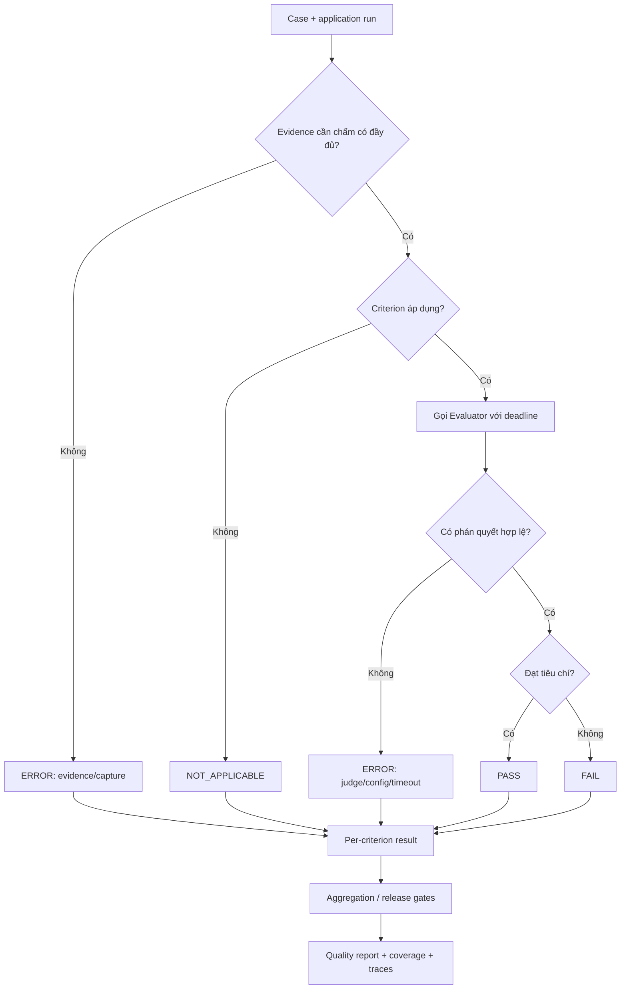

# Xử lý lỗi hệ thống đánh giá tách khỏi kết quả chất lượng

> **Chương:** Evaluator tùy chỉnh  
> **Module:** `SPRING_AI_EVALUATION_OBSERVABILITY` — đánh giá ứng dụng Spring AI bằng dataset, relevance, fact checking và kiểm thử RAG/tool calling; đồng thời dùng metrics, traces, chi phí và độ trễ để phát hiện nguyên nhân suy giảm chất lượng giữa các phiên bản prompt, model và pipeline.

## Mục tiêu học tập

Sau bài này, bạn có thể:

1. Phân biệt **phản hồi ứng dụng không đạt chất lượng** với **hệ thống evaluator không thể đưa ra phán quyết**.
2. Thiết kế kết quả đánh giá gồm `PASS`, `FAIL`, `NOT_APPLICABLE` và `ERROR`; biết khi nào cần thêm trạng thái điều phối `NOT_RUN`.
3. Phân loại lỗi timeout, rate limit, thiếu bằng chứng, lỗi parse kết quả judge, sai cấu hình và các lỗi chất lượng thực sự trong RAG/tool calling.
4. Xây dựng mã Java bao bọc `Evaluator` của Spring AI, giới hạn thời gian, bắt lỗi đúng tầng và trả kết quả có cấu trúc mà không tự biến ERROR thành FAIL.
5. Tính riêng **quality pass rate**, **evaluation coverage**, **evaluation error rate** và các ngưỡng chặn phát hành.
6. Kết hợp bản ghi lỗi với metrics, traces, token, cost và latency để xử lý nguyên nhân và so sánh công bằng các phiên bản.

## 1. Vấn đề: một kết quả `false` có thể che giấu nhiều tình huống

Hãy xét một bài test trợ lý RAG: người dùng hỏi thời hạn hoàn tiền, nguồn chuẩn nêu **7 ngày làm việc**, còn ứng dụng trả lời "14 ngày". Nếu evaluator hoạt động bình thường và phát hiện sai lệch, đó là **FAIL về chất lượng**.

Nhưng nếu evaluator đang gọi LLM judge mà bị HTTP 429, hết thời gian chờ hoặc không đọc được snapshot tài liệu, ta **chưa chứng minh được** câu trả lời đúng hay sai. Đó là **ERROR của hệ thống đánh giá**.

Nếu gộp cả hai thành `pass = false`:

- Dashboard có thể báo chất lượng model giảm trong khi lỗi thực sự là judge hết quota.
- Candidate B có thể trông kém hơn A chỉ vì lượt B gặp timeout nhiều hơn.
- Ngược lại, nếu bỏ mọi lỗi chấm khỏi thống kê mà không ghi coverage, bản báo cáo có thể trông tốt giả tạo.
- Quy tắc release có thể cho phép phát hành dù chưa hề kiểm chứng những ca rủi ro cao.

**Cốt lõi:** Một evaluator phải trả lời hai câu hỏi độc lập: "**Đã chấm được chưa?**" và, **nếu đã chấm được**, "**câu trả lời có đạt không?**".

| Trường hợp | Có phán quyết chất lượng? | Trạng thái phù hợp | Ví dụ |
|---|---|---|---|
| Chấm thành công, đáp ứng điều kiện | Có | `PASS` | JSON đúng schema, citation đúng nguồn |
| Chấm thành công, vi phạm điều kiện | Có | `FAIL` | Mô hình trả sai số ngày, gọi tool trái quyền |
| Chính sách xác định tiêu chí không liên quan | Không cần | `NOT_APPLICABLE` | Không có hoạt động tool và case không yêu cầu tool |
| Đáng lẽ phải chấm nhưng evaluator hoặc dữ liệu chấm có vấn đề | Chưa | `ERROR` | Judge timeout, thiếu snapshot, mất tool trace |
| Lịch chạy chưa đến bước chấm hoặc bị chủ động bỏ qua | Chưa chạy | `NOT_RUN` ở tầng orchestration | Bước judge bị hoãn sau khi hard gate FAIL |

**`NOT_RUN` không đồng nghĩa `NOT_APPLICABLE`**. `NOT_APPLICABLE` chỉ nên được xác định từ chính sách và dữ liệu đáng tin cậy, còn `NOT_RUN` phản ánh trạng thái lịch chạy và phải được ghi riêng nếu muốn báo cáo đầy đủ.

### 1.1. Mối quan hệ với API Spring AI

Spring AI cung cấp `org.springframework.ai.evaluation.Evaluator`, nhận `EvaluationRequest` và trả `EvaluationResponse`. Phản hồi đánh giá thường có `isPass()`, `getScore()`, `getFeedback()`, `getMetadata()`.

`EvaluationResponse` thuận tiện cho một kết quả **đã chấm xong PASS/FAIL**. Để biểu diễn `ERROR` hoặc `NOT_APPLICABLE` một cách chắc chắn, ứng dụng nên có **kiểu kết quả bao ngoài** thay vì dùng `isPass() = false` làm mã đại diện cho mọi thất bại.

Ví dụ:

```text
EvaluationRequest
    |
    v
Spring AI Evaluator  -- trả EvaluationResponse -->  PASS hoặc FAIL
    |
    +-- exception / timeout / lỗi hạ tầng ------->  ERROR (orchestrator)

Applicability policy xác nhận không cần chấm ---->  NOT_APPLICABLE
Scheduler chưa chạy tác vụ --------------------->  NOT_RUN
```

Trong các hệ thống đánh giá nhiều chiều, cần lưu **kết quả từng tiêu chí** và trạng thái của quá trình chấm, không chỉ tổng điểm.

## 2. Phân biệt lỗi thuộc ứng dụng với lỗi thuộc evaluator

Giới hạn quan trọng nhất là **đối tượng nào đang được đo**.

| Tình huống | Điều đang được đo | Trạng thái hợp lý | Lý do |
|---|---|---|---|
| Model trả JSON thiếu dấu ngoặc; parser kiểm tra output chạy bình thường | JSON contract của **ứng dụng** | `FAIL` | Đầu ra vi phạm hợp đồng |
| JSON hợp lệ nhưng thiếu field bắt buộc | JSON contract của ứng dụng | `FAIL` | Rule xác định được vi phạm |
| Parser của **hệ thống chấm** gặp lỗi cấu hình, không thể chạy validator | Hạ tầng kiểm thử | `ERROR` | Chưa thể kết luận về output |
| LLM judge trả văn bản không parse được theo schema phán quyết | Hạ tầng/format **judge** | `ERROR` | Phán quyết judge không hợp lệ |
| Judge trả một phán quyết hợp lệ rằng nội dung sai nguồn | Groundedness của ứng dụng | `FAIL` | Đã có kết quả đánh giá |
| Context RAG được capture đầy đủ, xác nhận retrieval trả 0 tài liệu; model tự bịa câu trả lời | Groundedness / abstention | `FAIL` theo policy | Có đủ bằng chứng rằng ứng dụng không được phép khẳng định |
| Không thể capture context RAG; không biết model có thấy tài liệu nào | Hệ thống đánh giá | `ERROR` | Thiếu bằng chứng bắt buộc |
| Tool thật sự đã được gọi ngoài quyền | Tool policy | `FAIL` | Có event đáng tin chứng minh vi phạm |
| Không thu được tool execution record dù tiêu chí bắt buộc kiểm tra tool | Hệ thống capture/đánh giá | `ERROR` | Không thể suy "không gọi tool" |
| Ca chỉ hỏi đáp, không cần tool và runtime xác nhận không có lời gọi | Điều kiện áp dụng | `NOT_APPLICABLE` | Không có đối tượng đánh giá theo policy đã chọn |

Một lỗi 500 từ tool được ứng dụng gọi **không nhất thiết** là `ERROR` của evaluator: nếu runtime ghi nhận tool thất bại và mô hình vẫn nói "thao tác thành công", evaluator có thể kết luận **FAIL về tính trung thực của câu trả lời**. Ngược lại, nếu event tool bị mất, không có đủ cơ sở để kết luận; khi đó mới là ERROR của quá trình chấm.

### 2.1. Dữ liệu thiếu không luôn có cùng ý nghĩa

Với RAG, nên capture rõ hai trạng thái:

```json
{
  "retrievalCaptured": true,
  "providedDocumentIds": [],
  "caseId": "rag-no-evidence-001"
}
```

Đây là bằng chứng rằng **không có tài liệu được cấp cho model**. Nếu mô hình vẫn đưa ra khẳng định cần nguồn, có thể FAIL theo rubric.

```json
{
  "retrievalCaptured": false,
  "providedDocumentIds": null,
  "caseId": "rag-capture-lost-002"
}
```

Đây là **lỗi capture**; không được xem null như mảng rỗng để chấm model. Khi evaluator cần context này, trạng thái phải là `ERROR` với mã như `MISSING_RAG_EVIDENCE`.

Với tool calling, cũng phải tách `toolEvents = []` và `toolTraceCaptured = true` khỏi `toolEvents = null` hoặc capture không đầy đủ.

## 3. Phân loại nguyên nhân ERROR theo mã ổn định

Không nên chỉ lưu feedback như "Something went wrong". Mỗi ERROR cần `reasonCode`, giai đoạn, khả năng retry và tham chiếu tới trace/log có phân quyền.

| `reasonCode` gợi ý | Giai đoạn | Ví dụ nguyên nhân | Hướng xử lý |
|---|---|---|---|
| `EVALUATOR_TIMEOUT` | Judge/runtime | Judge vượt deadline | Retry có giới hạn, đo latency, xem provider |
| `JUDGE_RATE_LIMITED` | Provider | Judge trả 429 | Backoff/jitter, hạn chế concurrency, kiểm quota |
| `JUDGE_UNAVAILABLE` | Provider/network | 503, lỗi kết nối | Retry có giới hạn, circuit breaker nếu cần |
| `INVALID_JUDGE_RESPONSE` | Phân tích kết quả judge | Judge không trả schema phán quyết hợp lệ | Kiểm prompt/schema/parser của judge |
| `INVALID_JUDGE_SCORE` | Chuẩn hóa score | Score NaN, Infinity, ngoài [0,1] hoặc sai thang | Kiểm evaluator version, adapter và hợp đồng |
| `MISSING_RAG_EVIDENCE` | Capture | Mất `providedContext` | Sửa luồng capture, không query lại tùy tiện |
| `MISSING_TOOL_TRACE` | Capture | Mất event thực thi tool | Sửa trace/runtime instrumentation |
| `MISSING_REFERENCE_SNAPSHOT` | Dữ liệu chuẩn | Không có bản ghi nghiệp vụ cùng version | Lưu snapshot và kiểm nguồn |
| `EVIDENCE_INTEGRITY_FAILED` | Evidence store | Hash bytes không khớp receipt | Chặn re-score, điều tra kho lưu |
| `POLICY_VERSION_MISMATCH` | Điều phối | Rubric version hoặc hash khác expected | Pin policy; không trộn thước đo |
| `EVALUATOR_CONFIG_ERROR` | Khởi tạo | API key thiếu, schema không tương thích | Sửa cấu hình; thường không retry vô hạn |
| `EVALUATOR_REJECTED` | Backpressure | Queue đầy, giới hạn tài nguyên | Giảm tải, ưu tiên case, tăng kiểm soát capacity |
| `EVALUATION_INTERRUPTED` | Lập lịch | Job bị hủy, worker dừng | Ghi trạng thái và lý do, lên lịch lại đúng quyền |

Mã lỗi là **giao diện ổn định cho máy và báo cáo**. Không đưa chi tiết nội bộ provider, payload người dùng, key hay dữ liệu khách hàng vào `reasonCode`; nội dung điều tra nhạy cảm đặt ở log/trace có ACL.

### 3.1. Khi nào cần dùng `FAIL` thay vì `ERROR`?

Đặt câu hỏi: "Nếu không gọi lại một dịch vụ đánh giá nào nữa, tôi đã có đủ dữ liệu đáng tin để kết luận vi phạm chưa?"

- Model đưa ra `{"amount":"100"}` trong khi schema yêu cầu số: parser JSON + schema validator chạy bình thường ⇒ **FAIL**.
- Parser từ chối JSON không hợp lệ **của model**: đây là vi phạm contract ⇒ **FAIL**, không phải lỗi hệ thống chấm.
- Parser không khởi động vì thư viện validator không tương thích ⇒ **ERROR**.
- Tool record chứng minh lệnh hủy không có xác nhận ⇒ **FAIL**.
- Tool record không tồn tại vì exporter trace bị hỏng ⇒ **ERROR**.
- LLM judge trả `isPass = false` hợp lệ ⇒ **FAIL**; judge HTTP timeout ⇒ **ERROR**.

Không cho mô hình tự quyết rằng "lỗi của tôi là ERROR". Phân loại dựa trên **đầu vào đã capture**, trách nhiệm của từng thành phần và hợp đồng đã công bố.

## 4. Thiết kế quy trình đánh giá có lớp bảo vệ

Một thiết kế dễ mở rộng thường tách ba tầng:

1. **Capture và xác minh evidence:** thu raw answer, tài liệu RAG đã cấp, snapshot nghiệp vụ, tool events, phiên bản prompt/model/pipeline.
2. **Chạy criterion evaluator:** chọn tiêu chí áp dụng, kiểm tra đầu vào đủ, gọi evaluator tất định hoặc LLM judge, quản lý deadline/exception/retry.
3. **Tổng hợp và công bố:** lưu kết quả từng tiêu chí, phân biệt PASS/FAIL/N/A/ERROR, áp hard gate, tính coverage, liên kết metric/trace.



Vị trí kiểm tra applicability và evidence có thể phụ thuộc tiêu chí: ví dụ không cần lấy tool trace để đánh giá relevance văn bản, nhưng nếu tiêu chí tool policy là bắt buộc thì mất tool trace phải là ERROR. **Không để một lỗi không liên quan chặn mọi tiêu chí**: mỗi criterion nên nêu rõ những nguồn nào nó thực sự cần.

### 4.1. Bộ dữ liệu chạy kiểm thử có thể chứa đủ thông tin chưa?

```yaml
caseId: refund-042
datasetVersion: support-rag-v5
promptVersion: refund-prompt-v7
modelVersion: model-c
pipelineVersion: rag-v4
runId: app-run-042
question: "Yêu cầu hoàn tiền mất bao lâu?"
rawAnswer: "Trong 14 ngày làm việc [doc:refund-policy-v3]."
ragExpected: true
retrievalCaptured: true
providedContext:
  - documentId: refund-policy-v3
    content: "Hoàn tiền trong 7 ngày làm việc."
    sourceVersion: 3
toolTraceCaptured: true
toolEvents: []
traceId: example-trace-id
```

Đây là định dạng minh họa do ứng dụng tự thiết kế, không phải YAML framework mặc định. Khi capture đầy đủ như trên, evaluator fact checking có thể phát hiện **FAIL chất lượng**. Nếu `providedContext` bị thiếu do lỗi capture, nó phải trả `ERROR`; không thay bằng "đoán" ngữ cảnh hoặc tự tìm nguồn trên Internet.

## 5. Java: bao bọc `Evaluator` với timeout và kết quả bốn trạng thái

Mẫu sau sử dụng `ExecutorService` mà ứng dụng cung cấp, tạo một tác vụ cho mỗi tiêu chí và áp deadline. Nó tránh biến exception của judge thành `FAIL`. Đây là **lớp bao bọc**, không thay thế các evaluator Spring AI hiện có.

### 5.1. Mã Java 17+: `ResilientCriterionRunner`

```java
import java.time.Duration;
import java.util.Objects;
import java.util.concurrent.ExecutionException;
import java.util.concurrent.ExecutorService;
import java.util.concurrent.Future;
import java.util.concurrent.RejectedExecutionException;
import java.util.concurrent.TimeUnit;
import java.util.concurrent.TimeoutException;

import org.springframework.ai.evaluation.EvaluationRequest;
import org.springframework.ai.evaluation.EvaluationResponse;
import org.springframework.ai.evaluation.Evaluator;

public final class ResilientCriterionRunner {

    public enum Status {
        PASS, FAIL, NOT_APPLICABLE, ERROR
    }

    public record CriterionResult(
            String criterionId,
            Status status,
            Double score,
            String reasonCode,
            String feedback) {

        public CriterionResult {
            if (criterionId == null || criterionId.isBlank()) {
                throw new IllegalArgumentException("Thiếu criterionId");
            }
            Objects.requireNonNull(status);
            Objects.requireNonNull(reasonCode);
            Objects.requireNonNull(feedback);
            boolean hasVerdict = status == Status.PASS || status == Status.FAIL;
            if (hasVerdict != (score != null)) {
                throw new IllegalArgumentException(
                        "PASS/FAIL có score; N/A/ERROR dùng null");
            }
            if (score != null && (!Double.isFinite(score)
                    || score < 0 || score > 1)) {
                throw new IllegalArgumentException(
                        "score phải hữu hạn và nằm trong [0,1]");
            }
        }
    }

    private final ExecutorService executor;

    public ResilientCriterionRunner(ExecutorService executor) {
        this.executor = Objects.requireNonNull(executor);
    }

    // applicable được xác định bằng policy/dataset đáng tin,
    // KHÔNG phải một cờ do model tự ghi trong câu trả lời.
    public CriterionResult run(
            String criterionId,
            boolean applicable,
            EvaluationRequest request,
            Evaluator evaluator,
            Duration timeout) {

        if (!applicable) {
            return new CriterionResult(
                    criterionId, Status.NOT_APPLICABLE, null,
                    "CRITERION_NOT_APPLICABLE",
                    "Tiêu chí không thuộc phạm vi case theo policy.");
        }

        if (request == null || evaluator == null) {
            return error(criterionId, "MISSING_EVALUATION_INPUT",
                    "Thiếu request hoặc evaluator cần thiết.");
        }

        if (timeout == null || timeout.isZero()
                || timeout.isNegative() || timeout.toMillis() == 0) {
            return error(criterionId, "INVALID_TIMEOUT_CONFIG",
                    "Deadline đánh giá chưa hợp lệ.");
        }

        Future<EvaluationResponse> future;
        try {
            future = executor.submit(() -> evaluator.evaluate(request));
        }
        catch (RejectedExecutionException ex) {
            return error(criterionId, "EVALUATOR_REJECTED",
                    "Bộ chạy evaluator đang quá tải.");
        }

        try {
            EvaluationResponse response =
                    future.get(timeout.toMillis(), TimeUnit.MILLISECONDS);

            if (response == null) {
                return error(criterionId, "JUDGE_NO_RESPONSE",
                        "Evaluator không trả phán quyết.");
            }

            // Mẫu này giả định evaluator đã chuẩn hóa score [0,1].
            // Nếu API/phiên bản dùng thang khác, cần adapter riêng.
            double score = response.getScore();
            if (!Double.isFinite(score) || score < 0 || score > 1) {
                return error(criterionId, "INVALID_JUDGE_SCORE",
                        "Score không phù hợp thang điểm đã khai báo.");
            }

            return new CriterionResult(
                    criterionId,
                    response.isPass() ? Status.PASS : Status.FAIL,
                    score,
                    response.isPass() ? "EVALUATOR_PASS" : "EVALUATOR_FAIL",
                    response.getFeedback() == null
                            ? "Evaluator không cung cấp feedback."
                            : response.getFeedback());
        }
        catch (TimeoutException ex) {
            future.cancel(true);
            return error(criterionId, "EVALUATOR_TIMEOUT",
                    "Evaluator vượt thời gian cho phép.");
        }
        catch (InterruptedException ex) {
            future.cancel(true);
            Thread.currentThread().interrupt();
            return error(criterionId, "EVALUATION_INTERRUPTED",
                    "Tác vụ đánh giá bị gián đoạn.");
        }
        catch (ExecutionException ex) {
            return error(criterionId, "EVALUATOR_EXECUTION_ERROR",
                    "Evaluator gặp lỗi trong quá trình thực thi.");
        }
    }

    private static CriterionResult error(
            String criterionId, String reasonCode, String feedback) {
        return new CriterionResult(
                criterionId, Status.ERROR, null, reasonCode, feedback);
    }
}
```

**Các giả định của mã:**

- `Evaluator` đã được ứng dụng khởi tạo đúng phiên bản Spring AI; `EvaluationRequest` chứa câu hỏi, `Document` ngữ cảnh và câu trả lời đúng lượt chạy.
- `response.getScore()` đã dùng thang [0,1]. Nếu evaluator chỉ đưa ra nhãn nhị phân hoặc dùng thang khác, cần adapter đúng nghĩa điểm thay vì ép ngưỡng tùy tiện.
- `applicable` do policy xác định, không phải cờ tự khai của model. Lỗi capture nguồn bắt buộc phải được chặn trước bước gọi `run()`.
- Thông tin nhạy cảm trong exception không được trả nguyên văn ra `feedback`. Logger/tracer có quyền phù hợp có thể lưu exception và mã trace riêng.
- `Future.cancel(true)` **không bảo đảm** ngừng một HTTP request đã gửi tới provider hoặc hoàn tác chi phí/token. Việc đặt deadline nên được kết hợp với timeout ở client/provider.

### 5.2. Executor cần bị giới hạn tài nguyên

Đừng tạo một executor không giới hạn thread/queue cho mọi câu hỏi đánh giá. Trong ứng dụng thực tế:

```java
import java.util.concurrent.ArrayBlockingQueue;
import java.util.concurrent.ThreadPoolExecutor;
import java.util.concurrent.TimeUnit;

var executor = new ThreadPoolExecutor(
        4, 4,
        0, TimeUnit.MILLISECONDS,
        new ArrayBlockingQueue<>(32),
        new ThreadPoolExecutor.AbortPolicy());

var runner = new ResilientCriterionRunner(executor);

// Executor thuộc vòng đời ứng dụng: shutdown khi service dừng.
// Không gọi shutdown ngay trong lúc có evaluation tasks đang chạy.
```

Với queue có giới hạn, `RejectedExecutionException` được ghi thành `ERROR/EVALUATOR_REJECTED`. Đây là dấu hiệu thiếu capacity hoặc tải tăng, **không phải** lỗi nội dung model. Có thể thêm bulkhead riêng cho judge, rate limiter và circuit breaker tùy yêu cầu dịch vụ.

### 5.3. Khi nào exception của JSON parser là FAIL?

Một evaluator kiểm tra raw JSON do model trả phải **xử lý lỗi parse đầu ra ngay trong rule**, rồi trả `EvaluationResponse` có `isPass = false`. Nếu để exception parse bay ra ngoài và bị wrapper đánh thành ERROR, bạn sẽ che mất một lỗi chất lượng thật.

```java
import java.util.Map;
import com.fasterxml.jackson.core.JsonFactory;
import com.fasterxml.jackson.core.JsonProcessingException;
import com.fasterxml.jackson.core.StreamReadFeature;
import com.fasterxml.jackson.databind.DeserializationFeature;
import com.fasterxml.jackson.databind.ObjectMapper;
import org.springframework.ai.evaluation.EvaluationRequest;
import org.springframework.ai.evaluation.EvaluationResponse;
import org.springframework.ai.evaluation.Evaluator;

class JsonSyntaxEvaluator implements Evaluator {
    private final ObjectMapper mapper = new ObjectMapper(
            JsonFactory.builder()
                    .enable(StreamReadFeature.STRICT_DUPLICATE_DETECTION)
                    .build())
            .enable(DeserializationFeature.FAIL_ON_TRAILING_TOKENS);

    @Override
    public EvaluationResponse evaluate(EvaluationRequest request) {
        String answer = request.getResponseContent();
        if (answer == null || answer.isBlank()) {
            return new EvaluationResponse(false, 0.0f,
                    "Ứng dụng không trả JSON.", Map.of(
                            "reasonCode", "INVALID_APP_JSON"));
        }
        try {
            // Chặn khóa trùng và nội dung thừa bằng parser strict.
            // Kiểm tra schema/enum/field cần validator bổ sung.
            var node = mapper.readTree(answer);
            if (node == null || !node.isObject()) {
                return new EvaluationResponse(false, 0.0f,
                        "Root JSON phải là object.", Map.of(
                                "reasonCode", "INVALID_APP_JSON_ROOT"));
            }
            return new EvaluationResponse(true, 1.0f,
                    "Cú pháp JSON đáp ứng kiểm tra minh họa.", Map.of());
        }
        catch (JsonProcessingException invalidAppOutput) {
            // Parser hoạt động bình thường: đây là lỗi OUTPUT của model,
            // không phải lỗi của hệ thống evaluator.
            return new EvaluationResponse(false, 0.0f,
                    "JSON của ứng dụng không hợp lệ.", Map.of(
                            "reasonCode", "INVALID_APP_JSON"));
        }
    }
}
```

Mẫu trên **chỉ kiểm tra cú pháp/root**, chưa thực hiện schema, field, enum và business rules. Parser đã được bật kiểm tra khóa trùng và trailing tokens; ứng dụng production còn nên giới hạn độ sâu/kích thước payload và dùng JSON Schema validator tương thích với hợp đồng. Điểm quan trọng của ví dụ là **lỗi do input ứng dụng gây ra phải thành FAIL có giải thích**, thay vì exception khiến wrapper mặc định đánh ERROR.

## 6. Kiểm thử coordinator: ERROR không làm sai số liệu chất lượng

Có thể kiểm tra wrapper bằng các evaluator giả (không gọi model):

```java
import static org.junit.jupiter.api.Assertions.*;
import java.time.Duration;
import java.util.List;
import java.util.Map;
import java.util.concurrent.ExecutorService;
import java.util.concurrent.Executors;

import org.junit.jupiter.api.AfterEach;
import org.junit.jupiter.api.Test;
import org.springframework.ai.evaluation.EvaluationRequest;
import org.springframework.ai.evaluation.EvaluationResponse;
import org.springframework.ai.evaluation.Evaluator;

class ResilientCriterionRunnerTest {
    private final ExecutorService executor = Executors.newFixedThreadPool(2);
    private final ResilientCriterionRunner runner =
            new ResilientCriterionRunner(executor);

    private final EvaluationRequest request = new EvaluationRequest(
            "Đơn hàng đang ở trạng thái nào?",
            List.of(),
            "{\"orderId\":\"ORD-2042\"}");

    @AfterEach
    void cleanup() {
        executor.shutdownNow();
    }

    @Test
    void knownQualityViolationIsFail() {
        Evaluator validator = req ->
                new EvaluationResponse(false, 0.0f,
                        "Sai hợp đồng JSON.",
                        Map.of("reasonCode", "INVALID_APP_JSON"));

        var result = runner.run(
                "json_contract", true, request,
                validator, Duration.ofSeconds(1));

        assertEquals(ResilientCriterionRunner.Status.FAIL,
                result.status());
        assertEquals(0.0, result.score());
    }

    @Test
    void judgeFailureIsErrorNotFail() {
        Evaluator brokenJudge = req -> {
            throw new IllegalStateException("provider unavailable");
        };

        var result = runner.run(
                "groundedness", true, request,
                brokenJudge, Duration.ofSeconds(1));

        assertEquals(ResilientCriterionRunner.Status.ERROR,
                result.status());
        assertNull(result.score());
        assertEquals("EVALUATOR_EXECUTION_ERROR",
                result.reasonCode());
    }

    @Test
    void inapplicableCriterionIsNotScored() {
        Evaluator neverCallMe = req -> {
            throw new AssertionError("Không được chạy");
        };

        var result = runner.run(
                "tool_policy", false, request,
                neverCallMe, Duration.ofSeconds(1));

        assertEquals(ResilientCriterionRunner.Status.NOT_APPLICABLE,
                result.status());
        assertNull(result.score());
    }
}
```

Ba test này cho thấy điểm khác nhau giữa **đầu ra model không đạt**, **judge bị lỗi** và **tiêu chí không áp dụng**. Để kiểm thử timeout, có thể dùng evaluator giả bị chặn bằng `CountDownLatch`, một executor riêng và deadline ngắn; test cần dọn tài nguyên và không được gửi lời gọi có side effect đến tool thật.

### 6.1. Các ca biên cần có

| Ca | Kết quả mong muốn |
|---|---|
| Provider judge trả 429 | ERROR với mã rate limit hoặc execution error phân loại được |
| Judge trả response null | ERROR: `JUDGE_NO_RESPONSE` |
| Judge trả score `NaN` hoặc > 1 | ERROR: `INVALID_JUDGE_SCORE` |
| JSON output model sai cú pháp nhưng parser hoạt động | FAIL: `INVALID_APP_JSON` |
| Thiếu nguồn RAG vì retrieval thực sự trả rỗng, model vẫn bịa claim | FAIL theo groundedness/abstention rubric |
| Mất capture của tài liệu RAG | ERROR: `MISSING_RAG_EVIDENCE` |
| Không cần và không gọi tool, trace hoàn chỉnh | NOT_APPLICABLE |
| Tool bị gọi trái quyền, event được lưu | FAIL của `tool_policy` |
| Tool trace bị mất | ERROR, không suy không có tool call |
| Evaluator bị bỏ qua sau hard gate | NOT_RUN ở runner, không phải N/A |
| Evaluation job retry hai lần | Lưu attempt count, không đếm hai kết quả chất lượng độc lập |
| Một lần chạy bị retry sau timeout | Không làm lại tool có side effect; chỉ chấm trên evidence cũ |

## 7. Retry, timeout, fallback và circuit breaker

Không phải ERROR nào cũng nên thử lại. Một chiến lược khắc phục cần dựa trên `reasonCode` và khả năng thay đổi kết quả khi retry.

| Loại ERROR | Retry? | Lưu ý |
|---|---|---|
| Rate limit `429` | Có, giới hạn số lần và dùng `Retry-After` nếu có | Có thể cần giảm concurrency |
| HTTP `503`, lỗi mạng ngắn hạn | Có, backoff + jitter | Không retry vô hạn |
| Judge timeout | Có thể, số lần nhỏ | Timeout/cancel không chắc đã dừng tính token |
| Policy hash/version mismatch | **Không tự retry** | Phải sửa cấu hình/artifact |
| Sai schema parser của judge do prompt/config | Thường không | Sửa hợp đồng chấm, tránh lặp cùng lỗi |
| Mất `providedContext` đã không capture | Không thể tự sửa bằng retry judge | Cần sửa capture hoặc tái chạy app đúng phương pháp |
| Lỗi integrity của artifact | Không chấm tiếp bằng dữ liệu nghi vấn | Điều tra store/receipt trước |
| Evaluator queue đầy | Retry có kiểm soát hoặc đưa vào hàng đợi | Cần giới hạn tải để không tạo thác lỗi |

### 7.1. Nguyên tắc retry an toàn

- Ghi mỗi **attempt** riêng, gồm `attemptNo`, `startedAt`, `duration`, `errorCode`, `traceId` và token/cost.
- Giới hạn tổng số attempt lẫn deadline toàn bộ case, tránh "timeout × retry" kéo dài quá SLA.
- Áp dụng exponential backoff có jitter cho lỗi tạm thời; tôn trọng rate limit của provider.
- Dùng một `evaluationJobId` hoặc khóa idempotency để không phát hành nhiều receipt cuối cho cùng lần chấm.
- Không retry "input không hợp lệ" của model rồi chọn lần tốt nhất nếu chính sách đang đo chất lượng **của output cụ thể**.
- Không gọi lại tool tạo side effect (hủy đơn, chuyển tiền, ghi dữ liệu) chỉ để lấy evidence cho evaluator.
- Nếu chuyển sang **fallback judge**, lưu `judgeVersion`/`policyVersion` mới và **đánh dấu kết quả không hoàn toàn so sánh trực tiếp** với judge gốc trừ khi đã hiệu chuẩn.

### 7.2. Timeout không hoàn toàn dừng chi phí

`Future.cancel(true)` gửi yêu cầu interrupt đến thread trong JVM; thư viện HTTP/provider có thể không lập tức ngừng request đang chạy phía server. Vì vậy:

- Đặt client timeout cho model/provider và giới hạn số connection.
- Ghi token/cost từ phản hồi/usage record nếu có, kể cả khi app đã hết deadline.
- Sử dụng bulkhead để judge chậm không làm nghẽn toàn bộ ứng dụng.
- Phân biệt `applicationLatencyMs` với `evaluationLatencyMs`: một judge chạy offline không nên bị đưa vào latency phục vụ người dùng.
- Theo dõi số timeout và số task bị cancel nhưng vẫn tiêu thụ tài nguyên.

Retry phục vụ **độ sẵn sàng của hệ thống chấm**, không tự biến một lời giải sai thành đúng. Kết quả chất lượng chỉ nên công bố khi có phán quyết hợp lệ trên cùng bằng chứng và policy.

## 8. Báo cáo quality riêng với evaluation health

Một báo cáo đáng tin có ít nhất hai trục:

1. **Chất lượng ứng dụng trên các ca đã chấm được.**
2. **Khả năng đánh giá đầy đủ và chính xác của hệ thống chấm.**

Giả sử có 100 ca:

| Outcome | Số lượng | Ý nghĩa |
|---|---:|---|
| PASS | 70 | Chấm được, đạt |
| FAIL | 15 | Chấm được, không đạt |
| ERROR | 10 | Đáng lẽ chấm nhưng lỗi |
| NOT_APPLICABLE | 5 | Tiêu chí không áp dụng theo policy |

Khi đó:

\[
\text{QualityPassRate} = \frac{\mathrm{PASS}}{\mathrm{PASS}+\mathrm{FAIL}}
=\frac{70}{85}\approx82.35\%.
\]

\[
\text{EvaluationCoverage} =
\frac{\mathrm{PASS}+\mathrm{FAIL}}
{\mathrm{PASS}+\mathrm{FAIL}+\mathrm{ERROR}}
=\frac{85}{95}\approx89.47\%.
\]

\[
\text{EvaluationErrorRate} =
\frac{\mathrm{ERROR}}{\mathrm{PASS}+\mathrm{FAIL}+\mathrm{ERROR}}
=\frac{10}{95}\approx10.53\%.
\]

`NOT_APPLICABLE` hợp lệ nằm ngoài mẫu số của ba công thức trên; nếu có `NOT_RUN` do scheduler chưa xử lý nhưng case vẫn cần chấm, hãy báo thêm **pending/not-run coverage** hoặc đưa số đó vào tổng case cần chấm. Đừng âm thầm loại nó để coverage tăng giả tạo.

**Không được chỉ ghi "82.35% đạt" rồi kết luận sản phẩm sẵn sàng phát hành**: 10 ca ERROR có thể bao gồm các tình huống rủi ro cao chưa hề được kiểm chứng.

### 8.1. Dashboard nên tách những chỉ số nào?

| Nhóm báo cáo | Chỉ số | Mục đích |
|---|---|---|
| **Quality** | PASS rate, FAIL rate, score distribution, unsupported claim rate | Theo dõi chất lượng ứng dụng |
| **Evaluation health** | ERROR rate, timeout, 429, evaluator queue depth, retry count | Theo dõi hạ tầng chấm |
| **Coverage** | Số ca applicable, scored, N/A, ERROR, NOT_RUN | Biết có đủ bằng chứng đưa ra kết luận |
| **Release policy** | Hard gate failures, mandatory evaluation coverage | Chặn lỗi bắt buộc |
| **Cost / performance** | Application p95, evaluation p95, token/cost serving và judging | Phân biệt chi phí hai luồng |
| **Lineage** | Dataset, rubric, judge, prompt, model, pipeline versions | So sánh công bằng A/B |

Một **evaluation success rate** cao nghĩa là hệ thống chấm hoạt động tốt, không có nghĩa ứng dụng trả lời đúng. Một **quality pass rate** cao nhưng coverage thấp cũng không bảo đảm chất lượng trên toàn bộ dataset.

### 8.2. Mã tổng hợp quyết định release

Ở mức case, có thể đặt chính sách:

```java
import java.util.List;
import java.util.Set;

record GateDecision(boolean releaseAllowed, String reasonCode) {}

static GateDecision evaluateRelease(
        List<ResilientCriterionRunner.CriterionResult> results,
        Set<String> mandatoryCriteria,
        Set<String> hardGates) {

    // Vi phạm hard gate đã có bằng chứng là lý do chặn rõ ràng.
    boolean failedGate = results.stream().anyMatch(r ->
            hardGates.contains(r.criterionId())
                    && r.status() == ResilientCriterionRunner.Status.FAIL);
    if (failedGate) {
        return new GateDecision(false, "HARD_GATE_FAILED");
    }

    // Không có phán quyết hợp lệ cho tiêu chí bắt buộc:
    // chặn phát hành vì chưa đủ cơ sở khẳng định chất lượng.
    for (String id : mandatoryCriteria) {
        var result = results.stream()
                .filter(r -> id.equals(r.criterionId()))
                .findFirst().orElse(null);

        if (result == null
                || result.status() == ResilientCriterionRunner.Status.ERROR
                || result.status()
                        == ResilientCriterionRunner.Status.NOT_APPLICABLE) {
            return new GateDecision(false, "MANDATORY_NOT_EVALUATED");
        }
        if (result.status() == ResilientCriterionRunner.Status.FAIL) {
            return new GateDecision(false, "MANDATORY_QUALITY_FAILED");
        }
    }

    return new GateDecision(true, "MANDATORY_GATES_PASSED");
}
```

Trong ví dụ này, `mandatoryCriteria` là tập tiêu chí **bắt buộc có phán quyết ở case đang xét**, vì thế N/A đối với một tiêu chí trong tập này là sai cấu hình hoặc thiếu khả năng đánh giá. Ở hệ thống thực, nên xác minh không có `criterionId` trùng, tập mandatory/hard gate đầy đủ, và đặt chính sách cho các tiêu chí không bắt buộc đang ERROR. **Hàm không thay thế release gate toàn dataset, SLA, chi phí và các tiêu chí chất lượng mềm**.

### 8.3. Khi nào nên chặn phát hành?

| Tình trạng | Gợi ý quyết định | Giải thích |
|---|---|---|
| Có bằng chứng gọi tool trái quyền | Chặn phát hành | FAIL ở hard gate |
| Judge fact checking lỗi cho case bắt buộc | Chặn cho tới khi chấm lại | Không thể chứng minh điều kiện đạt |
| Judge clarity bị lỗi cho ca không quan trọng, policy cho phép | Có thể ghi cảnh báo, không tự coi PASS | Cần quản trị error budget và coverage |
| Tất cả mandatory PASS nhưng p95 vượt SLA | Chặn hoặc xem lại mục tiêu vận hành | Chất lượng nội dung không bù cho vi phạm SLA |
| Chỉ có N/A hợp lệ theo policy | Không tính score cho tiêu chí đó | Không phát minh điểm 0 hay 1 |
| Baseline A 0 ERROR, candidate B 15 ERROR | Không kết luận B kém chất lượng chỉ dựa trên số FAIL | Điều tra judge/capture trước khi so sánh |

## 9. Quan sát lỗi hệ thống chấm bằng metrics và traces

Spring AI hỗ trợ observability dựa trên Micrometer cho nhiều thành phần như ChatClient, ChatModel, advisors, vector store và tool, tùy phiên bản và cấu hình. Ứng dụng cần thêm **các metric của pipeline đánh giá** để quan sát trạng thái evaluator.

Các tên metric dưới đây là **gợi ý do ứng dụng tự đặt**, không phải tên meter mặc định của Spring AI:

| Metric | Định nghĩa / gợi ý label | Ý nghĩa |
|---|---|---|
| `ai_evaluation_outcome_total` | Counter theo criterion/status | Phân biệt PASS/FAIL/N/A/ERROR |
| `ai_evaluation_error_total` | Counter theo criterion/reasonCode | Tìm loại lỗi hạ tầng nổi bật |
| `ai_evaluation_duration` | Timer của mỗi evaluator | Theo dõi p50/p95 latency chấm |
| `ai_evaluation_timeout_total` | Counter timeout judge | Phân tích deadline/quota |
| `ai_evaluation_retry_total` | Counter theo loại lỗi | Phát hiện retry storm |
| `ai_evaluation_queue_depth` | Gauge queue judge | Giám sát backpressure |
| `ai_evidence_missing_total` | Counter theo loại evidence | Tìm lỗi instrumentation |
| `ai_evaluation_cost_usd` | Chi phí đánh giá ước tính theo model | Tách cost judge khỏi serving |

Giữ số chiều label hợp lý, chẳng hạn `criterionId`, `status`, `reasonCode`, `policyVersion` được quản lý. Không đưa `caseId`, `userId`, raw prompt, email, thông tin giao dịch hoặc văn bản tài liệu vào metric tags; chúng có cardinality lớn và có thể nhạy cảm.

### 9.1. Bản ghi lỗi có thể truy vết

```json
{
  "evaluationJobId": "eval-job-048",
  "runId": "run-048",
  "caseId": "refund-048",
  "criterionId": "groundedness",
  "criterionVersion": "groundedness-v2",
  "policyVersion": "support-eval-v5",
  "judgeModelVersion": "judge-model-2026-11",
  "status": "ERROR",
  "score": null,
  "reasonCode": "EVALUATOR_TIMEOUT",
  "attemptCount": 2,
  "timeoutMs": 1500,
  "evaluationLatencyMs": 3100,
  "applicationLatencyMs": 1200,
  "traceId": "trace-example-048"
}
```

Đây là bản ghi ví dụ. `evaluationLatencyMs` có thể vượt `timeoutMs` vì có nhiều attempt/backoff; chỉ cần đặt tên chính xác và ghi được từng attempt. Tất cả timestamp/usage/cost phải có nguồn đo rõ ràng. Khi điều tra, mở trace của đúng lượt judge, so với context và raw output đã lưu, không dùng dữ liệu business live thay thế một snapshot cũ một cách âm thầm.

### 9.2. Dấu hiệu nào cho thấy "chất lượng giảm" hay "hệ thống chấm hỏng"?

| Quan sát | Giải thích khả dĩ | Bước xác minh |
|---|---|---|
| Quality pass rate giảm, ERROR rate ổn định | Output model/pipeline có thể hồi quy | Xem case PASS→FAIL, nguồn RAG và trace generation |
| ERROR tăng do 429, FAIL số lượng không đổi | Judge/provider bị giới hạn | Kiểm quota, concurrency, retry/backoff |
| ERROR tăng do `MISSING_RAG_EVIDENCE` | Lỗi capture hoặc advisor instrumentation | Xem prompt assembly và evidence pipeline |
| `INVALID_APP_JSON` FAIL tăng | Model output vi phạm schema | Xem raw response, model/prompt version |
| `INVALID_JUDGE_RESPONSE` ERROR tăng | Judge output không theo hợp đồng | Xem judge prompt/schema/parser |
| Tool permission FAIL tăng | Rủi ro hành động agent | Xem runtime events; tăng enforcement trước side effect |
| ERROR bằng 0 nhưng coverage thấp do NOT_RUN | Scheduler/runner bỏ tác vụ | Kiểm danh sách criterion dự kiến và job queue |
| Evaluation cost tăng nhưng serving cost không đổi | Thử lại judge nhiều lần hoặc thêm criteria | So số judge call và token usage |

## 10. So sánh phiên bản mà không trộn chất lượng với lỗi chấm

Giả sử dataset gồm 200 case giống nhau:

| Chỉ số | Baseline A | Candidate B |
|---|---:|---:|
| PASS | 182 | 172 |
| FAIL | 14 | 13 |
| ERROR | 4 | 15 |
| N/A | 0 | 0 |
| Quality pass rate trên ca đã chấm | 92.86% | 92.97% |
| Evaluation coverage | 98.0% | 92.5% |

Nếu chỉ nhìn số PASS tuyệt đối, B có vẻ kém hơn (172 so với 182). Nhưng **pass rate trên các ca chấm được** gần như không đổi; vấn đề nổi bật là coverage của B giảm vì 15 ERROR. Chưa thể khẳng định B kém chất lượng hơn A chỉ từ bảng này.

Mặt khác, cũng **không thể kết luận hai phiên bản có chất lượng tương đương**: các ca ERROR của B có thể chính là những câu hỏi khó nhất. Cần sửa hệ thống chấm, đánh giá lại các ca chưa có phán quyết và so sánh trên cùng một tập case có đủ bằng chứng.

### 10.1. Quy trình hồi quy đúng

1. Cố định `datasetVersion`, policy, criterion thresholds, judge prompt/model và schema đánh giá khi so A/B.
2. Lưu raw output, `providedContext`, tool events, snapshot nghiệp vụ và trace cho mỗi `runId`.
3. Báo riêng `PASS/FAIL/N/A/ERROR/NOT_RUN` trên mỗi criterion và mỗi nhóm case.
4. Đối chiếu các case A/B đều được chấm, nhưng không bỏ qua nhóm case chỉ một bên bị ERROR.
5. Thử lại ERROR có thể khắc phục bằng **cùng evidence và policy**, không tự gọi lại model phục vụ rồi coi là cùng output.
6. Chỉ tính điểm tổng và kết luận release sau khi đạt coverage/error budget đã định.
7. Kiểm tra thêm hard gates, p95 latency và cost của **ứng dụng**, tách khỏi chi phí của quá trình chấm.

Nếu sửa judge prompt/model hoặc policy để khắc phục ERROR, phải ghi phiên bản mới và chấm lại baseline khi cần so sánh; không lấy kết quả theo thước đo mới của B so với thước đo cũ của A như thể không có gì thay đổi.

## 11. Quy trình ứng phó khi ERROR tăng đột biến

Một runbook ngắn giúp tránh "sửa" nhầm prompt/model khi lỗi nằm ở judge:

1. **Xác định tín hiệu:** `evaluation_error_total` và coverage thay đổi khi nào, criterion nào, reasonCode nào?
2. **Kiểm soát tác động:** tạm dừng quyết định release với tiêu chí bắt buộc; không tự động đánh fail hàng loạt cho model.
3. **Đối chiếu traces:** xem judge/provider errors, rate limit, queue depth, snapshot capture, parser exceptions; kiểm phiên bản triển khai.
4. **Phân loại:** lỗi tạm thời (timeout/429/503), lỗi cấu hình (schema/version), lỗi evidence (missing/integrity), lỗi scheduling (NOT_RUN).
5. **Khắc phục tương ứng:** retry có giới hạn, giảm concurrency, sửa instrumentation, phục hồi artifact, khôi phục policy; không sửa dữ liệu test để "cho qua".
6. **Re-score:** chạy lại đánh giá trên **đúng output và evidence đã capture**, lưu các attempt và receipt mới.
7. **Đánh giá lại release:** kiểm hard gates, coverage và metrics khi phán quyết đã đầy đủ; ghi lại root cause và cách ngăn tái diễn.

Đối với ứng dụng có rủi ro cao, thiếu bằng chứng kiểm chứng là lý do chính đáng để **chặn phát hành**. Đối với tiêu chí phụ ít quan trọng, có thể cho phép release cùng cảnh báo theo policy, nhưng phải công bố tỷ lệ chưa chấm và lý do.

## 12. Những lỗi triển khai cần tránh

1. **Catch mọi exception rồi trả `EvaluationResponse(false, 0)`.** Làm lẫn lỗi hệ thống chấm với chất lượng model.
2. **Coi mọi parser exception là ERROR.** Nếu parser kiểm tra raw output ứng dụng vẫn chạy đúng, output sai JSON phải là FAIL.
3. **Coi mọi lỗi tool là lỗi evaluator.** Tool đã trả 403 nhưng model vẫn tuyên bố thành công có thể là FAIL của câu trả lời.
4. **Dùng null context như context rỗng.** Mất bằng chứng không chứng minh không có nguồn.
5. **Dùng N/A để che việc judge không chạy.** Phải phân biệt ERROR và NOT_RUN.
6. **Bỏ ERROR khỏi mẫu số mà không báo coverage.** Làm pass rate trông tốt giả tạo.
7. **Retry vô hạn hoặc không giới hạn queue.** Gây tăng chi phí, trễ và thác lỗi.
8. **Tự chuyển judge sang model khác mà không ghi phiên bản.** Điểm A/B có thể không còn so sánh được.
9. **Dùng `Future.cancel(true)` rồi tin request provider đã ngừng.** Lời gọi ngoài có thể vẫn chạy hoặc phát sinh chi phí.
10. **Gọi lại tool có side effect để lấy bằng chứng.** Có thể thực hiện lại giao dịch thật.
11. **Lưu raw exception chứa PII/API key trong metric labels.** Vi phạm bảo mật và tăng cardinality.
12. **Không ghi policy/judge/dataset version cùng kết quả.** Khó phân biệt thay đổi thước đo với thay đổi model.
13. **Dùng một điểm tổng cho cả SLA, relevance, groundedness và quyền tool.** Đơn vị và mức rủi ro khác nhau; cần điều kiện riêng.
14. **Báo release PASS dù mandatory evaluation ERROR.** Chưa đủ bằng chứng để kết luận điều kiện bắt buộc đạt.

## 13. Bài tập thực hành

**Bối cảnh:** Một trợ lý Spring AI tra cứu chính sách hoàn tiền bằng RAG, tra trạng thái đơn qua `lookupOrder` và đôi khi hủy đơn qua `cancelOrder`. Nhóm có evaluator relevance, fact checking, JSON contract và tool policy.

**Yêu cầu:**

1. Viết policy phân biệt PASS/FAIL/N/A/ERROR và trạng thái NOT_RUN của scheduler cho từng tiêu chí.
2. Tạo ít nhất **10 ca**: output JSON sai, câu trả lời sai nguồn, groundedness PASS, judge timeout, judge 429, thiếu `providedContext`, không cần tool, tool trái quyền, mất tool trace, evaluator trả score NaN.
3. Dùng `ResilientCriterionRunner` bao bọc ít nhất hai evaluator thực hoặc stub, áp timeout và giới hạn executor; xác minh exception tạo ERROR.
4. Viết một JSON rule trả FAIL đối với output ứng dụng sai định dạng nhưng không ném exception ra ngoài.
5. Tính quality pass rate, evaluation coverage và evaluation error rate khi có N/A/ERROR.
6. Tạo hard gate cho citation/tool permission, chặn release khi có lỗi quyền hoặc mandatory evaluator chưa chấm được.
7. So kết quả A/B trên cùng dataset; giải thích sự khác biệt giữa số FAIL tăng thật và số ERROR tăng do provider judge.
8. Liên kết một lỗi judge 429 và một lỗi model trả JSON sai với traces; nêu rõ metric nào tăng ở từng trường hợp.

**Câu hỏi tự kiểm tra:**

- Nếu model trả sai định dạng JSON, tại sao đây thường là FAIL chứ không phải ERROR?
- Nếu judge bị timeout, điểm groundedness có được phép tự đặt thành 0 không?
- Vì sao `retrievalCaptured = false` khác `retrievalCaptured = true` cùng với `documents = []`?
- Trong trường hợp nào `tool_policy = NOT_APPLICABLE` là hợp lệ?
- Tại sao retry đánh giá không được gọi lại `cancelOrder` thật?
- Một bảng A/B chỉ có pass rate trên các ca chấm được có đủ chứng minh B tốt hơn A không?

## 14. Checklist triển khai

- [ ] Có taxonomy trạng thái `PASS`, `FAIL`, `NOT_APPLICABLE`, `ERROR` và scheduler `NOT_RUN`.
- [ ] Phân biệt output ứng dụng sai với lỗi hệ thống chấm ở từng bước parse, retrieval, judge và tool.
- [ ] Capture đầy đủ đúng raw output, `providedContext`, tool events, policy/judge/dataset version.
- [ ] `reasonCode` ổn định; feedback không làm lộ dữ liệu nhạy cảm.
- [ ] Timeout, retry, backoff, quota, executor, queue và circuit breaker có giới hạn.
- [ ] Mọi ERROR được ghi nhận với attempt, trace và trạng thái capture; không ngầm biến thành FAIL.
- [ ] Mọi N/A có applicability reason rõ, không được dùng thay ERROR.
- [ ] Có unit tests cho judge exception, timeout, score sai thang, JSON output lỗi và thiếu evidence.
- [ ] Báo cáo quality pass rate **tách riêng** evaluation coverage, ERROR rate và NOT_RUN.
- [ ] Mandatory hard gates không được vượt qua khi chưa có phán quyết hợp lệ.
- [ ] So sánh prompt/model/pipeline trên cùng policy và evidence; re-score ERROR khi phù hợp.
- [ ] Liên kết evaluator metrics/traces/token/cost/latency với application metrics nhưng không nhập nhằng hai luồng.

## Tổng kết

Chất lượng ứng dụng và độ tin cậy của hệ thống đánh giá là **hai vấn đề độc lập**. `FAIL` chỉ nên được dùng khi evaluator đã chạy và có đủ bằng chứng rằng đầu ra vi phạm tiêu chí. `ERROR` phản ánh việc không thể đưa ra phán quyết vì lỗi judge, timeout, dữ liệu tham chiếu hoặc hạ tầng chấm; `NOT_APPLICABLE` là trường hợp hợp lệ không cần chấm; `NOT_RUN` là tác vụ chưa thực hiện. Trong Spring AI, hãy bao bọc `Evaluator` bằng lớp điều phối có trạng thái và lý do rõ ràng, giới hạn tài nguyên, báo chất lượng và coverage riêng, đồng thời liên kết với metrics/traces/chi phí/độ trễ. Nhờ đó, thay đổi theo prompt, model và pipeline được đánh giá dựa trên bằng chứng thay vì bị nhiễu bởi sự cố của chính hệ thống chấm.

## Tài liệu tham khảo

- [Spring AI — Evaluation Testing](https://docs.spring.io/spring-ai/reference/api/testing.html): `Evaluator`, `EvaluationRequest`, `EvaluationResponse` và các evaluator dựng sẵn.
- [Spring AI — Observability](https://docs.spring.io/spring-ai/reference/observability/): quan sát ChatClient, model, advisor, vector store và tool.
- [Spring AI — Tool Calling](https://docs.spring.io/spring-ai/reference/api/tools.html): vòng đời thực thi công cụ và dữ liệu cần kiểm chứng.
- [Micrometer — Documentation](https://docs.micrometer.io/): instrumentation cho metrics/timers và tracing.
- [OpenTelemetry — Traces](https://opentelemetry.io/docs/concepts/signals/traces/): liên kết các span và lỗi theo một request.
- [Java — ExecutorService](https://docs.oracle.com/en/java/javase/17/docs/api/java.base/java/util/concurrent/ExecutorService.html): quản lý tác vụ Java và giới hạn thực thi.
- [Java — Future](https://docs.oracle.com/en/java/javase/17/docs/api/java.base/java/util/concurrent/Future.html): timeout, cancellation và các giới hạn của interrupt.
