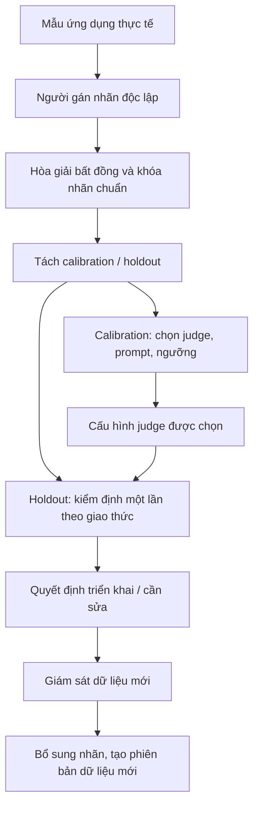

# Hiệu chỉnh kết quả với tập đã được con người đánh giá

Một ứng dụng Spring AI có thể dùng **LLM-as-a-Judge** để tự động chấm hàng nghìn câu trả lời RAG hoặc chuỗi gọi công cụ. Tuy nhiên, việc judge trả `PASS` hay `FAIL`, thậm chí nêu lý do thuyết phục, **không chứng minh judge chấm đúng**. Muốn biết có thể tin nó tới đâu, ta cần một tập ví dụ đã được con người đánh giá theo quy tắc nhất quán, đối chiếu kết quả judge với các nhãn tham chiếu và hiệu chỉnh ngưỡng/quy tắc để phù hợp rủi ro thực tế.

Bài thuộc chương **Mô hình làm giám khảo** của mô-đun **SPRING_AI_EVALUATION_OBSERVABILITY**. Mô-đun hướng tới đánh giá chất lượng ứng dụng Spring AI bằng bộ dữ liệu, relevance, fact checking và kiểm thử RAG hoặc tool calling; đồng thời quan trắc metrics, traces, chi phí, độ trễ để phân tích chất lượng khi thay prompt, model hoặc pipeline. Bài này tập trung vào **hiệu chỉnh judge bằng dữ liệu có nhãn người**: xây tập tham chiếu, đo lỗi, chọn ngưỡng, giữ tập kiểm chứng độc lập và theo dõi khi dữ liệu thực tế thay đổi.

## 1. Kết quả học tập

Sau bài này, bạn có thể:

1. Phân biệt **gán nhãn tham chiếu**, **hiệu chỉnh judge**, **đánh giá trên tập giữ lại** và **giám sát sau triển khai**.
2. Tạo bộ ví dụ có nhãn người, bằng chứng, lý do gán nhãn và thông tin truy nguyên, trong đó con người không vô tình bị ảnh hưởng bởi phán quyết của judge.
3. Lập ma trận nhầm lẫn và tính **false pass**, **false fail**, accuracy, recall và precision theo đúng quy ước nhãn.
4. Chọn ngưỡng `riskScore` hoặc quy tắc `PASS/FAIL/UNCERTAIN` trên tập hiệu chỉnh; cân đối độ an toàn với tỷ lệ chặn nhầm và chi phí rà soát.
5. Phân biệt **khả năng phân loại** và **hiệu chuẩn xác suất**, kiểm tra độ tin cậy của score thay vì tin vào điểm tự khai của LLM.
6. Kiểm định kết quả trên tập holdout, xử lý mất cân bằng dữ liệu và đánh giá theo nhóm lỗi, phiên bản prompt, model và pipeline.
7. Đưa phép đo vào luồng Spring AI với metadata, metrics/traces, token, độ trễ và điều kiện đánh giá lại judge.

## 2. “Hiệu chỉnh” thực sự là gì?

Trong ngữ cảnh này, *hiệu chỉnh* (calibration) là quá trình dùng ví dụ có nhãn người để hiểu và điều chỉnh **cách phán quyết tự động tương ứng với tiêu chuẩn chất lượng nghiệp vụ**. Nó có thể bao gồm:

- **Làm rõ rubric:** sửa định nghĩa PASS/FAIL/UNCERTAIN khi người chấm bất đồng vì quy tắc mơ hồ.
- **Hiệu chỉnh prompt và ví dụ của judge:** lựa chọn hướng dẫn, ví dụ đối chứng, cách yêu cầu evidence ID và xử lý ngoại lệ.
- **Chọn ngưỡng quyết định:** nếu judge trả một `riskScore`, xác định ngưỡng chuyển thành FAIL hoặc chuyển người rà soát.
- **Hiệu chuẩn xác suất:** nếu muốn diễn giải score thành xác suất, đối chiếu xác suất dự đoán với tần suất lỗi quan sát thực tế.
- **Đặt chính sách từ chối kết luận:** xác định khi nào trả UNCERTAIN và chuyển sang kiểm tra thủ công.

Có hai câu hỏi khác nhau:

| Câu hỏi | Cách đo | Ví dụ |
|---|---|---|
| **Judge phân biệt đúng và sai tốt tới đâu?** | Confusion matrix, recall lỗi, false pass, precision, độ khớp theo nhóm | Trong 80 câu người đánh dấu FAIL, judge bỏ lọt 10 câu |
| **Score có phản ánh xác suất thực tế không?** | Biểu đồ hiệu chuẩn, ECE, Brier score trên tập phù hợp | Những mẫu judge gán 80% nguy cơ sai có khoảng 80% thực sự FAIL không? |

Một model có thể xếp hạng rủi ro khá tốt nhưng score chưa được hiệu chuẩn, hoặc đưa ra score “0,99” rất tự tin mà vẫn nhầm. **Độ tự tin do LLM tự khai không mặc nhiên là xác suất đã hiệu chuẩn.**

Hiệu chỉnh cũng không có nghĩa là “ép judge đồng ý với bất kỳ nhãn nào con người gán”. Nhãn người cần được xây bằng rubric, bằng chứng và quy trình phân xử có trách nhiệm; chính các nhãn đó cũng có thể chứa sai sót.

## 3. Phân vai và tách dữ liệu để tránh tự kiểm chứng chính mình



Trong quy trình:

- **Generator** trả lời câu hỏi hoặc gọi công cụ trong ứng dụng Spring AI.
- **Người gán nhãn** xem câu hỏi, bằng chứng, output và rubric; ghi nhãn tham chiếu độc lập với judge.
- **Judge** chấm lại cùng đối tượng theo rubric, tạo nhãn/score và lời giải thích ngắn có nguồn.
- **Hệ thống đo lường** so sánh hai phía, quyết định thay đổi prompt, ngưỡng hoặc chọn model judge; ghi phiên bản để tái hiện.

Không lấy kết quả của judge hiện tại làm “đáp án chuẩn” để chứng minh chính judge chính xác. Nếu dùng LLM để hỗ trợ gợi ý nhãn, người chịu trách nhiệm phải **xác nhận lại bằng nguồn** và ghi nguồn gốc gán nhãn; phân biệt dữ liệu con người thực sự duyệt với dữ liệu gán nhãn tự động.

### 3.1. Ba vùng dữ liệu quan trọng

| Vùng | Dùng để làm gì? | Có được điều chỉnh theo kết quả vùng này? |
|---|---|---|
| **Thiết kế và tạo ví dụ (development)** | Viết rubric, tạo ca PASS/FAIL/UNCERTAIN mẫu, gỡ lỗi định dạng | Có |
| **Hiệu chỉnh/validation** | So sánh ứng viên judge, chọn prompt, threshold, chính sách abstain | Có, nhưng ghi lại mọi lần thử |
| **Holdout/test giữ riêng** | Đánh giá cuối cùng độ khái quát của cấu hình đã khóa | **Không** dùng lặp lại để chỉnh; nếu đã dùng để tối ưu thì không còn độc lập |

Nếu dữ liệu có các biến thể của **cùng câu hỏi, cùng chính sách, cùng hội thoại hoặc cùng đơn hàng**, phải tách theo **nhóm liên quan**, tránh bản gốc ở calibration còn bản diễn đạt lại ở holdout. Khi có thay đổi theo thời gian, cân nhắc một tập kiểm thử lấy từ thời kỳ mới hơn để đánh giá khả năng thích ứng.

## 4. Xây tập nhãn chuẩn bằng con người

Giả sử hệ thống RAG trả lời câu hỏi chính sách hoàn tiền. Hai nguồn minh họa:

```text
[refund-01] Đơn hàng thông thường có thể yêu cầu hoàn tiền
trong 30 ngày kể từ khi nhận hàng nếu khách còn hóa đơn.

[refund-02] Hàng thanh lý không thuộc diện hoàn tiền.
```

### 4.1. Chọn mẫu phản ánh đúng lỗi thực tế

Đừng chỉ lấy những câu có vẻ “dễ đọc” hoặc những câu judge đã chấm là lỗi. Hãy kết hợp:

- **Mẫu thường gặp:** nhiều câu đúng, câu hỏi ngắn và dài, đầu vào tiếng Việt có cấu trúc và ngôn ngữ tự nhiên.
- **Mẫu sai quan trọng:** sai số tiền, thời hạn, điều kiện, mã đơn hàng, quyền thao tác.
- **Ca ranh giới:** kết luận đúng nhưng lý do sai, câu đầy đủ nhưng thêm claim bịa, câu liên quan nhưng thiếu chứng cứ, nguồn mâu thuẫn.
- **Trường hợp RAG:** context truy xuất đúng/sai/thiếu, ngoại lệ, nhiều đoạn nguồn, nguồn dài.
- **Trường hợp tool calling:** tên công cụ, schema, tham số, thứ tự, trạng thái trước/sau gọi, tool lỗi hoặc bị gọi lặp.
- **Đầu vào dễ đánh lừa judge:** câu trả lời dài mạch lạc nhưng sai một chi tiết, dữ liệu chứa lệnh giả “bỏ qua rubric”, phủ định kép.

**Mất cân bằng lớp là vấn đề lớn:** nếu 95% câu trả lời đúng, judge luôn trả PASS có accuracy tới 95% mà **bỏ lọt 100% lỗi**. Cần thu thập đủ mẫu FAIL, đặc biệt lỗi nghiêm trọng. Có thể chủ động lấy thêm mẫu khó vào tập hiệu chỉnh; khi báo cáo cho production phải tách metric trên mẫu đã tăng cường và metric trên phân bố thực tế, hoặc áp dụng trọng số lấy mẫu có căn cứ.

### 4.2. Bộ trường gợi ý

```json
{
  "sampleId": "refund-014",
  "conversationGroup": "customer-case-08",
  "taskType": "rag_groundedness",
  "question": "Hàng thanh lý nhận 12 ngày có được hoàn tiền không?",
  "evidence": [
    {
      "id": "refund-01",
      "text": "Đơn thường: 30 ngày từ ngày nhận, cần hóa đơn."
    },
    {
      "id": "refund-02",
      "text": "Hàng thanh lý không thuộc diện hoàn tiền."
    }
  ],
  "candidateAnswer": "Có, vì đơn mới nhận 12 ngày và còn hóa đơn.",
  "humanLabels": {
    "REL": "PASS",
    "GND": "FAIL",
    "CMP": "FAIL"
  },
  "humanOverall": "FAIL",
  "humanReason": "Bỏ qua ngoại lệ hàng thanh lý refund-02.",
  "criticalError": true,
  "datasetVersion": "refund-eval-v1",
  "policyVersion": "refund-policy-v3",
  "sourceTraceId": "trace-input-014"
}
```

Đây là **định dạng dữ liệu minh họa do ứng dụng thiết kế**, không phải schema chuẩn của Spring AI. Trong tình huống thật, giữ nội dung hoặc hash/định danh bản nguồn theo chính sách lưu giữ để tái hiện điều generator đã nhận. Tách rõ **nhãn từng tiêu chí**, **nhãn tổng hợp** và **mức nghiêm trọng**; đừng đánh đồng relevance với factual correctness.

### 4.3. Mẫu gán nhãn có giải thích đối chứng

| Trường hợp | Câu trả lời | Nhãn người cho GND | Bằng chứng và lý do |
|---|---|---|---|
| A | “Đơn thường có hóa đơn, mới nhận 12 ngày thì còn trong hạn hoàn tiền.” | PASS | Phù hợp `refund-01` |
| B | “Hàng thanh lý mới nhận 12 ngày nên vẫn hoàn được.” | **FAIL** | Trái ngoại lệ `refund-02` |
| C | “Hàng thanh lý không được hoàn, và phí phạt là 50.000 đồng.” | **FAIL** | Kết luận đầu đúng nhưng tự thêm phí không có nguồn |
| D | “Hàng thanh lý không được hoàn vì đã quá 30 ngày.” | **FAIL** | Kết luận trùng nhưng lý do thời hạn sai trong tình huống 12 ngày |
| E | “Hàng thanh lý không thuộc diện hoàn tiền.” | PASS | Được `refund-02` hỗ trợ |
| F | “Có thể hoàn tiền theo chính sách mới 45 ngày.” | **FAIL** | Không có nguồn cho chính sách 45 ngày và trái ngoại lệ |

Đánh giá các câu theo **đúng bối cảnh** đã ghi trong dataset. Nếu câu A nói về đơn thường, không đem quy tắc hàng thanh lý để kết luận A sai. Nhãn người phải bám vào rubric cụ thể, tránh suy đoán ngữ cảnh bị thiếu.

### 4.4. Làm gì khi hai người chấm không thống nhất?

1. Viết **hướng dẫn gán nhãn** trước: PASS/FAIL/UNCERTAIN, ưu tiên nguồn, cách xem claim không được chứng cứ hỗ trợ và ví dụ ngoại lệ.
2. Để ít nhất hai người gán nhãn độc lập một tập con có tính đại diện, lý tưởng là **không thấy nhãn judge**. Ghi cả nhãn ban đầu và lý do.
3. Thống kê tỷ lệ đồng thuận, bảng bất đồng theo tiêu chí; có thể dùng **Cohen's kappa** cho hai người chấm cùng nhãn danh nghĩa, hoặc thước đo phù hợp cho nhiều người/nhãn thứ bậc.
4. Phân xử bất đồng bằng nguồn và quy tắc nghiệp vụ, không chỉ lấy đa số một cách máy móc. Ghi `adjudicationReason` và phiên bản rubric được chỉnh.
5. Nếu ngay cả chuyên gia không đủ dữ kiện, gán **UNCERTAIN** theo chính sách thay vì bịa một nhãn chắc chắn.

Ví dụ: một người cho “trong một tháng” là tương đương “30 ngày”, người khác đánh dấu FAIL. Cần định nghĩa rõ đơn vị ngày và việc có chấp nhận diễn đạt tương đương hay không, rồi **cập nhật rubric** để các mẫu tương tự được chấm nhất quán.

Kappa không phải điểm tuyệt đối về chất lượng: khi một nhãn chiếm đa số quá lớn, kappa có thể chịu ảnh hưởng của phân bố lớp. Nên báo kèm **tỷ lệ đồng thuận thực tế và các ca bất đồng quan trọng**.

## 5. Chạy judge trên đúng dữ liệu để hiệu chỉnh

Cố định cho mỗi lần chạy:

| Thành phần | Cần ghi |
|---|---|
| **Generator** | Tên/model version, prompt version, tham số sinh và câu trả lời thực tế |
| **Retrieval/tool** | Retriever/index version, evidence ID, tool schema, arguments, result, thứ tự sự kiện |
| **Judge** | Model/provider, judge prompt version, rubric version, cấu hình lời gọi |
| **Dataset** | Dataset version, sample ID, nhóm ngữ nghĩa, nhãn người và lý do |
| **Execution** | Run ID, trạng thái đánh giá, số retry, token, chi phí, độ trễ, trace ID |
| **Output** | Verdict từng tiêu chí, verdict tổng, score nếu có, evidence ID, phần giải thích |

Chỉ những mẫu có **dữ liệu tham chiếu hợp lệ** mới được dùng để kết luận judge chấm đúng/sai. Nếu lời gọi judge timeout, JSON sai schema hoặc trích dẫn ID nguồn không có thật, ghi **EVALUATION_ERROR** riêng; không âm thầm gán PASS.

Nếu judge trả `UNCERTAIN` theo rubric, đó là **một kết quả nghiệp vụ hợp lệ**. Khi tính accuracy trên ba nhãn, phải nêu rõ cách tính; khi tính accuracy có điều kiện trên mẫu chỉ PASS/FAIL thì đồng thời báo tỷ lệ judge từ chối quyết định (*abstention rate*) để tránh “đạt chính xác cao bằng cách từ chối mọi mẫu khó”.

## 6. Ma trận nhầm lẫn: đo đúng những lỗi gây hại

Trong phần này, lấy **FAIL theo nhãn con người là lớp dương (positive)**, vì ta quan tâm khả năng phát hiện câu trả lời lỗi. Chỉ xét các mẫu có nhãn người PASS/FAIL và judge thực sự trả PASS/FAIL; mẫu UNCERTAIN và lỗi kỹ thuật được báo riêng.

| | **Judge FAIL** | **Judge PASS** |
|---|---:|---:|
| **Người FAIL** | **TP**: phát hiện đúng lỗi | **FN — false pass**: bỏ lọt lỗi |
| **Người PASS** | **FP — false fail**: chặn nhầm câu đúng | **TN**: chấp nhận đúng câu đạt |

**Lưu ý thuật ngữ:** vì đang coi **FAIL** là positive, *false pass* tương ứng với **false negative**, còn *false fail* tương ứng với **false positive** trong ký hiệu thống kê. Luôn ghi rõ quy ước, tránh dùng mỗi chữ “FPR” rồi hiểu nhầm.

Ví dụ bộ **200 mẫu có nhãn người và có verdict hợp lệ**:

- 80 mẫu human-FAIL: judge phát hiện 70 (TP), bỏ lọt 10 (FN).
- 120 mẫu human-PASS: judge đánh rớt nhầm 12 (FP), chấm đạt đúng 108 (TN).

```text
                 JUDGE FAIL      JUDGE PASS       TỔNG
HUMAN FAIL           70              10            80
HUMAN PASS           12             108           120
TỔNG                 82             118           200
```

| Chỉ số | Công thức | Kết quả |
|---|---|---:|
| **Accuracy** | (TP + TN) / N | (70 + 108) / 200 = **89%** |
| **Recall phát hiện lỗi** | TP / (TP + FN) | 70 / 80 = **87,5%** |
| **False-pass rate trên mẫu sai** | FN / (TP + FN) | 10 / 80 = **12,5%** |
| **False-fail rate trên mẫu đúng** | FP / (FP + TN) | 12 / 120 = **10%** |
| **Precision của cảnh báo FAIL** | TP / (TP + FP) | 70 / 82 ≈ **85,4%** |

Một ứng dụng có thao tác tài chính hoặc cập nhật quyền truy cập có thể cần tối ưu **false pass ở nhóm lỗi nghiêm trọng** hơn việc tối ưu accuracy trung bình. Dù accuracy 89% nghe khá tốt, 10 lỗi bị cho đi qua trên 80 câu sai có thể chưa chấp nhận được.

**Không quên mẫu UNCERTAIN và lỗi chạy:** nếu có thêm 15 mẫu judge trả UNCERTAIN hoặc không chấm được, không được lặng lẽ bỏ chúng khỏi báo cáo và gọi kết quả “trên 215 mẫu đạt 89%”. Hãy báo **coverage = 200/215** cho tập có verdict PASS/FAIL, phân tách số UNCERTAIN và số EVALUATION_ERROR; báo chính xác mẫu nào thuộc mẫu số của từng chỉ số.

### 6.1. Đo chất lượng theo tiêu chí thay vì chỉ overall

Tính riêng confusion matrix cho:

- `REL` — câu trả lời đúng ý người dùng;
- `GND` — các claim có nguồn RAG hỗ trợ;
- `FAC` — tính đúng theo đáp án chuẩn/nguồn sự thật;
- `CMP` — đủ ý bắt buộc;
- `TLC` — tool, tham số, điều kiện và thứ tự.

Không giả định một judge phát hiện tốt lỗi **relevance** thì cũng phát hiện tốt lỗi **hallucination**. Báo cáo thêm loại lỗi: số tiền, đơn vị, thời hạn, ngoại lệ, công cụ, nguồn thiếu, ngữ cảnh dài.

### 6.2. Độ không chắc chắn của tỷ lệ đo

Tỷ lệ tính trên một mẫu là **ước lượng**, không phải sự thật bất biến. Với chỉ 10–20 ví dụ sai, chênh lệch một vài ca có thể làm tỷ lệ false pass đổi rất mạnh. Nên hiển thị khoảng tin cậy phù hợp (ví dụ **Wilson interval** cho tỷ lệ nhị phân) hoặc dùng bootstrap theo nhóm câu hỏi/hội thoại nếu dữ liệu có tương quan.

Một quy tắc gần đúng thường dùng: nếu **không thấy lỗi nào trong n phép thử độc lập**, cận trên một phía ở mức khoảng 95% cho xác suất lỗi xấp xỉ **3/n**. Ví dụ 0 false pass trong 50 mẫu human-FAIL chỉ gợi ý cận trên gần **6%**, chưa đủ chứng minh tỷ lệ bỏ lọt dưới 1%. Quy tắc này phụ thuộc giả định lấy mẫu độc lập và đại diện; không áp dụng máy móc cho các mẫu gần như trùng nhau.

## 7. Chọn ngưỡng chấm trên tập hiệu chỉnh

Một số judge trả nhãn trực tiếp. Một số ứng dụng còn thu **điểm rủi ro** `riskScore` trong khoảng 0–1: số càng lớn thì judge càng nghiêng về **câu trả lời sai**. Đây có thể là score do model sinh hoặc do một bộ phân loại riêng tạo ra; **chưa được coi là xác suất** cho đến khi kiểm định hiệu chuẩn.

Định nghĩa quy tắc minh họa:

```text
predict FAIL nếu riskScore >= threshold
predict PASS nếu riskScore < threshold
```

Chỉ thay **threshold** theo chất lượng đo trên **tập calibration**; không thử đi thử lại ngưỡng trên holdout. Với cùng 200 mẫu minh họa có 80 human-FAIL và 120 human-PASS, giả sử thử ba ngưỡng:

| Ngưỡng | TP | FN (false pass) | FP (false fail) | TN | Bỏ lọt lỗi (FN/80) | Chặn nhầm (FP/120) |
|---:|---:|---:|---:|---:|---:|---:|
| **0,30** | 76 | 4 | 34 | 86 | **5%** | **28,3%** |
| **0,50** | 70 | 10 | 12 | 108 | **12,5%** | **10%** |
| **0,70** | 62 | 18 | 5 | 115 | **22,5%** | **4,2%** |

Các con số là **ví dụ giả định**, có thứ tự nhất quán khi nâng ngưỡng: càng khó đánh FAIL thì bỏ lọt lỗi càng nhiều, đồng thời chặn nhầm càng ít.

### 7.1. Chọn ngưỡng theo mục tiêu nghiệp vụ

Nếu yêu cầu trên calibration là **tỷ lệ bỏ lọt lỗi tối đa 6%**, ngưỡng 0,30 đạt mục tiêu tại mẫu minh họa, nhưng chặn nhầm khoảng 28,3% câu đúng. Nếu hệ thống không đủ nhân lực để rà soát số lượng lớn câu bị đánh rớt, cần thay đổi quy trình hoặc cải thiện judge trước khi dùng ngưỡng này.

Có thể mô hình hóa chi phí quyết định bằng:

\[
\text{Cost} = C_{\mathrm{falsePass}} \times FN
           + C_{\mathrm{falseFail}} \times FP
           + C_{\mathrm{review}} \times N_{\mathrm{review}}.
\]

Trong đó các hệ số do **nghiệp vụ đặt ra** theo hậu quả thực tế; không lấy chi phí token của judge làm đại diện đầy đủ cho thiệt hại của một phán quyết sai. Khi dữ liệu calibration được lấy mẫu theo tỷ lệ FAIL cao hơn production, phải tính lại hoặc ước tính cost trên phân bố production trước khi triển khai.

**Ngưỡng được chọn trên tập calibration phải kiểm tra lại trên holdout** với khoảng tin cậy phù hợp; đạt 5% trên 80 mẫu chưa chứng minh chắc chắn đạt 6% với mọi dữ liệu mới.

### 7.2. Thiết kế vùng “cần rà soát”

Nếu rubric và dữ liệu cho phép, có thể dùng hai ngưỡng:

```text
riskScore < lowThreshold        -> PASS
lowThreshold <= riskScore
        && riskScore < highThreshold -> REVIEW / UNCERTAIN
riskScore >= highThreshold      -> FAIL
```

Cách này tránh buộc judge đưa ra một quyết định chắc chắn ở vùng ranh giới. Tuy vậy, nếu `UNCERTAIN` là nhãn nghiệp vụ do **thiếu nguồn**, hãy dùng tên `REVIEW` cho trạng thái **chưa đủ tự tin của bộ phân loại** để tránh nhập nhằng. Đo **coverage** (tỷ lệ tự động quyết định), false pass trên toàn bộ tập phù hợp và tỷ lệ lỗi trong các mẫu được tự động cho PASS. Không để vùng REVIEW biến thành cách giấu những ví dụ khó ra khỏi mẫu số.

## 8. Hiệu chuẩn xác suất: khi score cần có ý nghĩa xác suất

**Threshold tuning** chọn điểm cắt cho quyết định. **Probability calibration** là bước khác: muốn đọc `pFail = 0,8` như “trong nhiều mẫu tương tự, khoảng 80% thực sự FAIL” thì phải kiểm tra thực nghiệm.

Giả sử đánh giá một mô hình cho điểm nguy cơ trên một tập hiệu chuẩn khác:

| Nhóm `pFail` dự đoán | Điểm dự đoán trung bình | Tỷ lệ human-FAIL thực tế | Số mẫu |
|---|---:|---:|---:|
| Thấp | 0,20 | 0,35 | 40 |
| Trung bình | 0,50 | 0,55 | 80 |
| Cao | 0,80 | 0,70 | 80 |

Nhóm 0,80 chỉ có 70% thực sự FAIL trong ví dụ: score **đang quá tự tin** ở vùng cao. Một phép đo gần đúng hay dùng là *Expected Calibration Error* (ECE):

\[
\operatorname{ECE}
= \sum_{b=1}^{B}\frac{n_b}{N}
\left|\operatorname{observedFailRate}_b
      -\operatorname{meanPredictedFailProb}_b\right|.
\]

Với bảng trên, ECE minh họa:

\[
(40/200)\times 0{,}15+
(80/200)\times 0{,}05+
(80/200)\times 0{,}10=0{,}09.
\]

ECE bằng 0,09 nghĩa là sai lệch tuyệt đối trung bình theo các nhóm được chọn là **9 điểm phần trăm** trong phép chia nhóm này; ECE phụ thuộc vào cách tạo bin và không thay thế phép đo phân loại hay kiểm tra theo nhóm lỗi. Có thể dùng **Brier score** (sai số bình phương giữa `pFail` và nhãn 0/1) và biểu đồ reliability để xem thêm.

Các cách hiệu chuẩn xác suất phổ biến gồm:

- **Platt scaling / logistic calibration:** học một ánh xạ đơn điệu từ score thô sang xác suất, phù hợp khi dữ liệu hiệu chỉnh không quá nhiều và hình dạng quan hệ đủ đơn giản.
- **Isotonic regression:** học một hàm không giảm linh hoạt hơn, nhưng dễ quá khớp khi bộ mẫu nhỏ.
- **Hiệu chuẩn theo nhóm/rủi ro:** báo riêng độ lệch ở tiếng Việt, nguồn dài, lỗi ngoại lệ, tool calling; không giả định mọi loại mẫu chia sẻ một đường hiệu chuẩn.

Cả bộ ánh xạ và ngưỡng đều là **tham số học từ dữ liệu**; phải kiểm chứng trên tập tách biệt. Nếu chỉ có nhãn PASS/FAIL từ judge mà không có score liên tục, không thể tự suy ra một xác suất đáng tin chỉ từ nhãn.

## 9. Ví dụ Java: tính ma trận nhầm lẫn và thử ngưỡng

Đoạn mã Java 17+ bên dưới tính các chỉ số bằng logic xác định từ **nhãn người và riskScore**. Mã là ví dụ độc lập với provider; `riskScore` có thể đến từ JSON của judge đã parse và kiểm tra hợp lệ. Trong thực tế, cần lưu phân tách calibration/holdout bằng metadata của bộ dữ liệu và xử lý riêng các mẫu judge trả UNCERTAIN hoặc lỗi chạy.

```java
import java.util.List;

public final class JudgeThresholdCalibration {

    // humanFail = true nghĩa là người gán nhãn FAIL.
    // riskScore càng cao nghĩa là nguy cơ FAIL càng lớn.
    public record LabeledExample(
            String sampleId, boolean humanFail, double riskScore) {}

    public record Confusion(int tp, int fn, int fp, int tn) {
        public int total() { return tp + fn + fp + tn; }
        public int humanFails() { return tp + fn; }
        public int humanPasses() { return fp + tn; }

        // Dùng NaN để thể hiện mẫu số bằng 0, tránh giả định tỷ lệ 0%.
        public double accuracy() {
            return total() == 0 ? Double.NaN
                    : (double) (tp + tn) / total();
        }
        public double falsePassRate() {
            return humanFails() == 0 ? Double.NaN
                    : (double) fn / humanFails();
        }
        public double falseFailRate() {
            return humanPasses() == 0 ? Double.NaN
                    : (double) fp / humanPasses();
        }
        public double failRecall() {
            return humanFails() == 0 ? Double.NaN
                    : (double) tp / humanFails();
        }
        public double failPrecision() {
            return (tp + fp) == 0 ? Double.NaN
                    : (double) tp / (tp + fp);
        }
    }

    public static Confusion evaluate(
            List<LabeledExample> samples, double threshold) {

        if (!Double.isFinite(threshold)
                || threshold < 0.0 || threshold > 1.0) {
            throw new IllegalArgumentException("Invalid threshold");
        }

        int tp = 0, fn = 0, fp = 0, tn = 0;

        for (LabeledExample sample : samples) {
            double risk = sample.riskScore();
            if (!Double.isFinite(risk) || risk < 0.0 || risk > 1.0) {
                throw new IllegalArgumentException(
                        "Invalid score for " + sample.sampleId());
            }

            boolean judgeFail = risk >= threshold;
            if (sample.humanFail() && judgeFail) tp++;
            else if (sample.humanFail()) fn++;
            else if (judgeFail) fp++;
            else tn++;
        }
        return new Confusion(tp, fn, fp, tn);
    }

    public static void main(String[] args) {
        List<LabeledExample> calibration = List.of(
            new LabeledExample("a", true, 0.90),
            new LabeledExample("b", true, 0.40),
            new LabeledExample("c", false, 0.60),
            new LabeledExample("d", false, 0.10)
        );

        for (double threshold : List.of(0.30, 0.50, 0.70)) {
            Confusion metrics = evaluate(calibration, threshold);
            System.out.printf(
                "threshold=%.2f TP=%d FN=%d FP=%d TN=%d"
                + " falsePass=%.2f falseFail=%.2f%n",
                threshold, metrics.tp(), metrics.fn(),
                metrics.fp(), metrics.tn(),
                metrics.falsePassRate(), metrics.falseFailRate()
            );
        }
    }
}
```

Với bốn mẫu trong ví dụ mã, khi `threshold = 0,50` ta có TP = 1, FN = 1, FP = 1, TN = 1; vì vậy false pass = 50% và false fail = 50%. Đó là bộ kiểm tra logic nhỏ, **không phải benchmark dùng để quyết định chất lượng sản phẩm**.

**Những giới hạn cố ý của ví dụ:** chưa triển khai chia tập theo nhóm, confidence interval, trọng số lớp, nhãn UNCERTAIN, kiểm soát dữ liệu nhạy cảm hay đọc từ cơ sở dữ liệu. Khi tạo dashboard, thống kê các mẫu **không có verdict hợp lệ** riêng để không vô tình làm đẹp accuracy.

### Dùng kết quả trong Spring AI

Có thể tích hợp với một `ChatModel` riêng làm judge qua `ChatClient`. Phần dưới minh họa cách đọc nhãn/score có cấu trúc; tên kiểu và bean là do ứng dụng định nghĩa:

```java
import org.springframework.ai.chat.client.ChatClient;
import org.springframework.ai.chat.model.ChatModel;

public final class SpringAiJudgeClient {

    public record JudgeOutput(
            String verdict,
            double riskScore,
            String rationale) {}

    private final ChatClient judge;

    public SpringAiJudgeClient(ChatModel judgeModel) {
        this.judge = ChatClient.builder(judgeModel).build();
    }

    public JudgeOutput evaluate(
            String rubric,
            String question,
            String evidenceJson,
            String candidateAnswer) {

        return judge.prompt()
                .system(rubric)
                .user(u -> u.text("""
                        QUESTION:
                        {question}

                        EVIDENCE:
                        {evidence}

                        ANSWER:
                        {answer}
                        """)
                        .param("question", question)
                        .param("evidence", evidenceJson)
                        .param("answer", candidateAnswer))
                .call()
                .entity(JudgeOutput.class);
    }
}
```

Ứng dụng cần **xác thực** `verdict` thuộc PASS/FAIL/UNCERTAIN, `riskScore` hữu hạn trong [0,1], `rationale` không rỗng, evidence ID và tiêu chí chấm nếu có. Mã trên chỉ minh họa lời gọi model và ánh xạ dữ liệu. **Không dùng trực tiếp score do model trả về như xác suất đã hiệu chuẩn**; muốn sử dụng như `pFail`, hãy đánh giá và hiệu chuẩn riêng trên dữ liệu có nhãn. Spring AI API/khả năng chuyển đổi kiểu có thể thay đổi theo phiên bản cụ thể, nên đối chiếu tài liệu đúng phiên bản của dự án.

Lưu ý về cấu hình: `judgeModel` phải là bean được chọn rõ ràng cho tác vụ đánh giá, tránh vô tình dùng cùng cấu hình sinh và chấm khi cần tính độc lập. Thay đổi model hoặc prompt judge có thể làm phân bố score đổi, dẫn đến ngưỡng cũ không còn phù hợp.

## 10. Chọn phiên bản judge và kiểm định trên holdout

Quy trình chọn một cấu hình đáng tin:

1. Xác định **tiêu chí bắt buộc** và hậu quả bỏ lọt lỗi. Ví dụ hệ thống RAG không được tự bịa mức phí hoặc thời hạn, còn tool calling không được tạo hành động khi điều kiện chưa thỏa.
2. Lập tập có nhãn người được phân xử, tách development, calibration và holdout theo nhóm liên quan.
3. Chạy các ứng viên judge trên calibration với cùng câu hỏi, câu trả lời, bằng chứng và rubric phiên bản xác định.
4. Kiểm tra false pass/false fail theo tiêu chí và nhóm lỗi, evidence match, lỗi schema, độ trễ và chi phí.
5. Chỉnh prompt, chọn ngưỡng/đường ánh xạ score và chính sách REVIEW dựa trên calibration; ghi lại cấu hình được chọn.
6. **Khóa cấu hình** rồi chạy holdout để ước lượng khả năng tổng quát. Báo khoảng tin cậy cùng tỷ lệ từ chối và lỗi đánh giá.
7. Nếu không đạt ngưỡng rủi ro trên holdout, quay lại vòng phát triển bằng bộ dữ liệu khác hoặc làm lại kế hoạch kiểm định; **không dùng chính holdout để chọn tới khi đạt**.
8. Khi triển khai, theo dõi giám sát và thu thập ví dụ mới được con người xác nhận để hiệu chỉnh ở chu kỳ tiếp theo.

### So sánh hai judge trên cùng mẫu

Giả sử judge A và B cùng chấm một bộ 200 ví dụ. Không chỉ báo “A 89%, B 91%” rồi kết luận B tốt hơn. Với hai hệ thống được thử **trên cùng các sample**, cần xem những ca nào A đúng B sai và ngược lại. Có thể dùng **McNemar test** cho kết quả đúng/sai nhị phân theo cặp hoặc **paired bootstrap** theo nhóm câu hỏi/hội thoại để ước lượng độ bất định của chênh lệch. Chênh lệch vài điểm phần trăm trên bộ nhỏ có thể chưa đủ chứng cứ.

Đối với lỗi hiếm nhưng nghiêm trọng, xem **từng false pass trọng yếu** và tiêu chí bắt buộc; một mô hình tổng thể nhỉnh hơn vẫn có thể kém hơn ở một nhóm cần bảo vệ.

## 11. Đánh giá theo lát cắt dữ liệu và chi phí sai lầm

Một số sai lệch dễ bị che khuất khi tính trung bình:

| Lát cắt | Điều cần xem |
|---|---|
| **Tiếng Việt / song ngữ** | Thuật ngữ chuyên môn, phủ định, cách diễn đạt ngày tháng |
| **RAG nhiều đoạn** | Truy xuất thừa, thiếu, mâu thuẫn, bằng chứng ở giữa ngữ cảnh dài |
| **Sai một chi tiết** | 30 so với 60 ngày, sai một chữ số đơn hàng, sai đơn vị |
| **Ngoại lệ chính sách** | Quy tắc chung và quy tắc loại trừ |
| **Tool calling** | Sai tham số, sai thứ tự, gọi lặp, kết quả tool báo lỗi |
| **Mức rủi ro nghiệp vụ** | Câu trả lời FAQ bình thường so với hành động gây tác động thật |
| **Phiên bản hệ thống** | Prompt, model, retriever, tool schema hoặc rubric mới |

Nếu một lát cắt chỉ có ba mẫu, kết quả “0% lỗi” không cung cấp bằng chứng mạnh. Luôn báo **số mẫu, tỷ lệ và khoảng tin cậy/giới hạn độ chính xác** khi người đọc có thể dùng số đó để đưa ra quyết định.

Khi dùng *stratified sampling* để có đủ mẫu lỗi nghiêm trọng, tách hai kiểu báo cáo:

- **Độ nhạy theo nhóm lỗi:** so trực tiếp trong nhóm đã tăng cường, giúp cải thiện judge.
- **Ước lượng hiệu năng trên production:** dùng dữ liệu lấy mẫu đại diện hoặc trọng số theo xác suất lấy mẫu/phân bố thực tế; tránh diễn giải tỷ lệ FAIL của tập tăng cường như tỷ lệ lỗi ngoài đời.

## 12. Tích hợp metrics, traces, chi phí và độ trễ

Để biết sự thay đổi là do generator, retrieval hay judge, lưu metadata liên kết từng lần chấm:

```json
{
  "runId": "eval-run-2026-11-27",
  "sampleId": "refund-014",
  "datasetVersion": "refund-eval-v1",
  "humanLabelVersion": "labels-v2",
  "generatorModelVersion": "generator-v5",
  "generatorPromptVersion": "prompt-v7",
  "retrieverVersion": "retriever-v3",
  "judgeModelVersion": "judge-v2",
  "judgePromptVersion": "judge-prompt-v4",
  "rubricVersion": "groundedness-rubric-v3",
  "thresholdVersion": "risk-threshold-v2",
  "executionStatus": "COMPLETED",
  "judgeVerdict": "FAIL",
  "humanVerdict": "FAIL",
  "judgeRiskScore": 0.86,
  "traceId": "trace-014",
  "judgeLatencyMs": 950,
  "judgeInputTokens": 410,
  "judgeOutputTokens": 120
}
```

Đây là bản ghi do ứng dụng định nghĩa, không phải danh sách field mặc định của framework. Khi dùng Spring AI và hệ sinh thái Spring/Micrometer, các thành phần như chat model, client, advisor, tool và vector store có thể được quan trắc tùy phiên bản/cấu hình. **Tỷ lệ false pass, lỗi nhãn người, ngưỡng, chi phí rà soát và ECE là metric nghiệp vụ mà ứng dụng phải tự tính**, không giả định chúng tự xuất hiện.

Gợi ý dashboard:

| Mục | Chỉ số nên theo dõi | Cách diễn giải |
|---|---|---|
| **Judge validity** | Schema-valid rate, tỷ lệ thiếu evidence ID, evaluation error | Judge có trả kết quả dùng được không? |
| **Human alignment** | False pass/false fail, recall lỗi, agreement, nhãn theo từng tiêu chí | Kết quả judge có khớp thước đo con người không? |
| **Abstention** | UNCERTAIN, REVIEW, coverage | Có đang “né” quá nhiều ca khó không? |
| **Calibration** | Reliability bins, Brier/ECE khi score được hiểu là xác suất | Score có đáng tin trong nhóm xác suất không? |
| **Hiệu năng** | p50/p95 thời gian judge, timeout, retry | Độ trễ tăng có làm chậm CI/offline evaluation không? |
| **Chi phí** | Tổng token, chi phí provider, số mẫu cần người phân xử | Chọn judge/ngưỡng có hợp ngân sách không? |
| **Hồi quy** | Chỉ số theo dataset, generator, judge, rubric và retriever version | Thay đổi nào thực sự đi cùng suy giảm chất lượng? |

### Phân biệt ba nguyên nhân giảm chất lượng

**Tình huống A — Chất lượng generator giảm:** cùng bộ câu hỏi, cùng context nguồn và cùng judge/rubric nhưng câu trả lời ở phiên bản generator mới có nhiều claim sai hơn. Cần xem generator prompt/model.

**Tình huống B — Retrieval yếu đi:** các câu FAIL đều thiếu đoạn bằng chứng mà phiên bản retriever cũ từng tìm thấy. Cần sửa truy xuất/chỉ mục hoặc xử lý nguồn, không chỉ sửa judge.

**Tình huống C — Thước đo thay đổi:** generator và dữ liệu giữ nguyên nhưng judge mới chấm khắt khe hơn, hoặc rubric đổi cách hiểu “nguồn không đủ”. Cần **chấm lại cùng các bản ứng dụng bằng cùng judge/rubric** và so với nhãn người trước khi khẳng định sản phẩm tốt/xấu hơn.

Khi dữ liệu chứa thông tin khách hàng, phải giới hạn quyền đọc, thời hạn lưu giữ, và cân nhắc rút gọn/che dữ liệu trước khi gửi sang provider judge hoặc hệ thống observability.

## 13. Khi nào cần hiệu chỉnh lại?

Không có một ngưỡng thời gian cố định cho mọi sản phẩm. Nên xem xét tái hiệu chỉnh khi:

- Thay **judge model**, judge prompt, rubric, cách parse kết quả hoặc ngưỡng.
- Đổi **generator model**, prompt, retrieval pipeline, dữ liệu nguồn, tool schema, làm thay đổi phân bố lỗi mà judge phải nhận diện.
- Dữ liệu thực tế có loại câu hỏi mới, thuật ngữ mới, quy định mới hoặc thay đổi ngôn ngữ người dùng.
- Tỷ lệ REVIEW/UNCERTAIN, evaluation error, false pass hoặc sai evidence ID tăng trên mẫu có nhãn kiểm tra định kỳ.
- Lượng context, token và độ trễ tăng khiến judge cắt mất chứng cứ quan trọng hoặc timeout nhiều hơn.

Khi tái hiệu chỉnh, tạo **phiên bản mới** cho nhãn/rubric/threshold/dataset; giữ log của phiên bản cũ để có khả năng tái hiện. Nếu mục tiêu là so sánh chất lượng các phiên bản generator, chọn một thước đo cố định hoặc chạy song song hai thước đo trên cùng dữ liệu và hiệu chuẩn mối quan hệ giữa chúng.

## 14. Những sai lầm thường gặp

| Sai lầm | Vì sao sai | Cách làm tốt hơn |
|---|---|---|
| Dùng judge tạo nhãn rồi dùng chính nhãn đó để đo judge | Vòng kiểm chứng khép kín, không có tham chiếu độc lập | Nhãn do người xác nhận theo rubric và bằng chứng |
| Một người gán nhãn tùy cảm nhận, không ghi lý do | Khó tái lập, dễ bất đồng | Rubric rõ, gán nhãn đôi trên tập con và phân xử |
| Accuracy cao nên bỏ qua confusion matrix | Mất cân bằng nhãn có thể che false pass | Báo recall lỗi, false pass, false fail theo phân đoạn |
| Chọn ngưỡng trên holdout đến khi đẹp | Rò rỉ dữ liệu và overfit | Chọn trên calibration; kiểm định holdout khóa |
| Bỏ mọi UNCERTAIN khỏi thống kê | Tỷ lệ đúng có thể đẹp do judge từ chối ca khó | Báo coverage và kết quả của nhánh review |
| Gộp timeout vào FAIL hoặc PASS | Méo chất lượng của generator | Trạng thái EVALUATION_ERROR riêng |
| Tin score `0,99` là xác suất thật | Điểm tự khai có thể không hiệu chuẩn | Reliability diagram, Brier/ECE và calibration độc lập |
| So điểm sau khi đổi judge/rubric | Hai lần không dùng cùng thước đo | Khóa hoặc chấm lại bằng cùng cấu hình |
| Dùng toàn mẫu dễ để chấp nhận judge | Không biết khả năng phát hiện lỗi hiếm | Thêm ca rủi ro cao, báo số mẫu và khoảng tin cậy |
| Đánh giá trace bằng cách chạy lại tool ghi dữ liệu thật | Có thể tạo thao tác trùng hoặc thay đổi trạng thái | Replay an toàn, dữ liệu ghi sẵn và kiểm thử xác định |
| Xem lời giải thích dài như chứng cứ | LLM có thể giải thích hợp lý cho verdict sai | Kiểm tra claim và evidence ID trên dữ liệu chuẩn |

## 15. Quy trình thực hành: từ 0 đến báo cáo hiệu chỉnh

1. **Chốt mục tiêu:** ví dụ “phát hiện câu RAG tự bịa chính sách hoàn tiền”, đo riêng GND và sai số tiền/thời hạn.
2. **Tạo bộ mẫu:** thu thập câu hỏi, context generator thấy, output, tool trace nếu có; thêm mẫu ranh giới/ngoại lệ.
3. **Viết hướng dẫn nhãn:** quy tắc PASS/FAIL/UNCERTAIN, nguồn ưu tiên và ví dụ gần đúng.
4. **Gán nhãn độc lập:** ít nhất hai người chấm một phần, ghi bất đồng, hòa giải và lưu lý do.
5. **Tách theo nhóm:** development, calibration, holdout; khóa ID và phiên bản của nguồn, nhãn và rubric.
6. **Chạy judge:** cố định model/prompt, chấm từng tiêu chí, lưu JSON có cấu trúc, token, latency, trace ID.
7. **Xác thực đầu ra:** loại riêng lỗi parse/schema, phát hiện evidence ID không có thật, đánh dấu REVIEW/UNCERTAIN.
8. **Tính chỉ số:** confusion matrix, false pass, false fail, coverage, evidence match và phân tích theo nhóm lỗi.
9. **Hiệu chỉnh:** chọn prompt/threshold/chính sách cần người xem theo chi phí rủi ro, chỉ trên tập calibration.
10. **Kiểm định giữ riêng:** đo lại trên holdout một lần theo quy trình đã đăng ký; nêu hạn chế và khoảng tin cậy.
11. **Ra quyết định:** nếu vượt điều kiện bắt buộc thì sử dụng theo phạm vi cho phép; nếu không, sửa judge/rubric và tạo vòng dữ liệu kiểm định mới.
12. **Giám sát định kỳ:** lấy mẫu production để người chấm lại, đối chiếu drift, cập nhật bảng chỉ số theo phiên bản.

### Checklist trước khi tin phán quyết tự động

- [ ] Có bộ mẫu đủ đa dạng với **nhãn chuẩn do người xác nhận**, lý do và bằng chứng.
- [ ] Có quy trình hòa giải bất đồng, lưu phiên bản hướng dẫn gán nhãn.
- [ ] Tập calibration và holdout tách theo nhóm liên quan, hạn chế rò rỉ dữ liệu.
- [ ] Có ma trận nhầm lẫn với FAIL được định nghĩa rõ là lớp positive.
- [ ] Báo **false pass trên mẫu sai** và false fail trên mẫu đúng cùng số mẫu.
- [ ] Báo coverage, UNCERTAIN/REVIEW và EVALUATION_ERROR riêng.
- [ ] Ngưỡng/chính sách chọn trên calibration, **không** tối ưu theo holdout.
- [ ] Nếu score được gọi là xác suất, đã kiểm tra hiệu chuẩn xác suất.
- [ ] Đã đánh giá trên nhóm lỗi quan trọng và thể hiện bất định của ước lượng.
- [ ] Lưu đủ dataset, generator, judge, rubric, threshold và trace metadata.
- [ ] Có cách xem lại false pass rủi ro cao và quy trình điều chỉnh phiên bản tiếp theo.

## 16. Tự luyện tập

**Câu 1 — Ma trận nhầm lẫn.** Trong 300 ví dụ người gán nhãn, có 90 human-FAIL và 210 human-PASS. Judge cho PASS nhầm 9 mẫu human-FAIL; cho FAIL nhầm 21 mẫu human-PASS. Hãy tính TP, FN, FP, TN, accuracy, false-pass rate và false-fail rate. Khi nào chỉ báo accuracy có thể đánh lừa?

**Câu 2 — Threshold.** Một judge trả riskScore càng cao càng có nguy cơ FAIL. Chọn ngưỡng 0,25 được false pass 3% nhưng false fail 35%; chọn ngưỡng 0,65 được false pass 20% nhưng false fail 5%. Với hệ thống chỉ gợi ý tài liệu FAQ và với tool có khả năng tạo giao dịch thật, nên đánh đổi khác nhau ra sao? Điều gì cần đo trên holdout?

**Câu 3 — Nhãn người không thống nhất.** Hai chuyên gia khác nhãn cho câu “trong một tháng” khi tài liệu quy định “30 ngày”. Bạn sẽ điều chỉnh rubric hay chỉ yêu cầu judge chọn một người? Cần lưu thêm trường nào trong dataset?

**Câu 4 — Holdout bị lộ.** Nhóm thử 30 prompt judge rồi liên tục so cả trên test holdout, chọn prompt có kết quả tốt nhất. Vấn đề nằm ở đâu và nên khắc phục như thế nào?

**Câu 5 — Phát hiện drift.** Sau khi đổi retriever, số mẫu GND = FAIL tăng, nhưng judge model và rubric giữ nguyên. Hãy nêu các metadata và trace cần kiểm tra trước khi sửa generator.

**Câu 6 — Điểm tự tin.** Judge trả `pFail = 0,9` cho nhiều mẫu nhưng trong nhóm đó chỉ có 60% nhãn người FAIL. Có thể nói score này là xác suất hiệu chuẩn không? Dùng cách kiểm tra nào?

### Gợi ý đáp án

1. TP = 81, FN = 9, FP = 21, TN = 189. Accuracy = (81 + 189)/300 = **90%**; false pass = 9/90 = **10%**; false fail = 21/210 = **10%**. Accuracy dễ che lỗi khi một lớp chiếm đa số hoặc lỗi nghiêm trọng ít gặp.
2. Hệ thống giao dịch cần giảm false pass và kết hợp kiểm tra xác định/phê duyệt; hệ thống FAQ có thể chịu mức rủi ro khác tùy phạm vi. Đánh giá cả coverage, chi phí review, độ trễ và false pass trên holdout với số mẫu/độ bất định phù hợp.
3. Viết rõ quy tắc đơn vị thời gian và diễn đạt tương đương; phân xử bằng nghiệp vụ, lưu nhãn ban đầu, lý do, người phân xử, phiên bản rubric.
4. Đã **tối ưu theo holdout** làm kết quả đánh giá lạc quan. Cần dùng validation để chọn cấu hình, và tập kiểm chứng mới, độc lập cho đánh giá cuối.
5. So `retrieverVersion`, `indexVersion`, `contextIds`, tài liệu đã vào generator/judge, `generatorPromptVersion` và trace retrieval → generation → evaluation. Xem nguồn có bị thiếu hoặc thay thứ tự trước khi quy lỗi cho model.
6. **Không.** Nhóm score cao đang quá tự tin. Dùng reliability bins, ECE/Brier và một tập độc lập để kiểm tra/hiệu chuẩn score.

## Tài liệu tham khảo

- [Spring AI Reference — Evaluation Testing](https://docs.spring.io/spring-ai/reference/api/testing.html): các khái niệm `Evaluator`, `EvaluationRequest` và các phép kiểm relevance/fact checking.
- [Spring AI Reference — Chat Client API](https://docs.spring.io/spring-ai/reference/api/chatclient.html): cấu hình lời gọi judge bằng `ChatClient` và ánh xạ đầu ra.
- [Spring AI Reference — Observability](https://docs.spring.io/spring-ai/reference/observability/): bối cảnh ghi nhận traces và metrics trong ứng dụng Spring AI.
- [scikit-learn — Probability Calibration](https://scikit-learn.org/stable/modules/calibration.html): giải thích reliability diagram và các phương pháp hiệu chuẩn xác suất (đọc để hiểu khái niệm; mã Java trong bài không phụ thuộc Python).
- [scikit-learn — Model Evaluation](https://scikit-learn.org/stable/modules/model_evaluation.html): định nghĩa confusion matrix, precision, recall và các phép đo phân loại.

**Điểm ghi nhớ:** hiệu chỉnh judge nghĩa là **đo sự phù hợp với nhãn người trên dữ liệu đại diện, điều chỉnh có kiểm soát trên calibration và xác nhận trên holdout độc lập**. Luôn báo số mẫu, false pass theo nhóm rủi ro, mức từ chối chấm và lỗi kỹ thuật. Khi giữ phiên bản rubric/judge/dataset cùng traces, metrics, chi phí và độ trễ, kết quả đánh giá mới giúp phân biệt một ứng dụng Spring AI thực sự suy giảm với việc thước đo đã thay đổi.
