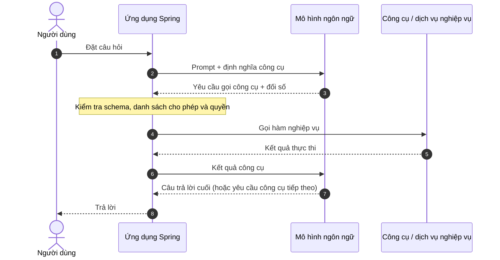

# Gọi công cụ (tool calling) là gì và giải quyết vấn đề nào

Một mô hình ngôn ngữ lớn (LLM) có thể hiểu câu hỏi, suy luận trên ngữ cảnh và tạo câu trả lời bằng ngôn ngữ tự nhiên. Tuy nhiên, bản thân mô hình không tự biết trạng thái mới nhất trong cơ sở dữ liệu của ứng dụng, không tự thực hiện phép tính bằng dịch vụ nghiệp vụ và cũng không có quyền truy cập trực tiếp vào hệ thống nội bộ. Nếu chỉ yêu cầu mô hình trả lời từ nội dung đã học hoặc từ prompt, ứng dụng sẽ gặp giới hạn khi câu hỏi cần dữ liệu đang thay đổi hoặc cần một hành động thật.

**Tool calling** (gọi công cụ) là cơ chế để mô hình đề xuất việc sử dụng một chức năng mà ứng dụng đã cung cấp. Mô hình chọn công cụ phù hợp và tạo các đối số có cấu trúc; ứng dụng nhận yêu cầu đó, kiểm tra rồi thực thi chức năng bằng mã của mình. Kết quả được gửi lại cho mô hình để mô hình giải thích hoặc kết hợp với các bước tiếp theo trước khi trả lời người dùng.

Trong phạm vi Spring AI, tool calling giúp kết nối khả năng hiểu ngôn ngữ của mô hình với các dịch vụ Java và nghiệp vụ của ứng dụng. Các cơ chế như `@Tool`, `ToolCallback`, schema đầu vào và `ToolContext` hỗ trợ khai báo công cụ, mô tả dữ liệu đầu vào, tích hợp việc thực thi và truyền ngữ cảnh cần thiết. Chúng không thay thế lớp nghiệp vụ hay cơ chế phân quyền của ứng dụng.

## Vì sao chỉ dùng prompt là chưa đủ?

Một prompt tốt có thể hướng dẫn mô hình cách trả lời, nhưng không tự tạo ra khả năng truy cập dữ liệu hoặc thực hiện thao tác. Có một số nhóm vấn đề thường gặp:

- **Dữ liệu thay đổi theo thời gian:** trạng thái đơn hàng, số dư, tồn kho, lịch hẹn hoặc tiến độ xử lý có thể thay đổi sau thời điểm mô hình được huấn luyện. Mô hình không thể suy ra giá trị hiện tại một cách đáng tin cậy chỉ từ kiến thức đã học.
- **Thông tin nằm trong hệ thống riêng:** dữ liệu khách hàng, hồ sơ, hợp đồng và quy trình nội bộ thường chỉ có trong API hoặc cơ sở dữ liệu mà ứng dụng kiểm soát.
- **Cần tính toán hoặc tra cứu có kết quả xác định:** tính phí, kiểm tra điều kiện, tìm lịch còn trống hay tổng hợp số liệu nên được thực hiện bằng mã và dữ liệu có thẩm quyền.
- **Cần tạo thay đổi trong hệ thống:** đặt lịch, tạo yêu cầu hỗ trợ hoặc cập nhật trạng thái là hành động có tác động thật. Một câu trả lời văn bản của mô hình không thể thay thế việc gọi dịch vụ nghiệp vụ và xác nhận kết quả.

Có thể đưa toàn bộ dữ liệu vào prompt để mô hình đọc, nhưng cách đó không phù hợp khi dữ liệu lớn, thay đổi liên tục, cần giới hạn theo người dùng hoặc cần ghi nhận một giao dịch. Tool calling cho phép ứng dụng chỉ cung cấp những thao tác cần thiết và thực thi chúng tại thời điểm cần.

## Tool calling hoạt động như thế nào?

Tool calling là một vòng trao đổi giữa ứng dụng, mô hình và công cụ. Mô hình không trực tiếp chạy mã Java. Nó trả về một yêu cầu gọi công cụ theo cấu trúc mà giao thức của model hỗ trợ; ứng dụng chịu trách nhiệm xử lý yêu cầu đó.

Một luồng điển hình gồm các bước:

1. **Ứng dụng khai báo các công cụ được phép dùng.** Mỗi công cụ có tên, mô tả mục đích và schema mô tả các tham số đầu vào. Schema giúp mô hình biết công cụ làm gì và cần cung cấp dữ liệu nào.
2. **Ứng dụng gửi câu hỏi cùng định nghĩa công cụ cho mô hình.** Prompt cung cấp ngữ cảnh hội thoại; danh sách công cụ cho mô hình biết những khả năng mà ứng dụng đang mở.
3. **Mô hình quyết định cách phản hồi.** Mô hình có thể trả lời ngay nếu không cần công cụ, hoặc yêu cầu gọi một hay nhiều công cụ với các đối số tương ứng.
4. **Ứng dụng kiểm tra và thực thi.** Ứng dụng xác định công cụ có nằm trong danh sách cho phép hay không, xác thực dữ liệu, kiểm tra quyền của người gọi và gọi mã nghiệp vụ tương ứng.
5. **Ứng dụng gửi kết quả về cho mô hình.** Kết quả thực thi được gắn với yêu cầu gọi công cụ ban đầu để mô hình có thể sử dụng đúng ngữ cảnh.
6. **Mô hình tiếp tục hoặc hoàn tất câu trả lời.** Mô hình có thể diễn giải kết quả, yêu cầu công cụ khác nếu cần, hoặc tạo câu trả lời cuối cùng. Ứng dụng điều phối vòng lặp và giới hạn số bước thực thi.



Điểm quan trọng của luồng này là **quyền thực thi luôn nằm ở ứng dụng**. Mô hình chỉ đề xuất công cụ và tham số. Ứng dụng có thể từ chối yêu cầu, yêu cầu xác nhận bổ sung, giới hạn số lần gọi hoặc trả về lỗi nghiệp vụ phù hợp.

## Tool calling giải quyết những loại bài toán nào?

Tool calling đặc biệt hữu ích khi câu trả lời cần kết hợp ngôn ngữ tự nhiên với một khả năng có sẵn trong hệ thống:

| Nhu cầu | Công cụ có thể thực hiện | Vai trò của mô hình |
|---|---|---|
| Tra cứu dữ liệu mới nhất | Đọc trạng thái đơn hàng, tồn kho hoặc lịch hẹn từ API | Hiểu yêu cầu, chọn công cụ và diễn giải kết quả |
| Tính toán theo quy tắc | Gọi dịch vụ tính phí, thuế, chiết khấu hoặc điều kiện đủ chuẩn | Thu thập tham số và trình bày kết quả |
| Tìm kiếm trong hệ thống | Gọi API tìm hồ sơ, hóa đơn hoặc phiếu hỗ trợ theo bộ lọc | Chuyển câu hỏi tự nhiên thành tham số tìm kiếm |
| Thực hiện một quy trình | Tạo lịch hẹn, mở phiếu hỗ trợ hoặc gửi yêu cầu nghiệp vụ | Xác định ý định, thu thập thông tin còn thiếu và thông báo kết quả |
| Phối hợp nhiều bước | Tra cứu thông tin rồi dùng kết quả để gọi dịch vụ tiếp theo | Điều phối hội thoại và quyết định bước kế tiếp trong phạm vi công cụ được cấp |

Ví dụ, người dùng hỏi: “Đơn hàng DH-2048 đã đến đâu?”. Mô hình nhận ra cần dữ liệu hiện tại và chọn công cụ tra cứu đơn hàng. Ứng dụng kiểm tra người dùng có quyền xem đơn đó, gọi `OrderService`, rồi gửi trạng thái trả về cho mô hình. Mô hình có thể diễn đạt: “Đơn hàng đang được giao và dự kiến đến trong hôm nay”, dựa trên kết quả thật mà dịch vụ cung cấp.

Nếu người dùng tiếp tục yêu cầu đổi địa chỉ giao hàng, đó là một hành động ghi dữ liệu. Ứng dụng cần kiểm tra chính sách đổi địa chỉ, trạng thái đơn, quyền của người dùng và có thể yêu cầu xác nhận trước khi thực thi. Việc mô hình đề xuất gọi công cụ không đồng nghĩa hành động đã được chấp thuận.

## Tool calling trong Spring AI

Spring AI cung cấp các thành phần để ứng dụng Java mô tả và kết nối công cụ với mô hình. Có thể hiểu các khái niệm chính như sau:

- **`@Tool`:** đánh dấu một phương thức Java là công cụ có thể được cung cấp cho mô hình. Mô tả của annotation giúp mô hình hiểu mục đích và thời điểm nên dùng phương thức.
- **`@ToolParam`:** mô tả tham số của phương thức, chẳng hạn ý nghĩa của mã đơn hàng hoặc giới hạn của một bộ lọc. Thông tin tham số góp phần hình thành schema mà mô hình sử dụng để tạo đối số.
- **Schema đầu vào:** biểu diễn có cấu trúc về tên, kiểu và mô tả các tham số. Schema giúp giảm sự mơ hồ khi chuyển yêu cầu ngôn ngữ tự nhiên thành dữ liệu đầu vào, nhưng ứng dụng vẫn phải kiểm tra dữ liệu ở thời điểm thực thi.
- **`ToolCallback`:** abstraction đại diện cho một công cụ có thể được gọi. Nó kết nối định nghĩa công cụ với phần thực thi, giúp ứng dụng đăng ký và sử dụng công cụ theo một giao diện thống nhất.
- **`ToolContext`:** mang ngữ cảnh do ứng dụng cung cấp trong lúc thực thi, ví dụ mã tương quan yêu cầu, thông tin tenant hoặc dữ liệu định danh đã được xác thực. Ngữ cảnh này phục vụ phía ứng dụng; không nên coi nó là dữ liệu do mô hình xác thực hoặc là cơ chế phân quyền tự động.

Ví dụ tối giản dưới đây minh họa cách khai báo một công cụ tra cứu. `OrderService` là dịch vụ nghiệp vụ do ứng dụng quản lý:

```java
import org.springframework.stereotype.Component;
import org.springframework.ai.tool.annotation.Tool;
import org.springframework.ai.tool.annotation.ToolParam;

@Component
public class OrderTools {

    private final OrderService orderService;

    public OrderTools(OrderService orderService) {
        this.orderService = orderService;
    }

    @Tool(description = "Tra cứu trạng thái hiện tại của một đơn hàng.")
    public OrderStatus lookupOrder(
            @ToolParam(description = "Mã đơn hàng cần tra cứu") String orderId) {
        return orderService.findStatus(orderId);
    }
}
```

Khi cấu hình `ChatClient`, ứng dụng có thể cung cấp bean công cụ cho lời gọi tương ứng:

```java
String answer = chatClient.prompt()
        .user("Đơn hàng DH-2048 đang ở trạng thái nào?")
        .tools(orderTools)
        .call()
        .content();
```

Trong ví dụ, annotation cung cấp metadata để Spring AI xây dựng định nghĩa công cụ; `.tools(orderTools)` đưa công cụ vào phạm vi của lời gọi chat. Khi mô hình yêu cầu gọi `lookupOrder`, phần tích hợp tool calling của Spring AI kết nối yêu cầu với phương thức Java, nhận kết quả và tiếp tục trao đổi với mô hình. `OrderService` vẫn là nơi chứa quy tắc và truy cập dữ liệu nghiệp vụ.

Đây là ví dụ minh họa cho API theo phong cách Spring AI hiện đại. Khi triển khai, cần đối chiếu package và chữ ký phương thức với phiên bản Spring AI mà dự án đang sử dụng, đồng thời cấu hình model/provider hỗ trợ tool calling.

## Phân biệt tool calling với RAG và câu trả lời thông thường

Ba cách tiếp cận có thể cùng xuất hiện trong một ứng dụng AI nhưng phục vụ mục tiêu khác nhau:

| Cách tiếp cận | Mục tiêu chính | Ví dụ phù hợp |
|---|---|---|
| Prompt và kiến thức của mô hình | Trả lời từ ngữ cảnh đã có trong hội thoại và kiến thức mô hình | Giải thích khái niệm phổ biến |
| RAG (Retrieval-Augmented Generation) | Truy xuất đoạn tài liệu liên quan rồi đưa nội dung đó vào ngữ cảnh để mô hình tổng hợp | Hỏi quy định trong bộ tài liệu hướng dẫn |
| Tool calling | Yêu cầu ứng dụng thực thi một chức năng hoặc truy vấn hệ thống có cấu trúc | Kiểm tra trạng thái đơn hàng hoặc tạo phiếu hỗ trợ |

Ranh giới không phải lúc nào cũng tuyệt đối. Một công cụ có thể thực hiện truy vấn tìm kiếm tài liệu, còn một quy trình RAG có thể được đóng gói phía sau một công cụ. Nên chọn theo bản chất công việc: cần lấy các đoạn tri thức để đọc thì dùng retrieval; cần gọi một thao tác hoặc dịch vụ có hợp đồng đầu vào/đầu ra thì tool calling là lựa chọn tự nhiên.

## Trách nhiệm của ứng dụng và các nguyên tắc an toàn

Tool calling mở một đường đi từ hội thoại tới hệ thống thật. Vì vậy, ứng dụng phải xem yêu cầu do mô hình tạo ra như dữ liệu đầu vào chưa đáng tin cậy và áp dụng các kiểm soát thông thường của một API nghiệp vụ.

1. **Chỉ công bố công cụ cần thiết.** Mỗi công cụ nên có mục đích hẹp, tên và mô tả rõ ràng. Không cung cấp một công cụ tổng quát có thể chạy tùy ý câu lệnh SQL, shell hoặc URL do mô hình tạo.
2. **Xác thực và phân quyền ở phía máy chủ.** Lấy danh tính người dùng từ phiên hoặc security context đã xác thực. Không dùng `userId`, `tenantId` hay vai trò do mô hình tự điền làm bằng chứng về quyền truy cập. Kiểm tra quyền trên từng tài nguyên và từng hành động.
3. **Kiểm tra mọi đối số.** Schema giúp mô hình tạo dữ liệu đúng hình dạng, nhưng không bảo đảm giá trị hợp lệ. Kiểm tra định dạng, giới hạn, trạng thái hiện tại và các bất biến nghiệp vụ trước khi gọi dịch vụ.
4. **Quản lý hành động có tác động.** Tách công cụ đọc và ghi khi phù hợp. Với thao tác nhạy cảm hoặc khó hoàn tác, yêu cầu người dùng xác nhận rõ ràng và kiểm tra lại điều kiện ngay trước khi thực thi.
5. **Giới hạn việc thực thi.** Đặt timeout, quota, giới hạn số vòng gọi và số công cụ khả dụng cho mỗi yêu cầu. Với thao tác có thể được gọi lại, cân nhắc idempotency key để tránh tạo giao dịch trùng lặp.
6. **Xử lý lỗi có kiểm soát.** Phân biệt lỗi xác thực, lỗi phân quyền, dữ liệu không tồn tại, xung đột trạng thái và lỗi phụ thuộc bên ngoài. Chỉ trả về thông tin cần thiết để mô hình giải thích; không đưa stack trace, bí mật hoặc dữ liệu nội bộ nhạy cảm vào kết quả.
7. **Ghi log và theo dõi.** Ghi nhận người yêu cầu, tên công cụ, thời điểm, mã tương quan, kết quả và quyết định từ chối theo chính sách dữ liệu của hệ thống. Tránh ghi token, thông tin xác thực hoặc dữ liệu cá nhân không cần thiết.
8. **Giới hạn dữ liệu trả về.** Công cụ chỉ nên trả những trường cần cho câu trả lời. Mô hình không cần nhận toàn bộ entity hoặc bản ghi cơ sở dữ liệu nếu chỉ cần trạng thái và thời gian cập nhật.

`ToolContext` có thể giúp chuyển một phần ngữ cảnh đáng tin cậy từ ứng dụng tới công cụ, nhưng bản thân nó không tự xác minh danh tính, không thay thế Spring Security và không tự cấp quyền. Công cụ phải dùng ngữ cảnh đã được ứng dụng thiết lập và vẫn kiểm tra quyền trước khi truy cập tài nguyên.

## Giới hạn cần hiểu đúng

Tool calling không làm cho mô hình luôn chọn đúng công cụ hoặc luôn tạo đối số chính xác. Mô hình có thể chọn nhầm, bỏ sót một tham số, hiểu sai yêu cầu mơ hồ hoặc đề xuất hành động không phù hợp. Provider cũng có thể khác nhau về khả năng hỗ trợ, cách biểu diễn tool call và khả năng gọi nhiều công cụ.

Do đó, ứng dụng cần có đường xử lý khi không có tool call, khi đối số không hợp lệ, khi công cụ thất bại và khi kết quả không đủ để trả lời. Với yêu cầu mơ hồ, mô hình nên hỏi lại người dùng hoặc ứng dụng cần yêu cầu bổ sung thông tin trước khi thực thi. Không được suy diễn rằng một hành động đã thành công chỉ vì mô hình nói rằng nó đã thành công; chỉ kết quả thực thi từ hệ thống nghiệp vụ mới xác nhận điều đó.

## Khi nào nên dùng tool calling?

Hãy cân nhắc tool calling khi câu trả lời phụ thuộc vào dữ liệu hiện tại, một phép tính có quy tắc rõ ràng, một API nội bộ hoặc một hành động cần thực thi. Công cụ phù hợp nhất thường là chức năng nghiệp vụ nhỏ, có đầu vào và đầu ra xác định, có thể kiểm tra quyền và có thể quan sát kết quả.

Nếu câu hỏi chỉ cần giải thích kiến thức chung, một lời gọi mô hình thông thường thường đã đủ. Nếu cần tổng hợp nội dung từ tài liệu, retrieval/RAG có thể phù hợp hơn. Nếu cần thay đổi trạng thái trong hệ thống, tool calling có thể là cầu nối, nhưng quyết định cho phép và thực thi vẫn thuộc ứng dụng.

Nắm vững ranh giới này là nền tảng để học các phần tiếp theo của module `SPRING_AI_TOOL_CALLING`: khai báo bằng `@Tool`, sử dụng `ToolCallback`, thiết kế schema đầu vào, truyền ngữ cảnh bằng `ToolContext`, điều phối nhiều lượt gọi, xác thực quyền, xử lý lỗi và kiểm thử tích hợp với dịch vụ nghiệp vụ an toàn.
