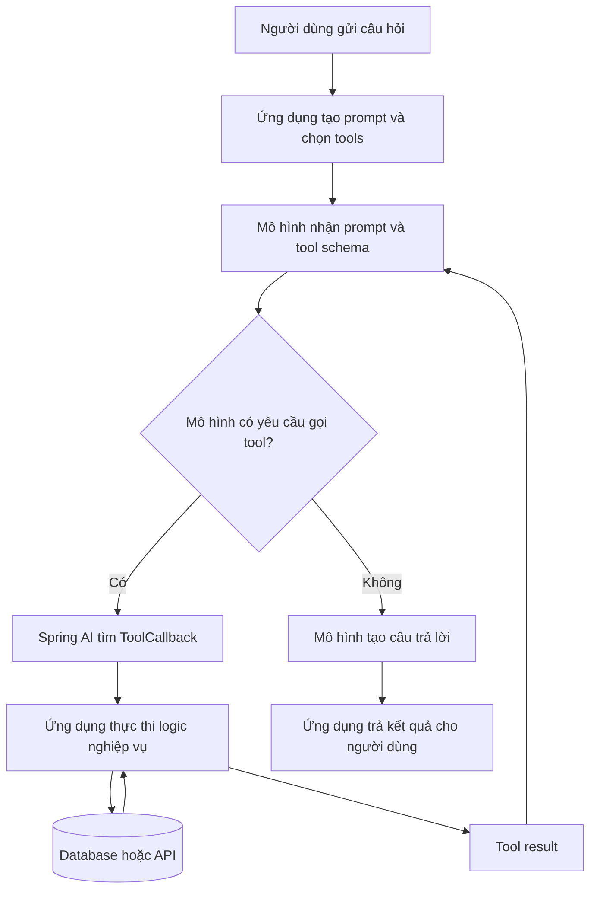

# Định hướng

## Phân biệt trả lời bằng kiến thức mô hình và truy cập dữ liệu thực tế

Module `SPRING_AI_TOOL_CALLING` hướng dẫn cách để mô hình ngôn ngữ yêu cầu ứng dụng gọi công cụ thông qua Spring AI. Chủ đề này bắt đầu từ một câu hỏi nền tảng: khi người dùng hỏi, mô hình đang trả lời dựa trên những gì nó đã học, hay ứng dụng đã truy vấn một nguồn dữ liệu bên ngoài để lấy thông tin mới?

Hai cách này có thể tạo ra câu trả lời trông giống nhau, nhưng nguồn thông tin, độ tin cậy, luồng xử lý và trách nhiệm bảo mật hoàn toàn khác nhau. Hiểu rõ sự khác biệt giúp chọn đúng giải pháp, tránh để mô hình tự đoán dữ liệu cần được xác minh từ hệ thống nghiệp vụ.

### 1. Trả lời bằng kiến thức đã học của mô hình

Mô hình ngôn ngữ được huấn luyện trên tập dữ liệu lớn. Trong quá trình huấn luyện, mô hình học các mẫu ngôn ngữ, khái niệm, quan hệ và cách giải quyết nhiều dạng câu hỏi. Khi nhận một prompt, mô hình dự đoán chuỗi đầu ra phù hợp dựa trên những gì đã học và nội dung hiện có trong ngữ cảnh hội thoại.

Ví dụ, người dùng hỏi:

- “Dependency Injection là gì?”
- “Giải thích sự khác nhau giữa `List` và `Set` trong Java.”
- “Vì sao cần dùng transaction khi cập nhật nhiều bảng?”

Đây là những câu hỏi kiến thức tổng quát. Mô hình thường có thể giải thích trực tiếp mà không cần truy cập cơ sở dữ liệu hay gọi dịch vụ bên ngoài.

Kiến thức của mô hình có một số giới hạn quan trọng:

- **Không đồng nghĩa với dữ liệu hiện tại.** Mô hình không tự biết một đơn hàng vừa được cập nhật, giá sản phẩm vừa thay đổi hay lịch họp vừa bị hủy.
- **Không phải cơ sở dữ liệu có thể truy vấn chính xác.** Mô hình có thể nhớ gần đúng một con số, tên phiên bản hoặc quy tắc, nhưng không bảo đảm trả về đúng bản ghi.
- **Có thể tạo thông tin nghe hợp lý nhưng không có căn cứ.** Hiện tượng này thường được gọi là hallucination. Khi thiếu dữ liệu, mô hình vẫn có thể tạo ra câu trả lời trôi chảy.
- **Không tự có quyền truy cập hệ thống của ứng dụng.** Việc mô hình biết cách gọi một API hoặc biết SQL không có nghĩa là nó đang kết nối tới API hay database đó.

Vì vậy, kiến thức mô hình phù hợp với giải thích, tổng hợp, gợi ý, viết bản nháp và các câu hỏi không phụ thuộc vào trạng thái mới nhất của một hệ thống cụ thể. Với dữ liệu có thể thay đổi hoặc cần độ chính xác nghiệp vụ, chỉ yêu cầu mô hình “hãy trả lời chính xác” là chưa đủ.

### 2. Trả lời bằng dữ liệu thực tế

Dữ liệu thực tế đến từ một nguồn mà ứng dụng có thể truy cập tại thời điểm xử lý yêu cầu, chẳng hạn:

- Cơ sở dữ liệu đơn hàng, khách hàng, sản phẩm hoặc giao dịch.
- REST API, dịch vụ nội bộ hoặc hệ thống của đối tác.
- Hệ thống quản lý kho, thanh toán, vận chuyển hoặc lịch làm việc.
- Đồng hồ hệ thống, tệp tin, công cụ tìm kiếm hoặc kho tài liệu.

Để trả lời dựa trên các nguồn này, ứng dụng phải thực hiện thao tác đọc dữ liệu và đưa kết quả vào luồng xử lý AI. Mô hình không thể tự suy ra trạng thái hiện tại từ kiến thức huấn luyện.

Ví dụ, với câu hỏi “Đơn hàng `ORD-2026-001` hiện đang ở trạng thái nào?”, hệ thống cần truy vấn dịch vụ đơn hàng. Dữ liệu trả về có thể gồm mã đơn hàng, trạng thái, thời điểm cập nhật và thông tin giao hàng. Mô hình có thể diễn giải các trường đó thành câu trả lời dễ hiểu cho người dùng.

“Dữ liệu thực tế” cũng không tự động có nghĩa là “dữ liệu thời gian thực tuyệt đối”. Nguồn dữ liệu có thể dùng cache, replica, đồng bộ trễ hoặc chứa bản ghi chưa được cập nhật. Ứng dụng cần hiểu đặc tính của nguồn, thời điểm lấy dữ liệu, múi giờ và đơn vị đo trước khi trình bày kết quả.

### 3. Phân biệt các cách đưa dữ liệu vào câu trả lời

Có nhiều cách kết hợp dữ liệu ngoài với mô hình. Chúng có thể phối hợp với nhau, nhưng giải quyết các vấn đề khác nhau.

| Cách tiếp cận | Dữ liệu đến từ đâu? | Ai quyết định lúc truy xuất? | Phù hợp khi |
| --- | --- | --- | --- |
| Kiến thức mô hình | Những mẫu và thông tin mô hình đã học | Không có truy xuất nguồn ngoài trong lượt hỏi | Giải thích khái niệm, viết nội dung, suy luận tổng quát |
| Đưa dữ liệu vào prompt | Ứng dụng đọc dữ liệu trước khi gọi mô hình | Ứng dụng | Luồng nghiệp vụ luôn cần một tập dữ liệu đã xác định |
| RAG | Bộ truy xuất tài liệu, thường là tìm kiếm từ khóa hoặc vector store | Pipeline truy xuất của ứng dụng | Hỏi đáp trên tài liệu, chính sách, hướng dẫn hoặc kho tri thức |
| Tool calling | Hàm, dịch vụ hoặc API được ứng dụng công khai dưới dạng công cụ | Mô hình đề xuất công cụ và tham số; ứng dụng thực thi | Cần truy vấn có lựa chọn theo ngữ cảnh hoặc thực hiện thao tác nghiệp vụ |

**Đưa dữ liệu vào prompt** có nghĩa là ứng dụng tự gọi repository hoặc API, sau đó chèn kết quả vào prompt. Mô hình chỉ nhận phần dữ liệu ứng dụng cung cấp; nó không chọn hay thực thi truy vấn đó.

**RAG (Retrieval-Augmented Generation)** thường tìm các đoạn tài liệu liên quan đến câu hỏi rồi đưa chúng vào ngữ cảnh để mô hình tổng hợp câu trả lời. RAG đặc biệt hữu ích khi dữ liệu là tài liệu bán cấu trúc hoặc phi cấu trúc. RAG không mặc nhiên thực hiện thay đổi trạng thái trong hệ thống nghiệp vụ.

**Tool calling** cho phép mô hình yêu cầu ứng dụng chạy một thao tác đã được công khai. Công cụ có thể đọc dữ liệu, tìm kiếm, tính toán hoặc thực hiện hành động. Một công cụ cũng có thể gọi pipeline RAG; do đó RAG và tool calling có thể được kết hợp thay vì phải chọn một trong hai.

### 4. Tool calling hoạt động như thế nào?

Tool calling là một giao thức phối hợp giữa mô hình và ứng dụng. Mô hình đề xuất tên công cụ cùng các đối số theo schema mà ứng dụng đã cung cấp. Ứng dụng kiểm tra yêu cầu, tìm callback tương ứng, thực thi logic và gửi kết quả về cho mô hình. Mô hình có thể dùng kết quả đó để trả lời hoặc yêu cầu thêm công cụ khác.

Luồng cơ bản:

1. Ứng dụng nhận câu hỏi và xây dựng prompt.
2. Ứng dụng gửi prompt cùng danh sách định nghĩa công cụ cho mô hình. Định nghĩa mô tả tên, mục đích và schema đầu vào.
3. Mô hình quyết định trả lời trực tiếp hoặc phát ra một yêu cầu gọi công cụ. Yêu cầu này chứa tên công cụ và các đối số, thường ở dạng dữ liệu có cấu trúc.
4. Spring AI chuyển yêu cầu đến callback phù hợp. Code của ứng dụng thực thi nghiệp vụ, ví dụ gọi service hoặc repository.
5. Kết quả thực thi được gửi lại cho mô hình dưới dạng phản hồi của công cụ.
6. Mô hình đọc kết quả và tạo câu trả lời cuối cùng. Nếu cần thêm dữ liệu, nó có thể yêu cầu gọi công cụ ở vòng tiếp theo.



Điểm cốt lõi là **mô hình quyết định đề xuất thao tác, còn ứng dụng sở hữu và thực thi thao tác đó**. Mô hình không nhận quyền truy cập trực tiếp vào database hoặc API chỉ vì schema của một công cụ được gửi trong prompt. Quyền thực thi nằm ở code và cấu hình của ứng dụng.

Mô hình cũng không bắt buộc phải gọi công cụ trong mọi tình huống. Nếu công cụ không được cung cấp, mô tả không rõ, hoặc mô hình cho rằng có thể trả lời trực tiếp, nó có thể không tạo tool call. Nếu một yêu cầu bắt buộc phải dùng dữ liệu mới nhất, ứng dụng cần thiết kế luồng để bảo đảm dữ liệu được truy xuất, thay vì chỉ trông chờ vào một chỉ dẫn trong prompt.

### 5. Vai trò của `@Tool`, `ToolCallback` và schema trong Spring AI

Trong Spring AI, `@Tool` là cách khai báo một method có thể được mô hình yêu cầu gọi. Annotation mô tả mục đích của công cụ; các tham số method được dùng để tạo schema đầu vào. `@ToolParam` giúp mô tả ý nghĩa của từng tham số và xác định tham số tùy chọn.

`ToolCallback` là abstraction kết nối phần định nghĩa công cụ mà mô hình nhìn thấy với logic thực thi trong ứng dụng. Spring AI cung cấp các cách tạo callback từ method hoặc function, ví dụ `MethodToolCallback` và `FunctionToolCallback`. `ToolCallbackProvider` có thể cung cấp một nhóm callback. Cách khai báo bằng `@Tool` thường thuận tiện khi ứng dụng sở hữu trực tiếp method; cách tạo callback bằng code phù hợp khi cần đăng ký động hoặc tùy chỉnh sâu hơn.

Ví dụ sau minh họa một công cụ chỉ đọc trạng thái đơn hàng:

```java
import org.springframework.ai.chat.model.ToolContext;
import org.springframework.ai.tool.annotation.Tool;
import org.springframework.ai.tool.annotation.ToolParam;
import org.springframework.stereotype.Component;

@Component
public class OrderTools {

    private final OrderQueryService orderQueryService;

    public OrderTools(OrderQueryService orderQueryService) {
        this.orderQueryService = orderQueryService;
    }

    @Tool(
        name = "lookup_order_status",
        description = "Tra cứu trạng thái hiện tại của đơn hàng mà người dùng hiện tại có quyền xem."
    )
    public OrderStatus lookupOrderStatus(
            @ToolParam(description = "Mã đơn hàng, ví dụ ORD-2026-001") String orderId,
            ToolContext toolContext) {

        Object value = toolContext.getContext().get("userId");
        if (!(value instanceof String userId) || userId.isBlank()) {
            throw new IllegalStateException("Thiếu ngữ cảnh người dùng.");
        }

        return orderQueryService.findStatusVisibleTo(orderId, userId);
    }
}
```

`OrderQueryService` và `OrderStatus` là kiểu nghiệp vụ minh họa của ứng dụng. Service phải thực hiện truy vấn có tham số, kiểm tra quyền xem đơn hàng và trả về dữ liệu phù hợp. Việc method được đánh dấu `@Tool` không tự sinh ra truy vấn database hay quy tắc nghiệp vụ.

Đăng ký công cụ với `ChatClient` cho một yêu cầu:

```java
String answer = chatClient.prompt()
    .user("Kiểm tra giúp tôi đơn hàng ORD-2026-001.")
    .tools(orderTools)
    .toolContext(Map.of("userId", authenticatedUser.id()))
    .call()
    .content();
```

Trong ví dụ, `orderTools` cung cấp method đã đánh dấu `@Tool`. `.tools(...)` làm công cụ khả dụng cho lượt gọi này. Nếu muốn công cụ mặc định khả dụng cho các yêu cầu được tạo từ cùng `ChatClient.Builder`, có thể cấu hình bằng `defaultTools(...)`; cần cân nhắc phạm vi vì một công cụ chỉ nên xuất hiện trong những yêu cầu được phép sử dụng nó.

`@ToolParam` giúp mô hình hiểu cần truyền loại dữ liệu nào. Tên, mô tả và schema nên cụ thể: “mã đơn hàng do người dùng cung cấp” hữu ích hơn một tham số chung chung tên `value`. Tham số mặc định thường được xem là bắt buộc; chỉ đánh dấu tùy chọn khi nghiệp vụ thực sự cho phép bỏ qua. Nếu schema yêu cầu một giá trị mà prompt không cung cấp và mô hình không thể suy ra, mô hình có thể tự tạo giá trị để đáp ứng schema.

Kết quả công cụ nên là dữ liệu có cấu trúc, đủ nhỏ và có ý nghĩa nghiệp vụ. Ví dụ, `OrderStatus` có thể chứa `orderId`, `status` và `updatedAt`. Không nên trả về toàn bộ entity với trường nội bộ, dữ liệu cá nhân không liên quan hoặc payload rất lớn chỉ vì model có thể đọc được JSON.

### 6. Dùng `ToolContext` để truyền ngữ cảnh nội bộ

Một số thông tin cần thiết cho việc thực thi nhưng không nên do mô hình tự cung cấp, ví dụ `userId`, `tenantId`, request ID hoặc phạm vi quyền hiện tại. Spring AI cung cấp `ToolContext` để truyền các giá trị này tới method công cụ.

Trong ví dụ trên, `userId` được lấy từ danh tính đã xác thực của request rồi truyền qua `.toolContext(...)`. `ToolContext` được chuyển tới tool khi thực thi; các giá trị trong context không được gửi cho mô hình như một phần của tool schema. Mô hình chỉ cần cung cấp `orderId`, còn ứng dụng cung cấp ngữ cảnh xác thực.

Không đưa `userId`, `tenantId`, vai trò hoặc quyền truy cập thành tham số để mô hình tự quyết định. Người dùng có thể yêu cầu xem dữ liệu của người khác, và mô hình có thể phát ra một mã định danh bất kỳ. Công cụ phải lấy danh tính từ ngữ cảnh tin cậy, sau đó kiểm tra quyền tại service hoặc lớp bảo mật. `ToolContext` giúp truyền thông tin; nó không thay thế xác thực, phân quyền hoặc kiểm tra dữ liệu đầu vào.

### 7. Điều phối nhiều lượt gọi công cụ

Một yêu cầu có thể cần nhiều thao tác. Ví dụ, để trả lời “Đơn hàng của tôi đang ở đâu và dự kiến khi nào giao?”, hệ thống có thể cần tra cứu đơn hàng rồi lấy thông tin vận chuyển. Mô hình có thể yêu cầu các công cụ theo thứ tự hoặc yêu cầu nhiều công cụ trong một lượt, tùy khả năng của model và cách điều phối.

Với cách dùng `ChatClient` thông thường, Spring AI cung cấp vòng lặp tool calling để gửi định nghĩa công cụ, thực thi callback khi nhận tool call, thêm kết quả vào lịch sử trao đổi và tiếp tục gọi mô hình cho đến khi có câu trả lời cuối cùng. Trong các phiên bản Spring AI mới, vòng lặp này được tổ chức trong advisor chain thông qua `ToolCallingAdvisor`. Khi dùng API mức thấp như `ChatModel` trực tiếp hoặc tự xây dựng vòng lặp, ứng dụng cần hiểu rõ hành vi của phiên bản đang dùng và chịu trách nhiệm điều phối các bước tương ứng.

Không nên để một yêu cầu chạy vòng lặp không giới hạn. Hãy đặt giới hạn số lần gọi, thời gian chờ, kích thước kết quả và ngân sách phù hợp. Với các công cụ có tác dụng phụ, cần kiểm soát thứ tự thực thi, chống gọi lặp và bảo đảm tính idempotent khi có thể. Một lần retry do timeout không được vô tình tạo hai giao dịch hoặc gửi hai thông báo giống nhau.

### 8. Bảo mật và độ tin cậy khi truy cập dữ liệu

Tool calling mở ra một cổng từ ngôn ngữ tự nhiên tới logic nghiệp vụ. Vì vậy, mỗi công cụ cần được thiết kế như một endpoint nội bộ có hợp đồng và quyền hạn rõ ràng.

**Chỉ công khai thao tác cần thiết.** Tạo công cụ chuyên biệt như `lookup_order_status` hoặc `get_available_slots`, thay vì một công cụ tổng quát nhận câu SQL, URL tùy ý hoặc lệnh shell. Danh sách tool khả dụng cho một request nên là tập tối thiểu phục vụ nhiệm vụ đó.

**Kiểm tra đầu vào ở phía ứng dụng.** Schema giúp mô hình tạo tham số đúng định dạng, nhưng không thay thế validation. Kiểm tra độ dài, định dạng, miền giá trị, trạng thái nghiệp vụ và quan hệ giữa các tham số trước khi gọi hệ thống phía sau.

**Phân quyền tại nơi thực thi.** Kiểm tra quyền theo người dùng và tenant trên mỗi lần gọi. Không coi việc mô hình chọn một tool là sự chấp thuận của người dùng hoặc bằng chứng rằng người dùng có quyền thực hiện thao tác.

**Tách thao tác đọc và ghi.** Công cụ đọc dữ liệu thường ít rủi ro hơn công cụ cập nhật hoặc xóa dữ liệu. Với thao tác có tác dụng phụ, cần xác nhận rõ ý định, kiểm tra quyền, ghi audit log và áp dụng cơ chế chống lặp. Những hành động không thể đảo ngược nên có bước xác nhận của người dùng hoặc người có thẩm quyền.

**Giới hạn dữ liệu trả về.** Chỉ trả các trường cần cho câu trả lời. Loại bỏ token, mật khẩu, thông tin thanh toán và dữ liệu cá nhân không cần thiết. Dữ liệu lấy từ tài liệu hoặc dịch vụ bên ngoài cũng có thể chứa chỉ dẫn độc hại; hãy xem nó là dữ liệu đầu vào không đáng tin cậy, không phải chỉ thị thay đổi chính sách của ứng dụng.

**Xử lý lỗi có kiểm soát.** Các lỗi như không tìm thấy bản ghi, không đủ quyền, dịch vụ quá thời gian hoặc lỗi kết nối cần có cách biểu diễn rõ ràng. Có thể chuyển một thông báo lỗi an toàn cho mô hình để mô hình giải thích, hoặc ném lỗi về tầng gọi để ứng dụng xử lý. Không gửi stack trace, câu SQL, secret hay chi tiết hạ tầng cho mô hình hoặc người dùng. Chỉ retry lỗi tạm thời khi thao tác an toàn để chạy lại.

**Theo dõi việc thực thi.** Ghi nhận tên tool, request ID, thời gian thực thi, kết quả thành công/thất bại và số lần gọi. Nếu ghi tham số hoặc kết quả vào log, phải che dữ liệu nhạy cảm. Thông tin quan sát giúp phát hiện tool bị gọi sai, vòng lặp kéo dài, lỗi từ nhà cung cấp hoặc chi phí tăng bất thường.

### 9. Kết quả từ tool vẫn cần được kiểm soát

Sau khi tool chạy xong, kết quả thường được gửi lại cho mô hình để mô hình diễn giải. Điều này tạo ra hai tầng cần đánh giá:

1. **Tầng thực thi:** tool có truy vấn đúng nguồn, đúng người dùng, đúng phạm vi và trả về dữ liệu đúng không?
2. **Tầng diễn giải:** mô hình có tóm tắt đúng dữ liệu, giữ nguyên con số, trạng thái, thời điểm và điều kiện quan trọng không?

Tool chạy thành công không bảo đảm câu trả lời cuối cùng hoàn toàn chính xác. Mô hình có thể bỏ sót một trường, nhầm múi giờ hoặc diễn giải sai trạng thái. Với dữ liệu tài chính, trạng thái giao dịch hoặc quyết định quan trọng, ứng dụng nên giữ kết quả có cấu trúc để giao diện hiển thị trực tiếp những trường cần chính xác. Không nên để một câu văn do mô hình tạo ra trở thành nguồn sự thật duy nhất.

Nếu tool result đã là câu trả lời hoàn chỉnh và không cần mô hình diễn giải thêm, có thể cân nhắc cơ chế trả kết quả trực tiếp cho caller mà Spring AI hỗ trợ, tùy phiên bản và cách tích hợp. Quyết định này nên dựa trên yêu cầu kiểm soát nội dung và trải nghiệm người dùng.

### 10. Chọn cách xử lý theo loại câu hỏi

| Câu hỏi | Cách xử lý phù hợp | Lý do |
| --- | --- | --- |
| “`@Transactional` trong Spring dùng để làm gì?” | Kiến thức mô hình | Câu hỏi khái niệm, không phụ thuộc dữ liệu riêng của hệ thống |
| “Đơn hàng `ORD-2026-001` đang ở trạng thái nào?” | Tool truy vấn đơn hàng | Trạng thái phải lấy từ nguồn dữ liệu hiện tại và cần kiểm tra quyền xem |
| “Chính sách hoàn tiền hiện hành của công ty quy định thế nào?” | RAG trên kho chính sách, có thể được gọi qua tool | Cần tìm đúng tài liệu có hiệu lực và trích xuất nội dung liên quan |
| “Còn bao nhiêu sản phẩm trong kho Hà Nội?” | Tool truy vấn tồn kho | Số lượng thay đổi liên tục và có thể phụ thuộc kho hoặc biến thể sản phẩm |
| “Hủy đơn hàng này giúp tôi.” | Tool thay đổi trạng thái, có kiểm tra quyền và xác nhận | Đây là hành động có tác dụng phụ, cần xác minh ý định và điều kiện nghiệp vụ |
| “Viết email xin gia hạn thời hạn dự án.” | Kiến thức mô hình | Có thể tạo bản nháp mà không cần đọc hoặc sửa hệ thống bên ngoài |

Một câu hỏi có thể cần phối hợp nhiều cách. Chẳng hạn, người dùng hỏi “Dựa trên chính sách hiện hành, đơn hàng này có được hoàn tiền không?”. Ứng dụng có thể dùng tool lấy trạng thái và lịch sử đơn hàng, RAG tìm điều khoản chính sách, rồi để mô hình đối chiếu hai nguồn. Quy tắc quyết định cuối cùng vẫn nên nằm trong service nghiệp vụ nếu đó là một quyết định có ràng buộc pháp lý hoặc tài chính.

### 11. Kiểm thử và vận hành

Kiểm thử tool calling cần bao phủ cả method thực thi và vòng phối hợp với mô hình:

- **Unit test cho logic nghiệp vụ:** kiểm tra truy vấn, validation, phân quyền, trường hợp không tìm thấy dữ liệu và lỗi từ hệ thống phụ thuộc.
- **Kiểm tra hợp đồng tool:** xác minh tên, mô tả, kiểu tham số, trường bắt buộc và kiểu kết quả. Mô tả sai hoặc schema mơ hồ có thể khiến mô hình chọn nhầm công cụ hoặc tạo đối số không phù hợp.
- **Integration test có mock:** dùng service giả hoặc callback giả để kiểm tra ứng dụng đăng ký đúng tool, chuyển đúng tham số, xử lý tool result và kết thúc vòng lặp.
- **Kiểm thử quyền truy cập:** thử người dùng ở tenant A truy vấn dữ liệu tenant B, truyền mã đơn hàng không thuộc sở hữu và gọi tool khi thiếu ngữ cảnh xác thực.
- **Kiểm thử lỗi và giới hạn:** mô phỏng timeout, lỗi API, kết quả rỗng, tool call lặp và số lần gọi vượt giới hạn.
- **Kiểm thử hành động có tác dụng phụ:** xác minh xác nhận của người dùng, idempotency và audit log trước khi cho phép cập nhật dữ liệu.

Trong môi trường thực tế, theo dõi tỷ lệ gọi tool thành công, thời gian phản hồi, số vòng gọi trên mỗi yêu cầu, lỗi theo tên tool và tỷ lệ câu hỏi cần truy xuất dữ liệu. Các chỉ số này giúp phân biệt lỗi của mô hình với lỗi từ dịch vụ nghiệp vụ.

### 12. Những hiểu nhầm thường gặp

1. **“Đánh dấu `@Tool` là database tự được kết nối.”** Không đúng. Method phải gọi repository, service hoặc API cụ thể. Annotation chỉ giúp Spring AI mô tả và kết nối method với cơ chế tool calling.
2. **“Mô hình gọi tool nghĩa là tool đã chạy.”** Chưa chắc. Tool call là yêu cầu từ mô hình. Ứng dụng còn phải phân giải callback, kiểm tra điều kiện và thực thi.
3. **“Có tool thì câu trả lời luôn là dữ liệu mới nhất.”** Không đúng. Độ mới phụ thuộc nguồn dữ liệu, cache, replica và thời điểm truy vấn.
4. **“Mô hình tự kiểm tra quyền người dùng.”** Không đúng. Quyền phải được kiểm tra trong ứng dụng dựa trên danh tính đáng tin cậy.
5. **“Kết quả tool là câu trả lời cuối cùng.”** Không nhất thiết. Mô hình có thể diễn giải kết quả và vẫn có thể diễn giải sai; ứng dụng cần giữ dữ liệu cấu trúc cho các trường quan trọng.
6. **“Càng nhiều tool thì mô hình càng hữu ích.”** Không hẳn. Nhiều tool trùng chức năng hoặc mô tả không rõ làm tăng độ phức tạp, chi phí token và khả năng chọn nhầm. Chỉ cung cấp các tool cần thiết cho yêu cầu.

### 13. Quy trình ra quyết định

Khi thiết kế một chức năng AI, có thể dùng các câu hỏi sau:

1. Câu trả lời có phụ thuộc dữ liệu thay đổi theo thời gian hoặc dữ liệu riêng của người dùng không? Nếu không, kiến thức mô hình có thể đã đủ.
2. Dữ liệu nằm trong tài liệu cần tìm kiếm ngữ nghĩa hay trong hệ thống nghiệp vụ có API rõ ràng? Tài liệu thường phù hợp với RAG; dữ liệu nghiệp vụ hoặc hành động thường phù hợp với tool.
3. Ứng dụng có thể lấy dữ liệu trước mỗi prompt một cách ổn định không? Nếu có, đưa dữ liệu vào prompt có thể đơn giản hơn. Nếu cần mô hình lựa chọn thao tác theo ngữ cảnh, cân nhắc tool calling.
4. Tool có tác dụng phụ hoặc trả về dữ liệu nhạy cảm không? Nếu có, xác định quyền, xác nhận, giới hạn và audit trước khi đăng ký tool.
5. Kết quả có cần chính xác tuyệt đối ở dạng cấu trúc không? Nếu có, giữ dữ liệu gốc trong ứng dụng và để giao diện hoặc service trình bày các trường quan trọng.

Nguyên tắc thiết kế là chỉ dùng kiến thức mô hình cho phần mô hình có thể trả lời đáng tin cậy; dùng truy xuất cho dữ liệu cần kiểm chứng; và dùng tool calling khi ứng dụng cần mô hình yêu cầu một thao tác cụ thể. Trong mọi trường hợp, ứng dụng vẫn chịu trách nhiệm về quyền truy cập, validation, thực thi, xử lý lỗi và tính đúng đắn của dữ liệu.

### Tài liệu tham khảo

- [Spring AI Reference — Tool Calling](https://docs.spring.io/spring-ai/reference/api/tools.html)
- [Spring AI 1.0 Reference — Tool Calling](https://docs.spring.io/spring-ai/reference/1.0/api/tools.html)

Các API và chi tiết điều phối có thể thay đổi giữa các phiên bản Spring AI. Khi triển khai, hãy đối chiếu tài liệu đúng với phiên bản dependency của dự án, đặc biệt nếu gọi `ChatModel` trực tiếp thay vì dùng vòng điều phối của `ChatClient`.
