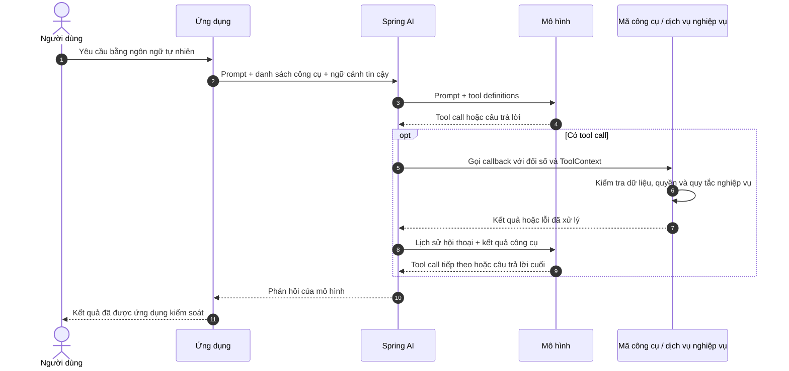

# Trách nhiệm của mô hình, Spring AI và mã thực thi công cụ

Tool calling cho phép mô hình ngôn ngữ đề xuất một thao tác có cấu trúc để ứng dụng thực hiện. Ví dụ, khi người dùng hỏi trạng thái đơn hàng, mô hình có thể yêu cầu gọi công cụ `getOrderStatus` với tham số `orderId`. Mô hình không tự truy cập cơ sở dữ liệu, không chạy mã Java và cũng không có quyền đối với đơn hàng. Nó chỉ tạo ra một yêu cầu gọi công cụ dựa trên mô tả mà ứng dụng cung cấp.

Trong Spring AI, cần phân biệt ba trách nhiệm:

- **Mô hình** hiểu yêu cầu hội thoại, chọn công cụ phù hợp trong danh sách được cung cấp và tạo tên công cụ cùng dữ liệu đầu vào theo schema.
- **Spring AI** chuyển mô tả công cụ thành định dạng mà model provider hỗ trợ, nhận tool call trong phản hồi, tìm callback tương ứng, chuyển tiếp dữ liệu và đưa kết quả thực thi trở lại cuộc hội thoại.
- **Ứng dụng và mã thực thi công cụ** quyết định công cụ nào được mở cho từng yêu cầu, xác thực dữ liệu, kiểm tra quyền, gọi dịch vụ nghiệp vụ, kiểm soát tác động phụ và trả kết quả an toàn.

Phân chia này là nền tảng để tích hợp AI với dịch vụ nghiệp vụ mà vẫn giữ quyền kiểm soát ở phía ứng dụng.

## 1. Nhìn toàn bộ luồng tool calling

Một lượt tool calling thường diễn ra như sau:

1. Ứng dụng nhận yêu cầu của người dùng và tạo prompt. Ứng dụng đăng ký những công cụ được phép dùng trong lượt đó.
2. Spring AI lấy metadata của các công cụ, bao gồm tên, mô tả và schema đầu vào, rồi gửi chúng cùng yêu cầu đến model provider.
3. Mô hình trả về nội dung thông thường hoặc một hay nhiều tool call. Mỗi tool call có tên công cụ và các đối số có cấu trúc.
4. Khi dùng cơ chế tự điều phối của Spring AI, framework tìm `ToolCallback` phù hợp và gọi mã Java tương ứng. Mã này kiểm tra đầu vào, quyền truy cập và thực hiện nghiệp vụ.
5. Kết quả công cụ được Spring AI chuyển thành thông điệp kết quả trong lịch sử hội thoại và gửi lại cho mô hình.
6. Mô hình có thể yêu cầu thêm công cụ hoặc tạo câu trả lời cuối cùng. Ứng dụng trả câu trả lời đó cho người dùng sau khi áp dụng các chính sách đầu ra cần thiết.



Sơ đồ mô tả một vòng lặp có thể lặp lại nhiều lần. Mô hình có thể cần tra cứu khách hàng trước, sau đó mới tra cứu đơn hàng, hoặc gọi nhiều công cụ độc lập trong cùng một lượt. Vì vậy, không nên xem một lần gọi model là một thao tác nghiệp vụ đơn lẻ.

## 2. Mô hình quyết định điều gì?

Mô hình chịu trách nhiệm diễn giải ý định và chọn trong tập công cụ mà ứng dụng đã cung cấp. Một tool call thường chứa:

- Tên công cụ, chẳng hạn `getOrderStatus`.
- Các đối số theo schema, chẳng hạn `{ "orderId": "ORD-2048" }`.
- Định danh của tool call để liên kết kết quả với yêu cầu tương ứng trong giao thức hội thoại.

Mô hình có thể chọn sai công cụ, bỏ sót tham số, đưa ra giá trị không hợp lệ hoặc hiểu sai dữ kiện trong câu hỏi. Mô hình cũng có thể bị ảnh hưởng bởi nội dung không đáng tin cậy trong prompt hay dữ liệu được truy xuất. Do đó, tool call phải được xem là **đề xuất đầu vào từ một thành phần không có thẩm quyền nghiệp vụ**.

Mô hình không quyết định được:

- Người dùng có quyền xem hoặc sửa tài nguyên hay không.
- Một thao tác có được phép trong trạng thái hiện tại của hệ thống hay không.
- Giá trị do người dùng cung cấp có hợp lệ theo quy tắc nghiệp vụ hay không.
- Giao dịch đã được ghi thành công hay chưa.
- Có cần xác nhận trước khi thực hiện một hành động có tác động lớn hay không.

Những quyết định đó thuộc về ứng dụng và dịch vụ nghiệp vụ. Không cấp quyền chỉ vì mô hình đã chọn một công cụ hoặc tạo ra đối số có vẻ hợp lý.

## 3. Spring AI chịu trách nhiệm điều phối kỹ thuật

Spring AI cung cấp lớp tích hợp giữa hội thoại và mã Java. Các thành phần quan trọng gồm:

| Thành phần | Trách nhiệm |
|---|---|
| `@Tool` | Đánh dấu một phương thức Java có thể được công bố như một công cụ. |
| `@ToolParam` | Mô tả tham số để mô hình hiểu ý nghĩa và tạo đối số phù hợp. |
| `ToolCallback` | Đại diện cho một công cụ có thể được gọi; có thể được tạo từ phương thức được chú thích hoặc đăng ký theo cách lập trình. |
| `ToolCallbackProvider` | Cung cấp một nhóm callback để ứng dụng đăng ký với cơ chế gọi công cụ. |
| `ToolContext` | Chuyển dữ liệu ngữ cảnh do ứng dụng cung cấp đến phương thức công cụ mà không biến dữ liệu đó thành tham số do mô hình tạo. |
| `ChatClient` / `ChatModel` | Gửi yêu cầu đến mô hình và nhận phản hồi hội thoại, bao gồm cả tool call. |

Khi ứng dụng đăng ký các tool callback với `ChatClient`, Spring AI có thể thực hiện vòng lặp tự động: gửi định nghĩa công cụ, nhận tool call, gọi callback, gửi kết quả trở lại mô hình và tiếp tục cho đến khi nhận được phản hồi cuối cùng hoặc gặp lỗi. Cách dùng tự động phù hợp với luồng thông thường và giúp ứng dụng không phải tự xử lý từng thông điệp giao thức.

Spring AI không tự biết chính sách phân quyền của hệ thống, ý nghĩa nghiệp vụ của từng mã định danh hay mức độ nguy hiểm của một thao tác. Framework cũng không thể thay thế transaction, kiểm tra quyền trong service, giới hạn tần suất hoặc cơ chế xác nhận của ứng dụng. Những chính sách đó phải được đặt ở lớp ứng dụng và dịch vụ nghiệp vụ.

## 4. Khai báo công cụ bằng `@Tool`

Ví dụ dưới đây khai báo một công cụ chỉ đọc để tra cứu trạng thái đơn hàng. Các kiểu `OrderStatusView`, `OrderQueryService` và `AuthenticatedUser` đại diện cho các kiểu của ứng dụng.

```java
import org.springframework.ai.tool.annotation.Tool;
import org.springframework.ai.tool.annotation.ToolParam;
import org.springframework.ai.chat.model.ToolContext;
import org.springframework.security.access.AccessDeniedException;
import org.springframework.stereotype.Component;

@Component
public class OrderTools {

    private final OrderQueryService orderQueryService;

    public OrderTools(OrderQueryService orderQueryService) {
        this.orderQueryService = orderQueryService;
    }

    @Tool(description = "Tra cứu trạng thái của một đơn hàng mà người dùng hiện tại được phép xem.")
    public OrderStatusView getOrderStatus(
            @ToolParam(description = "Mã đơn hàng cần tra cứu") String orderId,
            ToolContext toolContext) {

        Object userIdValue = toolContext.getContext().get("userId");
        if (!(userIdValue instanceof String userId) || userId.isBlank()) {
            throw new AccessDeniedException("Thiếu ngữ cảnh người dùng đã xác thực.");
        }

        return orderQueryService.findStatusVisibleTo(orderId, userId)
                .orElseThrow(() -> new OrderNotFoundException(orderId));
    }
}
```

Ứng dụng đăng ký đối tượng công cụ cho yêu cầu hội thoại. Ví dụ API dưới đây minh họa cách dùng `ChatClient` trong Spring AI 1.x:

```java
String answer = chatClient.prompt()
        .user(question)
        .toolContext(Map.of("userId", authenticatedUser.id()))
        .tools(orderTools)
        .call()
        .content();
```

`@Tool` mô tả khả năng có thể gọi; `.tools(orderTools)` đưa công cụ vào phạm vi của prompt hiện tại. Chỉ khai báo một bean có phương thức `@Tool` không có nghĩa là mọi prompt đều tự động được cấp công cụ đó. Ứng dụng cần chủ động đăng ký công cụ ở đúng nơi và đúng phạm vi.

Tham số `ToolContext` được Spring AI cung cấp cho phương thức công cụ. Trong ví dụ, `userId` đến từ phiên đã xác thực của ứng dụng. Mô hình không tự tạo hoặc sửa giá trị này như một đối số của tool call. Dù vậy, service vẫn phải kiểm tra quyền truy cập tài nguyên; ngữ cảnh chỉ cung cấp dữ kiện để service thực hiện kiểm tra.

Với công cụ được tạo động hoặc cần tích hợp một hàm Java có sẵn, ứng dụng có thể tạo `ToolCallback` theo cách lập trình. Ví dụ dạng khái quát:

```java
ToolCallback lookupStock = FunctionToolCallback
        .builder("lookupStock", inventoryService::lookup)
        .description("Tra cứu số lượng tồn kho của một mã sản phẩm.")
        .inputType(StockQuery.class)
        .build();
```

Sau đó đăng ký callback với yêu cầu `ChatClient` thông qua API callback tương ứng của phiên bản Spring AI đang dùng. Cách này hữu ích khi danh sách công cụ được lắp ghép theo tenant, vai trò hoặc tính năng đã bật. Cần giữ cùng một nguyên tắc: việc callback xuất hiện trong danh sách chỉ cho phép mô hình đề xuất gọi nó; mã thực thi vẫn phải xác thực và kiểm tra quyền.

## 5. Schema đầu vào là hợp đồng dữ liệu, không phải cơ chế bảo mật

Spring AI dùng metadata của công cụ để tạo định nghĩa và schema đầu vào cho model provider. Schema giúp mô hình biết:

- Tên và mục đích của công cụ.
- Tên, kiểu và ý nghĩa của từng tham số.
- Tham số nào bắt buộc và cấu trúc dữ liệu nào được chấp nhận.

Mô tả công cụ nên cụ thể, tập trung vào một nhiệm vụ và nêu rõ khi nào nên dùng. Ví dụ, `Tra cứu trạng thái đơn hàng theo mã đơn hàng` tốt hơn mô tả chung như `Xử lý đơn hàng`. Tên tham số nên có nghĩa rõ ràng; dùng DTO khi đầu vào có nhiều trường liên quan.

Schema không đảm bảo mọi đầu vào đều hợp lệ. Model provider có thể trả dữ liệu sai kiểu, thiếu trường, vượt giới hạn hoặc chứa giá trị không tồn tại trong hệ thống. Ứng dụng cần kiểm tra lại ở ranh giới thực thi:

1. Kiểm tra cú pháp và cấu trúc: trường bắt buộc, độ dài, định dạng, miền giá trị.
2. Chuẩn hóa dữ liệu theo quy tắc của hệ thống, nếu việc chuẩn hóa được phép.
3. Kiểm tra ràng buộc nghiệp vụ: trạng thái hiện tại, quan hệ giữa các trường, giới hạn số lượng.
4. Kiểm tra quyền trên tài nguyên cụ thể sau khi đã xác định tài nguyên.

Không đưa vào schema các thông tin nhạy cảm hoặc thông tin mà mô hình không cần quyết định. Ví dụ, `tenantId`, `userId`, vai trò, quyền hạn và khóa nội bộ thường phải lấy từ ngữ cảnh tin cậy phía server, không yêu cầu mô hình gửi lên.

## 6. Dùng `ToolContext` cho dữ liệu tin cậy

`ToolContext` truyền dữ liệu từ ứng dụng đến callback trong lúc thực thi. Các giá trị phù hợp có thể gồm:

- Người dùng đã xác thực hoặc định danh người dùng.
- Tenant hiện tại được xác định từ phiên đăng nhập.
- Ngôn ngữ, múi giờ hoặc cấu hình hiển thị của yêu cầu.
- Correlation ID để liên kết log và trace.
- Thông tin chính sách hoặc giới hạn đã được ứng dụng xác định.

Không dùng `ToolContext` như kho lưu trữ trạng thái dài hạn. Không đặt mật khẩu, access token hoặc bí mật không cần thiết vào đó. Hãy truyền dữ liệu tối thiểu mà callback cần và kiểm soát vòng đời của nó theo từng yêu cầu.

Đặc biệt, phân biệt hai nguồn dữ liệu:

| Nguồn | Ví dụ | Cách xử lý |
|---|---|---|
| Đối số từ mô hình | `orderId`, `productCode`, số lượng người dùng muốn đặt | Xem là dữ liệu không tin cậy; kiểm tra cấu trúc, giá trị và quyền trên tài nguyên. |
| Ngữ cảnh từ ứng dụng | `userId`, `tenantId`, correlation ID | Lấy từ phiên hoặc tầng server đáng tin cậy; không cho mô hình ghi đè. |

Ngay cả khi `userId` đến từ `ToolContext`, truy vấn vẫn phải giới hạn dữ liệu theo người dùng hoặc tenant. Ví dụ, truy vấn đơn hàng nên kết hợp mã đơn hàng với phạm vi người dùng được phép xem, thay vì chỉ truy vấn theo `orderId` rồi tin rằng mã đó đã đủ để cấp quyền.

## 7. Kiểm soát quyền và tác động nghiệp vụ

Mỗi tool callback là một điểm vào mới của hệ thống. Hãy áp dụng các nguyên tắc bảo mật như với controller hoặc API công khai:

- **Allowlist theo yêu cầu:** chỉ đăng ký các công cụ cần thiết cho tác vụ và vai trò hiện tại. Không đưa toàn bộ công cụ nội bộ vào mọi prompt.
- **Xác thực ở phía server:** xác định người dùng từ security context hoặc phiên đã xác thực. Không tin `userId`, `role`, `tenantId` hay `isAdmin` do mô hình gửi trong đối số.
- **Phân quyền tại service:** kiểm tra quyền trên đúng tài nguyên và đúng hành động. Kiểm tra ở tầng tool giúp phản hồi sớm, còn service vẫn phải bảo vệ nghiệp vụ khi được gọi từ nơi khác.
- **Quyền tối thiểu:** tách công cụ đọc và ghi. Một công cụ tra cứu không nên đồng thời có khả năng cập nhật hoặc xóa dữ liệu.
- **Xác nhận hành động quan trọng:** với thao tác gửi tiền, xóa dữ liệu, phát hành hóa đơn hoặc gửi thông báo ra ngoài, hãy dùng bước chuẩn bị và bước xác nhận do ứng dụng kiểm soát. Không coi câu văn do mô hình tự tạo là xác nhận hợp lệ của người dùng.
- **Giới hạn tài nguyên:** đặt timeout, giới hạn số bản ghi, kích thước đầu vào, tần suất gọi và ngân sách cho mỗi yêu cầu.

Đối với thao tác ghi, cần thiết kế tính lặp an toàn. Mô hình hoặc tầng điều phối có thể gửi lại yêu cầu sau timeout, và người dùng cũng có thể lặp lại câu hỏi. Dùng mã yêu cầu nghiệp vụ hoặc idempotency key do server tạo, kiểm tra trạng thái trước khi ghi và đặt transaction ở service phù hợp. Không giả định mỗi tool call chỉ được thực thi đúng một lần.

## 8. Điều phối nhiều lượt gọi công cụ

Một yêu cầu hội thoại có thể chứa nhiều vòng tool calling. Ví dụ, để trả lời câu hỏi `Đơn hàng mới nhất của tôi đang ở đâu?`, mô hình có thể cần gọi `findLatestOrder`, nhận mã đơn hàng, rồi gọi `getOrderStatus` hoặc `getShipmentTracking`.

Khi dùng tự điều phối của Spring AI, framework thực hiện chu trình callback và gửi kết quả trở lại mô hình. Ứng dụng vẫn cần giới hạn tài nguyên của toàn bộ chu trình, vì một câu hỏi có thể kích hoạt nhiều lần gọi model và công cụ. Cần xem xét:

- Số vòng tool calling tối đa cho một yêu cầu.
- Tổng thời gian cho model và tất cả công cụ.
- Số lượng tool call tối đa trong một phản hồi và tổng số callback.
- Giới hạn token và kích thước kết quả được đưa trở lại prompt.
- Hành vi khi một công cụ lỗi, hết thời gian hoặc trả kết quả không đầy đủ.
- Quy tắc thực thi song song đối với các công cụ độc lập.

Nếu cần tự kiểm soát vòng lặp, ứng dụng có thể làm việc ở tầng `ChatModel` và cơ chế `ToolCallingManager` của Spring AI thay vì giao toàn bộ chu trình cho `ChatClient`. Logic điều phối về mặt khái niệm như sau:

```text
history = tạo lịch sử hội thoại ban đầu
for round từ 1 đến MAX_TOOL_ROUNDS:
    response = gửi history đến mô hình
    nếu response không có tool call:
        trả câu trả lời cuối

    kiểm tra số lượng và tên các tool call
    với từng tool call:
        kiểm tra callback có nằm trong allowlist
        xác thực đối số và quyền truy cập
        thực thi callback theo chính sách timeout / transaction
        thêm kết quả gắn với đúng tool call ID vào history

trả trạng thái kết thúc có kiểm soát khi vượt giới hạn
```

Đây là thuật toán minh họa, không phải mã Java có thể biên dịch trực tiếp. Khi triển khai, dùng đúng kiểu message, `ToolCallingManager` và API của phiên bản Spring AI đang được dự án sử dụng. Nếu Spring AI tự điều phối, hãy cấu hình các giới hạn tương đương ở tầng request, callback và model client.

Một phản hồi có thể yêu cầu nhiều công cụ. Chỉ chạy song song khi các thao tác độc lập, không phụ thuộc thứ tự và không xung đột tài nguyên. Với các thao tác ghi hoặc có quan hệ trước sau, cần tuần tự hóa và kiểm soát transaction. Không dựa vào thứ tự tool call do mô hình phát ra như một cam kết nghiệp vụ.

Khi chạm giới hạn vòng lặp, timeout hoặc ngân sách, dừng chu trình và trả một trạng thái có thể hiểu được. Không tiếp tục gọi công cụ vô hạn để cố làm cho mô hình hoàn tất câu trả lời.

## 9. Xử lý lỗi tại ranh giới công cụ

Không phải mọi lỗi đều có cùng cách xử lý. Nên phân loại tối thiểu:

| Loại lỗi | Ví dụ | Hướng xử lý |
|---|---|---|
| Đầu vào không hợp lệ | Mã đơn hàng sai định dạng | Trả lỗi kiểm tra dữ liệu có thể sửa; không gọi service. |
| Không có quyền | Người dùng không được xem đơn hàng | Từ chối theo chính sách; không tiết lộ dữ liệu của người khác. |
| Không tìm thấy | Mã đơn hàng không tồn tại hoặc không hiển thị trong phạm vi người dùng | Trả kết quả an toàn, tránh tạo kênh dò tìm tài nguyên. |
| Lỗi nghiệp vụ | Đơn hàng không ở trạng thái cho phép hủy | Trả mã hoặc thông điệp nghiệp vụ rõ ràng để mô hình giải thích. |
| Lỗi tạm thời | Dịch vụ phụ thuộc quá tải hoặc timeout | Retry có giới hạn khi thao tác an toàn để retry; nếu không, trả trạng thái chưa xác định. |
| Lỗi hệ thống | Lỗi kết nối hoặc lỗi lập trình | Ghi log và trace ở server; chỉ trả thông tin đã làm sạch. |

Không trả stack trace, câu lệnh SQL, token, thông tin xác thực hoặc chi tiết hạ tầng cho mô hình. Kết quả công cụ thường được đưa vào prompt ở lượt tiếp theo, vì vậy nội dung lỗi cũng phải được xem là dữ liệu có thể được mô hình diễn giải và nhắc lại cho người dùng.

Hãy thống nhất định dạng kết quả cho các công cụ có thể thất bại, chẳng hạn gồm `success`, `code` và `message` với dữ liệu chi tiết chỉ xuất hiện khi được phép. Nếu callback ném exception, hành vi cuối cùng phụ thuộc cơ chế gọi công cụ và cách ứng dụng cấu hình xử lý lỗi; không nên giả định mọi exception đều tự động trở thành một tool result thân thiện. Hãy xử lý các lỗi dự kiến ở lớp công cụ hoặc service và kiểm thử đường đi lỗi thực tế.

Retry chỉ phù hợp với lỗi tạm thời và thao tác có tính lặp an toàn. Với thao tác ghi mà kết quả timeout khiến trạng thái giao dịch chưa rõ, hãy tra cứu trạng thái theo mã giao dịch trước khi quyết định thử lại.

## 10. Quan sát và kiểm toán

Tool calling tạo ra một chuỗi hoạt động trải qua model, framework và service. Log ứng dụng nên giúp trả lời được: yêu cầu nào đã gọi công cụ nào, ai là người dùng đã xác thực, callback mất bao lâu, kết quả thuộc loại nào và vòng lặp kết thúc vì lý do gì.

Nên ghi nhận các thông tin phù hợp như tên công cụ, tool call ID, correlation ID, tenant đã được xác thực, thời gian thực thi, trạng thái thành công/thất bại và mã lỗi đã chuẩn hóa. Che hoặc loại bỏ dữ liệu nhạy cảm trong đối số và kết quả. Không ghi toàn bộ prompt hay payload tùy tiện nếu chúng có thể chứa thông tin cá nhân hoặc bí mật.

Metrics hữu ích gồm số lượt gọi theo công cụ, tỷ lệ lỗi, độ trễ, timeout, số vòng lặp trung bình và tỷ lệ yêu cầu chạm giới hạn. Các dữ liệu này giúp phát hiện công cụ có mô tả khó hiểu, callback quá chậm hoặc một luồng hội thoại gọi quá nhiều công cụ.

## 11. Kiểm thử công cụ và luồng điều phối

Kiểm thử cần bao phủ cả phương thức Java lẫn cách công cụ tham gia vào hội thoại:

1. **Kiểm thử đơn vị callback:** đầu vào hợp lệ, thiếu trường, sai định dạng, giá trị biên và lỗi nghiệp vụ.
2. **Kiểm thử quyền:** người dùng hợp lệ, người dùng không có quyền, tenant khác nhau và tài nguyên không thuộc phạm vi truy cập.
3. **Kiểm thử schema:** tên công cụ, mô tả, kiểu tham số, trường bắt buộc và cấu trúc DTO được công bố đúng như dự định.
4. **Kiểm thử `ToolContext`:** callback nhận đúng ngữ cảnh từ server; giá trị trong đối số mô hình không thể ghi đè ngữ cảnh tin cậy.
5. **Kiểm thử tích hợp:** model giả lập trả tool call, callback được gọi, kết quả được gắn đúng tool call ID và mô hình nhận được kết quả ở lượt kế tiếp.
6. **Kiểm thử nhiều lượt:** chuỗi tra cứu qua nhiều công cụ, phản hồi có nhiều tool call, vòng lặp vượt giới hạn và một callback thất bại giữa chu trình.
7. **Kiểm thử tác động phụ:** thao tác ghi được bảo vệ bằng quyền, xác nhận và idempotency; retry không tạo bản ghi hoặc giao dịch trùng.
8. **Kiểm thử vận hành:** timeout, giới hạn số lượng, log đã che dữ liệu nhạy cảm và trace liên kết được các bước.

Ưu tiên dùng callback giả hoặc service giả để kiểm thử điều phối một cách ổn định. Kiểm thử với model thật có ích cho đánh giá chất lượng lựa chọn công cụ và mô tả schema, nhưng không nên là cách duy nhất để xác minh phân quyền hoặc quy tắc nghiệp vụ.

## 12. Checklist khi thiết kế một tool

Trước khi công bố một công cụ cho mô hình, hãy trả lời được các câu hỏi sau:

- Công cụ giải quyết một nhiệm vụ cụ thể nào? Tên và mô tả có giúp mô hình chọn đúng lúc không?
- Đầu vào nhỏ nhất cần thiết là gì? Schema có rõ kiểu và ràng buộc không?
- Công cụ có thực sự cần xuất hiện trong prompt này và với người dùng này không?
- Danh tính, tenant và quyền được lấy từ đâu? Service nào kiểm tra quyền trên tài nguyên?
- Công cụ chỉ đọc hay có tác động phụ? Nếu ghi dữ liệu, xác nhận và idempotency được xử lý ra sao?
- Kết quả và lỗi nào được phép đưa trở lại mô hình? Có thông tin nhạy cảm nào cần che không?
- Timeout, retry, giới hạn vòng lặp và giới hạn kết quả đã được đặt chưa?
- Có kiểm thử cho trường hợp không có quyền, dữ liệu sai, callback lỗi và nhiều lượt gọi không?

Một tích hợp tool calling tốt giữ cho mô hình tập trung vào hiểu yêu cầu và đề xuất bước tiếp theo, Spring AI xử lý giao thức và callback, còn ứng dụng giữ toàn quyền kiểm soát việc thực thi nghiệp vụ. Khi ranh giới này rõ ràng, hệ thống có thể tận dụng khả năng hội thoại của mô hình mà vẫn bảo vệ dữ liệu, quyền truy cập và tính nhất quán của dịch vụ.
