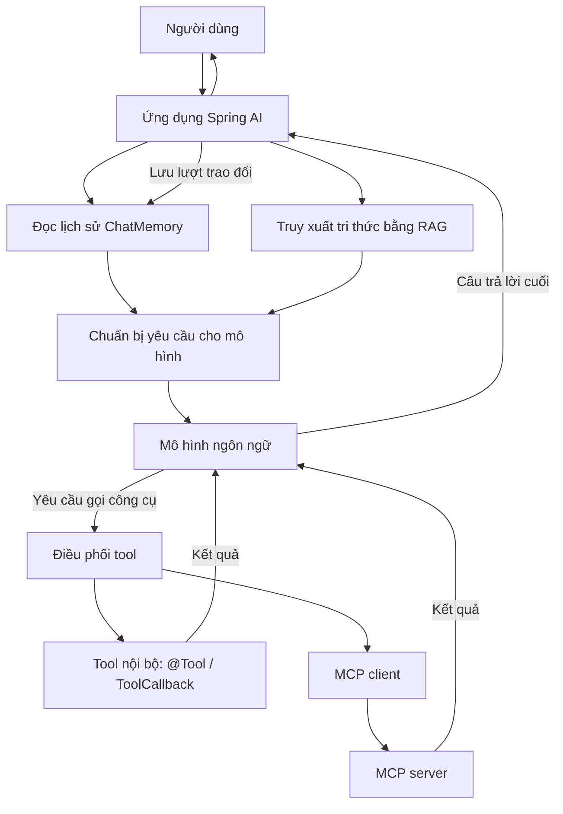

# Quan hệ với RAG, bộ nhớ hội thoại và MCP

Trong Spring AI, **tool calling** cho phép mô hình ngôn ngữ đề nghị ứng dụng thực hiện một thao tác bên ngoài mô hình, chẳng hạn tra cứu đơn hàng hoặc tạo yêu cầu hỗ trợ. Cơ chế này thường được dùng cùng RAG, bộ nhớ hội thoại và Model Context Protocol (MCP), nhưng mỗi thành phần giải quyết một vấn đề khác nhau.

- **Tool calling** trả lời câu hỏi: mô hình cần ứng dụng thực hiện thao tác nào?
- **RAG** trả lời câu hỏi: cần tìm và đưa tri thức nào vào ngữ cảnh để mô hình trả lời có căn cứ?
- **Bộ nhớ hội thoại** trả lời câu hỏi: thông tin nào từ các lượt trao đổi trước cần được giữ lại để hiểu lượt hiện tại?
- **MCP** trả lời câu hỏi: ứng dụng kết nối và trao đổi với các nguồn công cụ, dữ liệu, mẫu lời nhắc bên ngoài theo một giao thức chung như thế nào?

Các thành phần này có thể phối hợp trong cùng một yêu cầu. Chúng không thay thế lẫn nhau: RAG không tự thực hiện giao dịch, bộ nhớ hội thoại không xác nhận trạng thái mới nhất trong hệ thống nghiệp vụ, còn MCP không tự quyết định mô hình cần gọi công cụ nào.

## 1. Nhìn tổng thể luồng phối hợp

Một ứng dụng Spring AI có thể nạp lịch sử hội thoại, truy xuất tài liệu liên quan rồi gửi ngữ cảnh cùng câu hỏi đến mô hình. Nếu mô hình trả về yêu cầu gọi công cụ, ứng dụng điều phối yêu cầu đó đến `ToolCallback` nội bộ hoặc công cụ được cung cấp qua MCP. Kết quả thực thi được gửi lại cho mô hình để mô hình tạo câu trả lời cuối cùng.



Đây là sơ đồ khái niệm. Trong ứng dụng thực tế, RAG có thể chạy trước khi gọi mô hình, được tích hợp qua advisor, hoặc được cung cấp dưới dạng một tool để mô hình chủ động yêu cầu truy xuất. Việc thực thi tool có thể được Spring AI hỗ trợ điều phối, nhưng ứng dụng vẫn chịu trách nhiệm cấu hình công cụ, cung cấp ngữ cảnh tin cậy, kiểm soát quyền và xử lý kết quả.

## 2. Tool calling và RAG: thực hiện thao tác hay tìm tri thức?

RAG (Retrieval-Augmented Generation) bổ sung thông tin có liên quan vào yêu cầu gửi đến mô hình. Một luồng RAG thường gồm các bước: nhận câu hỏi, chuyển câu hỏi thành truy vấn, tìm các đoạn tài liệu phù hợp, chọn hoặc sắp xếp kết quả, rồi đưa phần nội dung cần thiết vào ngữ cảnh để mô hình trả lời. Với Spring AI, nguồn truy xuất có thể là `VectorStore`, kho tìm kiếm hoặc một dịch vụ truy vấn khác; advisor và các thành phần retrieval giúp kết nối bước truy xuất với luồng tạo câu trả lời.

Tool calling có mục tiêu khác. Mô hình phát ra một yêu cầu có tên tool và các tham số theo schema. Ứng dụng kiểm tra yêu cầu, gọi hàm hoặc dịch vụ tương ứng, sau đó trả kết quả cho mô hình. Tool có thể đọc dữ liệu mới nhất hoặc thực hiện một hành động có tác động đến hệ thống.

| Nhu cầu | Thành phần phù hợp | Ví dụ |
| --- | --- | --- |
| Giải thích quy định bảo hành trong tài liệu | RAG | Tìm điều khoản bảo hành của dòng sản phẩm X và trích nội dung liên quan |
| Kiểm tra trạng thái bảo hành của một thiết bị cụ thể | Tool calling | Gọi dịch vụ quản lý bảo hành bằng số sê-ri |
| Tạo phiếu sửa chữa | Tool calling | Gọi dịch vụ nghiệp vụ để tạo phiếu sau khi kiểm tra quyền và dữ liệu |
| Giải thích quy trình rồi thực hiện một bước trong quy trình | RAG kết hợp tool calling | RAG tìm hướng dẫn; tool kiểm tra điều kiện và tạo yêu cầu |

Ví dụ, khi người dùng hỏi “Điều kiện đổi trả là gì?”, RAG có thể tìm chính sách đổi trả và cung cấp các đoạn phù hợp. Khi người dùng hỏi “Đơn hàng A123 của tôi đang ở trạng thái nào?”, ứng dụng nên gọi dịch vụ đơn hàng để lấy trạng thái hiện tại. Nếu người dùng muốn tạo yêu cầu đổi trả, tool cần kiểm tra đơn hàng, thời hạn, quyền của người dùng và các quy tắc nghiệp vụ trước khi ghi dữ liệu.

Có hai cách phổ biến để kết hợp RAG với tool calling:

1. **RAG chạy như một bước chuẩn bị ngữ cảnh.** Ứng dụng truy xuất tài liệu trước hoặc trong pipeline advisor, rồi gửi kết quả cùng câu hỏi đến mô hình. Mô hình có thể tiếp tục gọi tool nếu cần dữ liệu động hoặc cần thực hiện thao tác.
2. **Đóng gói thao tác truy xuất thành một tool.** Mô hình có thể yêu cầu gọi tool tìm kiếm khi nhận thấy cần tra cứu. Cách này hữu ích khi việc truy xuất là một lựa chọn trong nhiều hành động, nhưng cần mô tả tool rõ ràng và giới hạn phạm vi tìm kiếm.

Không nên mặc định mọi truy vấn RAG đều phải trở thành tool. Nếu ứng dụng luôn cần truy xuất một nhóm tri thức trước khi trả lời, một bước retrieval được điều phối rõ ràng thường dễ kiểm soát hơn. Ngược lại, nếu chỉ một số câu hỏi mới cần tra cứu, tool có thể giúp mô hình lựa chọn thời điểm gọi. Dù chọn cách nào, bộ lọc quyền truy cập tài liệu phải được thực hiện ở tầng truy xuất; không giao việc quyết định quyền cho mô hình.

## 3. Tool calling và bộ nhớ hội thoại: hiểu ngữ cảnh hay xác nhận sự thật?

Bộ nhớ hội thoại lưu giữ những thông tin từ các lượt trao đổi trước để ứng dụng có thể tiếp tục cuộc trò chuyện. Trong Spring AI, `ChatMemory` biểu diễn phần lịch sử hội thoại được đưa trở lại ngữ cảnh; `ChatMemoryRepository` có thể được dùng để lưu trữ lịch sử theo cơ chế lưu trữ mà ứng dụng lựa chọn. `MessageChatMemoryAdvisor` là một cách tích hợp bộ nhớ hội thoại vào luồng `ChatClient`.

Ví dụ, người dùng hỏi “Đơn hàng A123 của tôi ở đâu?” rồi tiếp tục “Còn đơn đó thì khi nào giao?”. Bộ nhớ hội thoại giúp mô hình hiểu cụm “đơn đó” đang nói đến A123. Tuy nhiên, lịch sử hội thoại chỉ giúp xác định đối tượng cần hỏi. Để trả lời thời gian giao hàng hiện tại, ứng dụng vẫn cần gọi tool tra cứu đơn hàng. Không nên coi một câu trả lời cũ trong bộ nhớ là trạng thái có thẩm quyền của hệ thống nghiệp vụ.

### `ChatMemory` khác `ToolContext`

Hai loại ngữ cảnh này phục vụ hai phạm vi khác nhau:

- `ChatMemory` giữ các thông điệp hội thoại qua nhiều lượt, thường được phân vùng bằng mã cuộc trò chuyện. Nó giúp duy trì tính liên tục của trao đổi.
- `ToolContext` mang dữ liệu ngữ cảnh do ứng dụng cung cấp cho một lần thực thi tool, chẳng hạn mã người dùng đã xác thực, mã tenant, locale hoặc mã tương quan để ghi log. Dữ liệu trong `ToolContext` không phải là tham số do mô hình tự quyết định và không được gửi như một phần schema đầu vào mà mô hình nhìn thấy.

Ví dụ dưới đây minh họa một tool tra cứu đơn hàng. `principalId` phải được lấy từ phiên hoặc security context đã xác thực của ứng dụng, sau đó truyền vào `ToolContext`. Tool vẫn phải gọi dịch vụ nghiệp vụ để kiểm tra người dùng có quyền xem đơn hàng đó hay không.

```java
@Component
class OrderTools {

    private final OrderService orderService;

    OrderTools(OrderService orderService) {
        this.orderService = orderService;
    }

    @Tool(description = "Tra cứu trạng thái đơn hàng mà người dùng hiện tại được phép xem")
    OrderStatus getOrderStatus(
            @ToolParam(description = "Mã đơn hàng cần tra cứu") String orderId,
            ToolContext toolContext) {

        String principalId =
                (String) toolContext.getContext().get("principalId");

        return orderService.findStatusForPrincipal(orderId, principalId);
    }
}
```

Khi gọi `ChatClient`, ứng dụng đăng ký tool và đưa dữ liệu tin cậy vào context:

```java
String answer = chatClient.prompt()
        .user(question)
        .tools(orderTools)
        .toolContext(Map.of("principalId", authenticatedPrincipalId))
        .call()
        .content();
```

Các tên lớp và cách cấu hình advisor cần được đối chiếu với phiên bản Spring AI mà dự án đang sử dụng. Điểm quan trọng của ví dụ là `orderId` do mô hình đề xuất vẫn là dữ liệu đầu vào chưa đáng tin cậy; `principalId` do ứng dụng cấp và dịch vụ nghiệp vụ xác minh quyền trước khi trả dữ liệu.

Khi kết hợp memory với tool calling, cần lưu ý ba điều:

1. **Phân vùng bộ nhớ theo đúng cuộc trò chuyện và người dùng.** Không dùng một vùng nhớ chung cho nhiều người hoặc nhiều tenant. Mã cuộc trò chuyện nên được xác định ở phía ứng dụng và được kiểm tra quyền truy cập.
2. **Không dùng memory làm cơ sở dữ liệu nghiệp vụ.** Bộ nhớ có thể thiếu, cũ hoặc chỉ chứa một phần thông tin. Với số dư, trạng thái đơn hàng, quyền hạn và dữ liệu giao dịch, hãy truy vấn nguồn dữ liệu có thẩm quyền bằng tool.
3. **Kiểm soát nội dung được lưu.** Không lưu bí mật, token, dữ liệu cá nhân không cần thiết hoặc toàn bộ kết quả tool quá lớn. Cần có chính sách giới hạn dung lượng, thời gian lưu, xóa và tóm tắt lịch sử.

Trong một lượt tool calling, thông điệp yêu cầu gọi tool và kết quả tool có thể cần được giữ trong chuỗi thông điệp để mô hình tiếp tục suy luận. Việc các thông điệp này có được lưu qua các request tiếp theo hay không phụ thuộc cách ứng dụng cấu hình và cách advisor ghi lịch sử ở phiên bản Spring AI đang dùng. Hãy kiểm tra hành vi lưu thực tế thay vì mặc định rằng mọi kết quả tool đều đã nằm trong `ChatMemory`.

## 4. MCP và ToolCallback: chuẩn hóa kết nối công cụ

Model Context Protocol (MCP) là giao thức chuẩn hóa cách một ứng dụng client kết nối đến một MCP server để khám phá và sử dụng các khả năng mà server công bố. MCP thường đề cập đến ba nhóm khả năng:

- **Tools:** các thao tác có thể được gọi, thường có tên, mô tả và schema đầu vào.
- **Resources:** dữ liệu hoặc nội dung mà client có thể đọc để bổ sung ngữ cảnh.
- **Prompts:** các mẫu lời nhắc do server cung cấp để client sử dụng trong những tình huống xác định.

MCP xác định cách trao đổi giữa client và server. Nó không tự chạy mô hình ngôn ngữ và cũng không quyết định khi nào cần gọi một tool. Ứng dụng vẫn phải gửi mô tả tool cho mô hình, nhận yêu cầu gọi tool, điều phối việc thực thi và xử lý kết quả.

Trong Spring AI, `ToolCallback` là một abstraction phía ứng dụng mô tả một tool mà mô hình có thể yêu cầu gọi. Một phương thức Java được đánh dấu `@Tool` có thể được Spring AI chuyển thành callback. Với MCP, Spring AI MCP client có thể khám phá các tool từ server và cung cấp chúng dưới dạng callback để dùng trong cùng luồng tool calling. Tùy phiên bản và chế độ đồng bộ/bất đồng bộ, phần tích hợp thường được cấu hình qua một `ToolCallbackProvider` tương ứng.

Ví dụ khái niệm về việc đưa các callback đã lấy từ MCP client vào `ChatClient`:

```java
ToolCallback[] remoteCallbacks = mcpToolCallbackProvider.getToolCallbacks();

String answer = chatClient.prompt()
        .user(question)
        .toolCallbacks(remoteCallbacks)
        .call()
        .content();
```

Đoạn mã minh họa ranh giới tích hợp; cách tạo MCP client, khởi tạo provider, cấu hình transport và quản lý vòng đời kết nối phụ thuộc starter cùng phiên bản Spring AI được chọn. Khi triển khai, cần đọc đúng tài liệu của phiên bản dependency đang khóa trong dự án.

Phân biệt các thành phần ở đây:

| Thành phần | Vai trò |
| --- | --- |
| `@Tool` | Khai báo một phương thức Java mà ứng dụng muốn cung cấp như một tool |
| `ToolCallback` | Abstraction để Spring AI mô tả và thực thi một tool trong luồng tương tác với mô hình |
| MCP client | Kết nối đến MCP server, khám phá và gửi yêu cầu sử dụng các khả năng được công bố |
| MCP server | Công bố tools, resources hoặc prompts và xử lý yêu cầu theo giao thức MCP |

Một tool nội bộ được khai báo bằng `@Tool` không tự động trở thành MCP tool cho các ứng dụng khác. Muốn ứng dụng khác sử dụng qua MCP, cần có MCP server công bố khả năng đó. Tương tự, một MCP resource không tự động trở thành tài liệu trong vector store; ứng dụng cần quyết định cách đọc, lọc, lập chỉ mục và cập nhật nội dung resource nếu muốn dùng nó trong RAG.

MCP có thể kết nối với RAG theo nhiều cách. Server có thể cung cấp resource để ứng dụng nạp vào pipeline retrieval, hoặc cung cấp một tool tìm kiếm mà ứng dụng chuyển thành `ToolCallback`. Giao thức chỉ chuẩn hóa cách trao đổi; chất lượng truy xuất, lọc quyền và cách đưa kết quả vào prompt vẫn là trách nhiệm của ứng dụng.

## 5. Ghép bốn thành phần trong một tình huống nghiệp vụ

Giả sử xây dựng trợ lý chăm sóc khách hàng. Người dùng hỏi: “Với đơn hàng tôi vừa nhắc đến, tôi có đủ điều kiện đổi trả không? Nếu được thì tạo yêu cầu giúp tôi.” Một luồng xử lý có thể diễn ra như sau:

1. **Memory xác định ngữ cảnh hội thoại.** Ứng dụng nạp lịch sử đúng conversation để hiểu “đơn hàng tôi vừa nhắc đến” là đơn nào. Mã người dùng và tenant được lấy từ phiên đã xác thực, không lấy từ lời nhắn của mô hình.
2. **RAG tìm chính sách.** Pipeline truy xuất các đoạn quy định đổi trả phù hợp với sản phẩm và thời điểm mua. Bộ lọc truy xuất chỉ cho phép đọc tài liệu mà người dùng hoặc ứng dụng hiện tại được quyền sử dụng.
3. **Tool lấy dữ liệu trực tiếp.** Mô hình có thể yêu cầu gọi tool tra cứu đơn hàng. Tool gọi dịch vụ đơn hàng để lấy ngày mua, trạng thái giao hàng và các dữ liệu cần thiết; dịch vụ kiểm tra quyền sở hữu đơn hàng.
4. **Ứng dụng đánh giá điều kiện nghiệp vụ.** Các quy tắc quyết định đủ điều kiện đổi trả phải được thực thi trong dịch vụ nghiệp vụ. Mô hình có thể giải thích kết quả dựa trên chính sách và dữ liệu trả về, nhưng không thay thế bộ quy tắc.
5. **Tool thực hiện thao tác.** Nếu quy trình yêu cầu xác nhận của người dùng, ứng dụng phải lấy xác nhận trước khi gọi tool tạo yêu cầu đổi trả. Tool tạo yêu cầu cần hỗ trợ kiểm tra dữ liệu và chống tạo trùng khi retry.
6. **MCP mở rộng nguồn tích hợp nếu cần.** Nếu dịch vụ đơn hàng hoặc hệ thống ticket được công bố qua MCP server, ứng dụng có thể dùng các callback từ MCP client. Phần kiểm tra quyền và quy tắc nghiệp vụ vẫn phải được thực hiện ở hệ thống có thẩm quyền.
7. **Memory lưu phần trao đổi phù hợp.** Ứng dụng lưu câu hỏi, câu trả lời và thông tin tham chiếu cần thiết theo chính sách lưu trữ. Không nhất thiết lưu toàn bộ payload nội bộ hoặc thông tin nhạy cảm từ kết quả tool.

Tình huống này cho thấy mỗi thành phần có một trách nhiệm: memory giữ mạch hội thoại, RAG cung cấp căn cứ, tool calling yêu cầu ứng dụng thực hiện thao tác, MCP chuẩn hóa kết nối đến công cụ hoặc nguồn ngữ cảnh từ hệ thống khác.

## 6. Ranh giới bảo mật và xử lý lỗi

Khi các thành phần phối hợp, dữ liệu đi qua nhiều ranh giới tin cậy. Không được coi yêu cầu do mô hình tạo ra là lệnh đã được xác thực. Mô hình có thể chọn sai tool, truyền tham số thiếu hoặc diễn giải sai nội dung truy xuất. Ứng dụng cần áp dụng các nguyên tắc sau:

- **Xác thực và phân quyền ở phía server.** Kiểm tra danh tính, tenant, quyền thao tác và quyền truy cập bản ghi trong ứng dụng hoặc dịch vụ nghiệp vụ. `ToolContext` có thể truyền dữ liệu xác thực đã được ứng dụng kiểm tra; không dùng giá trị do mô hình tự khai báo để cấp quyền.
- **Kiểm tra schema và quy tắc miền.** Schema giúp mô hình tạo đầu vào có cấu trúc, nhưng không thay thế validation. Kiểm tra định dạng, giới hạn, trạng thái hiện tại và quan hệ giữa các trường trước khi gọi dịch vụ.
- **Giới hạn công cụ được phép dùng.** Chỉ đăng ký những callback cần thiết cho tác vụ. Với MCP, kiểm soát server được tin cậy, danh sách tool được phép, timeout, kích thước kết quả và quyền mà kết nối được cấp.
- **Coi tài liệu truy xuất là dữ liệu.** Nội dung từ RAG hoặc MCP resource có thể chứa chỉ dẫn sai lệch hoặc prompt injection. Không để nội dung tài liệu tự thay đổi chính sách hệ thống hay quyền thực thi tool.
- **Xử lý lỗi có cấu trúc.** Phân biệt lỗi đầu vào, lỗi phân quyền, lỗi nghiệp vụ, timeout và lỗi kết nối MCP. Trả thông báo phù hợp cho mô hình hoặc người dùng mà không làm lộ stack trace, thông tin xác thực hay dữ liệu nội bộ.
- **Thiết kế retry an toàn.** Với thao tác ghi, dùng idempotency key hoặc cơ chế chống trùng. Không tự động retry một lệnh có thể tạo giao dịch nhiều lần nếu chưa xác định được lần gọi trước đã thành công hay chưa.
- **Theo dõi được luồng thực thi.** Ghi nhận conversation ID, tool name, thời gian, kết quả thành công/thất bại và correlation ID theo chính sách bảo mật. Che hoặc loại bỏ dữ liệu nhạy cảm khỏi log.

Nếu RAG không tìm được tài liệu đủ căn cứ, ứng dụng nên cho mô hình biết rằng không có bằng chứng phù hợp để trả lời. Nếu memory không truy xuất được, không được lấy nhầm lịch sử của cuộc trò chuyện khác. Nếu tool hoặc MCP server không phản hồi, cần có timeout và thông báo lỗi có kiểm soát; không giả lập một kết quả nghiệp vụ thành công.

## 7. Kiểm thử từng lớp và kiểm thử luồng kết hợp

Kiểm thử riêng từng thành phần giúp khoanh vùng lỗi; kiểm thử tích hợp xác nhận rằng các thành phần phối hợp đúng trong một yêu cầu thực tế.

| Phạm vi | Nội dung cần kiểm tra |
| --- | --- |
| Tool calling | Mô tả và schema đủ rõ; tham số hợp lệ được xử lý; tham số sai hoặc thiếu bị từ chối; tool không được gọi khi không cần thiết |
| Phân quyền | Người dùng không thể tra cứu bản ghi của người khác; tenant không bị lẫn; `ToolContext` được lấy từ nguồn tin cậy |
| RAG | Truy xuất đúng tài liệu; kết quả tuân thủ bộ lọc quyền; trường hợp không có bằng chứng không tạo ra câu trả lời khẳng định |
| Memory | Lịch sử được phân vùng theo conversation; ngữ cảnh được khôi phục đúng; dữ liệu cũ hoặc đã hết hạn không được coi là trạng thái hiện tại |
| MCP | Client khám phá đúng tool; schema được ánh xạ chính xác; lỗi kết nối, timeout và kết quả không hợp lệ được xử lý |
| Điều phối nhiều lượt | Kết quả tool được đưa lại cho mô hình; giới hạn số vòng gọi được áp dụng; luồng dừng đúng khi có lỗi hoặc cần xác nhận |
| Tác động nghiệp vụ | Lệnh ghi có kiểm tra quyền, chống trùng và xác nhận theo quy trình; retry không tạo tác động lặp |

Một bài kiểm thử đầu-cuối hữu ích là mô phỏng người dùng hỏi về chính sách, nhắc đến một đơn hàng ở lượt trước, yêu cầu kiểm tra trạng thái rồi yêu cầu tạo phiếu. Bài kiểm thử cần xác nhận rằng memory giải quyết đúng tham chiếu, RAG chỉ trả tài liệu được phép, tool lấy dữ liệu hiện tại, quyền được kiểm tra ở server và thao tác ghi chỉ xảy ra sau khi đáp ứng điều kiện nghiệp vụ.

## 8. Chọn thành phần theo nhu cầu

| Khi ứng dụng cần... | Ưu tiên sử dụng | Kết hợp khi... |
| --- | --- | --- |
| Tìm nội dung liên quan trong tài liệu hoặc tri thức nội bộ | RAG | Cần gọi dịch vụ để xác minh dữ liệu mới nhất hoặc thực hiện hành động |
| Giữ mạch trao đổi qua nhiều lượt | ChatMemory | Cần dùng thông tin đã nói để xác định đối tượng rồi truy vấn nguồn dữ liệu có thẩm quyền |
| Đọc dữ liệu nghiệp vụ hoặc yêu cầu một hành động | Tool calling qua `@Tool` / `ToolCallback` | Tool cần truy cập hệ thống từ xa được công bố qua MCP |
| Kết nối công cụ và nguồn ngữ cảnh từ nhiều hệ thống theo giao thức chung | MCP | Ứng dụng cần đưa tool MCP vào cùng luồng điều phối với tool nội bộ |

Khi thiết kế, hãy xác định dữ liệu nào là tri thức cần truy xuất, dữ liệu nào là lịch sử hội thoại, thao tác nào cần thực thi và hệ thống nào cung cấp khả năng đó. Sau đó mới quyết định dùng advisor, `ChatMemory`, `ToolCallback` nội bộ hay MCP client. Cách phân định rõ ràng này giúp ứng dụng Spring AI duy trì câu trả lời có căn cứ, giữ đúng ngữ cảnh và thực hiện nghiệp vụ trong phạm vi quyền được cấp.
