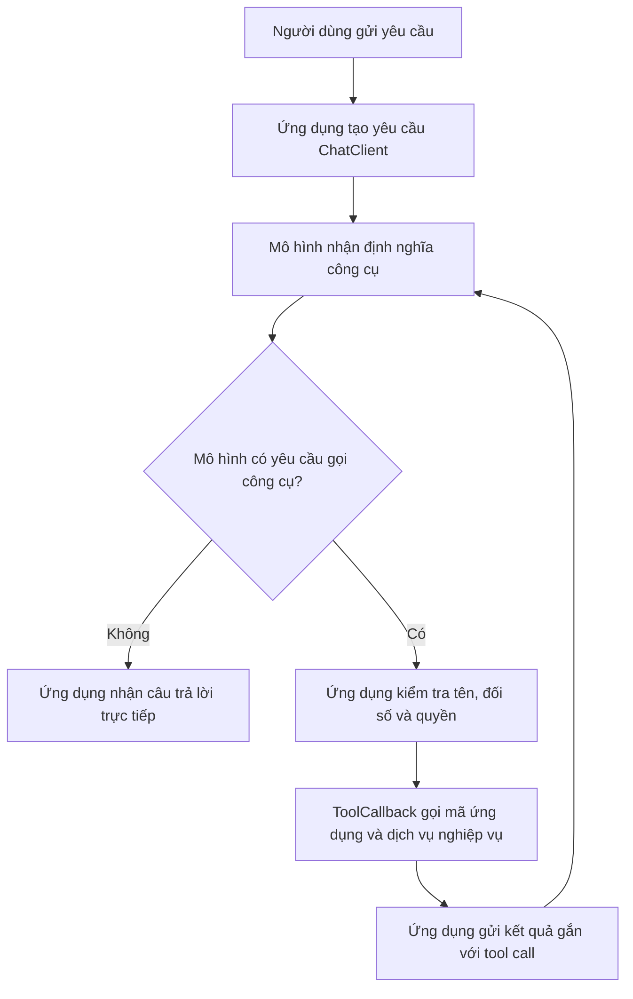

# Kiến thức cần có và lộ trình từ công cụ đầu tiên đến vận hành

Tool calling kết nối mô hình ngôn ngữ với dữ liệu và khả năng của ứng dụng. Người dùng đặt câu hỏi; mô hình có thể đề xuất gọi một công cụ cùng các đối số; ứng dụng kiểm tra yêu cầu, thực thi mã nghiệp vụ rồi gửi kết quả trở lại cho mô hình. Mô hình dùng kết quả đó để tạo câu trả lời tiếp theo.

Trong Spring AI, `@Tool`, `@ToolParam`, `ToolCallback`, schema đầu vào và `ToolContext` giúp ứng dụng mô tả, đăng ký và thực thi các công cụ theo một hợp đồng có cấu trúc. Những API này không chuyển quyền kiểm soát ứng dụng cho mô hình. Ứng dụng vẫn chịu trách nhiệm chọn công cụ nào được cung cấp, xác thực người dùng, kiểm tra quyền, gọi dịch vụ nghiệp vụ, giới hạn thực thi và xử lý lỗi.

Bài này giúp bạn xác định kiến thức nền cần chuẩn bị, hiểu ranh giới trách nhiệm trong một lần gọi công cụ và đi theo lộ trình từ công cụ chỉ đọc đầu tiên đến một tích hợp có thể kiểm thử và vận hành.

## Sau khi học xong, bạn cần làm được gì?

- Giải thích được mô hình chỉ gửi yêu cầu gọi công cụ; mã của ứng dụng mới là nơi thực thi.
- Đọc và thiết kế một hợp đồng công cụ gồm tên, mô tả, tham số, schema và kết quả.
- Chọn cách khai báo bằng `@Tool` hoặc cách tạo `ToolCallback` phù hợp.
- Phân biệt đối số do mô hình sinh với ngữ cảnh đáng tin cậy do ứng dụng truyền vào.
- Theo dõi được một hoặc nhiều lượt gọi công cụ, bao gồm cả trường hợp không có công cụ nào được gọi.
- Kiểm thử quyền truy cập, lỗi, giới hạn thực thi và chất lượng kết quả trước khi đưa tích hợp vào môi trường thật.

## Kiến thức nền cần chuẩn bị

Bạn không cần phải là chuyên gia về AI để bắt đầu. Tuy nhiên, bạn cần đủ kiến thức về Java, Spring và dịch vụ phía sau để nhận biết dữ liệu nào đáng tin cậy và nơi nào phải áp dụng quy tắc nghiệp vụ.

| Nhóm kiến thức | Nội dung nên nắm | Vì sao cần thiết |
|---|---|---|
| Java | Phương thức, tham số, kiểu trả về, class, record, enum, collection, generic, exception và lambda | Công cụ thường được biểu diễn bằng phương thức hoặc hàm Java; dữ liệu đầu vào và đầu ra cần kiểu rõ ràng. |
| Spring và Spring Boot | Bean, dependency injection, cấu hình, profile, service và cách quản lý dependency | Công cụ thường cần gọi service đã có trong ứng dụng và dùng cấu hình theo từng môi trường. |
| HTTP và dịch vụ nghiệp vụ | REST API, timeout, mã lỗi, giao dịch, tính lặp an toàn và tích hợp hệ thống | Công cụ có thể đọc dữ liệu từ dịch vụ khác hoặc yêu cầu một thao tác nghiệp vụ. |
| JSON và hợp đồng dữ liệu | JSON object, kiểu dữ liệu, trường bắt buộc, trường tùy chọn, enum và validation | Mô hình gửi đối số có cấu trúc; ứng dụng cần chuyển đổi và kiểm tra chúng trước khi thực thi. |
| Mô hình ngôn ngữ | Message, vai trò của assistant và tool, prompt, context window, token và tính không xác định | Bạn cần hiểu vì sao mô hình có thể chọn sai công cụ, tạo đối số không hợp lệ hoặc không gọi công cụ. |
| Bảo mật ứng dụng | Authentication, authorization, quyền theo người dùng hoặc tenant, bảo vệ dữ liệu và quản lý secret | Một yêu cầu do mô hình tạo ra không chứng minh người dùng có quyền thực hiện yêu cầu đó. |
| Kiểm thử và vận hành | Unit test, integration test, log, metric, trace, timeout, retry và giới hạn tài nguyên | Một công cụ đúng trong ví dụ đơn lẻ vẫn có thể thất bại khi dịch vụ chậm, có nhiều yêu cầu đồng thời hoặc dữ liệu nhạy cảm. |

Nếu chưa quen Spring, hãy học cách tạo bean và inject một service trước. Nếu chưa quen JSON, hãy thực hành chuyển một JSON object thành DTO và kiểm tra dữ liệu sai. Hai kỹ năng này sẽ giúp bạn hiểu phần lớn công việc phía sau một công cụ.

## Hiểu đúng luồng và ranh giới trách nhiệm

Một lần gọi công cụ thường đi qua các bước sau:



Ba thành phần có trách nhiệm khác nhau:

| Thành phần | Trách nhiệm | Không nên giao cho thành phần này |
|---|---|---|
| Mô hình | Chọn công cụ trong số công cụ được cung cấp, tạo đối số theo schema và diễn giải kết quả | Xác thực danh tính, tự quyết định quyền truy cập hoặc trực tiếp thực thi mã trong ứng dụng |
| Spring AI | Hỗ trợ mô tả và cung cấp công cụ, chuyển tiếp yêu cầu gọi, điều phối callback và trao đổi kết quả theo API đang dùng | Thay thế quy tắc nghiệp vụ hoặc tự xác định người dùng có quyền thực hiện thao tác hay không |
| Ứng dụng | Chọn tập công cụ, xác thực và phân quyền, kiểm tra đầu vào, thực thi nghiệp vụ, giới hạn tài nguyên và ghi nhận hoạt động | Tin rằng đối số do mô hình tạo ra luôn đúng hoặc luôn an toàn |

Thông điệp yêu cầu gọi công cụ là một phần trong trao đổi của assistant. Nó chứa tên công cụ và đối số có cấu trúc; bản thân thông điệp đó chưa phải kết quả thực thi. Ứng dụng cần thực thi công cụ được phép, sau đó gửi thông điệp kết quả tương ứng. Tool call ID giúp liên kết yêu cầu gọi với kết quả của nó, đặc biệt khi có nhiều công cụ trong cùng một lượt.

Nếu mô hình không yêu cầu gọi công cụ, ứng dụng có thể nhận một câu trả lời trực tiếp. Vì vậy, đừng mặc định rằng câu trả lời của mô hình chứng minh dữ liệu đã được truy vấn. Với tác vụ cần dữ liệu mới, ứng dụng phải kiểm tra luồng thực tế và chỉ khẳng định đã tra cứu khi có kết quả thực thi tương ứng.

## Lộ trình học từ công cụ đầu tiên đến vận hành

### 1. Chốt nền tảng và môi trường thử nghiệm

Trước khi viết công cụ, hãy chọn một tổ hợp Java, Spring Boot và Spring AI tương thích. Quản lý dependency theo hướng dẫn của phiên bản Spring AI đang dùng, chẳng hạn thông qua BOM tương ứng. Chọn model provider có hỗ trợ tool calling và xác nhận endpoint, thông tin xác thực cùng giới hạn của provider.

Ghi lại phiên bản JDK, Spring Boot, Spring AI và tên model trong dự án. Đưa secret vào biến môi trường hoặc cơ chế quản lý secret của môi trường chạy; không đặt API key trong mã nguồn, prompt hay schema gửi cho mô hình. Tạo profile kiểm thử dùng model giả lập hoặc tài nguyên thử nghiệm để không phụ thuộc hệ thống sản xuất.

**Kết quả cần đạt:** dự án khởi động được, có thể gửi một yêu cầu chat đơn giản và có cấu hình kiểm thử tái lập.

### 2. Xây dựng công cụ chỉ đọc đầu tiên bằng `@Tool`

Bắt đầu với một thao tác nhỏ, dễ kiểm chứng và không làm thay đổi trạng thái, chẳng hạn tra cứu trạng thái đơn hàng hoặc đọc thông tin một sản phẩm. Tránh bắt đầu bằng công cụ thanh toán, xóa dữ liệu hay cập nhật tài khoản.

Ví dụ dưới đây minh họa một phương thức tra cứu. Tên kiểu và chữ ký có thể cần điều chỉnh theo phiên bản Spring AI của dự án:

```java
@Component
class OrderTools {

    private final OrderQueryService orderQueryService;

    OrderTools(OrderQueryService orderQueryService) {
        this.orderQueryService = orderQueryService;
    }

    @Tool(description = "Tra cứu trạng thái đơn hàng mà người dùng hiện tại có quyền xem")
    OrderStatusView getOrderStatus(
            @ToolParam(description = "Mã đơn hàng cần tra cứu") String orderId,
            ToolContext toolContext) {

        String userId = (String) toolContext.getContext().get("userId");
        return orderQueryService.findStatusForUser(orderId, userId);
    }
}
```

Đoạn mã minh họa hai nguyên tắc. `@Tool` mô tả khả năng mà mô hình có thể yêu cầu; `@ToolParam` giúp mô hình hiểu tham số. `userId` đến từ ngữ cảnh do ứng dụng truyền vào, còn `orderId` là đối số mô hình đề xuất. Service vẫn phải kiểm tra người dùng có quyền xem đơn hàng đó hay không. Không đưa `userId` vào tham số mà mô hình có thể tự chọn.

Sau khi khai báo phương thức, cung cấp đối tượng chứa công cụ cho yêu cầu `ChatClient` theo API của phiên bản đang dùng. Thử ít nhất ba tình huống: câu hỏi phù hợp để gọi công cụ, câu hỏi không cần công cụ và đầu vào khiến công cụ không tìm thấy dữ liệu. Quan sát cả yêu cầu gọi lẫn kết quả thực thi thay vì chỉ đọc câu trả lời cuối.

**Kết quả cần đạt:** bạn giải thích được khi nào mô hình chọn gọi công cụ, phương thức Java nào được chạy và kết quả nào được trả về.

### 3. Thiết kế tên, mô tả và schema đầu vào

Schema là hợp đồng để mô hình tạo đối số. Hãy đặt tên công cụ ngắn gọn, duy nhất trong tập công cụ được cung cấp và thể hiện rõ hành động hoặc dữ liệu cần truy cập. Mô tả nên trả lời ba câu hỏi: công cụ làm gì, nên dùng khi nào và có giới hạn nào.

Với tham số, hãy mô tả ý nghĩa thay vì chỉ lặp lại tên biến. Phân biệt trường bắt buộc, tùy chọn và có thể null; dùng enum cho tập giá trị hữu hạn; dùng DTO hoặc record khi đầu vào có nhiều trường liên quan. Đơn vị, định dạng ngày giờ, múi giờ và quy tắc định danh cần được ghi rõ để tránh hiểu nhầm.

Schema giúp mô hình tạo dữ liệu đúng hình dạng, nhưng không thay thế validation lúc chạy. Ứng dụng vẫn phải kiểm tra độ dài, miền giá trị, định dạng, quan hệ giữa các trường, sự tồn tại của tài nguyên và quyền truy cập. Một đối số đúng kiểu JSON vẫn có thể sai về nghiệp vụ.

**Kết quả cần đạt:** người đọc có thể hiểu hợp đồng công cụ mà không phải xem phần triển khai, và ứng dụng từ chối được đối số sai hoặc không hợp lệ.

### 4. Biết khi nào dùng `@Tool` và khi nào dùng `ToolCallback`

`@Tool` phù hợp khi muốn biến một phương thức Java thành công cụ với cách khai báo gần với mã nghiệp vụ. Khi cần kiểm soát rõ kiểu hàm, cách chuyển đổi hoặc cách tích hợp, bạn có thể tạo callback trực tiếp.

| Cách tiếp cận | Khi phù hợp |
|---|---|
| `@Tool` và `@ToolParam` | Công cụ gắn với một phương thức trong bean Spring; muốn khai báo chức năng và tham số ngay cạnh phần triển khai. |
| `MethodToolCallback` | Muốn tạo callback từ một `Method` và đối tượng chứa phương thức, hoặc cần kiểm soát cách xây dựng callback từ method. |
| `FunctionToolCallback` | Có sẵn `Function`, `Supplier`, `Consumer` hoặc `BiFunction` và muốn bọc hàm đó thành công cụ. |
| `ToolCallback` tùy chỉnh | Cần tự kiểm soát định nghĩa công cụ, schema, chuyển đổi đối số, thực thi và biểu diễn kết quả. |

Không cần học mọi biến thể cùng lúc. Hãy bắt đầu bằng `@Tool`, sau đó thử `FunctionToolCallback` hoặc callback tùy chỉnh khi có yêu cầu cụ thể. Dù chọn cách nào, mỗi callback vẫn cần tên, mô tả, schema, quy tắc kiểm tra và kết quả có ý nghĩa rõ ràng.

**Kết quả cần đạt:** bạn chọn được cách tạo callback dựa trên cấu trúc ứng dụng, thay vì chọn chỉ vì một API có vẻ ngắn hơn.

### 5. Đăng ký công cụ và truyền `ToolContext`

Khai báo một bean có công cụ không có nghĩa là mọi yêu cầu đều được phép gọi công cụ đó. Ứng dụng cần chọn rõ tập công cụ cho từng yêu cầu hoặc từng nhóm người dùng. Giữ tên công cụ duy nhất trong tập đã cung cấp và tránh đưa toàn bộ danh mục nội bộ cho mọi cuộc hội thoại.

`ToolContext` dành cho thông tin do ứng dụng cung cấp khi thực thi, ví dụ định danh người dùng đã xác thực, tenant, mã tương quan hoặc chính sách đã được xác định. Những dữ liệu này không nên được mô hình tự sinh như một phần của JSON arguments. Khi nhận context, callback vẫn phải kiểm tra kiểu dữ liệu, sự hiện diện và nguồn gốc của giá trị trước khi sử dụng.

Quyền phải được kiểm tra tại thời điểm thực thi và trên tài nguyên cụ thể. Ví dụ, việc người dùng được phép gọi `getOrderStatus` không đồng nghĩa họ được xem mọi đơn hàng. Với công cụ ghi dữ liệu, cần đánh giá thêm xác nhận của người dùng, tính lặp an toàn và khả năng khôi phục khi thao tác thất bại.

**Kết quả cần đạt:** mỗi yêu cầu chỉ nhận các công cụ cần thiết và callback có thể xác định người dùng, tenant cùng quyền truy cập từ nguồn đáng tin cậy.

### 6. Hiểu điều phối một lượt và nhiều lượt gọi

Sau khi có tool call, ứng dụng hoặc cơ chế điều phối của Spring AI thực thi callback, thêm kết quả vào lịch sử hội thoại rồi tiếp tục trao đổi với mô hình. Mô hình có thể yêu cầu nhiều công cụ trong một lượt hoặc yêu cầu công cụ ở nhiều lượt liên tiếp.

Với vòng lặp tự động, framework đảm nhiệm phần lớn việc nhận diện yêu cầu, gọi công cụ và tiếp tục hội thoại theo cấu hình của phiên bản. Với điều phối thủ công, ứng dụng đọc `ChatResponse`, kiểm tra tool call, gọi `ToolCallingManager` hoặc callback theo API tương ứng, cập nhật lịch sử thông điệp và quyết định có tiếp tục hay dừng. Điều phối thủ công hữu ích khi cần chèn bước phê duyệt, kiểm tra chính sách hoặc quản lý trạng thái riêng.

Luôn giữ đúng liên kết giữa tool call ID, thứ tự thông điệp và kết quả tương ứng. Đặt giới hạn số vòng mô hình, tổng số lần gọi công cụ, thời gian cho từng công cụ và thời gian tối đa của toàn bộ yêu cầu. Cần có điều kiện dừng khi mô hình lặp lại cùng một lời gọi hoặc khi ngân sách tài nguyên đã hết.

Hành vi điều phối và API có thể thay đổi giữa các phiên bản Spring AI. Đọc tài liệu đúng phiên bản đã khóa trong dependency và kiểm tra rõ thành phần nào đang sở hữu vòng lặp. Tránh vô tình chạy đồng thời một vòng lặp thủ công và một advisor tự động cho cùng yêu cầu.

**Kết quả cần đạt:** bạn có thể mô tả đường đi của một tool call, theo dõi nhiều lần gọi và xác định chính xác điều kiện kết thúc.

### 7. Thiết kế kết quả và xử lý lỗi

Kết quả công cụ nên chứa đúng dữ liệu cần cho bước tiếp theo. Ưu tiên DTO có cấu trúc, tên trường rõ ràng và thông tin nguồn hoặc thời điểm đọc khi tính cập nhật quan trọng. Tránh trả nguyên entity cơ sở dữ liệu, dữ liệu cá nhân không cần thiết, token truy cập, thông tin xác thực hoặc nội dung nội bộ.

Phân loại lỗi trước khi quyết định cách phản hồi:

- Lỗi đối số hoặc schema: dữ liệu không đúng hợp đồng.
- Lỗi phân quyền: người dùng không được phép truy cập tài nguyên hoặc thực hiện hành động.
- Lỗi nghiệp vụ: tài nguyên không tồn tại, trạng thái không cho phép hoặc điều kiện nghiệp vụ chưa thỏa mãn.
- Lỗi hạ tầng: timeout, mất kết nối, giới hạn tốc độ hoặc dịch vụ phía sau không sẵn sàng.

Chỉ trả cho mô hình thông báo lỗi đã được kiểm soát và đủ để nó phản hồi phù hợp. Không gửi stack trace, truy vấn nội bộ hay bí mật hệ thống vào nội dung công cụ. Ứng dụng cần giữ log kỹ thuật riêng có che dữ liệu nhạy cảm. Retry chỉ phù hợp khi biết thao tác có thể lặp an toàn; với thao tác ghi, hãy dùng idempotency key hoặc cơ chế chống thực thi trùng.

**Kết quả cần đạt:** lỗi được phân loại, không làm lộ thông tin nội bộ và không khiến một thao tác nghiệp vụ bị thực hiện nhiều lần ngoài ý muốn.

### 8. Kiểm thử và đưa vào vận hành

Kiểm thử công cụ ở nhiều lớp. Unit test xác minh logic Java, validation và quy tắc nghiệp vụ. Integration test xác minh callback được đăng ký, schema được tạo đúng và dịch vụ phía sau được gọi đúng. Kiểm thử hội thoại xác minh mô hình có thể chọn công cụ phù hợp, xử lý kết quả và dừng đúng lúc. Khi cần kết quả tái lập, dùng model giả lập hoặc stub response thay vì phụ thuộc hoàn toàn vào một lần sinh ngẫu nhiên của model thật.

Ít nhất hãy kiểm tra các tình huống sau:

- Mô hình chọn đúng công cụ và tạo đối số hợp lệ.
- Mô hình không gọi công cụ dù ứng dụng có cung cấp công cụ.
- Đối số thiếu, sai kiểu, vượt giới hạn hoặc tham chiếu tài nguyên không tồn tại.
- Người dùng không có quyền, hoặc cố truy cập dữ liệu thuộc tenant khác.
- Công cụ timeout, dịch vụ phía sau lỗi hoặc trả kết quả rỗng.
- Nhiều tool call xảy ra trong một lượt; một công cụ thất bại trong khi công cụ khác đã hoàn tất.
- Mô hình lặp lại lời gọi, vượt giới hạn vòng lặp hoặc yêu cầu một thao tác cần xác nhận.

Khi vận hành, theo dõi số lần gọi theo tên công cụ, tỷ lệ thành công, loại lỗi, độ trễ, số vòng mô hình, token và chi phí. Dùng trace hoặc correlation ID để nối yêu cầu người dùng với các tool call và lời gọi dịch vụ phía sau. Log đủ để điều tra nhưng phải che dữ liệu cá nhân và secret. Thiết lập timeout, rate limit, giới hạn đồng thời và cảnh báo cho các lỗi có ảnh hưởng đến nghiệp vụ.

Trước khi phát hành, thử với model và cấu hình thực tế, kiểm tra quyền trên từng công cụ, đánh giá dữ liệu trả về và chuẩn bị cách tắt hoặc thu hẹp tập công cụ khi có sự cố. Khi nâng cấp Spring AI hoặc đổi model provider, chạy lại kiểm thử hợp đồng và luồng điều phối vì khả năng tool calling và cách diễn giải schema có thể khác nhau.

**Kết quả cần đạt:** bạn có bằng chứng kiểm thử cho các đường đi thành công và thất bại, đồng thời có thể phát hiện, giới hạn và điều tra hoạt động của công cụ trong môi trường chạy thật.

## Chọn tool calling hay một khả năng khác?

Tool calling là một phần trong thiết kế ứng dụng AI. Không phải yêu cầu nào cũng cần gọi công cụ.

| Nhu cầu | Cách tiếp cận thường phù hợp |
|---|---|
| Trả lời bằng kiến thức tổng quát đã học trong mô hình | Yêu cầu chat thông thường; kiểm tra lại khi cần độ chính xác hoặc dữ liệu mới. |
| Tìm nội dung trong tài liệu nội bộ hoặc kho tri thức | RAG để truy xuất đoạn tài liệu liên quan rồi đưa ngữ cảnh vào mô hình. |
| Đọc dữ liệu hiện tại hoặc yêu cầu một hành động trong hệ thống | Tool calling để ứng dụng thực thi một chức năng nghiệp vụ có kiểm soát. |
| Buộc câu trả lời cuối tuân theo cấu trúc JSON hoặc DTO | Structured output; mục tiêu chính là định dạng đầu ra, không phải thực thi chức năng nghiệp vụ. |
| Chuẩn hóa cách một ứng dụng AI khám phá và gọi công cụ từ hệ thống khác | MCP có thể cung cấp một giao thức trao đổi công cụ; ứng dụng vẫn phải quyết định công cụ nào được phép dùng. |
| Điều phối nhiều bước, nhiều công cụ và quyết định theo trạng thái | Có thể xây dựng một agent hoặc workflow; tool calling là một khả năng mà quá trình đó sử dụng. |

Các cách tiếp cận có thể kết hợp. Chẳng hạn, một công cụ có thể truy vấn dịch vụ tìm kiếm tài liệu, sau đó mô hình tóm tắt kết quả. Điều cần xác định là phần nào chịu trách nhiệm truy xuất, phần nào thực thi nghiệp vụ và nơi nào áp dụng quyền truy cập.

## Bài tập theo từng chặng

Bạn có thể dùng một ứng dụng quản lý đơn hàng giả lập để luyện tập theo thứ tự:

1. Tạo công cụ chỉ đọc `getOrderStatus` và kiểm tra một yêu cầu có gọi đúng công cụ.
2. Bổ sung mô tả tham số, DTO kết quả và validation cho mã đơn hàng không hợp lệ.
3. Truyền định danh người dùng qua `ToolContext`; chứng minh người dùng không thể xem đơn hàng của người khác.
4. Tạo thêm một công cụ đọc thông tin giao hàng và xử lý một lượt có nhiều tool call.
5. Giới hạn số lần gọi, mô phỏng timeout và kiểm tra thông báo lỗi trả về mô hình.
6. Thêm một công cụ cập nhật trạng thái trong môi trường thử nghiệm; yêu cầu xác nhận trước khi thực thi và kiểm tra chống gọi trùng.
7. Bổ sung metric, trace và log có che dữ liệu nhạy cảm; thử lại sau khi đổi phiên bản Spring AI hoặc model provider.

Hoàn thành từng chặng bằng một bằng chứng cụ thể: test pass, log của một luồng đã kiểm tra, schema được xác minh hoặc một tình huống quyền truy cập bị từ chối đúng cách. Điều đó giúp bạn tiến từ ví dụ chạy được sang tích hợp có thể tin cậy.

## Danh sách kiểm tra trước khi đưa công cụ vào môi trường thật

- [ ] Phiên bản Java, Spring Boot, Spring AI và model provider đã được ghi nhận.
- [ ] Công cụ có tên duy nhất, mô tả rõ mục đích và schema phù hợp.
- [ ] Đối số được validation lại trong ứng dụng.
- [ ] Tập công cụ được chọn theo yêu cầu và quyền của người dùng.
- [ ] Danh tính và tenant đến từ ngữ cảnh đáng tin cậy; quyền được kiểm tra trên từng tài nguyên.
- [ ] Kết quả chỉ chứa dữ liệu cần thiết và không làm lộ secret hoặc thông tin nhạy cảm.
- [ ] Có xử lý lỗi, timeout, giới hạn vòng lặp, rate limit và chống thực thi trùng khi cần.
- [ ] Có kiểm thử thành công, thất bại, không gọi công cụ và truy cập trái quyền.
- [ ] Có log, metric hoặc trace đủ để giám sát và điều tra mà vẫn bảo vệ dữ liệu.
- [ ] Có cách thu hồi hoặc tắt công cụ khi phát hiện sự cố.

Khi đã nắm các kiến thức nền và hoàn thành lộ trình này, bạn có thể học sâu từng phần: schema đầu vào, các kiểu `ToolCallback`, `ToolContext`, điều phối tự động hoặc thủ công, giới hạn thực thi, xử lý lỗi, bảo mật và kiểm thử. Hãy giữ một nguyên tắc xuyên suốt: mô hình đề xuất lời gọi; ứng dụng quyết định và chịu trách nhiệm cho việc thực thi.
