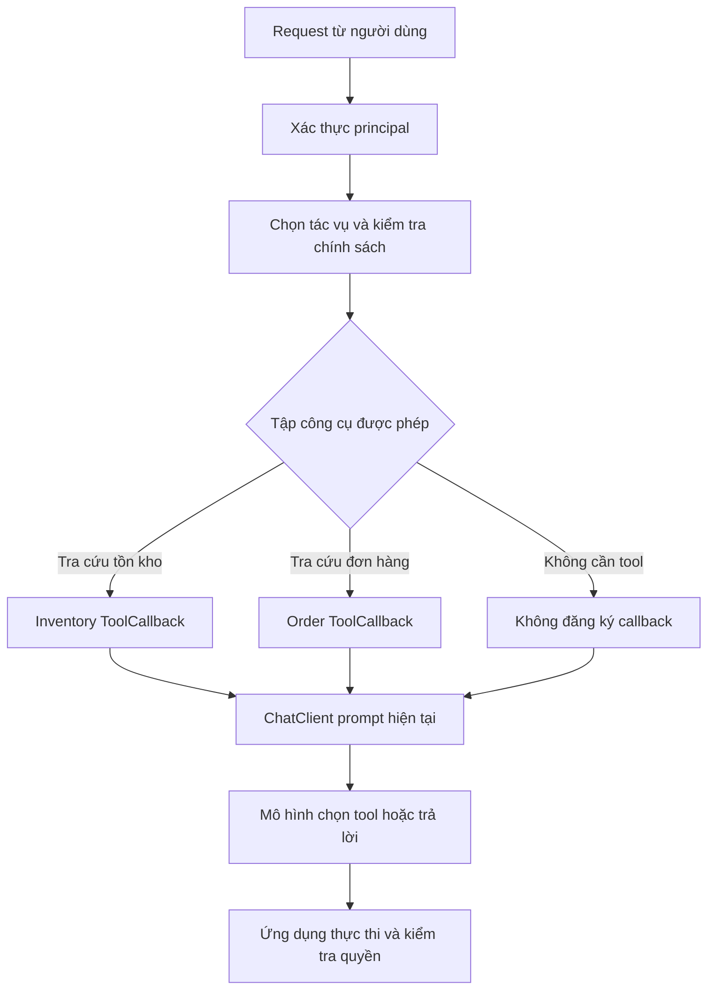

# Cung cấp công cụ theo từng lần gọi ChatClient

Spring AI cho phép ứng dụng quyết định tập công cụ ở từng lần gọi `ChatClient`. Thay vì gắn mọi công cụ vào một client dùng chung, ứng dụng có thể thêm các đối tượng chứa phương thức `@Tool` bằng `.tools(...)` hoặc thêm callback đã được xây dựng sẵn bằng `.toolCallbacks(...)` ngay trên prompt hiện tại.

Cách đăng ký theo từng prompt hữu ích khi một ứng dụng có nhiều loại người dùng, nhiều nghiệp vụ hoặc các công cụ có quyền truy cập khác nhau. Trước khi gửi prompt tới mô hình, mã ứng dụng xác định người gọi đã xác thực, chọn tập callback được phép và cung cấp đúng tập đó cho lần gọi. Mô hình chỉ chọn trong những công cụ ứng dụng đã công bố; service phía máy chủ vẫn phải kiểm tra quyền khi thực thi.

Trong module `SPRING_AI_TOOL_CALLING`, tool calling là cơ chế để mô hình yêu cầu ứng dụng thực hiện một thao tác nghiệp vụ thông qua tên công cụ và đối số có cấu trúc. Ứng dụng điều phối nhiều lượt gọi, xác thực dữ liệu, kiểm tra quyền, xử lý lỗi và trả kết quả về hội thoại. Việc cung cấp công cụ theo từng lần gọi là một điểm kiểm soát quan trọng trong chu trình đó.

Sau bài học, bạn có thể:

- Đăng ký đối tượng có `@Tool` bằng `.tools(...)` cho một prompt.
- Đăng ký `ToolCallback` bằng `.toolCallbacks(...)` cho một prompt.
- Phân biệt đăng ký mặc định ở cấp `ChatClient.Builder` với đăng ký theo từng lần gọi.
- Chọn callback dựa trên principal và chính sách quyền do máy chủ xác định.
- Kết hợp danh sách công cụ, `ToolContext` và nhiều tool call trong một lượt hội thoại.
- Kiểm thử rằng mỗi prompt chỉ nhận đúng tập công cụ dự kiến.

## 1. Tập công cụ là một phần của từng yêu cầu

Một `ChatClient` có thể được dùng cho nhiều tác vụ. Ví dụ, cùng một ứng dụng hỗ trợ khách hàng có thể nhận câu hỏi về tồn kho, trạng thái đơn hàng và hồ sơ khách hàng. Không phải lần gọi nào cũng cần tất cả công cụ.

Hãy hình dung hai yêu cầu:

- Nhân viên kho hỏi số lượng sản phẩm tại một kho. Lượt gọi cần công cụ tra cứu tồn kho.
- Nhân viên chăm sóc khách hàng hỏi tình trạng giao hàng. Lượt gọi cần công cụ tra cứu đơn hàng.

Nếu cung cấp cả hai công cụ trong mọi prompt, mô hình phải lựa chọn giữa nhiều khả năng không liên quan và ứng dụng mở rộng phạm vi thao tác ở mọi luồng. Nếu chọn tập công cụ trước từng prompt, ứng dụng có thể giới hạn khả năng mà mô hình nhìn thấy theo đúng mục đích và quyền của request.



Quyết định cung cấp công cụ thuộc về ứng dụng. Mô hình không được tự yêu cầu một callback chưa được đăng ký cho lượt gọi đó.

## 2. Hai cách cung cấp công cụ ở cấp prompt

Spring AI có hai phương thức thường dùng trên prompt spec:

| Phương thức | Đối tượng truyền vào | Khi phù hợp |
|---|---|---|
| `.tools(...)` | Đối tượng Java có các phương thức được đánh dấu `@Tool` | Ứng dụng đang dùng annotation để khai báo công cụ |
| `.toolCallbacks(...)` | Một hoặc nhiều `ToolCallback` đã được tạo | Ứng dụng muốn tái sử dụng callback hoặc tự kiểm soát định nghĩa công cụ |

Ví dụ với đối tượng `@Tool`:

```java
String answer = chatClient.prompt()
    .user("Mã SKU KB-104 còn bao nhiêu chiếc ở kho HN-01?")
    .tools(inventoryTools)
    .call()
    .content();
```

Ví dụ với callback:

```java
String answer = chatClient.prompt()
    .user("Mã SKU KB-104 còn bao nhiêu chiếc ở kho HN-01?")
    .toolCallbacks(inventoryLookupTool)
    .call()
    .content();
```

`inventoryTools` là đối tượng chứa một hoặc nhiều phương thức `@Tool`. `inventoryLookupTool` là một `ToolCallback`, ví dụ callback được tạo từ `FunctionToolCallback` hoặc `MethodToolCallback`. Chọn một cách phù hợp với kiểu công cụ đang có; không cần đăng ký cùng một công cụ qua cả hai phương thức trong một prompt.

## 3. Chuẩn bị công cụ dùng trong ví dụ

Giả sử ứng dụng có service tra cứu tồn kho và một lớp công cụ khai báo bằng `@Tool`:

```java
import org.springframework.ai.tool.annotation.Tool;
import org.springframework.ai.tool.annotation.ToolParam;
import org.springframework.stereotype.Component;

@Component
public class InventoryTools {

    private final InventoryService inventoryService;

    public InventoryTools(InventoryService inventoryService) {
        this.inventoryService = inventoryService;
    }

    @Tool(
        name = "lookup_inventory",
        description = "Tra cứu số lượng tồn kho của một mã sản phẩm tại một kho. "
            + "Chỉ đọc tồn kho, không thay đổi số lượng."
    )
    public InventoryLookupResult lookupInventory(
            @ToolParam(description = "Mã SKU của sản phẩm") String sku,
            @ToolParam(description = "Mã kho cần tra cứu") String warehouseCode) {

        if (sku == null || sku.isBlank()) {
            throw new IllegalArgumentException("sku không được để trống");
        }
        if (warehouseCode == null || warehouseCode.isBlank()) {
            throw new IllegalArgumentException("warehouseCode không được để trống");
        }

        return inventoryService.lookup(sku.strip(), warehouseCode.strip());
    }
}
```

Lớp công cụ chỉ đóng vai trò adapter. `InventoryService` thực hiện truy vấn và áp dụng quy tắc nghiệp vụ. DTO kết quả nên chứa các trường cần thiết cho câu trả lời, chẳng hạn SKU, mã kho, số lượng có thể bán và trạng thái còn hàng.

Nếu ứng dụng đã tạo callback bean, có thể inject trực tiếp callback đó:

```java
@Bean
ToolCallback inventoryLookupTool(InventoryService inventoryService) {
    Function<InventoryLookupRequest, InventoryLookupResult> function = request ->
        inventoryService.lookup(request.sku(), request.warehouseCode());

    return FunctionToolCallback.builder("lookup_inventory", function)
        .description("Tra cứu số lượng tồn kho theo SKU và mã kho; chỉ đọc dữ liệu.")
        .inputType(InventoryLookupRequest.class)
        .build();
}
```

Trong các ví dụ tiếp theo, có thể dùng `InventoryTools` qua `.tools(...)` hoặc `inventoryLookupTool` qua `.toolCallbacks(...)`. Cả hai đều minh họa việc chọn công cụ ngay trên prompt.

## 4. Cung cấp công cụ cho đúng một lần gọi

Khi chỉ một thao tác cần công cụ tồn kho, thêm nó vào prompt đó:

```java
@Service
public class InventoryAssistant {

    private final ChatClient chatClient;
    private final InventoryTools inventoryTools;

    public InventoryAssistant(
            ChatClient chatClient,
            InventoryTools inventoryTools) {
        this.chatClient = chatClient;
        this.inventoryTools = inventoryTools;
    }

    public String answerInventoryQuestion(String question) {
        return chatClient.prompt()
            .user(question)
            .tools(inventoryTools)
            .call()
            .content();
    }
}
```

Trong ví dụ này, `.tools(inventoryTools)` thuộc prompt đang được xây dựng. Một lần gọi khác qua cùng `chatClient` không tự động kế thừa đối tượng công cụ được thêm vào prompt trước đó.

Với callback đã tạo sẵn, thay `.tools(inventoryTools)` bằng `.toolCallbacks(inventoryLookupTool)`. Cách này phù hợp khi callback được đóng gói thành Spring bean và cần dùng lại ở nhiều assistant.

## 5. Đăng ký mặc định và đăng ký theo từng prompt

Spring AI cũng cho phép đặt công cụ mặc định khi xây dựng `ChatClient`:

```java
ChatClient inventoryClient = chatClientBuilder
    .defaultTools(inventoryTools)
    .build();
```

Hoặc đăng ký callback mặc định:

```java
ChatClient inventoryClient = chatClientBuilder
    .defaultToolCallbacks(inventoryLookupTool)
    .build();
```

Các công cụ mặc định được cấu hình ở cấp builder sẽ có mặt trong những prompt sử dụng client đó theo cấu hình mặc định. Ngược lại, `.tools(...)` và `.toolCallbacks(...)` được gọi trên prompt để cung cấp thêm công cụ cho lần gọi hiện tại.

| Cấp cấu hình | API | Phạm vi |
|---|---|---|
| `ChatClient.Builder` | `defaultTools(...)` | Công cụ mặc định của client |
| `ChatClient.Builder` | `defaultToolCallbacks(...)` | Callback mặc định của client |
| Prompt hiện tại | `tools(...)` | Đối tượng `@Tool` được thêm cho lần gọi |
| Prompt hiện tại | `toolCallbacks(...)` | Callback được thêm cho lần gọi |

Nếu mục tiêu là giới hạn công cụ theo từng người dùng hoặc từng nghiệp vụ, tránh đặt công cụ nhạy cảm làm mặc định trên một `ChatClient` dùng chung cho mọi caller. Có thể tạo client chuyên biệt cho một nhóm quyền ổn định, hoặc dùng một client không có công cụ mặc định rồi bổ sung callback theo từng prompt.

Đăng ký mặc định và đăng ký theo prompt có thể cùng tồn tại trong một ứng dụng. Hãy kiểm tra tập công cụ cuối cùng được gửi tới model theo phiên bản Spring AI đang dùng và tránh trùng tên công cụ giữa các nguồn đăng ký.

## 6. Chọn callback dựa trên quyền của người gọi

Không nên để mô hình tự quyết định người dùng có quyền sử dụng công cụ nào. Ứng dụng phải xác thực người gọi trước, sau đó dùng chính sách phía máy chủ để chọn callback cho prompt.

Ví dụ, một policy service trả về danh sách callback mà principal được phép dùng:

```java
public interface ToolAccessPolicy {
    List<ToolCallback> callbacksFor(AuthenticatedPrincipal principal);
}
```

Assistant chọn callback trước khi gọi mô hình:

```java
@Service
public class SupportAssistant {

    private final ChatClient chatClient;
    private final ToolAccessPolicy toolAccessPolicy;

    public SupportAssistant(
            ChatClient chatClient,
            ToolAccessPolicy toolAccessPolicy) {
        this.chatClient = chatClient;
        this.toolAccessPolicy = toolAccessPolicy;
    }

    public String answer(String question, AuthenticatedPrincipal principal) {
        List<ToolCallback> allowedCallbacks =
            toolAccessPolicy.callbacksFor(principal);

        var prompt = chatClient.prompt().user(question);

        if (!allowedCallbacks.isEmpty()) {
            prompt.toolCallbacks(allowedCallbacks.toArray(ToolCallback[]::new));
        }

        return prompt.call().content();
    }
}
```

`AuthenticatedPrincipal` phải được tạo từ cơ chế xác thực của ứng dụng, chẳng hạn Spring Security. Không dựng principal từ tên, role hoặc tenant do người dùng ghi trong prompt. `ToolAccessPolicy` phải kiểm tra quyền dựa trên nguồn tin cậy và trả về đúng các callback được phép.

Nếu danh sách rỗng, prompt không nhận thêm callback từ policy. Nếu client có công cụ mặc định, những công cụ mặc định đó vẫn thuộc cấu hình của client; do vậy, muốn kiểm soát tập công cụ hoàn toàn theo request, hãy sử dụng client không mang các callback mặc định có giới hạn quyền.

## 7. Không nhầm việc mô hình chọn tool với việc cấp quyền

Việc chỉ cung cấp callback được phép là một lớp giới hạn hữu ích, nhưng chưa thay thế phân quyền tại service. Một callback có thể được gọi bởi nhiều assistant, hoặc một request có thể chứa dữ liệu do mô hình tự suy luận. Vì vậy, service vẫn cần xác minh quyền mỗi lần thực thi.

Ví dụ, `lookup_inventory` có thể chỉ được cung cấp cho nhân viên kho. Khi callback được gọi, service vẫn phải kiểm tra người dùng có quyền xem kho được yêu cầu và SKU thuộc phạm vi dữ liệu mà người dùng được phép truy cập hay không.

Các nguyên tắc quan trọng:

- Xác thực principal trước khi chọn callback.
- Chọn callback bằng policy phía máy chủ, không dựa vào lời mô hình tự nhận mình có quyền.
- Kiểm tra quyền ở cấp chức năng, tenant và tài nguyên trong service.
- Coi mọi arguments do mô hình tạo là đầu vào không đáng tin cậy.
- Không đưa callback quản trị hoặc callback có tác động phụ vào prompt của caller không đủ quyền.
- Với công cụ ghi/xóa/thanh toán, yêu cầu xác nhận hoặc phê duyệt phù hợp và bảo vệ khỏi thực thi trùng.

Prompt injection có thể khiến mô hình cố yêu cầu một công cụ hoặc đối số ngoài mục đích ban đầu. Nếu callback không được cung cấp, mô hình không thể gọi callback đó qua lượt này; nếu callback được cung cấp, service vẫn phải kiểm tra quyền và dữ liệu trước khi thực thi.

## 8. Kết hợp `ToolContext` với callback theo từng prompt

Đối số công khai và context tin cậy có nguồn khác nhau. Ví dụ, mô hình có thể sinh `sku` và `warehouseCode`, còn ứng dụng lấy `tenantId` từ principal đã xác thực.

Khi gọi `ChatClient`, ứng dụng có thể truyền context cho lượt tool calling:

```java
chatClient.prompt()
    .user("Tra cứu SKU KB-104 tại kho HN-01")
    .toolContext(Map.of("tenantId", principal.tenantId()))
    .toolCallbacks(inventoryLookupTool)
    .call()
    .content();
```

Với phương thức `@Tool` cần nhận context, có thể khai báo `ToolContext` như tham số đặc biệt theo hỗ trợ của Spring AI:

```java
@Tool(description = "Tra cứu tồn kho trong tenant hiện tại")
public InventoryLookupResult lookupInventory(
        @ToolParam(description = "Mã SKU") String sku,
        @ToolParam(description = "Mã kho") String warehouseCode,
        ToolContext toolContext) {

    String tenantId = (String) toolContext.getContext().get("tenantId");
    if (tenantId == null || tenantId.isBlank()) {
        throw new IllegalStateException("Thiếu tenant context");
    }

    return inventoryService.lookup(tenantId, sku, warehouseCode);
}
```

`ToolContext` được cung cấp từ phía ứng dụng và không phải trường mà mô hình cần sinh trong JSON arguments. Với `FunctionToolCallback` có chữ ký `Function<I, O>` đơn giản, function không tự nhận tham số `ToolContext`; nếu cần context trong function, hãy dùng biến thể context-aware được phiên bản Spring AI đang sử dụng hỗ trợ hoặc tạo adapter phù hợp. Không giả định `.toolContext(...)` tự động truyền context vào mọi kiểu callback.

Chỉ truyền dữ liệu cần thiết. Không đưa password, access token hoặc secret vào context nếu callback không cần chúng. Context cũng không thay thế việc service kiểm tra quyền trên tài nguyên cụ thể.

## 9. Công cụ theo từng lượt trong hội thoại nhiều vòng

Một lần gọi `ChatClient` có thể trải qua nhiều bước: mô hình yêu cầu tool, ứng dụng thực thi, gửi kết quả về mô hình và mô hình tiếp tục trả lời hoặc yêu cầu công cụ khác. Khi Spring AI quản lý vòng tool calling tự động, các callback đã đăng ký cho prompt đó được dùng trong quá trình xử lý của lượt gọi.

Nếu ứng dụng tạo một prompt mới cho lượt hội thoại tiếp theo, hãy chọn và cung cấp lại tập công cụ cho prompt mới. Việc lưu lịch sử hội thoại hoặc bật chat memory không đồng nghĩa với việc callback theo prompt trước được giữ lại như quyền mặc định cho các lượt sau.

Điều này quan trọng với quyền truy cập: principal hoặc quyền có thể thay đổi giữa các lượt. Ứng dụng nên xác thực lại theo request hiện tại và chọn callback theo chính sách hiện hành, thay vì tin rằng người dùng vẫn có quyền giống lượt trước.

Khi một phản hồi yêu cầu nhiều tool call, chỉ cung cấp các callback mà ứng dụng đã cho phép trong lượt đó. Việc thực thi song song hay tuần tự phụ thuộc quan hệ giữa các công cụ và cấu hình điều phối. Chỉ chạy song song khi các thao tác độc lập và an toàn khi đồng thời. Đặt giới hạn số vòng, timeout và kích thước kết quả để tránh chu trình gọi công cụ kéo dài không kiểm soát.

## 10. Tránh tên công cụ trùng và tập công cụ quá rộng

Tên công cụ là định danh được dùng để ánh xạ tool call tới callback. Trong tập công cụ cuối cùng của một prompt, mỗi tên cần phân giải rõ ràng.

Nếu `defaultToolCallbacks(...)` đã cung cấp `lookup_inventory`, không nên thêm một callback khác có cùng tên bằng `.toolCallbacks(...)` trong cùng prompt. Nếu có hai nghiệp vụ khác nhau, hãy đặt tên rõ ràng như `lookup_inventory` và `lookup_order_status`.

Không cần đưa tất cả công cụ của toàn hệ thống vào một prompt. Một tập công cụ nhỏ và có mô tả tốt giúp mô hình lựa chọn dễ hơn, giảm nguy cơ gọi nhầm và thu hẹp bề mặt thực thi mà ứng dụng phải bảo vệ.

## 11. Xử lý khi không có công cụ phù hợp

Không phải câu hỏi nào cũng cần tool call. Nếu danh sách callback theo policy rỗng, ứng dụng có thể gọi mô hình mà không thêm công cụ; mô hình sẽ trả lời từ nội dung prompt và kiến thức sẵn có. Với những câu hỏi đòi hỏi dữ liệu cập nhật, ứng dụng nên hướng dẫn mô hình nói rõ giới hạn nếu không có nguồn dữ liệu được phép.

Nếu có callback nhưng mô hình không chọn công cụ, đó có thể là hành vi đúng nếu câu hỏi không cần tra cứu. Không ép mô hình gọi tool cho mọi câu hỏi bằng cách đưa mô tả công cụ quá rộng hoặc prompt chỉ thị không phù hợp.

Nếu người dùng yêu cầu một thao tác mà policy không cấp callback, ứng dụng có thể trả lời rằng thao tác không khả dụng hoặc người dùng cần quyền phù hợp. Không yêu cầu mô hình tự tạo callback hoặc đoán tên công cụ khác.

## 12. Kiểm thử việc cung cấp công cụ theo từng lần gọi

Nên kiểm thử ba phần riêng biệt.

**Kiểm thử policy:** với principal có quyền kho, policy trả callback tồn kho; principal chỉ có quyền hỗ trợ đơn hàng không nhận callback tồn kho; principal không có quyền nhận danh sách rỗng hoặc tập công cụ công khai phù hợp.

**Kiểm thử prompt:** dùng model giả hoặc ChatModel test double để kiểm tra request gửi đi có đúng tên và schema của callback mong đợi. Xác nhận prompt khác qua cùng `ChatClient` không nhận callback đã thêm ở prompt trước.

**Kiểm thử thực thi:** mô phỏng tool call hợp lệ và không hợp lệ, xác nhận callback gọi service đúng đối số, `ToolContext` được lấy từ ứng dụng và service từ chối truy cập trái phép.

Ma trận kiểm thử cơ bản:

| Trường hợp | Tập công cụ mong đợi | Kết quả mong đợi |
|---|---|---|
| Nhân viên kho hỏi tồn kho | `lookup_inventory` | Có thể tra cứu theo SKU/kho được phép |
| Nhân viên hỗ trợ hỏi giao hàng | `lookup_order_status` | Không thấy công cụ tồn kho nếu không cần |
| Caller không có quyền tra cứu | Không có callback nhạy cảm | Không thể thực hiện thao tác |
| Hai prompt liên tiếp cần hai nhóm công cụ khác nhau | Mỗi prompt nhận tập riêng | Không rò công cụ từ prompt trước |
| Callback được cung cấp nhưng SKU thuộc kho ngoài phạm vi | Có callback tồn kho | Service từ chối truy cập tài nguyên |
| Mô hình không yêu cầu tool | Callback vẫn được công bố | Không thực thi service ngoài yêu cầu |
| Prompt có callback trùng tên | Không hợp lệ về cấu hình | Phát hiện xung đột trước khi chạy |

## 13. Lỗi thường gặp

| Triệu chứng | Nguyên nhân | Cách xử lý |
|---|---|---|
| Công cụ không xuất hiện với mô hình | Quên gọi `.tools(...)` hoặc `.toolCallbacks(...)` trên prompt và không có default | Đăng ký callback cho đúng lượt gọi |
| Công cụ xuất hiện trong mọi prompt | Được cấu hình bằng `defaultTools` hoặc `defaultToolCallbacks` trên client dùng chung | Chuyển sang đăng ký theo prompt hoặc client chuyên biệt |
| Prompt sau vẫn dùng nhầm tập công cụ | Tái sử dụng danh sách callback đã lưu theo caller hoặc mặc định quá rộng | Tính lại tập callback theo principal ở mỗi request |
| Spring báo nhiều bean cùng kiểu | Inject `ToolCallback` mà không phân biệt bean | Dùng `@Qualifier` hoặc inject danh sách có chủ đích |
| Tool name bị trùng | Hai callback khác nhau dùng cùng tên trong tập prompt | Đặt tên duy nhất và kiểm tra tập công cụ cuối cùng |
| Người dùng gọi được công cụ ngoài quyền | Chỉ dựa vào mô tả hoặc prompt để phân quyền | Chọn callback bằng policy server và kiểm tra quyền trong service |
| Tenant bị lẫn giữa request | Lưu context trong field hoặc capture khi tạo singleton | Truyền context theo request, không giữ state người dùng trong callback |
| Tool call chạy nhiều vòng quá lâu | Không có giới hạn vòng, timeout hoặc kích thước kết quả | Đặt ngân sách điều phối và timeout rõ ràng |

## 14. Ghi nhớ

- `.tools(...)` cung cấp đối tượng chứa phương thức `@Tool` cho prompt hiện tại.
- `.toolCallbacks(...)` cung cấp các callback đã tạo sẵn cho prompt hiện tại.
- `defaultTools(...)` và `defaultToolCallbacks(...)` đặt công cụ mặc định ở cấp `ChatClient.Builder`; dùng chúng khi công cụ phù hợp với mọi prompt của client.
- Muốn giới hạn công cụ theo caller hoặc nghiệp vụ, xác thực và chọn callback ở phía máy chủ trước mỗi lần gọi.
- `ToolContext` truyền dữ liệu tin cậy do ứng dụng tạo; nó tách biệt với arguments do mô hình sinh và không thay thế phân quyền.
- Công cụ theo prompt không tự động trở thành quyền mặc định cho prompt tiếp theo; hãy chọn lại tập công cụ ở mỗi request.
- Service phải xác thực dữ liệu và quyền mỗi lần callback chạy, kể cả khi callback chỉ được cung cấp cho nhóm người dùng đã xác thực.

Khi xây dựng assistant có nhiều nghiệp vụ, hãy để `ChatClient` dùng chung không mang các công cụ nhạy cảm làm mặc định. Ở mỗi request, xác thực principal, chọn callback theo policy, thêm chúng bằng `.tools(...)` hoặc `.toolCallbacks(...)`, truyền context tin cậy nếu cần và kiểm thử tập công cụ cuối cùng cùng hành vi service.
