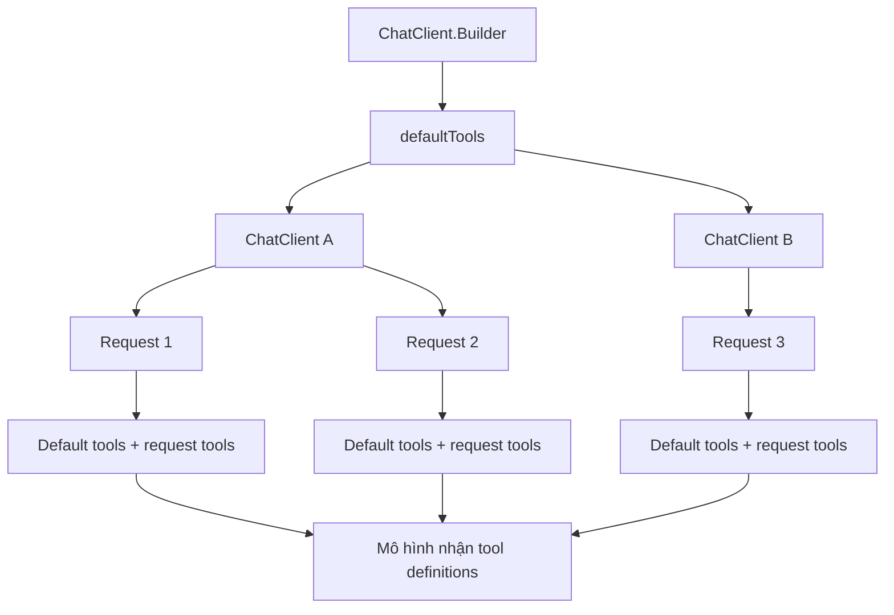

# Đăng ký công cụ

## Đặt công cụ mặc định và đánh giá phạm vi dùng chung

Spring AI cho phép đăng ký tool ở nhiều phạm vi: trên `ChatModel`, trên `ChatClient.Builder` hoặc trực tiếp trong một request. Chọn đúng phạm vi giúp giảm việc khai báo lặp lại và giữ cho mô hình chỉ nhìn thấy những thao tác phù hợp với yêu cầu hiện tại.

Trong module `SPRING_AI_TOOL_CALLING`, `@Tool`, `ToolCallback`, `ToolCallbackProvider` và `ToolContext` là các thành phần giúp ứng dụng mô tả và thực thi công cụ. Đăng ký một tool làm mặc định có nghĩa là tool đó được cung cấp cho nhiều request theo phạm vi của đối tượng được cấu hình. Điều này tiện lợi với các công cụ dùng chung, nhưng có thể mở rộng quyền thao tác ngoài ý muốn nếu đưa tool nhạy cảm vào một client dùng chung.

### 1. Ba phạm vi đăng ký công cụ

Spring AI có hai điểm vào chính để điều phối tool calling: `ChatClient` ở tầng ứng dụng và `ChatModel` ở tầng provider. Mỗi điểm vào có quy tắc mặc định riêng.

| Phạm vi | Cách đăng ký | Phạm vi áp dụng | Phù hợp với |
| --- | --- | --- | --- |
| `ChatModel` mặc định | `ToolCallingChatOptions.toolCallbacks(...)` khi tạo model | Các request dùng model đó, trừ khi request options thay thế defaults | Hạ tầng hoặc luồng gọi `ChatModel` trực tiếp |
| `ChatClient` mặc định | `ChatClient.Builder.defaultTools(...)` | Các request từ những `ChatClient` được tạo bằng builder đó | Công cụ ít rủi ro, luôn hữu ích cho một nhóm chức năng |
| Theo request | `ChatClientRequestSpec.tools(...)` hoặc `ToolCallingChatOptions.toolCallbacks(...)` | Một request cụ thể | Công cụ phụ thuộc nhiệm vụ, vai trò, tenant hoặc thao tác cần xác nhận |

Điểm cần nhớ là phạm vi đăng ký quyết định tool definitions nào được cung cấp cho mô hình trong request. Mô hình có thể chọn gọi một tool trong danh sách đó, nhưng ứng dụng mới là bên thực thi callback. Việc tool xuất hiện trong danh sách không thay thế xác thực, phân quyền hoặc kiểm tra điều kiện nghiệp vụ ở service.



Sơ đồ trên mô tả quy tắc kết hợp của `ChatClient` trong tài liệu Spring AI 2.1.0. Các phiên bản trước có thể có semantics khác; phần migration bên dưới chỉ rõ điểm cần kiểm tra.

### 2. Đặt công cụ mặc định trên `ChatClient.Builder`

Với ứng dụng dùng `ChatClient`, cách phổ biến là cấu hình tool dùng chung khi tạo client. `defaultTools(Object...)` nhận nhiều kiểu đầu vào:

- POJO có method được đánh dấu `@Tool`.
- Một `ToolCallback` đã được tạo bằng `MethodToolCallback` hoặc `FunctionToolCallback`.
- `ToolCallbackProvider`.
- Mảng hoặc collection chứa các loại trên.

Có thể trộn các kiểu trong cùng một lời gọi `defaultTools(...)`.

Ví dụ, một trợ lý hỗ trợ khách hàng luôn cần công cụ tra cứu thời gian và hướng dẫn sử dụng:

```java
@Configuration(proxyBeanMethods = false)
public class AssistantConfiguration {

    @Bean
    ChatClient supportChatClient(
            ChatClient.Builder builder,
            DateTimeTools dateTimeTools,
            HelpCenterTools helpCenterTools) {

        return builder
            .defaultTools(dateTimeTools, helpCenterTools)
            .build();
    }
}
```

Sau đó, các request dùng `supportChatClient` có thể gọi những tool mặc định mà không cần khai báo lại:

```java
String answer = supportChatClient.prompt()
    .user("Giờ hiện tại ở Việt Nam là mấy giờ và tôi có thể đổi mật khẩu ở đâu?")
    .call()
    .content();
```

Nếu một request cần thêm một công cụ tra cứu đơn hàng, có thể truyền nó tại thời điểm gọi:

```java
String answer = supportChatClient.prompt()
    .user("Kiểm tra đơn hàng ORD-2048 giúp tôi.")
    .tools(orderQueryTools)
    .call()
    .content();
```

Theo tài liệu Spring AI 2.1.0, `.tools(...)` ở cấp request **bổ sung** vào danh sách `.defaultTools(...)`. Mô hình nhận hợp của hai danh sách. Vì vậy, `.tools(orderQueryTools)` không có nghĩa là chỉ có `orderQueryTools`; các tool mặc định vẫn khả dụng trong request đó.

### 3. Phạm vi thực tế của builder và client

Spring Boot auto-configure một `ChatClient.Builder` prototype-scoped. Mỗi injection point nhận một builder mới để tạo cấu hình riêng. `ChatClient` được tạo từ builder thường được khai báo thành Spring bean singleton, vì vậy các request dùng cùng client sẽ chia sẻ cấu hình mặc định của client đó.

Ví dụ tạo hai client với tập tool khác nhau:

```java
@Configuration(proxyBeanMethods = false)
public class ChatClientsConfiguration {

    @Bean
    ChatClient readOnlyChatClient(
            ChatClient.Builder builder,
            CatalogTools catalogTools,
            HelpCenterTools helpCenterTools) {

        return builder
            .defaultTools(catalogTools, helpCenterTools)
            .build();
    }

    @Bean
    ChatClient operationsChatClient(
            ChatClient.Builder builder,
            CatalogTools catalogTools,
            HelpCenterTools helpCenterTools,
            OrderOperationsTools orderOperationsTools) {

        return builder
            .defaultTools(catalogTools, helpCenterTools, orderOperationsTools)
            .build();
    }
}
```

Hai injection point nhận hai builder prototype riêng, nên cấu hình defaults không bị nối tiếp từ bean này sang bean kia. Mỗi `ChatClient` sau khi build giữ tập defaults của nó và dùng tập đó cho các request sau.

Không nên hiểu prototype builder là mỗi request tự có một `ChatClient` mới. Nếu `ChatClient` được tạo thành bean singleton, các request vẫn dùng chung client và các tool object đã cấu hình. Vì vậy, tool object cần an toàn khi nhiều request chạy đồng thời.

### 4. Đối tượng nào được chia sẻ?

Khi gọi `defaultTools(toolA, toolB)`, các tool được gắn vào cấu hình client. Nếu `toolA` và `toolB` là Spring singleton bean, nhiều request có thể gọi cùng một instance.

Điều này thường phù hợp với tool stateless, chỉ phụ thuộc các service thread-safe. Nó nguy hiểm nếu tool lưu dữ liệu riêng của request trong field hoặc thay đổi trạng thái dùng chung.

Ví dụ không nên dùng:

```java
@Component
public class OrderTools {

    private String currentTenantId;

    public void setCurrentTenantId(String tenantId) {
        this.currentTenantId = tenantId;
    }

    @Tool(description = "Tra cứu đơn hàng")
    public OrderSummary lookupOrder(String orderId) {
        return orderService.findOrder(orderId, currentTenantId);
    }
}
```

Nếu hai request của tenant khác nhau chạy đồng thời, một request có thể ghi đè `currentTenantId` trong khi request còn lại đang thực thi. Kết quả là truy vấn sai tenant.

Hãy truyền dữ liệu theo request qua `ToolContext`:

```java
@Component
public class OrderTools {

    private final OrderQueryService orderQueryService;

    public OrderTools(OrderQueryService orderQueryService) {
        this.orderQueryService = orderQueryService;
    }

    @Tool(description = "Tra cứu đơn hàng mà người dùng hiện tại có quyền xem")
    public OrderSummary lookupOrder(
            @ToolParam(description = "Mã đơn hàng") String orderId,
            ToolContext toolContext) {

        String tenantId = (String) toolContext.getContext().get("tenantId");
        String userId = (String) toolContext.getContext().get("userId");

        if (tenantId == null || userId == null) {
            throw new IllegalStateException("Thiếu ngữ cảnh xác thực.");
        }

        return orderQueryService.findVisibleOrder(orderId, tenantId, userId);
    }
}
```

Tool object vẫn có thể được dùng chung; dữ liệu của từng lần gọi được truyền qua đối số hoặc `ToolContext`. Service phải kiểm tra quyền sở hữu đơn hàng theo danh tính và tenant đã xác thực. Không để mô hình tự khai báo `tenantId`, `userId` hoặc quyền của người dùng trong schema đầu vào.

### 5. Truyền `ToolContext` theo từng request

`defaultToolContext(...)` thiết lập context mặc định trên builder. `toolContext(...)` tại request cung cấp các giá trị cho lần gọi cụ thể. Theo tài liệu Spring AI 2.1, các giá trị request được gộp với context mặc định; nếu trùng key thì giá trị request ghi đè giá trị mặc định.

Ví dụ:

```java
@Bean
ChatClient supportChatClient(ChatClient.Builder builder, CommonTools commonTools) {
    return builder
        .defaultTools(commonTools)
        .defaultToolContext(Map.of("application", "support-portal"))
        .build();
}
```

Khi xử lý một request:

```java
String answer = supportChatClient.prompt()
    .user(question)
    .toolContext(Map.of(
        "tenantId", authenticatedUser.tenantId(),
        "userId", authenticatedUser.id(),
        "requestId", requestId))
    .call()
    .content();
```

Tool nhận context qua tham số `ToolContext`. Các giá trị trong context không được gửi cho mô hình như tham số tool schema; chúng là dữ liệu runtime do ứng dụng cung cấp.

Không đặt `userId`, `tenantId`, vai trò hoặc quyền truy cập vào `defaultToolContext` của một client dùng chung. Nếu request quên truyền một key, giá trị mặc định vẫn có thể được dùng. Đối với thông tin định danh và phân quyền, hãy truyền rõ ràng ở từng request và kiểm tra lại trong service. Context mặc định chỉ nên chứa cấu hình dùng chung, không nhạy cảm và không thay đổi theo người dùng.

### 6. Chọn tool mặc định theo mức độ rủi ro

Đặt tool mặc định làm cho tool definitions xuất hiện trong mọi request từ client đó. Điều này ảnh hưởng đến những thao tác mô hình có thể yêu cầu. Không nên đưa mọi tool của ứng dụng vào một client chỉ vì chúng đã tồn tại dưới dạng Spring bean.

Một cách phân loại thực tế:

| Nhóm tool | Ví dụ | Phạm vi phù hợp |
| --- | --- | --- |
| Đọc thông tin công khai, ít rủi ro | Giờ hiện tại, FAQ, danh mục sản phẩm công khai | Có thể đặt mặc định cho client tương ứng |
| Đọc dữ liệu riêng theo người dùng | Đơn hàng, hồ sơ, hóa đơn | Chỉ thêm vào request hoặc client dành cho chức năng đó; luôn kiểm tra quyền ở service |
| Thay đổi trạng thái | Cập nhật địa chỉ giao hàng, tạo phiếu hỗ trợ | Đăng ký theo request và kiểm tra điều kiện nghiệp vụ |
| Tác động lớn hoặc khó đảo ngược | Hủy đơn, hoàn tiền, xóa tài khoản, thanh toán | Chỉ cung cấp trong luồng chuyên biệt, yêu cầu xác nhận và audit |

`returnDirect`, mô tả tool hoặc system prompt không phải cơ chế phân quyền. Nếu tool có thể thay đổi dữ liệu, callback phải kiểm tra quyền và điều kiện thực thi mỗi lần được gọi. Với thao tác quan trọng, cần bước xác nhận của người dùng hoặc người có thẩm quyền trước khi thực thi.

### 7. Dùng request-level tools để giới hạn capability

Với client không có tool nhạy cảm trong defaults, ứng dụng có thể chọn tập tool cho mỗi request dựa trên chức năng và quyền của người dùng.

```java
List<Object> allowedTools = new ArrayList<>();
allowedTools.add(catalogTools);

if (authorizationService.canReadOrders(authenticatedUser)) {
    allowedTools.add(orderQueryTools);
}

if (authorizationService.canCreateSupportTicket(authenticatedUser)) {
    allowedTools.add(supportTicketTools);
}

String answer = baseChatClient.prompt()
    .user(question)
    .tools(allowedTools.toArray())
    .toolContext(Map.of(
        "tenantId", authenticatedUser.tenantId(),
        "userId", authenticatedUser.id()))
    .call()
    .content();
```

Ví dụ này giả định `baseChatClient` không có các tool riêng tư trong `defaultTools`. Trong Spring AI 2.1.0, request-level `.tools(...)` bổ sung vào defaults; do đó, nếu client đã có một tool nhạy cảm ở defaults, danh sách `allowedTools` không thể loại bỏ tool đó.

Nếu cần các nhóm quyền khác nhau, có thể tạo nhiều `ChatClient` với tập defaults riêng hoặc dùng một client chung không có tool nhạy cảm rồi chỉ gắn tool phù hợp theo request. Dù chọn cách nào, service vẫn phải kiểm tra quyền vì danh sách tool chỉ là một lớp giới hạn capability mà mô hình nhìn thấy.

### 8. `ToolCallback` bean không tự động trở thành tool mặc định

Spring AI có thể tự phát hiện các bean kiểu `ToolCallback` trong application context và cung cấp chúng cho `ToolCallbackResolver` để phân giải theo tên. Tuy nhiên, việc callback tồn tại trong Spring context không đồng nghĩa callback tự động được đưa vào mọi request của `ChatClient`.

Từ Spring AI 2.0.1, cơ chế fallback phân giải và thực thi tool bean không được gắn vào request đã bị tắt mặc định. Chỉ các tool được gắn vào request qua `.tools(...)`, `.defaultTools(...)` hoặc `ToolCallingChatOptions.toolCallbacks(...)` mới có thể được thực thi cho request đó. Mục đích là tránh việc mô hình yêu cầu một tool chỉ vì tool đó tồn tại ở đâu đó trong application context.

Đăng ký callback bean một cách tường minh:

```java
@Configuration(proxyBeanMethods = false)
public class ToolConfiguration {

    @Bean
    ToolCallback catalogLookup(CatalogService catalogService) {
        return FunctionToolCallback.builder(
                "lookup_catalog_item",
                (CatalogRequest request) -> catalogService.find(request.sku()))
            .description("Tra cứu thông tin một sản phẩm trong danh mục công khai")
            .inputType(CatalogRequest.class)
            .build();
    }
}
```

Sau đó đưa callback vào đúng phạm vi:

```java
@Bean
ChatClient catalogChatClient(
        ChatClient.Builder builder,
        ToolCallback catalogLookup) {

    return builder
        .defaultTools(catalogLookup)
        .build();
}
```

Nếu chỉ một chức năng cần callback đó, inject bean và truyền bằng `.tools(catalogLookup)` trong request tương ứng. Việc tách khai báo bean khỏi đăng ký vào client giúp tái sử dụng callback mà vẫn kiểm soát được request nào được dùng nó.

Nếu chủ động khôi phục fallback cũ bằng `spring.ai.tools.resolution.fallback.enabled=true`, phạm vi các callback có thể được phân giải sẽ rộng hơn. Chỉ bật khi có lý do rõ ràng và đã đánh giá tác động bảo mật; mặc định an toàn hơn là gắn tool tường minh vào request hoặc client.

### 9. Dùng `ToolCallbackProvider` khi danh sách tool được cung cấp theo nhóm

`defaultTools(...)` và `.tools(...)` chấp nhận `ToolCallbackProvider` cùng với callback đơn lẻ. Provider hữu ích khi một nhóm tool được tạo hoặc cung cấp từ một thành phần khác, ví dụ MCP client.

```java
@Bean
ChatClient researchChatClient(
        ChatClient.Builder builder,
        SyncMcpToolCallbackProvider researchMcpTools,
        LocalResearchTools localResearchTools) {

    return builder
        .defaultTools(researchMcpTools, localResearchTools)
        .build();
}
```

Provider có thể được giữ lại và resolve callback tại thời điểm request. Với MCP client, việc tự động kết nối và phát hiện tool có thể cần round-trip mạng; Spring AI không mặc định đưa tất cả MCP provider vào `ChatClient` vì lý do đó. Ứng dụng nên inject provider và gắn rõ ràng vào client hoặc request cần sử dụng.

Khi kết hợp tool cục bộ với tool từ nhiều MCP server, hãy đảm bảo tên tool không trùng. Việc phân giải theo tên cần một callback tương ứng duy nhất; tên trùng có thể dẫn đến chọn nhầm callback. Dùng prefix hoặc quy tắc đặt tên có namespace cho từng nguồn.

Trong đường `ChatClient` của Spring AI 2.1, framework kiểm tra danh sách đã gộp và báo lỗi nếu có hai callback trùng tên. Nếu tự ghép `ToolCallingChatOptions` rồi gọi `ChatModel` trực tiếp, bước kiểm tra của `ChatClient` không chạy; resolver có thể chọn callback đầu tiên có tên trùng mà không báo lỗi. Vì vậy, hãy giữ tên tool duy nhất, đặc biệt khi kết hợp callback cục bộ với provider từ xa.

### 10. Khác biệt giữa `ChatClient` và gọi `ChatModel` trực tiếp

Không áp dụng quy tắc kết hợp của `ChatClient` cho `ChatModel`.

Với `ChatClient` trong Spring AI 2.1.0:

- `defaultTools(...)` đặt tập tool mặc định cho client.
- `.tools(...)` tại request bổ sung tool vào defaults.
- `.toolContext(...)` tại request gộp context và ghi đè key trùng.

Với `ChatModel` trực tiếp:

- Tool mặc định được đặt trong `ToolCallingChatOptions` khi tạo model.
- Khi `Prompt` có `ChatOptions` riêng, request options thay thế default options như một khối; tool callbacks, model name, temperature và tool context đều đến từ options của request.
- Nếu cần dùng tool mặc định cộng thêm tool mới, ứng dụng phải chủ động kết hợp danh sách callback.

Ví dụ kết hợp options cho `ChatModel`:

```java
OpenAiChatOptions defaults = (OpenAiChatOptions) chatModel.getOptions();

List<ToolCallback> callbacks = new ArrayList<>();
if (defaults.getToolCallbacks() != null) {
    callbacks.addAll(defaults.getToolCallbacks());
}
callbacks.add(orderLookupCallback);

OpenAiChatOptions requestOptions = defaults.mutate()
    .toolCallbacks(callbacks)
    .build();

ChatResponse response = chatModel.call(
    new Prompt("Tra cứu đơn hàng ORD-2048", requestOptions));
```

Đây là ví dụ cho provider có `OpenAiChatOptions`; các provider khác dùng kiểu options riêng tương ứng. Gọi `ChatModel` trực tiếp chỉ gửi tool definitions và trả tool call trong response. Caller phải tự thực thi tool và điều phối các lượt tiếp theo. `ChatClient` tự động dùng `ToolCallingAdvisor` để thực thi vòng lặp.

### 11. Migration và khác biệt theo phiên bản

Không nên nâng cấp Spring AI mà giữ nguyên giả định về API và precedence của tool.

| Phiên bản/tầng | Cách kết hợp được tài liệu mô tả | Lưu ý |
| --- | --- | --- |
| Spring AI 1.0.9 `ChatClient` | Runtime tools thay thế default tools | `.tools(...)` không nên được giả định là phép cộng |
| Spring AI 2.0.0-RC2 docs | Runtime tools thay thế default tools | Kiểm tra lại tài liệu đúng bản phát hành đang dùng |
| Spring AI 2.1.0 `ChatClient` | Request `.tools(...)` bổ sung vào `.defaultTools(...)` | Danh sách cuối là hợp của hai phạm vi |
| Spring AI 2.1.0 `ChatModel` | Request options thay thế model default options | Muốn giữ defaults phải kết hợp callbacks tường minh |

Spring AI 2.x cũng chuẩn hóa tên API:

- Dùng `ChatClient.Builder.defaultTools(Object...)` thay cho `defaultToolCallbacks(...)`.
- Dùng `ChatClientRequestSpec.tools(Object...)` thay cho `toolCallbacks(...)` ở request của `ChatClient`.
- `defaultToolCallbacks(...)` và `ChatClientRequestSpec.toolCallbacks(...)` đã deprecated từ 2.0.0 và được đánh dấu để loại bỏ trong 3.0.0.
- Context được truyền riêng qua `defaultToolContext(...)` và `toolContext(...)`, không gói trong `ToolSpec` consumer cũ.

Khi nâng cấp từ 1.x hoặc 2.0.x, hãy kiểm tra đúng version dependency và viết test chứng minh tập tool cuối cùng được gửi cho mô hình. Không suy luận precedence chỉ từ tên method.

### 12. Quy mô lớn và chi phí tool definitions

`ToolCallingAdvisor` mặc định gửi các tool definitions đã đăng ký tới mô hình ở mỗi request. Với một tập nhỏ, việc này đơn giản và dễ dự đoán. Khi client có hàng chục hoặc hàng trăm tool, schema chiếm thêm token, tăng kích thước context và có thể khiến mô hình khó chọn đúng tool.

Tài liệu Spring AI 2.1 gợi ý cân nhắc `ToolSearchToolCallingAdvisor` khi có khoảng 30 tool trở lên hoặc khi một phiên MCP tổng hợp nhiều trăm tool. Cơ chế này dùng progressive disclosure: mô hình bắt đầu với tool tìm kiếm, sau đó yêu cầu những tool liên quan đến nhiệm vụ hiện tại thay vì nhận toàn bộ định nghĩa ngay từ đầu.

Có thể bật bằng cấu hình:

```properties
spring.ai.chat.client.tool-search-advisor.enabled=true
spring.ai.chat.client.tool-search-advisor.tool-index-type=regex
```

Chỉ số `regex` không cần dependency bổ sung. Các lựa chọn `lucene` hoặc `vector` cần dependency hoặc `VectorStore` tương ứng. Dù dùng tool search, ứng dụng vẫn cần kiểm tra quyền thực thi; tìm thấy tên tool không phải là cấp quyền cho người dùng.

### 13. Kiểm thử phạm vi đăng ký và khả năng chia sẻ

Test nên xác minh danh sách tool mà mô hình nhận được, không chỉ kiểm tra câu trả lời cuối có vẻ đúng.

**Kiểm thử cấu hình mặc định:**

- Xác minh `defaultTools(...)` đăng ký đúng callback và tool object.
- Tạo hai `ChatClient` từ hai builder injection point với defaults khác nhau; kiểm tra chúng không bị rò cấu hình sang nhau.
- Xác minh request của client nhận đúng tool mặc định.
- Với Spring AI 2.1.0, xác minh request-level `.tools(...)` bổ sung vào defaults.

**Kiểm thử cách ly request:**

- Dùng hai request đồng thời với `tenantId` và `userId` khác nhau.
- Xác minh tool nhận đúng `ToolContext` của từng request.
- Xác minh không có dữ liệu request được lưu trong field của tool singleton.
- Xác minh một callback bean chưa được gắn vào request không thể được thực thi nhờ fallback mặc định đã tắt từ 2.0.1.

**Kiểm thử phân quyền:**

- Người dùng không có quyền không được đưa tool nhạy cảm vào danh sách request.
- Kể cả khi tool được cung cấp, service phải từ chối truy cập dữ liệu ngoài tenant hoặc ngoài phạm vi của người dùng.
- Tool thay đổi dữ liệu phải kiểm tra xác nhận, trạng thái hiện tại và idempotency trước khi thực thi.

Ví dụ kiểm tra service luôn nhận tenant từ context:

```java
@Test
void toolUsesTenantFromRequestContext() {
    ToolContext context = new ToolContext(Map.of(
        "tenantId", "tenant-a",
        "userId", "user-17"));

    orderTools.lookupOrder("ORD-2048", context);

    verify(orderQueryService).findVisibleOrder(
        "ORD-2048", "tenant-a", "user-17");
}
```

Test này kiểm tra tool chuyển đúng ngữ cảnh tới service. Một integration test khác nên mock `ChatModel` để xác minh các tool definitions được gửi theo đúng defaults và request tools. Nên có thêm test chạy song song để phát hiện việc tool object vô tình giữ trạng thái giữa các request.

### 14. Checklist lựa chọn phạm vi

Trước khi đưa một tool vào `defaultTools(...)`, hãy tự trả lời:

1. Tool có phù hợp với mọi request từ client này không?
2. Tool chỉ đọc dữ liệu công khai hay có thể đọc dữ liệu riêng theo người dùng?
3. Tool có thay đổi dữ liệu, phát sinh chi phí hoặc tạo tác động khó đảo ngược không?
4. Service có xác thực danh tính, tenant và quyền ở mỗi lần thực thi không?
5. Tool object có stateless và an toàn khi nhiều request chạy đồng thời không?
6. Có dữ liệu request nào bị lưu trong `defaultToolContext` hoặc field của singleton không?
7. Nếu request thêm tool, semantics của version Spring AI hiện tại là append hay replace?
8. Có cần nhiều client với tập tool khác nhau hoặc tool search khi số lượng tool tăng không?

Nguyên tắc thực tế: chỉ đặt mặc định các tool thực sự dùng chung trong phạm vi client. Dữ liệu định danh và quyền truy cập phải được truyền theo request; thao tác nhạy cảm cần được gắn có chủ đích vào request phù hợp và kiểm tra lại tại service. Như vậy, ứng dụng có thể tái sử dụng cấu hình và callback mà vẫn giữ được ranh giới quyền hạn giữa các người dùng và chức năng.

### Tài liệu tham khảo

- [Spring AI 2.1.0 Reference — Tool Calling](https://docs.spring.io/spring-ai/reference/api/tools.html)
- [Spring AI 2.1.0 Reference — Chat Client API](https://docs.spring.io/spring-ai/reference/api/chatclient.html)
- [Spring AI 2.1.0 Reference — ChatModel Tool Calling](https://docs.spring.io/spring-ai/reference/api/tools/chatmodel-tool-calling.html)
- [Spring AI 2.1.0 Upgrade Notes](https://docs.spring.io/spring-ai/reference/upgrade-notes.html)
- [Spring AI 1.0.9 Reference — Tool Calling](https://docs.spring.io/spring-ai/reference/1.0/api/tools.html)

Các ví dụ `defaultTools(...)` và `.tools(...)` trong bài dựa trên Spring AI 2.1.0. Nếu dự án đang dùng 1.x hoặc 2.0.x, hãy kiểm tra tài liệu và test của đúng phiên bản trước khi dựa vào quy tắc kết hợp tool mặc định với tool theo request.
