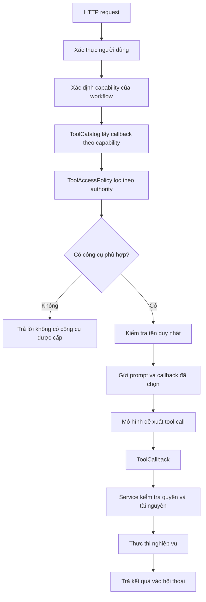

# Lựa chọn tập công cụ theo chức năng và quyền của người dùng

Một ứng dụng Spring AI thường có nhiều công cụ phục vụ các nhóm nghiệp vụ khác nhau: tra cứu đơn hàng, kiểm tra tồn kho, xem hồ sơ khách hàng hoặc thực hiện thao tác thanh toán. Mỗi người dùng chỉ nên được cung cấp những công cụ cần thiết cho luồng công việc hiện tại và phù hợp với quyền đã được ứng dụng xác thực.

Việc lựa chọn tập công cụ cần dựa trên hai yếu tố. **Chức năng** xác định nhóm nghiệp vụ mà cuộc hội thoại đang hỗ trợ. **Quyền của người dùng** xác định trong nhóm đó người dùng được phép thực hiện những hành động nào. Ứng dụng lọc callback trước khi gửi định nghĩa công cụ đến mô hình; service nghiệp vụ tiếp tục kiểm tra quyền khi callback thực thi.

Mô hình chỉ nhìn thấy danh sách công cụ mà ứng dụng cung cấp và có thể đề xuất gọi một công cụ trong danh sách đó. Mô hình không quyết định người dùng có quyền hay không, cũng không thể tự mở rộng tập công cụ được cấp.

## Vì sao cần chọn tập công cụ theo từng request?

Giả sử hệ thống có các công cụ sau:

| Công cụ | Chức năng | Quyền tối thiểu |
| --- | --- | --- |
| `orders_search` | Tìm và xem đơn hàng | `ORDER_READ` |
| `orders_cancel` | Hủy đơn hàng | `ORDER_CANCEL` |
| `inventory_lookup` | Kiểm tra tồn kho | `INVENTORY_READ` |
| `payments_refund` | Hoàn tiền | `PAYMENT_REFUND` |
| `customers_update` | Cập nhật thông tin khách hàng | `CUSTOMER_UPDATE` |

Người dùng hỗ trợ khách hàng có thể chỉ cần `orders_search`. Nhân viên kho có thể cần `inventory_lookup`. Nhân viên tài chính có thể được cấp `payments_refund` sau quy trình phê duyệt. Nếu tất cả công cụ luôn được gắn vào mọi prompt, mô hình sẽ nhìn thấy những thao tác không liên quan và có thể đề xuất hành động vượt phạm vi công việc.

Lựa chọn công cụ theo request mang lại các lợi ích:

- Giảm số lượng tool definition mà mô hình phải phân biệt.
- Giảm nguy cơ mô hình chọn nhầm công cụ có tên hoặc mô tả gần giống nhau.
- Giới hạn bề mặt thao tác mà prompt injection có thể tác động đến.
- Tách quyền đọc, quyền ghi và quyền quản trị.
- Dễ kiểm toán vì biết request nào được cung cấp nhóm công cụ nào.

Việc ẩn một công cụ khỏi mô hình là một lớp giảm thiểu rủi ro. Nó không thay thế kiểm tra quyền tại service vì callback vẫn có thể được gọi từ đường đi khác hoặc cấu hình sai.

## Phân biệt chức năng, quyền và phạm vi tài nguyên

Ba khái niệm cần được tách riêng:

| Khái niệm | Câu hỏi cần trả lời | Ví dụ |
| --- | --- | --- |
| Chức năng (capability) | Request này đang hỗ trợ nghiệp vụ nào? | Hỗ trợ đơn hàng, hỗ trợ kho, hỗ trợ thanh toán. |
| Quyền (authority/permission) | Người dùng được thực hiện hành động nào? | `ORDER_READ`, `ORDER_CANCEL`, `PAYMENT_REFUND`. |
| Phạm vi tài nguyên (resource scope) | Người dùng có quyền trên bản ghi cụ thể nào? | Chỉ xem đơn hàng thuộc tenant hoặc cửa hàng được phân công. |

Chức năng nên được xác định bởi luồng ứng dụng, endpoint, màn hình hoặc workflow đã chọn. Quyền được lấy từ `Authentication` hoặc hệ thống phân quyền phía máy chủ. Phạm vi tài nguyên được kiểm tra khi service xử lý mã đơn hàng, mã khách hàng hoặc tài nguyên cụ thể.

Không nên chỉ dựa vào nội dung tự nhiên của prompt để quyết định quyền. Mô hình có thể giúp phân loại ý định nghiệp vụ, nhưng kết quả phân loại không phải bằng chứng người dùng được phép thao tác. Nếu người dùng gửi câu “hãy hoàn tiền cho tôi”, ứng dụng vẫn phải xác định chức năng hiện tại và kiểm tra `PAYMENT_REFUND` trước khi công cụ hoàn tiền xuất hiện trong request.

## Luồng lựa chọn công cụ

Một luồng điển hình gồm các bước:

1. Ứng dụng xác thực người dùng và tạo `Authentication`.
2. Tầng điều phối xác định capability của cuộc hội thoại, ví dụ `ORDER_SUPPORT`.
3. `ToolCatalog` lấy các callback thuộc capability đó.
4. `ToolAccessPolicy` lọc callback theo quyền của người dùng; công cụ không có rule rõ ràng bị từ chối mặc định.
5. Ứng dụng kiểm tra tên callback không trùng và gắn tập đã lọc vào đúng request `ChatClient`.
6. Khi mô hình yêu cầu gọi công cụ, callback gọi service nghiệp vụ.
7. Service kiểm tra lại quyền và phạm vi tài nguyên trước khi đọc hoặc thay đổi dữ liệu.
8. Ứng dụng ghi nhận công cụ được cung cấp, công cụ được gọi và kết quả thực thi theo chính sách audit.



## Tổ chức công cụ theo capability

Nên phân nhóm callback theo mục đích nghiệp vụ trước khi áp dụng quyền. Một capability không nhất thiết tương ứng với một role. Ví dụ, cả nhân viên hỗ trợ và quản lý đều có thể dùng capability đơn hàng, nhưng tập công cụ được cấp cho mỗi người khác nhau.

Ví dụ định nghĩa capability:

```java
public enum ToolCapability {
    ORDER_SUPPORT,
    INVENTORY_SUPPORT,
    BILLING_SUPPORT
}
```

`ToolCatalog` giữ các callback đã được khởi tạo bởi Spring. Mỗi callback có một tên duy nhất và được xếp vào capability phù hợp:

```java
import java.util.List;
import java.util.Map;

import org.springframework.beans.factory.annotation.Qualifier;
import org.springframework.ai.tool.ToolCallback;
import org.springframework.stereotype.Component;

@Component
public class ToolCatalog {

    private final Map<ToolCapability, List<ToolCallback>> toolsByCapability;

    public ToolCatalog(
            @Qualifier("ordersSearch") ToolCallback ordersSearch,
            @Qualifier("ordersCancel") ToolCallback ordersCancel,
            @Qualifier("inventoryLookup") ToolCallback inventoryLookup,
            @Qualifier("paymentsRefund") ToolCallback paymentsRefund) {
        this.toolsByCapability = Map.of(
                ToolCapability.ORDER_SUPPORT,
                List.of(ordersSearch, ordersCancel),
                ToolCapability.INVENTORY_SUPPORT,
                List.of(inventoryLookup),
                ToolCapability.BILLING_SUPPORT,
                List.of(paymentsRefund));
    }

    public List<ToolCallback> forCapability(ToolCapability capability) {
        return this.toolsByCapability.getOrDefault(capability, List.of());
    }
}
```

Các tham số constructor là bean `ToolCallback` do ứng dụng đăng ký, chẳng hạn `FunctionToolCallback` hoặc custom callback. Trong dự án thực tế, có thể tạo các bean này từ `@Tool` bằng `ToolCallbacks.from(...)` rồi đưa callback đã tạo vào catalog. Cách tổ chức quan trọng là catalog trả về danh sách rõ ràng theo capability, không tự động đưa toàn bộ callback trong ApplicationContext vào mọi request.

Nên kiểm tra tên công cụ duy nhất trên toàn catalog khi ứng dụng khởi động. Nếu chỉ kiểm tra sau khi lọc, hai callback trùng tên có thể cùng xuất hiện đối với một nhóm người dùng và không xuất hiện đối với nhóm khác, khiến lỗi khó tái hiện.

## Lọc callback theo quyền của người dùng

Spring Security biểu diễn danh tính và authority của người dùng trong `Authentication`. Có thể tạo policy ánh xạ tên công cụ sang authority bắt buộc:

```java
import java.util.Collection;
import java.util.List;
import java.util.Map;
import java.util.Set;
import java.util.stream.Collectors;

import org.springframework.ai.tool.ToolCallback;
import org.springframework.security.core.Authentication;
import org.springframework.security.core.GrantedAuthority;
import org.springframework.stereotype.Component;

@Component
public class ToolAccessPolicy {

    private final Map<String, String> requiredAuthorityByTool = Map.of(
            "orders_search", "ORDER_READ",
            "orders_cancel", "ORDER_CANCEL",
            "inventory_lookup", "INVENTORY_READ",
            "payments_refund", "PAYMENT_REFUND");

    public List<ToolCallback> selectAllowed(
            Authentication authentication,
            Collection<ToolCallback> candidates) {

        if (authentication == null || !authentication.isAuthenticated()) {
            return List.of();
        }

        Set<String> authorities = authentication.getAuthorities().stream()
                .map(GrantedAuthority::getAuthority)
                .collect(Collectors.toUnmodifiableSet());

        return candidates.stream()
                .filter(callback -> {
                    String toolName = callback.getToolDefinition().name();
                    String required = this.requiredAuthorityByTool.get(toolName);

                    // Không có rule nghĩa là không được phép dùng.
                    return required != null && authorities.contains(required);
                })
                .toList();
    }
}
```

Ví dụ dùng authority dạng `ORDER_READ` để minh họa; ứng dụng có thể chuẩn hóa thành `ROLE_SUPPORT_AGENT` hoặc permission riêng theo chính sách hiện có. Hãy thống nhất cách đặt tên authority trong nơi tạo `Authentication` và policy.

Chính sách trong ví dụ dùng một authority bắt buộc cho mỗi công cụ. Nếu nghiệp vụ yêu cầu nhiều điều kiện, hãy mô hình hóa rõ ràng, ví dụ phải có tất cả authority, chỉ cần một trong nhiều authority, hoặc yêu cầu một trạng thái phê duyệt. Không nên viết logic phân quyền phức tạp bằng các phép so sánh chuỗi rải rác trong nhiều controller.

Điểm an toàn quan trọng là mặc định từ chối. Callback không có trong map policy không được đưa vào tập công cụ, kể cả khi nó đã được đăng ký trong Spring. Không dùng tên role hoặc tên người dùng do mô hình gửi làm đầu vào cho policy.

## Gắn tập công cụ đã lọc vào ChatClient

Tầng điều phối nhận capability từ workflow và `Authentication` do tầng bảo mật cung cấp. Sau đó nó lọc callback rồi chỉ truyền các callback được phép cho request hiện tại:

```java
import java.util.List;

import org.springframework.ai.chat.client.ChatClient;
import org.springframework.ai.tool.ToolCallback;
import org.springframework.security.core.Authentication;
import org.springframework.stereotype.Service;

@Service
public class AssistantService {

    private final ChatClient chatClient;
    private final ToolCatalog toolCatalog;
    private final ToolAccessPolicy toolAccessPolicy;

    public AssistantService(
            ChatClient chatClient,
            ToolCatalog toolCatalog,
            ToolAccessPolicy toolAccessPolicy) {
        this.chatClient = chatClient;
        this.toolCatalog = toolCatalog;
        this.toolAccessPolicy = toolAccessPolicy;
    }

    public String answer(
            ToolCapability capability,
            String userMessage,
            Authentication authentication) {

        List<ToolCallback> candidates = this.toolCatalog.forCapability(capability);
        List<ToolCallback> allowed = this.toolAccessPolicy
                .selectAllowed(authentication, candidates);

        if (allowed.isEmpty()) {
            return "Không có công cụ phù hợp được cấp cho yêu cầu này.";
        }

        return this.chatClient.prompt()
                .user(userMessage)
                .toolCallbacks(allowed.toArray(ToolCallback[]::new))
                .call()
                .content();
    }
}
```

`Authentication` cần được truyền từ request đã xác thực, ví dụ controller nhận tham số `Authentication` của Spring Security rồi chuyển vào service. `capability` cũng phải đến từ route hoặc workflow được ứng dụng kiểm soát. Nếu ứng dụng cho phép mô hình phân loại ý định để gợi ý capability, kết quả đó chỉ nên là gợi ý; tầng điều phối vẫn phải kiểm tra capability người dùng được phép truy cập.

Trong ví dụ, `ChatClient` không được cấu hình một tập default tools rộng hơn tập runtime. Với lựa chọn theo từng người dùng, nên truyền rõ danh sách callback đã lọc cho mỗi request và hiểu semantics default/runtime của phiên bản Spring AI đang dùng. Tránh đăng ký toàn bộ công cụ đặc quyền làm default tool rồi trông chờ prompt tự hạn chế mô hình.

Nếu không có callback phù hợp, ứng dụng có thể trả thông báo không có công cụ được cấp hoặc chuyển sang luồng xử lý không dùng tool. Không nên âm thầm gọi một ChatClient khác đang mang tập công cụ rộng hơn.

## Kiểm tra quyền lần nữa khi callback thực thi

Lọc công cụ trước khi gửi prompt làm giảm khả năng mô hình đề xuất hành động không được cấp. Tuy nhiên, đó không phải hàng rào bảo mật cuối cùng. Quyền có thể thay đổi giữa thời điểm tạo prompt và lúc thực thi; callback cũng có thể được gọi từ một đường đi khác.

Hãy đặt kiểm tra quyền tại service nghiệp vụ. Ví dụ:

```java
import org.springframework.security.access.prepost.PreAuthorize;
import org.springframework.stereotype.Service;

@Service
public class OrderService {

    @PreAuthorize("hasAuthority('ORDER_READ')")
    public OrderSummary findOrder(String orderId) {
        // Kiểm tra quyền trên chính đơn hàng và tenant trước khi trả dữ liệu.
        return loadAuthorizedOrder(orderId);
    }

    @PreAuthorize("hasAuthority('ORDER_CANCEL')")
    public void cancelOrder(String orderId) {
        // Kiểm tra trạng thái, quyền sở hữu và điều kiện hủy đơn.
        cancelAuthorizedOrder(orderId);
    }
}
```

Bật method security trong cấu hình Spring Security:

```java
import org.springframework.context.annotation.Configuration;
import org.springframework.security.config.annotation.method.configuration.EnableMethodSecurity;

@Configuration
@EnableMethodSecurity
class MethodSecurityConfiguration {
}
```

Các phương thức được bảo vệ phải được gọi qua Spring bean proxy để `@PreAuthorize` có hiệu lực; tránh self-invocation trong cùng class. Nếu tool callback chạy bất đồng bộ hoặc chuyển sang executor khác, cần cấu hình truyền `SecurityContext` đúng cách hoặc truyền ngữ cảnh xác thực đã được xác minh qua cơ chế an toàn. Không lấy danh tính từ arguments do mô hình tạo.

### Quyền theo tài nguyên cụ thể

Authority như `ORDER_READ` thường chỉ mô tả quyền ở mức chức năng. Người dùng có thể được xem đơn hàng nói chung nhưng chỉ được xem đơn hàng thuộc chi nhánh hoặc tenant của mình. Service cần kiểm tra cả quyền trên tài nguyên:

```java
@PreAuthorize("hasAuthority('ORDER_READ') and @orderAccess.canRead(authentication, #orderId)")
public OrderSummary findOrder(String orderId) {
    return orderRepository.findSummaryById(orderId)
            .orElseThrow(() -> new OrderNotFoundException(orderId));
}
```

`orderAccess.canRead(...)` là bean policy của ứng dụng, kiểm tra quan hệ giữa principal hiện tại và đơn hàng. Không tin `tenantId`, `ownerId` hoặc `branchId` do mô hình gửi để quyết định phạm vi truy cập. Nếu cần các giá trị đó trong callback, hãy lấy chúng từ `Authentication`, session đã xác thực hoặc `ToolContext` do ứng dụng tạo.

## Tách quyền đọc, ghi và thao tác nhạy cảm

Không nên gom mọi hành động của một miền nghiệp vụ vào một quyền duy nhất. Ví dụ, quyền xem đơn hàng không nên tự động bao gồm quyền hủy đơn; quyền xem giao dịch không nên bao gồm quyền hoàn tiền.

| Mức thao tác | Ví dụ | Cách kiểm soát |
| --- | --- | --- |
| Đọc | Tìm đơn hàng, tra cứu tồn kho | Authority đọc và kiểm tra tenant/resource scope. |
| Ghi thông thường | Cập nhật địa chỉ giao hàng | Authority cập nhật, kiểm tra trạng thái và dữ liệu đầu vào. |
| Thao tác nhạy cảm | Hủy đơn, hoàn tiền, thay đổi quyền | Authority riêng, kiểm tra điều kiện nghiệp vụ, xác nhận hoặc phê duyệt khi cần, audit và idempotency. |
| Quản trị | Thay đổi cấu hình hoặc quyền truy cập | Chỉ cấp cho workflow quản trị riêng; không đưa vào assistant thông thường. |

Với hành động có tác động tài chính hoặc khó hoàn tác, nên có bước xác nhận rõ ràng trước khi thực thi. Có thể dùng một workflow do ứng dụng điều khiển để hiển thị nội dung, số tiền và đối tượng sẽ thay đổi; chỉ sau khi người dùng xác nhận, ứng dụng mới phát hành lệnh thực thi có kiểm soát. Việc mô hình yêu cầu gọi `payments_refund` không được xem là xác nhận của người dùng.

## Kết hợp ToolContext với lựa chọn theo người dùng

`ToolContext` có thể mang dữ liệu nội bộ cần thiết cho callback, chẳng hạn user ID, tenant ID, request ID hoặc locale. Dữ liệu này phải được ứng dụng lấy từ nguồn tin cậy. Nó không phải cơ chế cấp quyền tự động.

Ví dụ truyền tenant đã xác thực vào request:

```java
String answer = chatClient.prompt()
        .user(userMessage)
        .toolCallbacks(allowedCallbacks.toArray(ToolCallback[]::new))
        .toolContext(Map.of(
                "tenantId", authenticatedTenantId,
                "requestId", requestId))
        .call()
        .content();
```

Callback có thể đọc `ToolContext` để truyền tenant vào service, nhưng service vẫn phải xác thực quyền trên tài nguyên. Không đưa context vào schema đầu vào của mô hình và không cho mô hình ghi đè các khóa như `tenantId` bằng arguments.

Nếu context được lưu ở phạm vi request hoặc conversation, hãy bảo đảm nó không bị dùng lại giữa hai người dùng. Với xử lý bất đồng bộ, kiểm tra cơ chế context propagation để principal và tenant không bị mất hoặc trộn lẫn.

## Ghi log và kiểm toán lựa chọn công cụ

Để giải thích vì sao một người dùng nhìn thấy hoặc không nhìn thấy một công cụ, hãy ghi nhận các sự kiện quan trọng:

- ID request hoặc correlation ID.
- Capability/workflow đã chọn.
- Principal hoặc subject ID đã xác thực theo chính sách log.
- Tên các công cụ được cung cấp cho mô hình.
- Tên công cụ mô hình yêu cầu gọi và kết quả cho phép/từ chối.
- Kết quả thực thi, thời gian, mã lỗi và ID giao dịch nghiệp vụ nếu có.

Không ghi access token, API key, mật khẩu, toàn bộ nội dung nhạy cảm của `ToolContext` hoặc dữ liệu khách hàng không cần thiết. Với thao tác ghi, log audit nên lưu ai thực hiện, hành động nào, trên tài nguyên nào, thời điểm nào và kết quả ra sao theo yêu cầu của hệ thống.

Log danh sách tool được cung cấp cũng giúp phát hiện cấu hình sai: ví dụ `payments_refund` xuất hiện trong request của người dùng chỉ có quyền `ORDER_READ`. Đây là dấu hiệu cần điều tra policy hoặc cách gắn default tools.

## Kiểm thử lựa chọn và phân quyền

Kiểm thử cần bao phủ cả bước lọc trước khi gọi mô hình và bước kiểm tra lúc thực thi.

| Trường hợp | Kết quả mong đợi |
| --- | --- |
| Người dùng chưa xác thực | Không nhận callback đặc quyền. |
| Người dùng có `ORDER_READ` | Có `orders_search`; không có `orders_cancel`. |
| Người dùng có `ORDER_CANCEL` nhưng thiếu `ORDER_READ` | Chỉ có công cụ được policy cấp theo từng authority; không tự suy ra quyền đọc. |
| Người dùng có quyền kho nhưng workflow là hỗ trợ đơn hàng | Không đưa `inventory_lookup` vào request nếu capability hiện tại không bao gồm nó. |
| Callback không có rule trong policy | Bị từ chối mặc định. |
| Người dùng yêu cầu mã đơn hàng thuộc tenant khác | Service từ chối dù tool đã xuất hiện trong prompt. |
| Quyền bị thu hồi sau khi tạo prompt | Service kiểm tra lại và từ chối khi callback thực thi. |
| Hai request của hai người dùng chạy đồng thời | Không rò rỉ callback hoặc `ToolContext` giữa hai request. |
| Người dùng yêu cầu hoàn tiền nhưng không có quyền | `payments_refund` không xuất hiện và service vẫn từ chối nếu bị gọi trực tiếp. |

Ví dụ kiểm tra policy:

```java
@Test
void onlyToolsAllowedByAuthoritiesAreSelected() {
    Authentication authentication = UsernamePasswordAuthenticationToken.authenticated(
            "agent-01",
            "N/A",
            List.of(new SimpleGrantedAuthority("ORDER_READ")));

    List<ToolCallback> allowed = policy.selectAllowed(authentication, List.of(
            ordersSearchCallback,
            ordersCancelCallback,
            inventoryLookupCallback));

    assertThat(allowed)
            .extracting(callback -> callback.getToolDefinition().name())
            .containsExactly("orders_search");
}
```

Ngoài unit test cho policy, cần integration test xác nhận `ChatClient` nhận đúng tập callback đã lọc. Mock service để kiểm tra `@PreAuthorize` và policy tài nguyên vẫn chặn truy cập trái phép ngay cả khi callback được gọi trực tiếp.

## Lỗi thường gặp

| Hiện tượng | Nguyên nhân có thể | Cách xử lý |
| --- | --- | --- |
| Mô hình vẫn nhìn thấy công cụ quản trị | Đã đăng ký tất cả callback làm default tools hoặc lọc sau khi gửi prompt | Chọn callback theo request trước khi gọi `ChatClient`; rà soát default tools và provider. |
| Người dùng có role nhưng không thấy công cụ | Policy dùng authority khác tên với `GrantedAuthority` thực tế | Kiểm tra authority trong `Authentication` và chuẩn hóa quy ước tên. |
| Công cụ bị ẩn nhưng endpoint khác vẫn gọi được | Chỉ lọc tool set, không kiểm tra quyền tại service | Bảo vệ service bằng method security và kiểm tra resource scope. |
| Người dùng đọc được tài nguyên tenant khác | Chỉ kiểm tra role chung, không kiểm tra quan hệ với bản ghi | Kiểm tra tenant/owner/branch trong service theo principal tin cậy. |
| Quyền thay đổi nhưng callback vẫn chạy | Chỉ kiểm tra quyền tại lúc tạo prompt | Kiểm tra lại quyền khi thực thi callback. |
| Công cụ không liên quan xuất hiện trong prompt | Chọn tập theo role mà không giới hạn capability | Lọc theo capability của workflow trước, sau đó lọc theo authority. |
| Request song song dùng nhầm quyền | Lưu callback hoặc context người dùng trong singleton mutable state | Chỉ giữ catalog bất biến; tạo danh sách đã lọc riêng cho từng request. |

## Quy trình triển khai đề xuất

1. Liệt kê các công cụ theo hành động nghiệp vụ, phân biệt đọc, ghi và quản trị.
2. Đặt tên duy nhất, ổn định và gắn mô tả rõ cho từng callback.
3. Nhóm callback vào capability/workflow mà ứng dụng hỗ trợ.
4. Định nghĩa authority tối thiểu cho từng công cụ; mặc định từ chối nếu thiếu policy.
5. Xác thực người dùng và lấy `Authentication` từ Spring Security.
6. Lọc callback theo capability trước, rồi theo authority của người dùng.
7. Gửi riêng tập callback đã lọc vào request `ChatClient`.
8. Kiểm tra lại quyền và phạm vi tài nguyên tại service khi callback thực thi.
9. Yêu cầu xác nhận/phê duyệt và ghi audit cho thao tác nhạy cảm.
10. Kiểm thử người dùng chưa xác thực, thiếu quyền, sai tenant, quyền bị thu hồi và request đồng thời.

Thiết kế này giúp mỗi cuộc hội thoại chỉ nhận các công cụ cần thiết cho nghiệp vụ đang xử lý và phù hợp với quyền của người dùng. `ToolCatalog` tổ chức công cụ, `ToolAccessPolicy` chọn tập callback, `ChatClient` cung cấp tập đó cho mô hình, còn service nghiệp vụ giữ trách nhiệm cuối cùng về quyền và tính hợp lệ của thao tác.

## Tài liệu tham khảo

- [Spring AI 1.0 Reference — Tool Calling](https://docs.spring.io/spring-ai/reference/1.0/api/tools.html)
- [Spring AI 1.0 Reference — ChatClient](https://docs.spring.io/spring-ai/reference/1.0/api/chatclient.html)
- [Spring Security Reference — Method Security](https://docs.spring.io/spring-security/reference/servlet/authorization/method-security.html)
- [Spring Security Reference — Authentication Architecture](https://docs.spring.io/spring-security/reference/servlet/authentication/architecture.html)
