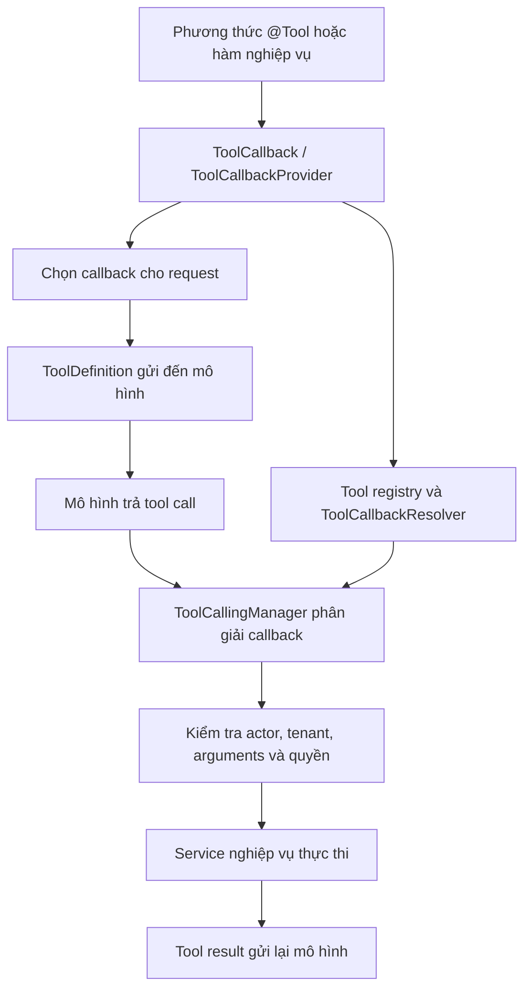

# Đảm bảo công cụ có trong ứng dụng không tự động trở thành công cụ được phép chạy

Một phương thức `@Tool`, một `ToolCallback` bean hoặc một công cụ MCP có thể đã tồn tại trong ứng dụng Spring. Điều đó chỉ cho biết ứng dụng có mã thực thi công cụ. Nó chưa xác định công cụ nào được đưa vào request của người dùng, mô hình được nhìn thấy công cụ nào, callback nào có thể được phân giải khi nhận tool call và người dùng hiện tại có quyền thực hiện hành động hay không.

Trong Spring AI, cần phân biệt bốn việc: **định nghĩa công cụ**, **đăng ký callback**, **cung cấp công cụ cho một request** và **ủy quyền thực thi**. Mô hình chỉ đề xuất một tool call cùng arguments. Ứng dụng vẫn chịu trách nhiệm chọn công cụ, xác thực người gọi, kiểm tra quyền trên dữ liệu cụ thể và quyết định có thực thi hay không.

Bài học thuộc chương Đăng ký công cụ của Spring AI Tool Calling. Mục tiêu là tránh việc một công cụ chỉ dành cho quản trị viên, một tenant hoặc một quy trình đặc biệt vô tình được dùng trong mọi cuộc hội thoại chỉ vì callback đã tồn tại trong Spring ApplicationContext.

Sau bài học, bạn có thể:

- Phân biệt `@Tool`, `ToolCallback`, `ToolCallbackProvider` và `ToolCallbackResolver`.
- Giải thích khác biệt giữa callback có trong ứng dụng và tool definition được gửi đến mô hình.
- Cấu hình công cụ ở cấp request hoặc mặc định của `ChatClient`.
- Hiểu chính xác cách `ChatClient.tools(...)`, `defaultTools(...)` và tool resolution fallback hoạt động trong Spring AI 2.1.x.
- Chọn công cụ theo actor, tenant và capability đã xác thực.
- Đặt kiểm tra quyền ở callback/service để mọi đường gọi đều được bảo vệ.

## 1. Bốn lớp cần phân biệt

Một công cụ có thể đi qua các lớp sau:

| Lớp | Câu hỏi cần trả lời | Ví dụ |
| --- | --- | --- |
| Định nghĩa | Công cụ làm gì và nhận arguments nào? | `@Tool`, `ToolDefinition`, JSON Schema |
| Đăng ký | Ứng dụng tạo và quản lý callback ở đâu? | Spring bean `ToolCallback`, `ToolCallbackProvider` |
| Cung cấp cho request | Tool definition nào được gửi đến mô hình trong request này? | `.tools(...)`, `.defaultTools(...)` |
| Phân quyền và thực thi | Actor có được thực hiện hành động trên tài nguyên này không? | Security context, authorization service, kiểm tra trong service nghiệp vụ |



Định nghĩa và đăng ký giúp ứng dụng biết cách thực thi công cụ. Cung cấp cho request quyết định mô hình được biết đến công cụ nào. Phân quyền quyết định hành động nào thực sự được phép chạy. Không lớp nào thay thế lớp còn lại.

## 2. Có @Tool hoặc @Component không đồng nghĩa mô hình đã được cấp công cụ

`@Tool` đánh dấu một phương thức có thể được chuyển thành callback. `@Component` giúp Spring quản lý object và inject dependency. Hai annotation này không tự có nghĩa mọi request `ChatClient` đều gửi định nghĩa của phương thức đó cho mô hình.

Ví dụ:

```java
@Component
public class UserAdministrationTools {

    private final UserAdministrationService administrationService;

    public UserAdministrationTools(UserAdministrationService administrationService) {
        this.administrationService = administrationService;
    }

    @Tool(description = "Khóa tài khoản người dùng theo mã tài khoản")
    public AccountActionResult lockAccount(
            @ToolParam(description = "Mã tài khoản cần khóa") String accountId) {
        return administrationService.lock(accountId);
    }
}
```

Object này tồn tại trong ApplicationContext và có method được đánh dấu. Để công cụ xuất hiện trong một request `ChatClient`, ứng dụng phải cung cấp object hoặc callback tương ứng:

```java
String answer = chatClient.prompt()
        .user("Khóa tài khoản ACC-1042")
        .tools(userAdministrationTools)
        .call()
        .content();
```

Chỉ request được gắn `.tools(userAdministrationTools)` mới nhận định nghĩa công cụ này từ đoạn code trên. Nếu không cấu hình `defaultTools(...)` hoặc một nguồn tool khác, các request còn lại không tự nhận method này chỉ vì bean đang tồn tại.

Điều tương tự áp dụng với `MethodToolCallback` và `FunctionToolCallback`: tạo được callback là bước xây dựng khả năng thực thi. Ứng dụng vẫn phải quyết định nơi đăng ký callback và request nào được cung cấp callback đó.

## 3. Đăng ký callback thành Spring bean

Với công cụ được tạo bằng code, có thể đăng ký một `ToolCallback` bean:

```java
public record AccountLookupRequest(String accountId) {
}

@Configuration(proxyBeanMethods = false)
public class AdministrationToolConfiguration {

    @Bean
    ToolCallback accountLookupTool(AccountQueryService accountQueryService) {
        return FunctionToolCallback
                .builder("lookup_account", accountQueryService::lookup)
                .description("Tra cứu thông tin tài khoản theo mã tài khoản")
                .inputType(AccountLookupRequest.class)
                .build();
    }
}
```

Spring AI 2.1.x tự phát hiện các `ToolCallback` bean trong ApplicationContext và đưa chúng vào `ToolCallbackResolver` mặc định để phân giải theo tên. Đây là cơ chế tra cứu callback ở phía thực thi. Việc bean được phát hiện không có nghĩa tool definition của nó tự động được gửi đến mọi request `ChatClient`.

Khi muốn mô hình nhìn thấy công cụ, hãy inject và cung cấp callback một cách rõ ràng:

```java
@Service
public class AccountAssistant {

    private final ChatClient chatClient;
    private final ToolCallback accountLookupTool;

    public AccountAssistant(
            ChatClient chatClient,
            ToolCallback accountLookupTool) {
        this.chatClient = chatClient;
        this.accountLookupTool = accountLookupTool;
    }

    public String ask(String question) {
        return chatClient.prompt()
                .user(question)
                .tools(accountLookupTool)
                .call()
                .content();
    }
}
```

Trong Spring AI 2.x, không dùng cách khai báo một bean `Function`, `Supplier` hoặc `Consumer` thuần rồi gọi `toolNames(...)` như một số ví dụ Spring AI 1.x. Cơ chế `SpringBeanToolCallbackResolver` và `toolNames(...)` đã bị loại bỏ. Hãy tạo `ToolCallback` rõ ràng, ví dụ bằng `FunctionToolCallback`, rồi đăng ký và cung cấp callback theo đúng phạm vi request.

## 4. ToolCallbackProvider là nguồn callback, không phải chính sách quyền

Khi có nhiều method `@Tool`, `MethodToolCallbackProvider` giúp tạo một nhóm callback từ các object chứa tool method:

```java
@Bean
ToolCallbackProvider orderToolProvider(OrderTools orderTools) {
    return MethodToolCallbackProvider.builder()
            .toolObjects(orderTools)
            .build();
}
```

`ToolCallbackProvider` cung cấp các callback qua `getToolCallbacks()`. `ChatClient` chấp nhận provider ở cả cấu hình mặc định và cấu hình theo request:

```java
// Cung cấp cho một request
chatClient.prompt()
        .user("Tra cứu đơn hàng của tôi")
        .tools(orderToolProvider)
        .call();

// Hoặc đặt làm công cụ mặc định cho client
ChatClient orderClient = ChatClient.builder(chatModel)
        .defaultTools(orderToolProvider)
        .build();
```

Provider giải quyết việc gom và cung cấp callback. Nó không tự xác thực người dùng, không biết người gọi có quyền trên một đơn hàng cụ thể và không nên được coi là nơi duy nhất áp dụng chính sách truy cập.

Nếu provider chứa cả công cụ đọc dữ liệu và công cụ thay đổi dữ liệu, đừng mặc định đưa toàn bộ provider vào mọi request. Có thể tách provider theo nhóm capability hoặc lọc callback theo quyền đã xác thực trước khi cung cấp cho `ChatClient`.

## 5. Phạm vi của defaultTools và tools trong ChatClient

`ChatClient.Builder.defaultTools(...)` cung cấp các tool dùng chung cho mọi request được tạo từ client đó. `.tools(...)` trên request bổ sung công cụ cho request hiện tại.

Trong Spring AI 2.1.x, hai tập này được hợp nhất: `.tools(...)` **thêm** công cụ vào `defaultTools(...)`, không thay thế chúng.

```java
ChatClient client = ChatClient.builder(chatModel)
        .defaultTools(publicReadOnlyTools)
        .build();

String answer = client.prompt()
        .user("Tra cứu hóa đơn INV-204")
        .tools(invoiceLookupTool)
        .call()
        .content();
```

Request trên nhận cả `publicReadOnlyTools` và `invoiceLookupTool`. Nếu `defaultTools` chứa công cụ quản trị, việc gọi `.tools(invoiceLookupTool)` không loại bỏ công cụ quản trị khỏi danh sách gửi đến mô hình.

| Cấu hình | Tập tool được gửi từ ChatClient |
| --- | --- |
| Chỉ `.tools(a, b)` | `a`, `b` cho request đó |
| Chỉ `.defaultTools(a, b)` | `a`, `b` cho mọi request từ client đó |
| `.defaultTools(a)` và request `.tools(b)` | `a` và `b` |

Vì vậy, hãy giữ `defaultTools` ở mức capability thực sự dùng chung và an toàn cho mọi người dùng của client. Công cụ theo vai trò, tenant, hành động ghi hoặc tác động bên ngoài nên được cung cấp theo request sau khi kiểm tra quyền.

Một cách tổ chức dễ kiểm soát là tạo các `ChatClient` có phạm vi rõ ràng, chẳng hạn client chỉ đọc và client quản trị. Không đưa tool nhạy cảm vào builder dùng chung toàn ứng dụng nếu mọi request không cần nó.

## 6. ToolCallbackResolver và resolution fallback

`ToolCallbackResolver` là thành phần tìm callback theo tên. Trong cấu hình mặc định của Spring AI 2.1.x, `StaticToolCallbackResolver` được tạo từ các `ToolCallback` bean và callback do `ToolCallbackProvider` bean cung cấp (có ngoại lệ với một số MCP provider để tránh gọi mạng sớm).

Thông thường, `ToolCallingManager` chỉ thực thi callback được gắn với request. Spring AI 2.1.x có tùy chọn **resolution fallback** để cho phép tìm callback theo tên trong resolver nếu tool call yêu cầu một công cụ không nằm trong callback list của request.

```properties
# Giữ mặc định: chỉ thực thi callback gắn với request
spring.ai.tools.resolution.fallback.enabled=false
```

Giá trị mặc định là `false`. Nếu bật:

```properties
spring.ai.tools.resolution.fallback.enabled=true
```

một tool call có tên khớp callback trong resolver có thể được phân giải và thực thi dù callback đó không được gắn vào request. Điều này làm rộng đáng kể phạm vi công cụ có thể gọi. Nếu resolver chứa công cụ quản trị, xóa dữ liệu hoặc chuyển tiền, fallback có thể làm những công cụ đó thực thi khi mô hình yêu cầu tên tương ứng, kể cả khi request không chủ định cung cấp chúng.

Khi tự tạo `ToolCallingManager`, cùng lựa chọn này có thể được cấu hình bằng builder:

```java
ToolCallingManager manager = ToolCallingManager.builder()
        .resolutionFallbackEnabled(false)
        .build();
```

Với ứng dụng có phân quyền theo request, hãy giữ fallback tắt trừ khi có thiết kế resolver riêng và đã kiểm soát toàn bộ callback mà resolver có thể trả về. Không dùng việc ẩn tool definition khỏi prompt làm cơ chế authorization.

## 7. ChatModel trực tiếp có quy tắc hợp nhất khác ChatClient

Nếu gọi `ChatModel` trực tiếp, bạn tự truyền `ToolCallingChatOptions` và tự điều phối vòng lặp qua `ToolCallingManager`. Tool callback trong options của request thay thế danh sách callback trong default options của model; nó không tự cộng dồn như `ChatClient.tools(...)` với `ChatClient.defaultTools(...)`.

```java
ToolCallingChatOptions requestOptions = ToolCallingChatOptions.builder()
        .toolCallbacks(allowedCallbacks)
        .toolContext(Map.of("actorId", actor.id(), "tenantId", actor.tenantId()))
        .build();

ChatResponse response = chatModel.call(new Prompt(question, requestOptions));
```

Khi dùng `ChatModel`, caller phải kiểm tra response có tool call, gọi `ToolCallingManager.executeToolCalls(...)`, bổ sung lịch sử hội thoại và gọi model tiếp. Danh sách callback trong options phải được tạo từ capability đã xác thực. Không tái sử dụng một danh sách tool quản trị làm default options cho mọi request.

## 8. Chọn tool theo người dùng và tenant

Giả sử hệ thống có ba capability:

- `ORDER_READ`: xem đơn hàng thuộc phạm vi được cấp.
- `ORDER_CANCEL`: hủy đơn hàng khi trạng thái cho phép.
- `USER_ADMIN`: quản trị tài khoản người dùng.

Khi nhận request, ứng dụng xác thực người dùng trước, lấy capability từ nguồn phân quyền đáng tin cậy và chọn callback tương ứng:

```java
public String ask(String question, AuthenticatedActor actor) {
    List<ToolCallback> allowedTools = new ArrayList<>();

    if (authorizationService.hasCapability(actor, "ORDER_READ")) {
        allowedTools.add(orderLookupTool);
    }

    if (authorizationService.hasCapability(actor, "ORDER_CANCEL")) {
        allowedTools.add(orderCancellationTool);
    }

    if (authorizationService.hasCapability(actor, "USER_ADMIN")) {
        allowedTools.add(userAdministrationTool);
    }

    return chatClient.prompt()
            .user(question)
            .tools(allowedTools)
            .toolContext(Map.of(
                    "actorId", actor.id(),
                    "tenantId", actor.tenantId()))
            .call()
            .content();
}
```

Ví dụ giả định `chatClient` không có `defaultTools` nhạy cảm, vì `.tools(allowedTools)` sẽ cộng thêm vào default set. `actor` phải đến từ authentication layer của server, không lấy từ nội dung prompt hoặc một trường JSON do người dùng tự gửi.

Đối với dữ liệu đa tenant, danh sách tool có thể giống nhau giữa các tenant, nhưng phạm vi dữ liệu phải được áp dụng trong service. Ví dụ hai người đều có `ORDER_READ` vẫn không có quyền xem đơn hàng của nhau.

## 9. Kiểm tra quyền tại nơi thực thi

Danh sách tool được gửi đến mô hình chỉ là thông tin để mô hình biết các hành động có thể yêu cầu. Mô hình có thể gửi arguments sai, lặp lại tool call hoặc yêu cầu một tài nguyên mà người dùng không có quyền xem. Do đó, callback/service phải kiểm tra quyền trước khi tạo side effect hoặc trả dữ liệu.

```java
@Component
public class OrderTools {

    private final OrderService orderService;
    private final CurrentActor currentActor;
    private final OrderAuthorizationService orderAuthorization;

    public OrderTools(
            OrderService orderService,
            CurrentActor currentActor,
            OrderAuthorizationService orderAuthorization) {
        this.orderService = orderService;
        this.currentActor = currentActor;
        this.orderAuthorization = orderAuthorization;
    }

    @Tool(description = "Tra cứu một đơn hàng mà người dùng hiện tại được phép xem")
    public OrderSummary lookupOrder(
            @ToolParam(description = "Mã đơn hàng") String orderId,
            ToolContext toolContext) {

        AuthenticatedActor actor = currentActor.requireAuthenticated();
        orderAuthorization.requireCanRead(actor, orderId);
        return orderService.findVisibleOrder(orderId, actor.tenantId());
    }
}
```

Trong ví dụ, actor được lấy từ thành phần xác thực phía server. `ToolContext` có thể mang `requestId`, `tenantId` hoặc dữ liệu request nội bộ cần truyền qua tool call; nhưng context không tự chứng minh quyền. Nếu dùng context để truyền actor, chỉ nhận giá trị do server tạo và vẫn kiểm tra lại ở service.

Với công cụ thay đổi dữ liệu, kiểm tra quyền phải bao gồm cả hành động và tài nguyên cụ thể:

- Actor có capability hủy đơn không?
- Đơn hàng có thuộc tenant của actor không?
- Trạng thái hiện tại có cho phép hủy không?
- Lệnh có bị lặp do retry không?
- Hành động có cần người dùng xác nhận trước khi thực thi không?

Nếu dùng `@Tool(requiresConfirmation = true)` cho thao tác nhạy cảm, Spring AI có thể tạm dừng vòng tool calling để người dùng cho phép hoặc từ chối. Xác nhận chỉ bổ sung bước duyệt; service vẫn phải xác thực và phân quyền ở thời điểm thực thi.

## 10. Kiểm tra các đường gọi có thể mở rộng phạm vi tool

Khi rà soát một ứng dụng Spring AI, hãy kiểm tra các nguồn sau:

| Nguồn | Câu hỏi kiểm tra |
| --- | --- |
| `@Tool` object | Object có được truyền vào `.tools(...)` ở request nào? |
| `ToolCallback` bean | Bean có nằm trong resolver và có được cung cấp cho ChatClient không? |
| `ToolCallbackProvider` bean | Provider có chứa callback đặc quyền nào? Provider được truyền ở cấp request hay default? |
| `ChatClient.defaultTools(...)` | Những tool nào được chia sẻ cho mọi request của client? |
| `ChatClient.tools(...)` | Có hiểu nhầm rằng request-level tools thay thế default tools không? |
| `ToolCallbackResolver` | Resolver có chứa callback nào ngoài tập request? |
| Resolution fallback | `spring.ai.tools.resolution.fallback.enabled` có đang bật không? |
| `ChatModel` default options | Request options có thay thế danh sách tool mặc định không? |
| MCP provider | Có tool từ server bên ngoài nào được thêm vào request? Có lọc nguồn và tên tool không? |
| Service nghiệp vụ | Mọi đường gọi có kiểm tra actor, tenant và quyền trên tài nguyên không? |

Đối với MCP, provider được auto-configure không đồng nghĩa tự động gắn vào `ChatClient`; ứng dụng cần inject và wire provider rõ ràng. Khi kết hợp local tool và MCP tool, kiểm tra tên không trùng nhau và chỉ đưa các tool từ nguồn đáng tin cậy vào request.

## 11. Kiểm thử chính sách đăng ký và thực thi

Nên kiểm thử riêng ba kết quả: tool definition được gửi đi, callback có được phân giải hay không và service có cho phép thực thi hay không.

| Tình huống | Kết quả mong đợi |
| --- | --- |
| Request không được cấp tool quản trị | Định nghĩa tool quản trị không xuất hiện trong request gửi mô hình. |
| Callback bean tồn tại nhưng request không đính kèm | Với fallback mặc định tắt, tool không được thực thi từ callback list của request. |
| Resolution fallback bật | Kiểm tra rõ callback nào có thể được resolver trả về; không để tool nhạy cảm ngoài dự kiến lọt vào. |
| Request user thường gọi tên tool quản trị | Service từ chối do không đủ quyền, kể cả khi tool call được phân giải. |
| User A yêu cầu dữ liệu của User B | Service từ chối hoặc trả kết quả không tiết lộ dữ liệu ngoài phạm vi. |
| Tenant A gửi mã tài nguyên thuộc Tenant B | Kiểm tra tenant isolation tại repository/service. |
| Client có default tools nhạy cảm | Test xác nhận `.tools(...)` không loại bỏ chúng; cấu hình client cần được thu hẹp. |
| Model gửi arguments giả mạo actor/tenant | Service bỏ qua danh tính trong arguments và dùng security context đáng tin cậy. |
| Tool call bị retry | Side effect không bị thực hiện trùng nếu nghiệp vụ yêu cầu idempotency. |

Có thể kiểm tra danh sách `ToolDefinition` trước khi gửi request bằng cách kiểm tra callback/provider mà ứng dụng đã chọn. Với kiểm thử tích hợp, dùng chat model giả để xác nhận tool list và mô phỏng tool call. Không cần gọi mô hình thật để kiểm thử authorization service.

Một bộ kiểm thử tối thiểu nên có:

1. Actor có quyền đọc gọi thành công tool tra cứu.
2. Actor không có quyền không thể gọi service thành công, kể cả khi gọi callback trực tiếp.
3. Actor có quyền trên tenant A không thể đọc tài nguyên thuộc tenant B.
4. Công cụ ghi dữ liệu không chạy trước bước xác nhận được yêu cầu.
5. Resolver fallback tắt và bật được kiểm tra theo đúng cấu hình triển khai.
6. Client mặc định không vô tình cấp công cụ nhạy cảm cho request thông thường.

## 12. Quy trình đăng ký an toàn

Khi thêm một công cụ mới, hãy đi theo trình tự:

1. Xác định hành động, dữ liệu đầu vào và kết quả công cụ.
2. Tạo `@Tool`, `MethodToolCallback` hoặc `FunctionToolCallback` phù hợp.
3. Đăng ký callback hoặc provider trong phạm vi cần thiết.
4. Xác định nhóm actor/tenant nào được phép yêu cầu công cụ.
5. Chọn callback theo quyền đã xác thực trước khi tạo request.
6. Kiểm tra `defaultTools`, callback provider, resolver và resolution fallback.
7. Đặt authorization trong callback/service để chặn cả đường gọi ngoài dự kiến.
8. Thêm audit, idempotency, giới hạn thời gian và xác nhận cho thao tác có tác động.
9. Kiểm thử cả danh sách tool gửi mô hình và quyết định thực thi ở server.

## Những điểm cần nhớ

- `@Tool` đánh dấu phương thức; `@Component` quản lý object. Chúng không tự làm công cụ xuất hiện trong mọi request `ChatClient`.
- `ToolCallback` bean được Spring AI 2.1.x phát hiện qua `ToolCallbackResolver`, nhưng việc phân giải theo tên không đồng nghĩa định nghĩa tool tự động được gửi đến mô hình.
- `ChatClient.defaultTools(...)` áp dụng cho mọi request từ client; `.tools(...)` theo request cộng thêm vào default set.
- `spring.ai.tools.resolution.fallback.enabled` mặc định là `false`. Bật fallback có thể cho phép gọi callback trong resolver dù request không đính kèm callback đó.
- Tool definition chỉ mô tả công cụ cho mô hình. Mô hình không cấp quyền cho người dùng và không tự thực thi service.
- Authorization phải dựa trên danh tính đã xác thực và tài nguyên cụ thể, được kiểm tra ở callback/service nghiệp vụ.
- Với tool nhạy cảm, cần xác nhận, audit, giới hạn tác động và kiểm soát retry phù hợp.

## Tài liệu tham khảo

- [Spring AI Reference — Tool Calling](https://docs.spring.io/spring-ai/reference/api/tools.html)
- [Spring AI Reference — Tool Resolution](https://docs.spring.io/spring-ai/reference/api/tools.html#_tool_resolution)
- [Spring AI Reference — ChatModel Tool Calling](https://docs.spring.io/spring-ai/reference/api/tools/chatmodel-tool-calling.html)
- [Spring AI Reference — Tool Call Confirmation](https://docs.spring.io/spring-ai/reference/api/tools/tool-call-confirmation.html)
- [Spring AI Upgrade Notes — Upgrading Tool Calling from 1.x to 2.0](https://docs.spring.io/spring-ai/reference/upgrade-notes.html)

Các ví dụ và quy tắc fallback trong bài dựa trên Spring AI 2.1.x. Nếu ứng dụng dùng nhánh khác, hãy kiểm tra lại API đăng ký tool, resolver và thứ tự ưu tiên options theo tài liệu của đúng phiên bản.
