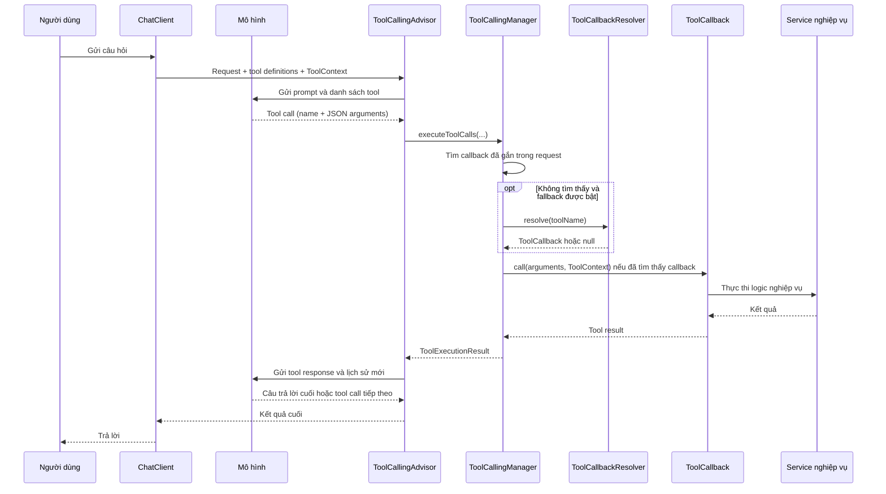

# Phân giải động

## Vai trò của `ToolCallbackResolver`

Khi mô hình yêu cầu gọi một công cụ, response chứa tên tool cùng các đối số theo JSON Schema đã được cung cấp trước đó. Ứng dụng cần tìm đúng phần logic có thể xử lý tên đó. Trong Spring AI, `ToolCallbackResolver` đảm nhiệm bước phân giải tên thành một đối tượng `ToolCallback`.

Resolver nằm giữa yêu cầu tool call và bước thực thi. Nó giúp ứng dụng tra cứu callback từ một danh sách tĩnh, Spring application context hoặc một registry tùy chỉnh. `ToolCallingManager` sử dụng callback tìm được để thực thi, chuyển kết quả thành tool response và tiếp tục vòng hội thoại.

Trong module `SPRING_AI_TOOL_CALLING`, cần hiểu rõ ranh giới này để thiết kế tích hợp an toàn: mô hình chỉ đề xuất tên và đối số; resolver chọn callback trong tập mà ứng dụng quản lý; callback thực thi nghiệp vụ và phải tự kiểm tra dữ liệu, quyền truy cập cùng điều kiện vận hành.

### 1. `ToolCallbackResolver` giải quyết vấn đề gì?

Nếu ứng dụng đã có sẵn callback, cách đơn giản nhất là truyền trực tiếp chúng vào request hoặc đặt làm mặc định trên `ChatClient`. Tuy nhiên, một số hệ thống muốn chọn callback theo tên tại runtime. Ví dụ:

- Một agent có thể sử dụng các tool được cấu hình trong registry.
- Một ứng dụng tích hợp nhiều module nghiệp vụ muốn tra cứu callback theo namespace.
- Một tool có thể được đại diện bằng callback proxy để chuyển tiếp lời gọi đến dịch vụ bên ngoài.
- Một hệ thống plugin cần ánh xạ tên tool tới implementation đã được cho phép.

`ToolCallbackResolver` cung cấp một hợp đồng nhỏ để giải quyết các tình huống đó:

```java
import org.jspecify.annotations.Nullable;
import org.springframework.ai.tool.ToolCallback;

public interface ToolCallbackResolver {

    @Nullable
    ToolCallback resolve(String toolName);
}
```

Phương thức `resolve` nhận tên tool và trả về callback tương ứng. Nếu không tìm thấy, resolver trả về `null`. Resolver không nhận JSON arguments, `ToolContext`, danh tính người dùng hoặc đối tượng `Prompt`; nó chỉ chịu trách nhiệm ánh xạ tên sang callback.

| Thành phần | Trách nhiệm |
| --- | --- |
| Mô hình | Đề xuất tên tool và JSON arguments |
| `ToolDefinition` | Mô tả tên, mục đích và input schema mà mô hình nhìn thấy |
| `ToolCallbackResolver` | Tìm `ToolCallback` theo tên khi cơ chế điều phối cần phân giải động |
| `ToolCallback` | Giữ định nghĩa và logic thực thi tool |
| `ToolCallingManager` | Chọn callback, gọi callback, xử lý kết quả và lỗi thực thi |
| `ToolCallingAdvisor` | Điều phối vòng lặp tool calling khi dùng `ChatClient` |

Điều quan trọng là resolver không thực thi nghiệp vụ. Nó không gọi database, không gửi email và không cập nhật đơn hàng chỉ vì nhận được tên tool. Nó trả về callback; bước thực thi diễn ra sau đó trong `ToolCallingManager`.

### 2. Luồng phân giải và thực thi một tool call

Trong Spring AI 2.x, khi dùng `ChatClient`, `ToolCallingAdvisor` quản lý vòng lặp. Nếu model trả về tool call, advisor chuyển response cho `ToolCallingManager`. Manager tìm callback đã gắn với request trước. Chỉ khi không tìm thấy callback tương ứng và resolution fallback được bật, manager mới hỏi `ToolCallbackResolver`.



Sơ đồ mô tả đường thực thi thành công. Nếu cả danh sách request và resolver đều không tìm thấy callback, hoặc fallback đang tắt khi request không có callback, `ToolCallingManager` ném `IllegalStateException` và không gọi tool. Luồng trên có hai đường để tìm callback. Đường ưu tiên là danh sách callback đã được gắn vào request. Đường thứ hai là resolver fallback, chỉ chạy khi callback không có trong request và tính năng fallback được bật.

Vì vậy, việc một callback tồn tại trong Spring application context và việc callback đó được phép thực thi trong một request là hai khái niệm khác nhau. Resolver có thể biết một callback, nhưng request vẫn có thể bị giới hạn chỉ chạy các callback được đính kèm rõ ràng.

### 3. Phân biệt resolver với `ToolCallbackProvider`

Hai abstraction này có liên quan nhưng không thay thế nhau:

| Abstraction | Hợp đồng chính | Khi sử dụng |
| --- | --- | --- |
| `ToolCallbackResolver` | `resolve(String toolName)` trả về một callback hoặc `null` | Cần tra cứu một callback bằng tên tại runtime |
| `ToolCallbackProvider` | Cung cấp một nhóm `ToolCallback` | Một thành phần sở hữu hoặc tổng hợp nhiều callback |
| `StaticToolCallbackResolver` | Phân giải từ danh sách callback đã biết | Registry nhỏ, cố định theo cấu hình ứng dụng |
| `DelegatingToolCallbackResolver` | Chuyển việc phân giải qua nhiều resolver con | Muốn ghép nhiều nguồn tìm callback |

Ví dụ, MCP client có thể cung cấp một `ToolCallbackProvider` đại diện cho các tool từ MCP server. Resolver lại nhận tên cụ thể và tìm callback phù hợp khi được hỏi. `ToolCallbackProvider` không phải một resolver theo tên; nó là nguồn cung cấp danh sách callback.

### 4. Resolver mặc định trong Spring AI 2.1.0

Trong cấu hình Spring Boot thông thường, Spring AI tự cấu hình cơ chế phân giải dựa trên các `ToolCallback` bean trong application context. Tài liệu Spring AI 2.1.0 mô tả `StaticToolCallbackResolver` được tự động cấu hình với:

- Các bean có kiểu `ToolCallback`.
- Các callback do bean `ToolCallbackProvider` cung cấp.
- MCP providers được loại khỏi quá trình liệt kê tự động để tránh gọi mạng tới từng MCP server khi khởi tạo hoặc quét tool. MCP provider cần được inject và gắn rõ vào `ChatClient` hoặc request.

Ví dụ khai báo một callback bean:

```java
@Configuration(proxyBeanMethods = false)
public class WeatherToolConfiguration {

    @Bean
    ToolCallback currentWeather(WeatherService weatherService) {
        return FunctionToolCallback.builder(
                "current_weather",
                (WeatherRequest request) -> weatherService.getWeather(request.location()))
            .description("Tra cứu thời tiết hiện tại theo tên thành phố.")
            .inputType(WeatherRequest.class)
            .build();
    }
}
```

Callback được Spring quản lý và có thể được resolver mặc định tìm theo tên. Nếu request cần sử dụng callback đó theo cách tường minh, hãy inject bean và gắn vào request:

```java
String answer = chatClient.prompt()
    .user("Thời tiết hiện tại ở Đà Nẵng thế nào?")
    .tools(currentWeather)
    .call()
    .content();
```

Một điểm dễ nhầm: `ToolCallback` bean được phát hiện để phục vụ name-based lookup không tự động trở thành tool khả dụng trong mọi request. Trong Spring AI 2.1.0, resolution fallback mặc định là `false`; callback cần được gắn vào request hoặc client để được thực thi theo luồng thông thường.

### 5. `ToolCallingManager` sử dụng resolver khi nào?

Trong Spring AI 2.1.0, `ToolCallingManager` tìm callback theo thứ tự sau:

1. Tìm trong danh sách `ToolCallback` được gắn vào `ToolCallingChatOptions` của request.
2. Nếu tìm thấy, sử dụng callback đó.
3. Nếu không tìm thấy và `resolutionFallbackEnabled` là `true`, gọi `ToolCallbackResolver.resolve(toolName)`.
4. Nếu vẫn không tìm thấy callback, việc thực thi thất bại với `IllegalStateException` báo không có `ToolCallback` cho tên tool đó.

Ví dụ, request có callback `lookup_order` và resolver cũng có callback cùng tên. Manager dùng callback được gắn trong request trước. Resolver không được hỏi khi callback đã tìm thấy.

Nếu request không có `lookup_order`:

- Khi fallback tắt, manager không gọi resolver và từ chối thực thi tool.
- Khi fallback bật, manager hỏi resolver để tìm callback theo tên.

Quy tắc này giúp request kiểm soát tập capability được phép thực thi. Nó cũng có nghĩa là bật fallback sẽ thay đổi ranh giới thực thi: một callback nằm ngoài danh sách request vẫn có thể chạy nếu resolver trả về callback cùng tên.

### 6. Resolution fallback và ranh giới bảo mật

Từ Spring AI 2.0.1, resolution fallback có thể cấu hình bằng property:

```properties
spring.ai.tools.resolution.fallback.enabled=true
```

Giá trị mặc định là `false`. Khi tắt, chỉ các callback gắn vào request mới được thực thi. Nếu tự tạo `ToolCallingManager`, có thể cấu hình cùng hành vi trên builder:

```java
ToolCallingManager toolCallingManager = ToolCallingManager.builder()
    .toolCallbackResolver(toolCallbackResolver)
    .resolutionFallbackEnabled(true)
    .build();
```

Chỉ bật fallback khi ứng dụng kiểm soát đầy đủ tập callback mà resolver có thể trả về. Nếu resolver nhìn thấy cả tool đọc dữ liệu nhạy cảm, hoàn tiền, xóa dữ liệu hoặc thay đổi trạng thái, một tool call được mô hình phát ra có thể làm những callback đó được thực thi dù request không đính kèm chúng.

Đặc biệt, `resolve(String toolName)` chỉ nhận tên tool. Nó không nhận `ToolContext`, `userId`, `tenantId` hoặc quyền của request. Vì vậy, resolver không phải nơi thích hợp để quyết định một người dùng cụ thể có quyền xem hoặc thay đổi dữ liệu nào.

Hãy đặt các kiểm tra bảo mật ở đúng nơi:

- Giới hạn callback nào được đính kèm vào request dựa trên chức năng và quyền của người dùng.
- Đưa danh tính tin cậy vào `ToolContext` theo từng request.
- Kiểm tra tenant, quyền sở hữu tài nguyên và quyền thao tác trong callback hoặc service nghiệp vụ.
- Với hành động có tác dụng phụ, yêu cầu xác nhận và ghi audit log trước hoặc trong khi thực thi.
- Không coi tên tool do mô hình gửi là bằng chứng về quyền của người dùng.

Ví dụ, resolver có thể trả về callback `lookup_order` cho mọi request. Callback vẫn phải kiểm tra `tenantId` và `userId` trong `ToolContext` trước khi đọc đơn hàng. Nếu người dùng ở tenant A yêu cầu mã đơn thuộc tenant B, service phải từ chối dù resolver đã tìm đúng callback.

### 7. Tùy chỉnh resolver theo registry riêng

Nếu ứng dụng cần chiến lược khác với registry tĩnh mặc định, có thể cung cấp bean `ToolCallbackResolver` riêng. Spring AI đưa ví dụ thay resolver mặc định bằng `StaticToolCallbackResolver`:

```java
@Configuration(proxyBeanMethods = false)
public class ToolResolverConfiguration {

    @Bean
    ToolCallbackResolver toolCallbackResolver(List<ToolCallback> toolCallbacks) {
        return new StaticToolCallbackResolver(toolCallbacks);
    }
}
```

Đây là cách phù hợp khi muốn tự kiểm soát danh sách callback tĩnh. Khi thay resolver mặc định, cần chủ động tính đến mọi nguồn callback mà ứng dụng muốn hỗ trợ, chẳng hạn `ToolCallbackProvider` hoặc resolver riêng. Không nên giả định việc thay bean chỉ thêm một nguồn mới vào cấu hình cũ.

Với registry động, có thể triển khai giao diện resolver để tra cứu callback từ catalog do ứng dụng quản lý:

```java
import java.util.Optional;
import org.jspecify.annotations.Nullable;
import org.springframework.ai.tool.ToolCallback;
import org.springframework.ai.tool.resolution.ToolCallbackResolver;

public interface ToolCallbackCatalog {
    Optional<ToolCallback> findEnabledCallback(String toolName);
}

public final class CatalogToolCallbackResolver implements ToolCallbackResolver {

    private final ToolCallbackCatalog catalog;

    public CatalogToolCallbackResolver(ToolCallbackCatalog catalog) {
        this.catalog = catalog;
    }

    @Override
    public @Nullable ToolCallback resolve(String toolName) {
        return catalog.findEnabledCallback(toolName).orElse(null);
    }
}
```

`ToolCallbackCatalog` là abstraction thuộc ứng dụng. Nó có thể đọc metadata từ database hoặc registry, nhưng nên trả về callback được tạo từ các implementation đã được ứng dụng cho phép. Không dùng dữ liệu catalog để nạp class tùy ý, gọi reflection trên tên class do người dùng cung cấp hoặc thực thi mã được lưu trong database.

Đăng ký resolver tùy chỉnh trong application context:

```java
@Bean
ToolCallbackResolver toolCallbackResolver(ToolCallbackCatalog catalog) {
    return new CatalogToolCallbackResolver(catalog);
}
```

Bean này thay resolver auto-configured. Nếu ứng dụng vẫn cần các nguồn callback tĩnh hoặc provider khác, hãy kết hợp chúng một cách tường minh trong resolver tùy chỉnh.

Nếu cần ghép nhiều nguồn, `DelegatingToolCallbackResolver` cho phép kết hợp một danh sách resolver con. Ví dụ, có thể dùng resolver tĩnh cho tool nội bộ và resolver catalog cho tool mở rộng. Hãy xác định rõ nguồn nào được ưu tiên và bảo đảm một tên tool chỉ ánh xạ tới một callback hợp lệ. Khi nhiều nguồn cùng trả callback cho một tên, thứ tự delegate có thể ảnh hưởng tới callback được chọn.

### 8. Dùng resolver cho tool từ dịch vụ bên ngoài

Một resolver có thể tra cứu callback đại diện cho tool ở dịch vụ từ xa. Tuy nhiên, cần phân biệt bước phân giải với bước gọi dịch vụ:

1. `resolve("search_documents")` tìm hoặc tạo một callback đại diện cho tool từ xa.
2. `ToolCallingManager` gọi `ToolCallback.call(toolInput, toolContext)`.
3. Callback proxy gửi JSON arguments tới remote service hoặc MCP client.
4. Callback chuyển kết quả từ dịch vụ ngoài thành chuỗi theo hợp đồng tool result.

Resolver không nên tự thực hiện hành động nghiệp vụ trong lúc `resolve`. Nếu nó gửi email, cập nhật đơn hàng hoặc gọi thanh toán ngay khi phân giải tên, hành động có thể xảy ra trước khi `ToolCallingManager` thực thi callback theo đúng lifecycle.

Với registry hoặc remote catalog, nên cân nhắc:

- Cache metadata và callback wrapper theo tên hoặc phiên bản để tránh truy vấn lặp lại không cần thiết.
- Đặt timeout cho việc tra cứu và gọi remote service.
- Phân biệt “không tồn tại tool” với “registry đang lỗi hoặc không truy cập được”. Không biến lỗi kết nối thành `null` một cách âm thầm.
- Giới hạn tên tool bằng allowlist và namespace; không nhận URL hoặc tên class tùy ý từ mô hình.
- Xử lý callback remote như một boundary tin cậy riêng: xác thực dịch vụ, kiểm tra schema, timeout, retry có giới hạn và idempotency cho hành động có tác dụng phụ.
- Không log token, secret, dữ liệu cá nhân hoặc toàn bộ payload nhạy cảm khi ghi nhận lỗi.

Nếu tool đến từ MCP server, Spring AI thường cung cấp các callback qua `ToolCallbackProvider`. Ứng dụng nên inject provider và gắn rõ ràng bằng `.tools(provider)` hoặc `.defaultTools(provider)` khi cần. Việc không tự động liệt kê MCP provider giúp tránh round-trip mạng tới từng MCP server khi khởi tạo ứng dụng.

### 9. Khác biệt giữa Spring AI 1.x và 2.x

`ToolCallbackResolver` tồn tại từ dòng 1.x, nhưng cách ứng dụng sử dụng cơ chế phân giải động đã thay đổi.

| Nội dung | Spring AI 1.0.9 | Spring AI 2.x / 2.1.0 |
| --- | --- | --- |
| Hợp đồng resolver | `resolve(String toolName)` trả callback hoặc `null` | Vẫn dùng cùng hợp đồng |
| Cách yêu cầu phân giải theo tên | Client có thể truyền `toolNames(...)` hoặc `defaultToolNames(...)` | Mô hình làm việc chủ yếu với callback được đăng ký tường minh; fallback theo tên là tùy chọn |
| Resolver cho functional bean | Có `SpringBeanToolCallbackResolver` cho `Function`, `Supplier`, `Consumer`, `BiFunction` bean | Spring AI 2.0 loại bỏ pattern bare function bean được resolve bằng `toolNames(...)` |
| Resolver tĩnh | `StaticToolCallbackResolver` tìm trong danh sách callback | `StaticToolCallbackResolver` được dùng cho `ToolCallback` bean và provider callback trong auto-configuration |
| Cơ chế fallback | Name-based dynamic specification được dùng trực tiếp qua tool names | Từ 2.0.1, fallback phân giải tool không đính kèm request mặc định tắt |
| Đăng ký function tool | Có thể dùng function bean và tên bean | Tạo `FunctionToolCallback` rồi đăng ký thành `ToolCallback` bean hoặc truyền trực tiếp |

Ví dụ kiểu dynamic specification trong 1.0.9:

```java
ChatClient.create(chatModel)
    .prompt("Thời tiết ở Hà Nội thế nào?")
    .toolNames("currentWeather")
    .call()
    .content();
```

SpringBeanToolCallbackResolver có thể tìm function bean theo tên `currentWeather`. Trong Spring AI 2.x, pattern này đã bị loại bỏ. Hãy khai báo callback tường minh:

```java
@Bean
ToolCallback currentWeather(WeatherService weatherService) {
    return FunctionToolCallback.builder(
            "currentWeather",
            (WeatherRequest request) -> weatherService.getWeather(request.location()))
        .description("Tra cứu thời tiết hiện tại theo thành phố.")
        .inputType(WeatherRequest.class)
        .build();
}
```

Sau đó truyền callback vào request hoặc client bằng `.tools(currentWeather)` hay `.defaultTools(currentWeather)`. Nếu ứng dụng thật sự cần resolver fallback để tìm callback không được đính kèm request, cấu hình fallback riêng và đánh giá đầy đủ tập tool có thể được resolver trả về.

### 10. Xử lý trường hợp không tìm thấy tool

Một số tình huống khiến resolver trả về `null`:

- Tên tool trong model response không khớp tên trong `ToolDefinition`.
- Callback chưa được đăng ký hoặc chưa được đưa vào registry.
- Tool đã bị vô hiệu hóa hoặc gỡ khỏi catalog.
- Request không có callback và resolution fallback đang tắt.
- Tên tool bị mô hình thay đổi hoặc cắt ngắn khi tạo response.

Trong Spring AI 2.1, nếu manager không tìm được callback, việc thực thi thất bại với `IllegalStateException` dạng `No ToolCallback found for tool name: ...`. Nên phân biệt lỗi cấu hình với lỗi registry:

| Tình huống | Cách xử lý |
| --- | --- |
| Không có tool với tên đó | Trả lỗi không tìm thấy; kiểm tra tool name và danh sách callback |
| Tool có trong registry nhưng fallback tắt | Gắn callback vào request hoặc bật fallback có kiểm soát |
| Registry không truy cập được | Báo lỗi hạ tầng an toàn; không giả vờ rằng tool không tồn tại |
| Trùng tên giữa nhiều nguồn | Đổi namespace hoặc từ chối cấu hình khi khởi động |
| Tool đã bị vô hiệu hóa | Không trả callback từ resolver và ghi nhận trạng thái catalog |

Không nên bắt mọi exception trong resolver rồi trả `null`. Cách đó làm mất thông tin về lỗi database, timeout hoặc lỗi cấu hình, khiến manager chỉ báo “không tìm thấy tool”. Hãy trả `null` cho trường hợp không có tên phù hợp; các lỗi hạ tầng cần được biểu diễn riêng để ứng dụng có thể xử lý và quan sát.

### 11. Kiểm thử resolver và manager

Kiểm thử cần bao phủ cả ánh xạ tên lẫn quyết định có được phép thực thi callback hay không.

**Unit test cho resolver:**

- Tên đã đăng ký trả về đúng callback.
- Tên không tồn tại trả về `null`.
- Tên trùng bị từ chối khi tạo registry thay vì chọn ngẫu nhiên.
- Resolver động xử lý callback bị vô hiệu hóa hoặc không còn tồn tại.
- Lỗi registry được phân biệt với trường hợp không tìm thấy tool.

**Integration test cho `ToolCallingManager`:**

- Callback được gắn trong request được chọn trước resolver.
- Khi fallback tắt, callback không gắn vào request không được thực thi dù resolver có thể tìm thấy.
- Khi fallback bật, callback thiếu trong request được resolve và thực thi.
- Tên không tìm thấy tạo lỗi rõ ràng.
- JSON arguments và `ToolContext` được chuyển đúng tới callback.
- Với nhiều request đồng thời, resolver không dùng state mutable để lưu tenant hoặc user của request trước.

**Kiểm thử bảo mật:**

- Mô hình yêu cầu tên tool nguy hiểm không có trong request; xác minh fallback tắt khiến callback không chạy.
- Nếu bật fallback, xác minh registry chỉ trả các tool trong allowlist.
- Callback đọc dữ liệu phải kiểm tra tenant và user từ `ToolContext`.
- Callback thay đổi dữ liệu phải xác minh quyền, xác nhận, idempotency và audit log.

Ví dụ test đơn giản cho resolver tĩnh tùy chỉnh:

```java
@Test
void resolvesRegisteredCallbackByExactName() {
    ToolCallback callback = mock(ToolCallback.class);
    ToolDefinition definition = ToolDefinition.builder()
        .name("lookup_order")
        .description("Tra cứu đơn hàng")
        .inputSchema("{\"type\":\"object\"}")
        .build();
    given(callback.getToolDefinition()).willReturn(definition);

    ToolCallbackResolver resolver =
        new StaticToolCallbackResolver(List.of(callback));

    assertThat(resolver.resolve("lookup_order")).isSameAs(callback);
    assertThat(resolver.resolve("delete_order")).isNull();
}
```

Một integration test riêng nên tạo `DefaultToolCallingManager` với resolver giả và kiểm tra cả hai giá trị `resolutionFallbackEnabled`. Test này xác nhận ranh giới giữa callback gắn request và callback chỉ có thể tìm qua resolver.

### 12. Quan sát hoạt động phân giải

Khi tool call không chạy, cần phân biệt lỗi ở các bước: model phát tên nào, callback có nằm trong request không, fallback có bật không, resolver có tìm được callback không, và callback thực thi có thành công không.

Spring AI cung cấp observability cho tool execution qua Micrometer observation `spring.ai.tool`, gồm tên tool, metadata và thời gian thực thi. Tracing context được truyền khi có tracer. Việc xuất arguments và results thành span attributes bị tắt mặc định do các giá trị này có thể chứa dữ liệu nhạy cảm.

Để chẩn đoán trong môi trường phát triển, có thể bật log DEBUG:

```properties
logging.level.org.springframework.ai=DEBUG
```

Với resolver tùy chỉnh, nên bổ sung metric hoặc log có cấu trúc cho:

- Số lần resolve theo tên tool.
- Tỷ lệ tìm thấy và không tìm thấy.
- Thời gian truy vấn registry hoặc catalog.
- Lỗi timeout, lỗi nguồn dữ liệu và callback bị vô hiệu hóa.
- Phiên bản hoặc nguồn đăng ký callback.

Chỉ log tên tool, mã request và trạng thái cần thiết. Không log toàn bộ JSON arguments, kết quả, token hoặc thông tin xác thực nếu chưa có chính sách bảo vệ dữ liệu phù hợp.

### 13. Những hiểu nhầm thường gặp

1. **“Resolver chính là tool.”** Resolver chỉ trả về callback. Callback mới chứa logic thực thi.
2. **“Có `ToolCallback` bean là mô hình tự động dùng được.”** Bean có thể được phát hiện cho name-based lookup, nhưng request vẫn phải gắn tool hoặc bật fallback.
3. **“Resolver gửi danh sách tool cho mô hình.”** Resolver chỉ nhận tên để tìm callback. Tool definitions phải được cung cấp qua cơ chế đăng ký tool phù hợp.
4. **“Fallback bật là an toàn vì chỉ có resolver trả callback.”** Khi bật fallback, mọi callback resolver có thể trả về đều có khả năng được thực thi nếu model gọi đúng tên.
5. **“Resolver có thể kiểm tra quyền theo tenant.”** `resolve` chỉ nhận `toolName`; quyền theo request phải được kiểm tra trong callback/service bằng context tin cậy.
6. **“Không tìm thấy tool và registry bị lỗi là một.”** Đây là hai trạng thái khác nhau và cần được xử lý riêng.
7. **“Có thể dùng bare Function bean như trước 1.x.”** Spring AI 2.0 đã loại bỏ pattern `SpringBeanToolCallbackResolver` cho function bean; hãy tạo `FunctionToolCallback` tường minh.

### 14. Checklist thiết kế `ToolCallbackResolver`

- Dùng tên tool ổn định, duy nhất và có namespace khi kết hợp nhiều nguồn.
- Ưu tiên gắn callback tường minh vào request hoặc `ChatClient` khi danh sách tool đã biết.
- Chỉ dùng resolver động khi thực sự cần tra cứu theo tên tại runtime.
- Giữ resolution fallback tắt nếu không có nhu cầu rõ ràng.
- Nếu bật fallback, kiểm soát toàn bộ callback mà resolver có thể trả về.
- Không dùng resolver làm lớp phân quyền theo người dùng hoặc tenant.
- Kiểm tra quyền trong callback/service bằng `ToolContext` và danh tính tin cậy.
- Resolver không thực thi side effect; callback mới thực hiện nghiệp vụ.
- Cache và đặt timeout cho registry động; phân biệt lỗi registry với tên không tồn tại.
- Kiểm thử cả lookup, fallback, unknown tool, trùng tên, concurrency và quyền truy cập.
- Theo dõi thời gian resolve, kết quả tìm kiếm và lỗi mà không ghi lộ payload nhạy cảm.

`ToolCallbackResolver` giúp Spring AI tìm đúng callback từ tên tool mà mô hình yêu cầu. Trong kiến trúc 2.1, callback gắn vào request vẫn là ranh giới thực thi mặc định; resolver fallback chỉ mở rộng ranh giới đó khi được bật. Hãy giữ resolver tập trung vào ánh xạ tên, để `ToolCallingManager` điều phối và để callback/service chịu trách nhiệm về quyền cùng tính đúng đắn của nghiệp vụ.

### Tài liệu tham khảo

- [Spring AI 2.1.0 Reference — Tool Calling](https://docs.spring.io/spring-ai/reference/api/tools.html)
- [Spring AI 2.1.0 API — ToolCallbackResolver](https://docs.spring.io/spring-ai/docs/current/api/org/springframework/ai/tool/resolution/ToolCallbackResolver.html)
- [Spring AI 2.1.0 API — StaticToolCallbackResolver](https://docs.spring.io/spring-ai/docs/2.1.x/api/org/springframework/ai/tool/resolution/StaticToolCallbackResolver.html)
- [Spring AI 2.1.0 API — DelegatingToolCallbackResolver](https://docs.spring.io/spring-ai/docs/2.1.x/api/org/springframework/ai/tool/resolution/DelegatingToolCallbackResolver.html)
- [Spring AI 1.0.9 Reference — Tool Calling and Dynamic Specification](https://docs.spring.io/spring-ai/reference/1.0/api/tools.html)
- [Spring AI 1.0.9 API — ToolCallbackResolver](https://docs.spring.io/spring-ai/docs/1.0.x/api/org/springframework/ai/tool/resolution/ToolCallbackResolver.html)

Các ví dụ fallback và cấu hình resolver trong bài dựa trên Spring AI 2.1.0; phần `toolNames(...)` và `SpringBeanToolCallbackResolver` mô tả dòng 1.0.9. Khi migration, hãy kiểm tra đúng phiên bản dependency và xác minh callback được đính kèm hoặc resolve theo đúng chính sách của ứng dụng.
