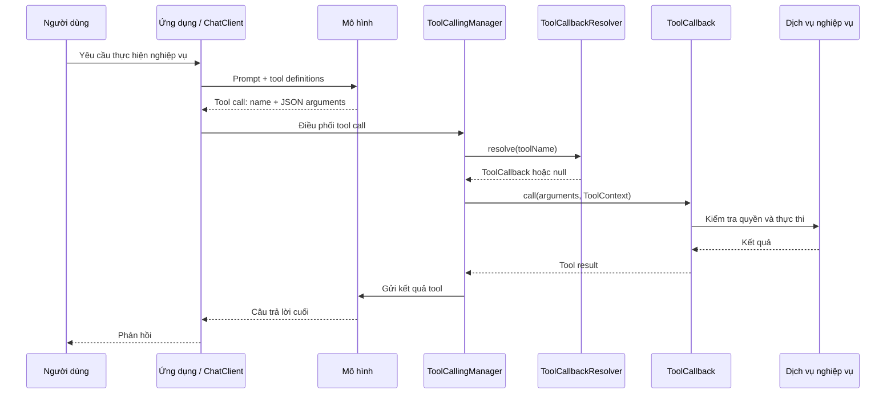

# Tạo resolver tùy chỉnh cho danh mục công cụ động

Trong một ứng dụng nhỏ, danh sách tool thường được khai báo cố định bằng `@Tool`, `FunctionToolCallback` hoặc các bean `ToolCallback`. Khi hệ thống có nhiều nghiệp vụ, plugin, tenant hoặc dịch vụ tích hợp thay đổi theo cấu hình, việc đăng ký từng callback từ lúc khởi động trở nên khó quản lý. Khi đó, ứng dụng có thể dùng `ToolCallbackResolver` để tìm callback theo tên tại thời điểm thực thi.

`ToolCallbackResolver` là một điểm mở rộng nhỏ nhưng quan trọng của Spring AI: nó nhận tên tool và trả về `ToolCallback` tương ứng hoặc `null` nếu không tìm thấy. Một resolver tùy chỉnh có thể tra cứu danh mục trong database, registry, cấu hình plugin hoặc một dịch vụ từ xa; sau đó tạo hoặc lấy callback đã được xây dựng từ mô tả của tool.

Trong module `SPRING_AI_TOOL_CALLING`, resolver chỉ giải quyết bước ánh xạ tên thành callback. Ứng dụng vẫn chịu trách nhiệm công bố đúng tool cho model, kiểm tra đầu vào, xác thực quyền, thực thi nghiệp vụ, giới hạn số lần gọi và xử lý lỗi.

## 1. ToolCallbackResolver nằm ở đâu trong vòng đời tool calling?

Một `ToolCallback` chứa định nghĩa mà model nhìn thấy và logic thực thi phía ứng dụng. Định nghĩa gồm tên, mô tả và JSON Schema đầu vào. Khi model gửi tool call, `ToolCallingManager` cần tìm callback có tên khớp để thực thi.



Hợp đồng resolver rất gọn:

```java
package org.springframework.ai.tool.resolution;

import org.springframework.ai.tool.ToolCallback;

public interface ToolCallbackResolver {
    ToolCallback resolve(String toolName);
}
```

Trong API Spring AI, kết quả của `resolve` có thể là `null` khi không tìm thấy tool. Vì vậy, resolver không nên tự tạo một callback giả cho tên không hợp lệ. Trả `null` cho phép `ToolCallingManager` tiếp tục cơ chế phân giải khác nếu resolver đang được ghép trong `DelegatingToolCallbackResolver`, hoặc báo lỗi không tìm thấy callback ở bước thực thi.

## 2. Khi nào cần resolver tùy chỉnh?

Resolver mặc định thường đủ dùng nếu ứng dụng có một tập callback cố định. Spring Boot có thể tạo `StaticToolCallbackResolver` từ các bean `ToolCallback` và callback do `ToolCallbackProvider` cung cấp; MCP providers được loại khỏi bước liệt kê tĩnh để tránh kết nối/lấy danh sách tool quá sớm. Một resolver riêng hữu ích khi danh mục tool thay đổi theo cấu hình hoặc được quản lý bên ngoài ứng dụng.

| Nguồn danh mục | Cách resolver có thể làm việc |
| --- | --- |
| Database | Tìm tool đang hoạt động theo tên, đọc mô tả/schema/phiên bản và tạo callback |
| Plugin registry | Tra cứu plugin đã được cài đặt, kiểm tra trạng thái rồi lấy callback tương ứng |
| Service registry | Tìm adapter hoặc endpoint đã đăng ký, sau đó tạo callback proxy |
| Cấu hình theo tenant | Tra cứu cấu hình tích hợp theo namespace; quyền trên tenant vẫn phải được kiểm tra lúc thực thi |
| Danh mục lớn | Dùng cache có phiên bản hoặc TTL để tránh đọc registry từ xa ở mọi lần gọi |

Không nên dùng resolver chỉ vì có thể. Nếu danh sách tool nhỏ và ổn định, truyền callback trực tiếp bằng `.tools(...)` đơn giản hơn và thể hiện rõ quyền của request. Resolver phù hợp khi việc ánh xạ tên sang callback thực sự cần diễn ra động.

## 3. Phân biệt API giữa Spring AI 1.x và 2.x

`ToolCallbackResolver` tồn tại từ Spring AI 1.0, nhưng cách tích hợp với request đã thay đổi giữa các thế hệ.

| Phiên bản | Cách dùng resolver |
| --- | --- |
| Spring AI 1.0.x | Phía client có thể cung cấp tên tool cho `ChatClient` hoặc `ChatModel`; resolver phía server ánh xạ tên đó thành callback để thực thi |
| Spring AI 2.0.x và 2.1.x | Cách chính là đăng ký `ToolCallback` tường minh với request hoặc client. Resolver vẫn được dùng cho phân giải theo tên và cơ chế fallback khi được bật |

Trong Spring AI 2.x, `spring.ai.tools.resolution.fallback.enabled` mặc định là `false`. Khi bật thuộc tính này, nếu model yêu cầu một tool không nằm trong callback list của request, `ToolCallingManager` mới thử tìm tool theo tên qua resolver. Có thể bật trong cấu hình:

```yaml
spring:
  ai:
    tools:
      resolution:
        fallback:
          enabled: true
```

Nếu tự tạo `ToolCallingManager`, builder cũng có tùy chọn `.resolutionFallbackEnabled(true)`. Cần đối chiếu API với phiên bản dependency thực tế của dự án.

Một điểm dễ nhầm: resolver không tự công bố toàn bộ danh mục tool cho mô hình. Model cần được cung cấp định nghĩa tool thông qua request hoặc cơ chế khám phá/công bố riêng. Resolver đảm nhận bước tìm callback khi ứng dụng cần thực thi tên tool. Với danh mục lớn, có thể dùng cơ chế tìm kiếm hoặc progressive disclosure để chỉ đưa các tool liên quan vào request; sau đó resolver xử lý việc phân giải callback theo tên.

<badge color="warning">Lưu ý bảo mật</badge>

Khi bật resolution fallback trong Spring AI 2.x, mọi tool mà resolver có thể trả về có thể được thực thi nếu model yêu cầu đúng tên, kể cả khi request không gắn callback đó. Không bật fallback toàn cục nếu resolver chứa tool ghi dữ liệu, tool quản trị hoặc tool có tác động lớn mà chưa có chính sách giới hạn và kiểm tra quyền phù hợp.

## 4. Thiết kế danh mục tool động

Không nên lưu mã Java tùy ý hoặc biểu thức thực thi trong database rồi chạy trực tiếp. Danh mục nên lưu metadata và khóa thao tác; ứng dụng ánh xạ khóa đó đến adapter đã được lập trình và cho phép.

Ví dụ một bản ghi danh mục có thể gồm:

| Trường | Ý nghĩa |
| --- | --- |
| `name` | Tên tool ổn định, duy nhất, ví dụ `crm.customer.lookup` |
| `description` | Mô tả mục đích và cách model nên dùng tool |
| `inputSchema` | JSON Schema đầu vào |
| `operationKey` | Khóa trỏ đến một adapter nghiệp vụ đã được allowlist |
| `permissionKey` | Quyền nghiệp vụ cần có để gọi tool |
| `version` | Phiên bản cấu hình để làm mới callback cache |
| `enabled` | Trạng thái cho phép phân giải |

DTO mô tả tool:

```java
public record DynamicToolSpec(
        String name,
        String description,
        String inputSchema,
        String operationKey,
        String permissionKey,
        long version,
        boolean enabled) {
}
```

Repository chỉ trả về tool đang được phép phân giải:

```java
import java.util.Optional;

public interface DynamicToolCatalog {
    Optional<DynamicToolSpec> findEnabledByName(String toolName);
}
```

`operationKey` không phải URL tùy ý hoặc tên class do người dùng cấu hình. Ví dụ, `crm.customer.lookup` có thể được ánh xạ đến một adapter `CustomerGateway` đã được đăng ký trong ứng dụng. Cách này cho phép cập nhật mô tả, schema hoặc trạng thái tool mà không biến database thành nơi thực thi mã tùy ý.

## 5. Tạo ToolCallback từ mô tả động

Để minh họa đầy đủ, ta tạo một callback dùng chung cho các tool được định nghĩa trong danh mục. Callback giữ `ToolDefinition` được tạo từ metadata và chuyển JSON arguments đến một executor đã được kiểm soát.

```java
import com.fasterxml.jackson.databind.JsonNode;
import com.fasterxml.jackson.databind.ObjectMapper;
import java.util.Map;

import org.springframework.ai.chat.model.ToolContext;
import org.springframework.ai.tool.ToolCallback;
import org.springframework.ai.tool.definition.ToolDefinition;
import org.springframework.ai.tool.execution.ToolExecutionException;
import org.springframework.ai.tool.metadata.ToolMetadata;

public final class CatalogToolCallback implements ToolCallback {

    private final DynamicToolSpec spec;
    private final ToolDefinition definition;
    private final ToolMetadata metadata;
    private final ObjectMapper objectMapper;
    private final JsonSchemaValidator schemaValidator;
    private final DynamicToolExecutor executor;

    public CatalogToolCallback(
            DynamicToolSpec spec,
            ObjectMapper objectMapper,
            JsonSchemaValidator schemaValidator,
            DynamicToolExecutor executor) {
        this.spec = spec;
        this.definition = ToolDefinition.builder()
                .name(spec.name())
                .description(spec.description())
                .inputSchema(spec.inputSchema())
                .build();
        this.metadata = ToolMetadata.builder().build();
        this.objectMapper = objectMapper;
        this.schemaValidator = schemaValidator;
        this.executor = executor;
    }

    @Override
    public ToolDefinition getToolDefinition() {
        return definition;
    }

    @Override
    public ToolMetadata getToolMetadata() {
        return metadata;
    }

    @Override
    public String call(String toolInput) {
        return call(toolInput, new ToolContext(Map.of()));
    }

    @Override
    public String call(String toolInput, ToolContext toolContext) {
        try {
            JsonNode arguments = objectMapper.readTree(toolInput);
            schemaValidator.validate(spec.inputSchema(), arguments);

            ToolContext context = toolContext != null
                    ? toolContext
                    : new ToolContext(Map.of());

            Object result = executor.execute(spec, arguments, context);
            return objectMapper.writeValueAsString(result);
        }
        catch (ToolExecutionException exception) {
            throw exception;
        }
        catch (Exception exception) {
            throw new ToolExecutionException(
                    definition,
                    new IllegalStateException("Tool execution failed", exception));
        }
    }
}
```

`JsonSchemaValidator` và `DynamicToolExecutor` là abstraction do ứng dụng định nghĩa. Validator cần kiểm tra JSON theo schema đã được kiểm duyệt. Executor ánh xạ `operationKey` đến adapter đã allowlist, xác thực quyền và thực hiện nghiệp vụ. `ObjectMapper` serialize kết quả thành JSON text để trả về cho mô hình.

Ví dụ hai interface của ứng dụng:

```java
import com.fasterxml.jackson.databind.JsonNode;
import org.springframework.ai.chat.model.ToolContext;

public interface JsonSchemaValidator {
    void validate(String schema, JsonNode arguments);
}

public interface DynamicToolExecutor {
    Object execute(
            DynamicToolSpec spec,
            JsonNode arguments,
            ToolContext toolContext);
}
```

Callback này chỉ minh họa một cách hiện thực hóa danh mục schema động. Nếu tool có DTO Java ổn định, nên ưu tiên `FunctionToolCallback` hoặc `MethodToolCallback` để tận dụng chuyển đổi kiểu và schema generator có sẵn. Custom callback phù hợp khi cấu trúc input thực sự được cấu hình động và cần được validate bằng JSON Schema.

## 6. Viết resolver tra cứu danh mục và cache theo phiên bản

Resolver tra cứu tool theo tên, kiểm tra trạng thái, sau đó dùng factory tạo callback. Vì `resolve` là lời gọi đồng bộ, không nên gọi một registry từ xa chậm ở mọi lần phân giải. Cache theo tên và phiên bản giúp tránh tạo lại callback cho mỗi lần gọi, đồng thời thay callback khi metadata hoặc schema thay đổi.

```java
import java.util.Optional;
import java.util.concurrent.ConcurrentHashMap;
import java.util.concurrent.ConcurrentMap;

import org.springframework.ai.tool.ToolCallback;
import org.springframework.ai.tool.resolution.ToolCallbackResolver;

public final class CatalogToolCallbackResolver implements ToolCallbackResolver {

    private final DynamicToolCatalog catalog;
    private final CatalogToolCallbackFactory callbackFactory;
    private final ConcurrentMap<String, CachedCallback> cache =
            new ConcurrentHashMap<>();

    public CatalogToolCallbackResolver(
            DynamicToolCatalog catalog,
            CatalogToolCallbackFactory callbackFactory) {
        this.catalog = catalog;
        this.callbackFactory = callbackFactory;
    }

    @Override
    public ToolCallback resolve(String toolName) {
        if (toolName == null || toolName.isBlank()) {
            return null;
        }

        Optional<DynamicToolSpec> result = catalog.findEnabledByName(toolName);
        if (result.isEmpty()) {
            cache.remove(toolName);
            return null;
        }

        DynamicToolSpec spec = result.get();
        return cache.compute(toolName, (name, current) -> {
            if (current != null && current.version() == spec.version()) {
                return current;
            }
            return new CachedCallback(
                    spec.version(), callbackFactory.create(spec));
        }).callback();
    }

    public void evict(String toolName) {
        cache.remove(toolName);
    }

    private record CachedCallback(long version, ToolCallback callback) {
    }
}
```

Factory tạo callback từ metadata đã được catalog trả về:

```java
import com.fasterxml.jackson.databind.ObjectMapper;
import org.springframework.ai.tool.ToolCallback;
import org.springframework.stereotype.Component;

@Component
class CatalogToolCallbackFactory {

    private final ObjectMapper objectMapper;
    private final JsonSchemaValidator schemaValidator;
    private final DynamicToolExecutor executor;

    CatalogToolCallbackFactory(
            ObjectMapper objectMapper,
            JsonSchemaValidator schemaValidator,
            DynamicToolExecutor executor) {
        this.objectMapper = objectMapper;
        this.schemaValidator = schemaValidator;
        this.executor = executor;
    }

    ToolCallback create(DynamicToolSpec spec) {
        return new CatalogToolCallback(
                spec, objectMapper, schemaValidator, executor);
    }
}
```

Trong ví dụ, `version` phải tăng khi tên, mô tả, schema, permission hoặc operation thay đổi. Cache này tránh tạo lại callback, nhưng resolver vẫn hỏi catalog mỗi lần `resolve`; nếu catalog ở xa, hãy thêm cache metadata/TTL ở tầng catalog hoặc dùng registry cục bộ được đồng bộ. Khi tool bị xóa hoặc vô hiệu hóa, resolver xóa cache và trả `null`. Với hệ thống nhiều instance, cần cơ chế đồng bộ invalidation hoặc TTL; cache cục bộ không tự biết instance khác đã cập nhật danh mục. Có thể dùng Caffeine, Redis hoặc sự kiện domain để quản lý cache theo quy mô hệ thống.

## 7. Đăng ký resolver với Spring Boot

Khi dùng Spring Boot auto-configuration, có thể cung cấp bean `ToolCallbackResolver` để thay chiến lược phân giải mặc định. Nếu ứng dụng vẫn có callback tĩnh, hãy ghép resolver động với `StaticToolCallbackResolver` để giữ khả năng tìm callback bean.

```java
import java.util.List;

import org.springframework.ai.tool.ToolCallback;
import org.springframework.ai.tool.resolution.DelegatingToolCallbackResolver;
import org.springframework.ai.tool.resolution.StaticToolCallbackResolver;
import org.springframework.ai.tool.resolution.ToolCallbackResolver;
import org.springframework.context.annotation.Bean;
import org.springframework.context.annotation.Configuration;

@Configuration(proxyBeanMethods = false)
class ToolResolutionConfiguration {

    @Bean
    ToolCallbackResolver toolCallbackResolver(
            DynamicToolCatalog catalog,
            CatalogToolCallbackFactory callbackFactory,
            List<ToolCallback> staticCallbacks) {

        ToolCallbackResolver dynamicResolver =
                new CatalogToolCallbackResolver(catalog, callbackFactory);
        ToolCallbackResolver staticResolver =
                new StaticToolCallbackResolver(staticCallbacks);

        return new DelegatingToolCallbackResolver(
                List.of(dynamicResolver, staticResolver));
    }
}
```

`DelegatingToolCallbackResolver` thử các resolver theo thứ tự và trả callback đầu tiên tìm được. Trong ví dụ, danh mục động được ưu tiên trước callback tĩnh. Nếu tên tool có thể trùng nhau giữa hai nguồn, cần quy định namespace hoặc phát hiện trùng ngay lúc nạp danh mục; không dựa vào thứ tự resolver để che xung đột.

Nếu ứng dụng còn dùng `ToolCallbackProvider`, cần đưa callback do provider cung cấp vào chiến lược tĩnh tương ứng hoặc dùng cơ chế auto-configuration phù hợp với phiên bản Spring AI. Khi tự thay bean resolver mặc định, hãy kiểm tra lại tất cả nguồn callback mà ứng dụng cần giữ.

## 8. ToolContext và phân quyền khi resolver không nhận context

Chữ ký `resolve(String toolName)` chỉ nhận tên tool. Resolver không nhận `ToolContext`, principal hoặc tenant. Đây là giới hạn thiết kế quan trọng:

- Resolver có thể tìm metadata tool theo tên toàn cục, kiểm tra tool có đang hoạt động và tạo callback.
- Callback nhận `ToolContext` ở thời điểm thực thi thông qua `call(String, ToolContext)`.
- Executor phải lấy principal và tenant từ context do ứng dụng cung cấp, sau đó kiểm tra quyền trên tool và tài nguyên cụ thể.

Không dùng `ThreadLocal`, biến static theo request hoặc giả định resolver luôn chạy trên cùng thread để truyền tenant. Luồng blocking, async và reactive có thể thay đổi thread; cách đó dễ làm rò ngữ cảnh giữa request.

Ví dụ executor kiểm tra quyền trước khi gọi adapter:

```java
import org.springframework.security.access.AccessDeniedException;

public Object execute(
        DynamicToolSpec spec,
        JsonNode arguments,
        ToolContext toolContext) {

    Object principalValue = toolContext.getContext().get("principalId");
    Object tenantValue = toolContext.getContext().get("tenantId");

    if (!(principalValue instanceof String principalId) || principalId.isBlank()
            || !(tenantValue instanceof String tenantId) || tenantId.isBlank()) {
        throw new AccessDeniedException("Missing authenticated context");
    }

    permissionService.assertCanInvoke(
            principalId, tenantId, spec.permissionKey());

    return operationRegistry.execute(
            spec.operationKey(), tenantId, arguments);
}
```

`permissionService` và `operationRegistry` là thành phần của ứng dụng. Registry chỉ ánh xạ các `operationKey` đã được đăng ký đến adapter tin cậy. Service phía sau vẫn phải kiểm tra quyền trên từng bản ghi; quyền gọi một tool không đồng nghĩa được đọc mọi tài nguyên.

Việc xóa cache hoặc disable tool chỉ ngăn các lần phân giải tiếp theo. Một callback đã được gắn vào request trước thời điểm thu hồi vẫn có thể được gọi; vì vậy executor cần kiểm tra trạng thái tool và quyền một lần nữa ngay trước side effect.

Nếu danh mục tool khác nhau theo từng tenant hoặc user, không nên để một resolver toàn cục tự chọn callback theo request context mà nó không nhận được. Hãy chọn một trong các cách sau:

1. Tạo danh sách callback được phép cho request sau khi xác thực user, rồi truyền qua `.tools(...)`.
2. Dùng tên tool có namespace ổn định, còn callback thực hiện kiểm tra tenant trong `ToolContext`.
3. Nếu schema và khả năng của tool thực sự khác nhau theo tenant, tạo callback theo cấu hình đã được kiểm tra và chỉ công bố callback tương ứng trong request đó.

## 9. Bảo mật khi bật phân giải động

Resolver mở rộng tập tool mà ứng dụng có thể tìm thấy. Nếu danh mục không được kiểm soát, model có thể yêu cầu những thao tác ngoài phạm vi mà người dùng hiện tại được phép thực hiện.

- **Giới hạn nguồn danh mục.** Chỉ đọc từ database/registry tin cậy; kiểm tra chữ ký hoặc quyền quản trị nếu metadata được nhập từ hệ thống bên ngoài.
- **Allowlist operation.** `operationKey` phải ánh xạ đến adapter đã được đăng ký trong code. Không cho phép cấu hình tùy ý class name, script, SQL hoặc URL rồi thực thi trực tiếp.
- **Xác thực schema.** Kiểm tra JSON Schema trước khi lưu và trước khi dùng; giới hạn kích thước schema, độ sâu object, số trường và kích thước arguments.
- **Phân quyền tại thời điểm gọi.** Kiểm tra principal, tenant, permission key và quyền trên tài nguyên bằng `ToolContext` cùng security service.
- **Giới hạn danh mục có thể phân giải.** Tắt tool đã bị thu hồi, giới hạn nhóm tool và tránh bật fallback toàn cục cho tool có rủi ro cao.
- **Chống trùng tên.** Tên tool phải duy nhất trong tập tool được cung cấp cho model. Nên đặt namespace như `crm.customer.lookup` hoặc `billing.invoice.read`.
- **Kiểm soát cache.** Khi tool bị thu hồi quyền hoặc thay schema, vô hiệu hóa cache trên mọi instance theo cơ chế đã chọn.
- **Không ghi dữ liệu nhạy cảm.** Log tool name, phiên bản, outcome và correlation ID; không ghi raw arguments, token hoặc toàn bộ kết quả mặc định.
- **Giới hạn thực thi.** Đặt timeout, rate limit, giới hạn số lần gọi mỗi lượt và idempotency cho thao tác ghi.

Trong Spring AI 2.x, bật `spring.ai.tools.resolution.fallback.enabled=true` có nghĩa một tool trong resolver có thể được thực thi dù request hiện tại không gắn callback đó. Chỉ bật khi danh mục trả về đã được giới hạn chặt, và callback vẫn kiểm tra quyền ở runtime. Với các thao tác nhạy cảm, cách an toàn hơn là chỉ đưa callback được phép vào request cụ thể.

## 10. Xử lý lỗi và vòng đời danh mục

Resolver nên phân biệt các tình huống:

| Tình huống | Hành vi phù hợp |
| --- | --- |
| Tên rỗng hoặc sai định dạng | Trả `null`, không truy vấn nguồn dữ liệu |
| Tool không tồn tại | Trả `null` để báo không tìm thấy callback |
| Tool bị disable hoặc thu hồi | Xóa cache và trả `null` |
| Metadata hoặc schema không hợp lệ | Không tạo callback; ghi log lỗi cấu hình có kiểm soát |
| Factory không tạo được callback | Ghi nhận lỗi cấu hình và ném lỗi phù hợp; không trả callback rỗng |
| JSON arguments sai schema | Callback từ chối trước khi gọi adapter |
| Không đủ quyền | Executor từ chối trước side effect |
| Dịch vụ đích lỗi | Ném `ToolExecutionException` để cơ chế `ToolExecutionExceptionProcessor` xử lý |

Với custom `ToolCallback`, khi thực thi thất bại, hãy ném `ToolExecutionException` gắn với `ToolDefinition` của callback. `ToolExecutionExceptionProcessor` có thể chuyển lỗi đã được kiểm soát thành thông báo cho model hoặc ném lỗi về caller tùy cấu hình. Không đưa stack trace, SQL, secret hay thông tin nội bộ vào thông báo mà model nhận được.

Khi cập nhật catalog, nên có quy trình versioning:

1. Kiểm tra name, description, schema, operation key và permission key.
2. Lưu phiên bản mới ở trạng thái chưa kích hoạt.
3. Chạy validation/contract test cho schema và adapter.
4. Kích hoạt phiên bản mới và phát sự kiện invalidation cache.
5. Thu hồi phiên bản cũ sau khi các instance đã cập nhật.

Không nên sửa schema đang được sử dụng mà không tăng version. Nếu model đã nhận schema cũ nhưng callback được thay ngay giữa lượt hội thoại, model có thể gửi arguments không còn khớp với callback mới.

## 11. Kiểm thử resolver và callback động

Kiểm thử resolver riêng với catalog giả lập, sau đó kiểm thử callback với JSON fixture và ToolContext. Không cần gọi model thật cho các kiểm tra này.

| Phạm vi | Trường hợp cần kiểm tra |
| --- | --- |
| Tra cứu | Tên hợp lệ trả đúng callback; tên lạ trả `null` |
| Trạng thái | Tool disabled hoặc bị thu hồi không còn được phân giải |
| Cache | Cùng version dùng lại callback; version mới tạo callback mới |
| Invalidation | Xóa/disable tool làm cache bị loại bỏ |
| Schema | Schema hợp lệ được gắn đúng vào `ToolDefinition`; arguments sai bị từ chối |
| Executor | Operation key chỉ gọi adapter allowlist |
| Quyền | Thiếu principal, sai tenant hoặc thiếu permission không gọi adapter |
| Context | `ToolContext` được chuyển đến callback và executor đúng invocation |
| Fallback | Spring AI 2.x chỉ phân giải callback ngoài request khi fallback được bật |
| Xung đột | Tên trùng giữa danh mục động và callback tĩnh được phát hiện |
| Lỗi | Lỗi nghiệp vụ được chuyển thành `ToolExecutionException` an toàn |

Ví dụ unit test resolver:

```java
import java.util.Optional;

import org.junit.jupiter.api.Test;
import org.springframework.ai.tool.ToolCallback;

import static org.assertj.core.api.Assertions.assertThat;
import static org.mockito.Mockito.times;
import static org.mockito.Mockito.verify;
import static org.mockito.Mockito.when;

@Test
void returnsNullWhenToolIsNotInCatalog() {
    when(catalog.findEnabledByName("crm.customer.unknown"))
            .thenReturn(Optional.empty());

    ToolCallback callback = resolver.resolve("crm.customer.unknown");

    assertThat(callback).isNull();
}

@Test
void reusesCallbackForSameCatalogVersion() {
    DynamicToolSpec spec = new DynamicToolSpec(
            "crm.customer.lookup",
            "Tra cứu khách hàng",
            "{\"type\":\"object\",\"properties\":{}}",
            "CRM_CUSTOMER_LOOKUP",
            "customer:read",
            4L,
            true);
    when(catalog.findEnabledByName(spec.name()))
            .thenReturn(Optional.of(spec));

    ToolCallback first = resolver.resolve(spec.name());
    ToolCallback second = resolver.resolve(spec.name());

    assertThat(second).isSameAs(first);
    verify(callbackFactory, times(1)).create(spec);
}
```

Test trên giả định `catalog`, `callbackFactory` và `resolver` đã được khởi tạo bằng Mockito fixture. Cần bổ sung test khi version thay đổi, tool bị disable và executor từ chối quyền. Ở tầng tích hợp, kiểm tra cấu hình `ToolCallingManager` để xác nhận resolution fallback đúng với giá trị dự kiến của môi trường.

## 12. Chọn cách công bố tool phù hợp với quy mô danh mục

Có hai việc cần phân biệt: **công bố tool definition** để model biết tên và schema; **phân giải callback** để ứng dụng thực thi đúng tool name. `ToolCallbackResolver` giải quyết việc thứ hai.

| Nhu cầu | Cách tiếp cận |
| --- | --- |
| Ít tool, quyền cố định | Đăng ký callback trực tiếp bằng `.tools(...)` hoặc `.defaultTools(...)` |
| Danh mục động nhưng nhỏ theo request | Tra catalog sau xác thực, tạo callback allowlist và truyền vào `.tools(...)` |
| Danh mục lớn, model cần tìm tool theo nhu cầu | Dùng tool discovery/progressive disclosure để công bố nhóm tool phù hợp; resolver xử lý phân giải tên khi thực thi |
| Tích hợp tên tool từ hệ thống cũ | Dùng resolver tùy chỉnh để ánh xạ tên đã công bố sang callback tương ứng; kiểm soát fallback và quyền |

Khi danh mục rất lớn, không nên gửi toàn bộ schema cho model ở mọi request. Có thể cung cấp một tool tìm kiếm danh mục, sau đó đưa định nghĩa các tool được chọn vào lượt gọi tiếp theo. `ToolCallbackResolver` không thay thế cơ chế khám phá này; nó là thành phần dispatch theo tên.

## 13. Quy trình triển khai

1. Xác định nguồn danh mục và định dạng metadata của tool.
2. Thiết kế tên tool duy nhất, mô tả, JSON Schema, operation key, permission key và version.
3. Tạo repository/catalog để truy vấn tool đang hoạt động.
4. Tạo factory sinh `ToolCallback` từ metadata đã kiểm duyệt.
5. Cài `ToolCallbackResolver.resolve(String)` để tra cứu, cache và trả `null` khi không tìm thấy.
6. Ghép resolver động với resolver tĩnh nếu ứng dụng vẫn có callback bean.
7. Cấu hình cơ chế công bố tool definition cho model và quyết định có cần resolution fallback hay không.
8. Kiểm tra quyền trong callback/executor bằng `ToolContext` do ứng dụng cấp.
9. Thêm invalidation cache, timeout, rate limit, logging và giới hạn số lần gọi.
10. Kiểm thử tra cứu, schema, cache, quyền, lỗi và hành vi fallback theo phiên bản Spring AI.

`ToolCallbackResolver` giúp ứng dụng tách danh mục công cụ khỏi code khởi tạo cố định. Một resolver tốt chỉ trả về callback đã được đăng ký, còn callback và service phía sau vẫn chịu trách nhiệm kiểm tra schema, quyền và tác động nghiệp vụ. Khi phân biệt rõ công bố tool với phân giải callback, đồng thời giới hạn fallback theo request và tenant, ứng dụng có thể hỗ trợ danh mục tool động mà vẫn giữ được quyền kiểm soát thực thi.

## Tài liệu tham khảo

- [Spring AI 2.1 — Tool Calling và Tool Resolution](https://docs.spring.io/spring-ai/reference/api/tools.html)
- [Spring AI 1.0 — Tool Calling và name-based resolution](https://docs.spring.io/spring-ai/reference/1.0/api/tools.html)
- [ToolCallbackResolver API](https://docs.spring.io/spring-ai/docs/current/api/org/springframework/ai/tool/resolution/ToolCallbackResolver.html)
- [DelegatingToolCallbackResolver API](https://docs.spring.io/spring-ai/docs/current/api/org/springframework/ai/tool/resolution/DelegatingToolCallbackResolver.html)
- [StaticToolCallbackResolver API](https://docs.spring.io/spring-ai/docs/current/api/org/springframework/ai/tool/resolution/StaticToolCallbackResolver.html)
- [ToolExecutionException API](https://docs.spring.io/spring-ai/docs/current/api/org/springframework/ai/tool/execution/ToolExecutionException.html)
