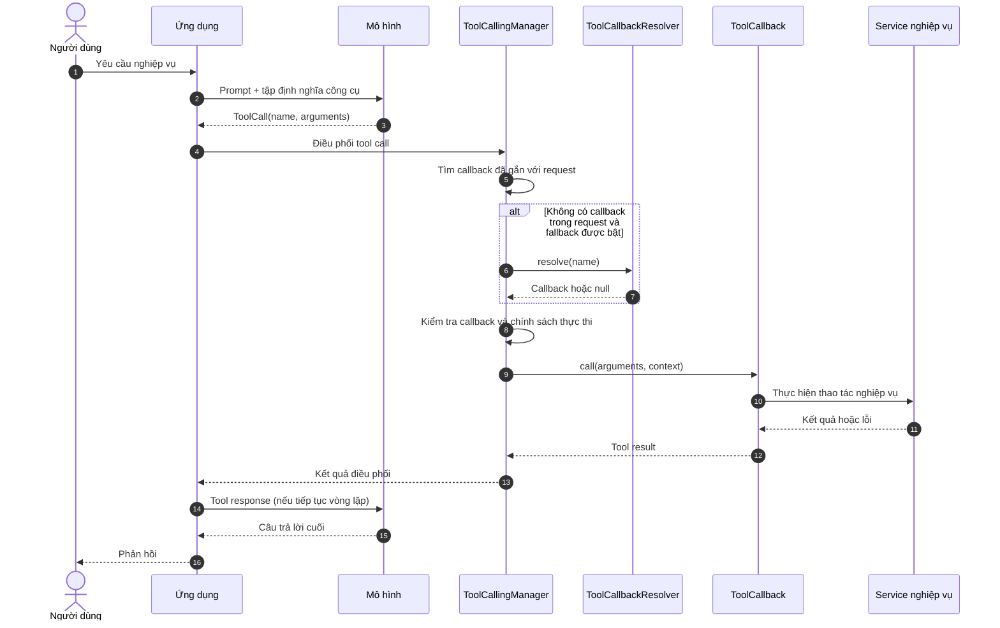

# Xử lý tên không tồn tại, trùng tên và công cụ bị thu hồi

Khi mô hình gửi một tool call, ứng dụng phải ánh xạ chính xác tên công cụ trong yêu cầu tới một `ToolCallback` có thể thực thi. Quá trình này được gọi là phân giải công cụ. Một tên có thể không tồn tại, hai callback có thể trùng tên, hoặc một công cụ từng được công bố có thể đã bị vô hiệu hóa hay thu hồi.

Những tình huống này cần được xử lý như một phần của ranh giới thực thi. Tên do mô hình gửi chỉ là dữ liệu đầu vào; nó không chứng minh công cụ tồn tại, đang hoạt động hay người gọi có quyền sử dụng. Ứng dụng phải phân giải tên theo registry đáng tin cậy, phát hiện xung đột trước khi chạy và kiểm tra trạng thái cùng quyền ngay tại thời điểm callback thực thi.

Trong module `SPRING_AI_TOOL_CALLING`, Spring AI cung cấp `ToolCallbackResolver` để phân giải callback theo tên. `ToolCallingManager` sử dụng resolver trong quá trình điều phối tool call. Với Spring AI 2.x, cơ chế fallback để chạy một công cụ có trong resolver nhưng chưa được gắn vào request mặc định đang tắt. Đây là một giới hạn quan trọng giúp tập công cụ của từng request có thể được kiểm soát rõ ràng.

Sau bài học, bạn có thể:

- Giải thích vai trò của `ToolCallbackResolver` và cách phân giải tên công cụ.
- Xử lý tên không tồn tại hoặc đã bị đổi mà không tự đoán công cụ thay thế.
- Phát hiện tên trùng trong một tập callback và giữa nhiều nguồn công cụ.
- Thu hồi công cụ trong registry và chặn cả callback cũ đã được gắn vào request.
- Cấu hình resolution fallback theo nguyên tắc fail-closed.
- Kiểm thử unknown name, duplicate name, stale callback và quyền thực thi.

## 1. Phân giải tên nằm ở đâu trong vòng tool calling?

Mô hình nhận danh sách định nghĩa công cụ mà ứng dụng công bố. Khi cần một công cụ, nó trả về tool call gồm tên và arguments. Ứng dụng tìm callback theo tên, chuyển arguments tới callback, thực thi service rồi gửi kết quả về mô hình hoặc caller theo metadata.



`ToolCallbackResolver` chịu trách nhiệm ánh xạ một tên thành callback. Nó không thay thế việc chọn công cụ cho từng request, xác thực người dùng hoặc kiểm tra quyền trên tài nguyên. Những việc đó thuộc về ứng dụng và service nghiệp vụ.

## 2. `ToolCallbackResolver` hoạt động như thế nào?

Trong Spring AI, interface có hợp đồng đơn giản:

```java
package org.springframework.ai.tool.resolution;

import org.springframework.ai.tool.ToolCallback;

public interface ToolCallbackResolver {
    // Trả null nếu tên không thể phân giải.
    ToolCallback resolve(String toolName);
}
```

`resolve` nhận tên công cụ và trả về `ToolCallback` tương ứng. Nếu không tìm thấy callback, hoặc ứng dụng quyết định tên đó không được phép phân giải, resolver trả về `null`.

Trong cấu hình Spring Boot, `StaticToolCallbackResolver` mặc định được tạo từ các bean kiểu `ToolCallback` trong application context và các công cụ do `ToolCallbackProvider` cung cấp (MCP provider được xử lý riêng để tránh gọi mạng liệt kê công cụ ngay lúc khởi động). Nếu cần tra cứu theo registry cơ sở dữ liệu, nguồn từ xa hoặc trạng thái động, ứng dụng có thể cung cấp implementation `ToolCallbackResolver` riêng.

Ví dụ một registry lưu callback cùng trạng thái hoạt động:

```java
public record ToolRegistration(
    String name,
    String version,
    boolean active,
    ToolCallback callback
) {}

public interface ToolRegistry {
    Optional<ToolRegistration> findByCanonicalName(String name);
}
```

Resolver chỉ trả về callback đang hoạt động:

```java
import org.springframework.ai.tool.ToolCallback;
import org.springframework.ai.tool.resolution.ToolCallbackResolver;
import org.springframework.stereotype.Component;

@Component
public class ActiveToolCallbackResolver implements ToolCallbackResolver {

    private final ToolRegistry toolRegistry;

    public ActiveToolCallbackResolver(ToolRegistry toolRegistry) {
        this.toolRegistry = toolRegistry;
    }

    @Override
    public ToolCallback resolve(String toolName) {
        return toolRegistry.findByCanonicalName(toolName)
            .filter(ToolRegistration::active)
            .map(ToolRegistration::callback)
            .orElse(null);
    }
}
```

Ví dụ giả định registry trả về bản ghi theo tên chuẩn hóa chính xác. Không nên tìm gần đúng hoặc tự chọn một tên có vẻ giống. Nếu `lookup_inventory` không tồn tại, không tự đổi thành `lookup_order` hay một công cụ khác.

`ToolCallbackResolver` chỉ nhận `toolName`, không nhận principal hoặc `ToolContext`. Vì vậy, resolver phù hợp để kiểm tra công cụ có tồn tại và đang hoạt động ở phạm vi registry. Việc người gọi cụ thể có quyền sử dụng công cụ vẫn phải được kiểm tra ở policy của ứng dụng và tại callback/service khi thực thi.

## 3. Tên công cụ không tồn tại

Một tên không phân giải được có thể xuất hiện vì nhiều lý do:

- Mô hình sinh tên không có trong tập công cụ đã gửi.
- Tên bị gõ sai hoặc khác chữ hoa/chữ thường.
- Công cụ đã được đổi tên hoặc xóa khỏi registry.
- Prompt hoặc lịch sử hội thoại cũ còn chứa tool call theo tên trước đây.
- Callback không được đăng ký cho request hiện tại.
- Công cụ đã bị thu hồi hoặc tắt trong lúc hội thoại đang chạy.

Khi `resolve(name)` trả về `null`, ứng dụng cần xử lý như một yêu cầu chưa được ánh xạ. Không thực thi callback mặc định, không chọn callback đầu tiên có tên gần giống và không chuyển sang một hành động có tác động tương tự.

Có thể phân biệt lỗi ở log nội bộ:

| Trạng thái | Ý nghĩa | Hướng xử lý |
|---|---|---|
| `UNKNOWN` | Tên chưa từng được đăng ký | Từ chối phân giải, ghi nhận tên yêu cầu |
| `RENAMED` | Tên cũ có bản ghi thay thế | Chỉ hỗ trợ alias tường minh, có thời hạn và kiểm tra tương thích |
| `NOT_ATTACHED` | Công cụ có trong registry nhưng không thuộc request | Từ chối nếu fallback tắt hoặc request không được phép |
| `DISABLED` | Công cụ tồn tại nhưng tạm ngừng | Không trả callback có thể thực thi |
| `REVOKED` | Quyền hoặc đăng ký đã bị thu hồi | Từ chối và giữ dấu vết thu hồi |

Thông báo gửi về mô hình hoặc người dùng nên đủ an toàn, ví dụ “Công cụ được yêu cầu hiện không khả dụng”. Không tiết lộ danh sách công cụ nội bộ, cấu hình registry hoặc lý do nhạy cảm như một tenant khác đang sở hữu công cụ đó. Log nội bộ có thể lưu mã trạng thái chi tiết để vận hành và điều tra.

Không dùng fuzzy matching để tự sửa tên công cụ. Nếu cần duy trì tên cũ trong thời gian chuyển đổi, hãy khai báo alias rõ ràng trong registry, ánh xạ tới một callback đã được duyệt và đặt ngày hết hạn. Alias không được phép vượt qua chính sách quyền hoặc trỏ sang công cụ có tác động khác.

## 4. Tên trùng nhau gây ra điều gì?

Tên công cụ là định danh để ánh xạ tool call tới callback. Trong cùng một tập công cụ cung cấp cho mô hình, mỗi tên phải duy nhất. Nếu hai callback cùng tên nhưng thực hiện hai hành động khác nhau, ứng dụng có thể gọi nhầm service hoặc tạo ra hành động không mong muốn.

Ví dụ hai nguồn cùng khai báo `search`:

```text
Local ProductTools.search       -> tìm sản phẩm
Remote CRM server search        -> tìm khách hàng
```

Mô hình chỉ thấy tên `search`. Nó không có đủ thông tin để phân biệt hai callback nếu ứng dụng đưa cả hai vào cùng tập mà không đổi tên.

Nên đặt tên theo namespace nghiệp vụ và hành động:

```text
catalog.search_products
crm.search_customers
inventory.lookup_stock
orders.lookup_delivery_status
```

Tên cần ổn định, duy nhất và phản ánh đúng phạm vi. Khi ghép công cụ từ nhiều module hoặc MCP server, hãy kiểm tra xung đột sau khi hợp nhất tất cả nguồn.

## 5. Spring AI phát hiện duplicate name ở đâu?

Trong Spring AI 2.1.0, có một số lớp kiểm tra khác nhau:

- Khi `MethodToolCallbackProvider` tạo callback từ nhiều tool object và phát hiện tên trùng, nó ném `IllegalArgumentException`.
- `ChatClient` kiểm tra tập callback được hợp nhất qua `.tools(...)` và `.defaultTools(...)`; nếu có hai callback cùng tên, request thất bại với `IllegalStateException`.
- Nếu gọi `ChatModel.call()`/`.stream()` trực tiếp hoặc tự dựng vòng điều phối với `ToolCallingChatOptions`, bước xác thực danh sách không tự chạy trong mọi đường đi. Khi bỏ qua kiểm tra, việc phân giải theo tên có thể chọn callback đầu tiên trong danh sách mà không báo lỗi.

Vì vậy, nếu tự tạo danh sách callback hoặc tự điều phối, hãy kiểm tra tính duy nhất trước khi gửi tool definition cho mô hình. Trong các API có hỗ trợ, dùng `ToolCallingChatOptions.validateToolCallbacks(...)` trên danh sách đã hợp nhất trước khi gọi model.

Với MCP, `DefaultMcpToolNamePrefixGenerator` có thể thêm prefix để tránh trùng tên giữa nhiều MCP connection. Cơ chế này không biết các phương thức `@Tool` cục bộ của ứng dụng. Nếu một công cụ local và một MCP tool có cùng tên, hãy đổi tên một phía hoặc lọc công cụ MCP trước khi ghép. Khi tự điều phối ngoài `ChatClient`, không dựa vào prefix của MCP để thay thế bước kiểm tra toàn bộ danh sách.

## 6. Kiểm tra tên trùng trước khi đăng ký

Có thể viết kiểm tra đơn giản cho danh sách callback trước khi cung cấp chúng:

```java
public static void assertUniqueToolNames(List<ToolCallback> callbacks) {
    Map<String, Long> counts = callbacks.stream()
        .collect(Collectors.groupingBy(
            callback -> callback.getToolDefinition().name(),
            Collectors.counting()
        ));

    List<String> duplicates = counts.entrySet().stream()
        .filter(entry -> entry.getValue() > 1)
        .map(Map.Entry::getKey)
        .sorted()
        .toList();

    if (!duplicates.isEmpty()) {
        throw new IllegalArgumentException(
            "Duplicate tool names: " + String.join(", ", duplicates)
        );
    }
}
```

Kiểm tra này nên chạy sau khi đã hợp nhất callback mặc định, callback theo prompt và callback từ provider. Chỉ kiểm tra từng nhóm riêng có thể bỏ sót trường hợp tên trùng giữa hai nhóm.

Nếu tên trùng là do cùng một callback vô tình được thêm hai lần, hãy sửa nơi đăng ký. Nếu hai công cụ thật sự khác nhau, hãy đổi namespace. Không giải quyết xung đột bằng cách âm thầm giữ callback đầu tiên hoặc callback cuối cùng.

## 7. Công cụ bị thu hồi hoặc tạm ngừng

Thu hồi công cụ là thay đổi trạng thái registry sau khi công cụ đã từng được đăng ký. Ví dụ:

- Quản trị viên tắt một tích hợp bị lỗi.
- Nhà cung cấp thu hồi credential hoặc kết nối MCP.
- Một công cụ nguy hiểm bị vô hiệu hóa sau cảnh báo bảo mật.
- Người dùng hoặc tenant mất quyền sử dụng một chức năng.
- Một phiên bản công cụ cũ bị thay thế do lỗi nghiệp vụ.

Có thể mô hình hóa vòng đời đăng ký bằng trạng thái rõ ràng:

```text
REGISTERED -> ACTIVE -> DISABLED -> REVOKED
                    \-> SUSPENDED
ACTIVE -> RETIRED
```

Ý nghĩa:

- `ACTIVE`: được phép đưa vào tập công cụ và có thể thực thi sau khi kiểm tra quyền.
- `DISABLED` hoặc `SUSPENDED`: tạm ngừng, không công bố hoặc phân giải thành callback có thể thực thi.
- `REVOKED`: quyền hoặc đăng ký đã bị thu hồi; mọi đường thực thi phải từ chối.
- `RETIRED`: phiên bản cũ không còn được dùng; tên hoặc version cũ cần bị chặn theo chính sách chuyển đổi.

Resolver có thể kiểm tra trạng thái `ACTIVE` khi tra cứu. Tuy nhiên, điều đó chưa đủ để thu hồi ngay một callback đã được gắn vào prompt trước khi trạng thái thay đổi.

## 8. Vì sao cần kiểm tra lại ngay trước khi thực thi?

Hãy xét trình tự sau:

1. Ứng dụng kiểm tra công cụ `inventory.lookup` đang hoạt động.
2. Ứng dụng gửi schema công cụ cho mô hình.
3. Quản trị viên thu hồi công cụ.
4. Mô hình trả về tool call đã được tạo từ schema cũ.
5. Callback cũ vẫn nằm trong danh sách callback của request.

Nếu ứng dụng chỉ kiểm tra trạng thái lúc tạo danh sách hoặc lúc gọi resolver, callback đã gắn vào request vẫn có thể chạy. Với đường thực thi này, resolver có thể không được gọi lại.

Do đó, hãy đặt một execution guard ngay trước hành động nghiệp vụ. Có thể bọc callback bằng một `ToolCallback` kiểm tra trạng thái và quyền rồi mới delegate:

```java
import org.springframework.ai.chat.model.ToolContext;
import org.springframework.ai.tool.ToolCallback;
import org.springframework.ai.tool.definition.ToolDefinition;
import org.springframework.ai.tool.metadata.ToolMetadata;

final class GuardedToolCallback implements ToolCallback {

    private final ToolCallback delegate;
    private final ToolExecutionPolicy executionPolicy;

    GuardedToolCallback(
            ToolCallback delegate,
            ToolExecutionPolicy executionPolicy) {
        this.delegate = delegate;
        this.executionPolicy = executionPolicy;
    }

    @Override
    public ToolDefinition getToolDefinition() {
        return delegate.getToolDefinition();
    }

    @Override
    public ToolMetadata getToolMetadata() {
        return delegate.getToolMetadata();
    }

    @Override
    public String call(String toolInput) {
        executionPolicy.requireActive(
            delegate.getToolDefinition().name()
        );
        return delegate.call(toolInput);
    }

    @Override
    public String call(String toolInput, ToolContext toolContext) {
        executionPolicy.requireActiveAndAuthorized(
            delegate.getToolDefinition().name(), toolContext
        );
        return delegate.call(toolInput, toolContext);
    }
}
```

`ToolExecutionPolicy` là thành phần do ứng dụng định nghĩa. Nó kiểm tra trạng thái hiện hành, principal, tenant và quyền đối với tài nguyên. Hãy đăng ký wrapper này thay cho callback gốc ở những đường có thể thực thi. Nếu service nghiệp vụ đã là ranh giới bảo mật chính, đặt kiểm tra trạng thái và quyền tại service cũng giúp bảo vệ các đường gọi không đi qua Spring AI.

Với overload `call(String)` không nhận `ToolContext`, policy cần lấy principal từ security context phía máy chủ hoặc một nguồn tin cậy tương đương. Không suy ra danh tính hay quyền từ arguments JSON.

Đối với thao tác có tác động phụ, kiểm tra nên diễn ra sát thời điểm ghi dữ liệu hoặc gọi hệ thống ngoài. Nếu yêu cầu thu hồi có hiệu lực ngay cả khi một request đang chạy, service cần kiểm tra trạng thái trong transaction hoặc tại điểm commit phù hợp. Một thao tác đã hoàn tất trước khi lệnh thu hồi có hiệu lực không thể được tự động đảo ngược; cần quy trình bù trừ nếu nghiệp vụ yêu cầu.

## 9. Resolution fallback và nguyên tắc fail-closed

Spring AI hỗ trợ phân giải callback theo tên thông qua `ToolCallbackResolver`. Tuy nhiên, trong Spring AI 2.x, việc cho phép thực thi callback có trong resolver nhưng không được gắn vào request cần bật resolution fallback.

**Giá trị mặc định: `false`.**

```properties
spring.ai.tools.resolution.fallback.enabled=false
```

Khi fallback tắt, chỉ các công cụ được gắn vào request qua `.tools(...)`, `.defaultTools(...)` hoặc options tương ứng mới được thực thi trong request đó. Resolver vẫn có thể được dùng bởi `ToolCallingManager`, nhưng tên có trong registry không tự động trở thành quyền thực thi cho mọi request.

Nếu bật:

```properties
spring.ai.tools.resolution.fallback.enabled=true
```

một tool call yêu cầu tên chưa được gắn vào request có thể được phân giải từ resolver và thực thi. Khi đó, mọi công cụ mà resolver có thể trả về đều có thể được gọi nếu mô hình nêu đúng tên, kể cả công cụ có mức rủi ro cao hoặc có tác động phá hủy.

Chỉ bật fallback khi ứng dụng kiểm soát đầy đủ registry và từng callback đều tự kiểm tra quyền khi thực thi. Không dùng fallback như một cách tiện lợi để bỏ qua việc chọn tập công cụ theo từng request. Với hệ thống có quyền theo người dùng hoặc tenant, giữ fallback tắt thường giúp mô hình bảo mật dễ kiểm tra hơn.

Nếu tự tạo `ToolCallingManager`, cùng tùy chọn có thể cấu hình qua builder:

```java
ToolCallingManager toolCallingManager = ToolCallingManager.builder()
    .toolCallbackResolver(toolCallbackResolver)
    .resolutionFallbackEnabled(false)
    .build();
```

## 10. Phiên bản Spring AI 1.x và 2.x

Không nên nhầm `ToolCallbackResolver` với cơ chế cũ dùng tên bean của các functional interface.

| Phiên bản | Cơ chế liên quan | Lưu ý |
|---|---|---|
| Spring AI 1.x | `SpringBeanToolCallbackResolver` và `toolNames(...)` có thể phân giải bean `Function`, `Supplier`, `Consumer` hoặc `BiFunction` theo tên | Đây là cách đăng ký động theo tên của API 1.x |
| Spring AI 2.0+ | `SpringBeanToolCallbackResolver` và `toolNames()` đã bị loại bỏ | Đăng ký `ToolCallback` tường minh hoặc đối tượng có `@Tool` |
| Spring AI 2.x | `ToolCallbackResolver` vẫn tồn tại cho name-based resolution | Resolution fallback mặc định tắt; bật riêng nếu thật sự cần |

Ví dụ cấu hình hiện hành cho function tool là tạo bean `ToolCallback` bằng `FunctionToolCallback.builder(...)`, rồi đăng ký callback với prompt bằng `.tools(callback)` hoặc làm công cụ mặc định bằng `.defaultTools(callback)`. Không viết mới code 2.x dựa trên `toolNames("beanName")` hoặc giả định một bean `Function` thuần sẽ tự trở thành callback theo tên.

## 11. Registry động, cache và thu hồi

Khi danh sách công cụ đến từ database hoặc hệ thống quản trị, registry thường cần cache để giảm chi phí tra cứu. Cache giúp tăng tốc nhưng tạo ra cửa sổ dữ liệu cũ khi công cụ bị tắt hoặc thu hồi.

Một thiết kế thực tế nên có:

- Tên chuẩn duy nhất và ID nội bộ ổn định cho từng công cụ.
- Version hoặc generation để phân biệt các định nghĩa đã thay đổi.
- Trạng thái `ACTIVE`, `DISABLED`, `REVOKED` hoặc `RETIRED`.
- Thời điểm thay đổi và actor thực hiện thay đổi để audit.
- Cache có TTL rõ ràng và cơ chế invalidation khi trạng thái thay đổi.
- Execution guard kiểm tra trạng thái mới nhất trước tác động nghiệp vụ.

Khi nhận sự kiện thu hồi, xóa entry khỏi cache hoặc đánh dấu tombstone. Không xóa dấu vết tên ngay lập tức nếu các hội thoại cũ có thể phát lại tool call theo tên đó. Tombstone giúp ứng dụng nhận diện đây là công cụ đã thu hồi thay vì coi nó là tên mới chưa từng tồn tại.

Không tái sử dụng ngay tên cũ cho một hành động khác. Nếu `orders.cancel` đã bị thu hồi, không gán lại cùng tên đó cho một callback có ý nghĩa khác. Dùng tên hoặc version mới để tránh tool call cũ bị diễn giải thành hành động mới.

Nếu registry hoặc nguồn chính sách không truy cập được, lựa chọn an toàn là từ chối thực thi công cụ nhạy cảm. Không dùng bản cache cũ vô thời hạn để tiếp tục chạy một callback đã có khả năng bị thu hồi.

## 12. Ghi log và phản hồi lỗi an toàn

Khi phân giải thất bại hoặc callback bị từ chối, log nên ghi đủ dữ liệu vận hành nhưng không lưu bí mật:

- Tên công cụ được yêu cầu và tên chuẩn sau khi kiểm tra.
- Kết quả phân giải: `UNKNOWN`, `DUPLICATE`, `NOT_ATTACHED`, `DISABLED`, `REVOKED` hoặc `DENIED`.
- ID request/correlation và principal đã xác thực (dùng ID phù hợp chính sách log).
- Version/generation của registry và callback.
- Thời điểm, thời lượng và nguồn gọi (local, MCP hoặc provider).
- Kết quả thực thi hoặc mã lỗi đã phân loại.

Không ghi access token, mật khẩu, secret, toàn bộ dữ liệu cá nhân hoặc arguments nhạy cảm vào log mặc định. Spring AI có logging và Micrometer observations cho tool calling; khi bật quan sát arguments/result, cần đánh giá dữ liệu nhạy cảm và chính sách lưu trữ trước.

Phản hồi cho mô hình nên ngắn và không chứa chi tiết nội bộ. Ví dụ:

```json
{
  "status": "unavailable",
  "message": "Công cụ được yêu cầu hiện không khả dụng. Hãy tiếp tục mà không thực hiện thao tác này."
}
```

Đây là định dạng minh họa do ứng dụng quy định, không phải schema phản hồi bắt buộc của Spring AI. Nếu dùng exception processor mặc định, thông điệp từ `RuntimeException` có thể được gửi lại mô hình. Hãy dùng thông điệp đã được làm sạch và phân loại, hoặc cấu hình processor để lỗi được ném về caller khi phù hợp. Không trả stack trace, câu SQL hoặc cấu hình resolver cho mô hình.

## 13. Kiểm thử unknown, duplicate và revoked

Các trường hợp này nên được kiểm thử riêng vì chúng xảy ra ở những điểm khác nhau trong vòng đời công cụ.

| Ca kiểm thử | Thiết lập | Kết quả mong đợi |
|---|---|---|
| Tên chưa đăng ký | Resolver nhận `unknown_tool` | Trả `null`; không callback nào được thực thi |
| Tên sai chữ hoa/chữ thường | Registry chỉ có `lookup_inventory` | Không tự đổi tên; từ chối phân giải |
| Tên có trong registry nhưng không gắn request | Resolution fallback tắt | Không thực thi callback đó |
| Tên có trong resolver nhưng fallback bật | Resolver trả callback đang active | Chỉ chạy nếu chính sách execution cho phép |
| Hai callback cùng tên | Hợp nhất danh sách trước khi gọi model | Validation thất bại trước khi gửi request |
| Hai `@Tool` object tạo tên trùng | Dùng `MethodToolCallbackProvider` | Quá trình tạo provider báo lỗi |
| Tên local trùng tên MCP | Hợp nhất local và remote callback | Đổi namespace hoặc lọc nguồn trùng |
| Callback bị thu hồi trước khi tạo prompt | Registry đánh dấu `REVOKED` | Không công bố hoặc không phân giải callback |
| Callback bị thu hồi sau khi schema đã gửi | Request còn giữ callback cũ | Execution guard từ chối trước khi gọi service |
| Cache chưa nhận sự kiện thu hồi | Cache chứa generation cũ | Execution guard đọc trạng thái mới và từ chối |
| Registry không khả dụng | Không xác minh được trạng thái | Fail-closed đối với công cụ nhạy cảm |

Một bài kiểm thử quan trọng là thu hồi công cụ giữa hai thời điểm: sau khi mô hình đã nhận schema nhưng trước khi callback được gọi. Nếu chỉ kiểm thử resolver trước lúc tạo prompt, bài test sẽ không phát hiện callback cũ vẫn có thể thực thi.

Với công cụ có tác động phụ, thêm kiểm thử race condition: một request bắt đầu thực thi đồng thời với lệnh thu hồi. Xác định rõ điểm tuyến tính hóa của thao tác — thời điểm service chấp nhận quyền và commit hành động — để biết thao tác nào được phép hoàn tất.

## 14. Checklist trước khi đưa resolver động vào production

- Tên công cụ được chuẩn hóa, duy nhất và không đổi ý nghĩa giữa các version.
- Unknown name trả về trạng thái không phân giải; không fuzzy match.
- Duplicate name bị phát hiện trên danh sách cuối cùng sau khi hợp nhất mọi nguồn.
- Resolution fallback được giữ tắt trừ khi có yêu cầu rõ ràng và kiểm soát đầy đủ registry.
- Resolver không được dùng làm cơ chế phân quyền theo principal vì chữ ký chỉ nhận tên.
- Callback hoặc service kiểm tra trạng thái thu hồi ngay trước khi thực thi.
- Quyền được kiểm tra theo principal, tenant và tài nguyên cụ thể.
- Cache có TTL/invalidation; đường thực thi nhạy cảm không tin cache cũ vô thời hạn.
- Tên cũ sau khi thu hồi được giữ tombstone hoặc chính sách alias có thời hạn.
- Log có mã quyết định và correlation ID nhưng không làm lộ secret hoặc dữ liệu nhạy cảm.
- Có test cho unknown, duplicate, revoked-after-prompt, stale cache và registry outage.

## 15. Ghi nhớ

- `ToolCallbackResolver.resolve(name)` ánh xạ tên sang callback; trả `null` khi không thể phân giải.
- Một tên không tồn tại không được tự động thay bằng công cụ gần giống.
- Tên công cụ phải duy nhất trong toàn bộ tập callback đã hợp nhất. Dùng namespace để tránh xung đột giữa module và nguồn MCP.
- Spring AI 2.x mặc định chỉ thực thi công cụ được gắn vào request; resolution fallback phải bật tường minh mới cho phép phân giải callback ngoài request.
- Resolver không nhận principal, nên không thể thay thế policy theo người dùng hoặc tenant.
- Thu hồi tại registry chưa đủ nếu callback cũ đã được gắn vào prompt. Cần execution guard ở callback hoặc service.
- Cache và lịch sử hội thoại có thể giữ tên cũ; dùng version, tombstone và kiểm tra trạng thái tại thời điểm thực thi.

Khi xây dựng phân giải động, hãy xác định một tên chuẩn cho mỗi công cụ, kiểm tra xung đột trên tập đã hợp nhất, chỉ trả callback còn hoạt động và giữ fallback tắt nếu không cần thiết. Trước mọi hành động nghiệp vụ, callback/service phải xác minh trạng thái và quyền hiện tại để một tool call cũ hoặc tên do mô hình tự sinh không thể vượt qua chính sách của ứng dụng.

## Tài liệu tham khảo

- [Spring AI 2.1.0 — Tool Calling và Tool Resolution](https://docs.spring.io/spring-ai/reference/api/tools.html)
- [Spring AI — Upgrade Notes](https://docs.spring.io/spring-ai/reference/upgrade-notes.html)
- [Spring AI API — ToolCallbackResolver](https://docs.spring.io/spring-ai/docs/current/api/org/springframework/ai/tool/resolution/ToolCallbackResolver.html)
