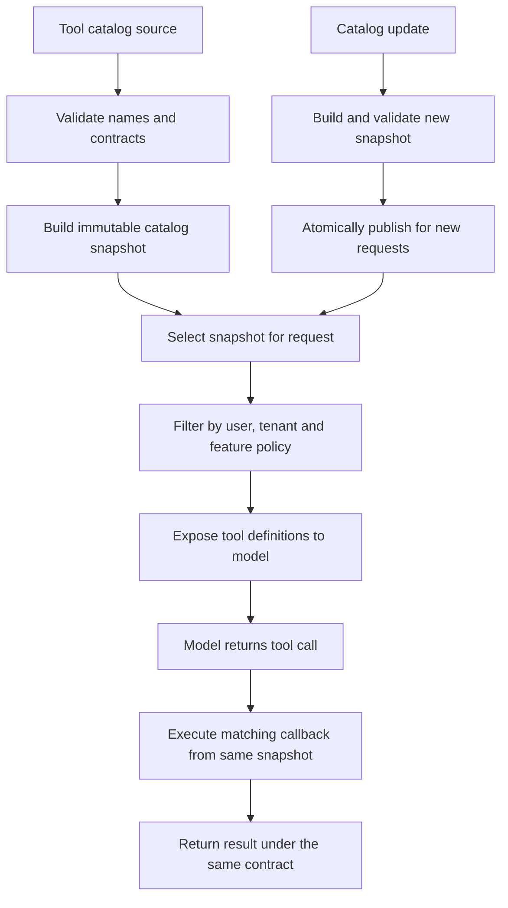

# Quản lý thay đổi danh mục mà không làm sai hợp đồng đang sử dụng

Danh mục công cụ (tool catalog) thường thay đổi theo phiên bản sản phẩm, quyền của người dùng, tenant hoặc dịch vụ tích hợp. Một công cụ mới có thể được thêm vào, mô tả có thể được cải thiện, schema có thể mở rộng và một callback cũ có thể cần thay thế. Nếu cập nhật danh mục ngay trong lúc hội thoại đang chạy, mô hình có thể đã nhìn thấy schema cũ nhưng ứng dụng lại phân giải tên sang callback mới. Kết quả là cùng một tool call có thể được diễn giải theo hai hợp đồng khác nhau.

Để tránh lỗi này, cần quản lý danh mục như một hợp đồng có phiên bản. Mỗi yêu cầu hội thoại nên sử dụng một snapshot bất biến gồm tool definition và callback tương ứng. Khi phát hành thay đổi, tạo snapshot mới rồi chuyển các yêu cầu mới sang phiên bản đó; những yêu cầu đang chạy tiếp tục dùng snapshot đã chụp. Với thay đổi không tương thích, giữ phiên bản cũ trong giai đoạn chuyển tiếp hoặc công bố một tên công cụ mới.

Trong module `SPRING_AI_TOOL_CALLING`, mô hình chỉ nhìn thấy tên, mô tả và schema của các công cụ được ứng dụng cung cấp. `ToolCallbackResolver` giúp phân giải tên thành callback, nhưng bản thân resolver không quản lý tương thích schema, quyền truy cập hay vòng đời phiên bản. Những trách nhiệm đó thuộc về lớp quản lý danh mục và ứng dụng.

## 1. Tool catalog là một hợp đồng, không chỉ là danh sách callback

Một mục trong danh mục nên được quản lý với các thông tin sau:

| Thành phần | Ý nghĩa | Ví dụ |
|---|---|---|
| Tool name | Định danh mô hình gửi trong tool call | `getOrderStatus` |
| Description | Mục đích và điều kiện sử dụng | Tra cứu trạng thái đơn hàng theo mã |
| Input schema | Các trường, kiểu dữ liệu và ràng buộc đầu vào | `orderId: string` |
| Result contract | Cấu trúc hoặc ngữ nghĩa của kết quả callback | `status`, `carrier`, `estimatedDelivery` |
| Callback implementation | Mã Java thực thi hợp đồng | `OrderStatusToolV1` |
| Catalog version | Phiên bản snapshot chứa công cụ | `catalog-2026-11-27.3` |
| Contract version | Phiên bản hợp đồng riêng của công cụ | `getOrderStatus:v1` |
| Availability policy | Điều kiện công cụ được đưa vào request | Vai trò, tenant, feature flag |

`ToolDefinition` của Spring AI chứa ba phần mô hình nhìn thấy: `name`, `description` và `inputSchema`. `ToolCallback` còn chứa metadata thực thi và hai phương thức `call(...)`. Kết quả callback cũng là một phần của hợp đồng ở mức ứng dụng, dù không được mô tả trong input schema.



Điểm quan trọng là snapshot chứa cả định nghĩa và implementation tương ứng. Không nên lấy tool definition từ phiên bản A rồi tra callback theo một danh mục toàn cục đã chuyển sang phiên bản B.

## 2. Vì sao cập nhật danh mục tại chỗ có thể phá hợp đồng?

Giả sử mô hình nhận công cụ `getOrderStatus` với schema:

```json
{
  "type": "object",
  "properties": {
    "orderId": { "type": "string" }
  },
  "required": ["orderId"],
  "additionalProperties": false
}
```

Mô hình trả về tool call:

```json
{
  "name": "getOrderStatus",
  "arguments": "{\"orderId\":\"ORD-2048\"}"
}
```

Trong lúc đó, ứng dụng cập nhật callback sang phiên bản mới yêu cầu thêm `regionCode`, đổi cách hiểu `orderId` hoặc trả về cấu trúc kết quả khác. Nếu resolver chỉ tra theo tên `getOrderStatus`, callback mới có thể nhận đối số được tạo theo schema cũ.

Các rủi ro thường gặp:

- **Schema và callback lệch phiên bản:** mô hình gửi field theo schema cũ, callback mới đòi field mới.
- **Ý nghĩa tham số thay đổi:** cùng `customerId` nhưng một phiên bản hiểu là ID nội bộ, phiên bản khác hiểu là mã công khai.
- **Kết quả đổi cấu trúc:** mô hình đang chờ `status` nhưng callback mới chỉ trả `state`.
- **Quyền thay đổi giữa request:** một công cụ mới được mở toàn cục khiến request cũ hoặc tenant khác có thể phân giải được nó.
- **Cache không đồng bộ:** node A đã cập nhật callback nhưng node B vẫn giữ schema hoặc resolver cũ.
- **Hội thoại đang chạy:** lịch sử hội thoại hoặc tool call được tạo theo catalog cũ nhưng lượt tiếp theo dùng catalog mới.

Tên công cụ duy nhất chỉ giúp phân biệt callback trong một tập công cụ. Nó không đảm bảo hai implementation cùng tên có hợp đồng tương thích.

## 3. Phân biệt catalog version và tool contract version

Hai loại phiên bản phục vụ hai mục đích khác nhau:

- **Catalog version** xác định một snapshot của toàn bộ tập công cụ được công bố tại một thời điểm.
- **Tool contract version** xác định hợp đồng riêng của một công cụ, gồm tên, schema đầu vào, ngữ nghĩa và kết quả.

Ví dụ:

| Catalog | Công cụ | Contract |
|---|---|---|
| `catalog-17` | `getOrderStatus` | `v1` |
| `catalog-18` | `getOrderStatus` | `v1` |
| `catalog-18` | `searchOrders` | `v2` |
| `catalog-19` | `getOrderStatus` | `v2` |

Catalog `catalog-18` có thể chỉ thêm công cụ mới mà không đổi hợp đồng `getOrderStatus:v1`. Khi đó request cũ và mới có thể cùng dùng implementation `v1` nếu chính sách cho phép. Khi `getOrderStatus` đổi schema không tương thích, nên phát hành contract `v2` và giữ `v1` trong thời gian chuyển đổi.

Không nhất thiết phải đưa phiên bản vào mọi tên công cụ. Nếu thay đổi tương thích ngược, có thể giữ tên ổn định. Nếu thay đổi phá vỡ hợp đồng, dùng tên mới như `getOrderStatusV2` là cách rõ ràng để mô hình phân biệt hai khả năng. Tên phiên bản cũng phải tuân theo quy tắc duy nhất trong tập được cung cấp.

## 4. Phân loại thay đổi tương thích và không tương thích

Trước khi phát hành catalog mới, hãy đánh giá cả schema đầu vào lẫn kết quả và ngữ nghĩa.

| Thay đổi | Đánh giá thường gặp | Điều kiện cần kiểm tra |
|---|---|---|
| Thêm một tool mới với tên duy nhất | Tương thích với tool cũ | Không trùng tên; chỉ expose cho đúng nhóm request |
| Cải thiện description mà không đổi hành vi | Thường tương thích | Kiểm tra mô hình có chọn tool khác đi không |
| Thêm trường đầu vào optional | Thường tương thích ngược | Callback cũ/new có xử lý khi trường bị bỏ qua; provider có hỗ trợ schema không |
| Thêm trường đầu vào required | Phá vỡ hợp đồng | Model hoặc client cũ không biết giá trị mới để gửi |
| Xóa hoặc đổi tên trường đầu vào | Phá vỡ hợp đồng | Tool call cũ có thể còn gửi trường cũ; strict schema có thể từ chối |
| Đổi kiểu dữ liệu hoặc đơn vị | Phá vỡ hợp đồng | Ví dụ `weight` từ kilogram sang gram làm đổi ý nghĩa dù tên không đổi |
| Thu hẹp enum hoặc miền giá trị | Có thể phá vỡ | Model cũ có thể gửi giá trị trước đây hợp lệ |
| Mở rộng enum | Có điều kiện | Callback/service downstream phải chấp nhận giá trị mới |
| Thêm trường vào JSON result | Thường tương thích nếu consumer bỏ qua field lạ | Kiểm tra prompt, parser và strict consumer |
| Xóa/đổi kiểu trường result | Phá vỡ hợp đồng | Mô hình hoặc ứng dụng có thể phụ thuộc field cũ |
| Thay đổi ngữ nghĩa hoặc tác động phụ | Phá vỡ dù schema không đổi | Kiểm tra authorization, xác nhận và hành vi nghiệp vụ |

“Thêm trường optional” chỉ tương thích nếu callback có default an toàn và provider/model chấp nhận cách biểu diễn optional. Một số chế độ strict có quy tắc riêng về `required`, nullable và `additionalProperties`; hãy kiểm tra schema cuối cùng với từng model provider.

Đổi description cũng có thể thay đổi lựa chọn công cụ của mô hình. Dù không phá cấu trúc JSON, đây vẫn là thay đổi hành vi cần kiểm thử với các câu hỏi đại diện.

## 5. Dùng snapshot bất biến cho mỗi request

Mỗi request nên chụp một snapshot trước khi gọi mô hình. Snapshot giữ callback list và version cố định trong suốt vòng tool calling.

Ví dụ lớp snapshot đơn giản:

```java
public final class ToolCatalogSnapshot {

    private final String version;
    private final List<ToolCallback> callbacks;
    private final Map<String, ToolCallback> callbacksByName;

    public ToolCatalogSnapshot(String version, List<ToolCallback> callbacks) {
        this.version = Objects.requireNonNull(version);
        this.callbacks = List.copyOf(callbacks);

        Map<String, ToolCallback> index = new LinkedHashMap<>();
        for (ToolCallback callback : this.callbacks) {
            String name = callback.getToolDefinition().name();
            if (index.putIfAbsent(name, callback) != null) {
                throw new IllegalArgumentException("Duplicate tool name: " + name);
            }
        }
        this.callbacksByName = Map.copyOf(index);
    }

    public String version() {
        return version;
    }

    public List<ToolCallback> callbacks() {
        return callbacks;
    }

    public Optional<ToolCallback> find(String name) {
        return Optional.ofNullable(callbacksByName.get(name));
    }
}
```

Snapshot dùng `List.copyOf` và map không thể sửa sau khi khởi tạo. Việc kiểm tra tên trùng diễn ra trước khi snapshot được đưa vào sử dụng. Callback bên trong cũng nên bất biến về `ToolDefinition`, schema và contract version; không thay đổi definition sau khi đã công bố.

Application service chọn snapshot, áp dụng quyền và đăng ký đúng callback list cho request:

```java
public String ask(String question, AuthenticatedUser user) {
    ToolCatalogSnapshot snapshot = catalogService.snapshotFor(user);

    Map<String, Object> trustedContext = Map.of(
            "userId", user.userId(),
            "tenantId", user.tenantId(),
            "catalogVersion", snapshot.version());

    return chatClient.prompt()
            .user(question)
            .toolContext(trustedContext)
            .tools(snapshot.callbacks())
            .call()
            .content();
}
```

Trong ví dụ, `catalogService.snapshotFor(user)` trả về snapshot đã được lọc theo chính sách phía server. Mô hình chỉ nhận các tool definition trong `snapshot.callbacks()`. Các callback thuộc snapshot đó được dùng trong quá trình thực thi cùng request. `catalogVersion` trong `ToolContext` hữu ích cho log và kiểm tra nhất quán; không dùng nó thay cho authorization.

Lưu ý: trong Spring AI 2.1, `.tools(...)` theo request được cộng thêm vào `defaultTools(...)` của client, không thay thế danh sách mặc định. Nếu cần kiểm soát catalog chính xác theo request, hãy giữ client đó không có các default tool không thuộc snapshot. Có thể dành default tools cho một tập nhỏ, ổn định và được phép trong mọi request.

## 6. Công bố catalog mới theo cách nguyên tử

Không cập nhật từng phần tử trong một map đang được request khác đọc. Hãy tạo snapshot hoàn chỉnh, kiểm tra nó, sau đó thay con trỏ active bằng một thao tác nguyên tử.

```java
@Component
public class ActiveToolCatalog {

    private final AtomicReference<ToolCatalogSnapshot> active;

    public ActiveToolCatalog(ToolCatalogSnapshot initialSnapshot) {
        this.active = new AtomicReference<>(initialSnapshot);
    }

    public ToolCatalogSnapshot current() {
        return active.get();
    }

    public void publish(ToolCatalogSnapshot next) {
        Objects.requireNonNull(next);
        validateBeforePublish(next);
        active.set(next);
    }

    private void validateBeforePublish(ToolCatalogSnapshot snapshot) {
        if (snapshot.callbacks().isEmpty()) {
            throw new IllegalArgumentException("Tool catalog must not be empty");
        }
        // Thực hiện contract checks, policy checks và compatibility checks tại đây.
    }
}
```

Một request gọi `current()` đúng một lần và giữ biến snapshot đó cho toàn bộ vòng lặp. Khi `publish(next)` xảy ra, các request mới nhận snapshot mới; request cũ vẫn giữ tham chiếu đến snapshot cũ. Không sửa callback hoặc map bên trong snapshot cũ.

Trong hệ thống nhiều instance, `AtomicReference` chỉ bảo đảm tính nguyên tử trong một JVM. Cần thêm cơ chế phát hành phiên bản chung:

1. Lưu catalog version và nội dung snapshot trong nguồn dữ liệu trung tâm.
2. Validate và đánh dấu version mới là `READY`.
3. Phát sự kiện catalog version mới qua message bus hoặc cơ chế invalidation.
4. Mỗi instance tải và kiểm tra snapshot mới, sau đó atomically swap local reference.
5. Ghi nhận instance nào đang phục vụ version nào và cảnh báo nếu một instance tụt phiên bản quá lâu.

Không để instance nhận event trước khi dữ liệu snapshot đã được commit. Sự kiện nên chứa version hoặc ID bất biến để consumer tải đúng bản đã hoàn tất.

## 7. Vai trò và giới hạn của ToolCallbackResolver

`ToolCallbackResolver` là interface phân giải một tên công cụ thành callback:

```java
public interface ToolCallbackResolver {
    @Nullable
    ToolCallback resolve(String toolName);
}
```

Spring AI có `StaticToolCallbackResolver` để phân giải từ danh sách callback tĩnh. Trong Spring Boot auto-configuration hiện hành, resolver mặc định được tạo từ các bean `ToolCallback` và công cụ do `ToolCallbackProvider` cung cấp (một số MCP provider được loại khỏi eager listing để tránh gọi mạng lúc khởi động).

Với catalog thay đổi theo phiên bản, có thể xây dựng resolver dựa trên snapshot:

```java
public final class SnapshotToolCallbackResolver implements ToolCallbackResolver {

    private final ToolCatalogSnapshot snapshot;

    public SnapshotToolCallbackResolver(ToolCatalogSnapshot snapshot) {
        this.snapshot = Objects.requireNonNull(snapshot);
    }

    @Override
    public ToolCallback resolve(String toolName) {
        return snapshot.find(toolName).orElse(null);
    }
}
```

Resolver này gắn với một snapshot cụ thể. Nếu dùng một resolver như vậy trong custom tool-calling loop, hãy bảo đảm cùng snapshot đã được dùng để tạo tool definitions gửi mô hình.

Không nên mặc định rằng một resolver singleton toàn cục có thể giữ đúng hợp đồng của mọi request. Chữ ký `resolve(String toolName)` chỉ nhận tên, không nhận catalog version, session ID, tenant hay request context. Nếu cùng một tên tồn tại ở `v1` và `v2`, resolver toàn cục không thể biết mô hình đang trả tool call theo schema nào chỉ từ tên đó.

Vì vậy:

- Với request cần catalog hoặc quyền riêng, ưu tiên chọn snapshot ở application service rồi truyền callback list tường minh bằng `.tools(...)`.
- Với custom loop, có thể tạo resolver gắn với snapshot của request/phiên và dùng resolver đó trong `ToolCallingManager` của loop.
- Chỉ dùng resolver toàn cục cho tên có ngữ nghĩa ổn định hoặc khi tên đã chứa version và chính sách truy cập được kiểm soát.
- Không dùng cache chỉ theo tên nếu callback có thể thay đổi theo version, tenant hoặc quyền.

## 8. Hiểu đúng resolution fallback ở Spring AI 2.x

Trong Spring AI 2.1, `ToolCallingManager` thực thi các callback được gắn với request. Nếu model yêu cầu một tên không có trong callback list của request, cơ chế fallback có thể tra tên đó qua `ToolCallbackResolver`, nhưng fallback hiện tắt mặc định.

```yaml
spring:
  ai:
    tools:
      resolution:
        fallback:
          enabled: false
```

Chỉ bật fallback khi ứng dụng thực sự cần hành vi đó và đã kiểm soát toàn bộ tập callback resolver có thể trả về:

```yaml
spring:
  ai:
    tools:
      resolution:
        fallback:
          enabled: true
```

Hoặc khi tự tạo `ToolCallingManager`:

```java
ToolCallingManager manager = ToolCallingManager.builder()
        .toolCallbackResolver(snapshotResolver)
        .resolutionFallbackEnabled(true)
        .build();
```

Fallback làm tăng phạm vi công cụ có thể thực thi: mô hình có thể gọi một callback mà request hiện tại không đính kèm nếu resolver tìm thấy tên. Nếu resolver toàn cục chứa công cụ xóa dữ liệu, hoàn tiền hoặc thay đổi tài khoản, việc bật fallback có thể vượt qua ý định giới hạn tool list của request. Không dùng fallback như cơ chế tự động cập nhật catalog cho mọi tenant.

## 9. Khác biệt quan trọng giữa Spring AI 1.x và 2.x

Các ví dụ động cần được đọc theo đúng phiên bản:

| Khía cạnh | Spring AI 1.x | Spring AI 2.x |
|---|---|---|
| Phân giải theo tên | Có `toolNames(...)` và `SpringBeanToolCallbackResolver` cho các bean function | Pattern resolver bean function theo tên đã bị loại bỏ |
| Công cụ dạng function bean | Có thể đăng ký `Function`, `Supplier`, `Consumer`, `BiFunction` và phân giải theo tên bean | Đăng ký callback tường minh bằng `FunctionToolCallback` hoặc `ToolCallback` bean |
| Công cụ theo request | Truyền callback hoặc tên theo API phiên bản | `.tools(...)` / `.defaultTools(...)` với POJO, `ToolCallback`, `ToolCallbackProvider` |
| Resolver | `DelegatingToolCallbackResolver` kết hợp resolver con là pattern phổ biến | `ToolCallbackResolver` vẫn tồn tại cho phân giải động và resolution fallback; callback của request là phạm vi thực thi mặc định |
| Fallback | Hành vi phân giải bean theo tên gắn với resolver cũ | Fallback resolver cho callback ngoài request tắt mặc định từ 2.0.1 |

Spring AI 2.0 loại bỏ `SpringBeanToolCallbackResolver` và API `toolNames(...)` dùng để phân giải bare function bean theo tên. Khi nâng cấp, chuyển các function bean thành bean `ToolCallback` tường minh hoặc truyền callback/đối tượng `@Tool` trực tiếp. Không sao chép ví dụ 1.x vào ứng dụng 2.x mà không kiểm tra API.

## 10. Giữ tương thích bằng adapter và alias

Khi thay đổi hợp đồng không thể thực hiện theo kiểu additive, giữ một adapter cho phiên bản cũ trong giai đoạn chuyển tiếp.

Ví dụ, hợp đồng cũ nhận `orderId`; hợp đồng mới nhận thêm `includeShipment` và trả thêm dữ liệu vận chuyển:

```java
public record OrderStatusRequestV1(String orderId) {}

public record OrderStatusRequestV2(
        String orderId,
        boolean includeShipment) {}

public record OrderStatusResponseV1(
        String orderId,
        String status) {}

public record OrderStatusResponseV2(
        String orderId,
        String status,
        ShipmentSummary shipment) {}
```

Có thể giữ hai tool definition song song:

```java
ToolCallback orderStatusV1 = FunctionToolCallback
        .builder("getOrderStatus", (OrderStatusRequestV1 request) ->
                orderService.findStatusV1(request.orderId()))
        .description("Tra cứu trạng thái đơn hàng theo mã đơn hàng.")
        .inputType(OrderStatusRequestV1.class)
        .build();

ToolCallback orderStatusV2 = FunctionToolCallback
        .builder("getOrderStatusV2", (OrderStatusRequestV2 request) ->
                orderService.findStatusV2(request.orderId(), request.includeShipment()))
        .description("Tra cứu trạng thái đơn hàng và tùy chọn thông tin vận chuyển.")
        .inputType(OrderStatusRequestV2.class)
        .build();
```

Ứng dụng có thể đưa cả hai callback vào catalog trong giai đoạn migration, hoặc chỉ đưa `v1`/`v2` theo cohort người dùng. Adapter `v1` có thể gọi service mới rồi chuyển kết quả về `OrderStatusResponseV1`, giữ nguyên hợp đồng cũ trong khi nội bộ đã nâng cấp.

Không giữ alias cũ vô thời hạn nếu nó làm mơ hồ lựa chọn của mô hình. Description phải giải thích rõ phạm vi và khi nào dùng từng phiên bản. Khi đã hết thời gian chuyển đổi và không còn request/session nào dùng `v1`, mới gỡ alias và callback cũ.

## 11. Quy trình rollout thay đổi catalog

Một quy trình phát hành có thể chia thành các giai đoạn:

1. **Thiết kế:** ghi lại tool name, schema, result contract, side effects, quyền và phiên bản hiện hành.
2. **Phân loại thay đổi:** xác định thay đổi additive hay breaking; nếu breaking, tạo contract version mới hoặc tên tool mới.
3. **Xây dựng song song:** tạo callback mới và giữ callback cũ. Không sửa object callback đang phục vụ request.
4. **Kiểm tra trước publish:** kiểm tra tên duy nhất, JSON schema, compatibility fixtures, authorization và hành vi kết quả.
5. **Canary:** expose catalog mới cho một nhóm request/tenant nhỏ qua policy phía server hoặc feature flag.
6. **Quan sát:** đo tỷ lệ gọi, lỗi deserialize, lỗi nghiệp vụ, callback latency và tỷ lệ model chọn sai tool theo catalog version.
7. **Mở rộng:** tăng cohort khi metrics ổn định; giữ khả năng quay lại snapshot trước.
8. **Deprecate:** đánh dấu công cụ cũ là deprecated trong metadata quản trị và ngừng expose cho request mới sau khi traffic giảm về mức chấp nhận được.
9. **Retire:** gỡ callback cũ sau khi hết thời gian sống của request/session, dữ liệu hội thoại và các consumer còn phụ thuộc.

Không xóa callback cũ ngay sau khi publish schema mới. Các request đang chạy có thể vẫn giữ snapshot cũ; các hội thoại nhiều lượt hoặc client tích hợp cũng có thể còn phát ra tên cũ.

## 12. Rollback và quản lý cache

Rollback nên là thao tác chuyển active pointer về một snapshot đã được kiểm tra, không phải sửa ngược từng callback tại chỗ.

Một snapshot nên có:

- Version bất biến và thời điểm tạo.
- Hash của danh sách tên, description và schema.
- Danh sách contract version của từng tool.
- Nguồn phát hành và trạng thái rollout.
- Kết quả kiểm tra compatibility.

Cache callback nên được khóa theo ít nhất `catalogVersion + toolName` hoặc theo contract version/schema hash. Cache chỉ theo tên có thể trả callback cũ hoặc mới không đúng với schema mà request đã nhìn thấy.

Với hệ thống nhiều instance:

- Dùng event invalidation có version để mọi node biết snapshot mới.
- Giữ snapshot trước đó trong khoảng thời gian rollback.
- Không dùng TTL làm cơ chế duy nhất nếu việc cập nhật cần đồng bộ nhanh.
- Ghi metrics cho version active của từng instance.
- Khi node không tải được snapshot mới, giữ snapshot hợp lệ cũ và báo trạng thái stale; không công bố một danh mục nửa cũ nửa mới.

Nếu một phiên hội thoại cần duy trì hợp đồng xuyên nhiều request, lưu catalog version vào session state và chọn lại snapshot tương ứng ở request kế tiếp. Nếu version cũ đã bị retire, ứng dụng cần một chính sách migration rõ ràng như ánh xạ qua adapter hoặc khởi tạo hội thoại mới. Không âm thầm chuyển một tool call cũ sang callback có ngữ nghĩa khác.

## 13. Phân quyền vẫn phải kiểm tra ở thời điểm thực thi

Catalog có thể được lọc theo vai trò hoặc tenant để giảm số công cụ mô hình nhìn thấy. Tuy nhiên, việc một tool có mặt trong snapshot không phải bằng chứng người dùng còn quyền tại thời điểm callback chạy.

Hãy duy trì hai lớp:

- **Exposure policy:** quyết định tool nào xuất hiện trong tool definitions của request dựa trên principal, tenant, feature flag và mục đích use case.
- **Execution authorization:** callback/service kiểm tra lại user, tenant, resource và action trước khi thực hiện.

Quyền có thể bị thu hồi sau khi request bắt đầu. Với thao tác nhạy cảm, service cần kiểm tra chính sách mới nhất tại thời điểm thực thi. `ToolContext` nên mang danh tính được xác thực và catalog version để trace; không nhận `userId`, `tenantId`, role hoặc quyền từ arguments do mô hình tạo.

Đặc biệt, không bật resolver fallback toàn cục để “dễ tìm công cụ”. Nếu cần fallback, resolver phải chỉ trả callback trong allowlist phù hợp với phạm vi bảo mật. Vì `resolve(String)` không nhận request context, việc lọc theo tenant/user phải được thực hiện trước khi tạo resolver theo request hoặc bên trong callback bằng context đáng tin cậy.

## 14. Kiểm thử hợp đồng trước và sau khi cập nhật

Kiểm thử catalog cần xác minh không chỉ callback chạy mà còn schema mà mô hình đã nhìn thấy vẫn khớp với implementation.

| Nhóm kiểm thử | Nội dung | Kỳ vọng |
|---|---|---|
| Snapshot | Tạo snapshot từ danh sách callback | Tên duy nhất; list/map bất biến |
| Schema contract | So sánh `ToolDefinition.inputSchema()` với fixture | Không có thay đổi breaking ngoài dự kiến |
| Result contract | Kiểm tra JSON/text result | Field và ngữ nghĩa cũ vẫn được giữ trong phiên bản cũ |
| Request binding | Chụp snapshot v1 rồi publish v2 | Request v1 vẫn gọi callback v1 |
| New request | Tạo request sau publish | Nhận đúng callback và schema v2 |
| Resolver | Tìm tên có/không có trong snapshot | Trả đúng callback hoặc `null` |
| Fallback | Callback không nằm trong request | Không thực thi khi fallback tắt; chỉ thực thi nếu chính sách cho phép khi bật |
| Rollback | Chuyển active snapshot về version trước | Request mới dùng version cũ đã kiểm tra |
| Cache | Cùng tên ở hai contract version | Không trả callback từ cache sai version |
| Tenant | Hai tenant có catalog khác nhau | Không lộ tool hoặc dữ liệu chéo tenant |
| Concurrency | Nhiều request đồng thời khi publish | Mỗi request dùng một snapshot nhất quán |
| Session migration | Hội thoại còn giữ version cũ | Có adapter hoặc chính sách hết hạn rõ ràng |

Nên giữ fixture cho tool call cũ để bảo đảm callback mới không vô tình nhận payload cũ theo cách sai. Với thay đổi description, chạy bộ câu hỏi đại diện để quan sát mô hình có chọn đúng công cụ hay không. Kiểm thử provider thật có thể chạy ở stage riêng; unit test snapshot và schema không cần gọi model.

## 15. Quan sát catalog trong môi trường chạy

Metrics và log nên gắn với catalog version và contract version, không chỉ tên công cụ. Những thông tin hữu ích gồm:

- `catalogVersion`, `toolName`, `contractVersion`.
- Request/session correlation ID và tenant đã được chuẩn hóa hoặc ẩn danh phù hợp.
- Số lần callback được gọi, thành công, thất bại và bị từ chối quyền.
- Lỗi schema/deserialization và mã lỗi nghiệp vụ.
- Độ trễ callback và tỷ lệ timeout.
- Tỷ lệ gọi công cụ cũ sau khi công bố phiên bản mới.
- Version active trên từng instance và trạng thái đồng bộ.

Không ghi raw arguments hoặc kết quả đầy đủ nếu chứa dữ liệu cá nhân, thông tin thanh toán hay bí mật. Có thể ghi hash schema và mã lỗi để so sánh giữa các lần phát hành mà không lưu payload nhạy cảm.

Spring AI cung cấp Micrometer observation cho tool call, bao gồm tên công cụ, metadata và thời gian thực thi. Có thể bổ sung catalog version bằng observation convention hoặc instrumentation ở application layer. Việc export arguments/result vào span cần cân nhắc dữ liệu nhạy cảm; mặc định Spring AI không bật xuất các nội dung đó.

## 16. Những cách cập nhật dễ phá hợp đồng

| Cách làm | Vấn đề | Cách quản lý tốt hơn |
|---|---|---|
| Thay callback trong map toàn cục ngay khi request đang chạy | Schema cũ có thể gọi implementation mới | Chụp snapshot bất biến theo request |
| Chỉ version schema nhưng không version result | Model nhận kết quả khác cấu trúc so với dự kiến | Version cả input và result contract |
| Cache callback chỉ theo tên | Có thể dùng nhầm implementation giữa catalog version | Cache theo catalog/contract version và schema hash |
| Bật resolution fallback để tự tìm mọi tool | Model có thể gọi công cụ không nằm trong request | Giữ fallback tắt hoặc dùng resolver allowlist theo request |
| Đổi ý nghĩa tham số nhưng giữ tên | Tool call vẫn parse được nhưng thực hiện sai nghiệp vụ | Tạo contract/name mới và giữ adapter cũ |
| Xóa tool cũ ngay sau rollout | Hội thoại hoặc consumer cũ vẫn gọi tên cũ | Deprecate, quan sát traffic rồi retire |
| Chỉ cập nhật một instance | Các node có danh mục khác nhau | Phát hành snapshot có version và đồng bộ qua event |
| Chỉ kiểm tra schema JSON | Không phát hiện thay đổi description, result hoặc quyền | Contract test toàn bộ hành vi công cụ |

## 17. Checklist quản lý catalog an toàn

- Mỗi snapshot có version bất biến và danh sách callback đã kiểm tra tên duy nhất.
- Tool definition và callback implementation thuộc cùng một contract version.
- Mỗi request chụp một snapshot và dùng nó trong toàn bộ vòng tool calling.
- Default tools chỉ chứa khả năng ổn định; tool theo catalog được đăng ký theo request.
- Đã phân loại thay đổi additive hay breaking cho input, result và ngữ nghĩa.
- Thay đổi breaking có tên/contract version mới và adapter tương thích trong giai đoạn chuyển tiếp.
- Snapshot mới được validate trước khi publish và được chuyển active atomically.
- Cache key bao gồm version; rollback có thể quay về snapshot đã kiểm tra.
- Resolution fallback được giữ tắt trừ khi có lý do rõ ràng và allowlist phù hợp.
- Exposure policy và authorization tại service được kiểm tra độc lập.
- Có test cho request đang chạy, request mới, rollback, cache, tenant và session migration.
- Metrics/log ghi nhận catalog version nhưng không làm lộ arguments hoặc kết quả nhạy cảm.

## 18. Tài liệu tham khảo

- [Spring AI 2.1 — Tool Calling](https://docs.spring.io/spring-ai/reference/api/tools.html): `ToolCallback`, `ToolDefinition`, `.tools(...)`, `.defaultTools(...)`, `ToolCallbackResolver` và resolution fallback.
- [Spring AI 2.0 — Tool Calling](https://docs.spring.io/spring-ai/reference/2.0/api/tools.html): thay đổi kiến trúc tool calling và phân giải công cụ ở dòng 2.x.
- [Spring AI 1.0 — Tool Calling](https://docs.spring.io/spring-ai/reference/1.0/api/tools.html): dynamic resolution bằng `toolNames(...)`, `SpringBeanToolCallbackResolver` và `DelegatingToolCallbackResolver` trong dòng 1.x.
- [Spring AI Upgrade Notes](https://docs.spring.io/spring-ai/reference/upgrade-notes.html): loại bỏ `SpringBeanToolCallbackResolver`/`toolNames(...)` và thay đổi resolution fallback trong 2.0/2.0.1.

Quản lý catalog an toàn nghĩa là mỗi request nhìn thấy và thực thi cùng một hợp đồng. Snapshot bất biến, phiên bản công cụ, rollout song song, resolver có phạm vi rõ ràng và kiểm thử tương thích giúp ứng dụng thêm hoặc thay thế công cụ mà không làm sai các hội thoại đang sử dụng hợp đồng cũ.
