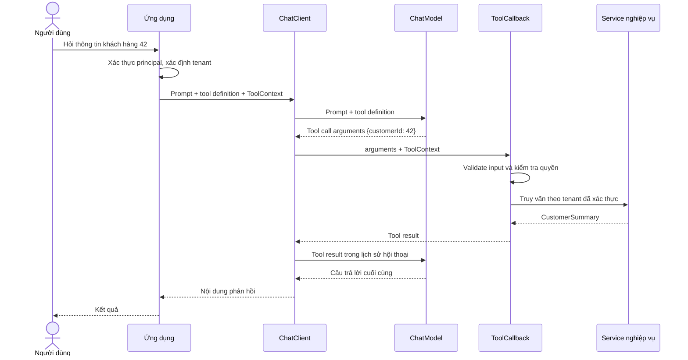

# Phân biệt đối số do mô hình sinh và ngữ cảnh do ứng dụng cung cấp

Khi Spring AI thực thi một tool, callback có thể nhận hai nhóm dữ liệu với nguồn gốc và mức độ tin cậy khác nhau:

- **Tool arguments** là JSON do mô hình tạo theo `ToolDefinition` và input schema. Chúng mô tả hành động hoặc tài nguyên mà mô hình muốn yêu cầu, ví dụ `customerId` hay `orderId`.
- **ToolContext** là map do ứng dụng gắn vào request. Spring AI chuyển map này trực tiếp đến tool khi thực thi; nó không đưa các giá trị trong context vào prompt hoặc JSON arguments mà mô hình nhìn thấy.

Phân biệt hai nhóm này giúp ứng dụng không để mô hình tự khai báo danh tính, tenant hoặc quyền truy cập. Mô hình có thể đề xuất mã khách hàng cần tra cứu; ứng dụng phải tự xác định người gọi là ai, thuộc tenant nào và có quyền xem khách hàng đó hay không.

## 1. Hai nguồn dữ liệu trong một lần gọi tool

Giả sử người dùng hỏi: “Cho tôi xem thông tin khách hàng 42”. Tool có schema chỉ nhận `customerId`. Ứng dụng đã xác thực người dùng `user-17` thuộc `tenant-A` và đưa danh tính đó vào `ToolContext`.

| Thuộc tính | Tool arguments | ToolContext |
| --- | --- | --- |
| Nguồn | Mô hình tạo từ hội thoại và schema | Ứng dụng tạo từ request/session đã xác thực |
| Ví dụ | `customerId = 42` | `subjectId = user-17`, `tenantId = tenant-A` |
| Mô hình có nhìn thấy? | Có; đây là dữ liệu trong tool call | Không; context không được gửi cho mô hình |
| Mục đích | Chỉ ra dữ liệu hoặc hành động mà mô hình yêu cầu | Bổ sung ngữ cảnh thực thi do ứng dụng kiểm soát |
| Độ tin cậy | Đầu vào không đáng tin cậy, cần validate | Chỉ đáng tin khi được tạo từ nguồn tin cậy và được ứng dụng kiểm tra |
| Thay thế cho nhau? | Không | Không |

Ví dụ JSON arguments do mô hình trả về:

```json
{
  "customerId": 42
}
```

Ví dụ context do ứng dụng chuẩn bị:

```java
Map<String, Object> toolContext = Map.of(
        "subjectId", "user-17",
        "tenantId", "tenant-A",
        "requestId", "req-9f81");
```

`tenantId` không nằm trong JSON arguments. Mô hình không được giao trách nhiệm chọn tenant để truy cập dữ liệu. Ứng dụng lấy tenant từ danh tính đã xác thực, kiểm tra tenant đó phù hợp với request rồi mới đưa vào context.

## 2. ToolContext được chuyển đến tool như thế nào?

Trong một yêu cầu `ChatClient`, ứng dụng có thể truyền công cụ và context cùng lúc:

```java
import java.util.Map;
import org.springframework.ai.chat.client.ChatClient;

String answer = chatClient.prompt()
        .user("Cho tôi xem thông tin khách hàng 42.")
        .tools(customerTools)
        .toolContext(Map.of(
                "caller", new CallerContext(
                        authenticatedSubjectId,
                        authenticatedTenantId,
                        requestId)))
        .call()
        .content();
```

Spring AI gửi tool definition (tên, mô tả và input schema) đến mô hình. Mô hình quyết định có gọi tool hay không và tạo JSON arguments. Khi nhận tool call, Spring AI tìm callback tương ứng và chuyển arguments cùng `ToolContext` đến callback. Context đi thẳng từ request đến bước thực thi, không đi qua mô hình.



Kết quả tool thường được gửi lại mô hình để mô hình diễn giải và trả lời. Vì vậy, dù `ToolContext` không được gửi cho mô hình, dữ liệu mà callback đưa vào **tool result** có thể được mô hình nhìn thấy. Chỉ trả về những trường cần thiết cho câu trả lời.

## 3. Khai báo ToolContext trong phương thức @Tool

Khi một phương thức có tham số kiểu `ToolContext`, Spring AI xem đây là tham số đặc biệt. Nó không trở thành thuộc tính trong JSON Schema. Các tham số nghiệp vụ khác mới là đầu vào mà mô hình phải tạo.

```java
import org.springframework.ai.chat.model.ToolContext;
import org.springframework.ai.tool.annotation.Tool;
import org.springframework.ai.tool.annotation.ToolParam;
import org.springframework.security.access.AccessDeniedException;

public class CustomerTools {

    private final CustomerService customerService;

    public CustomerTools(CustomerService customerService) {
        this.customerService = customerService;
    }

    @Tool(description = "Tra cứu thông tin khách hàng trong tenant hiện tại.")
    public CustomerSummary getCustomerInfo(
            @ToolParam(description = "ID khách hàng cần tra cứu") Long customerId,
            ToolContext toolContext) {

        CallerContext caller = requireCaller(toolContext);
        return customerService.findVisibleCustomer(
                caller.subjectId(), caller.tenantId(), customerId);
    }

    private CallerContext requireCaller(ToolContext context) {
        if (context == null) {
            throw new AccessDeniedException("Thiếu ngữ cảnh người gọi.");
        }
        Object value = context.getContext().get("caller");
        if (!(value instanceof CallerContext caller)) {
            throw new AccessDeniedException("Ngữ cảnh người gọi không hợp lệ.");
        }
        return caller;
    }
}
```

Schema mà mô hình nhìn thấy chỉ chứa `customerId`. `subjectId` và `tenantId` được đọc từ context trong lúc thực thi. Trong ứng dụng thực tế, nên dùng một record/DTO có kiểu rõ ràng thay cho nhiều phép ép kiểu `String` rải rác trong tool.

### ToolContext là tham số đặc biệt, không phải tham số optional

Nếu method khai báo `ToolContext`, request phải cung cấp context hợp lệ. Tài liệu Spring AI hiện hành ghi nhận lời gọi method có tham số `ToolContext` sẽ thất bại nếu request không có tool context hoặc context rỗng. Do đó, luôn truyền một map có các khóa cần thiết, và kiểm tra các khóa bắt buộc trước khi sử dụng.

## 4. Tạo context từ danh tính đã xác thực

Không lấy danh tính hoặc tenant từ nội dung hội thoại. Hãy tạo context ở tầng ứng dụng sau khi Spring Security đã xác thực principal và ứng dụng đã kiểm tra tenant mà người đó được phép sử dụng.

Có thể gom dữ liệu thực thi thành một kiểu bất biến:

```java
public record CallerContext(
        String subjectId,
        String tenantId,
        String requestId) {
}
```

Ứng dụng tạo `CallerContext` từ thông tin xác thực:

```java
CallerContext caller = new CallerContext(
        authentication.getName(),
        tenantResolver.requireAuthorizedTenant(authentication, requestedTenantId),
        requestId);

String answer = chatClient.prompt()
        .user(question)
        .tools(customerTools)
        .toolContext(Map.of("caller", caller))
        .call()
        .content();
```

`requestedTenantId` trong ví dụ có thể đến từ URL hoặc header, nhưng `tenantResolver` phải kiểm tra principal được phép dùng tenant đó. Chỉ sau khi kiểm tra thành công mới đưa tenant vào `CallerContext`. Không mặc định rằng giá trị từ request HTTP đã đáng tin cậy.

Trong tool, đọc context và kiểm tra kiểu:

```java
Object value = toolContext.getContext().get("caller");
if (!(value instanceof CallerContext caller)) {
    throw new AccessDeniedException("Thiếu ngữ cảnh người gọi hợp lệ.");
}
```

Record giúp gom các trường liên quan và tránh cập nhật từng khóa riêng lẻ. `ToolContext.getContext()` cung cấp map không thể sửa đổi, nhưng tính bất biến này chỉ ở cấp map; object lồng bên trong cũng cần là immutable DTO/record và collection bất biến nếu không muốn bị thay đổi.

## 5. Context không tự động cấp quyền

Việc một giá trị nằm trong `ToolContext` không chứng minh người dùng được phép truy cập tài nguyên. Context chỉ chuyển dữ liệu từ ứng dụng đến tool. Callback hoặc service nghiệp vụ vẫn phải xác thực dữ liệu, kiểm tra tenant và áp dụng authorization.

Ví dụ kiểm tra quyền trước khi đọc dữ liệu:

```java
@Tool(description = "Tra cứu thông tin khách hàng thuộc tenant hiện tại.")
public CustomerSummary getCustomerInfo(
        @ToolParam(description = "ID khách hàng") Long customerId,
        ToolContext toolContext) {

    CallerContext caller = requireCaller(toolContext);

    authorization.requireAllowed(
            caller.subjectId(),
            caller.tenantId(),
            "customer:read",
            customerId);

    return customerService.findVisibleCustomer(
            caller.subjectId(), caller.tenantId(), customerId);
}
```

Policy nên đánh giá quyền trên hành động và tài nguyên cụ thể. Một người dùng có quyền `customer:read` trong tenant A không đương nhiên có quyền đọc khách hàng thuộc tenant B. Nếu quyền có thể thay đổi, hãy truy vấn trạng thái quyền hiện hành ngay trước khi thực thi.

Không dùng một boolean như `isAdmin=true` trong context để bỏ qua authorization. Cũng không dùng danh sách permission chụp tại lúc tạo prompt làm quyết định cuối cùng cho một hành động có rủi ro; context có thể giữ subject/tenant để policy service tra cứu quyền mới nhất.

## 6. Dùng ToolContext với ChatModel trực tiếp

Không bắt buộc phải dùng `ChatClient`. Khi gọi `ChatModel` trực tiếp, có thể gắn tool callbacks và context vào `ToolCallingChatOptions`:

```java
import java.util.Map;
import org.springframework.ai.chat.model.ChatModel;
import org.springframework.ai.chat.model.ChatResponse;
import org.springframework.ai.chat.prompt.Prompt;
import org.springframework.ai.model.tool.ToolCallingChatOptions;
import org.springframework.ai.tool.ToolCallbacks;

ToolCallingChatOptions options = ToolCallingChatOptions.builder()
        .toolCallbacks(ToolCallbacks.from(customerTools))
        .toolContext(Map.of("caller", callerContext))
        .build();

Prompt prompt = new Prompt("Cho tôi xem thông tin khách hàng 42.", options);

ChatResponse response = chatModel.call(prompt);
```

Ở luồng này, options mang cả danh sách tool callback và context cho lần gọi. Nếu tự xây dựng vòng tool calling nhiều lượt, hãy giữ context gắn với đúng request trong mỗi vòng lặp; không tạo prompt tiếp theo mà quên truyền tool context. Với `ChatClient`, advisor của Spring AI quản lý vòng lặp tool calling.

## 7. Context ở custom ToolCallback

Khi tự triển khai `ToolCallback`, có thể xử lý cả JSON arguments và `ToolContext` qua overload `call(String toolInput, ToolContext toolContext)`. Đây là nơi phù hợp để tập trung parse, validate, kiểm tra policy và gọi service.

```java
import com.fasterxml.jackson.databind.ObjectMapper;
import org.springframework.ai.chat.model.ToolContext;
import org.springframework.ai.tool.ToolCallback;
import org.springframework.ai.tool.definition.ToolDefinition;
import org.springframework.ai.tool.metadata.ToolMetadata;
import org.springframework.ai.tool.execution.ToolExecutionException;
import org.springframework.security.access.AccessDeniedException;

public class CustomerLookupCallback implements ToolCallback {

    private final ToolDefinition definition;
    private final ObjectMapper objectMapper;
    private final CustomerService customerService;
    private final CustomerAuthorization authorization;

    public CustomerLookupCallback(
            ToolDefinition definition,
            ObjectMapper objectMapper,
            CustomerService customerService,
            CustomerAuthorization authorization) {
        this.definition = definition;
        this.objectMapper = objectMapper;
        this.customerService = customerService;
        this.authorization = authorization;
    }

    @Override
    public ToolDefinition getToolDefinition() {
        return definition;
    }

    @Override
    public ToolMetadata getToolMetadata() {
        return ToolMetadata.builder().build();
    }

    @Override
    public String call(String toolInput) {
        throw new ToolExecutionException(
                definition,
                new IllegalStateException("Tool này yêu cầu ToolContext."));
    }

    @Override
    public String call(String toolInput, ToolContext toolContext) {
        try {
            CallerContext caller = requireCaller(toolContext);
            CustomerLookupRequest request = objectMapper.readValue(
                    toolInput, CustomerLookupRequest.class);

            validate(request);
            authorization.requireAllowed(
                    caller.subjectId(), caller.tenantId(),
                    "customer:read", request.customerId());

            CustomerSummary customer = customerService.findVisibleCustomer(
                    caller.subjectId(), caller.tenantId(), request.customerId());

            return objectMapper.writeValueAsString(customer);
        }
        catch (Exception ex) {
            throw new ToolExecutionException(definition, ex);
        }
    }

    private CallerContext requireCaller(ToolContext context) {
        if (context == null) {
            throw new AccessDeniedException("Thiếu ngữ cảnh người gọi.");
        }
        Object value = context.getContext().get("caller");
        if (!(value instanceof CallerContext caller)) {
            throw new AccessDeniedException("Ngữ cảnh người gọi không hợp lệ.");
        }
        return caller;
    }
}
```

Đây là khung minh họa; constructor, logger, validation và xử lý exception cần được hoàn thiện theo ứng dụng. Nếu tool bắt buộc có context, overload không có context nên fail closed như ví dụ. Không tự tạo context mặc định bằng một tenant dùng chung để tránh vô tình mở quyền khi request thiếu thông tin.

## 8. Phạm vi và vòng đời của context

`ToolContext` được gắn với request gọi chat. Các tool được thực thi trong request đó nhận context tương ứng. Khi cùng một callback bean singleton phục vụ nhiều request, không lưu `CallerContext`, `tenantId` hoặc `subjectId` vào field có thể thay đổi; hãy lấy chúng từ tham số context của từng lần gọi.

| Dữ liệu | Nơi phù hợp | Lưu ý |
| --- | --- | --- |
| `subjectId` | ToolContext | Lấy từ principal đã xác thực |
| `tenantId` | ToolContext | Xác minh principal được phép dùng tenant |
| `requestId` / correlation ID | ToolContext hoặc tracing context | Dùng để liên kết log và audit |
| Locale/timezone | ToolContext nếu tool cần | Chuẩn hóa và giới hạn giá trị hợp lệ |
| `customerId`, `orderId`, `sku` | Tool arguments | Mô hình có thể đề xuất; cần validate và kiểm tra quyền |
| Password, bearer token, refresh token | Không nên đưa vào ToolContext | Dùng credential store hoặc cơ chế ủy quyền chuyên biệt |
| Toàn bộ `Authentication` hoặc HTTP request | Tránh truyền trực tiếp | Chuyển thành context DTO tối thiểu |

Context nên tuân theo nguyên tắc tối thiểu quyền: chỉ truyền các trường mà tool cần. Vì context thường áp dụng cho tất cả tool của một request, đừng đưa bí mật hoặc dữ liệu chỉ dành cho một tool vào map dùng chung nếu những tool khác cũng nhận được map đó.

### Context khi tích hợp MCP hoặc hệ thống từ xa

Trong ứng dụng chỉ dùng tool nội bộ, context được chuyển trực tiếp từ request đến callback. Nếu callback là cầu nối đến MCP hoặc một tool server từ xa, adapter có thể ánh xạ một phần context thành metadata gửi qua ranh giới mạng. Hãy kiểm tra `ToolContextToMcpMetaConverter` hoặc cơ chế chuyển context tương ứng trước khi đưa dữ liệu vào map. Không coi mọi integration đều giữ context hoàn toàn trong process.

## 9. Context và dữ liệu mặc định

Spring AI cho phép cấu hình tool context ở cấp mặc định và cấp request. Theo Tool Specification Reference hiện hành, khi cả hai được thiết lập qua ChatClient, các map được hợp nhất và giá trị runtime tại call site được ưu tiên nếu trùng khóa. Với các API ChatModel/options hoặc phiên bản khác, hãy kiểm tra quy tắc precedence tương ứng và không dựa vào hành vi merge ngầm cho dữ liệu bảo mật.

Đối với `tenantId`, `subjectId` hoặc policy scope, cách rõ ràng nhất là tạo context hoàn chỉnh ở tầng điều phối và truyền tường minh trong request. Nếu buộc phải kết hợp default context, hãy kiểm thử trường hợp trùng khóa để bảo đảm runtime context không bị ghi đè bởi giá trị mặc định cũ.

## 10. Những lỗi thường gặp

| Lỗi | Hậu quả | Cách xử lý |
| --- | --- | --- |
| Đưa `tenantId` vào schema cho mô hình điền | Mô hình có thể chọn tenant khác | Lấy tenant từ principal và truyền qua ToolContext |
| Nghĩ ToolContext tự xác thực người gọi | Dữ liệu context có thể được tạo sai ở tầng ứng dụng | Chỉ tạo từ nguồn xác thực, kiểm tra quyền trong tool/service |
| Không truyền context cho method cần ToolContext | Lời gọi tool thất bại | Luôn truyền map khác rỗng với các khóa bắt buộc |
| Lưu context vào field của callback singleton | Request đồng thời có thể dùng nhầm tenant | Đọc context từ tham số của mỗi lần call |
| Tin map bất biến làm object lồng cũng bất biến | Giá trị context có thể bị sửa | Dùng record và collection bất biến |
| Trả toàn bộ entity về mô hình | Có thể lộ dữ liệu không cần thiết | Chuyển thành DTO kết quả tối thiểu |
| Truyền token/credential trong context dùng chung | Tool khác hoặc adapter từ xa có thể nhận dữ liệu nhạy cảm | Dùng credential store, context tối thiểu |
| Tự điều phối nhiều lượt nhưng quên context | Lượt gọi sau mất tenant hoặc request scope | Truyền context nhất quán trong từng vòng lặp |

## 11. Kiểm thử ranh giới giữa arguments và context

Các kiểm thử cần xác nhận mô hình chỉ điều khiển những trường đã công bố trong schema, còn danh tính/tenant đến từ context. Đồng thời, phải chứng minh rằng callback không gọi service khi context thiếu hoặc policy từ chối.

| Trường hợp | Điều cần xác minh |
| --- | --- |
| Schema của tool | Chứa `customerId`, không chứa `tenantId` hoặc `subjectId` |
| Context hợp lệ | Callback dùng subject/tenant từ context |
| Context null/rỗng | Từ chối trước khi gọi service |
| Context sai kiểu hoặc thiếu khóa | Từ chối an toàn |
| Arguments thiếu/sai kiểu | Validation thất bại trước service |
| Mô hình gửi tenant giả trong arguments | Bị từ chối hoặc trường không được schema chấp nhận; không thay đổi tenant context |
| Policy từ chối | Service không được gọi |
| Hai request đồng thời khác tenant | Kết quả không bị trộn context |
| Tool result | Không chứa trường nhạy cảm không cần cho mô hình |

Ví dụ kiểm tra schema và context:

```java
@Test
void shouldUseTenantFromToolContextNotFromArguments() {
    CallerContext caller = new CallerContext("user-17", "tenant-A", "req-123");
    ToolContext context = new ToolContext(Map.of("caller", caller));

    String result = callback.call(
            """
            {"customerId":42}
            """,
            context);

    verify(authorization).requireAllowed(
            "user-17", "tenant-A", "customer:read", 42L);
}
```

Bổ sung test để gửi thêm trường `tenantId: "tenant-B"` trong JSON arguments. Callback phải bỏ qua hoặc từ chối trường ngoài schema theo chính sách parse; tuyệt đối không dùng nó để ghi đè tenant lấy từ context.

## 12. Checklist triển khai

- [ ] Phân loại rõ từng trường: do mô hình sinh hay do ứng dụng cung cấp.
- [ ] Tool schema chỉ chứa arguments mà mô hình được phép đề xuất.
- [ ] Danh tính và tenant được tạo từ principal/session đã xác thực.
- [ ] `ToolContext` được truyền rõ ràng ở request và có các khóa bắt buộc.
- [ ] Tool method đọc context qua tham số `ToolContext`, không lấy từ field dùng chung.
- [ ] Validate arguments độc lập với việc provider đã kiểm tra JSON Schema.
- [ ] Kiểm tra quyền trên action, tenant và resource tại thời điểm thực thi.
- [ ] Context dùng record/DTO bất biến và chỉ chứa dữ liệu tối thiểu.
- [ ] Không truyền password, token hoặc credential vào context dùng chung.
- [ ] Kết quả tool chỉ chứa dữ liệu cần thiết vì result có thể được gửi lại mô hình.
- [ ] Kiểm thử context thiếu, tenant sai, policy deny và nhiều request đồng thời.
- [ ] Kiểm tra adapter MCP/remote nếu context có thể được chuyển thành metadata mạng.

## Tài liệu tham khảo

- [Spring AI 2.1 — Tool Specification Reference: Tool Context](https://docs.spring.io/spring-ai/reference/2.1-SNAPSHOT/tools/reference.html) (bản SNAPSHOT; bản ổn định được tài liệu chỉ định là 2.1.0)
- [Spring AI 1.0 — Tool Calling: Tool Context](https://docs.spring.io/spring-ai/reference/1.0/api/tools.html)
- [Spring AI 2.1 — Tool Calling với ChatModel](https://docs.spring.io/spring-ai/reference/2.1-SNAPSHOT/tools/chatmodel.html)
- [Spring AI 2.1 — Session Recall và truyền session ID qua ToolContext](https://docs.spring.io/spring-ai/reference/2.1-SNAPSHOT/memory/session/recall.html)

`Tool arguments` trả lời câu hỏi “mô hình muốn gọi tool với dữ liệu nào”; `ToolContext` trả lời “ứng dụng đang thực thi yêu cầu đó trong ngữ cảnh nào”. Giữ hai nguồn dữ liệu tách biệt, tạo context từ danh tính đã xác thực và kiểm tra policy trong callback giúp ứng dụng tận dụng khả năng gọi công cụ của mô hình mà vẫn kiểm soát được tenant, quyền và phạm vi dữ liệu.
