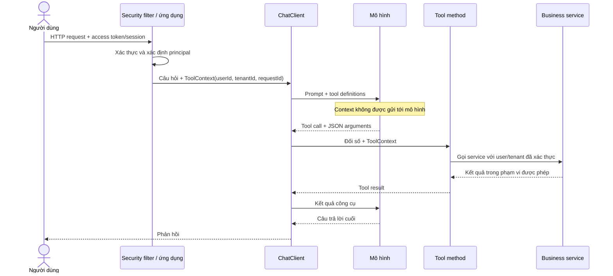

# Truyền thông tin người dùng, tenant và định danh yêu cầu

Một công cụ AI thường cần biết ai đang yêu cầu thao tác, dữ liệu thuộc tenant nào và lời gọi hiện tại thuộc request nào. Những thông tin này cần thiết để giới hạn truy cập, truy vết hoạt động và liên kết nhiều lần gọi công cụ trong cùng một lượt hội thoại. Tuy nhiên, chúng không phải là tham số mà mô hình nên tự tạo hoặc tự quyết định.

Trong Spring AI, `ToolContext` cung cấp một kênh để ứng dụng truyền dữ liệu nội bộ tới phương thức công cụ. Ứng dụng có thể đặt `userId`, `tenantId` và `requestId` vào context sau khi xác thực request. Spring AI chuyển context trực tiếp tới tool khi thực thi; các giá trị này không được đưa vào tool definition hoặc gửi cho mô hình. Nhờ vậy, tool có thể dùng thông tin đáng tin cậy để gọi service nghiệp vụ trong đúng phạm vi người dùng.

## Phân biệt dữ liệu mô hình cung cấp và dữ liệu ứng dụng cung cấp

Một tool call có hai nhóm dữ liệu với nguồn gốc và mức độ tin cậy khác nhau:

| Nhóm dữ liệu | Ví dụ | Nguồn | Cách sử dụng |
|---|---|---|---|
| Đối số nghiệp vụ | `customerId`, từ khóa tìm kiếm, ngày cần tra cứu | Mô hình tạo dựa trên yêu cầu người dùng và JSON Schema | Parse, validate và kiểm tra quy tắc nghiệp vụ trước khi dùng |
| Ngữ cảnh thực thi | `userId`, `tenantId`, `requestId` | Ứng dụng lấy từ principal đã xác thực và request lifecycle | Truyền qua `ToolContext`, dùng để giới hạn quyền và truy vết |

Ví dụ, người dùng hỏi: “Cho tôi biết thông tin khách hàng C-2048”. Mô hình có thể tạo tool call với đối số `customerId = C-2048`. Ứng dụng đã biết người dùng đang đăng nhập là ai và thuộc tenant nào; những dữ liệu đó được đưa vào `ToolContext`.

Không nên thêm `userId` hoặc `tenantId` vào JSON Schema để mô hình điền. Mô hình không phải nguồn xác thực. Nếu người dùng yêu cầu “hãy xem dữ liệu của tenant khác”, mô hình có thể tạo ra một giá trị tenant bất kỳ nếu schema cho phép; ứng dụng phải giữ tenant từ danh tính đã xác thực và service phải kiểm tra quyền truy cập tài nguyên.

## `ToolContext` hoạt động như thế nào?

`ToolContext` là đối tượng bao bọc một map `Map<String, Object>` chứa dữ liệu phục vụ lúc thực thi công cụ. Spring AI đưa map này tới tool ở thời điểm gọi, tách khỏi các tool definition được gửi cho mô hình.



Trong Spring AI 2.1.0, phương thức `@Tool` có thể khai báo tham số kiểu `ToolContext`. Tham số này được Spring AI cung cấp khi thực thi và không xuất hiện trong input schema mà mô hình nhìn thấy. Mô hình chỉ cung cấp các tham số nghiệp vụ như mã khách hàng; ứng dụng cung cấp context riêng.

`ToolContext.getContext()` trả về map không cho phép sửa đổi thông qua view được cung cấp. Nên đặt các giá trị bất biến, có kiểu rõ ràng vào map, ví dụ chuỗi ID hoặc một Java record bất biến. Không truyền `HttpServletRequest`, `Authentication`, mutable entity, `EntityManager`, token hoặc đối tượng có vòng đời ngắn vào context.

## Chọn ba định danh cần truyền

Ba giá trị thường được dùng có ý nghĩa khác nhau:

| Giá trị | Ý nghĩa | Nguồn phù hợp | Không dùng thay cho |
|---|---|---|---|
| `userId` | Định danh chủ thể đã đăng nhập | Principal hoặc identity service sau xác thực | Tên người dùng do prompt cung cấp |
| `tenantId` | Phạm vi tổ chức/khách hàng sở hữu dữ liệu | Tenant claim đã được xác minh hoặc tenant resolver của ứng dụng | Tenant ID do mô hình tự điền |
| `requestId` | Định danh một request để liên kết log, trace và các lần gọi tool | Request filter hoặc tracing/correlation component | User ID, session ID hoặc idempotency key |

Nên dùng internal subject ID ổn định thay cho email hoặc tên hiển thị nếu tool chỉ cần nhận diện người dùng. Chỉ truyền tenant ID khi thao tác cần giới hạn theo tenant. `requestId` thường được tạo một lần ở đầu request và giữ nguyên trong mọi tool execution của cùng vòng gọi công cụ.

`requestId` phục vụ quan sát và chẩn đoán. Nó không chứng minh quyền, không xác nhận một thao tác đã được người dùng phê duyệt và cũng không tự ngăn giao dịch trùng lặp. Với thao tác ghi cần chống thực thi lặp, hãy dùng idempotency key riêng do ứng dụng hoặc client nghiệp vụ quản lý và được service kiểm tra.

## Tạo context từ danh tính đã xác thực

Ứng dụng cần xây dựng context sau khi security filter chain đã xác thực request. Ví dụ dưới đây giả định ứng dụng có principal riêng với `userId` và `tenantId`, cùng một `RequestIdentity` tạo hoặc cung cấp correlation ID cho request hiện tại.

Trước tiên, định nghĩa một record bất biến để nhóm dữ liệu:

```java
public record ToolExecutionContext(
        String userId,
        String tenantId,
        String requestId) {
}
```

Sau đó, tạo context ở tầng điều phối request:

```java
import java.util.Map;

import org.springframework.ai.chat.client.ChatClient;
import org.springframework.security.access.AccessDeniedException;
import org.springframework.security.core.Authentication;
import org.springframework.security.core.context.SecurityContextHolder;
import org.springframework.stereotype.Service;

@Service
public class CustomerAssistant {

    private static final String EXECUTION_CONTEXT = "executionContext";

    private final ChatClient chatClient;
    private final CustomerTools customerTools;
    private final RequestIdentity requestIdentity;

    public CustomerAssistant(
            ChatClient chatClient,
            CustomerTools customerTools,
            RequestIdentity requestIdentity) {
        this.chatClient = chatClient;
        this.customerTools = customerTools;
        this.requestIdentity = requestIdentity;
    }

    public String ask(String question) {
        Authentication authentication =
                SecurityContextHolder.getContext().getAuthentication();

        if (authentication == null || !authentication.isAuthenticated()
                || !(authentication.getPrincipal() instanceof AppPrincipal principal)) {
            throw new AccessDeniedException("Không xác định được người dùng đã đăng nhập.");
        }

        ToolExecutionContext executionContext = new ToolExecutionContext(
                principal.userId(),
                principal.tenantId(),
                requestIdentity.currentRequestId());

        return chatClient.prompt()
                .user(question)
                .tools(customerTools)
                .toolContext(Map.of(EXECUTION_CONTEXT, executionContext))
                .call()
                .content();
    }
}
```

`AppPrincipal` và `RequestIdentity` là kiểu của ứng dụng trong ví dụ. `AppPrincipal` cần được tạo từ kết quả xác thực đáng tin cậy; `RequestIdentity` có thể đọc correlation ID do filter sinh ra. Nếu hệ thống chấp nhận correlation ID từ header bên ngoài, cần kiểm tra định dạng và giới hạn độ dài trước khi dùng trong log. Không dùng header này làm bằng chứng danh tính hoặc quyền truy cập.

Không nên lấy `userId` hay `tenantId` từ body của HTTP request, query parameter hoặc câu hỏi tự nhiên rồi đưa thẳng vào `ToolContext`. Những nguồn đó có thể do client kiểm soát. Nếu ứng dụng cho phép người dùng chọn một tenant đang đại diện, cần xác thực lựa chọn đó bằng membership/authorization service trước khi tạo context.

## Đọc context trong phương thức `@Tool`

Tool method nhận tham số nghiệp vụ theo schema và một tham số `ToolContext` riêng. Spring AI không đưa tham số context vào schema:

```java
import org.springframework.ai.chat.model.ToolContext;
import org.springframework.ai.tool.annotation.Tool;
import org.springframework.ai.tool.annotation.ToolParam;
import org.springframework.stereotype.Component;

@Component
public class CustomerTools {

    private static final String EXECUTION_CONTEXT = "executionContext";

    private final CustomerService customerService;

    public CustomerTools(CustomerService customerService) {
        this.customerService = customerService;
    }

    @Tool(description = "Tra cứu thông tin khách hàng trong phạm vi tenant hiện tại")
    public CustomerSummary getCustomerInfo(
            @ToolParam(description = "Mã khách hàng cần tra cứu") String customerId,
            ToolContext toolContext) {

        ToolExecutionContext executionContext = requireExecutionContext(toolContext);

        return customerService.findVisibleCustomer(
                executionContext.tenantId(),
                executionContext.userId(),
                customerId);
    }

    private ToolExecutionContext requireExecutionContext(ToolContext toolContext) {
        if (toolContext == null) {
            throw new IllegalArgumentException("Thiếu ngữ cảnh thực thi công cụ.");
        }

        Object value = toolContext.getContext().get(EXECUTION_CONTEXT);
        if (!(value instanceof ToolExecutionContext context)
                || context.userId() == null || context.userId().isBlank()
                || context.tenantId() == null || context.tenantId().isBlank()
                || context.requestId() == null || context.requestId().isBlank()) {
            throw new IllegalArgumentException("Ngữ cảnh thực thi công cụ không hợp lệ.");
        }

        return context;
    }
}
```

Mô hình chỉ thấy `customerId` trong schema. `ToolContext` được Spring AI thêm khi gọi phương thức. Phương thức lấy tenant và user từ record do ứng dụng tạo rồi gọi service có phạm vi truy cập tương ứng.

Nếu một `@Tool` method khai báo tham số `ToolContext` nhưng request không cung cấp context hoặc map rỗng, Spring AI 2.1.0 sẽ báo `IllegalArgumentException` khi thực thi method. Vì vậy, mọi đường gọi có thể kích hoạt tool đó phải thiết lập context không rỗng. Nếu có dữ liệu mặc định hợp lệ, hãy đưa dữ liệu đó vào map; không thêm một giá trị giả chỉ để vượt qua kiểm tra.

## Kiểm tra quyền vẫn thuộc service nghiệp vụ

`ToolContext` chỉ là kênh vận chuyển dữ liệu do ứng dụng cung cấp. Nó không phải cơ chế xác thực, không tự kiểm tra chữ ký token và không tự quyết định người dùng được phép làm gì. Việc một giá trị nằm trong context chỉ có nghĩa ứng dụng đã chuyển giá trị đó; service vẫn phải áp dụng chính sách quyền.

Ví dụ, service cần kiểm tra cả quyền của người dùng lẫn tenant sở hữu khách hàng:

```java
@Service
public class CustomerService {

    private final CustomerRepository customerRepository;
    private final CustomerAuthorization customerAuthorization;

    public CustomerService(
            CustomerRepository customerRepository,
            CustomerAuthorization customerAuthorization) {
        this.customerRepository = customerRepository;
        this.customerAuthorization = customerAuthorization;
    }

    public CustomerSummary findVisibleCustomer(
            String tenantId,
            String userId,
            String customerId) {

        customerAuthorization.requireCanReadCustomers(userId, tenantId);

        Customer customer = customerRepository
                .findByTenantIdAndCustomerId(tenantId, customerId)
                .orElseThrow(() -> new CustomerNotFoundException(customerId));

        customerAuthorization.requireCanReadCustomer(userId, customer);
        return CustomerSummary.from(customer);
    }
}
```

`CustomerAuthorization`, repository và DTO là thành phần nghiệp vụ của ví dụ. Truy vấn đã giới hạn theo `tenantId` ngay từ đầu; service tiếp tục kiểm tra quyền trên khách hàng cụ thể. Điều này tránh lỗi IDOR/BOLA, trong đó người dùng thay một ID tài nguyên để đọc dữ liệu của người khác.

Không chỉ dựa vào một chuỗi `tenantId` mà callback nhận được. Nếu dữ liệu tenant có thể thay đổi hoặc user có thể tham gia nhiều tenant, cần xác minh quan hệ user-tenant ở tầng authorization. Với thao tác ghi, kiểm tra trạng thái và quyền ngay trước khi thay đổi dữ liệu.

## `ToolContext` không thay thế `SecurityContext`

Hai cơ chế phục vụ mục đích khác nhau:

| Cơ chế | Vai trò | Phạm vi |
|---|---|---|
| Spring Security `SecurityContext` | Lưu `Authentication` hiện tại để security filter, method security và service dùng xác thực/ủy quyền | Thường gắn với execution context của request hoặc cơ chế context propagation đã cấu hình |
| Spring AI `ToolContext` | Chuyển dữ liệu phụ trợ do ứng dụng cung cấp tới tool khi thực thi | Gắn với lời gọi chat/tool và các vòng tool calling của request đó |

Trong xử lý đồng bộ cùng request, service có thể dùng `SecurityContextHolder` để lấy `Authentication`. Tuy nhiên, không nên giả định `SecurityContext` tự truyền sang mọi executor, scheduler hoặc reactive pipeline. Nếu tool được thực thi bất đồng bộ, cần cấu hình context propagation phù hợp hoặc truyền một execution context đã xác thực tới worker theo hợp đồng rõ ràng.

Ngay cả khi đã truyền `userId` và `tenantId` bằng `ToolContext`, không nên bỏ các kiểm tra authorization trong service. Context giúp tool biết phạm vi thực thi; service vẫn là nơi thực thi chính sách. Nếu dùng method security, hãy bảo đảm lời gọi đi qua Spring proxy và principal/authority có sẵn trong security context đúng thời điểm.

## Truyền context theo từng request với `ChatClient`

Với `ChatClient`, dùng `.toolContext(Map<String, Object>)` trên request:

```java
String answer = chatClient.prompt()
        .user("Cho tôi biết thông tin khách hàng C-2048")
        .tools(customerTools)
        .toolContext(Map.of("executionContext", new ToolExecutionContext(
                principal.userId(),
                principal.tenantId(),
                requestIdentity.currentRequestId())))
        .call()
        .content();
```

Context của request được chuyển cho các tool được gọi trong vòng tool calling. Nếu mô hình yêu cầu nhiều công cụ trong cùng request, chúng nhận context của request đó. Vì vậy, chỉ đưa các giá trị mà mọi tool được phép nhận và có thể cần sử dụng.

`ChatClient.Builder` cũng có `defaultToolContext(Map<String, Object>)`. Khi context mặc định và context ở request cùng có mặt, Spring AI gộp hai map; giá trị ở request hiện tại ghi đè giá trị mặc định có cùng key.

```java
ChatClient chatClient = ChatClient.builder(chatModel)
        .defaultToolContext(Map.of("application", "customer-assistant"))
        .build();

String answer = chatClient.prompt()
        .user(question)
        .tools(customerTools)
        .toolContext(Map.of("executionContext", new ToolExecutionContext(
                principal.userId(), principal.tenantId(), requestId)))
        .call()
        .content();
```

`defaultToolContext` phù hợp với metadata tĩnh của ứng dụng. Không đặt `userId`, `tenantId` hoặc `requestId` của một người dùng cụ thể vào `ChatClient` singleton dùng chung cho nhiều request. Nếu giữ context người dùng trong default, request sau có thể kế thừa nhầm dữ liệu người dùng trước. Hãy tạo context theo request và truyền qua `.toolContext(...)`.

## Dùng context khi gọi `ChatModel` trực tiếp

Nếu ứng dụng gọi `ChatModel` ở mức thấp, context được đặt trong `ToolCallingChatOptions` của provider:

```java
import org.springframework.ai.openai.OpenAiChatOptions;
import org.springframework.ai.chat.model.ChatModel;
import org.springframework.ai.chat.model.ChatResponse;
import org.springframework.ai.chat.prompt.Prompt;
import org.springframework.ai.tool.ToolCallback;
import org.springframework.ai.tool.ToolCallbacks;

ToolCallback[] callbacks = ToolCallbacks.from(customerTools);
ToolExecutionContext executionContext = new ToolExecutionContext(
        principal.userId(), principal.tenantId(), requestId);

OpenAiChatOptions options = OpenAiChatOptions.builder()
        .model("gpt-5.4-mini")
        .toolCallbacks(callbacks)
        .toolContext(Map.of("executionContext", executionContext))
        .build();

ChatResponse response = chatModel.call(new Prompt(question, options));
```

`OpenAiChatOptions` là ví dụ cho provider OpenAI; provider khác dùng options class tương ứng. Trong Spring AI 2.x, `ChatModel.call(...)` trực tiếp trả về phản hồi của mô hình và không tự thực thi tool call. Ứng dụng phải tự điều phối `ToolCallingManager` và vòng gọi tiếp theo. Với ứng dụng hội thoại thông thường, `ChatClient` thường thuận tiện hơn vì `ToolCallingAdvisor` quản lý vòng tool calling.

Khi truyền options trực tiếp cho `ChatModel`, request options thường thay thế default options của model theo hợp đồng provider; đừng mặc định việc gộp context giống với `ChatClient`. Hãy tạo options đầy đủ cho request hiện tại và kiểm tra quy tắc precedence của provider đang dùng.

Các đoạn code trên lược bỏ một số import và kiểu riêng của ứng dụng như `AppPrincipal`, `RequestIdentity`, `CustomerSummary` và `ToolExecutionContext`. Context cần được tạo mới cho mỗi request. Nó không tự được lưu vào conversation memory hoặc tự xuất hiện ở một lời gọi `ChatClient` tiếp theo; ứng dụng phải xây dựng và truyền lại context ở mỗi request.

## Context được chia sẻ cho các tool trong cùng request

`ToolContext` không phải một vùng riêng cho từng phương thức tool. Context của request có thể được cung cấp cho mọi tool được thực thi trong vòng đó. Điều này có một số hệ quả:

- Mỗi tool có thể đọc các key mà ứng dụng đã đưa vào context, vì vậy chỉ thêm dữ liệu cần thiết.
- Không đặt access token, refresh token, cookie, mật khẩu hoặc bí mật của dịch vụ vào context.
- Không giả định tool chỉ có thể đọc key liên quan đến nó. Tool khác trong cùng request có thể nhận cùng map.
- Nếu truyền context qua công cụ MCP từ xa, kiểm tra cách adapter chuyển context thành metadata và chỉ gửi các key được phép ra hệ thống bên ngoài.
- Không đưa object mutable hoặc tài nguyên có vòng đời ngắn vào context. Ưu tiên record/DTO bất biến và kiểu dữ liệu đơn giản.

Spring AI mô tả map của `ToolContext` là immutable view. Điều đó ngăn việc sửa map qua `getContext()`, nhưng không tự làm cho mọi object bên trong trở thành bất biến. Hãy dùng giá trị bất biến hoặc bản sao bất biến khi tạo context.

## Request ID, trace ID và idempotency key

Ba loại định danh này thường bị nhầm lẫn:

| Định danh | Mục đích | Ví dụ cách dùng |
|---|---|---|
| Request/correlation ID | Liên kết log và các bước xử lý thuộc một request | Cùng một ID xuất hiện trong log của controller, ChatClient, tool và service |
| Trace ID | Liên kết các span trong distributed trace | Tracing system tạo và truyền trace context qua HTTP client, database instrumentation hoặc messaging |
| Idempotency key | Ngăn một thao tác nghiệp vụ bị thực thi trùng khi retry | Service ghi nhận key cùng kết quả của lần thực thi đầu và trả lại kết quả đó cho lần gọi lặp |

Có thể đặt correlation ID vào `ToolContext` để tool ghi log với cùng định danh. Tuy nhiên, nếu tracing instrumentation đã có trace context, không cần sao chép toàn bộ trace object vào context. Chỉ truyền request ID khi tool hoặc hệ thống downstream thực sự cần nó.

Với thao tác ghi như tạo đơn, thanh toán hoặc gửi yêu cầu, idempotency key phải được kiểm tra tại service hoặc hệ thống nhận lệnh. Không dùng `requestId` thay thế nếu một request có thể chứa nhiều thao tác hoặc cùng một thao tác được gửi lại từ một request khác. Không cho mô hình tự chọn idempotency key nếu ứng dụng cần bảo đảm tính duy nhất.

## Xử lý context thiếu hoặc không hợp lệ

Tool cần context để truy cập dữ liệu tenant phải từ chối thực thi nếu context thiếu. Không dùng giá trị mặc định chung như `tenant = public`, `userId = system` hoặc một tenant mặc định để tiếp tục, vì điều đó có thể biến lỗi cấu hình thành truy cập sai phạm vi.

Nên kiểm tra:

1. `ToolContext` có được cung cấp hay không.
2. Key bắt buộc có tồn tại và đúng kiểu hay không.
3. ID có rỗng hoặc sai định dạng không.
4. Request ID có đúng định dạng/độ dài theo quy ước quan sát hay không.
5. Tenant có hợp lệ và người dùng có quan hệ với tenant đó không.
6. Service có quyền thực hiện hành động trên tài nguyên cụ thể không.

Khi thiếu context, lỗi cần được xử lý ở tầng ứng dụng theo chính sách. Không gửi các chi tiết nhạy cảm như principal object, claim đầy đủ hoặc token về cho mô hình. Với lỗi phân quyền, giữ hành vi từ chối và không cho mô hình tự tạo context khác để thử lại.

## Kiểm thử việc truyền và cô lập context

Kiểm thử cần chứng minh dữ liệu đúng được truyền tới tool, dữ liệu không xuất hiện trong schema của mô hình và context của request này không rò sang request khác.

| Ca kiểm thử | Điều cần xác minh |
|---|---|
| Request đã xác thực | `userId`, `tenantId`, `requestId` được lấy từ principal/request identity và có mặt trong tool context |
| Người dùng chưa xác thực | Ứng dụng từ chối trước khi gọi ChatClient hoặc không cung cấp tool có quyền truy cập dữ liệu |
| Tool method khai báo `ToolContext` | Tham số context không xuất hiện trong JSON Schema của tool |
| Không có context hoặc context rỗng | Spring AI từ chối lời gọi method-based tool có tham số `ToolContext` |
| Context hợp lệ | Tool đọc đúng user/tenant/request ID và gọi service với đúng phạm vi |
| Tenant bị giả mạo trong prompt hoặc tool arguments | Service vẫn dùng tenant từ context và từ chối truy cập trái phép |
| Runtime context ghi đè default context | Giá trị request hiện tại thắng giá trị mặc định cùng key |
| Hai request đồng thời | Context của user A không xuất hiện trong tool execution của user B |
| Nhiều tool call trong cùng request | Mọi tool nhận cùng request ID đã tạo ở đầu request |
| Context gửi tới MCP | Chỉ metadata được phép mới đi qua ranh giới remote server |
| Request ID và idempotency key | Hai định danh được kiểm tra theo mục đích riêng, không dùng thay nhau |

Ví dụ unit test cho phương thức đọc context:

```java
@Test
void passesAuthenticatedTenantAndUserToService() {
    ToolExecutionContext executionContext = new ToolExecutionContext(
            "user-17", "tenant-42", "req-8f31");
    ToolContext toolContext = new ToolContext(
            Map.of("executionContext", executionContext));

    customerTools.getCustomerInfo("C-2048", toolContext);

    verify(customerService).findVisibleCustomer(
            "tenant-42", "user-17", "C-2048");
}

@Test
void doesNotCallServiceWhenExecutionContextIsMissing() {
    ToolContext toolContext = new ToolContext(Map.of("otherKey", "value"));

    assertThatThrownBy(() -> customerTools.getCustomerInfo("C-2048", toolContext))
            .isInstanceOf(IllegalArgumentException.class);

    verifyNoInteractions(customerService);
}
```

Trong test thực tế, `customerTools` và `customerService` được khởi tạo bằng Mockito hoặc Spring test context. Bên cạnh unit test, nên có integration test với security filter và service authorization để xác nhận principal được tạo đúng, tenant isolation hoạt động và request context không bị chia sẻ giữa các request đồng thời.

## Quan sát tool execution mà không làm lộ dữ liệu

`requestId` giúp liên kết các bước xử lý. Có thể ghi log cấu trúc gồm:

- request ID hoặc trace ID;
- tên tool;
- internal user ID và tenant ID nếu chính sách log cho phép;
- thời điểm bắt đầu/kết thúc và thời gian thực thi;
- trạng thái thành công, từ chối quyền, lỗi validation hoặc lỗi downstream.

Không ghi toàn bộ `ToolContext`, access token, cookie, principal object hoặc payload khách hàng vào log. Tránh đưa tenant/user ID vào nội dung trả về cho mô hình nếu không cần. Spring AI cung cấp observation cho tool execution; dữ liệu arguments/results có thể được bật trong span attribute nhưng mặc định tắt vì lý do nhạy cảm. Khi cần truy vết, ưu tiên ID tương quan và metadata tối thiểu.

## Checklist triển khai

1. Xác thực request trước khi tạo `ToolContext`.
2. Lấy `userId` và `tenantId` từ principal/identity service đã xác thực.
3. Tạo `requestId` ở request boundary; không dùng nó làm credential hoặc idempotency key.
4. Đưa dữ liệu tối thiểu vào map context, ưu tiên record và giá trị bất biến.
5. Truyền context theo từng request bằng `.toolContext(...)`.
6. Khai báo `ToolContext` trong phương thức `@Tool` hoặc override overload tương ứng trong custom `ToolCallback` khi cần context.
7. Xác thực key và kiểu dữ liệu trước khi gọi service.
8. Service kiểm tra quyền trên tenant và tài nguyên cụ thể; không tin ID do mô hình tạo.
9. Không lưu dữ liệu người dùng vào `defaultToolContext` của ChatClient dùng chung.
10. Kiểm tra context có bị gửi sang MCP hoặc hệ thống từ xa không và lọc metadata theo allowlist.
11. Kiểm thử thiếu context, tenant isolation, request đồng thời và ghi log an toàn.

## Kết luận

`ToolContext` cho phép ứng dụng truyền `userId`, `tenantId` và `requestId` tới tool mà không đưa các giá trị này vào schema hoặc prompt gửi cho mô hình. Hãy tạo context từ principal đã xác thực và request identity do ứng dụng quản lý, truyền theo từng request bằng `ChatClient.toolContext(...)`, rồi đọc trong phương thức `@Tool` qua tham số `ToolContext`. Context giúp tool biết phạm vi thực thi nhưng không thay thế authentication hoặc authorization; service vẫn phải kiểm tra quyền trên tenant và tài nguyên. Giữ request ID tách biệt với idempotency key, hạn chế dữ liệu trong context và kiểm thử để ngăn rò rỉ giữa các request.

## Tài liệu tham khảo

- [Spring AI 2.1.0 — Tool Calling](https://docs.spring.io/spring-ai/reference/2.1/api/tools.html) — cách truyền `ToolContext` cho `@Tool`, dữ liệu không gửi tới mô hình và vòng thực thi.
- [Spring AI 2.1.0 — ToolContext API](https://docs.spring.io/spring-ai/docs/2.1.x/api/org/springframework/ai/chat/model/ToolContext.html) — map context và `getContext()`.
- [Spring AI 2.1.0 — ChatClient Defaults and Mutation](https://docs.spring.io/spring-ai/reference/2.1/api/chatclient.html) — `defaultToolContext`, `toolContext` và quy tắc gộp giá trị mặc định với runtime.
- [Spring AI 2.1.0 — ChatModel Tool Calling](https://docs.spring.io/spring-ai/reference/2.1/api/tools/chatmodel-tool-calling.html) — truyền tool context khi gọi `ChatModel` trực tiếp.
- [Spring Security — Authentication Architecture](https://docs.spring.io/spring-security/reference/servlet/authentication/architecture.html) — `Authentication`, `SecurityContext` và `SecurityContextHolder`.
