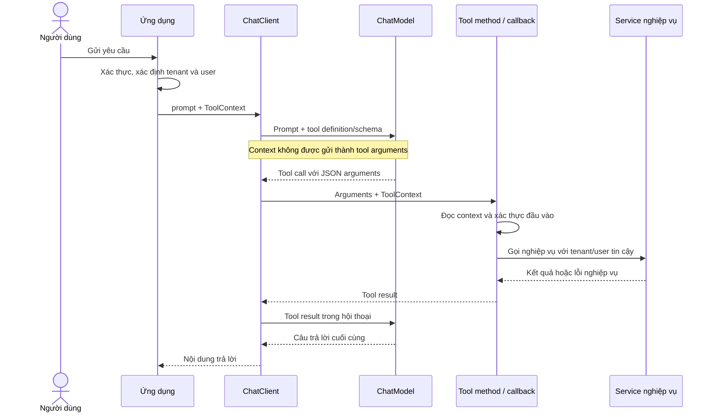

# Đọc ToolContext trong phương thức hoặc callback

`ToolContext` cho phép một công cụ Spring AI nhận thêm dữ liệu do ứng dụng cung cấp khi thực thi, chẳng hạn tenant hiện tại, mã người dùng đã xác thực, request ID hoặc múi giờ. Những giá trị này phục vụ logic nội bộ của ứng dụng và không cần trở thành tham số JSON mà mô hình phải tự tạo.

Trong một phương thức được đánh dấu `@Tool`, có thể khai báo `ToolContext` như một tham số đặc biệt. Với function-based tool, dùng `BiFunction<I, ToolContext, O>`. Với callback tự triển khai, ghi đè `call(String toolInput, ToolContext toolContext)`. Cả ba cách đều tách dữ liệu do mô hình đề xuất khỏi ngữ cảnh thực thi do ứng dụng kiểm soát.

`ToolContext` không tự xác thực người dùng và không tự cấp quyền. Ứng dụng phải tạo context từ nguồn tin cậy, truyền nó cho đúng request, rồi kiểm tra quyền và phạm vi tài nguyên trong service nghiệp vụ khi callback chạy.

## ToolContext chứa gì và được truyền khi nào?

`ToolContext` là đối tượng Spring AI dùng để mang một map dữ liệu bổ sung đến phần thực thi tool. Mỗi giá trị có một khóa và một giá trị Java tương ứng. Callback đọc map thông qua `getContext()`.

| Dữ liệu | Nguồn phù hợp | Dùng trong callback để làm gì? |
| --- | --- | --- |
| `tenantId` | Tenant đã được xác định từ phiên đăng nhập hoặc access token hợp lệ | Giới hạn truy vấn trong tenant hiện tại. |
| `userId` | Principal đã xác thực | Kiểm tra quyền trên tài nguyên hoặc ghi nhận người thực hiện. |
| `requestId` / `correlationId` | Middleware hoặc tầng điều phối | Liên kết log giữa request, tool call và service. |
| `locale` / `timeZone` | Thiết lập người dùng đã được ứng dụng xác minh | Định dạng ngày giờ hoặc nội dung theo ngữ cảnh. |
| `traceId` | Hệ thống tracing | Theo dõi lời gọi qua các service. |

Luồng truyền dữ liệu diễn ra như sau:

1. Ứng dụng xác thực request và thu thập các giá trị ngữ cảnh cần thiết.
2. Ứng dụng truyền map qua `.toolContext(...)` trong request `ChatClient`.
3. Spring AI gửi prompt và định nghĩa tool đến mô hình. Map context không trở thành arguments của mô hình.
4. Mô hình trả về tên công cụ cùng JSON arguments.
5. Spring AI điều phối callback và chuyển cả JSON arguments lẫn `ToolContext` đến phần thực thi.
6. Phương thức hoặc callback đọc context, kiểm tra dữ liệu rồi gọi service nghiệp vụ.



## Truyền context từ ChatClient

Trong Spring AI, `ChatClient` cho phép đính kèm map context cho một request bằng `.toolContext(Map<String, Object>)`. Nên tạo map ngay tại tầng điều phối sau khi đã xác thực người dùng và xác định phạm vi request.

```java
import java.util.Map;

String answer = chatClient.prompt()
        .user("Liệt kê các đơn hàng đang chờ xử lý của tôi.")
        .tools(orderTools)
        .toolContext(Map.of(
                "tenantId", authenticatedTenantId,
                "userId", authenticatedUserId,
                "requestId", requestId))
        .call()
        .content();
```

Trong ví dụ, `authenticatedTenantId` và `authenticatedUserId` phải được lấy từ `Authentication`, principal hoặc dịch vụ xác thực phía máy chủ. Không lấy các giá trị này từ nội dung prompt, tham số query tùy ý hoặc JSON do mô hình tạo ra.

Map được gắn vào request cụ thể. Điều này phù hợp với `ChatClient` dùng chung trong ứng dụng: mỗi request có thể truyền một context khác nhau mà không cần thay đổi field của bean `ChatClient` hay callback singleton.

`ToolContext` là dữ liệu bổ sung cho lúc thực thi. Nếu mô hình cần một thông tin nghiệp vụ để quyết định cách gọi tool, thông tin đó phải nằm trong mô tả công cụ hoặc schema đầu vào phù hợp. Không dùng context để giấu một tham số nghiệp vụ mà mô hình thực sự cần lựa chọn.

## Đọc ToolContext trong phương thức `@Tool`

Khi một phương thức được đánh dấu `@Tool` khai báo tham số kiểu `ToolContext`, Spring AI cung cấp context lúc gọi phương thức. Tham số này là tham số đặc biệt của framework; nó không được đưa vào JSON Schema mà mô hình nhìn thấy và mô hình không cần gửi trường tương ứng.

Ví dụ công cụ tra cứu đơn hàng theo tenant:

```java
import java.util.List;
import java.util.Map;

import org.springframework.ai.chat.model.ToolContext;
import org.springframework.ai.tool.annotation.Tool;
import org.springframework.ai.tool.annotation.ToolParam;
import org.springframework.stereotype.Component;

@Component
public class OrderTools {

    private final OrderService orderService;

    public OrderTools(OrderService orderService) {
        this.orderService = orderService;
    }

    @Tool(description = "Liệt kê đơn hàng trong tenant hiện tại, có thể lọc theo trạng thái")
    public List<OrderSummary> findOrders(
            @ToolParam(
                    description = "Trạng thái đơn hàng cần lọc; bỏ qua để lấy mọi trạng thái",
                    required = false)
            String status,
            ToolContext toolContext) {

        Map<String, Object> context = toolContext.getContext();
        String tenantId = requireContextString(context, "tenantId");
        String userId = requireContextString(context, "userId");

        return this.orderService.findVisibleOrders(tenantId, userId, status);
    }

    private static String requireContextString(
            Map<String, Object> context,
            String key) {
        Object value = context.get(key);
        if (!(value instanceof String text) || text.isBlank()) {
            throw new IllegalStateException("Thiếu context hợp lệ: " + key);
        }
        return text;
    }
}
```

Trong ví dụ:

- `status` là tham số do mô hình cung cấp. Nó được mô tả bằng `@ToolParam` và xuất hiện trong schema.
- `toolContext` là tham số do Spring AI cung cấp khi thực thi. Nó không xuất hiện trong schema.
- `tenantId` và `userId` được đọc từ map context và truyền vào service để giới hạn dữ liệu.
- `requireContextString(...)` từ chối thực thi nếu thiếu dữ liệu ngữ cảnh bắt buộc.

`OrderService.findVisibleOrders(...)` vẫn phải kiểm tra quyền và phạm vi từng đơn hàng. Việc nhận được `tenantId` từ context không tự chứng minh người dùng có quyền đọc mọi đơn hàng trong tenant.

### Phân biệt tham số của mô hình và tham số đặc biệt

| Tham số trong method | Nguồn dữ liệu | Có trong tool schema? | Ví dụ |
| --- | --- | --- | --- |
| `String status` có `@ToolParam` | JSON arguments do mô hình tạo | Có | `{"status":"PENDING"}` |
| `ToolContext toolContext` | Map do ứng dụng truyền qua request | Không | `toolContext.getContext().get("tenantId")` |

Không khai báo `tenantId` thành tham số thông thường rồi yêu cầu mô hình gửi lại. Cách đó cho phép mô hình đề xuất một tenant tùy ý và làm mờ ranh giới giữa dữ liệu người dùng với dữ liệu xác thực.

## Đọc ToolContext trong FunctionToolCallback

Nếu công cụ được biểu diễn bằng hàm Java thay vì method `@Tool`, có thể dùng `BiFunction<I, ToolContext, O>`. Tham số thứ nhất là DTO đầu vào từ mô hình; tham số thứ hai là context của ứng dụng.

```java
import java.util.function.BiFunction;

import org.springframework.ai.chat.model.ToolContext;
import org.springframework.ai.tool.ToolCallback;
import org.springframework.ai.tool.function.FunctionToolCallback;

public record OrderLookupRequest(String orderId) {}

BiFunction<OrderLookupRequest, ToolContext, OrderSummary> lookupOrder =
        (request, toolContext) -> {
            String tenantId = ToolContextValues.requiredString(toolContext, "tenantId");
            String userId = ToolContextValues.requiredString(toolContext, "userId");

            if (request.orderId() == null || request.orderId().isBlank()) {
                throw new IllegalArgumentException("orderId không được để trống");
            }

            return orderService.findVisibleOrder(
                    tenantId, userId, request.orderId());
        };

ToolCallback lookupOrderCallback = FunctionToolCallback
        .builder("orders_lookup", lookupOrder)
        .description("Tra cứu một đơn hàng trong phạm vi người dùng hiện tại")
        .inputType(OrderLookupRequest.class)
        .build();
```

Trong ví dụ, `orderService` là service được inject vào cấu hình tạo callback; `ToolContextValues` là helper đọc context có kiểm tra kiểu được định nghĩa ở phần sau.

Đăng ký callback và context cho request:

```java
import java.util.Map;

String answer = chatClient.prompt()
        .user("Tra cứu đơn hàng ORD-2026-001.")
        .toolCallbacks(lookupOrderCallback)
        .toolContext(Map.of(
                "tenantId", authenticatedTenantId,
                "userId", authenticatedUserId))
        .call()
        .content();
```

`inputType(OrderLookupRequest.class)` xác định kiểu dữ liệu dùng để tạo schema đầu vào. `ToolContext` là tham số thứ hai của `BiFunction`, không phải một field của `OrderLookupRequest`. Vì vậy mô hình chỉ tạo `orderId`; ứng dụng chịu trách nhiệm cung cấp tenant và user.

## Đọc ToolContext trong custom ToolCallback

Khi cần kiểm soát hoàn toàn việc parse JSON hoặc schema, có thể triển khai `ToolCallback`. Interface cung cấp overload `call(String toolInput, ToolContext toolContext)` để callback nhận cả arguments và context. Nếu công cụ bắt buộc phải có context, nên từ chối lời gọi không có context thay vì tự gán giá trị mặc định.

```java
import com.fasterxml.jackson.core.JsonProcessingException;
import com.fasterxml.jackson.databind.ObjectMapper;
import org.springframework.ai.chat.model.ToolContext;
import org.springframework.ai.tool.ToolCallback;
import org.springframework.ai.tool.definition.ToolDefinition;

public final class OrderLookupCallback implements ToolCallback {

    private final OrderService orderService;
    private final ObjectMapper objectMapper;
    private final ToolDefinition definition;

    public OrderLookupCallback(
            OrderService orderService,
            ObjectMapper objectMapper) {
        this.orderService = orderService;
        this.objectMapper = objectMapper;
        this.definition = ToolDefinition.builder()
                .name("orders_lookup")
                .description("Tra cứu đơn hàng theo mã trong phạm vi người dùng hiện tại")
                .inputSchema("""
                        {
                          "type": "object",
                          "properties": {
                            "orderId": {
                              "type": "string",
                              "description": "Mã đơn hàng cần tra cứu"
                            }
                          },
                          "required": ["orderId"],
                          "additionalProperties": false
                        }
                        """)
                .build();
    }

    @Override
    public ToolDefinition getToolDefinition() {
        return this.definition;
    }

    @Override
    public String call(String toolInput) {
        throw new IllegalStateException("orders_lookup cần ToolContext của request");
    }

    @Override
    public String call(String toolInput, ToolContext toolContext) {
        if (toolContext == null) {
            throw new IllegalStateException("Thiếu ToolContext");
        }

        try {
            OrderLookupRequest request = this.objectMapper.readValue(
                    toolInput, OrderLookupRequest.class);
            String tenantId = ToolContextValues.requiredString(toolContext, "tenantId");
            String userId = ToolContextValues.requiredString(toolContext, "userId");

            OrderSummary result = this.orderService.findVisibleOrder(
                    tenantId, userId, request.orderId());
            return this.objectMapper.writeValueAsString(result);
        }
        catch (JsonProcessingException ex) {
            throw new IllegalArgumentException("Arguments của orders_lookup không hợp lệ", ex);
        }
    }
}
```

Ví dụ trên giả định `ToolContextValues`, `OrderLookupRequest` và các kiểu nghiệp vụ được khai báo trong cùng module hoặc được import phù hợp. `call(String)` từ chối lời gọi contextless vì callback cần tenant và user; overload có context mới thực hiện nghiệp vụ. Nếu công cụ không cần context, implementation có thể chỉ cần `call(String)`.

## Đọc context an toàn và có kiểu

`getContext()` trả về map `Map<String, Object>`. Vì giá trị có kiểu `Object`, không nên ép kiểu trực tiếp mà không kiểm tra:

```java
Object rawTenantId = toolContext.getContext().get("tenantId");
if (!(rawTenantId instanceof String tenantId) || tenantId.isBlank()) {
    throw new IllegalStateException("tenantId không hợp lệ trong ToolContext");
}
```

Với context có cấu trúc phức tạp, nên định nghĩa các hàm đọc tập trung hoặc một lớp adapter riêng. Điều này tránh việc mỗi callback tự ép kiểu và diễn giải khóa theo cách khác nhau.

```java
public final class ToolContextValues {

    private ToolContextValues() {}

    public static String requiredString(ToolContext context, String key) {
        if (context == null) {
            throw new IllegalStateException("Thiếu ToolContext");
        }

        Object value = context.getContext().get(key);
        if (!(value instanceof String text) || text.isBlank()) {
            throw new IllegalStateException("Context '" + key + "' phải là chuỗi không rỗng");
        }
        return text;
    }
}
```

Nếu một khóa là tùy chọn, hãy xử lý rõ trường hợp không có giá trị:

```java
Object rawTimeZone = toolContext.getContext().get("timeZone");
String timeZone = rawTimeZone instanceof String value && !value.isBlank()
        ? value
        : "UTC";
```

Chỉ dùng mặc định khi nghiệp vụ đã quy định rõ. Với tenant, principal hoặc quyền, thiếu context thường phải làm thao tác thất bại an toàn thay vì dùng một giá trị mặc định.

## Context không phải tool arguments

Đây là ranh giới quan trọng nhất khi thiết kế công cụ:

| Đặc điểm | Tool arguments | ToolContext |
| --- | --- | --- |
| Ai tạo? | Mô hình tạo theo schema từ prompt và tool definition | Ứng dụng tạo từ request, phiên đăng nhập hoặc cấu hình tin cậy |
| Được gửi cho mô hình? | Có | Không được đưa vào tool arguments |
| Mục đích | Thể hiện dữ liệu nghiệp vụ mà mô hình cần chọn hoặc suy ra | Cung cấp ngữ cảnh thực thi nội bộ |
| Ví dụ | `orderId`, `status`, `pageSize` | `tenantId`, `authenticatedUserId`, `requestId` |
| Cách kiểm tra | Schema, validate dữ liệu và quy tắc nghiệp vụ | Kiểm tra nguồn gốc, kiểu dữ liệu, vòng đời và quyền |

Không chuyển thông tin xác thực thành một phần của prompt với hy vọng mô hình giữ nguyên giá trị. Prompt là nội dung gửi đến provider và mô hình có thể diễn giải hoặc tạo lại arguments. Context được truyền ngoài schema giúp ứng dụng giữ dữ liệu nội bộ ở đúng ranh giới.

## Vòng đời context và xử lý nhiều tool call

Context nên có phạm vi bằng request hoặc lần gọi `ChatClient` đã tạo nó. Không lưu context người dùng vào field của callback singleton, static map hoặc biến dùng chung có thể bị request khác ghi đè.

Nếu một phản hồi mô hình yêu cầu nhiều tool call, các callback trong cùng request có thể nhận cùng context được ứng dụng đính kèm. Vì vậy:

- Không sửa map context trong callback.
- Không đặt trạng thái thay đổi của một lần gọi vào object callback dùng chung.
- Không giả định thứ tự thực thi giữa nhiều tool call nếu nghiệp vụ không quy định.
- Với xử lý bất đồng bộ, bảo đảm dữ liệu context được truyền qua API tool calling; không phụ thuộc vào `ThreadLocal` hoặc `SecurityContextHolder` tự động tồn tại trên thread khác.
- Nếu mỗi công cụ cần dữ liệu khác nhau, dùng tên khóa rõ ràng hoặc adapter callback riêng; không để callback tự đọc khóa tùy ý ngoài hợp đồng đã thống nhất.

`ToolContext` là dữ liệu đầu vào của lần thực thi, không phải nơi lưu session lâu dài. Nếu cần giữ trạng thái hội thoại qua nhiều request HTTP, ứng dụng phải lưu và khôi phục trạng thái đó bằng cơ chế conversation/session phù hợp, sau đó xác minh lại quyền theo request hiện tại.

## Bảo mật khi sử dụng ToolContext

Việc context không được gửi như tool arguments không có nghĩa mọi giá trị đưa vào map đều tự động đáng tin. Mức độ tin cậy phụ thuộc vào nơi ứng dụng lấy giá trị và cách nó được kiểm tra.

1. **Tạo context phía máy chủ:** lấy `tenantId` và `userId` từ principal đã xác thực hoặc dịch vụ định danh. Không sao chép giá trị do mô hình đề xuất.
2. **Chỉ truyền dữ liệu cần thiết:** ưu tiên ID, request ID và locale; tránh truyền toàn bộ `Authentication`, session object hoặc entity lớn.
3. **Kiểm tra quyền tại service:** callback phải gọi service có kiểm tra authority và quyền trên tài nguyên cụ thể. Có `tenantId` không đồng nghĩa người dùng được phép đọc mọi bản ghi trong tenant.
4. **Không truyền secret:** không đưa mật khẩu, API key, access token hoặc credential vào context nếu callback có thể dùng cơ chế bảo mật riêng.
5. **Giới hạn nội dung log:** không log toàn bộ map; chỉ log khóa không nhạy cảm hoặc correlation ID cần thiết.
6. **Tách context giữa người dùng:** không tái sử dụng map của request trước cho request sau; kiểm thử hai request đồng thời với tenant khác nhau.
7. **Xử lý thiếu context theo nguyên tắc từ chối:** nếu công cụ cần tenant hoặc user ID mà không nhận được, dừng trước khi truy cập dữ liệu.

Ví dụ, `orders_lookup` cần `tenantId` và `userId`. Callback đọc hai giá trị này rồi gọi `OrderService.findVisibleOrder(...)`. Service vẫn phải kiểm tra quyền xem đúng `orderId` đó và bảo đảm nó thuộc phạm vi người dùng được phép. Không được dùng `orderId` làm bằng chứng rằng tài nguyên thuộc về người gọi.

## Xử lý lỗi khi context thiếu hoặc sai

Hãy phân biệt lỗi đầu vào mô hình và lỗi ngữ cảnh ứng dụng:

| Tình huống | Nguồn lỗi | Cách xử lý |
| --- | --- | --- |
| JSON thiếu `orderId` | Tool arguments | Từ chối arguments trước khi gọi service. |
| `tenantId` không có trong context | Cấu hình request hoặc xác thực | Dừng thực thi và ghi nhận lỗi cấu hình/an ninh. |
| `userId` sai kiểu | Tạo context không nhất quán | Từ chối; chuẩn hóa kiểu tại tầng điều phối. |
| Người dùng không có quyền xem đơn hàng | Authorization | Service từ chối truy cập. |
| Đơn hàng thuộc tenant khác | Resource scope | Service từ chối dù context có tenant hợp lệ. |
| Context không được truyền qua tác vụ bất đồng bộ | Context propagation | Truyền context rõ ràng qua luồng thực thi thay vì dựa vào thread-local. |
| Kết quả service có dữ liệu nhạy cảm | Thiết kế output | Lọc DTO kết quả trước khi trả lại mô hình. |

Không trả stack trace, câu truy vấn, thông tin kết nối hoặc nội dung nhạy cảm của context vào kết quả tool. Có thể trả thông báo lỗi nghiệp vụ đã được chuẩn hóa để mô hình giải thích cho người dùng.

## Kiểm thử việc đọc ToolContext

Nên kiểm tra riêng việc ứng dụng truyền context, callback đọc đúng khóa và service thực thi trong đúng phạm vi.

### Unit test cho method `@Tool`

Tạo `ToolContext` với map xác định rồi gọi phương thức trực tiếp:

```java
var context = new ToolContext(Map.of(
        "tenantId", "tenant-a",
        "userId", "user-01"));

List<OrderSummary> result = orderTools.findOrders("PENDING", context);

verify(orderService).findVisibleOrders("tenant-a", "user-01", "PENDING");
```

Kiểm tra thêm khi thiếu `tenantId`, thiếu `userId`, giá trị sai kiểu và khi service từ chối truy cập. Unit test này không cần gọi mô hình thật.

### Unit test cho BiFunction

```java
var context = new ToolContext(Map.of("tenantId", "tenant-b", "userId", "user-02"));
var request = new OrderLookupRequest("ORD-2026-001");

OrderSummary result = lookupOrder.apply(request, context);

verify(orderService).findVisibleOrder(
        "tenant-b", "user-02", "ORD-2026-001");
```

Kiểm tra cả trường hợp `ToolContext` null hoặc thiếu khóa bắt buộc. Nếu hàm được gọi qua `FunctionToolCallback`, kiểm tra thêm rằng callback chuyển context đến `BiFunction` và JSON input được ánh xạ thành đúng DTO.

### Integration test qua ChatClient

Mock model hoặc dùng phản hồi tool call có kiểm soát để xác nhận:

- Request được gắn đúng tập callback.
- `toolContext(...)` nhận giá trị từ principal đã xác thực.
- Tool method hoặc callback nhận được cùng giá trị context khi thực thi.
- Giá trị context không xuất hiện trong JSON arguments gửi từ mô hình.
- Hai request với tenant khác nhau không dùng nhầm context của nhau.
- Callback thiếu context không truy cập service.

Không chỉ kiểm tra câu trả lời cuối cùng của mô hình. Cần xác minh service được gọi với đúng tenant/user để phát hiện trường hợp câu trả lời nghe có vẻ đúng nhưng truy vấn sai phạm vi.

## Lỗi thường gặp

| Hiện tượng | Nguyên nhân có thể | Cách xử lý |
| --- | --- | --- |
| `ToolContext` trong method luôn rỗng | Request không gọi `.toolContext(...)` hoặc tạo map thiếu khóa | Kiểm tra nơi tạo request và map trước khi gọi `ChatClient`. |
| Mô hình được yêu cầu cung cấp `tenantId` | Tenant bị khai báo thành tham số thông thường trong tool schema | Chuyển tenant sang `ToolContext` và giữ schema chỉ chứa dữ liệu nghiệp vụ cần thiết. |
| Callback nhận context nhưng sai tenant | Context được lấy từ nguồn không tin cậy hoặc bị dùng chung giữa request | Tạo map riêng từ principal đã xác thực cho từng request. |
| `ClassCastException` khi đọc context | Ép kiểu trực tiếp mà không kiểm tra giá trị | Dùng hàm đọc có kiểm tra `instanceof` và báo lỗi rõ ràng. |
| Callback chạy trên thread khác không thấy SecurityContext | Dựa vào thread-local thay vì truyền context rõ ràng | Truyền `ToolContext` hoặc cấu hình SecurityContext propagation có chủ đích. |
| Callback sửa map context và gặp lỗi | Map context được cung cấp để đọc, không phải nơi lưu trạng thái mutable | Tạo object/map riêng cho dữ liệu tính toán của callback. |
| Dữ liệu nhạy cảm xuất hiện trong log | Log toàn bộ context hoặc arguments | Chỉ log metadata an toàn và correlation ID. |

## Quy trình triển khai

1. Xác định dữ liệu nào do mô hình lựa chọn và dữ liệu nào phải do ứng dụng cung cấp.
2. Khai báo các trường nghiệp vụ trong schema; không đưa principal hoặc tenant vào schema.
3. Tạo `ToolContext` từ request đã xác thực bằng `.toolContext(Map<String, Object>)`.
4. Đọc context trong method `@Tool`, `BiFunction<I, ToolContext, O>` hoặc `ToolCallback.call(...)` phù hợp với cách xây dựng công cụ.
5. Kiểm tra kiểu và sự hiện diện của các khóa context bắt buộc.
6. Truyền tenant/user tin cậy đến service và kiểm tra quyền trên tài nguyên cụ thể.
7. Không lưu context theo trạng thái mutable trong callback dùng chung; bảo đảm context đúng phạm vi request.
8. Kiểm thử context hợp lệ, thiếu/sai khóa, hai request đồng thời và truy cập trái phép.

Khi đọc `ToolContext` đúng cách, phương thức hoặc callback nhận được ngữ cảnh cần thiết để thực thi nghiệp vụ trong phạm vi ứng dụng đã xác định. Mô hình chỉ tạo arguments theo schema; ứng dụng vẫn giữ quyền quyết định danh tính, tenant, quyền truy cập và hành động nào thực sự được phép.

## Tài liệu tham khảo

- [Spring AI 1.0 Reference — Tool Calling](https://docs.spring.io/spring-ai/reference/1.0/api/tools.html)
- [Spring AI 1.0.x API — ToolContext](https://docs.spring.io/spring-ai/docs/1.0.x/api/org/springframework/ai/chat/model/ToolContext.html)
- [Spring AI 1.0.x API — ToolCallback](https://docs.spring.io/spring-ai/docs/1.0.x/api/org/springframework/ai/tool/ToolCallback.html)
- [Spring AI 1.0.x API — FunctionToolCallback](https://docs.spring.io/spring-ai/docs/1.0.x/api/org/springframework/ai/tool/function/FunctionToolCallback.html)
