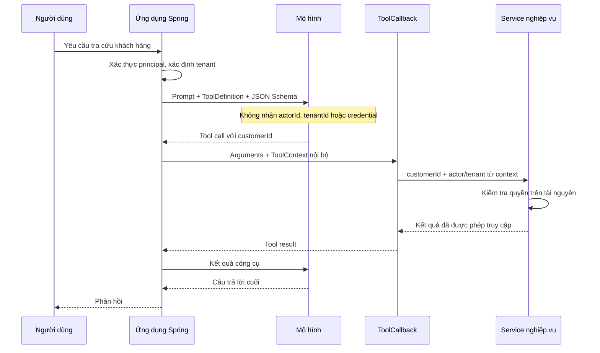

# Giữ thông tin xác thực và quyền truy cập ngoài schema gửi mô hình

Khi mô hình gọi một công cụ, nó cần gửi những arguments phục vụ tác vụ, chẳng hạn mã khách hàng hoặc mã đơn hàng. Những dữ liệu này không nên bao gồm danh tính đã xác thực của người gọi, tenant, quyền hạn hoặc thông tin bí mật dùng để truy cập dịch vụ. Mô hình không phải nơi xác lập danh tính và không được tự quyết định quyền truy cập.

Spring AI cung cấp `ToolContext` để ứng dụng truyền dữ liệu chỉ dành cho quá trình thực thi công cụ. Request gửi đến mô hình mang định nghĩa công cụ và JSON Schema; `ToolContext` được chuyển trực tiếp đến callback khi công cụ chạy, không được gửi như một phần nội dung mô hình nhìn thấy. Nhờ vậy, ứng dụng có thể truyền actor ID, tenant ID hoặc request scope mà không biến chúng thành tham số do mô hình tự tạo.

`ToolContext` là kênh truyền dữ liệu nội bộ, không phải kho bí mật hay bộ máy phân quyền. Ứng dụng vẫn phải lấy danh tính từ nguồn xác thực đáng tin cậy, giữ credential trong hệ thống quản lý bí mật và kiểm tra quyền trên từng tài nguyên tại service nghiệp vụ.

Sau bài học, bạn có thể:

- Phân biệt dữ liệu mô hình được phép tạo với dữ liệu xác thực do server quản lý.
- Giải thích vì sao actor, tenant, role, scope và credential không thuộc JSON Schema của tool.
- Truyền context bằng `ChatClient.toolContext(...)` và đọc nó qua tham số `ToolContext`.
- Dùng `BiFunction<I, ToolContext, O>` khi tạo `FunctionToolCallback`.
- Kiểm tra quyền ở tầng service, bao gồm quyền trên từng tài nguyên và tenant.
- Bảo vệ credential, tool result, log và trace khỏi việc rò rỉ dữ liệu nhạy cảm.

## 1. Phân biệt arguments với danh tính và quyền truy cập

Giả sử người dùng hỏi: “Cho tôi xem thông tin khách hàng C-1042”. Tool `lookup_customer` cần mã khách hàng để tìm dữ liệu. Mã `C-1042` là dữ liệu tác vụ có thể được mô hình gửi trong arguments. Tuy nhiên, ứng dụng phải tự biết ai đang đăng nhập và người đó được phép xem dữ liệu của tenant nào.

| Loại dữ liệu | Ví dụ | Nguồn đúng | Có đưa vào schema gửi mô hình? |
| --- | --- | --- | --- |
| Tham số nghiệp vụ | `customerId`, `orderId`, từ khóa tìm kiếm | Người dùng cung cấp qua yêu cầu; mô hình chuyển thành arguments | Có, nếu cần để thực hiện tác vụ |
| Danh tính đã xác thực | `actorId`, `subject`, principal | Authentication layer của server | Không |
| Phạm vi tenant | `tenantId`, organization ID | Session/principal hoặc tenant resolver phía server | Không |
| Quyền và phạm vi | role, permission, OAuth scope | Authorization service / identity provider | Không |
| Credential | access token, API key, client secret, mật khẩu | Secret manager, OAuth authorized client hoặc credential provider | Không |
| Thông tin vận hành | request ID, trace ID, correlation ID | Server tạo cho request hiện tại | Không |

JSON Schema là hợp đồng về dữ liệu mô hình cần cung cấp. Nó không phải nơi truyền danh tính, bằng chứng xác thực hoặc quyền. Nếu thêm `actorId` vào schema, mô hình có thể tự điền một ID khác. Nếu thêm `tenantId`, mô hình có thể yêu cầu dữ liệu thuộc tenant khác. Nếu thêm `accessToken`, credential sẽ đi qua nội dung request gửi đến nhà cung cấp mô hình.

Một tool schema phù hợp chỉ yêu cầu dữ liệu nghiệp vụ:

```json
{
  "type": "object",
  "properties": {
    "customerId": {
      "type": "string",
      "description": "Mã khách hàng cần tra cứu"
    }
  },
  "required": ["customerId"],
  "additionalProperties": false
}
```

Danh tính và tenant được cung cấp riêng từ server. Khi thực thi, service kết hợp hai nguồn: `customerId` từ arguments và `actorId`/`tenantId` từ context đã xác thực để quyết định có cho phép truy cập hay không.

## 2. ToolContext hoạt động như thế nào?

`ToolContext` là một object chứa map `Map<String, Object>` dành cho quá trình thực thi tool. Spring AI chuyển map này đến phương thức tool khi callback được gọi. Mô hình nhận tool definition gồm tên, mô tả và input schema; nó không nhận map context.



Các điểm quan trọng:

- `ToolContext` được tạo từ context của request và được chuyển đến tool tại thời điểm thực thi.
- Tham số kiểu `ToolContext` trong method `@Tool` là tham số đặc biệt của Spring AI; nó không được biến thành thuộc tính trong JSON Schema gửi mô hình.
- `ToolContext.getContext()` trả về map không cho sửa đổi qua view được cung cấp.
- Context có thể mang dữ liệu ứng dụng cần cho tool, ví dụ actor ID, tenant ID hoặc request ID.
- Việc dữ liệu không được gửi đến mô hình không có nghĩa nó tự động được mã hóa, lưu an toàn hoặc được phân quyền.

Map không cho sửa đổi không đồng nghĩa mọi object nằm bên trong đều bất biến. Nên truyền các giá trị đơn giản, bất biến như chuỗi ID, enum, số hoặc object context chuyên biệt có vòng đời rõ ràng. Không dùng một map mutable dùng chung giữa nhiều request.

## 3. Tạo context từ danh tính đã xác thực

Ứng dụng phải lấy principal sau khi authentication middleware xác minh request. Ví dụ sau dùng một abstraction `CurrentActor` để lấy danh tính hiện tại:

```java
public record AuthenticatedActor(
        String actorId,
        String tenantId) {
}

@Component
public class CurrentActor {

    public AuthenticatedActor requireAuthenticated() {
        // Đọc principal từ Spring Security hoặc cơ chế xác thực của ứng dụng.
        // Không lấy actorId/tenantId từ prompt hay tool arguments.
        return authenticatedActorFromSecurityContext();
    }
}
```

Khi chuẩn bị gọi AI, server tạo context cho đúng request:

```java
@Service
public class CustomerAssistant {

    private final ChatClient chatClient;
    private final CurrentActor currentActor;
    private final CustomerTools customerTools;

    public CustomerAssistant(
            ChatClient chatClient,
            CurrentActor currentActor,
            CustomerTools customerTools) {
        this.chatClient = chatClient;
        this.currentActor = currentActor;
        this.customerTools = customerTools;
    }

    public String ask(String question) {
        AuthenticatedActor actor = currentActor.requireAuthenticated();

        Map<String, Object> toolContext = Map.of(
                "actorId", actor.actorId(),
                "tenantId", actor.tenantId(),
                "requestId", UUID.randomUUID().toString());

        return chatClient.prompt()
                .user(question)
                .tools(customerTools)
                .toolContext(toolContext)
                .call()
                .content();
    }
}
```

`toolContext(...)` gắn context với request `ChatClient` hiện tại. Spring AI chuyển context này đến tool callback khi thực thi. Các giá trị trong map được ứng dụng tạo ra từ principal đã xác thực, không phải lấy từ nội dung câu hỏi.

Nếu ứng dụng cấu hình `defaultToolContext` và context riêng ở request, Spring AI hợp nhất hai map; giá trị của request hiện tại được ưu tiên khi trùng key. Hãy tránh đặt thông tin nhạy cảm trong context mặc định toàn cục nếu không cần thiết. Context mặc định không thể thay thế việc xác định actor cho từng request.

## 4. Đọc context trong phương thức @Tool

Phương thức `@Tool` có thể nhận `ToolContext` như tham số bổ sung. Tham số này được Spring AI cung cấp khi gọi method và không xuất hiện trong schema của mô hình.

```java
@Component
public class CustomerTools {

    private final CustomerService customerService;
    private final CustomerAuthorizationService authorizationService;

    public CustomerTools(
            CustomerService customerService,
            CustomerAuthorizationService authorizationService) {
        this.customerService = customerService;
        this.authorizationService = authorizationService;
    }

    @Tool(description = "Tra cứu thông tin khách hàng mà người dùng hiện tại được phép xem")
    public CustomerSummary lookupCustomer(
            @ToolParam(description = "Mã khách hàng cần tra cứu") String customerId,
            ToolContext toolContext) {

        String actorId = requiredContextValue(toolContext, "actorId");
        String tenantId = requiredContextValue(toolContext, "tenantId");

        authorizationService.requireCanReadCustomer(actorId, tenantId, customerId);
        return customerService.findSummary(customerId, tenantId);
    }

    private String requiredContextValue(ToolContext context, String key) {
        Object value = context.getContext().get(key);
        if (!(value instanceof String text) || text.isBlank()) {
            throw new IllegalStateException("Thiếu tool context bắt buộc: " + key);
        }
        return text;
    }
}
```

Schema được tạo từ `customerId`. `actorId` và `tenantId` đến từ `ToolContext`, nên mô hình không thể tự đặt hai giá trị này trong tool arguments. Nếu context bắt buộc bị thiếu, tool phải dừng và từ chối thực thi. Không dùng giá trị mặc định kiểu `admin`, `default-tenant` hoặc một tài khoản dịch vụ rộng quyền để tiếp tục.

`ToolContext` không tự gọi Spring Security để xác minh principal. Nó chỉ chuyển dữ liệu do ứng dụng cung cấp. Vì vậy, trách nhiệm xác minh nguồn của actor và tenant nằm ở lớp tạo context, còn trách nhiệm quyết định quyền nằm ở authorization service.

## 5. Dùng BiFunction với FunctionToolCallback

Nếu tool được xây dựng bằng `FunctionToolCallback`, có thể dùng overload `BiFunction<I, ToolContext, O>`. Tham số đầu tiên là dữ liệu do mô hình cung cấp theo input schema; tham số thứ hai là context nội bộ.

```java
public record CustomerLookupRequest(String customerId) {
}

public record CustomerSummary(
        String customerId,
        String displayName,
        String status) {
}
```

Tạo callback:

```java
ToolCallback customerLookupTool = FunctionToolCallback
        .<CustomerLookupRequest, CustomerSummary>builder(
                "lookup_customer",
                (request, toolContext) -> {
                    String actorId = (String) toolContext.getContext().get("actorId");
                    String tenantId = (String) toolContext.getContext().get("tenantId");

                    if (actorId == null || tenantId == null) {
                        throw new IllegalStateException("Thiếu ngữ cảnh xác thực");
                    }

                    authorizationService.requireCanReadCustomer(
                            actorId, tenantId, request.customerId());

                    return customerService.findSummary(
                            request.customerId(), tenantId);
                })
        .description("Tra cứu khách hàng theo mã trong phạm vi người dùng hiện tại")
        .inputType(CustomerLookupRequest.class)
        .build();
```

`inputType(CustomerLookupRequest.class)` tạo JSON Schema từ `CustomerLookupRequest`. `ToolContext` không nằm trong `CustomerLookupRequest` và không xuất hiện trong schema. Khi gọi, Spring AI truyền map context vào tham số thứ hai của `BiFunction`.

Chọn `BiFunction` khi logic tool cần cả arguments và dữ liệu nội bộ. Nếu chỉ cần context mà không cần arguments từ mô hình, vẫn phải chọn kiểu hàm phù hợp với overload hiện có và biểu diễn input rỗng theo API; không thêm trường credential giả vào DTO chỉ để lấy context.

## 6. Giữ credential trong hệ thống quản lý bí mật

`ToolContext` không phải secret manager. Dù context không được gửi đến mô hình, nó vẫn tồn tại trong tiến trình ứng dụng và có thể bị lộ nếu ghi log, đưa vào exception, serialize nhầm hoặc trả lại trong tool result.

Với các credential như API key, OAuth access token, refresh token, client secret hoặc mật khẩu:

- Lưu và xoay vòng chúng qua secret manager hoặc hệ thống quản lý OAuth client.
- Đưa vào context một định danh actor, tenant hoặc credential handle nếu tool cần xác định credential cần dùng.
- Để server-side credential provider lấy credential đúng lúc thực thi.
- Dùng token ngắn hạn, audience và scope tối thiểu phù hợp với dịch vụ đích.
- Không ghi credential vào prompt, JSON Schema, tool arguments, tool result, exception message hoặc log.
- Không lưu credential trong field `static`, singleton mutable hoặc map context dùng chung giữa các request.

Ví dụ, context chỉ mang danh tính và phạm vi; service lấy credential từ provider:

```java
@Service
public class ExternalCustomerGateway {

    private final CredentialProvider credentialProvider;
    private final WebClient webClient;

    public ExternalCustomerGateway(
            CredentialProvider credentialProvider,
            WebClient webClient) {
        this.credentialProvider = credentialProvider;
        this.webClient = webClient;
    }

    public CustomerSummary fetchForActor(
            String actorId,
            String tenantId,
            String customerId) {

        AccessCredential credential =
                credentialProvider.getDelegatedCredential(actorId, tenantId);

        return webClient.get()
                .uri("/customers/{id}", customerId)
                .headers(headers -> headers.setBearerAuth(credential.accessToken()))
                .retrieve()
                .bodyToMono(CustomerSummary.class)
                .block();
    }
}
```

`CredentialProvider` trong ví dụ là abstraction phía server. Nó phải kiểm tra actor/tenant và lấy credential từ kho được bảo vệ. Không trả `AccessCredential` về tool, không đưa access token vào DTO kết quả và không ghi header `Authorization` vào log.

Nếu một tích hợp bắt buộc phải truyền credential qua `ToolContext`, chỉ dùng credential ngắn hạn, giới hạn quyền và phạm vi, kiểm soát chặt nơi tạo context và loại bỏ nó sau request. Trong đa số thiết kế, truyền actor ID hoặc một handle rồi phân giải credential bên trong service sẽ giảm nguy cơ rò rỉ hơn.

## 7. Quyền truy cập phải được kiểm tra tại service

Không đưa quyền vào schema vì quyền là quyết định của server. Mô hình có thể chọn một `customerId`, nhưng service phải xác minh người dùng có thể đọc đúng khách hàng đó.

Ví dụ kiểm tra quyền nên kết hợp actor, tenant và resource:

```java
@Service
public class CustomerAuthorizationService {

    private final CustomerRepository customerRepository;
    private final PermissionService permissionService;

    public void requireCanReadCustomer(
            String actorId,
            String tenantId,
            String customerId) {

        if (!permissionService.hasPermission(actorId, tenantId, "CUSTOMER_READ")) {
            throw new AccessDeniedException("Không có quyền tra cứu khách hàng");
        }

        boolean visible = customerRepository.existsByIdAndTenantId(
                customerId, tenantId);

        if (!visible) {
            throw new AccessDeniedException("Không thể truy cập khách hàng được yêu cầu");
        }
    }
}
```

Truy vấn dữ liệu nên giới hạn tenant ngay trong repository, ví dụ `findByIdAndTenantId(customerId, tenantId)`, thay vì lấy bản ghi toàn cục rồi mới lọc ở tầng hiển thị. Cách này giảm nguy cơ IDOR và rò rỉ thông tin giữa các tenant.

Kiểm tra quyền cần thực hiện ở thời điểm hành động, không chỉ khi tạo danh sách tool. Quyền có thể bị thu hồi giữa lúc bắt đầu hội thoại và lúc mô hình yêu cầu thực thi công cụ. Đối với thao tác ghi, kiểm tra thêm trạng thái nghiệp vụ, idempotency và yêu cầu xác nhận nếu hành động có tác động lớn.

## 8. Vì sao không nên tin arguments do mô hình tạo?

Arguments do mô hình tạo vẫn là input không đáng tin cậy, kể cả khi chúng khớp JSON Schema. Mô hình có thể bị prompt injection, hiểu sai yêu cầu hoặc tạo nhầm mã tài nguyên.

Ví dụ một schema không an toàn:

```json
{
  "type": "object",
  "properties": {
    "tenantId": { "type": "string" },
    "actorId": { "type": "string" },
    "customerId": { "type": "string" },
    "accessToken": { "type": "string" }
  },
  "required": ["tenantId", "actorId", "customerId", "accessToken"]
}
```

Schema trên cho mô hình quyền tự khai báo danh tính, tenant và credential. Kẻ tấn công có thể yêu cầu mô hình điền một tenant khác hoặc tạo giá trị giả. Schema đúng nên chỉ có `customerId`; server truyền actor và tenant qua context rồi service xác minh quyền.

Không coi `@ToolParam` hoặc JSON Schema là validation bảo mật. Vẫn phải kiểm tra độ dài, định dạng, miền giá trị, quyền và trạng thái nghiệp vụ trong code. Nếu có trường `userId` hoặc `tenantId` thực sự là đối tượng mà người dùng muốn tra cứu, hãy đặt tên rõ nghĩa như `targetCustomerId`; tuyệt đối không dùng trường đó để xác định người đang gọi.

## 9. ToolContext không phải cơ chế phân quyền tự động

Một số hiểu nhầm thường gặp:

| Hiểu nhầm | Thực tế |
| --- | --- |
| ToolContext được giấu khỏi mô hình nên dữ liệu trong đó luôn an toàn | Nó chỉ không được đưa vào model request; log, exception, trace hoặc tool result vẫn có thể làm lộ dữ liệu. |
| Có `actorId` trong ToolContext nghĩa là actor đã được xác thực | Ứng dụng phải tạo context từ principal đã xác thực và bảo vệ đường tạo context. |
| Truyền `tenantId` là đủ để bảo vệ tenant | Repository/service phải giới hạn truy vấn và kiểm tra quyền trên từng tài nguyên. |
| Mô hình không thấy token nên có thể lưu token trong context mặc định | Context vẫn nằm trong tiến trình ứng dụng; nên dùng credential provider hoặc secret manager. |
| Schema không có `accessToken` thì tool tự an toàn | Callback có thể vô tình đưa token vào kết quả hoặc log; cần kiểm soát toàn bộ đường dữ liệu. |
| Chỉ cần kiểm tra quyền khi tạo ChatClient request | Quyền phải được kiểm tra lại lúc thực thi tool. |

`ToolContext` là một map context dành cho tool execution. Nó không xác thực người dùng, không tự kiểm tra OAuth scope, không áp dụng tenant filter, không mã hóa dữ liệu và không ngăn callback ghi log giá trị bên trong.

## 10. Truyền context qua ChatModel trực tiếp

Nếu ứng dụng gọi `ChatModel` thay vì `ChatClient`, truyền context trong `ToolCallingChatOptions` của request:

```java
ToolCallingChatOptions options = ToolCallingChatOptions.builder()
        .toolCallbacks(allowedCallbacks)
        .toolContext(Map.of(
                "actorId", actor.actorId(),
                "tenantId", actor.tenantId(),
                "requestId", requestId))
        .build();

Prompt prompt = new Prompt(question, options);
ChatResponse response = chatModel.call(prompt);
```

`ChatModel` trực tiếp trả về tool call nhưng không tự thực thi vòng lặp trong Spring AI 2.x. Caller dùng `ToolCallingManager.executeToolCalls(...)` để chạy callback. Context từ options được chuyển đến tool khi manager thực thi. Khi tự điều phối, phải bảo đảm mỗi request dùng đúng context của actor tương ứng; không tái sử dụng context của request trước.

Đối với `ChatClient`, API `.toolContext(Map<String, Object>)` đặt context ở request. Đối với `ChatModel`, dùng `ToolCallingChatOptions.toolContext(...)`. Cả hai cách đều tách dữ liệu nội bộ khỏi JSON Schema mà mô hình nhìn thấy.

## 11. Bảo vệ log, trace và kết quả tool

Dù context không được gửi đến mô hình, các hệ thống quan sát có thể ghi arguments và kết quả tool. Nếu callback trả credential hoặc exception có chứa header xác thực, dữ liệu đó có thể đi vào conversation history, trace hoặc log.

Áp dụng các nguyên tắc sau:

- Không log toàn bộ `ToolContext` bằng `toString()`.
- Không ghi access token, refresh token, API key, cookie, password hoặc header `Authorization`.
- Redact thông tin cá nhân và mã định danh nhạy cảm trong log/trace khi không cần thiết.
- Không trả stack trace, SQL, host nội bộ hoặc thông báo từ identity provider cho mô hình.
- Chỉ trả DTO chứa dữ liệu người dùng được phép xem.
- Bật thu thập tool arguments/results trong tracing chỉ sau khi đánh giá rủi ro và có chính sách che dữ liệu.
- Gắn request ID để truy vết mà không phải ghi credential hoặc payload nhạy cảm.

Nếu dùng một OAuth token cho truy cập thay mặt người dùng, hãy xác định rõ token đại diện cho ai, audience nào, scope nào và thời hạn bao lâu. Không dùng một token quản trị toàn quyền cho mọi tool call nếu service có thể dùng token theo actor và quyền tối thiểu.

## 12. Kiểm thử ranh giới schema và context

Kiểm thử cần chứng minh dữ liệu xác thực không lọt vào schema và service không tin danh tính do mô hình gửi.

| Tình huống | Kết quả cần xác minh |
| --- | --- |
| Tạo tool definition | Schema chỉ chứa arguments nghiệp vụ như `customerId`. |
| Gọi tool với ToolContext | Method nhận đúng `actorId`, `tenantId` do server tạo. |
| Context thiếu actor hoặc tenant | Callback dừng và từ chối; không dùng tài khoản mặc định. |
| Arguments cố gửi `actorId` giả | Service bỏ qua và không dùng giá trị đó để xác định người gọi. |
| User A truy cập dữ liệu User B | Authorization service từ chối. |
| Tenant A truy cập resource Tenant B | Truy vấn theo tenant không trả bản ghi. |
| Credential provider lỗi | Tool trả lỗi đã chuẩn hóa; không đưa token hoặc thông tin cấu hình ra ngoài. |
| Tool result | Không có access token, secret hoặc dữ liệu ngoài phạm vi. |
| Log và trace | Không xuất hiện credential hoặc toàn bộ context nhạy cảm. |
| Hai request đồng thời | Context của actor/tenant không bị dùng chéo giữa các request. |

Ví dụ kiểm thử method tool với context:

```java
@Test
void passesServerContextToToolWithoutAddingItToInputSchema() {
    ToolCallback[] callbacks = ToolCallbacks.from(customerTools);
    ToolCallback callback = Arrays.stream(callbacks)
            .filter(tool -> tool.getToolDefinition().name().equals("lookupCustomer"))
            .findFirst()
            .orElseThrow();

    String schema = callback.getToolDefinition().inputSchema();

    assertThat(schema).contains("customerId");
    assertThat(schema).doesNotContain("actorId");
    assertThat(schema).doesNotContain("tenantId");
    assertThat(schema).doesNotContain("accessToken");

    ToolContext context = new ToolContext(Map.of(
            "actorId", "user-17",
            "tenantId", "tenant-blue"));

    callback.call("""{"customerId":"C-1042"}""", context);

    verify(authorizationService)
            .requireCanReadCustomer("user-17", "tenant-blue", "C-1042");
}
```

Tên tool trong test cần khớp với `name` thực tế của method hoặc callback. Ngoài unit test, nên dùng model giả để xác nhận request gửi đi chỉ chứa tool definition và không chứa map context. Không cần gọi model thật để kiểm thử phân quyền hoặc tenant isolation.

## 13. Quy trình triển khai

Khi tạo một tool cần truy cập dữ liệu có bảo vệ, hãy làm theo trình tự:

1. Xác định arguments nghiệp vụ tối thiểu mô hình cần cung cấp.
2. Loại actor ID, tenant ID, role, permission, scope và credential khỏi JSON Schema.
3. Xác thực request và tạo `ToolContext` từ principal phía server.
4. Truyền context qua `ChatClient.toolContext(...)` hoặc `ToolCallingChatOptions.toolContext(...)`.
5. Đọc context trong method `@Tool` hoặc tham số `ToolContext` của callback.
6. Kiểm tra quyền trên actor, tenant và resource ở service nghiệp vụ.
7. Lấy credential từ secret manager hoặc credential provider ngay khi cần gọi dịch vụ ngoài.
8. Lọc kết quả, exception, log và trace để không làm lộ dữ liệu nhạy cảm.
9. Kiểm thử schema, context, authorization, tenant isolation và request đồng thời.

## Những điểm cần nhớ

- JSON Schema mô tả arguments mô hình được phép tạo; không dùng schema để nhận danh tính, quyền hoặc credential.
- `ToolContext` truyền dữ liệu nội bộ đến tool method/callback và không được gửi đến mô hình như một phần của tool definition.
- `ToolContext` không phải secret manager và không tự xác thực hoặc phân quyền.
- Tạo context từ principal đã xác thực ở server; không lấy actor/tenant từ prompt hoặc arguments.
- Giữ API key, OAuth token và mật khẩu trong secret manager hoặc credential provider; chỉ truyền ID/handle cần thiết qua context.
- Kiểm tra quyền tại service theo actor, tenant và tài nguyên cụ thể ở thời điểm thực thi.
- Không để context, credential hoặc dữ liệu nhạy cảm xuất hiện trong tool result, exception, log hay trace.

## Tài liệu tham khảo

- [Spring AI Reference — Tool Context](https://docs.spring.io/spring-ai/reference/api/tools.html#_tool_context)
- [Spring AI Reference — Tool Calling](https://docs.spring.io/spring-ai/reference/api/tools.html)
- [Spring AI API — ToolContext](https://docs.spring.io/spring-ai/docs/2.1.x/api/org/springframework/ai/chat/model/ToolContext.html)
- [Spring AI API — FunctionToolCallback](https://docs.spring.io/spring-ai/docs/2.1.x/api/org/springframework/ai/tool/function/FunctionToolCallback.html)
- [Spring Security Reference](https://docs.spring.io/spring-security/reference/)

Các ví dụ sử dụng API Spring AI 2.1.x. Hãy đối chiếu phiên bản Spring AI và Spring Security thực tế của dự án, đồng thời kiểm tra provider xác thực và cơ chế credential đang được sử dụng.
