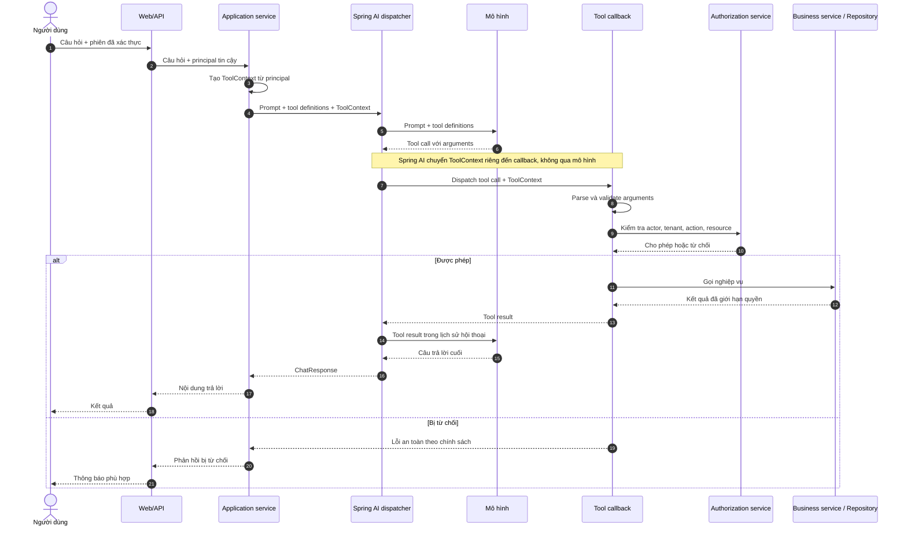

# Kiểm tra quyền từ nguồn tin cậy tại thời điểm thực thi

Khi mô hình yêu cầu gọi một công cụ, nó có thể cung cấp mã đơn hàng, mã khách hàng hoặc các tham số nghiệp vụ khác. Những giá trị đó chỉ là dữ liệu đầu vào. Chúng không chứng minh người đang trò chuyện có quyền đọc hay thay đổi tài nguyên được chỉ định.

Ứng dụng cần lấy danh tính từ nguồn đã xác thực, truyền phần ngữ cảnh cần thiết tới tool bằng `ToolContext`, rồi kiểm tra quyền trên đúng tài nguyên ngay khi callback thực thi. Việc kiểm tra phải nằm ở tầng dịch vụ nghiệp vụ hoặc một authorization service được dịch vụ gọi đến. Danh sách công cụ được hiển thị, mô tả `@Tool`, JSON Schema và lời khẳng định của mô hình đều không thay thế được bước này.

Trong module `SPRING_AI_TOOL_CALLING`, `ToolContext` là kênh truyền dữ liệu không do mô hình tạo. Spring AI chuyển context trực tiếp đến phương thức công cụ; dữ liệu này không được gửi trong tool definition cho mô hình. Tuy nhiên, `ToolContext` không tự xác thực người dùng và không tự áp dụng chính sách bảo mật. Ứng dụng phải tự tạo context từ principal đã xác thực và giữ quyền quyết định ở service.

## 1. Ranh giới tin cậy của một tool call

Một yêu cầu tra cứu đơn hàng có thể chứa ba nhóm dữ liệu khác nhau:

| Dữ liệu | Nguồn đúng | Có thể do mô hình quyết định? |
|---|---|---|
| `orderId`, trạng thái cần lọc, khoảng ngày | Tool arguments được tạo từ câu hỏi | Có, nhưng phải validate |
| `actorId`, `tenantId` | Principal hoặc session đã được server xác thực | Không |
| Quyền đọc, quyền hủy, quyền xem dữ liệu cá nhân | Chính sách hiện hành và quan hệ với tài nguyên | Không |

Luồng xử lý nên giữ thứ tự sau:



Mô hình chỉ chọn thao tác và tạo đối số. Ứng dụng xác định ai đang thực hiện yêu cầu. Authorization service quyết định người đó có được thực hiện hành động trên tài nguyên cụ thể hay không. Service nghiệp vụ thực hiện thao tác sau khi quyền được xác nhận.

## 2. ToolContext truyền dữ liệu nội bộ, không phải cơ chế xác thực

Spring AI cho phép truyền context theo từng prompt bằng `.toolContext(...)`. Phương thức `@Tool` có thể nhận `ToolContext` như một tham số đặc biệt:

```java
@Component
public class CustomerTools {

    private final CustomerQueryService customerQueryService;

    public CustomerTools(CustomerQueryService customerQueryService) {
        this.customerQueryService = customerQueryService;
    }

    @Tool(description = "Tra cứu thông tin khách hàng trong phạm vi người dùng hiện tại được phép xem.")
    public CustomerView getCustomer(
            @ToolParam(description = "Mã khách hàng cần tra cứu") String customerId,
            ToolContext toolContext) {

        String actorId = requiredContextValue(toolContext, "actorId");
        String tenantId = requiredContextValue(toolContext, "tenantId");

        return customerQueryService.findVisibleCustomer(customerId, actorId, tenantId);
    }

    private String requiredContextValue(ToolContext context, String key) {
        Object value = context.getContext().get(key);
        if (!(value instanceof String text) || text.isBlank()) {
            throw new AccessDeniedException("Thiếu ngữ cảnh truy cập cần thiết.");
        }
        return text;
    }
}
```

Trong ví dụ, `customerId` là dữ liệu do mô hình đề xuất; `actorId` và `tenantId` đến từ `ToolContext`. Mô hình không nhìn thấy hai trường context này trong schema đầu vào. Nếu context bị thiếu hoặc sai kiểu, tool từ chối thực thi theo nguyên tắc fail closed.

Điều đó không có nghĩa bất kỳ map nào được truyền vào `ToolContext` đều đáng tin. Nếu application service lấy `tenantId` từ JSON request mà người dùng có thể tự sửa, thì giá trị đó vẫn không đáng tin dù nó được đặt trong context. Độ tin cậy đến từ nơi ứng dụng lấy dữ liệu và cách kiểm tra nó, không đến từ tên lớp `ToolContext`.

## 3. Tạo context từ principal đã xác thực

Tạo context ở ranh giới HTTP hoặc application layer, nơi ứng dụng đã xác minh token/session. Ví dụ dưới đây giả định `AppPrincipal` là principal do hệ thống xác thực của ứng dụng tạo ra, chứa subject và tenant đã được xác định ở server.

```java
public record AppPrincipal(String subjectId, String tenantId) {
}

@RestController
@RequestMapping("/api/order-assistant")
public class OrderAssistantController {

    private final OrderAssistantService assistantService;

    public OrderAssistantController(OrderAssistantService assistantService) {
        this.assistantService = assistantService;
    }

    @PostMapping
    public AskResponse ask(
            @AuthenticationPrincipal AppPrincipal principal,
            @RequestBody AskRequest request) {

        return new AskResponse(
                assistantService.ask(request.question(), principal));
    }
}

public record AskRequest(String question) {}
public record AskResponse(String answer) {}
```

Application service tạo map mới cho mỗi request:

```java
@Service
public class OrderAssistantService {

    private final ChatClient chatClient;
    private final OrderTools orderTools;

    public OrderAssistantService(ChatClient chatClient, OrderTools orderTools) {
        this.chatClient = chatClient;
        this.orderTools = orderTools;
    }

    public String ask(String question, AppPrincipal principal) {
        Map<String, Object> trustedContext = Map.of(
                "actorId", principal.subjectId(),
                "tenantId", principal.tenantId());

        return chatClient.prompt()
                .user(question)
                .toolContext(trustedContext)
                .tools(orderTools)
                .call()
                .content();
    }
}
```

Các kiểu `AppPrincipal`, `AskRequest` và cách tạo principal là ví dụ của ứng dụng, không phải kiểu bắt buộc của Spring AI. Có thể dùng `Authentication`, `@AuthenticationPrincipal`, session hoặc một adapter identity riêng. Điều quan trọng là subject và tenant phải được lấy từ security layer hoặc ánh xạ phía server, không lấy từ câu hỏi hay DTO do client tự khai báo.

Chỉ truyền những dữ liệu định danh tối thiểu mà callback cần. Không đưa toàn bộ `Authentication`, access token, refresh token hoặc credential vào `ToolContext`. Không truyền danh sách role/authority rồi xem đó là quyền hiện hành nếu các quyền có thể bị thu hồi trong khi request đang chạy.

## 4. Phân biệt danh tính với quyền hiện hành

Danh tính và quyền là hai câu hỏi khác nhau:

- **Danh tính:** ai đang yêu cầu thao tác? Ví dụ subject `user-42` thuộc tenant `acme`.
- **Quyền:** tại thời điểm callback chạy, subject đó có được thực hiện hành động cụ thể trên tài nguyên cụ thể không?

Danh tính có thể được xác định khi nhận request và truyền qua `ToolContext`. Quyền cần được kiểm tra tại thời điểm thực thi. Một user có thể bị khóa, bị gỡ khỏi tenant, mất quyền đọc dữ liệu hoặc bị thay đổi vai trò sau khi prompt đã được gửi đến mô hình.

Vì vậy, context nên mang thông tin định danh ổn định như `actorId`, `tenantId` và `requestId`. Hãy để authorization service đọc chính sách hoặc ACL hiện hành khi tool được thực thi. Không lưu một snapshot `isAdmin=true` hoặc danh sách quyền cũ trong singleton bean rồi dùng cho các request sau.

| Cách làm | Rủi ro | Cách làm nên dùng |
|---|---|---|
| Lấy `actorId` từ arguments do mô hình tạo | Mô hình có thể yêu cầu đọc tài nguyên dưới danh tính người khác | Lấy subject từ principal đã xác thực |
| Lấy `tenantId` từ câu hỏi hoặc request body không kiểm soát | Có thể vượt ranh giới tenant | Xác định tenant ở security/application layer |
| Truyền role snapshot vào context rồi tin mãi | Quyền có thể bị thu hồi sau khi context được tạo | Truyền định danh; kiểm tra quyền hiện hành tại service |
| Chỉ ẩn tool khỏi danh sách khi user không có quyền | Tool vẫn có thể bị gọi qua đường khác hoặc resolver fallback | Kiểm tra authorization trong callback/service |
| Chỉ kiểm tra quyền ở controller trước khi gọi model | Quyền có thể thay đổi trước lúc tool thực thi | Kiểm tra lại sát thời điểm thực thi |

## 5. Kiểm tra quyền ở business service trên đúng tài nguyên

Không chỉ kiểm tra một authority chung như `order:read`. Cần xác định người dùng có quyền trên chính đơn hàng được yêu cầu hay không. Một service có thể thực hiện kiểm tra như sau:

```java
@Service
public class OrderQueryService {

    private final OrderRepository orderRepository;
    private final OrderAuthorizationService authorizationService;

    public OrderQueryService(
            OrderRepository orderRepository,
            OrderAuthorizationService authorizationService) {
        this.orderRepository = orderRepository;
        this.authorizationService = authorizationService;
    }

    @Transactional(readOnly = true)
    public OrderStatusView findVisibleStatus(
            String orderId, String actorId, String tenantId) {

        Order order = orderRepository
                .findByIdAndTenantId(orderId, tenantId)
                .orElseThrow(OrderNotFoundException::new);

        authorizationService.requireCanReadOrder(actorId, tenantId, order);

        return new OrderStatusView(
                order.getId(),
                order.getStatus().name(),
                order.getCarrier(),
                order.getEstimatedDelivery());
    }
}
```

`OrderAuthorizationService` cần kiểm tra chính sách hiện hành, chẳng hạn quyền sở hữu đơn hàng, quan hệ hỗ trợ khách hàng, vai trò theo tenant hoặc ACL được lưu trong hệ thống. Không dùng dữ liệu `ownerId` hoặc `tenantId` do mô hình gửi làm căn cứ cấp quyền.

Với những hệ thống cần tránh tiết lộ sự tồn tại của tài nguyên, có thể trả cùng một kết quả “không tìm thấy trong phạm vi truy cập” cho cả trường hợp ID không tồn tại và trường hợp người gọi không được phép xem. Cách phản hồi phụ thuộc chính sách chống dò tìm tài nguyên của ứng dụng.

Kết quả nên là DTO chứa đúng các trường người dùng được phép xem. Không trả trực tiếp entity hoặc object nội bộ có thể chứa dữ liệu thuộc tenant khác, ghi chú riêng, thông tin thanh toán hoặc trường quản trị.

## 6. Đối với thao tác ghi, kiểm tra và thay đổi trạng thái phải được bảo vệ cùng nhau

Với thao tác đọc, việc kiểm tra quyền và truy vấn có thể nằm trong một transaction read-only. Với thao tác ghi, cần chú ý race condition: trạng thái hoặc quyền có thể thay đổi giữa lúc kiểm tra và lúc cập nhật.

Ví dụ hủy đơn hàng:

```java
@Transactional
public CancellationResult cancelOrder(
        String orderId, String actorId, String tenantId) {

    Order order = orderRepository
            .findByIdAndTenantIdForUpdate(orderId, tenantId)
            .orElseThrow(OrderNotFoundException::new);

    authorizationService.requireCanCancelOrder(actorId, tenantId, order);
    order.cancel(); // Domain kiểm tra trạng thái có được phép hủy hay không.

    return new CancellationResult(order.getId(), "CANCELLED");
}
```

`findByIdAndTenantIdForUpdate` minh họa truy vấn khóa bản ghi trong transaction. Có thể dùng optimistic locking, conditional update hoặc cơ chế tương đương tùy hệ thống. Mục tiêu là không để một request khác thay đổi trạng thái tài nguyên giữa bước kiểm tra và bước ghi mà khiến quyết định cũ trở nên sai.

Với ACL nằm ở một dịch vụ ngoài database, transaction local không thể tự khóa chính sách ở hệ thống đó. Hãy xác định rõ độ trễ chấp nhận được, dùng policy version hoặc cơ chế kiểm tra lại ngay trước tác động nhạy cảm. Đối với giao dịch tiền hoặc thao tác không thể đảo ngược, cần idempotency key, audit và quy trình xác nhận riêng.

## 7. Có thể kết hợp Spring Security Method Security

Spring Security hỗ trợ kiểm tra quyền ở tầng method bằng `@PreAuthorize`, `@PostAuthorize` và các annotation liên quan. Cần bật method security bằng `@EnableMethodSecurity`; Spring Boot Security starter không tự bật method-level authorization mặc định.

```java
@Configuration
@EnableMethodSecurity
class MethodSecurityConfiguration {
}

@Service
public class OrderCommandService {

    @PreAuthorize("hasAuthority('order:cancel')")
    @Transactional
    public CancellationResult cancelOrder(
            String orderId, String actorId, String tenantId) {
        // Kiểm tra quyền trên đúng orderId/tenant và thực hiện nghiệp vụ.
        // ...
    }
}
```

`@PreAuthorize` hữu ích cho quyền tổng quát như `order:cancel`. Với quyền theo tài nguyên, cần kiểm tra thêm chủ sở hữu, tenant, trạng thái và ACL trong service. Không xem việc có authority `order:cancel` là đủ để hủy mọi đơn hàng.

Method security hoạt động qua Spring AOP proxy. Hãy gọi service qua Spring bean proxy; self-invocation từ một method khác trong cùng object có thể không đi qua interceptor. Nếu tool chạy trên thread khác, method security cũng cần có `SecurityContext` hợp lệ trên thread đó.

Có thể dùng `@PreAuthorize` cùng `AuthorizationService`, nhưng tránh lặp lại logic phức tạp trong SpEL. Giữ quy tắc truy cập tài nguyên ở một service hoặc policy component có thể kiểm thử độc lập.

## 8. Không dựa vào SecurityContextHolder khi context không được truyền qua thread

Trong ứng dụng servlet, Spring Security thường lưu `SecurityContext` theo thread. Nếu tool được thực thi trên một thread khác do executor, async task hoặc workflow engine tạo ra, `SecurityContextHolder` có thể không còn context của request ban đầu.

Spring Security cung cấp các lớp như `DelegatingSecurityContextRunnable` và `DelegatingSecurityContextExecutor` để truyền context qua ranh giới thread khi cần. Dù vậy, với tool calling, cách rõ ràng là tạo `ToolContext` từ principal tại application boundary và truyền actor reference tường minh. Service vẫn phải kiểm tra quyền hiện hành bằng nguồn chính sách phù hợp.

Không làm những việc sau:

- Đọc `SecurityContextHolder` trong callback rồi giả định luôn có authentication.
- Dùng `MODE_INHERITABLETHREADLOCAL` như một giải pháp chung cho thread pool dùng lại.
- Lưu `Authentication` của request vào field của bean `@Component`.
- Dùng một `ThreadLocal` tự tạo để giữ `currentUserId` giữa các lần gọi.
- Tái sử dụng `ToolContext` mutable giữa hai request hoặc hai tenant.

Nếu ứng dụng bắt buộc dùng method security trong executor, hãy cấu hình context propagation đúng với executor đang dùng và kiểm thử cả trường hợp thread mới. Đừng bỏ qua authorization chỉ vì security context không có mặt; thiếu context phải dẫn đến từ chối.

## 9. Cẩn thận khi kết hợp default ToolContext và context theo request

Spring AI cho phép đặt tool context mặc định và context theo request. Hai map được merge; giá trị ở runtime/request ghi đè giá trị mặc định khi trùng key.

Điều này tiện cho cấu hình chung như ngôn ngữ hoặc mã phiên bản ứng dụng. Tuy nhiên, không nên đặt `actorId`, `tenantId` hoặc quyền người dùng trong `defaultToolContext` dùng chung cho nhiều request. Danh tính và tenant phải được tạo lại theo principal của request hiện tại.

Ví dụ an toàn:

```java
String answer = chatClient.prompt()
        .user(question)
        .toolContext(Map.of(
                "actorId", principal.subjectId(),
                "tenantId", principal.tenantId(),
                "requestId", requestId))
        .tools(orderTools)
        .call()
        .content();
```

Không viết:

```java
// Không an toàn nếu tenantId đến từ request body do client tự gửi.
Map<String, Object> context = Map.of(
        "actorId", request.actorId(),
        "tenantId", request.tenantId());
```

Nếu runtime context ghi đè một giá trị mặc định, điều đó không tự làm giá trị mới đáng tin. Ứng dụng phải bảo đảm code tạo runtime context chỉ sử dụng principal đã xác thực và dữ liệu server đã kiểm tra.

## 10. Tool availability và authorization là hai lớp khác nhau

Có thể lọc danh sách tool theo vai trò hoặc use case để mô hình không nhìn thấy những khả năng không cần thiết. Ví dụ, chỉ thêm `cancelOrder` cho luồng có quyền xử lý hủy đơn. Đây là kiểm soát bề mặt công cụ, giúp mô hình chọn đúng và giảm khả năng yêu cầu thao tác ngoài mục đích.

Tuy nhiên, tool availability không phải authorization:

- Danh sách tool có thể bị cấu hình sai hoặc có resolver fallback.
- Mô hình có thể yêu cầu một tên không nằm trong danh sách.
- Quyền có thể bị thu hồi sau khi danh sách được tạo.
- Callback có thể được gọi từ một luồng khác ngoài ChatClient.
- Một service có thể được gọi trực tiếp bởi REST, batch hoặc message consumer.

Vì vậy, hãy lọc tool ở application layer và kiểm tra quyền ở service. Nếu dùng `ToolCallbackResolver` hoặc resolution fallback, chỉ cho phép resolver trả callback phù hợp với phạm vi được phép. Không bật fallback toàn cục để vượt qua danh sách tool đã chọn cho request.

## 11. Kiểm tra quyền trên từng tool call, kể cả khi mô hình gọi nhiều công cụ

Một assistant message có thể yêu cầu nhiều tool call. Không nên kiểm tra quyền một lần cho toàn bộ câu hỏi rồi coi tất cả thao tác sau đó đều được phép.

Ví dụ, mô hình có thể gọi `getOrderStatus` và `getCustomerAddress` trong cùng một lượt. Người dùng có thể được xem trạng thái đơn hàng nhưng không được xem địa chỉ giao hàng. Mỗi callback cần kiểm tra action và resource riêng.

Nếu các tool call chạy song song, mỗi service phải tự kiểm tra actor, tenant, resource và action. Không dùng một cờ mutable như `authorized=true` được đặt bởi callback trước để cho phép callback sau. Không dựa vào thứ tự tool call do mô hình tạo.

Với thao tác ghi, xác định rõ hành động nào cần xác nhận. Xác nhận phải gắn với người dùng, tài nguyên, tham số và thời hạn cụ thể. Khi người dùng chấp thuận, service vẫn kiểm tra lại quyền và trạng thái hiện hành trước khi thực thi; một lần phê duyệt không cấp quyền vĩnh viễn.

## 12. Không để kết quả tool làm lộ dữ liệu vượt quyền

Authorization phải giới hạn cả việc gọi thao tác lẫn dữ liệu trả về. Nếu người dùng chỉ được xem trạng thái đơn hàng, DTO không nên chứa địa chỉ đầy đủ, số điện thoại, ghi chú nội bộ hoặc thông tin thanh toán.

Hãy áp dụng các nguyên tắc sau:

- Truy vấn theo tenant và phạm vi actor ngay từ repository khi có thể.
- Chỉ map các trường đã được phép sang DTO.
- Không trả entity hoặc collection có thể chứa dữ liệu của nhiều tenant.
- Không đưa `Authentication`, token hoặc ACL chi tiết vào tool result.
- Không để thông điệp lỗi tiết lộ một tài nguyên thuộc người khác có tồn tại hay không nếu chính sách yêu cầu che giấu.
- Ghi audit event với actor, action, resource, outcome và correlation ID; không ghi raw token hoặc toàn bộ prompt.

Tool result sẽ được gửi lại cho mô hình trong vòng hội thoại thông thường. Vì thế, mọi dữ liệu đưa vào kết quả đều có khả năng xuất hiện trong câu trả lời cuối. Hãy giới hạn dữ liệu ngay tại service và DTO, không trông chờ prompt yêu cầu mô hình giữ bí mật.

## 13. Xử lý thiếu context và lỗi quyền theo nguyên tắc fail closed

Nếu callback không nhận được actor hoặc tenant hợp lệ, không tiếp tục bằng một tài khoản mặc định hoặc quyền hệ thống. Từ chối thao tác và ghi nhận lỗi cấu hình/ngữ cảnh.

Phân biệt các nhóm lỗi:

| Tình huống | Cách xử lý |
|---|---|
| Không có `actorId` hoặc `tenantId` trong ToolContext | Dừng trước khi gọi business service |
| Actor không còn hoạt động | Từ chối theo chính sách hiện hành |
| Actor không có quyền trên resource | Từ chối; tránh tiết lộ dữ liệu ngoài phạm vi |
| Resource không thuộc tenant | Trả kết quả không tìm thấy trong phạm vi tenant |
| Quyền bị thu hồi trong lúc model đang suy luận | Kiểm tra lại tại callback và từ chối |
| Authorization service không khả dụng | Không mặc định cho phép; xử lý như lỗi không thể xác minh quyền |
| Context có kiểu dữ liệu sai hoặc tenant không khớp | Từ chối và ghi nhận sự kiện bảo mật |

Nếu cần gửi lỗi lại mô hình, dùng thông điệp ngắn và an toàn như “Bạn không có quyền thực hiện thao tác này” hoặc “Không tìm thấy tài nguyên trong phạm vi truy cập”. Không đưa tên role nội bộ, ACL, tên tenant hoặc stack trace vào tool response.

## 14. Kiểm thử nguồn tin cậy và thời điểm kiểm tra quyền

Kiểm thử cần xác minh nguồn của identity, không chỉ kiểm tra callback có chạy hay không.

| Ca kiểm thử | Kịch bản | Kết quả mong đợi |
|---|---|---|
| Identity source | Principal hợp lệ gửi câu hỏi | ToolContext nhận đúng actor/tenant từ principal |
| Spoofed argument | Mô hình gửi thêm `actorId` hoặc `tenantId` giả | Callback bỏ qua các trường này; chỉ dùng context server |
| Missing context | Không có `actorId` hoặc `tenantId` | Từ chối trước khi gọi service |
| Object-level access | User A yêu cầu resource của user B | Service từ chối hoặc trả not found theo chính sách |
| Tenant isolation | User tenant A yêu cầu ID thuộc tenant B | Không truy xuất dữ liệu tenant B |
| Revoked permission | Quyền bị thu hồi sau khi prompt được gửi nhưng trước callback | Callback kiểm tra chính sách mới và từ chối |
| Disabled account | Tài khoản bị khóa trước khi tool thực thi | Từ chối thao tác |
| Context merge | Default và runtime context cùng có một key | Runtime thắng; runtime vẫn được tạo từ principal tin cậy |
| Async execution | Tool chạy trên thread khác | Authorization vẫn hoạt động; thiếu context phải fail closed |
| Concurrent requests | Hai user gọi cùng bean tool đồng thời | Không trộn actor hoặc tenant giữa request |
| TOCTOU | Trạng thái resource thay đổi trước khi cập nhật | Transaction/lock/conditional update ngăn cập nhật sai |
| Result filtering | User chỉ có quyền đọc một phần dữ liệu | DTO không chứa trường ngoài quyền |

Ví dụ unit test kiểm tra context được dùng thay vì identity trong tool arguments:

```java
@Test
void usesActorFromTrustedToolContext() {
    ToolContext context = new ToolContext(Map.of(
            "actorId", "user-42",
            "tenantId", "tenant-a"));

    OrderTools tools = new OrderTools(orderQueryService);
    tools.getOrderStatus("ORD-2048", context);

    verify(orderQueryService).findVisibleStatus(
            "ORD-2048", "user-42", "tenant-a");
}
```

Ví dụ trên kiểm tra việc truyền dữ liệu. Một integration test cần đi xa hơn: tạo principal đã xác thực, gọi application service, để model giả lập phát tool call, rồi thay đổi quyền trước khi callback được thực thi. Xác minh service từ chối dù mô hình đã nhận tool definition trước đó.

## 15. Checklist triển khai

- Principal được tạo từ cơ chế xác thực của ứng dụng; không lấy actor/tenant từ prompt hoặc tool arguments.
- Application service tạo `ToolContext` mới cho từng request.
- Context chỉ chứa dữ liệu tối thiểu như actor ID, tenant ID và correlation ID.
- Không lưu identity hoặc quyền request trong field của singleton tool bean.
- Callback kiểm tra context tồn tại và đúng kiểu trước khi gọi service.
- Authorization service kiểm tra actor, tenant, action và resource tại thời điểm thực thi.
- Quyền tổng quát và quyền trên tài nguyên được phân biệt rõ.
- Thao tác ghi bảo vệ kiểm tra quyền và cập nhật bằng transaction/locking hoặc cơ chế tương đương.
- Quyền có thể bị thu hồi được đọc từ nguồn chính sách hiện hành, không dùng snapshot role cũ.
- Tool availability được xem là kiểm soát phạm vi, không thay authorization.
- Kết quả và lỗi chỉ chứa dữ liệu mà actor được phép nhận.
- Có test cho giả mạo identity, thiếu context, tenant isolation, thu hồi quyền, async và request đồng thời.

## 16. Tài liệu tham khảo

- [Spring AI 2.1 — Tool Calling / Tool Context](https://docs.spring.io/spring-ai/reference/api/tools.html): cách truyền non-model data qua `.toolContext(...)`, nhận `ToolContext` trong phương thức `@Tool` và hành vi merge context mặc định với context theo request.
- [Spring AI — ChatModel Tool Calling](https://docs.spring.io/spring-ai/reference/api/tools/chatmodel-tool-calling.html): cách truyền `toolContext` qua `ToolCallingChatOptions` khi gọi `ChatModel` trực tiếp.
- [Spring Security — Method Security](https://docs.spring.io/spring-security/reference/servlet/authorization/method-security.html): bật `@EnableMethodSecurity`, dùng `@PreAuthorize` và thực thi authorization ở service layer.
- [Spring Security — Concurrency Support](https://docs.spring.io/spring-security/reference/servlet/integrations/concurrency.html): truyền `SecurityContext` qua thread bằng `DelegatingSecurityContextRunnable` và executor tương ứng.

`ToolContext` giúp callback nhận được dữ liệu do ứng dụng cung cấp mà không đưa dữ liệu đó vào prompt của mô hình. Tính tin cậy vẫn phải đến từ principal đã xác thực và chính sách được kiểm tra ở thời điểm thực thi. Khi service xác minh actor, tenant, hành động và tài nguyên ngay trước khi đọc hoặc ghi, tool calling có thể tích hợp với dịch vụ nghiệp vụ mà không biến lời yêu cầu của mô hình thành quyền truy cập.
