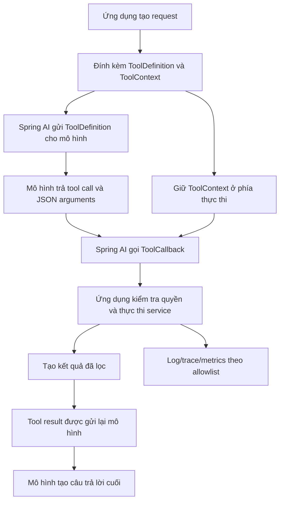

# Tránh rò rỉ ngữ cảnh vào kết quả công cụ hoặc nhật ký

`ToolContext` giúp ứng dụng truyền dữ liệu nội bộ như `userId`, `tenantId`, request scope hoặc mã tương quan đến phương thức công cụ mà không yêu cầu mô hình tạo các giá trị đó. Spring AI gửi định nghĩa công cụ cho mô hình, sau đó chuyển `ToolContext` trực tiếp đến callback khi thực thi. Bản thân context không được gửi đến mô hình.

Tuy nhiên, điều đó không tự động bảo vệ dữ liệu sau khi công cụ chạy. Kết quả công cụ thường được gửi trở lại mô hình để mô hình tạo câu trả lời; exception có thể được chuyển thành thông báo cho mô hình; log, trace, memory và hệ thống giám sát có thể lưu dữ liệu nếu ứng dụng hoặc cấu hình bật ghi nội dung. Nếu callback trả về cả đối tượng context, serialize nguyên entity hoặc ghi toàn bộ map vào log, dữ liệu nội bộ có thể rời khỏi ranh giới dự kiến.

Bài này tập trung vào cách giữ `ToolContext` trong phạm vi thực thi, tạo kết quả công cụ theo danh sách trường cho phép, xử lý exception an toàn, thiết kế log và trace không chứa dữ liệu nhạy cảm, cùng cách kiểm thử để phát hiện rò rỉ.

## Hiểu đúng đường đi của ToolContext và kết quả công cụ

Luồng xử lý có hai đường dữ liệu khác nhau:



`ToolContext` đi từ ứng dụng đến callback ở bước thực thi. Mô hình không nhận context như một phần của tool schema hoặc JSON arguments. Nhưng kết quả do callback trả về là một luồng dữ liệu khác: theo mặc định, Spring AI chuyển kết quả công cụ về mô hình để mô hình tiếp tục hội thoại.

| Thành phần | Có thể chứa gì? | Ai có thể nhận dữ liệu? |
|---|---|---|
| Tool definition | Tên, mô tả và schema đầu vào | Model provider nhận định nghĩa để chọn và gọi công cụ. |
| JSON arguments | Giá trị mô hình tạo như `customerId`, bộ lọc hoặc khoảng thời gian | Callback nhận để validation và thực thi. |
| `ToolContext` | Dữ liệu nội bộ do ứng dụng cấp như user, tenant, request scope | Callback nhận trực tiếp; không được gửi cho mô hình theo cơ chế chuẩn. |
| Tool result | Chuỗi hoặc JSON mà callback trả về | Mặc định được gửi lại mô hình; có thể trả trực tiếp cho caller nếu bật `returnDirect`. |
| Log, trace, memory | Những trường mà instrumentation hoặc ứng dụng ghi lại | Log backend, APM, hệ thống lưu hội thoại và người có quyền truy cập các hệ thống đó. |

Vì vậy, nguyên tắc quan trọng là: dữ liệu không tự rò rỉ chỉ vì nó nằm trong `ToolContext`; dữ liệu rò rỉ khi mã ứng dụng sao chép nó vào kết quả, exception, thông điệp hội thoại, log hoặc telemetry.

## Xác định dữ liệu nào được phép rời khỏi callback

Trước khi viết callback, hãy phân loại dữ liệu theo mục đích sử dụng. Không phải trường nào service truy vấn được cũng cần gửi cho mô hình hoặc lưu vào log.

| Nhóm dữ liệu | Ví dụ | Xử lý phù hợp |
|---|---|---|
| Bí mật xác thực | Access token, refresh token, API key, mật khẩu, cookie session | Không đưa vào tool result, prompt, log, trace hoặc metric. Chỉ truyền đến client/service thực sự cần nó qua kênh cấu hình bảo mật. |
| Định danh và phạm vi nội bộ | `userId`, `tenantId`, role, permission, internal account ID | Giữ trong context để kiểm tra quyền; chỉ trả ra nếu nghiệp vụ thật sự cần và đã được phê duyệt. Log bằng mã giả danh nếu cần đối chiếu. |
| Dữ liệu cá nhân | Email, số điện thoại, địa chỉ, ngày sinh, mã giấy tờ | Chỉ trả trường tối thiểu; che hoặc bỏ trường không cần thiết. Không ghi trực tiếp vào log. |
| Dữ liệu nghiệp vụ nhạy cảm | Số dư, giá nội bộ, lịch sử giao dịch, ghi chú hỗ trợ | Chọn projection theo mục đích; không serialize toàn bộ entity. |
| Dữ liệu kỹ thuật | SQL, connection string, host nội bộ, đường dẫn file, stack trace | Không đưa vào tool result hoặc log vận hành thông thường. Dùng error code và log chẩn đoán có kiểm soát. |
| Dữ liệu quan sát an toàn | Tên tool, trạng thái thành công/thất bại, thời gian chạy, mã request ngẫu nhiên | Có thể ghi theo allowlist và chính sách lưu trữ của hệ thống. |

Hãy trả lời ba câu hỏi cho từng trường: callback có cần đọc nó không, mô hình có cần biết nó không, và nhóm vận hành có cần nhìn thấy nó trong log không? Ba câu trả lời có thể khác nhau.

## Giữ ToolContext trong phạm vi thực thi

Chỉ đưa vào context những dữ liệu callback thật sự cần. Nếu service chỉ cần `tenantId` để giới hạn truy vấn, đừng truyền toàn bộ `Authentication`, HTTP request, session hoặc một đối tượng user chứa nhiều thông tin cá nhân.

```java
Map<String, Object> toolContext = Map.of(
        "tenantId", authenticatedUser.tenantId(),
        "actorRef", auditIdentity.pseudonymousReference(),
        "requestId", requestId
);

String answer = chatClient.prompt()
        .user(question)
        .tools(customerTools)
        .toolContext(toolContext)
        .call()
        .content();
```

`actorRef` trong ví dụ là mã giả danh được ứng dụng tạo theo chính sách audit; không phải access token hoặc mã bí mật. Nếu callback cần user ID thật để kiểm tra quyền, có thể truyền ID đó trong context, nhưng không ghi nguyên map ra log hoặc trả lại cho mô hình.

### Không biến context thành một phần của JSON arguments

Không khai báo `userId`, `tenantId`, role hoặc quyền truy cập thành tham số mà mô hình phải điền. Mô hình không phải nguồn xác thực danh tính. Hãy lấy các giá trị đó từ security context đã xác thực, truyền qua `ToolContext` và kiểm tra quyền trong service trên từng tài nguyên.

### Không lưu context trong field dùng chung

Callback thường là Spring bean được tái sử dụng giữa nhiều request. Không gán `userId`, `tenantId`, token hoặc context hiện tại vào field mutable của singleton callback. Hai request đồng thời có thể ghi đè dữ liệu của nhau, gây truy cập chéo tenant hoặc làm log ghi sai chủ thể.

Hãy đọc context từ tham số của lần gọi hiện tại, giữ biến cục bộ và không giữ tham chiếu context trong cache hoặc object dùng chung sau khi callback hoàn tất. Nếu cần chuyển tiếp xử lý bất đồng bộ, chỉ truyền projection tối thiểu và bảo đảm context gắn với đúng tác vụ.

## Trả về DTO theo allowlist thay vì entity hoặc context

Một nguyên nhân phổ biến gây rò rỉ là callback trả về JPA entity, object domain lớn hoặc map chứa cả dữ liệu phục vụ nội bộ. `DefaultToolCallResultConverter` sử dụng Jackson để serialize kết quả thành chuỗi. Nếu object có thêm trường như `tenantId`, `internalNotes`, `accessToken` hoặc quan hệ lồng nhau, các trường đó có thể xuất hiện trong JSON gửi lại mô hình.

Hãy tạo DTO đầu ra riêng chỉ chứa những trường được phép tiết lộ:

```java
public record CustomerToolResult(
        String displayName,
        String accountStatus,
        String supportReference) {
}
```

Phương thức công cụ đọc context để truy vấn đúng phạm vi, sau đó ánh xạ entity sang DTO:

```java
@Component
class CustomerTools {

    private static final Logger log = LoggerFactory.getLogger(CustomerTools.class);

    private final CustomerQueryService customerQueryService;

    CustomerTools(CustomerQueryService customerQueryService) {
        this.customerQueryService = customerQueryService;
    }

    @Tool(description = "Tra cứu tên hiển thị và trạng thái tài khoản của khách hàng mà người dùng hiện tại được phép xem")
    public CustomerToolResult getCustomerInfo(
            @ToolParam(description = "Mã khách hàng do hệ thống cấp") String customerId,
            ToolContext toolContext) {

        String tenantId = requireString(toolContext, "tenantId");
        String requestId = requireString(toolContext, "requestId");

        Customer customer = customerQueryService.findVisibleInTenant(customerId, tenantId);

        CustomerToolResult result = new CustomerToolResult(
                customer.getDisplayName(),
                customer.getAccountStatus().name(),
                customer.getSupportReference()
        );

        log.info("tool_execution tool={} requestId={} outcome={}",
                "getCustomerInfo", requestId, "success");

        return result;
    }

    private String requireString(ToolContext context, String key) {
        Object value = context.getContext().get(key);
        if (!(value instanceof String text) || text.isBlank()) {
            throw new IllegalStateException("Thiếu ngữ cảnh thực thi bắt buộc");
        }
        return text;
    }
}
```

`Customer`, `CustomerQueryService` và `requireString` là các kiểu/hàm minh họa của ứng dụng. Ví dụ chỉ ghi tên tool, request ID do ứng dụng tạo và trạng thái. Nó không ghi `tenantId`, JSON arguments, entity hay context.

Nếu không muốn mô hình biết cả `supportReference`, hãy bỏ trường đó khỏi DTO. Allowlist nên được thể hiện trực tiếp trong kiểu trả về để reviewer dễ kiểm tra. Đừng dựa vào việc Jackson tình cờ bỏ qua một số field hoặc dùng `@JsonIgnore` trên entity lớn như biện pháp duy nhất.

### Khi cần dùng ToolCallResultConverter

Spring AI chuyển kết quả tool thành `String` qua `ToolCallResultConverter`; converter mặc định dùng Jackson. Với phương thức `@Tool`, có thể cấu hình `resultConverter`; các builder của method/function callback cũng hỗ trợ converter riêng theo phiên bản.

Custom converter hữu ích khi cần chuẩn hóa định dạng, giới hạn kích thước, loại bỏ trường hoặc chuyển kết quả về một cấu trúc chung. Tuy nhiên, converter không nên là lớp bảo vệ duy nhất. Hãy trả về DTO tối thiểu ngay từ service/callback để dữ liệu nhạy cảm không xuất hiện trong object trung gian, debug log hoặc nơi khác trước khi serialize.

## Hiểu rõ returnDirect

Theo mặc định, kết quả công cụ được gửi lại mô hình để mô hình tiếp tục hội thoại. Nếu đặt `returnDirect = true`, kết quả được trả trực tiếp cho caller và bỏ qua lượt mô hình tiếp theo.

`returnDirect` thay đổi nơi nhận kết quả, không phải cơ chế che giấu dữ liệu. Nếu kết quả chứa `tenantId`, email hoặc ghi chú nội bộ, dữ liệu vẫn có thể đến client cuối cùng. Hãy lọc kết quả trước khi trả, bất kể dùng đường gửi lại mô hình hay trả trực tiếp.

Với nhiều tool call trong cùng một lượt, Spring AI chỉ áp dụng `returnDirect` nếu tất cả công cụ được gọi đều có `returnDirect = true`. Vì vậy, không dùng thuộc tính này để giả định một batch có kết quả nhạy cảm sẽ tự động bị ẩn khỏi hội thoại.

## Không để exception mang dữ liệu nội bộ quay lại mô hình

Khi công cụ ném exception, Spring AI chuyển lỗi qua `ToolExecutionException` và `ToolExecutionExceptionProcessor`. Theo mặc định, `DefaultToolExecutionExceptionProcessor` gửi message của `RuntimeException` trở lại mô hình; checked exception và `Error` được ném về caller. Điều này có nghĩa một exception có message như `SQL failed for tenant=... token=...` có thể trở thành nội dung tool result mà mô hình đọc được.

Hãy tạo message lỗi công khai ngắn, không chứa giá trị nhạy cảm:

```java
try {
    return customerQueryService.findVisibleInTenant(customerId, tenantId);
}
catch (DataAccessException ex) {
    log.error("tool_execution tool={} requestId={} outcome={} errorCode={}",
            "getCustomerInfo", requestId, "failed", "CUSTOMER_LOOKUP_UNAVAILABLE");

    throw new IllegalStateException("Hiện không thể tra cứu thông tin khách hàng");
}
```

Trong ví dụ, message runtime gửi về mô hình chỉ mô tả lỗi ở mức nghiệp vụ. Log cũng chỉ chứa mã lỗi và mã request; không truyền `ex` vào logger ở kênh log thông thường vì stack trace hoặc message gốc có thể chứa SQL, tham số truy vấn hoặc dữ liệu nội bộ.

Nếu cần xử lý lỗi ở caller thay vì gửi message lỗi về mô hình, có thể cấu hình:

```properties
spring.ai.tools.throw-exception-on-error=true
```

Thuộc tính này yêu cầu ném lỗi cho caller xử lý. Nó không tự động làm sạch log, stack trace hoặc dữ liệu được ghi bởi ứng dụng. Khi dùng custom `ToolExecutionExceptionProcessor`, hãy chỉ trả về thông báo đã làm sạch hoặc ném lỗi theo chính sách; không serialize toàn bộ exception, context hay request.

## Thiết kế log theo allowlist

Log cần giúp điều tra sự cố mà không lưu bản sao của request hoặc dữ liệu nghiệp vụ. Với một lần gọi công cụ, các trường thường đủ dùng là:

| Trường log | Mục đích | Ví dụ |
|---|---|---|
| `event` | Phân loại sự kiện | `tool_execution` |
| `tool_name` | Xác định callback | `getCustomerInfo` |
| `request_id` | Liên kết các bước của một request | ID ngẫu nhiên do ứng dụng tạo |
| `tool_call_id` | Liên kết với tool call nếu ứng dụng có sẵn ID | ID opaque từ response của model |
| `outcome` | Trạng thái | `success`, `denied`, `failed` |
| `duration_ms` | Đo thời gian | `42` |
| `error_code` | Phân loại lỗi | `CUSTOMER_LOOKUP_UNAVAILABLE` |
| `actor_ref` | Đối chiếu audit mà không lộ định danh thật | HMAC hoặc mã giả danh theo chính sách |

Không log mặc định các trường sau:

- Toàn bộ `ToolContext` hoặc `toolContext.getContext()`.
- JSON arguments nguyên bản và prompt của người dùng.
- Tool result nguyên bản hoặc DTO đầy đủ.
- Access token, session ID, password, API key, cookie, connection string hoặc encryption key.
- PII, dữ liệu thanh toán, thông tin tài khoản hoặc nội dung ghi chú nội bộ không cần thiết.
- `exception.getMessage()` hoặc stack trace có thể chứa câu truy vấn và dữ liệu thực tế trong log vận hành thông thường.

Nếu cần điều tra sâu, dùng một kênh chẩn đoán riêng có quyền truy cập hạn chế, thời hạn lưu trữ rõ ràng và quy trình phê duyệt. Không bật ghi toàn bộ payload trong production như cách xử lý sự cố mặc định.

### Mã giả danh và correlation ID

Correlation ID nên được tạo bởi ứng dụng và dùng để nối log, trace và sự kiện của cùng một request. Nếu cần liên kết một actor qua nhiều sự kiện, dùng mã giả danh ổn định theo chính sách, chẳng hạn HMAC với khóa quản lý riêng. Không dùng access token, session ID hoặc email làm correlation ID.

Nếu đưa dữ liệu vào MDC, chỉ đưa các giá trị an toàn như request ID hoặc mã giả danh. Xóa MDC sau khi request kết thúc và kiểm tra cơ chế truyền context qua thread pool/reactive pipeline để tránh dữ liệu request trước xuất hiện ở request sau.

## Bảo vệ trace, observation và metrics

Log không phải nơi duy nhất lưu nội dung. APM, distributed tracing và telemetry exporter có thể lưu span attributes, exception hoặc baggage.

Spring AI phát observation cho tool call qua Micrometer. Các thông tin như tên công cụ, metadata định nghĩa, thời gian chạy và tracing context có thể được ghi nhận. Việc xuất arguments và result thành span attributes là tùy chọn và mặc định tắt vì dữ liệu có thể nhạy cảm.

Giữ cấu hình mặc định:

```properties
spring.ai.tools.observations.include-content=false
```

Chỉ bật `true` trong môi trường kiểm thử với dữ liệu giả, hoặc trong một quy trình chẩn đoán đã được phê duyệt và có giới hạn truy cập. Kiểm tra cả exporter, collector và APM backend; tắt ở ứng dụng nhưng tự thêm payload vào custom span vẫn gây rò rỉ.

Với metrics, tránh dùng `userId`, `tenantId`, email hoặc request ID làm label. Các giá trị có độ phân biệt cao vừa làm tăng chi phí metrics vừa có thể tiết lộ thông tin. Dùng nhãn có cardinality thấp như tên tool, outcome và loại lỗi.

## Cẩn thận với DEBUG, TRACE và structured logging

Spring AI ghi các hoạt động chính ở mức `DEBUG`. Không bật `logging.level.org.springframework.ai=DEBUG` hoặc `TRACE` rộng trong production nếu chưa kiểm tra chính xác dữ liệu của release đang chạy và các logger liên quan.

Spring Boot hỗ trợ structured logging JSON, ECS, GELF và Logstash. Structured logging giúp parser xử lý dữ liệu nhất quán và giảm nguy cơ log injection, nhưng nó không tự động xóa token, PII hoặc context. Bạn vẫn phải chọn trường được phép ghi trước khi tạo log event.

Ví dụ cấu hình JSON cho console và file:

```properties
logging.structured.format.console=ecs
logging.structured.format.file=ecs
```

Không nối chuỗi trực tiếp từ dữ liệu người dùng vào log. Dùng template cố định và tham số hóa; giới hạn độ dài trường, encode đúng định dạng và xử lý CR/LF cùng ký tự phân cách từ dữ liệu không tin cậy. Parameterized logging một mình không ngăn được log injection nếu encoder vẫn ghi ký tự xuống dòng không an toàn.

## Kiểm soát bộ nhớ hội thoại và các bản sao dữ liệu

Tool result có thể được thêm vào conversation history để mô hình dùng ở lượt tiếp theo. Nếu một memory advisor được đặt bên trong tool loop, tool messages có thể được lưu cùng lịch sử hội thoại. Vì vậy, dữ liệu nhạy cảm trong result có thể tiếp tục tồn tại sau request hiện tại.

Hãy kiểm tra vị trí `MessageChatMemoryAdvisor` so với `ToolCallingAdvisor`, repository lưu conversation và các bản sao phục vụ phân tích. Mặc định memory advisor nằm ngoài tool loop và chỉ lưu user message cuối cùng cùng assistant response cuối cùng; nếu đặt memory advisor bên trong loop, cần xác nhận backend hỗ trợ tool messages và áp dụng chính sách lọc/retention tương ứng.

Không giả định xóa log là đã xóa hết dữ liệu. Cần xét cả trace backend, memory store, cache, dead-letter queue, exception monitoring, bản export và backup. Mỗi nơi có thời hạn lưu, quyền đọc và quy trình xóa riêng.

## Kiểm thử chống rò rỉ

Một kiểm thử tốt dùng giá trị giả dễ nhận biết làm canary, ví dụ `CTX_CANARY_TENANT_7F3A` hoặc `TOKEN_CANARY_DO_NOT_LOG`. Sau khi chạy callback, tìm các chuỗi này trong tất cả đầu ra mà hệ thống có thể lưu hoặc gửi đi.

| Kênh kiểm tra | Tình huống | Kết quả mong đợi |
|---|---|---|
| Tool schema | Context chứa `tenantId` và `userId` | Các trường context không xuất hiện trong schema gửi model. |
| Tool result | Callback dùng context để truy vấn dữ liệu | Result chỉ chứa DTO theo allowlist, không có context hoặc entity nội bộ. |
| Model-visible transcript | Tool result được gửi lại mô hình | Không có token, tenant ID nội bộ, session ID hoặc PII không cần thiết. |
| `returnDirect` | Callback trả kết quả trực tiếp | Caller chỉ nhận DTO đã lọc; không coi returnDirect là biện pháp bảo mật. |
| Runtime exception | Service ném exception có message chứa canary | Tool error gửi về mô hình chỉ có thông báo đã làm sạch. |
| Application log | Callback thành công và thất bại | Không có raw context, arguments, result, token hoặc stack trace nhạy cảm. |
| Micrometer span | Observation của tool call | Arguments và result không được xuất khi `include-content=false`. |
| Metrics | Nhiều user/tenant gọi cùng tool | Không tạo label từ định danh cá nhân hoặc request ID. |
| Memory store | Tool loop chạy cùng memory advisor | Chỉ dữ liệu đã được phép lưu xuất hiện trong conversation history. |
| Request đồng thời | Hai tenant gọi cùng callback | Context của request này không xuất hiện trong result hoặc log của request kia. |

Nên có unit test cho mapper DTO, result converter và hàm redaction; integration test cho callback cùng `ToolContext`; test log capture; và test observation exporter. Kiểm thử cả đường thành công, từ chối quyền, timeout, exception, kết quả rỗng và dữ liệu vượt giới hạn.

## Bài tập thực hành

Xây dựng công cụ `getCustomerInfo` cho một ứng dụng nhiều tenant:

1. Tạo `ToolContext` chứa `tenantId`, `requestId` và mã actor giả danh do ứng dụng tạo.
2. Viết callback lấy `tenantId` từ context, kiểm tra quyền trong service và truy vấn khách hàng thuộc tenant đó.
3. Tạo `CustomerToolResult` chỉ có `displayName`, `accountStatus` và `supportReference`.
4. Không trả về entity `Customer`, principal hoặc map context.
5. Ghi log tên tool, request ID, outcome và duration; không ghi JSON arguments hoặc result.
6. Mô phỏng exception có message chứa một canary secret; xác nhận message gửi lại mô hình đã được làm sạch.
7. Giữ `spring.ai.tools.observations.include-content=false` và kiểm tra span không chứa arguments/result.
8. Gọi đồng thời bằng hai tenant khác nhau; xác nhận context không bị trộn.
9. Tìm canary secret trong log, trace, tool result và memory store sau khi chạy test.

Bạn hoàn thành khi có thể chứng minh context chỉ được dùng trong callback/service, result chỉ chứa trường đã phê duyệt, log/trace đủ để điều tra mà không cần payload nhạy cảm, và mọi đường lỗi đều không làm lộ dữ liệu.

## Danh sách kiểm tra trước khi triển khai

- [ ] `ToolContext` chỉ chứa dữ liệu tối thiểu mà callback cần.
- [ ] Không đưa context, token hoặc quyền truy cập vào JSON arguments mà mô hình tạo.
- [ ] Không lưu context theo request trong field mutable của singleton callback.
- [ ] Callback kiểm tra quyền theo user/tenant trên tài nguyên cụ thể.
- [ ] Kết quả tool dùng DTO/projection theo allowlist, không trả entity hoặc context.
- [ ] `ToolCallResultConverter` nếu có chỉ serialize dữ liệu đã lọc.
- [ ] `returnDirect` được hiểu là thay đổi luồng trả kết quả, không phải cơ chế che dữ liệu.
- [ ] Exception gửi về mô hình có message an toàn; không chuyển `ex.getMessage()` thô.
- [ ] `spring.ai.tools.observations.include-content=false` trong môi trường thật.
- [ ] DEBUG/TRACE không được bật rộng khi chưa đánh giá dữ liệu được ghi.
- [ ] Log chỉ có trường allowlist; không ghi token, PII, raw arguments, result hoặc context.
- [ ] Log được encode/sanitize, giới hạn kích thước và bảo vệ khỏi CR/LF injection.
- [ ] Trace, metrics, MDC, memory, cache và exporter đều được kiểm tra.
- [ ] Có kiểm thử canary cho success, error, returnDirect và request đồng thời.
- [ ] Quyền đọc, thời hạn lưu và quy trình xóa log/trace/memory đã được xác định.

## Tài liệu tham khảo

- [Spring AI 2.0.2 – Tool Calling và ToolContext](https://docs.spring.io/spring-ai/reference/api/tools.html)
- [Spring AI 2.0.2 – Observability](https://docs.spring.io/spring-ai/reference/observability/index.html)
- [Spring Boot – Logging và Structured Logging](https://docs.spring.io/spring-boot/reference/features/logging.html)
- [OWASP – Logging Cheat Sheet](https://cheatsheetseries.owasp.org/cheatsheets/Logging_Cheat_Sheet.html)
