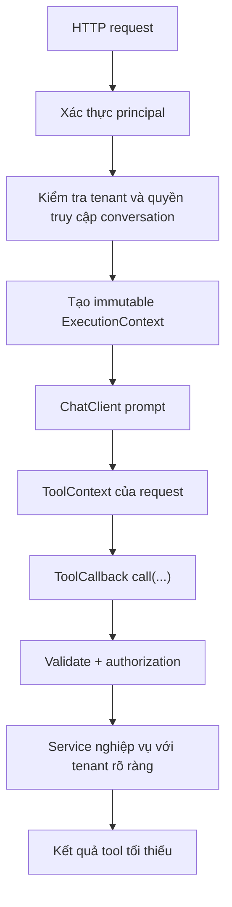
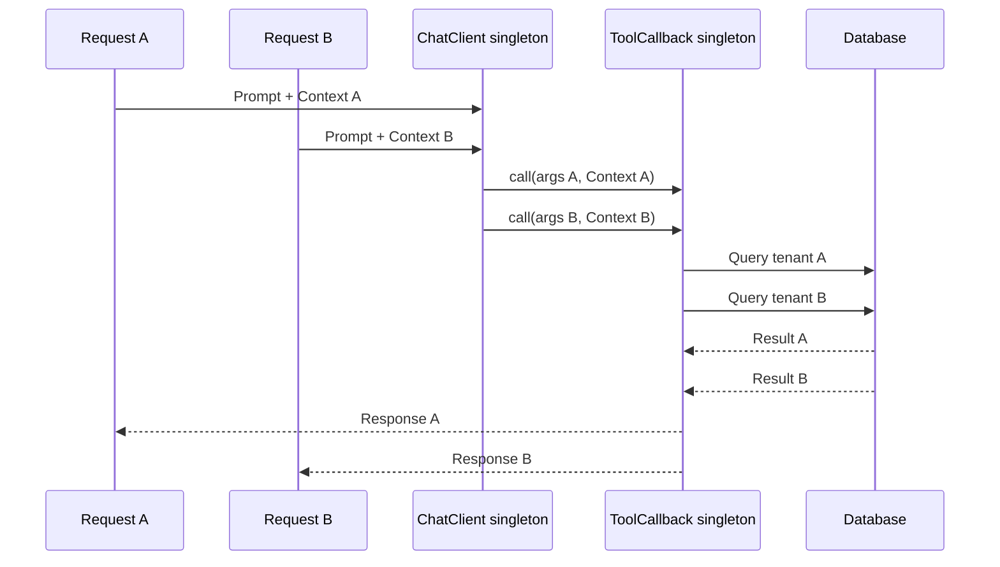

# Cô lập ngữ cảnh giữa các hội thoại và yêu cầu đồng thời

Ứng dụng Spring AI thường dùng chung một `ChatClient`, một `ToolCallback` bean và các service singleton cho nhiều người dùng. Điều đó an toàn khi các thành phần dùng chung chỉ giữ cấu hình bất biến, còn dữ liệu của từng người gọi được truyền theo từng request. Nếu lưu `tenantId`, `userId`, `conversationId` hoặc `ToolContext` vào field có thể thay đổi, hai request đồng thời có thể ghi đè dữ liệu của nhau và dẫn đến rò rỉ thông tin giữa người dùng hoặc tenant.

Bài học này tập trung vào việc cô lập context khi nhiều hội thoại và nhiều yêu cầu chạy cùng lúc. Ta sẽ tách danh tính người gọi, tenant, conversation ID và request ID; truyền context rõ ràng qua mỗi lần gọi; giữ callback không có trạng thái theo request; và kiểm thử để phát hiện việc trộn context.

## 1. Vì sao context có thể bị trộn?

Giả sử `CustomerLookupCallback` là một Spring singleton. Hai request đến gần như cùng lúc:

- Request A thuộc `user-17`, tenant `tenant-A`, hội thoại `conv-A`.
- Request B thuộc `user-29`, tenant `tenant-B`, hội thoại `conv-B`.

Nếu callback lưu tenant vào field trước khi gọi service, thứ tự thực thi có thể xảy ra như sau:

1. Request A ghi `currentTenant = tenant-A`.
2. Request B ghi đè `currentTenant = tenant-B`.
3. Request A tiếp tục truy vấn nhưng dùng `tenant-B`.

Đây là race condition. Một request có thể đọc dữ liệu của tenant khác dù cả hai người dùng đều đã xác thực đúng. Lỗi tương tự xảy ra nếu ứng dụng lưu caller trong biến static, mutable singleton, cache không có khóa tenant hoặc `ThreadLocal` không được dọn dẹp.

Nguyên tắc thiết kế là: **đối tượng dùng chung giữ cấu hình; mỗi lần gọi mang dữ liệu riêng trong tham số của chính lần gọi đó**.

## 2. Phân biệt các định danh và vòng đời

Không nên gộp mọi thông tin vào một chuỗi session hoặc một object không rõ mục đích. Mỗi định danh có phạm vi riêng:

| Giá trị | Phạm vi | Nguồn tạo | Dùng để |
| --- | --- | --- | --- |
| `subjectId` | Danh tính người dùng | Principal/session đã xác thực | Xác định ai đang gọi |
| `tenantId` | Ranh giới dữ liệu | Tenant resolver đã kiểm tra quyền | Cô lập dữ liệu giữa tổ chức |
| `conversationId` | Một cuộc hội thoại nhiều lượt | Ứng dụng tạo hoặc xác minh | Lấy đúng lịch sử hội thoại |
| `requestId` | Một HTTP/API request | Gateway hoặc ứng dụng | Correlation log và trace |
| `tool_call_id` | Một lần tool call của mô hình | Provider/model response | Ghép tool call với kết quả tương ứng |

`conversationId` có thể tồn tại qua nhiều request để duy trì lịch sử. `requestId` thay đổi theo từng request. `tool_call_id` có phạm vi nhỏ hơn nữa và không dùng để xác định người dùng hoặc hội thoại. `tenantId` và `subjectId` phải đến từ nguồn tin cậy của ứng dụng.

Luồng dữ liệu nên có ranh giới rõ ràng:



`ToolContext` mang dữ liệu của lần gọi chat đến callback. Nó không thay thế `ChatMemory`: context phục vụ thực thi công cụ, còn memory lưu các message của hội thoại.

## 3. Tạo ExecutionContext bất biến cho từng request

Gom các giá trị cần thiết vào một record. Chỉ đưa vào những trường mà tool thực sự cần:

```java
public record ToolExecutionContext(
        String subjectId,
        String tenantId,
        String conversationId,
        String requestId) {

    public ToolExecutionContext {
        if (subjectId == null || subjectId.isBlank()) {
            throw new IllegalArgumentException("subjectId is required");
        }
        if (tenantId == null || tenantId.isBlank()) {
            throw new IllegalArgumentException("tenantId is required");
        }
        if (conversationId == null || conversationId.isBlank()) {
            throw new IllegalArgumentException("conversationId is required");
        }
        if (requestId == null || requestId.isBlank()) {
            throw new IllegalArgumentException("requestId is required");
        }
    }
}
```

Record có các field final và không có setter. Tránh thêm `Map` mutable, `HttpServletRequest`, `Authentication`, `EntityManager`, transaction hoặc object request-scoped vào record. Nếu cần thêm metadata dạng collection, dùng bản sao bất biến như `Set.copyOf(...)` hoặc `Map.copyOf(...)` và bảo đảm các phần tử bên trong cũng không bị thay đổi.

Ứng dụng tạo context sau khi xác thực và kiểm tra tenant:

```java
ToolExecutionContext executionContext = new ToolExecutionContext(
        authentication.getName(),
        tenantResolver.requireAuthorizedTenant(authentication, requestedTenantId),
        conversationService.requireAccessibleConversation(
                authentication.getName(), requestedConversationId),
        requestId);
```

Không tin `requestedTenantId` hoặc `requestedConversationId` chỉ vì chúng đến từ URL/header. `tenantResolver` và `conversationService` phải xác minh người dùng hiện tại có quyền dùng những định danh đó.

## 4. Truyền context ở cấp request của ChatClient

`ChatClient` có thể được tạo một lần và dùng chung. Dữ liệu thay đổi theo người dùng nên được truyền ở prompt cụ thể qua `.toolContext(...)`:

```java
import java.util.Map;
import org.springframework.ai.chat.client.ChatClient;
import org.springframework.stereotype.Service;

@Service
public class CustomerAssistant {

    private final ChatClient chatClient;
    private final CustomerTools customerTools;

    public CustomerAssistant(
            ChatClient.Builder builder,
            CustomerTools customerTools) {
        this.chatClient = builder.build();
        this.customerTools = customerTools;
    }

    public String answer(
            String question,
            ToolExecutionContext executionContext) {

        return chatClient.prompt()
                .user(question)
                .tools(customerTools)
                .toolContext(Map.of("execution", executionContext))
                .call()
                .content();
    }
}
```

`executionContext` là biến cục bộ của lần gọi `answer`. Hai thread gọi `answer` với hai context khác nhau sẽ truyền hai map riêng vào hai prompt. `ChatClient` và `CustomerTools` có thể được dùng chung nếu chúng không giữ trạng thái request có thể thay đổi.

Với dữ liệu bảo mật như tenant, subject hoặc conversation ID, ưu tiên truyền context rõ ràng ở request. Không đặt caller hiện tại vào `defaultToolContext` dùng chung trên builder hoặc client, vì default đó có thể áp dụng cho nhiều request. Default context chỉ phù hợp với metadata cấu hình chung, bất biến và không nhạy cảm.

## 5. Đọc context trong @Tool mà không lưu vào field

Spring AI hỗ trợ tham số đặc biệt `ToolContext` trong phương thức `@Tool`. Tham số nghiệp vụ do mô hình sinh vẫn được khai báo riêng trong method signature:

```java
import org.springframework.ai.chat.model.ToolContext;
import org.springframework.ai.tool.annotation.Tool;
import org.springframework.ai.tool.annotation.ToolParam;
import org.springframework.security.access.AccessDeniedException;
import org.springframework.stereotype.Component;

@Component
public class CustomerTools {

    private final CustomerService customerService;
    private final CustomerAuthorization authorization;

    public CustomerTools(
            CustomerService customerService,
            CustomerAuthorization authorization) {
        this.customerService = customerService;
        this.authorization = authorization;
    }

    @Tool(description = "Tra cứu khách hàng trong tenant của người gọi.")
    public CustomerSummary getCustomer(
            @ToolParam(description = "ID khách hàng cần tra cứu") Long customerId,
            ToolContext toolContext) {

        ToolExecutionContext execution = requireExecutionContext(toolContext);

        authorization.requireAllowed(
                execution.subjectId(),
                execution.tenantId(),
                "customer:read",
                customerId);

        return customerService.findVisibleCustomer(
                execution.subjectId(),
                execution.tenantId(),
                customerId);
    }

    private ToolExecutionContext requireExecutionContext(ToolContext context) {
        if (context == null) {
            throw new AccessDeniedException("Missing tool execution context");
        }
        Object value = context.getContext().get("execution");
        if (!(value instanceof ToolExecutionContext execution)) {
            throw new AccessDeniedException("Invalid tool execution context");
        }
        return execution;
    }
}
```

`customerId` là tool argument do mô hình tạo. `subjectId` và `tenantId` đến từ context của request. Method lấy context vào biến cục bộ, kiểm tra quyền rồi gọi service với tenant rõ ràng. Không gán `execution` vào field như `this.currentExecution`.

## 6. Custom ToolCallback phải stateless

Khi triển khai `ToolCallback` tùy chỉnh, hãy giữ các field chỉ gồm cấu hình bất biến và dependency thread-safe. Dữ liệu theo request luôn lấy từ tham số `ToolContext` của từng lần gọi:

```java
import com.fasterxml.jackson.databind.ObjectMapper;
import org.springframework.ai.chat.model.ToolContext;
import org.springframework.ai.tool.ToolCallback;
import org.springframework.ai.tool.definition.ToolDefinition;
import org.springframework.ai.tool.execution.ToolExecutionException;
import org.springframework.security.access.AccessDeniedException;

public class CustomerLookupCallback implements ToolCallback {

    private final ToolDefinition definition;
    private final ObjectMapper objectMapper;
    private final CustomerService customerService;
    private final CustomerAuthorization authorization;

    public CustomerLookupCallback(
            ToolDefinition definition,
            ObjectMapper objectMapper,
            CustomerService customerService,
            CustomerAuthorization authorization) {
        this.definition = definition;
        this.objectMapper = objectMapper;
        this.customerService = customerService;
        this.authorization = authorization;
    }

    @Override
    public ToolDefinition getToolDefinition() {
        return definition;
    }

    @Override
    public String call(String toolInput) {
        throw new ToolExecutionException(
                definition,
                new IllegalStateException("ToolContext is required"));
    }

    @Override
    public String call(String toolInput, ToolContext toolContext) {
        try {
            ToolExecutionContext execution = requireExecutionContext(toolContext);
            CustomerLookupRequest request = objectMapper.readValue(
                    toolInput, CustomerLookupRequest.class);

            validate(request);
            authorization.requireAllowed(
                    execution.subjectId(),
                    execution.tenantId(),
                    "customer:read",
                    request.customerId());

            CustomerSummary result = customerService.findVisibleCustomer(
                    execution.subjectId(),
                    execution.tenantId(),
                    request.customerId());

            return objectMapper.writeValueAsString(result);
        }
        catch (Exception ex) {
            throw new ToolExecutionException(definition, ex);
        }
    }

    private ToolExecutionContext requireExecutionContext(ToolContext context) {
        if (context == null) {
            throw new AccessDeniedException("Missing tool execution context");
        }
        Object value = context.getContext().get("execution");
        if (!(value instanceof ToolExecutionContext execution)) {
            throw new AccessDeniedException("Invalid tool execution context");
        }
        return execution;
    }

    private void validate(CustomerLookupRequest request) {
        if (request == null || request.customerId() == null || request.customerId() <= 0) {
            throw new IllegalArgumentException("customerId must be positive");
        }
    }
}
```

Đây là khung minh họa; trong ứng dụng thật cần phân loại lỗi và chuyển thông điệp an toàn, không gửi nguyên exception hoặc stack trace cho mô hình. `ObjectMapper` sau khi cấu hình xong có thể dùng chung; không thay đổi cấu hình của nó sau khi callback bắt đầu phục vụ request.

## 7. Cô lập ChatMemory theo hội thoại

`ToolContext` và `ChatMemory` giải quyết hai bài toán khác nhau:

- `ToolContext` cung cấp dữ liệu thực thi cho tool trong một request chat.
- `ChatMemory` lưu message để mô hình tiếp tục một hội thoại qua nhiều request.

Đừng dùng `ToolContext` như nơi lưu lịch sử hội thoại. Cũng đừng giả định `conversationId` tự động xác thực người dùng. Ứng dụng phải kiểm tra người dùng có quyền truy cập hội thoại đó trước khi đọc hoặc ghi memory.

Với `MessageChatMemoryAdvisor`, có thể cung cấp conversation ID ở mỗi lần gọi bằng advisor parameter:

```java
import org.springframework.ai.chat.memory.ChatMemory;
import org.springframework.ai.chat.client.advisor.MessageChatMemoryAdvisor;

ChatClient chatClient = builder
        .defaultAdvisors(
                MessageChatMemoryAdvisor.builder(chatMemory).build())
        .build();

String answer = chatClient.prompt()
        .user(question)
        .advisors(advisors -> advisors.param(
                ChatMemory.CONVERSATION_ID,
                conversationId))
        .tools(customerTools)
        .toolContext(Map.of("execution", executionContext))
        .call()
        .content();
```

`conversationId` ở đây được tạo hoặc xác minh bởi ứng dụng. Nếu memory store chỉ dùng một ID toàn cục mà không phân vùng tenant/user, hãy tạo key có namespace, chẳng hạn `tenantId:userId:conversationId`, hoặc cấu hình store để áp dụng tenant scope riêng. Không nối chuỗi một cách tùy tiện nếu các thành phần ID có thể chứa dấu phân cách; dùng một hàm encode/compose ổn định.

Mỗi hội thoại cần memory key riêng. Nếu hai người dùng dùng cùng `conversationId` nhưng không có tenant/user namespace, lịch sử có thể bị trộn dù ToolContext của mỗi request vẫn riêng.

## 8. Nhiều request và nhiều tool call đồng thời

Có hai dạng đồng thời cần tính đến:

1. Nhiều request chat độc lập chạy cùng lúc, có context và conversation ID khác nhau.
2. Một response của mô hình yêu cầu nhiều tool call; callback có thể được điều phối song song tùy model, provider và cấu hình.

Không dựa vào thứ tự callback hoàn tất. Mỗi invocation phải dùng context được truyền cùng invocation đó, không đọc một biến dùng chung. Nếu hai tool call có quan hệ phụ thuộc, hãy điều phối tuần tự hoặc tạo một tool nghiệp vụ cấp cao thực hiện toàn bộ quy trình trong một transaction.



Các dependency dùng chung cũng cần an toàn với đồng thời. Service singleton nên stateless; repository và client nên được dùng theo hợp đồng thread-safety của framework. Không chia sẻ `EntityManager`, mutable DTO, transaction state hoặc `List` đang được ghi giữa các request.

Với thao tác ghi dữ liệu, mỗi lần thực thi cần transaction và idempotency phù hợp. Tool call ID có thể dùng để correlation nhưng không thay thế idempotency key nghiệp vụ, vì một lần retry của mô hình có thể tạo tool call ID mới.

## 9. ThreadLocal, async và reactive execution

Không nên dùng `ThreadLocal` để lưu tenant hoặc caller cho tool invocation. Request có thể đổi thread khi chạy async, executor hoặc reactive pipeline. Thread pool tái sử dụng thread nên giá trị cũ có thể còn lại nếu không được xóa đúng cách.

Các lỗi thường gặp:

- Lấy `SecurityContextHolder` trong callback nhưng tool thực thi trên thread không có security context.
- Gán tenant vào `ThreadLocal` rồi quên `remove()` trong `finally`.
- Đưa request-scoped bean vào callback singleton rồi sử dụng sau khi request kết thúc.
- Chuyển sang `CompletableFuture` hoặc executor riêng nhưng không truyền execution context.

Ưu tiên truyền `ToolExecutionContext` rõ ràng vào method/service. Nếu một tác vụ async cần context, đưa immutable context vào tham số tác vụ:

```java
CompletableFuture<CustomerSummary> future = CompletableFuture.supplyAsync(
        () -> customerService.findVisibleCustomer(
                execution.subjectId(),
                execution.tenantId(),
                customerId),
        customerExecutor);
```

Không dựa vào việc `ThreadLocal` tự đi theo `CompletableFuture`. Nếu service bắt buộc dùng Spring Security context trong thread khác, cấu hình cơ chế propagation chuyên biệt như `DelegatingSecurityContextExecutor` hoặc `TaskDecorator`, đồng thời kiểm thử việc context được khôi phục và dọn dẹp. Với Reactor, truyền dữ liệu qua Reactor Context hoặc tham số rõ ràng thay vì giả định thread cố định.

## 10. Tránh context mặc định bị chia sẻ

`defaultToolContext` có thể hữu ích cho metadata cố định của ứng dụng, nhưng không nên chứa thông tin người dùng hiện tại trong một ChatClient singleton. Nếu builder tạo một context mặc định chứa `tenant-A`, tất cả request sử dụng client đó có thể nhận cùng giá trị.

Đối với dữ liệu nhạy cảm theo request:

- Tạo context sau khi xác thực từng request.
- Truyền bằng `.toolContext(...)` trên prompt đó.
- Không sửa map sau khi truyền.
- Không tái sử dụng một `Map` mutable giữa các request.
- Nếu có default context, không đặt `subjectId`, `tenantId`, quyền hoặc conversation ID vào đó.

Khi kết hợp default context với request context, kiểm tra quy tắc hợp nhất và ưu tiên của phiên bản Spring AI đang dùng. Không dựa vào việc một khóa bảo mật “chắc chắn sẽ bị ghi đè” nếu chưa có test xác nhận.

## 11. Kiểm thử cách ly context

Unit test tuần tự thường không phát hiện race condition. Cần kiểm thử nhiều invocation cùng lúc với caller và tenant khác nhau, đồng thời xác minh service nhận đúng context cho từng request.

| Kiểm thử | Điều cần chứng minh |
| --- | --- |
| Hai request khác tenant | Mỗi invocation dùng đúng tenant riêng |
| Hai conversation cùng user | Memory history không bị trộn giữa hai conversation ID |
| Hai user cùng conversation ID đầu vào | Server-side ownership check ngăn truy cập lịch sử của người khác |
| Callback singleton | Không có field mutable chứa caller/context hiện tại |
| Tool call song song | Kết quả không phụ thuộc thứ tự hoàn tất |
| Async execution | Context được truyền rõ ràng; không dựa vào ThreadLocal ngầm |
| Context thiếu hoặc sai kiểu | Fail closed trước khi gọi service |
| Service bị lỗi | Context không rò sang request tiếp theo |

Ví dụ kiểm thử đồng thời bằng `CountDownLatch` để ép hai request chồng lấn:

```java
@Test
void shouldKeepTenantContextIsolatedAcrossConcurrentCalls() throws Exception {
    CountDownLatch bothCallsEntered = new CountDownLatch(2);
    CountDownLatch releaseCalls = new CountDownLatch(1);

    when(customerService.findVisibleCustomer(anyString(), anyString(), anyLong()))
            .thenAnswer(invocation -> {
                String tenantId = invocation.getArgument(1);
                bothCallsEntered.countDown();
                assertThat(releaseCalls.await(2, TimeUnit.SECONDS)).isTrue();
                return new CustomerSummary(tenantId);
            });

    Future<String> callA = executor.submit(() -> invokeTool(
            "tenant-A", "user-A", "conv-A", "req-A"));
    Future<String> callB = executor.submit(() -> invokeTool(
            "tenant-B", "user-B", "conv-B", "req-B"));

    assertThat(bothCallsEntered.await(2, TimeUnit.SECONDS)).isTrue();
    releaseCalls.countDown();

    assertThat(callA.get()).contains("tenant-A");
    assertThat(callB.get()).contains("tenant-B");
}
```

Đây là khung test: `invokeTool` cần tạo `ToolContext` mới cho mỗi invocation, gọi cùng một callback singleton và trả kết quả của callback. Cần shutdown executor trong teardown và dùng timeout hữu hạn để test không bị treo khi assertion thất bại.

Để kiểm tra ChatMemory, tạo hai conversation ID khác nhau, gửi message riêng cho từng hội thoại rồi xác minh mỗi lần đọc chỉ trả về lịch sử thuộc đúng key. Bổ sung test ownership: user B không thể đọc conversation của user A chỉ bằng cách gửi lại ID của A.

## 12. Audit và xử lý vòng đời

Gắn `requestId`, `conversationId`, `subjectId`, `tenantId` và tool name vào log/tracing ở dạng metadata đã kiểm soát. Dùng cùng correlation ID xuyên suốt prompt, callback và service để điều tra sự cố. Không log toàn bộ arguments/result nếu có PII hoặc dữ liệu bí mật.

Khi request kết thúc hoặc bị hủy:

- Không giữ reference đến request, context hoặc authentication trong singleton.
- Hủy tác vụ phụ thuộc nếu framework/service hỗ trợ cancellation.
- Đảm bảo transaction rollback khi thao tác chưa hoàn tất.
- Dọn ThreadLocal nếu có cơ chế legacy bắt buộc sử dụng.
- Không ghi kết quả muộn vào conversation memory nếu request đã hết quyền hoặc bị hủy; kiểm tra semantics của memory store và workflow.

## 13. Những lỗi thiết kế thường gặp

| Lỗi | Rủi ro | Cách sửa |
| --- | --- | --- |
| Lưu `currentTenant` trong callback field | Request khác có thể ghi đè tenant | Truyền context qua từng lần `call` |
| Dùng một context mutable toàn cục | Dữ liệu request bị trộn | Tạo map và record mới cho mỗi request |
| Dùng `conversationId` làm bằng chứng xác thực | Người dùng có thể đoán hoặc gửi ID của người khác | Kiểm tra ownership theo subject/tenant |
| Chỉ phân vùng memory theo conversation ID | Hai user có thể trùng ID và dùng chung lịch sử | Namespace memory key theo tenant/user/conversation |
| Dựa vào ThreadLocal khi async | Context có thể mất hoặc rò giữa thread pool | Truyền context tường minh hoặc cấu hình propagation |
| Giả định tool call luôn chạy tuần tự | Race condition khi callback được gọi song song | Thiết kế callback stateless và service thread-safe |
| Dùng tool_call_id làm idempotency key | Retry có thể tạo thao tác trùng | Dùng idempotency key nghiệp vụ ổn định |
| Đưa Authentication hoặc request object vào context | Giữ reference nặng và phụ thuộc vòng đời request | Chuyển thành DTO bất biến tối thiểu |

## 14. Checklist triển khai

- [ ] Tạo `ToolExecutionContext` mới cho từng request.
- [ ] Lấy subject và tenant từ nguồn xác thực, kiểm tra quyền trước khi tạo context.
- [ ] Xác minh quyền truy cập conversation trước khi đọc/ghi ChatMemory.
- [ ] Phân vùng memory key theo tenant, user và conversation.
- [ ] Truyền context ở cấp request bằng `.toolContext(...)`.
- [ ] Giữ ChatClient và callback singleton stateless; chỉ có field cấu hình bất biến.
- [ ] Không dùng static mutable state hoặc ThreadLocal cho context request.
- [ ] Không chia sẻ request-scoped object, EntityManager hoặc transaction qua context.
- [ ] Xử lý async/reactive bằng cách truyền context rõ ràng hoặc cấu hình propagation có kiểm thử.
- [ ] Thiết kế tool call song song không phụ thuộc thứ tự hoàn tất.
- [ ] Dùng idempotency key nghiệp vụ cho side effect và retry.
- [ ] Có test concurrency, cross-tenant, cross-conversation và context thiếu.
- [ ] Log correlation metadata có kiểm soát và dọn state khi request kết thúc.

## Tài liệu tham khảo

- [Spring AI 2.1 — Tool Specification Reference: Tool Context](https://docs.spring.io/spring-ai/reference/2.1-SNAPSHOT/tools/reference.html) (bản SNAPSHOT; tài liệu ghi bản ổn định là 2.1.0)
- [Spring AI 2.1 — Chat Memory](https://docs.spring.io/spring-ai/reference/2.1-SNAPSHOT/api/chat-memory.html)
- [Spring AI 2.1 — MessageChatMemoryAdvisor](https://docs.spring.io/spring-ai/docs/2.1.x/api/org/springframework/ai/chat/client/advisor/MessageChatMemoryAdvisor.html)
- [Spring AI 1.0 — Tool Calling](https://docs.spring.io/spring-ai/reference/1.0/api/tools.html)
- [Spring Security — Concurrency Support](https://docs.spring.io/spring-security/reference/servlet/integrations/concurrency.html)

Muốn cô lập đúng giữa các hội thoại và request đồng thời, hãy để dữ liệu theo request đi theo chính lần gọi đó: tạo context bất biến sau khi xác thực, truyền qua `ToolContext`, kiểm tra ownership của conversation memory và giữ callback không có state mutable. Các thành phần dùng chung có thể phục vụ nhiều người dùng an toàn khi chúng không lưu danh tính hoặc trạng thái của một request vào field dùng chung.
