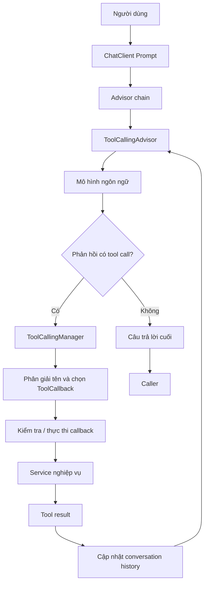
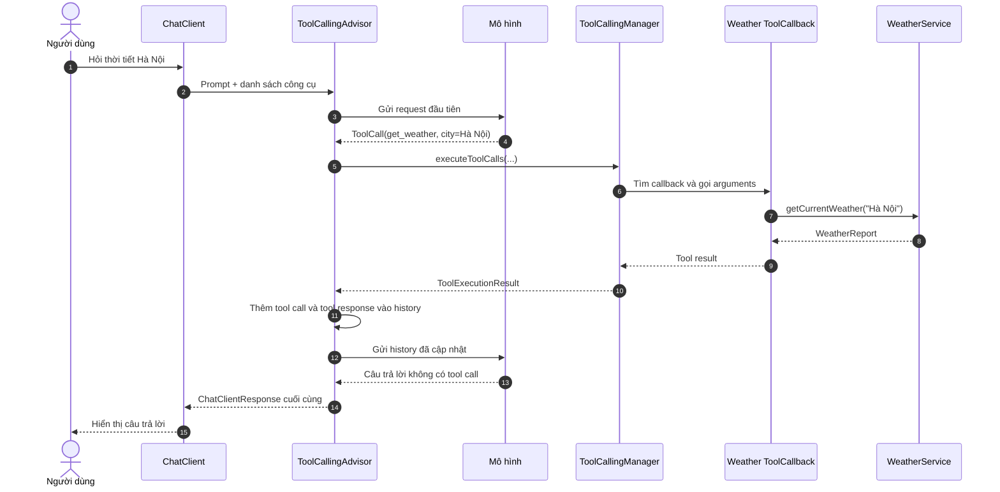

# ToolCallingAdvisor và kiến trúc vòng lặp trong Spring AI 2.x

Spring AI 2.x đưa vòng lặp gọi công cụ vào advisor chain của `ChatClient`. Khi ứng dụng cung cấp các công cụ và gọi `.call()` hoặc `.stream()`, `ToolCallingAdvisor` điều phối việc gửi định nghĩa công cụ cho mô hình, nhận tool call, yêu cầu `ToolCallingManager` thực thi callback, đưa kết quả trở lại lịch sử hội thoại và gọi mô hình tiếp cho đến khi có câu trả lời cuối cùng.

Kiến trúc này tách rõ ba trách nhiệm. Mô hình quyết định có cần công cụ hay không và sinh đối số. `ToolCallingAdvisor` quản lý vòng lặp cùng vị trí của nó trong advisor chain. `ToolCallingManager` phân giải và thực thi `ToolCallback`. Ứng dụng vẫn sở hữu quyền thực thi, xác thực, phân quyền, giới hạn tài nguyên và quy tắc nghiệp vụ.

Trong Spring AI 1.x, vòng lặp thực thi công cụ được quản lý bên trong từng `ChatModel`. Từ Spring AI 2.0, vòng lặp trở thành thành phần có thể kết hợp trong `ChatClient` advisor chain. Vì vậy, advisor về memory, quan sát, retry và logic tùy chỉnh có thể chạy bên ngoài hoặc bên trong vòng lặp tùy theo thứ tự. Bài học này tập trung vào kiến trúc đó và các API ổn định của Spring AI 2.1.0.

Sau bài học, bạn có thể:

- Mô tả vòng lặp tự động từ `ChatClient` tới mô hình, callback và câu trả lời cuối.
- Giải thích vai trò của `ToolCallingAdvisor`, `ToolCallingManager` và `ToolCallback`.
- Hiểu advisor đệ quy và ảnh hưởng của thứ tự advisor tới từng vòng gọi.
- Chọn cách lưu lịch sử hội thoại khi tool call chạy nhiều vòng.
- Dùng các hook của `ToolCallingAdvisor` để quan sát hoặc mở rộng vòng lặp.
- Tắt auto-registration khi thật sự cần tự điều khiển vòng lặp.
- Thiết lập giới hạn, xác nhận thao tác, xử lý lỗi và kiểm thử an toàn.

## 1. Kiến trúc tổng thể

Với cách dùng thông thường, ứng dụng tạo `ChatClient`, đăng ký công cụ trên prompt rồi gọi `.call()` hoặc `.stream()`. `DefaultChatClient` tự đăng ký một `ToolCallingAdvisor` trong advisor chain để quản lý vòng gọi công cụ.



Các thành phần phối hợp như sau:

| Thành phần | Trách nhiệm |
|---|---|
| `ChatClient` | Xây dựng prompt, nhận công cụ và chạy advisor chain |
| `ToolCallingAdvisor` | Điều khiển các vòng gọi mô hình, quyết định khi nào tiếp tục hoặc kết thúc |
| `ToolCallingManager` | Thực thi tool call, tìm callback, xử lý context, xác nhận và giới hạn |
| `ToolCallback` | Cung cấp định nghĩa công cụ và mã thực thi |
| Service nghiệp vụ | Kiểm tra dữ liệu, quyền, trạng thái và thực hiện thao tác thực tế |
| Các advisor khác | Bổ sung memory, logging, metrics, retry hoặc logic tùy chỉnh |

Mô hình không được cấp quyền gọi trực tiếp database hay API nội bộ. Nó chỉ trả về yêu cầu có cấu trúc. Ứng dụng mới là bên quyết định callback nào được cung cấp và callback đó có được phép chạy hay không.

## 2. Vòng lặp tự động diễn ra như thế nào?

Giả sử người dùng hỏi: “Kiểm tra thời tiết Hà Nội rồi cho tôi biết có nên mang ô không?”. Ứng dụng cung cấp `WeatherTools` cho prompt. Mô hình có thể yêu cầu `get_weather`, nhận kết quả rồi tạo câu trả lời cuối cùng.



Vòng lặp có bốn giai đoạn:

1. **Gửi request.** Advisor gửi prompt cùng định nghĩa các công cụ đã đăng ký tới mô hình.
2. **Kiểm tra phản hồi.** Nếu phản hồi không có tool call, advisor kết thúc và trả kết quả. Nếu có tool call, advisor chuyển chúng cho `ToolCallingManager`.
3. **Thực thi và cập nhật history.** Manager tìm callback tương ứng, thực thi và tạo tool response. Advisor thêm các thông điệp cần thiết vào conversation history.
4. **Gọi mô hình tiếp.** Advisor gửi history mới tới mô hình. Các bước 2–4 lặp lại cho tới khi mô hình trả lời mà không yêu cầu công cụ, hoặc vòng lặp dừng theo metadata/chính sách.

Do vòng lặp được quản lý trong cùng một lần gọi `ChatClient`, caller thường chỉ nhận câu trả lời cuối cùng. Các tool call và tool response trung gian được advisor quản lý trong quá trình xử lý.

## 3. Bắt đầu với `ChatClient`

Với cấu hình mặc định, không cần tự tạo `ToolCallingAdvisor`. `DefaultChatClient` tự thêm advisor cần thiết khi xử lý tool calling.

```java
import org.springframework.ai.chat.client.ChatClient;
import org.springframework.stereotype.Component;

@Component
public class WeatherAssistant {

    private final ChatClient chatClient;
    private final WeatherTools weatherTools;

    public WeatherAssistant(
            ChatClient.Builder chatClientBuilder,
            WeatherTools weatherTools) {
        this.chatClient = chatClientBuilder.build();
        this.weatherTools = weatherTools;
    }

    public String answer(String question) {
        return chatClient.prompt()
            .user(question)
            .tools(weatherTools)
            .call()
            .content();
    }
}
```

`WeatherTools` là đối tượng có một hoặc nhiều phương thức `@Tool`. Spring AI chuyển các định nghĩa đó thành `ToolCallback` và cung cấp cho advisor. Nếu callback đã được tạo sẵn, có thể truyền callback đó qua `.tools(callback)`; cả hai kiểu đều đi qua cùng vòng lặp.

Với client dùng chung, `.tools(...)` trên prompt chỉ cung cấp thêm công cụ cho request đó. Công cụ mặc định được cấu hình ở cấp builder sẽ có mặt trong mọi prompt của client theo cấu hình mặc định. Không đặt công cụ nhạy cảm hoặc có tác động phá hủy làm mặc định nếu chỉ một số request được phép sử dụng.

## 4. `ToolCallingAdvisor` là recursive advisor

`ToolCallingAdvisor` triển khai `CallAdvisor`, `StreamAdvisor` và marker interface `ToolAdvisor`. Nó là một recursive advisor: sau khi xử lý một vòng, nó có thể gọi lại phần advisor chain nằm phía sau nó để thực hiện vòng tiếp theo.

Trong advisor chain, `CallAdvisorChain.copy(this)` tạo một nhánh chỉ gồm các advisor nằm sau advisor hiện tại. Vì vậy:

- Advisor nằm trước `ToolCallingAdvisor` thường chạy một lần trước khi vòng lặp bắt đầu.
- Advisor nằm sau `ToolCallingAdvisor` được chạy lại ở từng vòng gọi mô hình.
- `ToolCallingAdvisor` không gọi lại những advisor nằm trước nó khi đệ quy.

Điều này giúp một advisor về quan sát có thể nhìn thấy từng vòng tool call, trong khi một advisor chuẩn bị ngữ cảnh hoặc nạp lịch sử có thể chạy một lần ở bên ngoài vòng lặp.

`ToolCallingAdvisor` dùng `ToolExecutionEligibilityChecker` để xác định phản hồi có cần thực thi công cụ và lặp tiếp không. Mặc định checker kiểm tra `chatResponse != null && chatResponse.hasToolCalls()`. Nếu provider có quy tắc finish reason riêng, có thể cấu hình checker chặt hơn.

## 5. Thứ tự advisor quyết định phạm vi mỗi vòng

Thứ tự advisor không chỉ quyết định thứ tự xử lý request. Với advisor đệ quy, nó còn quyết định advisor nào được chạy ở mỗi vòng.

`ToolCallingAdvisor.DEFAULT_ORDER` là:

```java
Ordered.HIGHEST_PRECEDENCE + 300
```

Một advisor có order thấp hơn 300 nằm bên ngoài vòng tool calling; advisor có order cao hơn 300 nằm bên trong và có thể quan sát từng vòng. Ví dụ:

| Advisor | Order minh họa | Vị trí |
|---|---:|---|
| Memory advisor cũ mặc định | `HIGHEST_PRECEDENCE + 200` | Bên ngoài vòng lặp |
| `ToolCallingAdvisor` | `HIGHEST_PRECEDENCE + 300` | Điều khiển vòng lặp |
| Advisor audit/metrics tùy chỉnh | `HIGHEST_PRECEDENCE + 400` | Bên trong vòng lặp |

Nếu cần ghi nhận từng lần mô hình yêu cầu công cụ hoặc từng kết quả tool response, đặt advisor quan sát phía trong vòng lặp. Nếu chỉ cần ghi nhận câu hỏi đầu vào và câu trả lời cuối, đặt advisor phía ngoài.

Không nên thêm nhiều `ToolCallingAdvisor` vào cùng một chain. `ToolAdvisor` là marker interface để `DefaultChatClient` bảo đảm chỉ có tối đa một tool advisor trong chain. Khi ứng dụng cung cấp một custom advisor triển khai `ToolAdvisor`, advisor mặc định được thay thế. Nếu đăng ký hai custom tool advisor cùng lúc, chain sẽ báo lỗi để tránh thực thi công cụ hai lần.

## 6. Lịch sử hội thoại bên trong và bên ngoài vòng lặp

Mô hình cần nhận được lịch sử tool call và tool response của các vòng trước để biết ứng dụng đã làm gì và kết quả ra sao. `ToolCallingAdvisor` mặc định tự giữ conversation history trong vòng lặp. Mỗi lần gọi mô hình tiếp theo nhận đầy đủ user message, assistant tool call và tool response của các vòng trước.

Với `MessageChatMemoryAdvisor` cũ, order mặc định thấp hơn `ToolCallingAdvisor`, nên memory nằm bên ngoài vòng lặp. Nó nạp lịch sử trước vòng lặp và chỉ lưu trao đổi user/final assistant sau khi vòng lặp kết thúc. Nó không nhìn thấy tool call và tool response trung gian.

Nếu muốn memory lưu cả transcript của từng vòng, cần đặt memory advisor bên trong vòng lặp. Ví dụ với API memory cũ:

```java
var memoryAdvisor = MessageChatMemoryAdvisor.builder(chatMemory)
    .order(BaseAdvisor.HIGHEST_PRECEDENCE + 400)
    .build();

var chatClient = ChatClient.builder(chatModel)
    .defaultAdvisors(memoryAdvisor)
    .build();
```

Khi memory advisor nằm bên trong, không để cả memory và `ToolCallingAdvisor` cùng ghi một bản history. Nếu tự tạo `ToolCallingAdvisor`, gọi `.disableInternalConversationHistory()` để memory quản lý lịch sử từng vòng. Với advisor được auto-register, `DefaultChatClient` nhận biết memory advisor nằm trong loop và tự tắt history nội bộ.

Từ Spring AI 2.1.0, `ChatMemory` và `MessageChatMemoryAdvisor` đã deprecated để chuyển sang Session Memory. Session Memory advisor được đặt bên trong vòng tool calling theo cấu hình mặc định và hỗ trợ lưu transcript theo event. Khi dùng memory repository bên trong vòng lặp, cần bảo đảm repository serialize được cả assistant tool call request và `ToolResponseMessage`, không chỉ user/assistant text thông thường.

## 7. Streaming và tool call từng phần

`ToolCallingAdvisor` hỗ trợ cả `.call()` và `.stream()`. Với streaming, một số model/provider phát các phần arguments của tool call thành nhiều chunk. Những phần này là delta, chưa phải tool call hoàn chỉnh và thường chưa phải JSON hợp lệ.

Spring AI biểu diễn các delta bằng `ToolCallPart` có trạng thái partial. `AssistantMessage.getToolCalls()` và `hasToolCalls()` bỏ qua phần partial. `ToolCallingManager` chỉ thực thi tool call hoàn chỉnh khi model kết thúc phản hồi. Vì vậy, ứng dụng không được tự parse hoặc thực thi một fragment arguments đang được stream.

Nếu giao diện cần hiển thị tiến trình, có thể đọc `.stream().chatResponse()` và kiểm tra `MessagePart`/`StreamingParts.isPartial(part)` để hiển thị tên công cụ và phần arguments đang đến. Khi tool call hoàn chỉnh xuất hiện, advisor sẽ thực thi theo vòng lặp như bình thường. `.stream().content()` chỉ phát nội dung text; các delta arguments không phải text nên không xuất hiện trong content stream.

Ví dụ minh họa quan sát delta:

```java
chatClient.prompt()
    .user("Kiểm tra thời tiết Amsterdam và Paris")
    .tools(weatherTools)
    .stream()
    .chatResponse()
    .subscribe(response -> response.getResults().forEach(generation -> {
        for (MessagePart part : generation.getOutput().getParts()) {
            if (part instanceof ToolCallPart toolCallPart
                    && StreamingParts.isPartial(part)) {
                var delta = toolCallPart.toolCall();
                ui.showToolProgress(
                    delta.id(), delta.name(), delta.arguments()
                );
            }
        }
    }));
```

Đây chỉ là luồng hiển thị tiến trình. Việc thực thi vẫn do advisor và manager thực hiện sau khi nhận tool call đầy đủ.

## 8. Cấu hình `ToolCallingAdvisor` tường minh

Phần lớn ứng dụng dùng auto-registration. Chỉ tạo advisor trực tiếp khi cần manager riêng, checker riêng, thay đổi order hoặc custom subclass.

```java
ToolCallingAdvisor toolCallingAdvisor = ToolCallingAdvisor.builder()
    .toolCallingManager(toolCallingManager)
    .advisorOrder(BaseAdvisor.HIGHEST_PRECEDENCE + 300)
    .build();

ChatClient chatClient = ChatClient.builder(chatModel)
    .defaultAdvisors(toolCallingAdvisor)
    .defaultTools(weatherTools)
    .build();
```

Các cấu hình chính:

| Builder option | Ý nghĩa |
|---|---|
| `toolCallingManager(...)` | Manager thực thi các tool call |
| `toolExecutionEligibilityChecker(...)` | Quyết định response có kích hoạt vòng tool tiếp theo hay không |
| `advisorOrder(...)` | Đặt advisor bên ngoài hoặc bên trong các advisor khác |
| `conversationHistoryEnabled(true)` | Advisor tự giữ toàn bộ history qua các vòng; đây là mặc định |
| `disableInternalConversationHistory()` | Chỉ chuyển thông điệp mới nhất cho chain; dùng khi memory bên trong quản lý history |

Ví dụ checker tùy chỉnh khi provider yêu cầu finish reason phải là `tool_calls`:

```java
ToolExecutionEligibilityChecker checker = response ->
    response != null
        && response.hasToolCalls()
        && "tool_calls".equals(response.getMetadata().getFinishReason());

ToolCallingAdvisor advisor = ToolCallingAdvisor.builder()
    .toolExecutionEligibilityChecker(checker)
    .build();
```

Chỉ thêm điều kiện theo finish reason khi provider thực sự yêu cầu. Nếu checker quá chặt và không khớp response thực tế, tool call hợp lệ có thể không được thực thi.

## 9. Hook để mở rộng vòng lặp

`ToolCallingAdvisor` cung cấp hook protected cho cả call và stream. Custom subclass có thể thêm audit, metrics, context hoặc điều chỉnh request mà không cần viết lại toàn bộ vòng lặp.

| Hook | Thời điểm chạy | Mục đích thường gặp |
|---|---|---|
| `doInitializeLoop` | Một lần trước vòng đầu | Chuẩn bị state theo session, index hoặc cache |
| `doBeforeCall` | Trước mỗi lần gọi model | Thêm/bớt tool, cập nhật options hoặc context |
| `doAfterCall` | Sau mỗi phản hồi model | Ghi nhận tool intent, metrics hoặc kiểm tra kết quả |
| `doGetNextInstructionsForToolCall` | Sau khi callback chạy | Chọn messages gửi cho vòng tiếp theo |
| `doFinalizeLoop` | Một lần sau khi kết thúc | Tổng hợp metrics, dọn state hoặc biến đổi response cuối |

Mỗi hook ở call path có một hook tương ứng ở stream path, ví dụ `doBeforeStream`, `doAfterStream` và `doFinalizeLoopStream`. Nếu custom advisor hỗ trợ cả hai chế độ, cần triển khai cả hai họ hook để hành vi nhất quán.

Ví dụ ý tưởng: ghi lại tên công cụ được mô hình yêu cầu sau mỗi vòng trong một subclass của `ToolCallingAdvisor`.

```java
@Override
protected ChatClientResponse doAfterCall(
        ChatClientResponse response,
        CallAdvisorChain chain) {

    if (response.chatResponse() != null
            && response.chatResponse().hasToolCalls()) {
        var toolCalls = response.chatResponse()
            .getResult().getOutput().getToolCalls();

        toolCalls.forEach(call ->
            auditService.recordRequestedTool(call.name(), call.arguments())
        );
    }

    return response;
}
```

Đây là phần thân hook minh họa bên trong subclass; lớp thực tế cần constructor và builder riêng để nhận dependency, đồng thời override hook stream tương ứng nếu hỗ trợ streaming. Khi xây dựng custom builder dùng với auto-configuration, cần triển khai đúng cơ chế `newCopy()` và `copy()` mà `DefaultChatClient` sử dụng cho từng prompt.

Custom `ToolAdvisor` có thể được tích hợp tự động bằng cách cung cấp bean `ToolCallingAdvisor.Builder<?>` trong auto-configuration chạy trước `ChatClientAutoConfiguration`. Cách này phù hợp khi muốn thay thế advisor mặc định ở cấp ứng dụng hoặc thư viện. Với logic đơn giản chỉ cần quan sát mỗi vòng, một advisor thường đặt bên trong loop có thể đủ và ít phức tạp hơn việc kế thừa `ToolCallingAdvisor`.

## 10. Quan sát từng vòng mà không tự viết vòng lặp

Nếu mục tiêu là gửi tiến trình tới SSE/WebSocket, ghi audit hoặc đo thời gian mỗi vòng, không nhất thiết phải tắt advisor tự động. Có thể đặt một advisor quan sát bên trong `ToolCallingAdvisor` bằng order lớn hơn 300:

```java
public class ToolCallObservingAdvisor implements CallAdvisor, StreamAdvisor {

    private final Consumer<ChatClientResponse> observer;

    public ToolCallObservingAdvisor(Consumer<ChatClientResponse> observer) {
        this.observer = observer;
    }

    @Override
    public int getOrder() {
        return Ordered.HIGHEST_PRECEDENCE + 400;
    }

    @Override
    public ChatClientResponse adviseCall(
            ChatClientRequest request,
            CallAdvisorChain chain) {
        ChatClientResponse response = chain.nextCall(request);
        observer.accept(response);
        return response;
    }

    @Override
    public Flux<ChatClientResponse> adviseStream(
            ChatClientRequest request,
            StreamAdvisorChain chain) {
        return chain.nextStream(request).doOnNext(observer);
    }
}
```

Đăng ký advisor quan sát cùng `ChatClient`:

```java
ChatClient chatClient = ChatClient.builder(chatModel)
    .defaultAdvisors(new ToolCallObservingAdvisor(this::publishProgress))
    .build();
```

Vì advisor quan sát nằm bên trong loop, nó được gọi ở từng iteration. Caller bên ngoài vẫn nhận kết quả cuối theo luồng của `ToolCallingAdvisor`; advisor quan sát có thể phát sự kiện trung gian sang kênh phụ. Khi ghi arguments hoặc result vào audit, cần che dữ liệu nhạy cảm và giới hạn quyền truy cập log.

## 11. Khi nào cần tự điều khiển vòng lặp?

Vòng tự động đáp ứng phần lớn nhu cầu. Chỉ tắt auto-registration khi ứng dụng cần điều khiển từng iteration, ví dụ:

- Phải chờ một hệ thống phê duyệt bên ngoài trước khi thực thi.
- Muốn phát tiến trình từng vòng và tự quyết định thời điểm tiếp tục.
- Có tín hiệu dừng từ một kênh khác.
- Cần điều kiện nghiệp vụ giữa hai lần gọi model mà hook advisor không đáp ứng.

Tắt advisor cho một prompt:

```java
ChatClientResponse response = chatClient.prompt()
    .user(question)
    .tools(weatherTools)
    .advisors(AdvisorParams.toolCallingAdvisorAutoRegister(false))
    .call()
    .chatClientResponse();
```

Hoặc tắt auto-registration toàn cục cho `ChatClient` được auto-configure:

```properties
spring.ai.chat.client.tool-calling.enabled=false
```

Khi đã tắt, định nghĩa công cụ vẫn có thể được gửi cho mô hình, nhưng tool call trong response không tự động được thực thi. Ứng dụng phải kiểm tra `ChatResponse.hasToolCalls()`, gọi `ToolCallingManager.executeToolCalls(...)`, đưa history mới vào prompt tiếp theo và lặp cho tới khi không còn tool call.

Ví dụ khung vòng lặp blocking:

```java
ToolCallingManager manager = ToolCallingManager.builder().build();
ToolCallback[] tools = ToolCallbacks.from(weatherTools);

ToolCallingChatOptions options = ToolCallingChatOptions.builder()
    .toolCallbacks(tools)
    .build();

ChatClientResponse response = chatClient.prompt()
    .user(question)
    .tools(tools)
    .advisors(AdvisorParams.toolCallingAdvisorAutoRegister(false))
    .call()
    .chatClientResponse();

Prompt prompt = new Prompt(List.of(new UserMessage(question)), options);

while (response.chatResponse() != null
        && response.chatResponse().hasToolCalls()) {

    ToolExecutionResult result = manager.executeToolCalls(
        prompt, response.chatResponse()
    );

    prompt = new Prompt(result.conversationHistory(), options);

    response = chatClient.prompt()
        .messages(result.conversationHistory())
        .tools(tools)
        .advisors(AdvisorParams.toolCallingAdvisorAutoRegister(false))
        .call()
        .chatClientResponse();
}
```

Đây là mẫu khung để minh họa trách nhiệm điều phối; ứng dụng cần bổ sung cách trả response cuối, xử lý lỗi, giới hạn số vòng, lưu history và truyền context theo API thực tế. Với streaming, cần aggregate các chunk để phát hiện tool call hoàn chỉnh, đồng thời có thể forward raw chunk ra SSE. Tự điều khiển vòng lặp cũng đồng nghĩa ứng dụng phải tự bảo đảm các advisor, observations, memory và quy tắc dừng mà framework tự động cung cấp.

Trong vòng lặp thực tế, kiểm tra `result.returnDirect()` ngay sau `executeToolCalls`. Nếu là `true`, chuyển tool result thành generation trả cho caller bằng `ToolExecutionResult.buildGenerations(result)` và dừng; không gửi kết quả đó trở lại mô hình. Khi dùng `ToolCallingAdvisor`, advisor tự xử lý nhánh này.

## 12. `returnDirect`: kết thúc ngay sau kết quả công cụ

Mặc định, kết quả callback được gửi lại mô hình để mô hình diễn giải và tiếp tục. Khi metadata công cụ đặt `returnDirect = true`, `ToolCallingAdvisor` kết thúc vòng lặp và trả kết quả tool trực tiếp cho caller mà không gửi kết quả đó trở lại mô hình.

Trường hợp phù hợp là output của công cụ đã là câu trả lời cuối hoặc một payload đã có định dạng ổn định. Nếu mô hình cần tổng hợp nhiều nguồn hoặc giải thích kết quả, nên để `returnDirect = false`.

Nếu một iteration chứa nhiều tool call, `returnDirect` chỉ được áp dụng khi tất cả công cụ trong batch đều có `returnDirect = true`. Nếu có ít nhất một công cụ không bật cờ này, kết quả được đưa lại mô hình và vòng lặp tiếp tục.

`returnDirect` chỉ điều khiển đường đi kết quả. Nó không thay thế xác thực, phân quyền, xác nhận thao tác hay kiểm tra dữ liệu trước khi hiển thị.

## 13. Xác nhận thao tác trước khi thực thi

Với thao tác có tác động phụ như đặt chỗ, hủy đơn hoặc gửi giao dịch, mô hình không nên tự quyết định thực thi ngay. Từ Spring AI 2.1.0, `ToolCallingManager` hỗ trợ `ToolCallConfirmationPolicy` để tạm dừng vòng lặp khi cần người dùng phê duyệt.

Có thể đánh dấu công cụ bằng `requiresConfirmation`:

```java
class BookingTools {

    @Tool(description = "Đặt chuyến bay", requiresConfirmation = true)
    String bookFlight(String flightNumber) {
        return bookingService.book(flightNumber);
    }

    @Tool(description = "Tra cứu trạng thái chuyến bay")
    String flightStatus(String flightNumber) {
        return bookingService.status(flightNumber);
    }
}
```

Nếu phản hồi có một tool call cần xác nhận, manager ném `ToolCallConfirmationRequiredException`; advisor dừng và trả response chứa các call đang chờ quyết định. Ứng dụng hiển thị thông tin cho người có quyền phê duyệt, ghi nhận allow/deny rồi gọi `ToolCallingManager.executeToolCalls(prompt, reply, decisions)` bằng response đã lưu ở phía server. Sau đó gửi tool result trở lại mô hình để tiếp tục hội thoại.

Framework không tự xác thực người phê duyệt và không tự chống replay. Ứng dụng phải xác minh người duyệt có quyền, lưu paused response ở nơi client không thể sửa, ghi nhận quyết định đã dùng và làm cho việc resume có tính idempotent. Không nhận nguyên `ChatResponse` từ client rồi thực thi, vì client có thể sửa tên công cụ và arguments.

## 14. Giới hạn vòng gọi và xử lý lỗi

Vòng lặp cần giới hạn để tránh mô hình yêu cầu công cụ liên tục, gây tốn token hoặc tạo tải không kiểm soát. `DefaultToolCallingManager` hỗ trợ giới hạn số lần gọi theo từng công cụ và tổng số tool call trong một turn.

Ví dụ cấu hình:

```java
ToolCallingManager manager = ToolCallingManager.builder()
    .maxCallsPerTool(20)
    .maxCallsPerTool("search_inventory", 8)
    .maxTotalToolCalls(60)
    .onLimitExceeded(ToolCallLimitBehavior.THROW)
    .build();
```

Các property tương ứng:

```properties
spring.ai.tools.limits.max-calls-per-tool-default=20
spring.ai.tools.limits.max-calls-per-tool.search_inventory=8
spring.ai.tools.limits.max-total-tool-calls=60
spring.ai.tools.limits.on-limit-exceeded=THROW
```

Spring AI 2.1.0 có mặc định 40 lần cho mỗi công cụ và 150 lần tổng trong một turn. Có thể chọn `RETURN_ERROR_RESPONSE` để tạo tool response báo giới hạn và cho mô hình tiếp tục xử lý, hoặc `THROW` để dừng và trả lỗi cho caller. Chỉ tăng giới hạn khi đã đánh giá ngân sách và tải thực tế.

Khi callback ném exception, `ToolExecutionExceptionProcessor` quyết định gửi thông báo lỗi về mô hình hay ném lỗi ra caller. Processor mặc định gửi message của `RuntimeException` về mô hình; checked exception và `Error` được ném lại. Có thể cấu hình:

```properties
spring.ai.tools.throw-exception-on-error=true
```

Khi gửi lỗi về mô hình, hãy dùng thông báo đã được làm sạch, không chứa stack trace, SQL, access token hoặc cấu hình nội bộ. Nếu cần caller xử lý lỗi, bật chế độ throw hoặc cung cấp processor phù hợp.

## 15. Quan sát và đo lường vòng lặp

Một request có thể tạo nhiều lần gọi mô hình và nhiều lần thực thi callback. Chỉ đo thời gian tổng của `.call()` sẽ không cho biết vòng nào chậm hoặc công cụ nào lỗi.

Nên quan sát:

- Số vòng gọi mô hình trong một turn.
- Số tool call theo tên và trạng thái thành công/thất bại.
- Thời gian từng lần gọi model và từng callback.
- Token usage tích lũy qua tất cả vòng.
- Số lần dừng do giới hạn, xác nhận hoặc lỗi.
- Tỷ lệ phản hồi cuối không cần công cụ so với phản hồi có tool call.

Spring AI phát Micrometer observation cho tool call dưới tên `spring.ai.tool`. Arguments và kết quả có thể được đưa vào span attributes nếu bật cấu hình, nhưng mặc định không bật vì lý do nhạy cảm. Chỉ ghi các trường cần thiết và che dữ liệu cá nhân hoặc bí mật.

## 16. Khi có hàng chục hoặc hàng trăm công cụ

`ToolCallingAdvisor` mặc định gửi tất cả định nghĩa công cụ đã đăng ký cho mô hình ở mỗi request. Với tập công cụ nhỏ, cách này đơn giản. Khi có từ vài chục công cụ trở lên hoặc nhiều MCP server, schema lớn làm tăng context, chi phí token và khả năng mô hình chọn nhầm.

Spring AI 2.1.0 cung cấp `ToolSearchToolCallingAdvisor` để progressive tool disclosure. Advisor lập chỉ mục tập công cụ và chỉ đưa công cụ tìm kiếm vào request đầu; mô hình dùng công cụ tìm kiếm để khám phá công cụ phù hợp. Các công cụ được tìm thấy mới được cung cấp cho những vòng tiếp theo.

Có thể bật bằng:

```properties
spring.ai.chat.client.tool-search-advisor.enabled=true
```

Đây là lựa chọn khi tập công cụ lớn. Với tập công cụ nhỏ, cung cấp trực tiếp bằng `.tools(...)` vẫn dễ kiểm soát và dễ debug hơn.

## 17. Khác biệt quan trọng giữa Spring AI 1.x và 2.x

| Nội dung | Spring AI 1.x | Spring AI 2.x |
|---|---|---|
| Vòng thực thi tool | Vòng lặp nội bộ từng `ChatModel` | `ToolCallingAdvisor` trong `ChatClient` advisor chain |
| Tích hợp advisor | Advisor khó quan sát từng vòng nội bộ của model | Advisor chain có thể chạy bên trong từng vòng |
| Quản lý history | Tool loop nằm trong model nên memory không thấy tool messages | Có thể đặt memory advisor ngoài hoặc trong loop |
| Tự điều khiển | Tùy API model và manager | Tắt auto-registration rồi dùng `ToolCallingManager` |
| Mở rộng vòng lặp | Không có cùng extension point advisor đệ quy | Hook của `ToolCallingAdvisor` và custom `ToolAdvisor` |

Gọi `ChatModel.call()` trực tiếp trong Spring AI 2.x vẫn hỗ trợ gửi tool definitions và nhận tool call, nhưng không tự chạy vòng lặp. Nếu không dùng `ChatClient`, ứng dụng phải gọi `ToolCallingManager`, cập nhật history và gọi model tiếp cho đến khi không còn tool call.

## 18. Kiểm thử kiến trúc vòng lặp

Nên kiểm thử các thành phần riêng và cả luồng tích hợp.

**Kiểm thử vòng lặp tự động:** mô phỏng phản hồi model đầu tiên có tool call và phản hồi kế tiếp không có tool call. Xác nhận callback chạy, tool result được thêm vào history và model được gọi lại đúng số lần.

**Kiểm thử không có tool call:** model trả text ngay từ đầu; callback không được gọi và caller nhận câu trả lời đó.

**Kiểm thử nhiều tool call:** một iteration yêu cầu hai công cụ; xác nhận mỗi callback được ánh xạ đúng, kết quả được gắn đúng tool call ID và vòng tiếp theo nhận đủ tool response.

**Kiểm thử returnDirect:** một công cụ bật `returnDirect`; xác nhận advisor kết thúc vòng sau khi thực thi. Nếu batch có một công cụ không bật cờ, xác nhận kết quả được đưa lại mô hình.

**Kiểm thử advisor order:** advisor ngoài loop chạy một lần; advisor trong loop chạy ở mỗi iteration. Xác nhận memory không ghi trùng lịch sử.

**Kiểm thử streaming:** partial tool-call delta không được thực thi; chỉ tool call hoàn chỉnh mới được manager xử lý. Xác nhận stream cuối cùng vẫn trả nội dung theo hợp đồng.

**Kiểm thử giới hạn và lỗi:** vượt max calls, callback timeout, callback ném exception và tool call cần confirmation. Xác nhận loop dừng hoặc tiếp tục theo chính sách.

**Kiểm thử quyền:** callback không thể đọc dữ liệu ngoài tenant hoặc thực hiện thao tác khi thiếu quyền, kể cả khi mô hình sinh arguments hợp lệ về schema.

## 19. Lỗi thường gặp

| Triệu chứng | Nguyên nhân | Cách xử lý |
|---|---|---|
| Model trả tool call nhưng callback không chạy | Đã tắt auto-registration hoặc đang gọi `ChatModel` trực tiếp | Bật lại `ToolCallingAdvisor` hoặc tự điều khiển bằng manager |
| Hai tool advisor cùng thực thi | Đăng ký advisor mặc định và custom advisor riêng mà không thay thế đúng cách | Chỉ giữ một `ToolAdvisor` trong chain |
| Model không thấy kết quả tool trước | History không được đưa vào vòng tiếp theo hoặc memory nằm sai vị trí | Kiểm tra history nội bộ và advisor order |
| Memory ghi thiếu tool transcript | Memory advisor nằm ngoài vòng lặp | Đặt memory bên trong khi cần lưu tool messages và kiểm tra repository |
| Memory ghi history trùng | Cả memory và advisor cùng quản lý history | Tắt internal history khi memory ở bên trong |
| Tool call chạy quá nhiều vòng | Không giới hạn số lần gọi hoặc giới hạn quá cao | Cấu hình max calls, timeout và ngân sách token |
| UI thấy arguments JSON chưa hoàn chỉnh | Đang đọc streaming partial delta | Chỉ hiển thị tiến trình; không parse/execute delta |
| Công cụ ghi chạy mà chưa có phê duyệt | Chưa bật `requiresConfirmation`/policy | Cấu hình confirmation policy và kiểm tra người duyệt |
| Lỗi nội bộ bị gửi cho mô hình | Exception processor mặc định gửi message RuntimeException | Làm sạch thông điệp hoặc cấu hình throw-to-caller |

## 20. Ghi nhớ

- Trong Spring AI 2.x, `ToolCallingAdvisor` điều khiển vòng gọi công cụ bên trong advisor chain của `ChatClient`.
- `ToolCallingManager` tìm và thực thi callback; kết quả được thêm vào conversation history rồi gửi lại mô hình.
- `ToolCallingAdvisor` là recursive advisor; advisor order quyết định thành phần nào chạy một lần và thành phần nào chạy ở từng vòng.
- Auto-registration đáp ứng phần lớn nhu cầu. Chỉ tắt nó khi ứng dụng cần tự điều khiển từng iteration hoặc có một custom `ToolAdvisor` phù hợp.
- Memory cần được đặt đúng phía của vòng lặp; Session Memory là hướng được khuyến nghị trong Spring AI 2.1.0.
- Streaming partial tool-call delta chưa phải tool call hoàn chỉnh và không được thực thi.
- Giới hạn tool call, exception processor, confirmation và quyền service là các phần của kiến trúc an toàn.

Khi xây dựng assistant bằng Spring AI 2.x, hãy bắt đầu với vòng tự động của `ChatClient`. Chỉ mở rộng advisor khi cần quan sát hoặc điều chỉnh từng vòng; chỉ tự điều khiển manager khi thực sự cần quyền kiểm soát toàn bộ chu trình. Dù dùng cách nào, ứng dụng vẫn phải giới hạn số lần gọi, xác thực dữ liệu và quyền, đồng thời kiểm thử cả đường thành công lẫn các điểm dừng do lỗi hoặc phê duyệt.

## Tài liệu tham khảo

- [Spring AI 2.1.0 — Tool Calling](https://docs.spring.io/spring-ai/reference/api/tools.html)
- [Spring AI 2.1.0 — ToolCallingAdvisor](https://docs.spring.io/spring-ai/reference/api/tools/tool-calling-advisor.html)
- [Spring AI 2.1.0 — Recursive Advisors](https://docs.spring.io/spring-ai/reference/api/advisors-recursive.html)
- [Spring AI 2.1.0 — Tool Call Confirmation](https://docs.spring.io/spring-ai/reference/api/tools/tool-call-confirmation.html)
