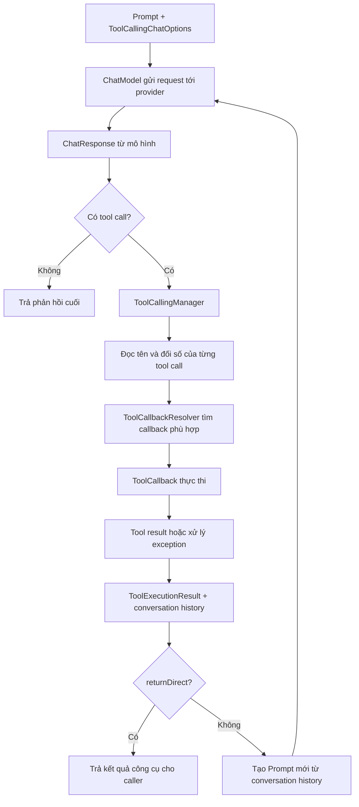

# ToolCallingManager và quá trình tìm, gọi, thu thập kết quả công cụ

Khi mô hình trả về một yêu cầu gọi công cụ, ứng dụng cần tìm đúng công cụ đã đăng ký, chuyển đối số tới phần thực thi, thu thập kết quả và gắn kết quả với yêu cầu ban đầu. Trong Spring AI, `ToolCallingManager` đảm nhiệm phần điều phối thực thi này. Nó làm việc với `ToolCallback`, `ToolCallbackResolver`, `ToolExecutionExceptionProcessor` và `ToolExecutionResult` để chuyển một phản hồi có tool call thành lịch sử hội thoại đã có kết quả công cụ.

`ToolCallingManager` không phải là mô hình ngôn ngữ và cũng không tự quyết định người dùng được phép làm gì. Mô hình đề xuất tên công cụ cùng đối số; ứng dụng cung cấp danh sách callback, kiểm tra quyền trong service và quyết định có tiếp tục gọi mô hình hay không. Với `ChatClient`, `ToolCallingAdvisor` tự quản lý vòng lặp và gọi manager ở mỗi vòng. Khi dùng `ChatModel` trực tiếp hoặc xây dựng một bộ điều phối riêng, ứng dụng gọi `ToolCallingManager` tường minh.

## Vị trí của ToolCallingManager trong kiến trúc

Các thành phần chính có trách nhiệm khác nhau:

| Thành phần | Trách nhiệm |
|---|---|
| `ChatModel` | Gửi prompt và tool definitions tới provider; trả về phản hồi của mô hình, có thể chứa tool call |
| `ToolCallingChatOptions` | Mang danh sách `ToolCallback`, tool context và các tùy chọn tool calling cho request |
| `ToolDefinition` | Mô tả tên, mô tả và JSON Schema của một công cụ để mô hình lựa chọn và tạo đối số |
| `ToolCallback` | Cung cấp định nghĩa và logic thực thi của một công cụ |
| `ToolCallbackResolver` | Tìm callback theo tên công cụ trong những callback mà ứng dụng cho phép phân giải |
| `ToolCallingManager` | Phân giải công cụ, thực thi các tool call và tạo kết quả thực thi gắn với lịch sử hội thoại |
| `ToolExecutionExceptionProcessor` | Quyết định cách xử lý lỗi phát sinh khi callback thực thi |
| `ToolExecutionResult` | Trả lịch sử hội thoại đã bổ sung tool result và cho biết có thể trả kết quả trực tiếp hay không |
| `ToolCallingAdvisor` | Tự động chạy vòng lặp gọi mô hình, thực thi công cụ và gọi lại mô hình khi dùng `ChatClient` |



Luồng trên có thể được `ToolCallingAdvisor` điều khiển tự động hoặc được ứng dụng triển khai thủ công. Dù chọn cách nào, callback chỉ được thực thi bởi ứng dụng. Mô hình không nhận quyền truy cập trực tiếp vào database, HTTP client hay service phía sau callback.

## ToolCallingManager cung cấp những thao tác nào?

Trong Spring AI 2.1.0, interface `ToolCallingManager` thuộc package `org.springframework.ai.model.tool` và có hai thao tác chính:

```java
public interface ToolCallingManager {

    List<ToolDefinition> resolveToolDefinitions(
            ToolCallingChatOptions chatOptions);

    ToolExecutionResult executeToolCalls(
            Prompt prompt,
            ChatResponse chatResponse);
}
```

`resolveToolDefinitions(...)` lấy danh sách định nghĩa công cụ từ các tùy chọn tool calling. Provider dùng các định nghĩa này để gửi tên, mô tả và schema tới mô hình. `executeToolCalls(...)` nhận prompt đã gửi cho mô hình cùng phản hồi có tool call, tìm callback phù hợp và thực thi các yêu cầu đó.

Ứng dụng thường không cần tự gọi `resolveToolDefinitions(...)` trong luồng hội thoại thông thường; `ChatModel` và `ToolCallingAdvisor` xử lý phần trao đổi tool definitions. Phương thức này hữu ích khi xây dựng tích hợp provider, bộ điều phối hoặc thành phần hạ tầng cần xem các định nghĩa đã được phân giải.

Spring Boot auto-configure `DefaultToolCallingManager` khi có cấu hình Spring AI phù hợp. Nếu không dùng auto-configuration, có thể tạo implementation mặc định bằng builder:

```java
ToolCallingManager toolCallingManager = ToolCallingManager.builder()
        .build();
```

Không cần tự tạo manager mới cho từng tool call. `DefaultToolCallingManager` được thiết kế để có thể được chia sẻ giữa các request; bộ đếm giới hạn được tính từ lịch sử của lượt hiện tại thay vì lưu trạng thái mutable riêng cho từng request trong manager.

## Cách manager tìm đúng ToolCallback

Mô hình không gửi một tham chiếu Java hay địa chỉ object. Nó trả về một tool call có tên và JSON arguments. Ví dụ phản hồi có thể yêu cầu:

```json
{
  "id": "call_7f2a",
  "name": "lookupOrder",
  "arguments": {
    "orderId": "ORD-2048"
  }
}
```

Manager dùng tên `lookupOrder` để tìm `ToolCallback` tương ứng. Callback có `ToolDefinition` mô tả cùng tên, schema và phần thực thi. Tên công cụ cần duy nhất trong tập callback được cung cấp cho một request; nếu có hai callback trùng tên, việc phân giải có thể chọn nhầm hoặc request bị từ chối tùy đường gọi và cơ chế xác thực danh sách.

Spring AI có `ToolCallbackResolver` với thao tác `resolve(String toolName)`. Resolver mặc định là `StaticToolCallbackResolver`, được auto-configure từ các bean `ToolCallback` trong application context và các callback provider phù hợp. Khi dùng `ChatClient`, cách phổ biến nhất là truyền callback rõ ràng bằng `.tools(...)` hoặc `.defaultTools(...)`. Khi dùng `ChatModel` trực tiếp, truyền danh sách callback vào `ToolCallingChatOptions.toolCallbacks(...)`.

Ví dụ đăng ký và truyền callback:

```java
ToolCallback[] tools = ToolCallbacks.from(new OrderTools(orderService));

ToolCallingChatOptions options = ToolCallingChatOptions.builder()
        .toolCallbacks(tools)
        .build();

Prompt prompt = new Prompt(
        "Kiểm tra trạng thái đơn ORD-2048",
        options);
```

`ToolCallbacks.from(...)` chuyển object có các phương thức `@Tool` thành callback. Có thể truyền trực tiếp một `ToolCallback` tự triển khai hoặc callback tạo bằng `MethodToolCallback`/`FunctionToolCallback`.

### Quy tắc phân giải và ranh giới cho phép

Trong Spring AI 2.1.0, chế độ fallback phân giải một tool bean toàn cục dù callback đó không được gắn vào request bị tắt mặc định. Khi fallback tắt, manager chỉ thực thi callback nằm trong danh sách được request cho phép. Điều này quan trọng vì một tool bean có thể có quyền ghi dữ liệu hoặc thao tác nhạy cảm; việc bean tồn tại trong application context không có nghĩa mọi request đều được dùng nó.

Có thể bật fallback bằng `spring.ai.tools.resolution.fallback.enabled=true` hoặc `.resolutionFallbackEnabled(true)` trên builder. Chỉ bật khi resolver được kiểm soát chặt và mọi tool mà nó có thể trả về đều được phép thực thi trong phạm vi request. Nếu bật tùy tiện, mô hình có thể yêu cầu một tool có sẵn toàn cục dù ứng dụng không định cung cấp tool đó cho request hiện tại.

Khi kết hợp callback cục bộ với MCP tools, cần tránh tên trùng. `ChatClient` kiểm tra danh sách tool đã hợp nhất và báo lỗi khi có tên trùng. Với vòng lặp tự viết và `ChatModel` trực tiếp, hãy tự kiểm tra danh sách callback trước khi gửi request; không dựa vào việc thứ tự callback sẽ luôn chọn đúng tool.

## Quá trình thực thi một tool call

Sau khi tìm được callback, manager chuyển JSON arguments tới `ToolCallback.call(...)`. Tùy implementation, callback parse JSON, ánh xạ sang tham số Java, gọi service nghiệp vụ và chuyển kết quả thành chuỗi.

Một tool call thường đi qua các bước:

1. Đọc tên, ID và arguments trong `AssistantMessage.ToolCall` do mô hình trả về.
2. Tìm callback có tên tương ứng trong phạm vi callback được phép của request.
3. Kiểm tra điều kiện thực thi và giới hạn số lần gọi.
4. Gọi callback với JSON input và `ToolContext` nếu có.
5. Nhận chuỗi kết quả hoặc xử lý exception qua `ToolExecutionExceptionProcessor`.
6. Tạo một tool response gắn với ID và tên của tool call ban đầu.
7. Đưa assistant message chứa yêu cầu gọi công cụ cùng tool response vào lịch sử hội thoại.

Việc gắn đúng ID là cần thiết vì provider cần biết tool response nào trả lời tool call nào. Không nên chỉ nối kết quả thành một đoạn văn bản tự do vào prompt rồi bỏ thông tin liên kết của giao thức.

Nếu một phản hồi có nhiều tool call, manager xử lý các yêu cầu trong batch và thu thập tool response tương ứng. Mỗi callback vẫn chịu trách nhiệm xác thực đối số và quyền truy cập. Nếu các công cụ có phụ thuộc dữ liệu hoặc side effect, thiết kế service phải bảo đảm thứ tự và tính nhất quán nghiệp vụ; không dựa vào mô hình để bảo đảm một chuỗi giao dịch an toàn.

## ToolExecutionResult thu thập những gì?

`executeToolCalls(...)` trả về `ToolExecutionResult`, không chỉ trả một chuỗi kết quả đơn lẻ. Interface này cung cấp hai thông tin quan trọng:

```java
public interface ToolExecutionResult {

    List<Message> conversationHistory();

    boolean returnDirect();
}
```

`conversationHistory()` chứa các thông điệp cần thiết để tiếp tục hội thoại: lịch sử prompt, phản hồi assistant có tool call và các `ToolResponseMessage` do callback tạo ra. Ứng dụng dùng danh sách này làm messages của prompt tiếp theo. Nhờ đó, mô hình biết nó đã yêu cầu công cụ nào và công cụ trả về điều gì.

`returnDirect()` cho biết kết quả tool có nên được trả thẳng cho caller thay vì gửi lại mô hình hay không. Giá trị này là `true` khi tất cả tool được gọi trong vòng hiện tại đều cấu hình `returnDirect = true`. Nếu chỉ một tool trong batch không bật `returnDirect`, kết quả sẽ được gửi lại mô hình để mô hình tổng hợp câu trả lời.

Ví dụ, mô hình gọi hai công cụ `lookupCustomer` và `lookupOrders`. Nếu cả hai chỉ tra cứu dữ liệu và đều trả kết quả trực tiếp, ứng dụng có thể trả transcript/kết quả công cụ theo hợp đồng endpoint. Nếu một công cụ cần mô hình diễn giải hoặc kết hợp dữ liệu, ứng dụng tiếp tục gọi mô hình với conversation history mới.

## Vòng lặp thủ công với ChatModel

Từ Spring AI 2.0 trở đi, `ChatModel.call(prompt)` và `ChatModel.stream(prompt)` chỉ trả về phản hồi thô của mô hình. Chúng không tự thực thi tool call. Đây là thay đổi quan trọng so với Spring AI 1.x, nơi mỗi `ChatModel` từng có vòng thực thi công cụ nội bộ.

Với API mức thấp, ứng dụng tự kiểm tra `ChatResponse.hasToolCalls()`, gọi manager và gửi lịch sử đã cập nhật lại cho model:

```java
import java.util.List;

import org.springframework.ai.chat.messages.Message;
import org.springframework.ai.chat.model.ChatModel;
import org.springframework.ai.chat.model.ChatResponse;
import org.springframework.ai.chat.prompt.Prompt;
import org.springframework.ai.model.tool.ToolCallingChatOptions;
import org.springframework.ai.model.tool.ToolCallingManager;
import org.springframework.ai.model.tool.ToolExecutionResult;
import org.springframework.ai.tool.ToolCallback;
import org.springframework.ai.tool.ToolCallbacks;

public class ManualToolOrchestrator {

    private final ChatModel chatModel;
    private final ToolCallingManager toolCallingManager;
    private final ToolCallback[] tools;

    public ManualToolOrchestrator(
            ChatModel chatModel,
            ToolCallingManager toolCallingManager,
            OrderTools orderTools) {
        this.chatModel = chatModel;
        this.toolCallingManager = toolCallingManager;
        this.tools = ToolCallbacks.from(orderTools);
    }

    public List<Message> answer(String question) {
        ToolCallingChatOptions options = ToolCallingChatOptions.builder()
                .toolCallbacks(tools)
                .build();

        Prompt prompt = new Prompt(question, options);
        ChatResponse response = chatModel.call(prompt);

        while (response.hasToolCalls()) {
            ToolExecutionResult result =
                    toolCallingManager.executeToolCalls(prompt, response);

            if (result.returnDirect()) {
                return result.conversationHistory();
            }

            prompt = new Prompt(result.conversationHistory(), options);
            response = chatModel.call(prompt);
        }

        return List.of(response.getResult().getOutput());
    }
}
```

Ví dụ trả về `List<Message>` để thể hiện rõ hai dạng kết thúc: khi `returnDirect` là `true`, caller nhận lịch sử đã có tool result; khi mô hình trả lời cuối, caller nhận assistant message cuối. Trong ứng dụng thực tế, tầng API có thể chuyển hai dạng này thành response DTO riêng. Nếu cần giữ toàn bộ transcript, hãy trả về hoặc lưu `conversationHistory` cùng final assistant message thay vì chỉ giữ nội dung text.

`ToolCallingManager` có thể được inject từ Spring Boot auto-configuration. Nếu ứng dụng không dùng auto-configuration, khởi tạo bằng `ToolCallingManager.builder().build()` hoặc cấu hình builder với resolver, giới hạn và observation phù hợp.

## ChatClient tự gọi manager qua ToolCallingAdvisor

Với ứng dụng chat thông thường, nên dùng `ChatClient`. `DefaultChatClient` tự đăng ký `ToolCallingAdvisor`, advisor này gọi model, kiểm tra tool call, ủy quyền thực thi cho `ToolCallingManager`, thêm tool result vào lịch sử và gọi lại model cho đến khi phản hồi không còn tool call.

```java
String answer = chatClient.prompt()
        .user("Đơn ORD-2048 đang ở trạng thái nào?")
        .tools(orderTools)
        .call()
        .content();
```

Ở đây, ứng dụng không cần viết vòng `while` hoặc gọi `executeToolCalls(...)` thủ công. `ToolCallingAdvisor` xử lý vòng lặp và trả nội dung cuối. Dùng `ChatClient` giúp tool loop phối hợp với các advisor khác như memory, observability, retry hoặc logic ứng dụng.

Không đăng ký hai `ToolCallingAdvisor` trong cùng advisor chain. `DefaultChatClient` kiểm tra invariant này và báo lỗi nếu có nhiều hơn một tool advisor. Nếu cần thay đổi hành vi vòng lặp, hãy cân nhắc custom `ToolAdvisor`/`ToolCallingAdvisor` và các hook trước/sau mỗi vòng thay vì tự tạo một vòng lặp thứ hai song song.

## Khi nào cần tự điều khiển vòng lặp?

Một số trường hợp cần ứng dụng kiểm soát từng iteration:

- Chờ người dùng hoặc hệ thống phê duyệt trước khi thực thi một tool.
- Gửi tiến độ từng vòng tới SSE/WebSocket.
- Áp dụng điều kiện nghiệp vụ giữa hai lần gọi model.
- Dừng vòng lặp theo tín hiệu hủy hoặc side-channel.
- Tích hợp với workflow engine hoặc agent framework khác.

Có thể tắt auto-registration của advisor ở một request bằng `AdvisorParams.toolCallingAdvisorAutoRegister(false)`. Khi đó, ứng dụng phải kiểm tra phản hồi và tự gọi manager. Đừng tắt advisor rồi giả định `ChatClient` vẫn tự chạy tool loop.

Nếu chỉ cần hiển thị tiến độ streaming, có thể dùng streaming API và aggregate các chunk của từng vòng trước khi kiểm tra tool call hoàn chỉnh. Một `ToolCallPart` partial chỉ chứa một mảnh tên hoặc JSON arguments; không thực thi callback từ mảnh dữ liệu đó. `MessageAggregator` hoặc `ChatClientMessageAggregator` giúp tổng hợp phản hồi trước khi gọi manager.

## Giới hạn số lần gọi và chống vòng lặp runaway

Mô hình có thể yêu cầu công cụ nhiều lần, ví dụ phân trang kết quả hoặc bổ sung dữ liệu. Nhưng nếu không có giới hạn, một lỗi suy luận hoặc lỗi callback có thể làm tăng chi phí và giữ request quá lâu.

`DefaultToolCallingManager` có giới hạn mặc định trong mỗi lượt hội thoại:

| Giới hạn | Mặc định Spring AI 2.1.0 | Mục đích |
|---|---:|---|
| Số lần gọi mỗi tool | 40 | Ngăn một công cụ bị gọi lặp quá nhiều |
| Tổng số tool call | 150 | Giới hạn tổng số lần thực thi của mọi công cụ trong một lượt |

Có thể tùy chỉnh qua builder:

```java
ToolCallingManager toolCallingManager = ToolCallingManager.builder()
        .maxCallsPerTool(10)
        .maxCallsPerTool("lookupOrder", 5)
        .maxTotalToolCalls(30)
        .onLimitExceeded(ToolCallLimitBehavior.RETURN_ERROR_RESPONSE)
        .build();
```

`ToolCallLimitBehavior.THROW` ném `ToolCallLimitExceededException` khi vượt giới hạn. `RETURN_ERROR_RESPONSE` bỏ qua tool call vượt ngưỡng và tạo tool response lỗi để mô hình có thể biết giới hạn đã đạt. Khi gọi manager trực tiếp, ứng dụng phải xử lý exception hoặc kết quả lỗi theo cấu hình. Không nên tắt giới hạn chỉ để một vòng lặp tiếp tục chạy; nếu nghiệp vụ cần nhiều lần gọi, hãy đặt ngân sách phù hợp theo request.

Giới hạn tool call không thay thế timeout, quota API, giới hạn token hoặc giới hạn concurrency. Ứng dụng nên có deadline tổng cho request và timeout riêng cho từng service downstream. Với thao tác ghi, thêm idempotency key hoặc cơ chế chống thực thi lặp vì timeout không chứng minh thao tác chưa được hoàn thành.

## Xử lý lỗi trong quá trình phân giải và thực thi

Các lỗi có thể xuất hiện ở nhiều bước:

| Bước | Ví dụ lỗi | Hướng xử lý |
|---|---|---|
| Phân giải tên | Không có callback cho tên mô hình yêu cầu | Từ chối tool call; kiểm tra tool list và tên callback |
| Parse arguments | JSON sai cú pháp hoặc thiếu trường | Trả lỗi đã làm sạch hoặc dừng theo chính sách |
| Kiểm tra quyền | Người dùng không có quyền truy cập tài nguyên | Không gọi downstream; giữ quyết định từ chối ở tầng ứng dụng |
| Thực thi callback | Service timeout, dữ liệu không tồn tại hoặc xung đột nghiệp vụ | Phân biệt lỗi nghiệp vụ với lỗi hạ tầng; không giả lập thành công |
| Chuyển kết quả | DTO không serialize được | Ghi nhận lỗi và không gửi kết quả sai định dạng |
| Tiếp tục vòng lặp | Provider lỗi, hết token hoặc request timeout | Dừng có kiểm soát và trả trạng thái phù hợp |

`ToolCallingManager` phối hợp với `ToolExecutionExceptionProcessor` khi callback ném `ToolExecutionException`. Processor mặc định có thể gửi thông điệp của `RuntimeException` về mô hình; checked exception và `Error` được ném lại caller. Khi tự triển khai callback, cần bọc lỗi bằng `ToolExecutionException` để framework xử lý theo cùng hợp đồng.

Không đưa stack trace, SQL, token, API key hoặc dữ liệu nhạy cảm vào thông báo lỗi có thể gửi về mô hình. Với lỗi phân quyền và lỗi hệ thống, ứng dụng có thể chọn ném lên caller thay vì để mô hình tiếp tục thử công cụ khác.

## Xác nhận trước khi thực thi tool

Một số tool có tác động lớn như hủy đơn, hoàn tiền, thay đổi quyền hoặc gửi thông báo cần con người xác nhận. Spring AI 2.1.0 hỗ trợ cơ chế confirmation cho tool. Nếu `executeToolCalls(prompt, response)` gặp tool cần xác nhận, manager có thể ném `ToolCallConfirmationRequiredException` và không chạy các tool trong batch đó.

Sau khi người dùng quyết định, ứng dụng tiếp tục bằng overload nhận `ToolCallDecisions`. Mỗi tool call trong phản hồi cần có một quyết định; callback chỉ chạy nếu được cho phép và vẫn thuộc prompt gốc. Khi tiếp tục, dùng phản hồi tool call đã lưu từ lần model trả về, không dùng một tool call do client tự gửi lại hoặc chỉnh sửa.

Confirmation không thay thế authorization. Sau khi được người dùng cho phép, service vẫn kiểm tra danh tính, tenant, quyền và trạng thái nghiệp vụ ngay trước khi thực hiện. Một lời gọi do mô hình tạo ra cũng không tự chứng minh rằng người dùng đã đồng ý với hành động đó.

## Quan sát quá trình tìm và gọi công cụ

Spring AI phát Micrometer observation cho tool call với tên `spring.ai.tool`. Có thể theo dõi:

- Tên công cụ và metadata định nghĩa.
- Thời gian thực thi.
- Tracing context khi có `Tracer`.
- Thành công, lỗi và số lần gọi theo request.

Arguments và results có thể được đưa vào span attribute nếu bật cấu hình tương ứng, nhưng mặc định bị tắt vì lý do nhạy cảm. Không ghi toàn bộ prompt, access token, dữ liệu cá nhân hoặc kết quả nhạy cảm chỉ để thuận tiện debug. Trong môi trường phát triển, có thể bật `DEBUG` cho package `org.springframework.ai`; trong production nên dùng log có cấu trúc, correlation ID và dữ liệu tối thiểu.

Khi điều tra một request, nên có thể trả lời được: model đã yêu cầu tool nào, callback nào được phân giải, tool có được thực thi hay bị chặn, kết quả/loại lỗi là gì, vòng lặp có tiếp tục không và lý do kết thúc là gì.

## Kiểm thử ToolCallingManager

Nên kiểm thử cả việc phân giải callback và kết quả hội thoại, không chỉ kiểm tra service được gọi.

| Ca kiểm thử | Điều cần xác minh |
|---|---|
| Tên tool hợp lệ | Manager tìm đúng callback và gọi với JSON arguments tương ứng |
| Tên tool không được đăng ký | Không thực thi callback khác có tên gần giống hoặc quyền cao hơn |
| Nhiều tool call trong một response | Mỗi tool call có tool response gắn đúng ID và tên |
| Tool trả kết quả thành công | `conversationHistory()` chứa assistant tool call và tool result |
| Tool ném exception | Processor áp dụng đúng chính sách; không lộ stack trace hoặc bí mật |
| Tất cả tool bật `returnDirect` | `returnDirect()` là `true` và không cần gọi model thêm |
| Có tool không bật `returnDirect` | Kết quả được gửi lại model để tiếp tục hội thoại |
| Vượt giới hạn mỗi tool/tổng | Manager ném exception hoặc tạo error response theo cấu hình |
| Tool cần confirmation | Không tool nào trong batch chạy trước quyết định; chỉ callback được duyệt mới thực thi |
| Tool callback name collision | Request bị từ chối hoặc danh sách được namespace/validate trước khi dùng |
| Context theo request | Callback nhận đúng tenant/user context của request hiện tại, không dùng context từ request khác |
| Lịch sử tiếp tục | Prompt kế tiếp chứa đủ assistant tool call và tool response trước đó |

Một unit test của callback có thể dùng Mockito để xác minh service; test manager nên tạo `Prompt` với `ToolCallingChatOptions`, dựng `ChatResponse` chứa tool call và gọi `executeToolCalls(...)`. Sau đó kiểm tra `ToolExecutionResult.conversationHistory()` và verify đúng callback được thực thi. Với vòng lặp đầy đủ, dùng `ChatModel` giả để lần đầu trả tool call, lần kế tiếp trả assistant message cuối; xác minh model được gọi đúng số lượt và nhận đúng lịch sử.

## Checklist khi sử dụng ToolCallingManager

1. Cung cấp đúng `ToolCallback` cho từng request và giữ tên công cụ duy nhất.
2. Kiểm tra tool call có tồn tại trước khi gọi `executeToolCalls(...)`.
3. Để callback parse/validate arguments và service thực thi authorization.
4. Dùng `ToolExecutionResult.conversationHistory()` làm đầu vào của lượt model kế tiếp.
5. Kiểm tra `returnDirect()` trước khi gọi lại model.
6. Giữ giới hạn số lần gọi, timeout, quota và concurrency phù hợp.
7. Bảo vệ thao tác nhạy cảm bằng confirmation và authorization ở service.
8. Giữ nguyên liên kết tool call ID với tool response trong lịch sử.
9. Không bật resolution fallback toàn cục nếu chưa kiểm soát danh sách tool có thể được phân giải.
10. Ghi observation và log đủ để truy vết nhưng không làm lộ arguments/results nhạy cảm.

## Kết luận

`ToolCallingManager` là thành phần thực thi trung tâm của tool calling ở mức thấp trong Spring AI. Nó phân giải định nghĩa và callback, thực thi tool call từ phản hồi của mô hình, thu thập tool response và trả `ToolExecutionResult` chứa lịch sử hội thoại để tiếp tục. `ToolCallingAdvisor` dùng manager để tự chạy vòng lặp cho `ChatClient`; với `ChatModel` trực tiếp, ứng dụng tự kiểm tra `hasToolCalls()`, gọi manager và gửi lịch sử mới lại mô hình. Hiểu rõ ranh giới này giúp lựa chọn đúng API, kiểm soát danh sách callback, giới hạn số lần gọi, xử lý lỗi và giữ quyền thực thi trong ứng dụng.

## Tài liệu tham khảo

- [Spring AI 2.1.0 — Tool Calling](https://docs.spring.io/spring-ai/reference/api/tools.html) — kiến trúc tool calling, ToolCallback, ToolCallbackResolver, ToolCallingAdvisor, giới hạn và observability.
- [Spring AI 2.1.0 — ChatModel Tool Calling](https://docs.spring.io/spring-ai/reference/api/tools/chatmodel-tool-calling.html) — vòng lặp thủ công với `ToolCallingManager`, `ToolExecutionResult` và `returnDirect`.
- [Spring AI 2.1.0 — ToolCallingManager API](https://docs.spring.io/spring-ai/docs/2.1.x/api/org/springframework/ai/model/tool/ToolCallingManager.html) — `resolveToolDefinitions` và `executeToolCalls`.
- [Spring AI 2.1.0 — ToolExecutionResult API](https://docs.spring.io/spring-ai/docs/2.1.x/api/org/springframework/ai/model/tool/ToolExecutionResult.html) — `conversationHistory()` và `returnDirect()`.
- [Spring AI 2.1.0 — DefaultToolCallingManager API](https://docs.spring.io/spring-ai/docs/2.1.x/api/org/springframework/ai/model/tool/DefaultToolCallingManager.html) — implementation mặc định và giới hạn tool call.
