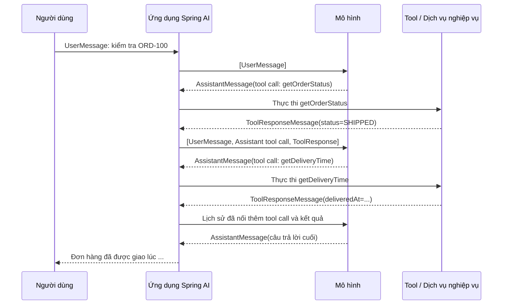

# Duy trì lịch sử thông điệp giữa các vòng gọi mô hình

Mô hình ngôn ngữ không tự nhớ những request trước. Mỗi lần ứng dụng gọi mô hình, nó cần gửi lại các thông điệp cần thiết để mô hình hiểu cuộc hội thoại đang ở bước nào. Điều này đặc biệt quan trọng khi tool calling tạo ra nhiều vòng: mô hình yêu cầu gọi tool, ứng dụng thực thi, gửi kết quả về mô hình, rồi mô hình có thể yêu cầu thêm tool trước khi đưa ra câu trả lời cuối.

Trong Spring AI, cần phân biệt hai phạm vi lịch sử:

- **Lịch sử trong một lượt tool calling:** giữ yêu cầu ban đầu, các yêu cầu gọi tool của assistant và kết quả tool giữa những lần gọi mô hình trong cùng lượt. `ToolCallingAdvisor` quản lý phần này khi dùng `ChatClient`.
- **Lịch sử giữa các lượt người dùng:** lưu những lượt hội thoại đã hoàn thành để request tiếp theo có thể hiểu ngữ cảnh trước đó. Ở Spring AI 2.1, Session Memory là cách được khuyến nghị để làm việc này và lưu đầy đủ tool messages.

Nếu chỉ giữ câu hỏi của người dùng và câu trả lời cuối, mô hình vẫn có thể trả lời câu tiếp theo trong một cuộc trò chuyện thông thường, nhưng nó sẽ thiếu dấu vết của những tool đã gọi và kết quả đã nhận. Khi cần tiếp tục một quy trình nhiều bước, kiểm tra lại kết quả hoặc khôi phục phiên sau lỗi, ứng dụng phải duy trì đúng chuỗi thông điệp.

## 1. Vì sao phải giữ toàn bộ chuỗi thông điệp?

Giả sử người dùng yêu cầu: “Kiểm tra đơn hàng ORD-100, nếu đã giao thì cho tôi biết thời điểm giao.” Một lượt có thể diễn ra như sau:

1. Người dùng gửi câu hỏi.
2. Assistant trả về một `AssistantMessage` chứa yêu cầu gọi tool `getOrderStatus` cùng arguments.
3. Ứng dụng thực thi tool và tạo `ToolResponseMessage` chứa kết quả tương ứng với tool call.
4. Ứng dụng gửi toàn bộ lịch sử đã cập nhật trở lại mô hình.
5. Mô hình có thể gọi thêm tool `getDeliveryTime`; ứng dụng tiếp tục thực thi và nối kết quả vào lịch sử.
6. Khi không còn tool call, assistant tạo câu trả lời cuối.

Sơ đồ chuỗi thông điệp:



Mỗi vòng gọi mô hình cần nhận được các thông điệp trước đó có liên quan. Nếu chỉ gửi `ToolResponseMessage` mà bỏ `AssistantMessage` chứa tool call, mô hình không biết kết quả đó trả lời cho yêu cầu nào. Nếu giữ tool call nhưng thiếu kết quả tương ứng, nhiều provider sẽ từ chối prompt vì chuỗi hội thoại không hợp lệ.

## 2. Phân biệt lượt hội thoại và vòng gọi mô hình

Hai khái niệm này không giống nhau:

- **Lượt hội thoại (turn):** bắt đầu bằng một `UserMessage` và kết thúc khi assistant hoàn thành phản hồi cho yêu cầu đó. Một lượt có thể gồm nhiều vòng gọi mô hình và nhiều lần thực thi tool.
- **Vòng gọi mô hình (round):** một lần gửi prompt đến mô hình và nhận lại một response. Response có thể chứa câu trả lời cuối hoặc yêu cầu gọi một hay nhiều tool.

Ví dụ một lượt có ba vòng:

| Vòng | Mô hình nhận | Mô hình trả về | Ứng dụng thực hiện |
| --- | --- | --- | --- |
| 1 | UserMessage | AssistantMessage có tool call `lookupOrder` | Gọi dịch vụ đơn hàng |
| 2 | Lịch sử + ToolResponse của `lookupOrder` | AssistantMessage có tool call `lookupShipment` | Gọi dịch vụ vận chuyển |
| 3 | Lịch sử + ToolResponse của `lookupShipment` | AssistantMessage có câu trả lời cuối | Trả kết quả cho người dùng |

Không nên tạo một danh sách mới chỉ chứa thông điệp của vòng hiện tại. Ứng dụng phải nối response và kết quả tool vào lịch sử trước khi gửi request kế tiếp.

## 3. Các loại Message tham gia tool calling

Spring AI biểu diễn hội thoại bằng các đối tượng `Message`, không phải chỉ một chuỗi văn bản nối lại.

| Loại message | Vai trò |
| --- | --- |
| `SystemMessage` | Hướng dẫn hoặc quy tắc cho mô hình |
| `UserMessage` | Nội dung người dùng gửi; mở đầu một lượt hội thoại |
| `AssistantMessage` | Nội dung assistant; có thể là câu trả lời hoặc chứa danh sách tool calls |
| `ToolResponseMessage` | Kết quả do ứng dụng trả về cho từng tool call |

Một `AssistantMessage` có tool calls chứa tên tool, arguments và ID của từng lần gọi. `ToolResponseMessage` cần chứa kết quả gắn với đúng tool call ID. Nếu assistant yêu cầu nhiều tool trong cùng một response, các kết quả phải được ghép với đúng ID tương ứng.

Ví dụ khái niệm:

```text
UserMessage
  "Kiểm tra đơn hàng ORD-100"

AssistantMessage
  toolCall(id="call-1", name="lookupOrder", arguments={"orderId":"ORD-100"})

ToolResponseMessage
  response(toolCallId="call-1", name="lookupOrder", response={"status":"SHIPPED"})

AssistantMessage
  "Đơn hàng ORD-100 đã được gửi đi."
```

Tên trường và cách tạo message cụ thể phụ thuộc API của phiên bản Spring AI. Khi dùng `ToolCallingManager`, hãy để framework tạo `ToolResponseMessage` và cập nhật lịch sử thay vì tự ghép chuỗi JSON thủ công.

## 4. Dùng ChatClient: ToolCallingAdvisor giữ lịch sử trong vòng lặp tự động

Với `ChatClient`, Spring AI tự đăng ký `ToolCallingAdvisor` trong `DefaultChatClient`. Advisor này quản lý vòng đời tool calling:

1. Gửi prompt cùng định nghĩa các tool đến mô hình.
2. Nhận response từ mô hình.
3. Nếu response có tool calls, giao cho `ToolCallingManager` tìm và thực thi callback.
4. Nối kết quả tool vào lịch sử hội thoại.
5. Gửi lịch sử mới đến mô hình.
6. Lặp lại cho đến khi mô hình trả lời mà không yêu cầu tool.

Ví dụ:

```java
@Service
public class OrderAssistant {

    private final ChatClient chatClient;
    private final OrderTools orderTools;

    public OrderAssistant(
            ChatClient.Builder chatClientBuilder,
            OrderTools orderTools) {
        this.chatClient = chatClientBuilder.build();
        this.orderTools = orderTools;
    }

    public String answer(String question) {
        return chatClient.prompt()
                .user(question)
                .tools(orderTools)
                .call()
                .content();
    }
}
```

Khi `.call()` chạy, `ToolCallingAdvisor` tự điều phối các vòng gọi. Ứng dụng không cần tự tạo danh sách `Message` cho từng vòng trong cùng lượt này. Lịch sử nội bộ của advisor chứa các tool call và tool response cần thiết để mô hình tiếp tục.

Điều đó chưa đồng nghĩa lịch sử đã được lưu bền vững cho những lần người dùng quay lại sau đó. Muốn giữ hội thoại qua nhiều lần gọi `ChatClient`, cần thêm memory/session advisor hoặc một cơ chế lưu lịch sử riêng.

## 5. Spring AI 2.1: dùng Session Memory để lưu cả tool call và tool result

Từ Spring AI 2.1.0, API `ChatMemory`, các repository của nó và `MessageChatMemoryAdvisor` đã deprecated để chuyển sang Session Memory. Session Memory lưu cuộc hội thoại như một log sự kiện chỉ nối thêm (append-only), rồi dựng phần lịch sử cần thiết cho prompt. Nó hỗ trợ lưu cả assistant tool-call messages và `ToolResponseMessage`.

Session Memory có hai advisor phối hợp:

- `SessionMemoryAdvisor` chạy bên trong vòng tool calling. Mỗi lần mô hình được gọi, advisor nạp lịch sử phù hợp, lưu user message hoặc tool results, rồi lưu response của assistant. Assistant response có tool calls luôn được giữ lại.
- `SessionTurnAdvisor` chạy bên ngoài vòng tool calling. Nó quản lý một lượt `ChatClient`, xử lý các trường hợp vòng lặp kết thúc mà không có model round tiếp theo (ví dụ `returnDirect` hoặc vượt giới hạn tool call), và kích hoạt compaction khi cần.

### Cài đặt Session Memory với JDBC

Với ứng dụng Spring Boot dùng JDBC, có thể thêm starter:

```xml
<dependency>
    <groupId>org.springframework.ai</groupId>
    <artifactId>spring-ai-starter-model-session-jdbc</artifactId>
</dependency>
```

Khi có `DataSource`, Spring Boot tạo `JdbcSessionRepository` và `SessionService`. Với PostgreSQL hoặc MySQL trong môi trường phát triển, có thể bật khởi tạo schema bằng cấu hình tương ứng:

```properties
spring.ai.session.repository.jdbc.initialize-schema=always
```

Trong môi trường production, quản lý schema theo quy trình migration của ứng dụng và cấu hình quyền database phù hợp.

### Gắn SessionAdvisors vào ChatClient

```java
import org.springframework.ai.chat.client.ChatClient;
import org.springframework.ai.chat.model.ChatModel;
import org.springframework.ai.session.SessionService;
import org.springframework.ai.session.advisor.SessionAdvisors;
import org.springframework.ai.session.compaction.TurnCountTrigger;
import org.springframework.ai.session.compaction.WindowCompactionStrategy;
import org.springframework.context.annotation.Bean;
import org.springframework.context.annotation.Configuration;

@Configuration
class AssistantConfiguration {

    @Bean
    ChatClient chatClient(
            ChatModel chatModel,
            SessionService sessionService) {

        return ChatClient.builder(chatModel)
                .defaultAdvisors(SessionAdvisors.builder(sessionService)
                        .compaction(
                                new TurnCountTrigger(20),
                                WindowCompactionStrategy.builder().lastTurns(10).build())
                        .build())
                .build();
    }
}
```

Mỗi request cần cung cấp session ID:

```java
String answer = chatClient.prompt()
        .user(question)
        .advisors(SessionAdvisors.session(sessionId))
        .tools(orderTools)
        .call()
        .content();
```

Session được tạo trong lần dùng đầu tiên nếu chưa tồn tại. Không có session mặc định: ứng dụng phải truyền ID cho mỗi lần gọi để tránh gộp lịch sử của nhiều người dùng vào cùng một cuộc hội thoại.

Trong ứng dụng nhiều người dùng, hãy tạo hoặc tra cứu `sessionId` ở phía server dựa trên danh tính đã xác thực và kiểm tra quyền sở hữu trước mỗi lần đọc/ghi. Không dùng một ID chung cho mọi người dùng và không cho phép người gọi truy cập session chỉ bằng cách đoán ID.

`SessionAdvisors.builder(sessionService)` thiết lập thứ tự advisor mặc định: turn advisor ở ngoài vòng lặp, memory advisor ở trong vòng lặp. Vì vậy, mỗi vòng gọi mô hình đều nhìn thấy phần lịch sử đã cập nhật và log lưu lại cả tool calls lẫn tool results.

### Giới hạn lịch sử và compaction theo lượt

Session Memory hỗ trợ compaction để giảm phần lịch sử gửi đến mô hình khi hội thoại dài. Ví dụ, kích hoạt compaction khi view vượt ngưỡng 20 lượt và giữ 10 lượt gần nhất:

```java
SessionAdvisors.builder(sessionService)
        .compaction(
                new TurnCountTrigger(20),
                WindowCompactionStrategy.builder().lastTurns(10).build())
        .build();
```

Compaction hoạt động theo ranh giới lượt, vì vậy không cắt đôi một tool call và kết quả của nó. Log gốc vẫn được giữ; compaction tạo một ranh giới xác định phần nào của log được dùng làm view cho prompt.

## 6. Vì sao không nên chỉ dùng MessageChatMemoryAdvisor mặc định?

Trong các phiên bản trước và trong chế độ tương thích, `MessageChatMemoryAdvisor` vẫn có thể dùng để lưu ngữ cảnh. Tuy nhiên, vị trí của advisor so với `ToolCallingAdvisor` quyết định memory có nhìn thấy các tool messages hay không.

Mặc định `MessageChatMemoryAdvisor` nằm ngoài vòng lặp:

- Nạp lịch sử một lần trước khi vòng tool calling bắt đầu.
- Lưu user message cuối và assistant message cuối sau khi vòng lặp kết thúc.
- Không nhìn thấy assistant tool-call requests và tool response messages.

Đây là mặc định an toàn cho các repository chỉ lưu user/assistant messages. Nếu cần transcript tool đầy đủ, memory advisor phải chạy bên trong vòng lặp và repository phải hỗ trợ đầy đủ loại message.

Ví dụ cấu hình legacy với `MessageChatMemoryAdvisor` bên trong vòng lặp:

```java
import org.springframework.ai.chat.client.advisor.MessageChatMemoryAdvisor;
import org.springframework.ai.chat.client.advisor.api.BaseAdvisor;

var memoryAdvisor = MessageChatMemoryAdvisor.builder(chatMemory)
        .order(BaseAdvisor.HIGHEST_PRECEDENCE + 400)
        .build();

var chatClient = ChatClient.builder(chatModel)
        .defaultAdvisors(memoryAdvisor)
        .build();
```

`ToolCallingAdvisor` mặc định có order `BaseAdvisor.HIGHEST_PRECEDENCE + 300`; order lớn hơn đặt memory advisor bên trong vòng lặp. Với `ToolCallingAdvisor` được `DefaultChatClient` tự đăng ký, Spring AI nhận ra `MemoryAdvisor` nằm bên trong và tự tắt internal conversation history để tránh ghi trùng. Nếu tự tạo `ToolCallingAdvisor`, cần gọi `.disableInternalConversationHistory()` trên builder.

Đây là hướng tương thích cho code cũ. Với Spring AI 2.1.0 trở lên, ưu tiên Session Memory vì `ChatMemory` và `MessageChatMemoryAdvisor` đã deprecated.

### Kiểm tra khả năng lưu của repository

Không phải repository nào cũng hỗ trợ tool messages. Ví dụ, `JdbcChatMemoryRepository` lọc bỏ `AssistantMessage` chứa tool calls và `ToolResponseMessage` khi lưu; việc lọc diễn ra âm thầm. Nếu dùng JDBC với tool calling, hãy dùng Session Memory cùng JDBC session repository để lưu đầy đủ các message type.

Các repository `InMemoryChatMemoryRepository`, `RedisChatMemoryRepository` và `Neo4jChatMemoryRepository` được Spring AI liệt kê là hỗ trợ đầy đủ tool messages từ phiên bản 2.0. Tuy nhiên, trong Spring AI 2.1.0, Session Memory vẫn là hướng phát triển được khuyến nghị.

## 7. Tự điều khiển vòng lặp với ChatModel

Khi gọi `ChatModel` trực tiếp, ứng dụng nhận response thô. Từ Spring AI 2.x, `ChatModel` không tự thực thi tool calls; ứng dụng phải dùng `ToolCallingManager`, cập nhật prompt bằng `ToolExecutionResult.conversationHistory()` rồi gọi mô hình lại.

Ví dụ vòng lặp blocking:

```java
import java.util.ArrayList;
import java.util.List;

import org.springframework.ai.chat.messages.Message;
import org.springframework.ai.chat.messages.UserMessage;
import org.springframework.ai.chat.model.ChatModel;
import org.springframework.ai.chat.model.ChatResponse;
import org.springframework.ai.chat.prompt.Prompt;
import org.springframework.ai.model.tool.ToolCallingChatOptions;
import org.springframework.ai.tool.ToolCallback;
import org.springframework.ai.tool.execution.ToolCallingManager;
import org.springframework.ai.tool.execution.ToolExecutionResult;

public List<Message> runToolLoop(
        ChatModel chatModel,
        ToolCallingManager toolCallingManager,
        ToolCallback[] tools,
        String question) {

    var chatOptions = ToolCallingChatOptions.builder()
            .toolCallbacks(tools)
            .build();

    List<Message> history = new ArrayList<>();
    history.add(new UserMessage(question));

    Prompt prompt = new Prompt(history, chatOptions);
    ChatResponse response = chatModel.call(prompt);

    while (response.hasToolCalls()) {
        ToolExecutionResult result =
                toolCallingManager.executeToolCalls(prompt, response);

        // Lịch sử gồm prompt cũ, assistant tool-call request và tool responses.
        history = new ArrayList<>(result.conversationHistory());

        if (result.returnDirect()) {
            return history;
        }

        prompt = new Prompt(history, chatOptions);
        response = chatModel.call(prompt);
    }

    // Lưu phản hồi cuối của assistant vào transcript do ứng dụng quản lý.
    history.add(response.getResult().getOutput());
    return history;
}
```

Đoạn mã tập trung vào việc giữ lịch sử trong một lượt. Ứng dụng cần khởi tạo `ToolCallingManager` và callback phù hợp với cấu hình của mình. Nếu muốn lưu xuyên nhiều request, hãy ghi các message mới vào Session Memory hoặc kho hội thoại của ứng dụng. Khi ghi thủ công, chỉ append phần message mới sau mỗi vòng; không ghi lại toàn bộ history nhiều lần vì sẽ tạo bản sao.

Hai điểm cần giữ:

1. `result.conversationHistory()` là lịch sử đầy đủ đã được nối thêm assistant tool call và các tool responses. Dùng nó để tạo prompt kế tiếp.
2. Khi `result.returnDirect()` là `true`, tool yêu cầu trả kết quả trực tiếp. Không gọi mô hình thêm một vòng như luồng thông thường.

Không tạo prompt tiếp theo chỉ từ câu hỏi mới và kết quả tool gần nhất. Làm vậy sẽ bỏ mất các tool calls trước đó, kết quả trước đó và hướng dẫn hệ thống.

## 8. Bảo toàn tính toàn vẹn của tool-call messages

Provider thường yêu cầu mọi assistant message chứa tool calls phải được theo sau bởi tool responses tương ứng. Do đó, khi lưu và khôi phục lịch sử, cần bảo đảm:

- Mỗi tool call có ID duy nhất trong phạm vi response.
- Mỗi tool call đã thực thi có một kết quả gắn với đúng ID.
- Nếu một assistant message yêu cầu nhiều tool, phải giữ đủ kết quả cho tất cả tool calls trước khi gửi lịch sử tiếp theo cho mô hình.
- Không lọc bỏ `ToolResponseMessage` trong khi vẫn giữ assistant tool-call message.
- Không đưa tool response vào prompt nếu không có assistant tool call tương ứng trước đó.

Session Memory có cơ chế bảo vệ tính toàn vẹn: window được mở rộng về đầu lượt để không cắt giữa tool call và kết quả; read guard loại bỏ cặp tool message không đầy đủ khỏi prompt và ghi cảnh báo. Nếu một lượt trước kết thúc khi còn tool call chưa có kết quả, session advisor có thể thêm kết quả tổng hợp “No result was recorded for this tool call.” ở lượt sau. Thông báo này chỉ nói rằng log không ghi nhận kết quả; không khẳng định tool chưa thực thi, vì side effect có thể đã xảy ra trước khi lỗi xuất hiện.

Với luồng tự quản lý, ứng dụng phải tự xử lý trường hợp tool thất bại giữa chừng. Không để một assistant tool-call request chưa được trả lời lọt vào prompt tiếp theo. Hãy chuyển lỗi thành kết quả tool an toàn theo hợp đồng, hoặc dừng lượt và khôi phục theo quy trình rõ ràng.

## 9. Lịch sử trong streaming

Khi dùng `.stream()`, một số model gửi arguments của tool call thành nhiều delta. Một delta chỉ là một phần của tool call, thường chưa phải JSON hoàn chỉnh và không được xem như một message hoàn tất.

Ứng dụng cần để Spring AI aggregate các chunk thành response hoàn chỉnh trước khi kiểm tra `hasToolCalls()` và thực thi tool. Không lưu từng delta như một `AssistantMessage` độc lập. Với manual streaming loop, `MessageAggregator` hoặc `ChatClientMessageAggregator` giúp ghép các chunk của một vòng trước khi quyết định gọi tool.

Nếu chỉ cần hiển thị tiến trình, có thể đọc các `ToolCallPart` được đánh dấu partial để cập nhật UI. Nhưng chỉ dùng tool call hoàn chỉnh cho thực thi và lịch sử hội thoại.

## 10. Giới hạn kích thước lịch sử và chi phí token

Lưu đầy đủ lịch sử không có nghĩa phải gửi toàn bộ log từ đầu đến cuối trong mọi prompt. Context window của model có giới hạn; lịch sử càng dài càng tăng token, độ trễ và chi phí.

Các chiến lược thường dùng:

| Chiến lược | Cách hoạt động | Lưu ý |
| --- | --- | --- |
| Sliding window | Chỉ đưa các lượt gần nhất vào prompt | Cắt theo ranh giới lượt, không cắt giữa tool call và result |
| Compaction | Tóm tắt các lượt cũ và giữ lại phần gần nhất | Giữ thông tin cần cho nghiệp vụ và không thay đổi log gốc |
| Event filtering | Chọn nhóm sự kiện được đưa vào prompt | Không lọc riêng một nửa của cặp tool call/result |
| Giới hạn token | Dựa vào token budget thay vì chỉ đếm số message | Một tool response lớn có thể chiếm nhiều token hơn nhiều lượt chat ngắn |

`MessageWindowChatMemory` mặc định có cửa sổ 20 message và giữ `SystemMessage`. Khi cần loại bỏ lịch sử, nó loại bỏ theo lượt hoàn chỉnh. Session Memory hỗ trợ `EventFilter`, cửa sổ theo lượt và compaction. Nên giữ lại những tool results cần thiết để mô hình hiểu trạng thái hiện tại, còn payload lớn có thể lưu trong hệ thống nghiệp vụ và chỉ đưa ID/thông tin tóm tắt vào hội thoại.

## 11. Lỗi, retry và gọi đồng thời

Lịch sử message có thể không đồng bộ với trạng thái thật của hệ thống nếu tool đã tạo side effect nhưng ứng dụng lỗi trước khi ghi tool response. Khi đó, một lần retry có thể tạo tác động trùng.

Các nguyên tắc cần áp dụng:

- Dùng idempotency key cho thao tác ghi như tạo đơn, gửi thông báo hoặc thanh toán.
- Ghi nhận trạng thái thực thi tool ở tầng nghiệp vụ; không suy ra “chưa chạy” chỉ vì transcript thiếu kết quả.
- Phân biệt lỗi validation, lỗi phân quyền, lỗi nghiệp vụ và lỗi hạ tầng. Không đưa stack trace hoặc secret vào tool response.
- Giới hạn số vòng gọi và số lần gọi mỗi tool trong một lượt để ngăn vòng lặp không kết thúc.
- Khi tool yêu cầu xác nhận, giữ trạng thái chờ và tiếp tục đúng tool call sau khi có quyết định; không tự tạo một tool response thành công.
- Serialize các request cùng một session. Hai lượt chạy đồng thời trên cùng session có thể xen kẽ message và làm hỏng thứ tự hội thoại.

Session Memory 2.1 ghi log theo append-only và có kiểm tra version khi ghi theo batch. Tuy nhiên, ứng dụng vẫn cần bảo đảm một lượt đang chạy trên mỗi session tại một thời điểm. Nếu có nhiều instance, dùng cơ chế khóa hoặc điều phối theo session ID ở tầng ứng dụng.

## 12. Kiểm thử việc duy trì lịch sử

Nên kiểm tra cả chuỗi message lẫn hành vi của memory/session advisor. Không chỉ xác nhận nội dung câu trả lời cuối.

| Kịch bản | Điều cần xác minh |
| --- | --- |
| Một tool call | Assistant tool call được theo sau bởi ToolResponseMessage có cùng ID |
| Nhiều vòng tool | Lịch sử vòng sau chứa đầy đủ các vòng trước |
| Nhiều tool trong một response | Tất cả tool calls có kết quả tương ứng |
| Lượt tiếp theo | Session nạp đúng lịch sử của conversation ID hiện tại |
| Tách người dùng | Người dùng/tenant khác không đọc được session của nhau |
| Compaction/window | Không cắt giữa assistant tool call và tool response |
| `returnDirect` | Tool result được lưu dù không có model round tiếp theo |
| Tool lỗi | Không để tool call chưa có kết quả lọt vào prompt kế tiếp |
| Retry | Không tạo side effect trùng khi kết quả lần gọi trước chưa được ghi |
| Gọi đồng thời | Hai request cùng session được tuần tự hóa |
| Streaming | Partial tool-call deltas không bị lưu hoặc thực thi như message hoàn chỉnh |

Ví dụ kiểm thử vòng lặp thủ công có thể xác nhận lịch sử tăng sau mỗi lần thực thi:

```java
import org.springframework.ai.chat.messages.AssistantMessage;
import org.springframework.ai.chat.messages.ToolResponseMessage;

import static org.assertj.core.api.Assertions.assertThat;

assertThat(result.conversationHistory())
        .anyMatch(message -> message instanceof AssistantMessage assistant
                && assistant.hasToolCalls());

assertThat(result.conversationHistory())
        .anyMatch(message -> message instanceof ToolResponseMessage);
```

Trong integration test với Session Memory, thực hiện một request có tool call, sau đó gọi lại cùng `sessionId` bằng một câu hỏi tham chiếu đến kết quả trước đó. Xác nhận model nhận được tool transcript cần thiết. Đồng thời kiểm tra `sessionService.getActiveMessages(sessionId)` để xác nhận message được lưu theo thứ tự.

## 13. Chọn cơ chế phù hợp

| Nhu cầu | Cách tiếp cận |
| --- | --- |
| Tự động giữ lịch sử giữa các vòng tool trong một lần `.call()` | Dùng `ChatClient` và `ToolCallingAdvisor` mặc định |
| Lưu tool calls/results qua nhiều lượt người dùng trong Spring AI 2.1 | Dùng `SessionAdvisors` với Session Memory |
| Dự án cũ đang dùng `ChatMemory` | Kiểm tra advisor order và khả năng lưu tool messages của repository; lên kế hoạch chuyển sang Session Memory |
| Cần tự kiểm soát từng vòng gọi, approval hoặc điều kiện dừng | Dùng `ChatModel` cùng `ToolCallingManager`, giữ `ToolExecutionResult.conversationHistory()` |
| Cần lưu audit đầy đủ, tìm kiếm và thời hạn lưu riêng | Dùng Session Memory hoặc kho lịch sử nghiệp vụ chuyên biệt theo yêu cầu |

Điều quan trọng là giữ nguyên chuỗi thông điệp theo đúng thứ tự và đúng quan hệ giữa tool call với tool response. `ToolCallingAdvisor` giải quyết lịch sử nội bộ của vòng lặp tự động; Session Memory duy trì lịch sử có cấu trúc giữa các lượt; còn khi tự điều khiển `ChatModel`, ứng dụng phải dùng `conversationHistory()` làm đầu vào cho vòng tiếp theo. Thiết kế đúng ba lớp này giúp mô hình tiếp tục công việc dựa trên kết quả đã có mà không mất ngữ cảnh hoặc tạo ra một transcript không hợp lệ.

## Tài liệu tham khảo

- [Spring AI 2.1 — Tool Calling Loop](https://docs.spring.io/spring-ai/reference/api/tools.html)
- [Spring AI 2.1 — Memory and the Tool Loop](https://docs.spring.io/spring-ai/reference/api/tools.html#_memory_and_the_tool_loop)
- [Spring AI 2.1 — Session Memory](https://docs.spring.io/spring-ai/reference/api/session.html)
- [Spring AI 2.1 — Session ChatClient Integration](https://docs.spring.io/spring-ai/reference/api/session/chat-client.html)
- [Spring AI 2.1 — ChatModel Tool Calling](https://docs.spring.io/spring-ai/reference/api/tools/chatmodel-tool-calling.html)
- [Spring AI 2.1 — Chat Memory and Migration to Session Memory](https://docs.spring.io/spring-ai/reference/api/chat-memory.html)
