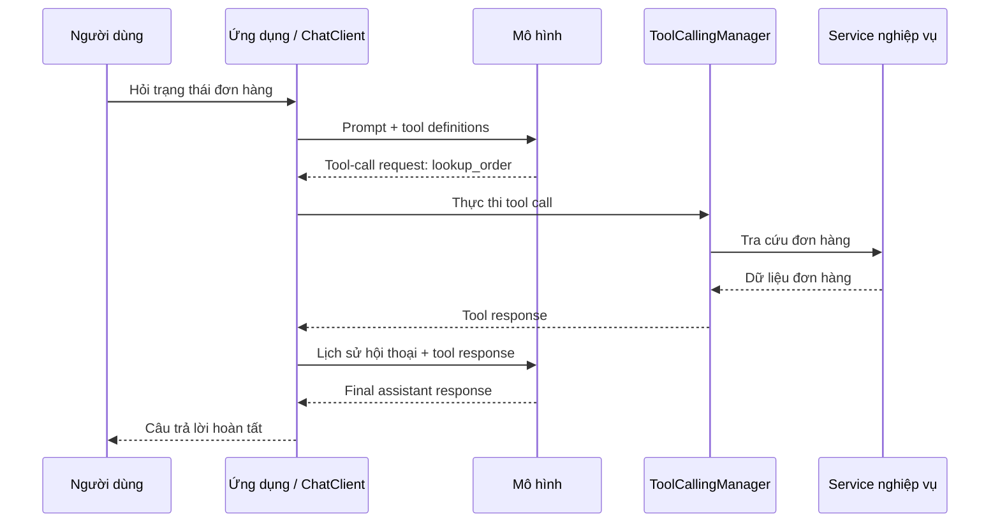
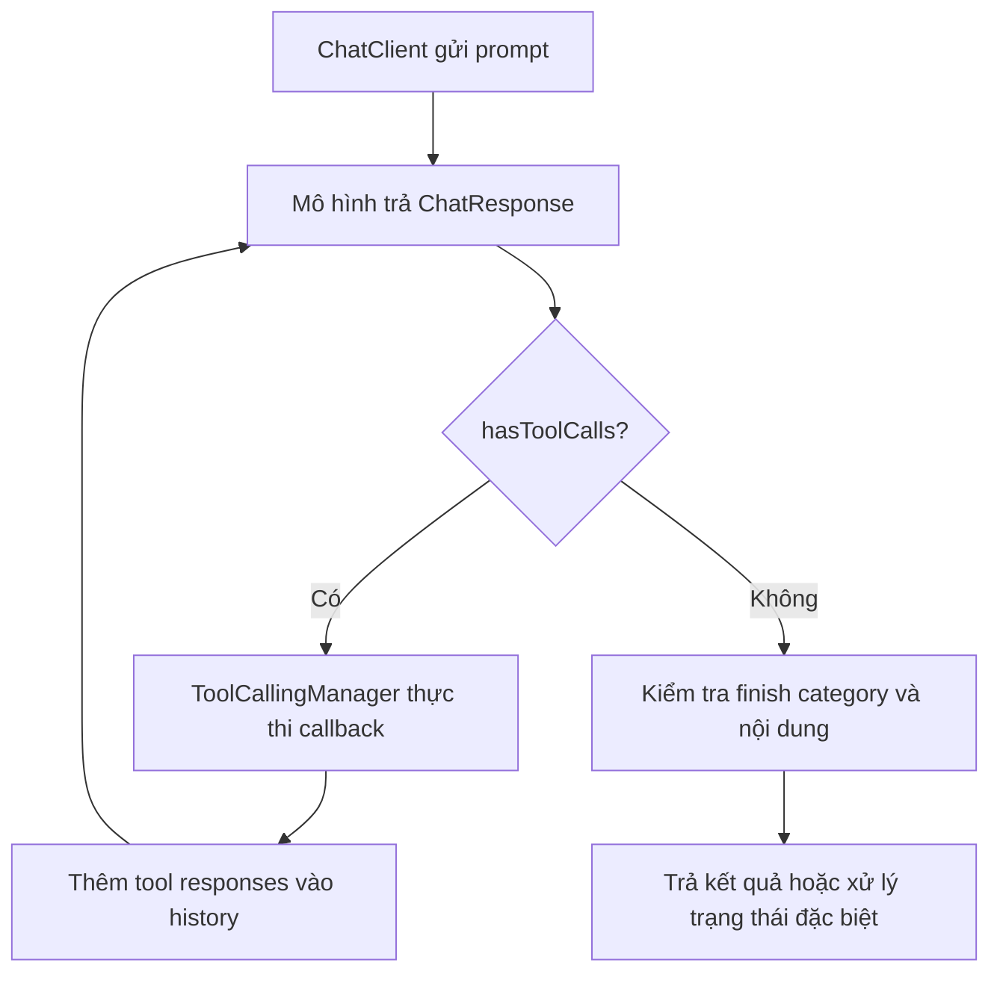

# Vòng lặp tự động

## Xác định phản hồi cần thực thi công cụ và phản hồi đã hoàn tất

Trong tool calling, không phải mọi phản hồi từ mô hình đều là câu trả lời cuối cùng cho người dùng. Có phản hồi chứa yêu cầu gọi một hoặc nhiều công cụ; có phản hồi đã hoàn tất nội dung; cũng có phản hồi bị cắt ngắn, bị bộ lọc chặn hoặc đang chờ người dùng xác nhận thao tác.

Trong module `SPRING_AI_TOOL_CALLING`, ứng dụng cung cấp tool definitions thông qua `@Tool`, `ToolCallback`, schema đầu vào và `ToolContext`. Mô hình quyết định có yêu cầu gọi tool hay không. Ứng dụng thực thi yêu cầu và gửi kết quả về mô hình để mô hình tiếp tục trả lời. Muốn vòng lặp hoạt động đúng, cần nhận diện chính xác loại phản hồi trước khi quyết định bước tiếp theo.

Với Spring AI 2.1.0, tín hiệu trực tiếp để xác định mô hình đã yêu cầu công cụ là `ChatResponse.hasToolCalls()`. `ToolCallingAdvisor` mặc định dùng chính điều kiện này để quyết định có tiếp tục vòng lặp hay không. Finish reason cung cấp thêm thông tin về lý do mô hình dừng, giúp ứng dụng phân biệt hoàn tất bình thường với giới hạn token, từ chối hoặc bộ lọc nội dung.

### 1. Ba loại thông điệp trong một vòng tool calling

Trước khi xét finish reason, hãy phân biệt ba loại nội dung thường xuất hiện trong hội thoại:

| Loại | Nguồn tạo | Ý nghĩa |
| --- | --- | --- |
| Tool-call request | Mô hình | Mô hình yêu cầu ứng dụng chạy một tool với tên và đối số cụ thể |
| Tool response | Ứng dụng sau khi callback chạy | Kết quả thực thi được gắn với tool call tương ứng và đưa vào lịch sử hội thoại |
| Final assistant response | Mô hình | Nội dung mô hình tạo sau khi nhận đủ ngữ cảnh, thường là câu trả lời cuối cho người dùng |

Ví dụ người dùng hỏi: “Đơn hàng ORD-2048 đang ở đâu và dự kiến khi nào giao?”. Mô hình có thể yêu cầu `lookup_order` và `get_delivery_status`. Đây là tool-call request. Ứng dụng chạy hai callback, lấy kết quả từ hệ thống đơn hàng và vận chuyển, rồi thêm các tool response vào lịch sử. Mô hình nhận lịch sử mới và tạo câu trả lời như “Đơn hàng đã rời kho Hà Nội, dự kiến giao ngày mai”. Câu cuối mới là final assistant response.



Tool-call request chưa phải kết quả thực thi. Tool response cũng chưa chắc là câu trả lời cuối của mô hình. Nếu ứng dụng gửi tool response trở lại mô hình, mô hình có thể tiếp tục yêu cầu thêm tool hoặc tạo câu trả lời cuối.

### 2. Dùng `ChatResponse.hasToolCalls()` để nhận diện yêu cầu gọi tool

`ChatResponse.hasToolCalls()` trả về `true` khi response có ít nhất một yêu cầu thực thi tool. Đây là điều kiện trực tiếp để biết mô hình muốn ứng dụng làm thêm việc.

```java
ChatResponse response = chatModel.call(prompt);

if (response.hasToolCalls()) {
    // Mô hình yêu cầu thực thi ít nhất một tool.
    ToolExecutionResult result =
        toolCallingManager.executeToolCalls(prompt, response);
}
else {
    // Không có tool call trong response này.
    // Kiểm tra finish reason trước khi phân loại kết quả cho người dùng.
}
```

Không nên dò chuỗi như “call tool”, “search” hoặc “đang tra cứu” trong phần text để xác định tool call. Đó chỉ là ngôn ngữ tự nhiên; mô hình có thể nói rằng nó sẽ tra cứu nhưng không phát ra tool-call request có cấu trúc. Ngược lại, một response có tool call có thể không có phần text dễ đọc.

`hasToolCalls()` cũng không có nghĩa tool đã chạy. Nó chỉ cho biết mô hình đã yêu cầu thực thi. Callback chỉ được chạy khi `ToolCallingManager` hoặc cơ chế điều phối tương ứng nhận và thực thi yêu cầu đó.

### 3. Finish reason cho biết vì sao mô hình dừng

Mỗi `Generation` có metadata về lý do mô hình dừng. `getFinishReason()` trả về tên nguyên bản mà provider sử dụng, chẳng hạn `stop`, `end_turn`, `STOP`, `content_filter`, `refusal` hoặc `SAFETY`. Các tên này khác nhau giữa nhà cung cấp.

Spring AI 2.1.0 bổ sung `FinishReasonCategory` để chuẩn hóa các lý do phổ biến:

| Category | Ý nghĩa | Cách ứng dụng nên hiểu |
| --- | --- | --- |
| `COMPLETED` | Mô hình đã hoàn tất câu trả lời | Có thể xem là kết thúc bình thường sau khi kiểm tra nội dung và nghiệp vụ |
| `TRUNCATED` | Câu trả lời bị cắt do giới hạn độ dài hoặc token | Nội dung có thể chưa đầy đủ; cân nhắc tiếp tục hoặc báo giới hạn |
| `TOOL_CALL` | Mô hình yêu cầu gọi công cụ | Cần chuyển yêu cầu cho cơ chế thực thi tool nếu có tool call hợp lệ |
| `FILTERED` | Bộ lọc an toàn dừng phản hồi hoặc mô hình từ chối | Xử lý như phản hồi bị chặn/từ chối, không coi là câu trả lời bình thường |
| `OTHER` | Lý do không có ý nghĩa chung hoặc Spring AI chưa nhận diện | Xem metadata cụ thể và chính sách ứng dụng |
| `UNSPECIFIED` | Provider không cung cấp lý do | Dùng nội dung và các tín hiệu cấu trúc khác; không tự suy ra hoàn tất |

Đọc category trên generation:

```java
Generation generation = response.getResult();

if (generation != null) {
    ChatGenerationMetadata metadata = generation.getMetadata();
    FinishReasonCategory category = metadata.getFinishReasonCategory();
    String rawReason = metadata.getFinishReason();

    // category là giá trị chuẩn hóa; rawReason là tên provider trả về.
}
```

Ở cấp response, `response.hasFinishReasonCategory(category)` trả về `true` nếu có ít nhất một generation kết thúc với category đó. Còn `response.hasFinishReasons(Set<String>)` so sánh các raw finish reason của provider, không phân biệt chữ hoa/chữ thường.

### 4. Không dùng raw finish reason như một chuẩn chung

Hai provider có thể dùng cùng một raw finish reason cho tình huống khác nhau, hoặc dùng hai tên khác nhau cho cùng một ý nghĩa. Spring AI phân loại dựa trên hiểu biết riêng của từng `ChatModel` về response của provider.

Ví dụ:

- OpenAI có thể báo raw finish reason thông thường là `stop` trong khi một trường metadata riêng cho biết mô hình từ chối. Spring AI phân loại generation đó thành `FILTERED` và lưu thông tin từ chối trong metadata của message.
- Gemini và Ollama có thể báo một raw stop thông thường khi mô hình yêu cầu tool. Spring AI vẫn phân loại generation đó thành `TOOL_CALL`.

Vì vậy, không nên viết logic dùng duy nhất `"tool_calls".equals(rawFinishReason)` cho mọi provider. Nếu ứng dụng cần kiểm tra lý do dừng theo cách portable, ưu tiên `FinishReasonCategory`. Raw finish reason phù hợp để ghi log, chẩn đoán provider hoặc áp dụng quy tắc riêng cho một model đã xác định.

### 5. Kết hợp `hasToolCalls()` và finish reason

Hai tín hiệu này trả lời hai câu hỏi khác nhau:

- `hasToolCalls()`: mô hình có yêu cầu chạy tool trong response không?
- Finish reason category: provider phân loại lý do generation dừng là gì?

Trong Spring AI 2.1.0, `ToolCallingAdvisor` mặc định dùng checker tương đương:

```java
response -> response != null && response.hasToolCalls()
```

Đây là cách mặc định phù hợp cho phần lớn ứng dụng vì nó dựa trên yêu cầu tool có cấu trúc, không phụ thuộc tên finish reason của từng provider.

Nếu ứng dụng cần chính sách chặt hơn, có thể cung cấp `ToolExecutionEligibilityChecker` tùy chỉnh. Ví dụ sau chỉ tiếp tục khi response có tool call và model phân loại finish reason là `TOOL_CALL`:

```java
ToolExecutionEligibilityChecker checker = response ->
    response != null
        && response.getResult() != null
        && !response.getResult().getOutput().getToolCalls().isEmpty()
        && response.getResult().getMetadata().getFinishReasonCategory()
            == FinishReasonCategory.TOOL_CALL;

ToolCallingAdvisor advisor = ToolCallingAdvisor.builder()
    .toolExecutionEligibilityChecker(checker)
    .build();
```

Đây là chính sách nghiêm ngặt hơn mặc định. Chỉ dùng khi provider và phiên bản Spring AI của ứng dụng phân loại category ổn định cho tất cả model đang sử dụng. Nếu category không được cung cấp hoặc chưa được ánh xạ, checker có thể bỏ qua một tool call hợp lệ. Không thêm điều kiện finish reason chỉ vì muốn kiểm tra nhiều tín hiệu hơn; hãy xác định rõ mục tiêu của điều kiện bổ sung.

Ví dụ checker trên ghép tool calls với finish category của generation đầu tiên. Nó giả định ứng dụng dùng một generation cho mỗi response. Nếu cấu hình nhiều generation, hãy xác định generation nào được phép thực thi và kiểm tra tool calls cùng metadata trên chính generation đó; không ghép tool call của generation này với finish category của generation khác.

### 6. Bảng quyết định cho từng loại response

| `hasToolCalls()` | Finish category | Diễn giải | Bước tiếp theo |
| --- | --- | --- | --- |
| `true` | `TOOL_CALL` | Có yêu cầu gọi tool | Thực thi tool call theo quyền và giới hạn đã cấu hình |
| `true` | `UNSPECIFIED` hoặc `OTHER` | Có yêu cầu gọi tool nhưng provider không phân loại rõ | Mặc định vẫn dựa vào tool call có cấu trúc; ghi nhận metadata để theo dõi |
| `false` | `COMPLETED` | Mô hình đã hoàn tất generation | Trả nội dung cho người dùng sau khi kiểm tra chính sách ứng dụng |
| `false` | `TRUNCATED` | Mô hình dừng do giới hạn độ dài | Báo nội dung chưa đầy đủ hoặc tiếp tục bằng chiến lược riêng |
| `false` | `FILTERED` | Phản hồi bị chặn hoặc từ chối | Xử lý từ chối/bộ lọc; không coi là hoàn tất bình thường |
| `false` | `OTHER` hoặc `UNSPECIFIED` | Không có tool call và lý do chưa rõ | Kiểm tra text, metadata và quy tắc ứng dụng trước khi kết luận |

Không có tool call chỉ cho biết vòng lặp không có công cụ cần chạy ở response đó. Nó không tự chứng minh câu trả lời đã đầy đủ, đúng hoặc phù hợp để trả cho người dùng. Finish category và metadata giúp phân loại lý do dừng, còn ứng dụng vẫn phải kiểm tra kết quả theo yêu cầu nghiệp vụ.

### 7. Nhiều tool call trong cùng một response

Một response có thể chứa nhiều tool call. Ví dụ, mô hình yêu cầu `lookup_order` và `get_shipping_status` trong cùng một lượt. `hasToolCalls()` chỉ là tín hiệu boolean cho biết có ít nhất một yêu cầu; nó không cho biết số lượng hoặc trạng thái của từng tool.

`ToolCallingManager.executeToolCalls(prompt, response)` nhận response và xử lý các tool call trong đó. Kết quả `ToolExecutionResult` chứa conversation history mới, gồm yêu cầu tool call của mô hình và các tool response tương ứng. Advisor gửi lịch sử này trở lại mô hình để mô hình tiếp tục.

```java
if (response.hasToolCalls()) {
    ToolExecutionResult result =
        toolCallingManager.executeToolCalls(prompt, response);

    // Lịch sử gồm assistant tool-call request và tool responses.
    Prompt nextPrompt = new Prompt(result.conversationHistory(), chatOptions);
    ChatResponse nextResponse = chatModel.call(nextPrompt);
}
```

Không tự giả định rằng một tool call tương ứng với một response cuối. Mô hình có thể yêu cầu nhiều tool trong một lượt, rồi yêu cầu thêm tool sau khi nhận kết quả đầu tiên. Ứng dụng cần giữ đúng tool call ID và tool response tương ứng trong lịch sử.

### 8. Khi nào vòng lặp kết thúc?

Với `ChatClient`, `DefaultChatClient` tự đăng ký `ToolCallingAdvisor` khi có tool. Advisor sở hữu vòng lặp và lặp lại cho đến khi response không còn tool call hoặc một điều kiện kết thúc đặc biệt xảy ra.

Luồng mặc định:

1. Gửi prompt và tool definitions đến mô hình.
2. Nhận response.
3. Nếu `hasToolCalls()` là `true`, chuyển yêu cầu cho `ToolCallingManager`.
4. Thêm tool responses vào conversation history.
5. Gửi history mới đến mô hình.
6. Lặp lại đến khi không còn tool call.
7. Trả response cuối cho caller.



Trong Spring AI 2.x, nếu gọi `ChatModel` trực tiếp, model chỉ trả raw response và không tự chạy tool. Caller phải tự viết vòng lặp. Đây là khác biệt quan trọng so với Spring AI 1.x, nơi mỗi `ChatModel` từng có vòng thực thi tool nội bộ.

### 9. Ví dụ tự điều phối vòng lặp bằng `ChatModel`

Ví dụ sau minh họa cách kiểm tra `hasToolCalls()` khi ứng dụng tự điều phối. `renderDirectToolResult(...)` và `classifyFinalResponse(...)` là helper của ứng dụng để chuyển kết quả theo hợp đồng API thực tế.

```java
public String askWithTools(String question) {
    Prompt prompt = new Prompt(question, chatOptions);
    ChatResponse response = chatModel.call(prompt);

    int maxIterations = 8;
    int iteration = 0;

    while (response.hasToolCalls()) {
        if (iteration++ >= maxIterations) {
            throw new IllegalStateException("Vượt giới hạn vòng gọi công cụ.");
        }

        ToolExecutionResult result =
            toolCallingManager.executeToolCalls(prompt, response);

        if (result.returnDirect()) {
            return renderDirectToolResult(result);
        }

        prompt = new Prompt(result.conversationHistory(), chatOptions);
        response = chatModel.call(prompt);
    }

    return classifyFinalResponse(response);
}
```

Trong nhánh kết thúc bình thường, `classifyFinalResponse` nên kiểm tra finish category trước khi lấy text:

```java
private String classifyFinalResponse(ChatResponse response) {
    Generation generation = response.getResult();
    if (generation == null) {
        throw new IllegalStateException("Mô hình không trả về generation.");
    }

    FinishReasonCategory category = generation.getMetadata().getFinishReasonCategory();
    if (category == FinishReasonCategory.FILTERED) {
        throw new IllegalStateException("Phản hồi bị từ chối hoặc bộ lọc nội dung chặn.");
    }

    if (category == FinishReasonCategory.TRUNCATED) {
        throw new IllegalStateException("Phản hồi chưa hoàn tất do giới hạn độ dài.");
    }

    return generation.getOutput().getText();
}
```

Ví dụ trên dùng `IllegalStateException` để làm rõ nhánh xử lý. Ứng dụng thực tế nên ánh xạ các trường hợp bị lọc, bị cắt ngắn hoặc không có generation sang mã lỗi và thông báo phù hợp với API của mình. Với category `OTHER` hoặc `UNSPECIFIED`, hãy quyết định theo provider và chính sách sản phẩm thay vì tự xem đó là thành công.

### 10. Trường hợp `returnDirect`

Một số tool đã tạo ra kết quả cuối cùng mà không cần mô hình diễn giải thêm. Metadata `returnDirect = true` cho phép `ToolCallingAdvisor` dừng vòng lặp ngay sau khi tool thực thi và trả tool result trực tiếp cho caller.

Ví dụ phù hợp là một tool truy xuất RAG đã tạo ra phần nội dung cần hiển thị hoặc một tool trả kết quả cấu trúc mà ứng dụng muốn xử lý trực tiếp.

Khi `returnDirect` được kích hoạt:

1. Tool vẫn được thực thi như bình thường.
2. `ToolCallingAdvisor` đọc cờ trong `ToolExecutionResult`.
3. Advisor dừng vòng lặp.
4. Tool result được trả về caller dưới dạng `ChatResponse` có generation content là kết quả của tool.

Mô hình không nhận tool result và không tạo thêm câu trả lời. Đây là một đường kết thúc hợp lệ của vòng lặp, nhưng không có nghĩa mô hình vừa hoàn tất câu trả lời. Nếu một lượt có nhiều tool call, `returnDirect` chỉ được áp dụng khi tất cả tool call trong lượt đều bật `returnDirect = true`; nếu không, kết quả được gửi lại mô hình và vòng lặp tiếp tục.

### 11. Trường hợp chờ xác nhận của người dùng

Một tool có tác dụng phụ như hủy đơn, gửi email hoặc thanh toán có thể cần xác nhận. Trong Spring AI 2.1.0, `ToolCallingManager` có thể ném `ToolCallConfirmationRequiredException` khi phát hiện tool call cần người dùng quyết định.

Khi xảy ra tình huống này:

- `ToolCallingAdvisor` dừng vòng lặp.
- Không có tool call nào trong reply đó được thực thi.
- Advisor trả response về caller, kèm danh sách call key đang chờ quyết định trong metadata `ToolCallDecisions.AWAITING_DECISION_METADATA_KEY`.
- Ứng dụng trình bày thao tác cần xác nhận, thu thập quyết định allow/deny và gọi lại `ToolCallingManager` với các quyết định đó.
- Ứng dụng gửi tool result hoặc thông báo từ chối trở lại mô hình trong request tiếp theo để tiếp tục hội thoại.

Đây là trạng thái tạm dừng, không phải final assistant answer và cũng chưa phải tool response. Ứng dụng phải giữ conversation history cùng quyết định của người dùng để tiếp tục đúng lượt.

### 12. Phân biệt giới hạn token, lỗi tool và phản hồi hoàn tất

Không phải mọi trường hợp vòng lặp dừng đều là mô hình đã trả lời thành công.

| Tình huống | Tín hiệu thường gặp | Cách xử lý |
| --- | --- | --- |
| Mô hình yêu cầu tool | `hasToolCalls() == true` | Thực thi tool call |
| Mô hình trả lời xong | Không có tool call, category `COMPLETED` | Trình bày câu trả lời |
| Mô hình bị giới hạn độ dài | Category `TRUNCATED` | Báo nội dung chưa đầy đủ hoặc tiếp tục có kiểm soát |
| Mô hình từ chối hoặc bị lọc | Category `FILTERED` | Trả trạng thái từ chối/bị chặn |
| Tool thực thi lỗi | `ToolExecutionException` hoặc tool error response tùy exception processor | Xử lý lỗi; có thể gửi lỗi an toàn về mô hình để mô hình phản hồi |
| Vượt giới hạn số lần gọi | `ToolCallLimitExceededException` hoặc error tool response theo cấu hình | Dừng hoặc cho mô hình biết giới hạn đã đạt |
| Chờ xác nhận | `ToolCallConfirmationRequiredException` và awaiting-decision metadata | Tạm dừng, chờ người dùng quyết định |
| Tool trả trực tiếp | `ToolExecutionResult.returnDirect() == true` | Trả tool result cho caller, không gọi lại mô hình |

Spring AI 2.1 có giới hạn số lần gọi theo từng tool và tổng số tool call trong một lượt. Khi vượt giới hạn, mặc định manager ném `ToolCallLimitExceededException`; `ToolCallingAdvisor` trả lỗi như response cuối. Có thể cấu hình `RETURN_ERROR_RESPONSE` để tạo tool error response cho mô hình và tiếp tục hội thoại. Các giới hạn giúp tránh vòng lặp không dừng hoặc tool bị gọi quá nhiều.

### 13. Xử lý nhiều `Generation`

`ChatResponse` có thể chứa nhiều `Generation`, mỗi generation có metadata riêng. `getResult()` chỉ trả generation đầu tiên; `getResults()` trả toàn bộ danh sách. `hasFinishReasonCategory(category)` kiểm tra xem có generation nào kết thúc với category đó.

Vì vậy, nếu ứng dụng yêu cầu nhiều generation trong cùng response, không nên đọc duy nhất `getResult()` rồi kết luận mọi generation có cùng finish reason. Hãy kiểm tra từng generation khi cần đánh giá riêng:

```java
for (Generation generation : response.getResults()) {
    ChatGenerationMetadata metadata = generation.getMetadata();
    FinishReasonCategory category = metadata.getFinishReasonCategory();

    // Phân loại generation này theo metadata của chính nó.
}
```

Với tool calling thông thường, cấu hình một generation là phổ biến hơn. Nếu provider hỗ trợ nhiều generation, hãy xác định rõ ứng dụng muốn xử lý tool call của generation nào và cách ghép kết quả trước khi thực thi.

### 14. Streaming: không thực thi từ một mảnh đối số chưa hoàn chỉnh

Trong streaming, một số provider gửi tool-call arguments thành nhiều chunk. Mỗi chunk có thể chỉ chứa một phần JSON, ví dụ:

```text
Chunk 1: {"order
Chunk 2: Id":"ORD-
Chunk 3: 2048"}
```

Các mảnh này được biểu diễn bằng `ToolCallPart` partial. Một partial `ToolCallPart` chưa phải tool call hoàn chỉnh; `AssistantMessage.getToolCalls()` và `ChatResponse.hasToolCalls()` bỏ qua các phần partial. `ToolCallingManager` chỉ thực thi khi nhận được tool call hoàn chỉnh trong response đã aggregate.

Không gọi tool ngay khi nhận chunk đầu tiên hoặc khi JSON arguments còn chưa hoàn chỉnh. Với luồng tự điều phối, dùng `ChatClientMessageAggregator` để tổng hợp các chunk thành `ChatClientResponse`, sau đó kiểm tra `response.chatResponse().hasToolCalls()` và mới gọi `ToolCallingManager`.

Khi dùng `ChatClient` với `ToolCallingAdvisor` tự động, advisor tự điều phối cả `.call()` và `.stream()`. Tool-call chunks được advisor xử lý bên trong vòng lặp; các argument delta có thể vẫn được phát ra cho subscriber để hiển thị tiến trình, nhưng chúng không phải tool call hoàn chỉnh. Nếu chỉ muốn quan sát tiến trình từng vòng, thường nên đặt custom advisor bên trong vòng lặp thay vì tắt auto-registration. Khi tự điều phối streaming, ứng dụng phải quản lý việc aggregate chunk, phát tiến trình cho UI và giữ conversation history giữa các vòng.

### 15. Kiểm thử điều kiện tiếp tục và kết thúc

Kiểm thử nên chứng minh rằng ứng dụng chỉ thực thi tool khi có tool-call request hoàn chỉnh và xử lý đúng các loại kết thúc khác nhau.

**Kiểm thử nhận diện response:**

- Response có tool call làm `hasToolCalls()` trả về `true`.
- Response chỉ có text không kích hoạt tool execution.
- Response có `COMPLETED` được phân loại là generation hoàn tất.
- Response có `TRUNCATED` không bị xem là câu trả lời đầy đủ.
- Response có `FILTERED` được xử lý như từ chối/bị chặn.
- Raw finish reason khác nhau nhưng cùng category vẫn được xử lý nhất quán.
- `OTHER` và `UNSPECIFIED` đi qua nhánh chính sách rõ ràng.

**Kiểm thử vòng lặp:**

- Khi response có tool call, `ToolCallingManager` được gọi.
- Tool response được thêm vào conversation history trước lượt model tiếp theo.
- Vòng lặp dừng khi response không còn tool call.
- Nhiều tool call trong cùng lượt được xử lý đúng.
- `returnDirect` dừng vòng lặp nếu tất cả tool trong lượt đều direct.
- Confirmation-required dừng vòng lặp mà không chạy bất kỳ tool call nào của reply đó.
- Vượt giới hạn số tool call được xử lý theo cấu hình.

**Kiểm thử streaming:**

- Partial `ToolCallPart` không kích hoạt thực thi.
- Chỉ response đã aggregate với tool call hoàn chỉnh mới được thực thi.
- Các chunk text và argument delta được phân phối đúng cho UI.
- Hủy stream dừng việc tiếp tục vòng lặp theo chính sách của ứng dụng.

Ví dụ test một điều kiện eligibility tùy chỉnh:

```java
@Test
void requiresToolCallAndToolCallFinishCategory() {
    ToolExecutionEligibilityChecker checker = response ->
        response != null
        && response.getResult() != null
        && !response.getResult().getOutput().getToolCalls().isEmpty()
        && response.getResult().getMetadata().getFinishReasonCategory()
            == FinishReasonCategory.TOOL_CALL;

    assertThat(checker.isToolCallResponse(responseWithToolCallCategory()))
        .isTrue();
    assertThat(checker.isToolCallResponse(responseWithoutToolCalls()))
        .isFalse();
}
```

Test này minh họa chính sách nghiêm ngặt. Nếu ứng dụng dùng nhiều provider, cần thêm test cho cách từng provider phân loại finish reason để bảo đảm checker không bỏ qua tool call hợp lệ.

### 16. Checklist khi đọc một phản hồi của mô hình

Trước khi trả nội dung cho người dùng hoặc chạy công cụ, hãy kiểm tra theo thứ tự:

1. Có `ChatResponse` và generation hợp lệ không?
2. `hasToolCalls()` có phải `true` không? Nếu có, xử lý tool call trước khi coi response là câu trả lời cuối.
3. Nếu không có tool call, finish category là `COMPLETED`, `TRUNCATED`, `FILTERED`, `OTHER` hay `UNSPECIFIED`?
4. Có trạng thái đặc biệt như `returnDirect`, chờ xác nhận hoặc vượt giới hạn tool call không?
5. Nếu streaming, response đã aggregate và tool call đã hoàn chỉnh chưa?
6. Conversation history có giữ đúng assistant tool-call request và tool response tương ứng không?
7. Nội dung có thể trả cho người dùng không, hay cần thông báo bị từ chối, chưa hoàn tất hoặc cần xác nhận?

Nguyên tắc thực tế là dùng `hasToolCalls()` để xác định yêu cầu thực thi công cụ, dùng finish reason category để hiểu lý do mô hình dừng và dùng trạng thái của `ToolExecutionResult` hoặc exception để xử lý các nhánh đặc biệt. Không coi một response không có tool call là câu trả lời thành công nếu metadata cho biết nội dung bị cắt ngắn hoặc bị chặn.

### Tài liệu tham khảo

- [Spring AI 2.1.0 Reference — Tool Calling](https://docs.spring.io/spring-ai/reference/api/tools.html)
- [Spring AI 2.1.0 Reference — ToolCallingAdvisor](https://docs.spring.io/spring-ai/reference/api/tools/tool-calling-advisor.html)
- [Spring AI 2.1.0 Reference — ChatClient API and Finish Reason Categories](https://docs.spring.io/spring-ai/reference/api/chatclient.html)
- [Spring AI 2.1.0 Reference — ChatModel Tool Calling](https://docs.spring.io/spring-ai/reference/api/tools/chatmodel-tool-calling.html)
- [Spring AI 2.1.0 API — ChatResponse](https://docs.spring.io/spring-ai/docs/2.1.x/api/org/springframework/ai/chat/model/ChatResponse.html)
- [Spring AI 2.1.0 Reference — Tool Call Confirmation](https://docs.spring.io/spring-ai/reference/api/tools/confirmation.html)

Các ví dụ API trong bài dựa trên Spring AI 2.1.0. `FinishReasonCategory` và `ChatResponse.hasFinishReasonCategory(...)` có từ 2.1.0; nếu dự án dùng minor version cũ hơn, hãy kiểm tra API tương ứng và cách provider ánh xạ finish reason.
