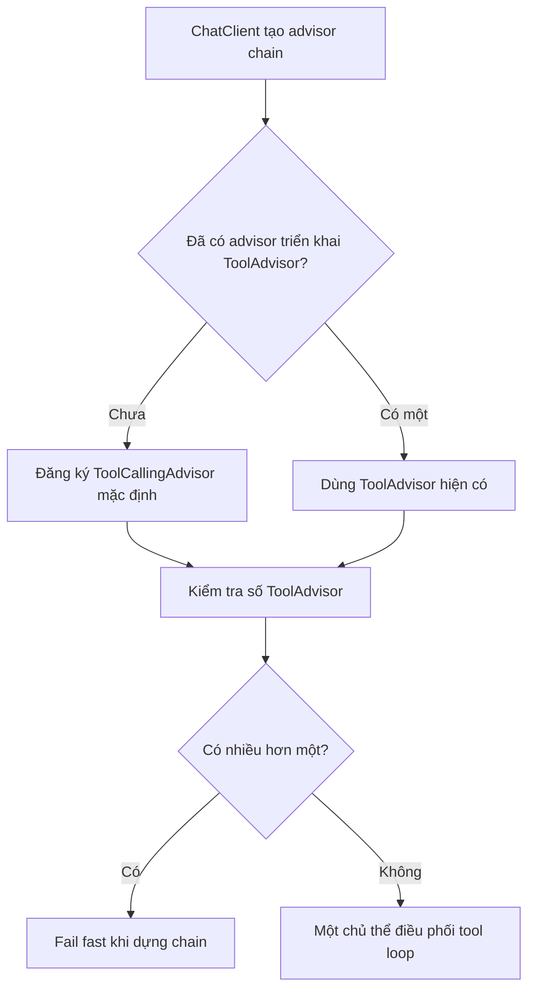

# Ràng buộc một ToolAdvisor trong chuỗi theo phiên bản

Trong Spring AI, vòng lặp gọi công cụ của `ChatClient` được điều phối bởi `ToolCallingAdvisor`. Advisor này nhận phản hồi từ mô hình, thực thi tool call qua `ToolCallingManager`, đưa kết quả vào lịch sử hội thoại rồi gọi mô hình tiếp cho đến khi không còn tool call. Vì advisor sở hữu vòng lặp này, một advisor chain chỉ nên có một thành phần chịu trách nhiệm điều phối tool calling.

Spring AI dùng marker interface `ToolAdvisor` để nhận biết thành phần đó. Trong chế độ mặc định, `DefaultChatClient` tự đăng ký một `ToolCallingAdvisor`. Nếu chuỗi đã có một advisor triển khai `ToolAdvisor`, cơ chế tự đăng ký bỏ qua advisor mặc định. Nếu có hai advisor `ToolAdvisor` tùy chỉnh trong cùng chuỗi, Spring AI từ chối tạo chuỗi và báo lỗi sớm. Ràng buộc này ngăn hai vòng lặp cùng thực thi một tool call hoặc cùng sửa lịch sử hội thoại.

Quy tắc đã thay đổi trong quá trình phát triển Spring AI 2.0. Vì vậy, khi nâng cấp ứng dụng, cần xem lại các đoạn code tự thêm `ToolCallingAdvisor`, custom advisor quản lý tool loop và cấu hình tự đăng ký.

Sau bài học, bạn có thể:

- Giải thích vì sao mỗi advisor chain chỉ có một `ToolAdvisor` quản lý tool loop.
- Phân biệt hành vi của Spring AI 1.x, 2.0 milestone/RC và 2.1.x.
- Tránh đăng ký `ToolCallingAdvisor` hai lần khi nâng cấp.
- Dùng `ToolAdvisor` marker đúng cách khi viết custom advisor sở hữu vòng lặp.
- Tùy chỉnh advisor mặc định, tắt tự đăng ký hoặc điều khiển tool loop thủ công.
- Đặt advisor quan sát, memory và xử lý request ở đúng vị trí trong chuỗi.

## 1. Vì sao chỉ nên có một ToolAdvisor?

Một tool call có vòng đời gồm nhiều bước: gửi định nghĩa công cụ, nhận yêu cầu từ mô hình, thực thi callback, ghép kết quả với yêu cầu ban đầu và gửi kết quả lại mô hình. `ToolCallingAdvisor` quản lý toàn bộ chu trình này và có thể lặp nhiều lần trong cùng một request.

Nếu hai advisor cùng sở hữu vòng lặp, chúng có thể cùng nhìn thấy một phản hồi chứa tool call. Cả hai đều có thể gọi `ToolCallingManager`, thực thi callback, bổ sung tool response hoặc gọi mô hình thêm một lượt. Hậu quả có thể là:

- Một thao tác nghiệp vụ bị thực thi hai lần.
- Lịch sử hội thoại chứa tool response trùng hoặc sai thứ tự.
- Một advisor dừng vòng lặp trong khi advisor còn lại vẫn tiếp tục.
- Kết quả `returnDirect`, xác nhận của người dùng hoặc giới hạn số lần gọi bị xử lý không nhất quán.
- Chi phí token và số lần gọi model tăng ngoài dự kiến.

Spring AI giải quyết vấn đề ở cấp advisor chain bằng marker `ToolAdvisor`. Marker cho `DefaultChatClient` biết chuỗi đã có thành phần quản lý tool calling, từ đó tránh tự thêm một `ToolCallingAdvisor` thứ hai.



Điểm quan trọng: `ToolAdvisor` là marker interface, không phải một bộ thực thi tool hoàn chỉnh. Một custom advisor chỉ triển khai marker nhưng không thực hiện logic cần thiết sẽ không tự có vòng lặp. Nếu tự quản lý tool lifecycle, advisor đó còn phải triển khai các hợp đồng advisor phù hợp và chịu trách nhiệm thực thi, lịch sử, blocking/streaming theo thiết kế.

## 2. Quy tắc thay đổi theo phiên bản

| Phiên bản | Cách quản lý tool loop | Ý nghĩa khi cấu hình advisor |
| --- | --- | --- |
| Spring AI 1.x | Vòng thực thi tool gắn với từng `ChatModel` implementation | Chưa có mô hình `ToolCallingAdvisor` làm chủ vòng lặp trong advisor chain của `ChatClient`. |
| Spring AI 2.0.0-M7 | `ChatClient` tự thêm `ToolCallingAdvisor` khi tools được cấu hình trong request hoặc default | Code đã tự thêm advisor có thể tạo vòng lặp trùng. |
| Spring AI 2.0.0-RC2 trở đi | `ChatClient` tự thêm advisor mặc định cho mọi request, trừ khi tắt rõ ràng | Advisor vẫn được thêm ngay cả khi tool được một advisor khác đưa vào động ở runtime. |
| Spring AI 2.1.x | Duy trì auto-registration và `ToolAdvisor` marker; `DefaultChatClient` bảo đảm tối đa một marker advisor trong chain | Nếu đã có một custom `ToolAdvisor`, advisor mặc định bị bỏ qua; hai custom `ToolAdvisor` làm chain fail-fast. |

Hai mốc 2.0.0-M7 và 2.0.0-RC2 dễ bị nhầm. Ở M7, auto-registration chỉ xảy ra khi công cụ đã được khai báo. Từ RC2, advisor được đăng ký vô điều kiện theo mặc định để hỗ trợ công cụ được thêm vào trong quá trình advisor chain chạy.

Trong 2.1.x, cách hiểu chính xác là: chế độ mặc định có một `ToolCallingAdvisor`; invariant của chuỗi là không có nhiều hơn một `ToolAdvisor`. Ứng dụng có thể chủ động tắt auto-registration và tự điều khiển vòng lặp, khi đó không có `ToolAdvisor` trong chain.

## 3. Cách dùng thông thường trong Spring AI 2.1.x

Với phần lớn ứng dụng, không cần tự tạo `ToolCallingAdvisor`. `DefaultChatClient` tự đăng ký advisor mặc định. Chỉ cần cung cấp tool:

```java
ChatClient chatClient = ChatClient.builder(chatModel)
        .build();

String answer = chatClient.prompt()
        .user("Thời tiết hiện tại ở Đà Nẵng thế nào?")
        .tools(weatherTools)
        .call()
        .content();
```

Khi mô hình yêu cầu gọi `get_current_weather`, `ToolCallingAdvisor` sẽ chuyển yêu cầu cho `ToolCallingManager`, nhận kết quả và gửi lại mô hình. Nếu mô hình yêu cầu gọi tiếp một công cụ khác, advisor tiếp tục vòng lặp. Khi mô hình trả lời mà không còn tool call, `ChatClient` trả kết quả cuối.

Vì auto-registration đã tồn tại, không cần thêm một `ToolCallingAdvisor` tường minh:

```java
// Không thêm ToolCallingAdvisor lần nữa trong cấu hình mặc định 2.x.
ChatClient chatClient = ChatClient.builder(chatModel)
        .defaultAdvisors(auditAdvisor)
        .build();
```

`auditAdvisor` ở ví dụ này chỉ quan sát hoặc biến đổi request/response. Nó không sở hữu tool loop và không triển khai `ToolAdvisor`, vì vậy có thể cùng tồn tại với advisor mặc định.

## 4. Lỗi thường gặp khi nâng cấp từ 1.x lên 2.x

Trong một ứng dụng cũ, bạn có thể đã tự thêm `ToolCallingAdvisor` vì phiên bản trước chưa tự đăng ký advisor trong `ChatClient`:

```java
// Cách khai báo cũ có thể gặp trong code đã chuyển sang Spring AI 2.x.
ChatClient chatClient = ChatClient.builder(chatModel)
        .defaultAdvisors(ToolCallingAdvisor.builder().build())
        .build();
```

Từ Spring AI 2.0.0-RC2, `ToolCallingAdvisor` triển khai `ToolAdvisor`. `DefaultChatClient` nhận ra marker này và bỏ qua auto-registration mặc định. Nếu code được viết theo API có marker, advisor tường minh sẽ là advisor quản lý vòng lặp.

Tuy nhiên, trong các giai đoạn chuyển tiếp trước khi marker được thêm, việc vừa tự thêm advisor vừa có auto-registration có thể tạo hai advisor. Vì vậy, khi nâng cấp cần kiểm tra đúng phiên bản Spring AI và bỏ cách đăng ký cũ nếu không còn cần thiết.

Quy tắc an toàn cho ứng dụng 2.1.x:

- Nếu dùng cấu hình mặc định, chỉ cung cấp tools; để `ChatClient` tự thêm `ToolCallingAdvisor`.
- Nếu cần cấu hình riêng, cung cấp một builder hoặc một custom `ToolAdvisor` để thay thế advisor mặc định.
- Không đăng ký hai advisor cùng triển khai `ToolAdvisor` trong một chain.
- Nếu custom advisor tự thực thi tool loop, hãy triển khai `ToolAdvisor` để `DefaultChatClient` biết không được thêm vòng lặp mặc định.

## 5. Tạo một custom ToolAdvisor thay thế advisor mặc định

Khi cần thay đổi logic vòng lặp, ví dụ thêm bước kiểm tra ngân sách, ghi audit cho từng lần gọi hoặc thay đổi cách chọn tool, có thể mở rộng `ToolCallingAdvisor`. Lớp con kế thừa marker `ToolAdvisor`, nên auto-registration sẽ nhận biết advisor này và không thêm một advisor mặc định nữa.

```java
public class AuditingToolCallingAdvisor extends ToolCallingAdvisor {

    private final AuditService auditService;

    @Override
    protected ChatClientResponse doAfterCall(
            ChatClientResponse response,
            CallAdvisorChain chain) {

        var toolCalls = response.chatResponse()
                .getResult().getOutput().getToolCalls();

        for (var toolCall : toolCalls) {
            auditService.recordToolIntent(toolCall.name());
        }

        return response;
    }
}
```

Đây là phần hook minh họa; constructor và builder của lớp con được lược bỏ. Builder của lớp con cần chuyển tiếp cấu hình cần thiết của lớp cha và cung cấp `AuditService`. `ToolCallingAdvisor` có các cặp hook riêng cho đường `call` và `stream`. Nếu logic tùy chỉnh cần áp dụng cho cả hai kiểu, hãy override cả hai nhóm hook tương ứng.

Với một subclass, không cần thêm một `ToolCallingAdvisor` khác bên cạnh nó. Hãy cung cấp đúng một instance/builder tùy chỉnh cho `ChatClient`.

## 6. Cấu hình advisor mặc định bằng ToolCallingAdvisor.Builder

Nếu chỉ cần thay `ToolCallingManager`, eligibility checker hoặc advisor order mà không cần viết subclass, có thể cấu hình builder mặc định.

Trong ứng dụng Spring Boot, khai báo một bean `ToolCallingAdvisor.Builder<?>`:

```java
@Configuration(proxyBeanMethods = false)
public class ToolCallingConfiguration {

    @Bean
    ToolCallingAdvisor.Builder<?> toolCallingAdvisorBuilder(
            ToolCallingManager toolCallingManager) {

        return ToolCallingAdvisor.builder()
                .toolCallingManager(toolCallingManager)
                .advisorOrder(ToolCallingAdvisor.DEFAULT_ORDER);
    }
}
```

Spring Boot dùng builder này để tạo advisor tự đăng ký. Cách này vẫn giữ một advisor trong chain, nhưng thay cấu hình của advisor đó. Khi dùng custom `ToolCallingAdvisor` subclass, builder có thể tạo subclass thay cho builder mặc định.

Nếu không dùng Spring Boot auto-configuration, có thể truyền builder đã cấu hình vào overload `ChatClient.builder(...)` tương ứng của phiên bản Spring AI đang dùng. Overload này nhận `ToolCallingAdvisor.Builder<?>` cùng các thành phần quan sát của `ChatClient`.

Không cần tạo cả builder bean tùy chỉnh và một `ToolCallingAdvisor` instance khác trong `.defaultAdvisors(...)`. Chọn một điểm cấu hình cho advisor sở hữu vòng lặp.

## 7. Tắt auto-registration toàn cục hoặc theo request

Có hai cách tắt `ToolCallingAdvisor` mặc định.

**Tắt cho mọi request của ChatClient được auto-configure:**

```properties
spring.ai.chat.client.tool-calling.enabled=false
```

**Tắt cho một request:**

```java
String response = chatClient.prompt()
        .user("Tra cứu thời tiết hiện tại")
        .tools(weatherTools)
        .advisors(AdvisorParams.toolCallingAdvisorAutoRegister(false))
        .call()
        .content();
```

Khi tắt auto-registration, tool definitions vẫn có thể được gửi đến mô hình. Nhưng `ChatClient` không tự thực thi tool call trong phản hồi. Ứng dụng chuyển sang chế độ user-controlled: đọc `ChatResponse`, kiểm tra tool call, gọi `ToolCallingManager.executeToolCalls(...)`, đưa `conversationHistory()` vào lượt kế tiếp và lặp cho đến khi không còn tool call.

Ví dụ rút gọn cho đường blocking:

```java
ToolCallingManager manager = ToolCallingManager.builder().build();
ToolCallback[] callbacks = ToolCallbacks.from(weatherTools);

ToolCallingChatOptions options = ToolCallingChatOptions.builder()
        .toolCallbacks(callbacks)
        .build();

Prompt prompt = new Prompt(question, options);
ChatResponse response = chatModel.call(prompt);

while (response.hasToolCalls()) {
    ToolExecutionResult result = manager.executeToolCalls(prompt, response);
    prompt = new Prompt(result.conversationHistory(), options);
    response = chatModel.call(prompt);
}

String answer = response.getResult().getOutput().getText();
```

Khi tự điều phối, ứng dụng phải tự chịu trách nhiệm về giới hạn vòng lặp, timeout, retry, lịch sử hội thoại, quan sát và xử lý lỗi. Chế độ này phù hợp khi cần kiểm soát từng lượt; với nhu cầu quan sát tiến trình thông thường, một advisor quan sát đặt bên trong vòng lặp thường đơn giản hơn.

Đoạn code trên là vòng lặp tối thiểu để minh họa. Trong ứng dụng thật, bổ sung nhánh xử lý `returnDirect`, xác nhận của người dùng, giới hạn số lần gọi và exception theo chính sách của hệ thống.

## 8. ToolAdvisor khác advisor thông thường như thế nào?

Không phải advisor nào cũng là `ToolAdvisor`. Advisor thông thường có thể bổ sung prompt, ghi log, đo thời gian, kiểm tra dữ liệu hoặc quan sát response. Chúng không sở hữu vòng lặp tool calling và có thể kết hợp với một `ToolCallingAdvisor`.

| Loại advisor | Triển khai `ToolAdvisor`? | Vai trò |
| --- | --- | --- |
| `ToolCallingAdvisor` | Có | Điều phối tool loop và thực thi callback. |
| Subclass của `ToolCallingAdvisor` | Có, kế thừa từ lớp cha | Thay đổi hoặc mở rộng vòng lặp hiện tại. |
| Custom advisor tự quản lý tool loop | Phải có | Thay thế advisor mặc định và chịu trách nhiệm toàn bộ vòng lặp. |
| Advisor ghi log/metrics | Không | Quan sát request/response mà không tạo vòng lặp thứ hai. |
| Advisor thêm context hoặc guardrail | Không, nếu không quản lý tool lifecycle | Chạy trước hoặc bên trong vòng lặp theo order. |

Nếu advisor chỉ muốn nhìn thấy từng lần mô hình được gọi, hãy đặt nó bên trong vòng lặp bằng `advisorOrder` lớn hơn order của `ToolCallingAdvisor`. Ví dụ advisor mặc định có order `HIGHEST_PRECEDENCE + 300`; advisor quan sát có thể dùng `HIGHEST_PRECEDENCE + 400`:

```java
public class ToolCallObservingAdvisor implements CallAdvisor, StreamAdvisor {

    @Override
    public int getOrder() {
        return Ordered.HIGHEST_PRECEDENCE + 400;
    }

    @Override
    public ChatClientResponse adviseCall(
            ChatClientRequest request,
            CallAdvisorChain chain) {

        ChatClientResponse response = chain.nextCall(request);
        // Ghi metrics hoặc quan sát response của iteration hiện tại.
        return response;
    }

    @Override
    public Flux<ChatClientResponse> adviseStream(
            ChatClientRequest request,
            StreamAdvisorChain chain) {
        return chain.nextStream(request);
    }
}
```

Advisor này không triển khai `ToolAdvisor`, nên `ToolCallingAdvisor` mặc định vẫn được đăng ký. Do nằm sau advisor điều phối vòng lặp, nó được chạy ở mỗi iteration.

## 9. Hiểu đúng advisor order: bên trong và bên ngoài vòng lặp

`ToolCallingAdvisor` mặc định dùng:

```java
Ordered.HIGHEST_PRECEDENCE + 300
```

Trong advisor chain, order thấp hơn được áp dụng ở phía ngoài; order cao hơn nằm sâu hơn trong chuỗi. `ToolCallingAdvisor` là advisor đệ quy: nó gọi lại phần advisor chain phía sau nó cho từng iteration.

| Order ví dụ | Vị trí | Số lần chạy trong một tool loop |
| --- | --- | --- |
| `HIGHEST_PRECEDENCE + 200` | Trước `ToolCallingAdvisor`, bên ngoài loop | Thường một lần cho request tổng thể |
| `HIGHEST_PRECEDENCE + 300` | `ToolCallingAdvisor` mặc định | Quản lý toàn bộ loop |
| `HIGHEST_PRECEDENCE + 400` | Sau `ToolCallingAdvisor`, bên trong loop | Chạy lại ở mỗi iteration |

Ví dụ, memory advisor ở order `+200` tải lịch sử trước khi tool loop bắt đầu và lưu câu hỏi/câu trả lời cuối sau khi loop kết thúc. Advisor ở order `+400` có thể quan sát cả các phản hồi trung gian và tool response của những iteration trước.

Có thể cấu hình order của advisor mặc định bằng property `spring.ai.chat.client.tool-calling.advisor-order`. Giá trị property là một số nguyên tuyệt đối. Mặc định tương đương `Ordered.HIGHEST_PRECEDENCE + 300`; thông thường nên giữ mặc định và chỉ thay đổi khi đã xác định order của các advisor còn lại.

```properties
spring.ai.chat.client.tool-calling.advisor-order=-2147483348
```

Giá trị trên là biểu diễn số của `Integer.MIN_VALUE + 300`, tương ứng order mặc định. Khi thay đổi, property phải có giá trị thấp hơn các advisor muốn chạy bên trong loop và cao hơn các advisor muốn chạy bên ngoài loop.

Thay đổi order không tạo thêm hoặc xóa bớt `ToolAdvisor`; nó chỉ thay đổi vị trí của advisor duy nhất trong chuỗi.

## 10. Tùy chỉnh ToolCallingAdvisor hay tự điều khiển vòng lặp?

Hãy chọn cách mở rộng theo mức kiểm soát cần thiết:

| Nhu cầu | Cách phù hợp |
| --- | --- |
| Dùng tool calling thông thường | Để `ChatClient` tự đăng ký `ToolCallingAdvisor`. |
| Đổi `ToolCallingManager` hoặc order | Cấu hình `ToolCallingAdvisor.Builder<?>` bean hoặc builder của `ChatClient`. |
| Ghi metrics/audit mỗi iteration | Thêm advisor thông thường vào bên trong loop theo order. |
| Thêm logic trước/sau mỗi iteration | Subclass `ToolCallingAdvisor` và override hook phù hợp. |
| Thay toàn bộ cơ chế tool execution | Custom advisor triển khai `ToolAdvisor`, thay advisor mặc định. |
| Tự phát luồng từng bước và tự quyết định tiếp tục hay dừng | Tắt auto-registration và dùng `ToolCallingManager` để điều phối thủ công. |

`ToolCallingAdvisor` cung cấp hook cho cả đường blocking và streaming: khởi tạo loop, trước mỗi lần gọi model, sau mỗi phản hồi và khi kết thúc loop. Nếu chỉ cần audit hoặc metrics, không cần viết lại vòng lặp. Nếu cần thay logic vòng lặp, nên kế thừa advisor hiện có để giữ cơ chế quản lý lịch sử và thực thi đã được framework cung cấp.

## 11. Kiểm thử invariant một ToolAdvisor

Kiểm thử nên tập trung vào số lượng advisor sở hữu tool loop và hành vi thực thi, không chỉ kiểm tra response cuối cùng.

| Tình huống | Kết quả mong đợi |
| --- | --- |
| Không khai báo custom ToolAdvisor | ChatClient tự đăng ký đúng một `ToolCallingAdvisor`. |
| Thêm một custom subclass của ToolCallingAdvisor | Advisor mặc định bị bỏ qua; custom advisor là chủ thể duy nhất. |
| Thêm một custom advisor triển khai ToolAdvisor | Auto-registration bị bỏ qua. |
| Thêm hai custom ToolAdvisor | Advisor chain thất bại sớm khi được xây dựng. |
| Thêm advisor audit thông thường | Vẫn có một ToolCallingAdvisor và audit advisor cùng chạy. |
| Tắt auto-registration theo request | Tool definitions vẫn được gửi; tool call không tự chạy. |
| Tắt auto-registration toàn cục | Mọi request dùng ChatClient auto-configured chuyển sang user-controlled mode. |
| Một phản hồi chứa tool call | Callback chỉ được thực thi một lần cho mỗi tool call ID. |
| Mô hình gọi nhiều tool liên tiếp | Một advisor duy nhất điều phối đủ các iteration cho đến câu trả lời cuối. |
| Blocking và streaming | Hành vi vòng lặp nhất quán ở cả `.call()` và `.stream()`. |

Một bộ kiểm thử tích hợp có thể dùng chat model giả để trả về lần lượt: tool call thứ nhất, tool call tiếp theo và câu trả lời cuối. Dùng spy trên callback để xác nhận mỗi tool call chỉ thực thi một lần. Thêm custom advisor để kiểm tra số lần hook chạy; advisor bên trong loop phải thấy từng iteration.

Khi nâng cấp phiên bản, chạy lại các test sau:

1. Không còn cấu hình tự thêm advisor trùng với auto-registration.
2. Custom advisor sở hữu tool loop có triển khai `ToolAdvisor`.
3. Advisor chain không chứa hai `ToolAdvisor`.
4. Cấu hình global/per-call opt-out đúng với chế độ vận hành mong muốn.
5. Order của memory, audit và guardrail vẫn đặt chúng ở phía trong hoặc ngoài loop đúng yêu cầu.

## 12. Checklist khi nâng cấp phiên bản

- **Từ 1.x lên 2.0:** kiểm tra code đã tự thực thi tool loop ở `ChatModel` hay tự thêm advisor; `ChatModel` trực tiếp không còn tự chạy tool loop như cách cũ.
- **Nếu nâng từ M7:** xác nhận ứng dụng có phụ thuộc vào việc advisor chỉ xuất hiện khi tools được khai báo hay không.
- **Từ RC2 trở đi:** nhớ rằng advisor mặc định được thêm ngay cả khi không khai báo tool tĩnh, để hỗ trợ tool được thêm động.
- **Từ RC2 trở đi:** custom advisor quản lý tool loop cần triển khai `ToolAdvisor` marker.
- **Khi lên 2.1.x:** bỏ advisor thủ công dư thừa; dùng builder bean nếu cần tùy chỉnh advisor mặc định.
- **Mọi phiên bản 2.x:** kiểm tra chỉ có một chủ thể điều phối tool loop trong chain; dùng advisor thông thường cho logging/metrics.
- **Khi cần tự điều phối:** tắt auto-registration có chủ đích và kiểm thử toàn bộ vòng lặp thủ công.

## Những điểm cần nhớ

- `ToolCallingAdvisor` là thành phần đệ quy quản lý tool execution loop của `ChatClient` trong Spring AI 2.x.
- `ToolAdvisor` là marker giúp `DefaultChatClient` nhận ra chuỗi đã có một chủ thể quản lý tool lifecycle.
- Trong chế độ mặc định, `ChatClient` tự đăng ký một `ToolCallingAdvisor`; nếu chain đã có một `ToolAdvisor`, advisor mặc định bị bỏ qua.
- Hai custom advisor triển khai `ToolAdvisor` trong cùng chain làm quá trình dựng chain thất bại.
- Từ 2.0-RC2, auto-registration mặc định diễn ra cho mọi request, trừ khi tắt; M7 chỉ tự đăng ký khi tools đã được khai báo.
- Advisor order quyết định thành phần chạy ngoài hay trong loop; nó không quyết định số lượng ToolAdvisor.
- Dùng advisor thông thường để quan sát từng iteration; chỉ thay thế `ToolCallingAdvisor` khi thực sự cần sở hữu vòng lặp.
- Tắt auto-registration đồng nghĩa ứng dụng phải tự thực thi tool call và quản lý lịch sử hội thoại.

## Tài liệu tham khảo

- [Spring AI Reference 2.1.0 — ToolCallingAdvisor](https://docs.spring.io/spring-ai/reference/api/tools/tool-calling-advisor.html)
- [Spring AI Reference 2.1.0 — ChatClient Tool Calling](https://docs.spring.io/spring-ai/reference/api/chatclient.html#_tool_calling)
- [Spring AI Reference — Tool Calling Loop](https://docs.spring.io/spring-ai/reference/api/tools.html)
- [Spring AI Upgrade Notes — Automatic ToolCallingAdvisor Registration](https://docs.spring.io/spring-ai/reference/upgrade-notes.html)

Các mốc phiên bản trong bài dựa trên upgrade notes và tài liệu stable Spring AI 2.1.0. Khi dùng milestone, release candidate hoặc patch version khác, hãy kiểm tra upgrade notes của đúng artifact vì thời điểm auto-registration và marker `ToolAdvisor` được đưa vào có ảnh hưởng trực tiếp đến cấu hình advisor chain.
