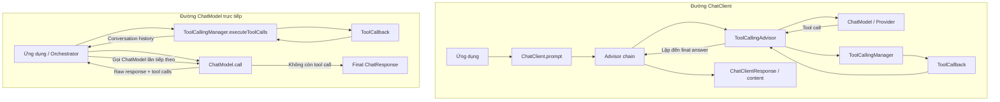

# Phân biệt đường gọi ChatClient và ChatModel trực tiếp

Spring AI cung cấp hai cách phổ biến để gửi yêu cầu có tool tới mô hình: gọi qua `ChatClient` hoặc gọi trực tiếp `ChatModel`. Cả hai đều có thể gửi tool definition và nhận tool call, nhưng trách nhiệm điều phối khác nhau.

Với `ChatClient`, `ToolCallingAdvisor` được tự động đăng ký trong advisor chain theo cấu hình mặc định. Advisor gửi tool definition cho mô hình, nhận tool call, yêu cầu `ToolCallingManager` thực thi callback, đưa kết quả vào lịch sử hội thoại và gọi mô hình tiếp cho đến khi có câu trả lời không còn tool call. Ứng dụng thường chỉ cần gọi `.call().content()` để nhận nội dung cuối.

Với `ChatModel` trực tiếp, `call(prompt)` và `stream(prompt)` là API thấp hơn. Trong Spring AI 2.x, chúng chỉ gửi yêu cầu đến provider và trả về phản hồi thô, kể cả khi phản hồi chứa tool call. Caller phải tự phát hiện tool call, gọi `ToolCallingManager`, cập nhật lịch sử và gọi model tiếp. Đây là lựa chọn phù hợp khi ứng dụng cần sở hữu workflow và từng bước điều phối.

Module `SPRING_AI_TOOL_CALLING` tập trung vào cách mô hình yêu cầu gọi công cụ bằng `@Tool`, `ToolCallback`, schema đầu vào và `ToolContext`. Dù chọn đường nào, ứng dụng vẫn sở hữu callback, kiểm tra quyền và thực thi nghiệp vụ. Khác biệt nằm ở nơi vòng lặp được điều khiển.

## 1. So sánh nhanh hai đường gọi

| Khía cạnh | `ChatClient` | `ChatModel` trực tiếp |
|---|---|---|
| Vai trò | API cấp cao cho ứng dụng hội thoại | API request/response cấp thấp với model provider |
| Gửi tool definition | Qua `.tools(...)`, `.defaultTools(...)` hoặc callback provider | Qua `ToolCallingChatOptions.toolCallbacks(...)` trong `Prompt` |
| Thực thi tool call | `ToolCallingAdvisor` tự điều phối theo mặc định | Caller phải tự thực thi |
| Vòng lặp nhiều lượt | Advisor tự lặp đến khi model không còn tool call | Caller viết vòng lặp và quyết định điều kiện dừng |
| Thành phần thực thi callback | `ToolCallingManager` được advisor sử dụng | Caller gọi `ToolCallingManager.executeToolCalls(...)` |
| Advisor chain | Có thể kết hợp memory, retrieval, observability và advisor khác | Không có advisor chain của `ChatClient` |
| Kiểm soát từng vòng | Có thể mở rộng bằng advisor hoặc tắt auto loop để tự điều khiển | Kiểm soát trực tiếp từng request/response |
| Phù hợp | Chat app, trợ lý, RAG và phần lớn use case hội thoại | Custom orchestrator, workflow engine hoặc hạ tầng tự xây |



## 2. Đường ChatClient: vòng lặp tự động qua ToolCallingAdvisor

Trong Spring AI 2.1, `DefaultChatClient` tự động đăng ký `ToolCallingAdvisor` vào advisor chain, trừ khi ứng dụng tắt auto-registration hoặc đã cung cấp một `ToolAdvisor` riêng. Khi request có công cụ, advisor chịu trách nhiệm chạy vòng lặp.

Luồng xử lý:

1. Ứng dụng tạo prompt và đăng ký callback bằng `.tools(...)` hoặc công cụ mặc định bằng `.defaultTools(...)` trên builder.
2. `ToolCallingAdvisor` gửi prompt cùng tool definition đến model.
3. Model trả về assistant message. Nếu không có tool call, advisor kết thúc vòng và trả kết quả.
4. Nếu có tool call, advisor giao chúng cho `ToolCallingManager`.
5. Manager tìm callback, thực thi và tạo tool response tương ứng.
6. Advisor thêm assistant tool-call message và tool response vào conversation history rồi gửi lịch sử trở lại model.
7. Các bước trên lặp lại cho đến khi model trả lời mà không yêu cầu gọi công cụ, hoặc một điều kiện dừng khác được áp dụng.

Ví dụ tối thiểu:

```java
ChatClient chatClient = ChatClient.builder(chatModel)
        .build();

String answer = chatClient.prompt()
        .user("Đơn hàng ORD-2048 đang ở trạng thái nào?")
        .tools(orderTools)
        .call()
        .content();
```

`orderTools` có thể là một object chứa phương thức `@Tool`, một `ToolCallback` hoặc một nhóm callback phù hợp. `content()` trả nội dung của phản hồi cuối sau khi advisor hoàn thành vòng tool calling. Người gọi ở tầng ứng dụng không cần tự phân tích `AssistantMessage.getToolCalls()` trong trường hợp dùng luồng tự động mặc định.

Nếu model không yêu cầu công cụ, advisor trả phản hồi bình thường. Nếu model yêu cầu một hoặc nhiều công cụ, advisor xử lý từng tool call theo callback đã đăng ký rồi tiếp tục hội thoại. Vì vậy cùng một dòng code `.call().content()` có thể đại diện cho một lần gọi model hoặc nhiều lần gọi model tùy phản hồi.

## 3. Đăng ký công cụ theo request hoặc mặc định với ChatClient

`ChatClient` hỗ trợ hai phạm vi đăng ký:

```java
ChatClient chatClient = ChatClient.builder(chatModel)
        .defaultTools(commonReadOnlyTools)
        .build();

String answer = chatClient.prompt()
        .user(question)
        .tools(orderTools)
        .call()
        .content();
```

- `.defaultTools(...)` gắn các công cụ ổn định vào những request được tạo từ client đó.
- `.tools(...)` thêm công cụ cho một request cụ thể.

Trong đường `ChatClient`, tool được thêm ở cấp request sẽ kết hợp với `defaultTools` của client. Đây là hành vi khác với cách ghi đè options ở `ChatModel` trực tiếp.

Chỉ nên đặt các công cụ thực sự an toàn và cần thiết trong mọi request ở `defaultTools`. Công cụ ghi dữ liệu, hoàn tiền, xóa dữ liệu hoặc thao tác nhạy cảm nên được cung cấp theo use case và quyền của request. Việc tool có mặt trong prompt không thay thế authorization ở callback/service.

## 4. Đường ChatModel trực tiếp: chỉ nhận phản hồi thô

`ChatModel` là giao diện thấp hơn giữa ứng dụng và provider. Khi gửi tool definitions qua `ToolCallingChatOptions`, model có thể trả về tool call, nhưng `ChatModel` không tự thực thi callback trong Spring AI 2.x.

Ví dụ gửi một yêu cầu:

```java
ToolCallback[] tools = ToolCallbacks.from(new OrderTools());

ToolCallingChatOptions options = ToolCallingChatOptions.builder()
        .toolCallbacks(tools)
        .build();

Prompt prompt = new Prompt(
        "Đơn hàng ORD-2048 đang ở trạng thái nào?",
        options);

ChatResponse response = chatModel.call(prompt);
```

Sau lời gọi trên, cần kiểm tra phản hồi:

```java
if (response.hasToolCalls()) {
    // Model đã yêu cầu gọi công cụ.
    // Caller phải điều phối việc thực thi và gọi model lại.
} else {
    String finalAnswer = response.getResult().getOutput().getText();
}
```

`response.hasToolCalls()` cho biết phản hồi có ít nhất một tool call hoàn chỉnh. Nếu có, đó vẫn là yêu cầu thực thi từ assistant, chưa phải câu trả lời cuối. Ứng dụng cần chuyển phản hồi cùng prompt cho `ToolCallingManager`.

## 5. Tự điều phối vòng lặp bằng ToolCallingManager

`ToolCallingManager` thực thi các tool call trong một `ChatResponse`. Phương thức `executeToolCalls(prompt, response)` trả về `ToolExecutionResult`, trong đó có conversation history đã bổ sung assistant tool-call message và tool response.

Vòng lặp blocking cơ bản (đặt trong một phương thức có kiểu trả về `ToolRunResult`):

```java
public ToolRunResult run(String question) {
    ToolCallingManager toolCallingManager = ToolCallingManager.builder().build();

    ToolCallback[] tools = ToolCallbacks.from(new OrderTools());
    ToolCallingChatOptions options = ToolCallingChatOptions.builder()
            .toolCallbacks(tools)
            .build();

    Prompt prompt = new Prompt(question, options);
    ChatResponse response = chatModel.call(prompt);

    int round = 0;
    int maxRounds = 8;

    while (response.hasToolCalls()) {
        if (++round > maxRounds) {
            throw new IllegalStateException("Đã vượt giới hạn vòng tool calling.");
        }

        ToolExecutionResult result =
                toolCallingManager.executeToolCalls(prompt, response);

        if (result.returnDirect()) {
            // Các tool trong vòng này đã yêu cầu trả kết quả trực tiếp.
            // Trả conversation history hoặc trích xuất output theo hợp đồng ứng dụng.
            return new ToolRunResult(null, result.conversationHistory(), true);
        }

        prompt = new Prompt(result.conversationHistory(), options);
        response = chatModel.call(prompt);
    }

    String finalAnswer = response.getResult().getOutput().getText();
    return new ToolRunResult(finalAnswer, List.of(), false);
}
```

Ví dụ giả định `chatModel` đã được inject và các kiểu `Message`, `List` cùng dependency liên quan đã được import. Kiểu trả về biểu diễn cả final assistant answer và direct tool result; caller có thể đọc `answer` khi `direct=false`, hoặc chuyển `conversationHistory` cho adapter xử lý theo contract của công cụ khi `direct=true`.

Ví dụ kiểu kết quả của ứng dụng:

```java
public record ToolRunResult(
        String answer,
        List<Message> conversationHistory,
        boolean direct) {
}
```

Khi `result.returnDirect()` là `true`, caller có thể trả history cho lớp adapter để lấy kết quả tool theo contract của công cụ. Khi vòng lặp kết thúc vì model không còn tool call, lấy text từ `AssistantMessage` cuối cùng và trả về `answer`.

`ToolCallingManager` được Spring Boot auto-configure dưới dạng `DefaultToolCallingManager`. Nếu ứng dụng không dùng Spring Boot auto-configuration, có thể tạo manager bằng builder như ví dụ. Có thể tùy chỉnh resolver, exception processor và các giới hạn thực thi theo API phiên bản đang sử dụng.

## 6. Giữ conversation history chính xác qua từng vòng

Mỗi lần model yêu cầu tool, lịch sử cần chứa:

1. Các message trước đó, gồm system và user message.
2. Assistant message chứa tool call do model tạo.
3. Tool response tương ứng với từng tool call ID.

Sau khi `ToolCallingManager.executeToolCalls(...)` trả về, dùng `result.conversationHistory()` làm message list cho prompt tiếp theo. Không chỉ gửi lại tool result riêng lẻ, vì mô hình cần biết nó đang trả lời tool call nào và tool call đó xuất phát từ assistant message nào.

```java
ToolExecutionResult result =
        toolCallingManager.executeToolCalls(prompt, response);

Prompt nextPrompt = new Prompt(
        result.conversationHistory(),
        options);

ChatResponse nextResponse = chatModel.call(nextPrompt);
```

Không tự tạo tool response với ID mới hoặc ghép kết quả theo thứ tự hoàn thành khi có nhiều tool call. `ToolCallingManager` quản lý việc ghép kết quả với yêu cầu gọi tương ứng. Nếu ứng dụng tự viết toàn bộ executor, cần bảo đảm mỗi tool response tham chiếu đúng tool call ID.

Vòng lặp có thể gồm nhiều lượt. Ví dụ, model gọi `findLatestOrder`, nhận mã đơn hàng, sau đó gọi `getOrderStatus`, rồi mới trả lời. Không giả định mỗi câu hỏi chỉ cần một vòng thực thi công cụ.

## 7. Khác biệt khi truyền tool options

Đây là khác biệt dễ gây lỗi khi chuyển cùng một cấu hình từ `ChatClient` sang `ChatModel`:

| Cấu hình | `ChatClient` | `ChatModel` trực tiếp |
|---|---|---|
| Công cụ mặc định | `.defaultTools(...)` trên client | Tool callbacks trong default options của model (nếu model builder hỗ trợ) |
| Công cụ theo request | `.tools(...)` được cộng thêm vào default tools | `ToolCallingChatOptions.toolCallbacks(...)` trong prompt options thay thế default options nói chung |
| Muốn dùng default + tool bổ sung | Thêm `.tools(...)` vào request | Phải tự ghép default callbacks vào runtime options |
| Context mặc định + runtime | Context của request merge với context mặc định; runtime ghi đè key trùng | Request options thay default options; context cần được đưa đầy đủ vào request options |

Ví dụ `ChatModel` có default tool list:

```java
ChatModel chatModel = /* model được cấu hình default options */;

ToolCallingChatOptions runtimeOptions = ToolCallingChatOptions.builder()
        .toolCallbacks(otherTool)
        .build();

ChatResponse response = chatModel.call(
        new Prompt(question, runtimeOptions));
```

Với hầu hết provider, options được gắn vào `Prompt` sẽ thay thế default options của `ChatModel` như một bộ options hoàn chỉnh. Do đó request trên chỉ dùng `otherTool`, không tự cộng thêm danh sách tool mặc định. Nếu cần cả hai, hãy tự ghép danh sách:

```java
List<ToolCallback> combined = new ArrayList<>(defaultTools);
combined.add(otherTool);

ToolCallingChatOptions runtimeOptions = ToolCallingChatOptions.builder()
        .toolCallbacks(combined)
        .build();
```

Một số API/provider có quy tắc options riêng; ví dụ tài liệu Spring AI nêu ngoại lệ đối với OpenAI Responses API. Khi chuyển provider, kiểm tra precedence trong tài liệu của adapter thay vì giả định mọi model xử lý options giống hệt nhau.

## 8. Khi nào nên dùng ChatClient?

Chọn `ChatClient` khi mục tiêu chính là xây dựng trải nghiệm hội thoại và muốn Spring AI quản lý vòng tool calling mặc định.

Các trường hợp phù hợp:

- API trợ lý khách hàng cần trả lời sau một hoặc nhiều tool call.
- RAG kết hợp retrieval tool, memory và các advisor khác.
- Ứng dụng không cần can thiệp vào từng vòng model/tool.
- Muốn dùng blocking hoặc streaming mà vẫn giữ cơ chế advisor composition.
- Muốn thay đổi behavior bằng cách thêm advisor thay vì tự viết orchestration loop.

Ví dụ kết hợp tool với memory hoặc advisor khác:

```java
String answer = chatClient.prompt()
        .user(question)
        .tools(orderTools)
        .advisors(memoryAdvisor)
        .call()
        .content();
```

Advisor chain cho phép phối hợp tool calling với memory, retrieval, observability và logic trước/sau mỗi lần gọi model. Thứ tự advisor có thể ảnh hưởng message history và ngữ cảnh được đưa vào model; hãy kiểm tra ordering khi ứng dụng có nhiều advisor.

Không nên chọn `ChatClient` chỉ vì ít dòng code nếu use case cần approval gate, workflow có trạng thái hoặc điều kiện dừng riêng ở từng bước. Có thể mở rộng vòng lặp bằng advisor hoặc tắt auto-registration cho request đó.

## 9. Khi nào nên gọi ChatModel trực tiếp?

Chọn `ChatModel` khi ứng dụng chủ động muốn sở hữu request/response cycle và không cần advisor chain của `ChatClient`.

Các trường hợp phù hợp:

- Workflow engine cần quyết định bước tiếp theo dựa trên kết quả tool.
- Orchestrator riêng cần pause, resume hoặc yêu cầu phê duyệt trước một số tool call.
- Hạ tầng hoặc thư viện đang xây API cấp cao hơn Spring AI.
- Cần kiểm soát chặt số vòng, thứ tự callback, timeout tổng và chính sách retry.
- Cần dừng vòng lặp theo tín hiệu side-channel hoặc trạng thái của một quy trình dài.

Khi dùng trực tiếp, ứng dụng phải chịu trách nhiệm đầy đủ cho:

- Phát hiện tool call trong `ChatResponse`.
- Thực thi callback qua `ToolCallingManager` hoặc executor của ứng dụng.
- Bổ sung đúng conversation history.
- Gọi model lại sau khi nhận tool result.
- Giới hạn số vòng, thời gian và số lượng tool call.
- Xử lý lỗi, hủy request, retry và quan sát từng bước.
- Dừng khi có `returnDirect` hoặc khi model trả câu trả lời cuối.

Nếu không cần các quyền kiểm soát này, dùng `ChatClient` sẽ giảm lượng mã điều phối mà ứng dụng phải duy trì.

## 10. Muốn tự điều khiển vòng lặp nhưng vẫn dùng ChatClient

Không nhất thiết phải chuyển sang `ChatModel` chỉ vì cần tự điều khiển một số vòng. Có thể tắt tự động đăng ký `ToolCallingAdvisor` cho một request bằng:

```java
ChatClientResponse response = chatClient.prompt()
        .user(question)
        .tools(tools)
        .advisors(AdvisorParams.toolCallingAdvisorAutoRegister(false))
        .call()
        .chatClientResponse();
```

Khi tắt auto-registration, tool definitions vẫn có thể được gửi cho model nhưng tool call trong phản hồi không được thực thi tự động. Caller phải kiểm tra `response.chatResponse().hasToolCalls()`, dùng `ToolCallingManager.executeToolCalls(...)`, rồi gọi ChatClient tiếp với history mới và vẫn giữ auto-registration tắt cho những lượt do ứng dụng điều khiển.

```java
ToolCallingManager manager = ToolCallingManager.builder().build();
ToolCallback[] tools = ToolCallbacks.from(new OrderTools());
ToolCallingChatOptions options = ToolCallingChatOptions.builder()
        .toolCallbacks(tools)
        .build();

ChatClientResponse response = chatClient.prompt()
        .user(question)
        .tools(tools)
        .advisors(AdvisorParams.toolCallingAdvisorAutoRegister(false))
        .call()
        .chatClientResponse();

Prompt prompt = new Prompt(List.of(new UserMessage(question)), options);

while (response.chatResponse() != null
        && response.chatResponse().hasToolCalls()) {

    ToolExecutionResult result = manager.executeToolCalls(
            prompt, response.chatResponse());

    if (result.returnDirect()) {
        break;
    }

    prompt = new Prompt(result.conversationHistory(), options);
    response = chatClient.prompt()
            .messages(result.conversationHistory())
            .tools(tools)
            .advisors(AdvisorParams.toolCallingAdvisorAutoRegister(false))
            .call()
            .chatClientResponse();
}
```

Đoạn mã trên minh họa pattern user-controlled loop; cần bổ sung giới hạn vòng, xử lý response rỗng, lỗi và direct result theo contract của ứng dụng. Nếu tắt advisor tự động, ứng dụng cũng phải hiểu rõ advisor nào vẫn chạy và advisor nào bị bỏ qua. Khi dùng `ChatModel` trực tiếp, không có advisor chain của `ChatClient` ngay từ đầu.

Có thể tắt auto-registration toàn cục cho `ChatClient` auto-configured bằng:

```yaml
spring:
  ai:
    chat:
      client:
        tool-calling:
          enabled: false
```

Chỉ đặt global false khi ứng dụng chủ động sở hữu tool loop cho tất cả request của client. Nếu chỉ một use case cần can thiệp, tắt theo request sẽ giới hạn ảnh hưởng tốt hơn.

## 11. Streaming: khác biệt vẫn là nơi sở hữu vòng lặp

Với `ChatClient`, `.stream()` vẫn đi qua advisor chain và `ToolCallingAdvisor` có thể điều phối tool loop tự động. Ứng dụng có thể nhận các delta nội dung cuối hoặc quan sát `ChatResponse` tùy API streaming được chọn.

Với `ChatModel.stream(prompt)`, model trả một `Flux<ChatResponse>` gồm các chunk. Nếu tự điều phối tool calling, caller cần gom các chunk của một vòng thành một phản hồi hoàn chỉnh trước khi kiểm tra `hasToolCalls()` và thực thi công cụ. Không thực thi callback khi mới nhận một phần tên hoặc arguments của tool call, vì JSON arguments có thể chưa hoàn chỉnh.

Ví dụ khái niệm:

```java
AtomicReference<ChatResponse> aggregated = new AtomicReference<>();

new MessageAggregator().aggregate(
        chatModel.stream(prompt),
        aggregated::set)
    .blockLast();

ChatResponse response = aggregated.get();
if (response != null && response.hasToolCalls()) {
    ToolExecutionResult result =
            toolCallingManager.executeToolCalls(prompt, response);
    // Cập nhật history và tiếp tục vòng kế tiếp nếu cần.
}
```

Nếu cần gửi progress ra SSE/WebSocket, có thể forward các chunk trong khi vẫn aggregate đầy đủ response của vòng hiện tại. Đừng coi một delta `ToolCallPart` là tool call hoàn chỉnh; đợi phần hoàn chỉnh theo cơ chế aggregator của framework.

## 12. `returnDirect` trong hai đường gọi

Một tool có thể khai báo `returnDirect = true`. Khi đó kết quả công cụ được trả về caller thay vì gửi lại mô hình để mô hình diễn đạt tiếp.

- Trong đường `ChatClient` tự động, `ToolCallingAdvisor` xử lý metadata và kết thúc vòng khi điều kiện direct thỏa mãn.
- Trong đường `ChatModel` trực tiếp, `ToolCallingManager.executeToolCalls(...)` trả `ToolExecutionResult`; kiểm tra `result.returnDirect()` trước khi tạo prompt tiếp theo.
- Nếu một vòng có nhiều tool call, `returnDirect()` chỉ là `true` khi tất cả tool được gọi trong vòng đó đều có `returnDirect = true`.

Không tiếp tục gọi model sau khi kết quả đã được cấu hình trả trực tiếp. Caller cần xử lý kết quả theo định dạng mà converter của tool tạo ra.

## 13. Giới hạn vòng lặp và bảo vệ tài nguyên

Vòng tự động không nên được xem là vô hạn. Một model có thể tiếp tục yêu cầu tool qua nhiều lượt, hoặc tool result khiến model lặp lại thao tác. Ứng dụng cần có giới hạn tổng thể phù hợp với use case.

Các giới hạn nên cân nhắc:

- Số vòng model/tool tối đa cho một yêu cầu.
- Số tool call tối đa trong một assistant message và toàn bộ lượt.
- Timeout cho từng callback và deadline tổng cho request.
- Ngân sách token, chi phí model và kích thước conversation history.
- Giới hạn concurrency và rate limit theo user/tenant.
- Chính sách retry có giới hạn và idempotency cho công cụ ghi.
- Hủy vòng lặp khi client ngắt kết nối hoặc workflow hết hạn.

Với `ChatClient`, có thể dùng cấu hình `ToolCallingAdvisor` và các giới hạn manager/advisor phù hợp phiên bản, hoặc thêm advisor tùy chỉnh để theo dõi điều kiện dừng. Với `ChatModel` trực tiếp, vòng lặp nằm trong mã ứng dụng nên có thể kiểm tra counter và deadline ngay tại mỗi iteration.

Không chỉ giới hạn số vòng. Một vòng có thể chứa nhiều tool call song song; hãy giới hạn tổng số callback, tổng thời gian và tác động phụ. Mỗi callback vẫn phải kiểm tra quyền độc lập.

## 14. Lỗi thường gặp khi chọn sai đường gọi

| Triệu chứng | Nguyên nhân | Cách xử lý |
|---|---|---|
| Dùng `ChatModel.call()` nhưng callback không chạy | Spring AI 2.x không còn internal tool loop trong ChatModel | Dùng ChatClient hoặc gọi `ToolCallingManager` thủ công |
| `ChatClient` trả final content mà không thấy tool result trung gian | ToolCallingAdvisor đã xử lý vòng lặp tự động | Lấy `ChatClientResponse` hoặc dùng custom advisor nếu cần quan sát sâu |
| ChatClient gọi công cụ lặp nhiều lần | Model tiếp tục yêu cầu tool; thiếu giới hạn hoặc tool result không đủ | Đặt max rounds, timeout và kiểm tra result contract |
| Công cụ mặc định biến mất khi thêm options cho ChatModel | Runtime options thay default options | Ghép default callbacks vào request options |
| ChatClient có nhiều tool hơn dự kiến | `.tools(...)` được cộng thêm vào `.defaultTools(...)` | Kiểm tra cả hai phạm vi đăng ký |
| Tool call xuất hiện trong response nhưng không được thực thi | Auto ToolCallingAdvisor đã bị tắt hoặc không được đăng ký | Bật lại advisor hoặc tự điều phối qua ToolCallingManager |
| Streaming JSON arguments chưa hoàn chỉnh | Thực thi callback từ delta một phần | Aggregate response của vòng trước khi chạy tool |
| `returnDirect` không được tôn trọng trong loop tự viết | Caller bỏ qua `ToolExecutionResult.returnDirect()` | Kiểm tra cờ trước khi gọi model lần tiếp theo |
| Sau nâng cấp 1.x lên 2.x tool không tự chạy | Internal ChatModel tool loop đã bị loại bỏ trong 2.0 | Chuyển sang ChatClient hoặc viết manual loop |

## 15. Chuyển từ Spring AI 1.x sang 2.x

Trong Spring AI 1.x, mỗi implementation `ChatModel` có internal tool execution loop. Vì vậy, một số ứng dụng gọi trực tiếp `chatModel.call(prompt)` với tool options và kỳ vọng callback được thực thi tự động.

Spring AI 2.0 đã loại bỏ internal loop này khỏi các `ChatModel` implementation. Sau nâng cấp:

- `chatModel.call(prompt)` trả về phản hồi model có thể chứa tool call nhưng không tự thực thi callback.
- Với phần lớn ứng dụng, chuyển sang `ChatClient`; `ToolCallingAdvisor` chạy vòng lặp tự động.
- Nếu cần dùng `ChatModel`, gọi `ToolCallingManager.executeToolCalls(...)`, thêm conversation history và gọi model lại.
- Kiểm tra lại precedence của tool callbacks và options theo provider.

Đừng chỉ đổi dependency rồi giữ nguyên giả định của 1.x. Hãy thêm integration test xác minh callback có thực sự được gọi và kết quả đã quay lại model trước khi trả final answer.

## 16. Kiểm thử hai đường gọi

Một bộ kiểm thử nên bao phủ các hành vi tương đương và những khác biệt có chủ ý:

| Ca kiểm thử | ChatClient tự động | ChatModel trực tiếp |
|---|---|---|
| Model không yêu cầu tool | Trả final answer | Caller đọc final `AssistantMessage` |
| Model yêu cầu một tool | Advisor thực thi callback và gọi model lại | Caller gọi manager rồi gọi model lại |
| Model yêu cầu nhiều tool | Advisor/manager xử lý và ghép tool response | Caller/manager xử lý và ghép tool response |
| Model yêu cầu nhiều vòng | Advisor lặp tự động | Vòng lặp caller lặp đến khi hết tool call |
| `returnDirect=true` | Advisor trả kết quả theo direct contract | Caller kiểm tra `ToolExecutionResult.returnDirect()` |
| Callback ném lỗi | Theo exception processor của tool manager | Theo exception processor của tool manager và caller |
| Giới hạn vòng | Kiểm tra cấu hình advisor/manager | Kiểm tra counter/deadline trong loop |
| Tool context | Context theo request đến callback | Context nằm trong `ToolCallingChatOptions` của prompt |
| Advisor memory/observability | Có thể compose trong advisor chain | Caller tự triển khai các concern tương đương |

Nên dùng model giả lập để trả lần lượt: phản hồi cuối, một tool call, nhiều tool call và nhiều vòng tool call. Xác minh số lần model được gọi, số lần callback chạy, tool call ID của kết quả và lịch sử hội thoại. Với kiểm thử streaming, xác minh callback chỉ chạy sau khi tool call hoàn chỉnh.

## 17. Quy tắc chọn đường gọi

Hãy bắt đầu bằng `ChatClient` cho các ứng dụng hội thoại thông thường. Dùng `.tools(...)` cho công cụ theo request và `.defaultTools(...)` cho nhóm công cụ thực sự ổn định. Để `ToolCallingAdvisor` sở hữu vòng lặp và kết hợp với advisor chain.

Chuyển sang `ChatModel` trực tiếp khi workflow của ứng dụng cần kiểm soát từng bước, hoặc khi đang xây hạ tầng orchestration riêng. Khi đó, coi việc phát hiện tool call, thực thi callback, cập nhật history, giới hạn vòng, xử lý lỗi và direct result là trách nhiệm của orchestrator.

Nếu chỉ cần can thiệp một phần vào luồng ChatClient, xem xét custom advisor hoặc tắt auto-registration cho đúng request. Không chuyển toàn bộ ứng dụng sang đường thấp hơn chỉ để thêm một điều kiện đơn giản giữa các vòng.

## 18. Checklist trước khi triển khai

- Đã xác định rõ tầng nào sở hữu vòng tool calling.
- Nếu dùng ChatClient, hiểu `ToolCallingAdvisor` được auto-register và biết cách tắt khi cần.
- Nếu dùng ChatModel trực tiếp, có vòng lặp gọi `ToolCallingManager` và cập nhật conversation history.
- Đã kiểm tra `hasToolCalls()` trước khi xem phản hồi assistant là câu trả lời cuối.
- Đã xử lý `returnDirect()` đúng cách.
- Đã đặt giới hạn vòng, callback, timeout và chi phí.
- Đã xác minh semantics của default tools và request tools trên API đang dùng.
- Đã truyền `ToolContext` theo request và kiểm tra quyền trong service.
- Đã xử lý lỗi, retry và idempotency cho thao tác ghi.
- Nếu streaming, chỉ thực thi tool sau khi aggregate được tool call hoàn chỉnh.
- Có integration test cho một tool, nhiều tool, nhiều vòng và final answer.
- Nếu nâng cấp từ 1.x, đã kiểm tra thay đổi loại bỏ internal ChatModel loop ở 2.0.

## 19. Tài liệu tham khảo

- [Spring AI 2.1 — Tool Calling](https://docs.spring.io/spring-ai/reference/api/tools.html): `ToolCallingAdvisor`, vòng lặp tự động của ChatClient, user-controlled execution và cấu hình auto-registration.
- [Spring AI 2.1 — ChatModel Tool Calling](https://docs.spring.io/spring-ai/reference/api/tools/chatmodel-tool-calling.html): API thấp, `ToolCallingChatOptions`, manual loop, `ToolCallingManager` và `ToolExecutionResult`.
- [Spring AI 2.1 — ChatClient API](https://docs.spring.io/spring-ai/reference/api/chatclient.html): advisor chain, default tools và request-level tools.
- [Spring AI Upgrade Notes](https://docs.spring.io/spring-ai/reference/upgrade-notes.html): loại bỏ internal tool execution loop của `ChatModel` trong Spring AI 2.0.

`ChatClient` là đường gọi cấp cao, nơi Spring AI tự điều phối tool calling thông qua `ToolCallingAdvisor`. `ChatModel` trực tiếp là đường gọi cấp thấp, nơi ứng dụng nhận tool call thô và tự chạy vòng bằng `ToolCallingManager`. Chọn đúng đường theo mức kiểm soát workflow cần có, đồng thời giữ việc xác thực, phân quyền và thực thi nghiệp vụ ở phía ứng dụng.
