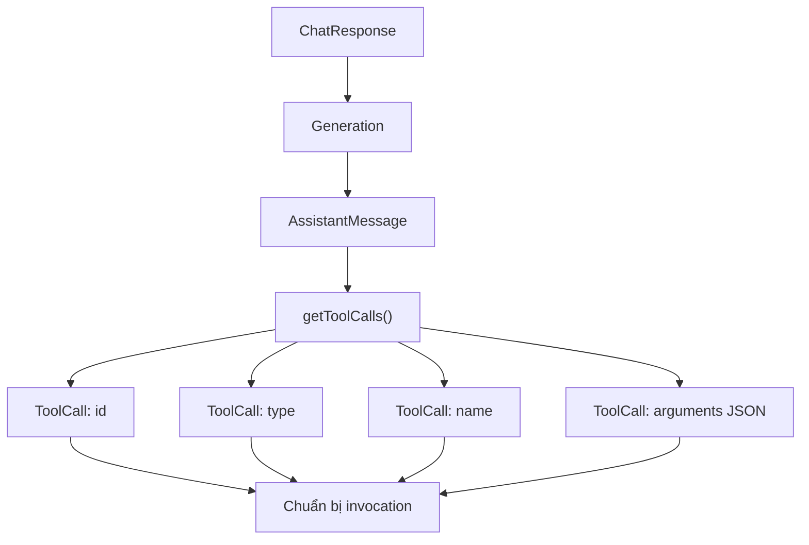

# Đọc tool call từ ChatResponse và chuẩn bị ngữ cảnh thực thi

Khi mô hình yêu cầu gọi công cụ, Spring AI trả về một `ChatResponse` có chứa thông điệp của assistant và danh sách tool call. Mỗi tool call mang **ID**, **tên công cụ**, **loại lời gọi** và **arguments dạng JSON string**. Ứng dụng đọc dữ liệu này để biết mô hình đang yêu cầu điều gì, sau đó chuẩn bị callback, xác thực arguments và gắn ngữ cảnh tin cậy trước khi thực thi.

Điểm cần giữ rõ trong luồng tự điều phối là: `ChatResponse` chỉ là kết quả mô hình trả về. Việc có một tool call trong response chưa có nghĩa công cụ đã chạy. Ứng dụng chịu trách nhiệm kiểm tra yêu cầu, xác định callback phù hợp, áp dụng chính sách và gửi kết quả đúng về hội thoại.

## 1. Tool call nằm ở đâu trong ChatResponse?

Với Spring AI, cấu trúc phản hồi thường đi theo chuỗi:

1. `ChatResponse` chứa một hoặc nhiều `Generation`.
2. Mỗi `Generation` chứa `AssistantMessage` do mô hình tạo ra.
3. `AssistantMessage` chứa nội dung văn bản, metadata và các `ToolCall` nếu mô hình yêu cầu gọi công cụ.
4. Mỗi `AssistantMessage.ToolCall` cung cấp `id`, `type`, `name` và `arguments`.



Ví dụ mô hình yêu cầu tra cứu một đơn hàng:

```json
{
  "role": "assistant",
  "tool_calls": [
    {
      "id": "call_order_01",
      "type": "function",
      "function": {
        "name": "getOrderStatus",
        "arguments": "{\"orderId\":\"ORD-42\"}"
      }
    }
  ]
}
```

Trong API Java của Spring AI, ta không cần tự parse JSON wire format phía trên. Provider adapter đã chuẩn hóa tool call thành `AssistantMessage.ToolCall` để ứng dụng đọc bằng accessor.

## 2. Kiểm tra response trước khi đọc tool call

`ChatResponse.hasToolCalls()` là cách kiểm tra nhanh xem mô hình có yêu cầu thực thi tool hay không. Nếu không có tool call, ứng dụng có thể lấy nội dung trả lời cuối cùng từ generation đầu tiên:

```java
ChatResponse response = chatModel.call(prompt);

if (response == null || !response.hasToolCalls()) {
    Generation generation = response != null ? response.getResult() : null;
    String answer = generation != null
            ? generation.getOutput().getText()
            : "";
    return answer;
}
```

`getResult()` trả về generation đầu tiên và có thể là `null` nếu response không có kết quả. Với cấu hình chat thông thường chỉ có một candidate, đây thường là generation cần xử lý. `getResults()` trả về toàn bộ danh sách generation; nếu ứng dụng cấu hình nhiều candidate (`n > 1`), hãy xác định candidate được chọn theo chính sách của provider trước khi thực thi tool call. Không coi các generation thay thế nhau là nhiều bước của cùng một kế hoạch.

## 3. Đọc danh sách AssistantMessage.ToolCall

Khi response có tool call, lấy assistant message và đọc danh sách lời gọi:

```java
import java.util.List;
import org.springframework.ai.chat.messages.AssistantMessage;
import org.springframework.ai.chat.model.Generation;
import org.springframework.ai.chat.model.ChatResponse;

Generation generation = response.getResult();
if (generation == null) {
    throw new IllegalStateException("ChatResponse không có Generation");
}

AssistantMessage assistantMessage = generation.getOutput();
List<AssistantMessage.ToolCall> toolCalls = assistantMessage.getToolCalls();

for (AssistantMessage.ToolCall toolCall : toolCalls) {
    String id = toolCall.id();
    String type = toolCall.type();
    String name = toolCall.name();
    String argumentsJson = toolCall.arguments();

    log.info("Model requested tool: id={}, type={}, name={}", id, type, name);
}
```

Các trường có ý nghĩa riêng:

| Trường | Ý nghĩa | Cách sử dụng |
| --- | --- | --- |
| `id()` | Định danh của lần gọi | Giữ nguyên để liên kết kết quả với yêu cầu tương ứng |
| `type()` | Loại tool call do provider chuẩn hóa | Dùng khi cần xử lý theo loại lời gọi/provider |
| `name()` | Tên tool mà mô hình muốn gọi | Tra cứu callback trong tập công cụ được phép |
| `arguments()` | JSON string chứa các tham số | Parse và validate theo input schema/DTO |

`AssistantMessage.ToolCall` là record, vì vậy truy cập bằng `id()`, `type()`, `name()` và `arguments()`. Không dùng `toString()` để parse hoặc log toàn bộ record vì arguments có thể chứa dữ liệu nhạy cảm.

## 4. Phân biệt ID, tên tool và arguments

Ba trường thường bị nhầm lẫn:

- **ID** xác định một lần gọi cụ thể. Cùng một tool có thể được gọi nhiều lần trong một response, mỗi lần có ID riêng.
- **Tên tool** xác định callback cần được phân giải, ví dụ `getOrderStatus`.
- **Arguments** mô tả dữ liệu mà mô hình muốn truyền vào callback, ví dụ `{"orderId":"ORD-42"}`.

Không dùng tên tool thay cho ID. Nếu response chứa hai lần gọi `searchCustomer` với hai bộ arguments khác nhau, chúng vẫn là hai invocation riêng. Khi tự tạo tool response, ID của kết quả phải khớp ID của yêu cầu gốc. Không tự sinh ID mới để thay thế ID provider trả về.

Một số provider có thể không trả ID hoặc có thể trả ID trùng. Nếu tự xây dựng giao thức ghép request/response, hãy áp dụng quy tắc định danh theo provider đang dùng; không đoán ID. `ToolCallingManager` là lựa chọn an toàn hơn khi muốn Spring AI quản lý việc ghép tool call và tool response.

## 5. Parse arguments JSON và tạo dữ liệu có kiểu

`arguments()` là chuỗi JSON, không phải object Java đã được validate. Hãy parse nó bằng Jackson hoặc bộ chuyển đổi phù hợp rồi kiểm tra dữ liệu trước khi thực thi.

Ví dụ DTO cho tool tra cứu đơn hàng:

```java
public record OrderStatusRequest(String orderId) {
}
```

Đọc arguments:

```java
import com.fasterxml.jackson.databind.JsonNode;
import com.fasterxml.jackson.databind.ObjectMapper;

JsonNode arguments = objectMapper.readTree(toolCall.arguments());
if (!arguments.isObject()) {
    throw new IllegalArgumentException("Tool arguments phải là JSON object");
}

OrderStatusRequest request = objectMapper.treeToValue(
        arguments, OrderStatusRequest.class);

if (request.orderId() == null || request.orderId().isBlank()) {
    throw new IllegalArgumentException("orderId là bắt buộc");
}
```

Với tool không có tham số, provider thường biểu diễn arguments bằng object rỗng `{}`. Hãy xử lý trường hợp này theo schema của tool; không tự thay một chuỗi JSON lỗi hoặc bị cắt cụt thành `{}` vì như vậy có thể che giấu lỗi dữ liệu.

JSON Schema giúp mô hình tạo arguments đúng cấu trúc, nhưng ứng dụng vẫn phải validate lại. Cần kiểm tra kiểu, trường bắt buộc, độ dài, định dạng, giới hạn số lượng, trường ngoài schema và điều kiện nghiệp vụ. Đừng giả định model/provider luôn trả JSON hợp lệ.

### Không dùng arguments làm nguồn danh tính

Nếu mô hình gửi thêm `tenantId`, `userId`, `role` hoặc `isAdmin` trong arguments, không dùng các trường đó để quyết định quyền. Danh tính và tenant phải được lấy từ authentication/session đã xác thực rồi truyền qua `ToolContext`. Arguments chỉ nên chứa các giá trị nghiệp vụ mà mô hình được phép đề xuất.

## 6. Chuẩn bị ngữ cảnh thực thi từ ứng dụng

Trước khi gửi prompt, ứng dụng tạo context từ principal đã xác thực. Context có thể gồm subject, tenant, conversation ID và request ID:

```java
public record ToolExecutionContext(
        String subjectId,
        String tenantId,
        String conversationId,
        String requestId) {
}

ToolExecutionContext executionContext = new ToolExecutionContext(
        authenticatedSubjectId,
        authorizedTenantId,
        authorizedConversationId,
        requestId);
```

Đưa context vào `ToolCallingChatOptions` cùng các callback:

```java
import java.util.Map;
import org.springframework.ai.model.tool.ToolCallingChatOptions;
import org.springframework.ai.tool.ToolCallback;
import org.springframework.ai.tool.ToolCallbacks;

ToolCallback[] callbacks = ToolCallbacks.from(orderTools);

ToolCallingChatOptions options = ToolCallingChatOptions.builder()
        .toolCallbacks(callbacks)
        .toolContext(Map.of("execution", executionContext))
        .build();

Prompt prompt = new Prompt(
        "Kiểm tra trạng thái đơn hàng ORD-42.",
        options);
```

`ToolContext` được chuyển trực tiếp đến callback khi thực thi và không được đưa vào JSON arguments mà mô hình nhìn thấy. Mỗi request cần tạo context riêng. Không lưu `subjectId`, `tenantId` hoặc `ToolContext` vào field mutable của singleton callback.

## 7. Tạo kế hoạch invocation trước khi thực thi

Trong một bộ điều phối tùy chỉnh, có thể chuyển các tool call đã đọc thành một cấu trúc nội bộ để kiểm tra trước khi gọi callback:

```java
import com.fasterxml.jackson.databind.JsonNode;
import com.fasterxml.jackson.databind.ObjectMapper;
import java.util.ArrayList;
import java.util.List;
import org.springframework.security.access.AccessDeniedException;

public record PreparedToolInvocation(
        String toolCallId,
        String toolName,
        JsonNode arguments) {
}
```

Ví dụ chuẩn bị từng invocation:

```java
List<PreparedToolInvocation> prepared = new ArrayList<>();

for (AssistantMessage.ToolCall toolCall : toolCalls) {
    if (toolCall.name() == null || toolCall.name().isBlank()) {
        throw new IllegalArgumentException("Tool name bị thiếu");
    }

    if (!allowedToolNames.contains(toolCall.name())) {
        throw new AccessDeniedException("Tool không được phép sử dụng");
    }

    JsonNode args = objectMapper.readTree(toolCall.arguments());
    if (!args.isObject()) {
        throw new IllegalArgumentException("Arguments phải là JSON object");
    }

    prepared.add(new PreparedToolInvocation(
            toolCall.id(), toolCall.name(), args));
}
```

Đây là bước chuẩn bị và kiểm tra, chưa thực thi callback. Allowlist nên được tạo từ các tool mà ứng dụng đã đăng ký cho request. Việc mô hình trả về một tên tool bất kỳ không làm tool đó tự động trở thành hợp lệ.

Có thể bổ sung bước policy decision trước khi thực thi: kiểm tra caller có quyền gọi action tương ứng trên resource được xác định từ arguments hay không. Với thao tác ghi, hãy xác minh approval hoặc yêu cầu xác nhận người dùng trước khi chuyển sang bước thực thi.

## 8. Dùng ToolCallingManager để thực thi sau khi đã đọc response

Trong phần lớn trường hợp, không cần tự viết bộ phân giải callback và ghép response. `ToolCallingManager` nhận `Prompt` cùng `ChatResponse`, tìm callback theo tên, chuyển arguments, truyền `ToolContext` từ options và tạo `ToolExecutionResult` có lịch sử hội thoại đã cập nhật.

```java
import org.springframework.ai.model.tool.ToolCallingManager;
import org.springframework.ai.model.tool.ToolExecutionResult;
import org.springframework.ai.chat.model.ChatModel;
import org.springframework.ai.chat.model.ChatResponse;
import org.springframework.ai.chat.prompt.Prompt;
import org.springframework.ai.model.tool.ToolCallingChatOptions;

void runManualLoop(ChatModel chatModel, Prompt prompt, ToolCallingChatOptions options) {
    ToolCallingManager toolCallingManager = ToolCallingManager.builder().build();
    ChatResponse response = chatModel.call(prompt);
    ToolExecutionResult directResult = null;

    while (response.hasToolCalls()) {
        // Có thể kiểm tra/log tên tool và áp dụng policy trước bước này.
        ToolExecutionResult result = toolCallingManager.executeToolCalls(
                prompt, response);

        if (result.returnDirect()) {
            // Tất cả tool trong lượt này cho phép trả kết quả trực tiếp.
            directResult = result;
            break;
        }

        prompt = new Prompt(result.conversationHistory(), options);
        response = chatModel.call(prompt);
    }

    if (directResult != null) {
        sendToolResultToCaller(directResult); // Ánh xạ kết quả theo API của ứng dụng.
        return;
    }

    String finalAnswer = response.getResult().getOutput().getText();
    sendTextToCaller(finalAnswer);
}
```

Khi dùng Spring Boot starter, `DefaultToolCallingManager` thường đã được auto-configure và có thể inject. Nếu không dùng auto-configuration, tạo manager bằng builder. `executeToolCalls(...)` thực thi tất cả tool call trong response theo cơ chế của manager và trả về:

Hai hàm `sendToolResultToCaller(...)` và `sendTextToCaller(...)` trong ví dụ là điểm tích hợp do ứng dụng định nghĩa để chuyển kết quả về HTTP/API hoặc giao diện. Chúng không phải API của Spring AI.

- Lịch sử hội thoại gồm prompt ban đầu, assistant tool call và tool response.
- Cờ `returnDirect()` cho biết tất cả tool được gọi trong lượt đó có cho phép trả kết quả trực tiếp hay không.

Khi `returnDirect()` là `true`, không gọi mô hình thêm vòng nữa; kết quả tool chính là đầu ra cho caller. Nếu là `false`, dùng `conversationHistory()` làm messages cho prompt tiếp theo. Đừng tự dựng lại lịch sử từ mỗi mẩu text vì có thể làm mất assistant message chứa tool call hoặc tool response.

## 9. Khác biệt API theo phiên bản Spring AI

Việc đọc `ChatResponse` phụ thuộc vào việc vòng lặp tự động có được bật hay không. Kiểm tra đúng phiên bản và entry point mà ứng dụng đang sử dụng:

| Phiên bản/entry point | Hành vi | Cách để ứng dụng nhận tool call thô |
| --- | --- | --- |
| Spring AI 1.x `ChatModel` | Mỗi `ChatModel` có vòng thực thi tool nội bộ mặc định | Đặt `internalToolExecutionEnabled(false)` trong `ToolCallingChatOptions` |
| Spring AI 2.x `ChatModel` | Không còn vòng thực thi nội bộ; trả raw response | Gọi `chatModel.call(prompt)` và đọc `ChatResponse` |
| Spring AI 2.x `ChatClient` | Tự đăng ký `ToolCallingAdvisor` để chạy vòng lặp | Tắt auto advisor theo request bằng `AdvisorParams.toolCallingAdvisorAutoRegister(false)` hoặc cấu hình global tương ứng |

Ví dụ với Spring AI 1.x:

```java
ToolCallingChatOptions options = ToolCallingChatOptions.builder()
        .toolCallbacks(callbacks)
        .toolContext(Map.of("execution", executionContext))
        .internalToolExecutionEnabled(false)
        .build();

ChatResponse response = chatModel.call(new Prompt(question, options));
// response có thể chứa tool call để ứng dụng tự đọc và điều phối.
```

Với Spring AI 2.x, khi dùng `ChatModel` trực tiếp, không cần cờ `internalToolExecutionEnabled(false)` để tắt vòng nội bộ vì vòng đó đã được loại bỏ. Nếu dùng `ChatClient`, phải chú ý `ToolCallingAdvisor` tự động đăng ký; nếu muốn tự đọc response, hãy tắt advisor tự động cho request và lấy `ChatClientResponse.chatResponse()`.

Ví dụ khởi đầu với ChatClient 2.x:

```java
import org.springframework.ai.chat.client.ChatClientResponse;
import org.springframework.ai.chat.client.AdvisorParams;
import org.springframework.ai.chat.messages.AssistantMessage;
import org.springframework.ai.chat.model.ChatResponse;
import java.util.List;
ChatClientResponse clientResponse = chatClient.prompt()
        .user(question)
        .options(options)
        .advisors(AdvisorParams.toolCallingAdvisorAutoRegister(false))
        .call()
        .chatClientResponse();

ChatResponse response = clientResponse.chatResponse();
if (response != null && response.hasToolCalls()) {
    AssistantMessage assistant = response.getResult().getOutput();
    List<AssistantMessage.ToolCall> calls = assistant.getToolCalls();
}
```

Khi tự điều phối nhiều lượt qua ChatClient, tiếp tục dùng `ToolCallingManager.executeToolCalls(...)`, sau đó gửi `result.conversationHistory()` vào request kế tiếp và vẫn tắt auto advisor ở request đó. Nếu không, vòng tự động có thể chạy thêm bên trong vòng lặp thủ công.

## 10. Trường hợp một response có nhiều tool call

Một `AssistantMessage` có thể chứa nhiều `ToolCall`. Hãy duyệt hết danh sách và giữ riêng ID, tên cùng arguments cho từng invocation:

```java
for (AssistantMessage.ToolCall call : assistantMessage.getToolCalls()) {
    PreparedToolInvocation invocation = prepare(call, executionContext);
    // Gửi invocation qua policy gate trước khi thực thi.
}
```

Không giả định callback hoàn tất theo đúng thứ tự tool call. Nếu dùng `ToolCallingManager`, manager chịu trách nhiệm điều phối và tạo kết quả. Nếu tự chạy song song, mỗi task phải giữ nguyên ID và arguments của invocation riêng, không ghép kết quả theo thứ tự hoàn tất.

Với các tool có quan hệ phụ thuộc, hãy điều phối tuần tự hoặc tạo một tool nghiệp vụ cấp cao để thực hiện quy trình. Với các tool độc lập, chỉ chạy song song khi service, transaction và giới hạn tài nguyên cho phép.

## 11. Streaming: không thực thi một tool call chưa hoàn chỉnh

Ở streaming API, tool call có thể được gửi thành nhiều delta. Một chunk có thể chỉ chứa một phần arguments hoặc chỉ một phần tên/ID; phần JSON đó chưa chắc parse được và chưa đại diện cho invocation hoàn chỉnh.

Không gọi callback từ từng delta. Hãy aggregate các chunk của một lượt thành `ChatResponse` hoàn chỉnh bằng `MessageAggregator` hoặc `ChatClientMessageAggregator`, sau đó mới kiểm tra `hasToolCalls()` và đọc `AssistantMessage.getToolCalls()`. Spring AI bỏ qua partial `ToolCallPart` khi xác định danh sách tool call hoàn chỉnh.

```java
import java.util.concurrent.atomic.AtomicReference;
import org.springframework.ai.chat.model.ChatModel;
import org.springframework.ai.chat.model.ChatResponse;
import org.springframework.ai.chat.model.MessageAggregator;
AtomicReference<ChatResponse> aggregated = new AtomicReference<>();

new MessageAggregator().aggregate(
        chatModel.stream(prompt),
        aggregated::set)
        .blockLast();

ChatResponse completeResponse = aggregated.get();
if (completeResponse != null && completeResponse.hasToolCalls()) {
    // Đọc và chuẩn bị invocation từ response đã aggregate.
}
```

Nếu cần hiển thị tiến độ cho người dùng, có thể hiển thị delta như thông tin tiến trình. Nhưng chỉ thực thi khi đã có tool call hoàn chỉnh, được parse và kiểm tra.

## 12. Kiểm tra an toàn trước khi chuyển sang bước thực thi

`ChatResponse` là dữ liệu đến từ mô hình/provider, không phải lệnh đã được ứng dụng phê duyệt. Trước khi thực thi từng invocation, cần:

- Xác minh tool name thuộc tập callback đã đăng ký cho request.
- Parse arguments và kiểm tra kiểu, trường bắt buộc, kích thước và giới hạn.
- Tạo caller/tenant context từ authentication đã xác thực, không lấy từ arguments.
- Kiểm tra quyền trên action và resource cụ thể.
- Kiểm tra approval nếu tool có side effect cần xác nhận.
- Giới hạn số tool call, thời gian chờ, kích thước kết quả và số vòng lặp.
- Giữ nguyên tool call ID để liên kết kết quả và ghi log correlation.

Không ghi toàn bộ arguments vào log nếu chúng có thể chứa dữ liệu cá nhân hoặc bí mật. Log tối thiểu tool name, ID, request ID, thời lượng và kết quả policy; phần payload cần được che hoặc chỉ ghi khi có cơ chế kiểm soát.

## 13. Kiểm thử bước đọc và chuẩn bị invocation

Có thể dùng `ChatResponse` giả hoặc mock `ChatModel` để kiểm tra bộ điều phối mà không gọi provider thật. Các trường hợp nên có:

| Trường hợp | Điều cần xác minh |
| --- | --- |
| Response không có tool call | Lấy text response và kết thúc lượt |
| Một tool call | Đọc đúng ID, type, name và arguments |
| Nhiều tool call | Tất cả invocation được chuẩn bị riêng, không trộn ID |
| Arguments sai JSON | Dừng trước callback và trả lỗi an toàn |
| Tool name không được đăng ký | Từ chối, không gọi callback tùy ý |
| Arguments có tenant giả | Không ghi đè tenant lấy từ ToolContext |
| Context thiếu | Không thực thi tool cần context |
| Nhiều generation | Chọn candidate theo chính sách, không thực thi tất cả candidate thay thế |
| Streaming delta chưa hoàn chỉnh | Không gọi tool trước khi aggregate hoàn tất |
| `returnDirect` | Không gọi mô hình thêm khi kết quả đã là câu trả lời |

Ví dụ kiểm tra trích xuất:

```java
AssistantMessage assistant = response.getResult().getOutput();
List<AssistantMessage.ToolCall> calls = assistant.getToolCalls();

assertThat(calls).hasSize(1);
assertThat(calls.get(0).id()).isEqualTo("call_order_01");
assertThat(calls.get(0).name()).isEqualTo("getOrderStatus");
assertThat(calls.get(0).arguments()).contains("ORD-42");
```

Kiểm thử riêng bước chuẩn bị context để bảo đảm `subjectId`, `tenantId`, `conversationId` và `requestId` đến từ ứng dụng. Bổ sung kiểm thử tích hợp cho `ToolCallingManager` để xác nhận tool response được đưa vào conversation history và prompt tiếp theo.

## 14. Checklist trước khi thực thi tool call

- [ ] Xác định rõ phiên bản Spring AI và entry point (`ChatModel` hay `ChatClient`).
- [ ] Xác nhận vòng tự động đã được tắt đúng cơ chế nếu ứng dụng tự điều phối.
- [ ] Kiểm tra `response.hasToolCalls()` trước khi đọc tool call.
- [ ] Lấy đúng `Generation` và `AssistantMessage` từ `ChatResponse`.
- [ ] Duyệt danh sách `AssistantMessage.ToolCall` và giữ nguyên ID.
- [ ] Phân giải tool name trong allowlist callback của request.
- [ ] Parse JSON arguments và validate trước khi thực thi.
- [ ] Tạo `ToolContext` từ danh tính và tenant do ứng dụng xác thực.
- [ ] Đánh giá policy và yêu cầu approval trước side effect.
- [ ] Dùng `ToolCallingManager` để thực thi và cập nhật conversation history khi phù hợp.
- [ ] Aggregate streaming response trước khi thực thi.
- [ ] Giới hạn số vòng gọi và xử lý `returnDirect` đúng cách.

## Tài liệu tham khảo

- [Spring AI 2.1 — ChatModel Tool Calling](https://docs.spring.io/spring-ai/reference/api/tools/chatmodel-tool-calling.html)
- [Spring AI 2.1 — Tool Calling](https://docs.spring.io/spring-ai/reference/api/tools.html)
- [Spring AI 1.0 — Tool Calling và User-Controlled Tool Execution](https://docs.spring.io/spring-ai/reference/1.0/api/tools.html)
- [ChatResponse API — Spring AI 2.1](https://docs.spring.io/spring-ai/docs/2.1.x/api/org/springframework/ai/chat/model/ChatResponse.html)
- [AssistantMessage.ToolCall API — Spring AI](https://docs.spring.io/spring-ai/docs/current/api/org/springframework/ai/chat/messages/AssistantMessage.ToolCall.html)
- [ToolCallingManager API — Spring AI 1.0](https://docs.spring.io/spring-ai/docs/1.0.x/api/org/springframework/ai/model/tool/ToolCallingManager.html)

Đọc tool call từ `ChatResponse` là bước chuyển từ phản hồi của mô hình sang một yêu cầu thực thi có thể kiểm soát. Hãy giữ nguyên ID và tên tool, parse arguments như dữ liệu không đáng tin cậy, tạo context từ nguồn xác thực của ứng dụng và chỉ chuyển invocation qua callback sau khi đã kiểm tra quyền. Khi cần quản lý vòng lặp và lịch sử hội thoại, `ToolCallingManager` giúp giữ đúng cấu trúc tool call/tool response của Spring AI.
