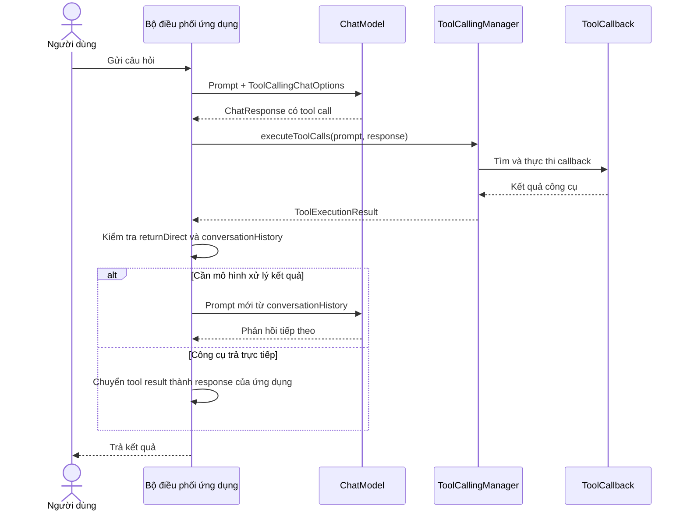

# Thực thi bằng ToolCallingManager và tiếp nhận ToolExecutionResult

Khi tự điều phối tool calling, ứng dụng cần làm hai việc sau mỗi phản hồi của mô hình: yêu cầu Spring AI thực thi các tool call và tiếp nhận kết quả theo đúng cấu trúc để quyết định bước tiếp theo. `ToolCallingManager.executeToolCalls(...)` đảm nhiệm việc thực thi; `ToolExecutionResult` trả lại lịch sử hội thoại đã có kết quả công cụ cùng thông tin cho biết có cần gọi mô hình thêm hay không.

Đây là cách điều khiển ở mức thấp phù hợp khi ứng dụng cần chen logic nghiệp vụ giữa các lượt, lưu trạng thái hội thoại theo cách riêng, phát tiến độ, chờ phê duyệt hoặc tích hợp với workflow engine. Nếu không cần quyền kiểm soát đó, `ChatClient` cùng `ToolCallingAdvisor` đã tự chạy vòng lặp. Khi chọn tự điều phối, ứng dụng phải chịu trách nhiệm giữ đúng prompt, response, tool options và lịch sử qua từng vòng.

## Vị trí của `executeToolCalls` trong một lượt hội thoại

`ChatModel` gửi prompt và các tool definition tới provider. Mô hình trả về `ChatResponse`; phản hồi này có thể chứa câu trả lời cuối hoặc các yêu cầu gọi công cụ. `ChatModel.call(...)` không tự thực thi tool call trong Spring AI 2.x. Ứng dụng kiểm tra `response.hasToolCalls()` rồi chuyển cặp `Prompt` và `ChatResponse` cho `ToolCallingManager`.



`ToolCallingManager` không gọi mô hình lần tiếp theo. Nó thực thi các callback mà mô hình yêu cầu và trả `ToolExecutionResult`. Ứng dụng phải quyết định tiếp tục gọi `ChatModel`, trả kết quả trực tiếp, chờ xác nhận, hoặc dừng do lỗi/chính sách.

## Chuẩn bị `ToolCallingManager` và danh sách callback

Khi dùng Spring Boot Starter, Spring AI tự cấu hình `DefaultToolCallingManager` và có thể inject qua constructor. Nếu ứng dụng không dùng auto-configuration, có thể tạo implementation mặc định bằng builder:

```java
ToolCallingManager toolCallingManager = ToolCallingManager.builder()
        .build();
```

Định nghĩa callback và `ToolCallingChatOptions` trước khi gọi model:

```java
ToolCallback[] callbacks = ToolCallbacks.from(new OrderTools(orderService));

ToolCallingChatOptions options = ToolCallingChatOptions.builder()
        .toolCallbacks(callbacks)
        .toolContext(Map.of("tenantId", authenticatedTenantId))
        .build();

Prompt prompt = new Prompt(
        "Kiểm tra trạng thái đơn hàng ORD-2048",
        options);
```

`ToolCallbacks.from(...)` chuyển object có phương thức `@Tool` thành callback. Có thể thay bằng các `ToolCallback` đã đăng ký hoặc callback tạo bằng `MethodToolCallback`/`FunctionToolCallback`. Danh sách callback trong options xác định những công cụ được gửi cho model và có thể thực thi trong request này.

Khi dùng `ChatModel` trực tiếp, tool callbacks ở options cấp request thay thế danh sách tool mặc định của model nếu cả hai cùng được cấu hình. Nếu muốn dùng cả tool mặc định và tool bổ sung, hãy ghép chúng tường minh vào danh sách runtime. Với tool có quyền cao hoặc thao tác phá hủy, chỉ thêm callback ở request cần thiết thay vì công bố toàn cục.

## Thực thi một phản hồi có tool call

Sau khi gọi model, kiểm tra `hasToolCalls()` trước khi gọi manager:

```java
ChatResponse response = chatModel.call(prompt);

if (response.hasToolCalls()) {
    ToolExecutionResult result =
            toolCallingManager.executeToolCalls(prompt, response);

    // Xử lý result trước khi quyết định gọi model tiếp.
}
else {
    String finalAnswer = response.getResult().getOutput().getText();
}
```

`executeToolCalls(prompt, response)` cần nhận đúng prompt đã tạo ra response đó. Prompt chứa tool options, callback và context của request. Không dùng một prompt khác thiếu callback hoặc context để thực thi phản hồi cũ. Manager đọc các tool call trong assistant message, phân giải callback theo tên, truyền arguments cho callback, nhận kết quả và tạo tool response tương ứng.

Nếu phản hồi chứa nhiều tool call, manager thực thi các call đó và thu thập kết quả vào lịch sử. Ứng dụng cần bảo đảm mọi callback đều an toàn khi được gọi trong cùng một batch. Không dựa vào thứ tự hoàn tất để suy ra quan hệ phụ thuộc nghiệp vụ; nếu thao tác B cần kết quả của thao tác A, hãy thiết kế công cụ/luồng sao cho bước B chỉ được yêu cầu sau khi A đã hoàn tất.

## Đọc `ToolExecutionResult`

`ToolExecutionResult` cung cấp hai thông tin chính:

```java
public interface ToolExecutionResult {
    List<Message> conversationHistory();
    boolean returnDirect();
}
```

| Thành phần | Ý nghĩa | Cách dùng |
|---|---|---|
| `conversationHistory()` | Lịch sử gồm các message trước đó, assistant message có tool call và tool response tương ứng | Dùng làm messages cho lần gọi model kế tiếp hoặc lưu vào kho hội thoại |
| `returnDirect()` | Cho biết kết quả của lượt tool có thể trả thẳng cho caller hay phải gửi lại mô hình | Nếu `true`, dừng vòng lặp và chuyển kết quả công cụ thành response của ứng dụng |

`conversationHistory()` không chỉ chứa phần văn bản kết quả. Nó giữ cấu trúc giao thức cần thiết để model biết tool call nào đã được yêu cầu và kết quả nào trả lời call đó. Các tool response phải giữ quan hệ với tool call ID ban đầu. Vì vậy, khi tiếp tục hội thoại, dùng toàn bộ lịch sử này thay vì chỉ nối kết quả thành một câu text mới.

## Tiếp tục gọi model bằng conversation history

Trường hợp thông thường là tool result cần được mô hình đọc, kết hợp hoặc diễn giải. Khi `returnDirect()` là `false`, tạo prompt mới từ lịch sử trả về và giữ lại options của request:

```java
ToolExecutionResult result =
        toolCallingManager.executeToolCalls(prompt, response);

if (!result.returnDirect()) {
    prompt = new Prompt(result.conversationHistory(), options);
    response = chatModel.call(prompt);
}
```

Prompt mới cần tiếp tục cùng cuộc hội thoại và cùng bộ công cụ được phép. Nếu bỏ `options`, model có thể không nhận lại tool definitions ở vòng sau hoặc manager không còn đủ callback/context để xử lý yêu cầu tiếp theo. Nếu mỗi vòng có một bộ công cụ khác nhau theo chính sách, hãy xây dựng options mới có chủ đích và bảo đảm chúng vẫn khớp với callback được phép.

Ví dụ, người dùng hỏi: “Kiểm tra đơn ORD-2048 và cho biết đơn có đủ điều kiện đổi địa chỉ không”. Model có thể gọi `lookupOrder`. Manager thực thi và đưa trạng thái đơn vào `conversationHistory()`. Ứng dụng gọi model lại với lịch sử đó; model có thể trả lời ngay hoặc yêu cầu `checkAddressChangeEligibility` ở vòng tiếp theo. Kết quả từ bước trước được giữ trong đúng vị trí để model hiểu ngữ cảnh.

## Xử lý `returnDirect()` và trả kết quả cho caller

Một số tool trả về dữ liệu đã là kết quả cuối cùng, chẳng hạn một đoạn tài liệu được truy xuất, một báo cáo đã được phê duyệt hoặc một DTO mà endpoint muốn trả nguyên trạng. Khi đó, khai báo tool với `returnDirect = true`. Sau khi thực thi, kiểm tra `result.returnDirect()` và không gọi model thêm.

```java
@Tool(
        description = "Lấy bản tóm tắt đơn hàng đã được hệ thống xác nhận",
        returnDirect = true)
public OrderSummary getConfirmedOrder(String orderId) {
    return orderService.getConfirmedSummary(orderId);
}
```

Trong trường hợp direct return, `ToolExecutionResult` vẫn chứa `conversationHistory()` có tool response. Có thể dùng tiện ích `ToolExecutionResult.buildGenerations(result)` để chuyển kết quả tool thành các `Generation` phù hợp với response của ứng dụng hoặc provider adapter.

```java
if (result.returnDirect()) {
    List<Generation> generations = ToolExecutionResult.buildGenerations(result);
    return new DirectToolOutcome(generations);
}
```

`DirectToolOutcome` là response DTO do ứng dụng định nghĩa. Ứng dụng có thể chuyển generation thành response HTTP, event hoặc kết quả workflow. Không cần yêu cầu model diễn giải lại dữ liệu nếu hợp đồng tool nói rằng kết quả đã là đầu ra cuối.

Nếu mô hình gọi nhiều công cụ trong cùng một lượt, `returnDirect()` chỉ là `true` khi tất cả công cụ được gọi đều có `returnDirect = true`. Nếu chỉ một callback không bật cờ này, manager yêu cầu ứng dụng gửi kết quả của batch về model để mô hình tổng hợp. Một tool bị từ chối trong luồng xác nhận cũng khiến kết quả cần quay lại model để mô hình phản hồi với quyết định từ chối.

## Một bộ điều phối hoàn chỉnh cho luồng blocking

Ví dụ dưới đây trả về một kiểu kết quả của ứng dụng để phân biệt câu trả lời do model tạo với kết quả tool được trả trực tiếp:

```java
public record ManualTurnResult(
        String answer,
        List<Generation> directGenerations,
        boolean returnedDirect) {
}
```

```java
public class OrderAssistant {

    private final ChatModel chatModel;
    private final ToolCallingManager toolCallingManager;
    private final ToolCallback[] callbacks;

    public OrderAssistant(
            ChatModel chatModel,
            ToolCallingManager toolCallingManager,
            OrderTools orderTools) {
        this.chatModel = chatModel;
        this.toolCallingManager = toolCallingManager;
        this.callbacks = ToolCallbacks.from(orderTools);
    }

    public ManualTurnResult ask(String question) {
        ToolCallingChatOptions options = ToolCallingChatOptions.builder()
                .toolCallbacks(callbacks)
                .build();

        Prompt prompt = new Prompt(question, options);
        ChatResponse response = chatModel.call(prompt);

        while (response.hasToolCalls()) {
            ToolExecutionResult result =
                    toolCallingManager.executeToolCalls(prompt, response);

            if (result.returnDirect()) {
                return new ManualTurnResult(
                        null,
                        ToolExecutionResult.buildGenerations(result),
                        true);
            }

            prompt = new Prompt(result.conversationHistory(), options);
            response = chatModel.call(prompt);
        }

        return new ManualTurnResult(
                response.getResult().getOutput().getText(),
                List.of(),
                false);
    }
}
```

Đoạn code tập trung vào vòng blocking và cách tiêu thụ kết quả. Trong ứng dụng thật, cần bổ sung context theo request, deadline tổng, giới hạn số vòng/model call, xử lý cancellation và mapping exception. Không lưu `callbacks` chứa trạng thái người dùng thay đổi theo request trong một singleton; context của người dùng nên được truyền ở options/tool context cho từng request.

## Dùng `ChatClient` nhưng tự tiếp nhận từng kết quả

Nếu vẫn muốn dùng advisor chain của `ChatClient` nhưng cần tự quyết định mỗi vòng, có thể tắt auto-registration của `ToolCallingAdvisor` cho request đó. Khi ấy `ChatClient` trả `ChatClientResponse` chứa phản hồi thô; ứng dụng gọi manager và gửi lịch sử mới cho request tiếp theo.

```java
ChatClientResponse response = chatClient.prompt()
        .user(question)
        .options(options)
        .advisors(AdvisorParams.toolCallingAdvisorAutoRegister(false))
        .call()
        .chatClientResponse();

Prompt prompt = new Prompt(List.of(new UserMessage(question)), options);

while (response.chatResponse() != null
        && response.chatResponse().hasToolCalls()) {

    ToolExecutionResult result = toolCallingManager.executeToolCalls(
            prompt, response.chatResponse());

    if (result.returnDirect()) {
        return DirectToolOutcome.from(result);
    }

    prompt = new Prompt(result.conversationHistory(), options);
    response = chatClient.prompt()
            .messages(result.conversationHistory())
            .options(options)
            .advisors(AdvisorParams.toolCallingAdvisorAutoRegister(false))
            .call()
            .chatClientResponse();
}

return ModelAnswer.from(response.chatResponse());
```

Ở mỗi request tiếp theo vẫn phải tắt auto-registration; nếu quên, `ToolCallingAdvisor` có thể tự chạy một vòng lặp bên trong trong khi bộ điều phối của ứng dụng cũng chạy vòng lặp bên ngoài. Điều đó tạo hai tầng thực thi khó quan sát và có thể khiến tool call bị xử lý ngoài dự kiến. Khi tự điều phối, ứng dụng cũng tự chịu trách nhiệm về lịch sử, quan sát và dừng vòng lặp.

## Lưu và khôi phục hội thoại đúng cách

`conversationHistory()` là lịch sử đầy đủ mà manager dùng để tiếp tục lượt hiện tại. Khi ứng dụng tự lưu hội thoại, hãy lưu các message theo đúng thứ tự và vai trò:

1. System/developer instruction cần thiết cho phiên.
2. User message của lượt hiện tại.
3. Assistant message chứa tool call.
4. Tool response message tương ứng với từng tool call.
5. Các lượt model/tool tiếp theo nếu có.
6. Assistant message cuối khi mô hình hoàn tất.

Không chỉ lưu text cuối rồi bỏ assistant tool call và tool response nếu bạn cần khôi phục chính xác lượt đang chạy hoặc tiếp tục sau khi service restart. Provider có thể yêu cầu các message tool call/result phải khớp nhau.

Khi lưu lịch sử vào database, tránh append toàn bộ `conversationHistory()` lặp lại sau mỗi vòng nếu store đang lưu incremental messages. `conversationHistory()` thường chứa cả các message trước đó; ghi lại toàn bộ sau mỗi iteration sẽ nhân đôi user/assistant/tool messages. Có hai cách phổ biến:

- Lưu một bản snapshot mới của toàn bộ lịch sử và thay thế snapshot cũ trong một thao tác nguyên tử.
- So sánh phần lịch sử mới với phần đã lưu và chỉ append các message mới theo thứ tự.

Với nhiều request đồng thời trên cùng conversation ID, cần khóa/version hoặc optimistic concurrency để hai vòng điều phối không ghi đè lịch sử của nhau. Một request chỉ nên tiếp tục từ snapshot mà nó đã nhận và được ứng dụng xác nhận còn hợp lệ.

## Xử lý kết quả trong chế độ streaming

Với `ChatModel.stream(prompt)`, mỗi chunk chỉ là một phần của phản hồi. Một tool call có thể được phát thành nhiều mảnh tên và JSON arguments. Không gọi manager từ một chunk riêng lẻ. Trước hết, tổng hợp tất cả chunk của vòng hiện tại thành `ChatResponse` hoàn chỉnh bằng `ChatClientMessageAggregator` hoặc aggregator tương ứng của phiên bản đang dùng; sau đó mới kiểm tra `hasToolCalls()` và gọi `executeToolCalls(...)`.

Luồng streaming thủ công có thể tổ chức như sau:

```java
while (true) {
    AtomicReference<ChatResponse> aggregated = new AtomicReference<>();

    new ChatClientMessageAggregator().aggregate(
            chatModel.stream(prompt).doOnNext(this::forwardChunkToClient),
            aggregated::set)
        .blockLast();

    ChatResponse response = aggregated.get();
    if (response == null || !response.hasToolCalls()) {
        break;
    }

    ToolExecutionResult result =
            toolCallingManager.executeToolCalls(prompt, response);

    if (result.returnDirect()) {
        handleDirectResult(result);
        break;
    }

    prompt = new Prompt(result.conversationHistory(), options);
}
```

Đây là minh họa cho từng vòng streaming; `forwardChunkToClient` và `handleDirectResult` là xử lý của ứng dụng. Nếu đang ở Reactor event-loop, không gọi `.blockLast()` trực tiếp trên event-loop đó. Hãy chạy phần điều phối blocking trên scheduler phù hợp hoặc xây dựng chuỗi reactive không blocking. Dù chọn cách nào, mỗi vòng vẫn phải đợi phản hồi hoàn chỉnh trước khi thực thi tool call.

## Xác nhận trước khi gọi công cụ có tác động

Spring AI 2.1.0 cho phép đánh dấu tool cần xác nhận bằng `requiresConfirmation = true` hoặc `ToolMetadata`. Khi `ToolCallingManager` nhận phản hồi có ít nhất một tool call cần xác nhận, nó ném `ToolCallConfirmationRequiredException` và không thực thi bất kỳ tool call nào trong batch đó.

Ứng dụng cần giữ lại `Prompt` đã gửi và `ChatResponse` đang chờ, hiển thị các tool call cho người dùng, rồi thu thập một `ToolCallDecision` cho từng call. Khi người dùng quyết định, gọi overload `executeToolCalls(prompt, reply, decisions)`; tool được cho phép mới chạy, tool bị từ chối nhận thông điệp từ chối như tool result. Sau đó dùng `conversationHistory()` để tiếp tục gọi model.

Một số nguyên tắc quan trọng:

- Lưu paused reply ở server-side store mà client không thể sửa. Không nhận lại `ChatResponse` từ payload client vì client có thể thay tool name hoặc arguments.
- Quyết định phải bao phủ mọi tool call trong reply, kể cả tool không bị policy yêu cầu xác nhận.
- Xác thực người đưa ra quyết định và kiểm tra họ có quyền phê duyệt hành động đó.
- Đánh dấu pause đã được giải quyết hoặc dùng idempotency để cùng một quyết định không chạy tool hai lần.
- Nếu người dùng từ chối, message từ chối sẽ được gửi vào model như tool result; không dùng nội dung từ chối để chứa bí mật hoặc thông tin không an toàn.

Confirmation không thay thế authorization trong service. Ngay cả sau khi người dùng cho phép, service vẫn kiểm tra quyền và trạng thái dữ liệu ngay trước khi thực thi.

## Xử lý các trường hợp manager không trả ToolExecutionResult

`executeToolCalls(...)` chỉ trả `ToolExecutionResult` khi quá trình thực thi hoàn tất theo hợp đồng. Một số trường hợp làm lời gọi ném exception thay vì trả kết quả bình thường:

| Tình huống | Biểu hiện | Hướng xử lý |
|---|---|---|
| Không tìm thấy callback | Tên tool không có trong danh sách callback được phép và resolver không tìm thấy fallback | Kiểm tra tool definitions, tên callback và danh sách callback gắn với prompt; không tự chạy một tool khác có tên gần giống |
| Tool execution thất bại | `ToolExecutionException` được chuyển tới `ToolExecutionExceptionProcessor` | Theo chính sách, processor có thể tạo tool error response hoặc ném lỗi lên caller |
| Vượt giới hạn tool call | `ToolCallLimitExceededException` khi cấu hình `THROW` | Dừng lượt, ghi nhận limit và trả trạng thái có kiểm soát; có thể cấu hình `RETURN_ERROR_RESPONSE` để model nhận lỗi dưới dạng tool result |
| Cần xác nhận | `ToolCallConfirmationRequiredException` | Lưu prompt/reply, chờ quyết định, rồi resume bằng overload có `ToolCallDecisions` |
| Lỗi provider/network | `ChatModel.call(...)` thất bại trước hoặc sau bước tool | Xử lý retry/timeout ở tầng tích hợp; không giả định tool chưa chạy nếu lỗi xảy ra sau side effect |
| Lỗi serialize kết quả | Callback không chuyển kết quả thành chuỗi được | Sửa DTO/converter và không trả dữ liệu giả thành công |

Với thao tác ghi dữ liệu, timeout không chứng minh service chưa thực hiện side effect. Nếu cần retry, dùng idempotency key hoặc truy vấn trạng thái giao dịch trước khi gửi lại lệnh. Không để mô hình tự quyết định retry vô hạn.

## Giới hạn vòng lặp và quyền thực thi

Vòng lặp thủ công cần giới hạn rõ ràng vì ứng dụng đang tự quản lý số lần gọi model và số tool execution. Có thể dùng giới hạn tích hợp của `DefaultToolCallingManager`, đồng thời đặt ngân sách cấp ứng dụng:

- Số tool call tối đa trên mỗi tool và tổng số tool call trong một lượt.
- Số lần gọi model tối đa và deadline tổng của request.
- Timeout riêng cho từng callback/downstream service.
- Giới hạn token/chi phí, số bản ghi và kích thước tool result.
- Cơ chế hủy khi người dùng ngắt request hoặc workflow bị dừng.

Trong Spring AI 2.1.0, `DefaultToolCallingManager` mặc định giới hạn 40 lần gọi cho mỗi tool và 150 tool call tổng trong một lượt. Có thể tùy chỉnh bằng builder hoặc properties. Khi gọi manager trực tiếp, ứng dụng cần xử lý `ToolCallLimitExceededException`; không có `ToolCallingAdvisor` bên ngoài để tự biến mọi lỗi giới hạn thành phản hồi cuối.

Danh sách callback trong prompt là ranh giới những công cụ được cung cấp cho lượt đó. Không bật resolution fallback toàn cục nếu chưa kiểm soát chặt resolver. Tool callback vẫn phải xác thực đối số và quyền trong service; `ToolCallingManager` điều phối việc gọi nhưng không thay thế authorization.

## Kiểm thử việc tiếp nhận ToolExecutionResult

Một bộ kiểm thử tốt cần xác minh cả kết quả của manager và cách bộ điều phối sử dụng nó:

| Ca kiểm thử | Điều cần xác minh |
|---|---|
| Model trả lời ngay | Không gọi `executeToolCalls`; trả nội dung assistant cuối |
| Một tool call thành công | Manager gọi đúng callback; history có assistant tool call và tool response |
| Nhiều tool call | Mỗi tool response gắn đúng tool call ID và thứ tự trong lịch sử được giữ |
| `returnDirect = false` | Bộ điều phối tạo prompt kế tiếp từ `conversationHistory()` và gọi model lại |
| Tất cả tool `returnDirect = true` | Bộ điều phối dừng model round-trip và trả generations/tool result cho caller |
| Batch trộn direct và non-direct | `returnDirect()` là false; kết quả quay lại model |
| Context theo request | Callback nhận đúng `ToolContext` và tenant/user của request hiện tại |
| Tool lỗi | Exception processor áp dụng đúng chính sách; không lộ stack trace hoặc bí mật |
| Unknown tool | Không gọi nhầm callback; ứng dụng ghi nhận cấu hình/danh sách tool không khớp |
| Vượt limit | Manager dừng theo `THROW` hoặc trả error response theo cấu hình |
| Confirmation | Không tool nào trong batch chạy trước khi có quyết định; resume dùng reply server-side đã lưu |
| Lưu hội thoại | Không nhân đôi toàn bộ lịch sử khi cập nhật snapshot qua nhiều vòng |
| Streaming | Chỉ gọi manager sau khi aggregator tạo response hoàn chỉnh |

Nên mock `ChatModel` để mô phỏng chuỗi phản hồi xác định: lần đầu trả tool call, lần hai trả một tool call khác, lần cuối trả văn bản. Kiểm tra prompt ở mỗi lần gọi chứa đủ assistant tool call và tool response trước đó. Với manager, có thể dùng callback giả có bộ đếm để xác nhận số lần thực thi, kết quả và `returnDirect`.

## Checklist triển khai

1. Dùng đúng `Prompt` đã tạo ra `ChatResponse` khi gọi manager.
2. Cung cấp `ToolCallingChatOptions` chứa callback, context và các tùy chọn đúng với request.
3. Chỉ gọi `executeToolCalls(...)` khi `response.hasToolCalls()` là true.
4. Đọc `ToolExecutionResult.conversationHistory()` và giữ nguyên tool call/result messages.
5. Kiểm tra `returnDirect()` trước khi gọi model thêm.
6. Khi tiếp tục, tạo `Prompt` mới từ history và giữ options cần thiết.
7. Khi lưu hội thoại, tránh append lại các message đã có trong full history.
8. Xử lý riêng unknown tool, tool exception, limit và confirmation.
9. Giới hạn số vòng, timeout, token/chi phí và concurrency.
10. Xác thực quyền ở service; không xem việc model yêu cầu gọi tool là sự chấp thuận của người dùng.
11. Với streaming, aggregate response của mỗi vòng trước khi kiểm tra tool call.
12. Kiểm thử cả nhánh model trả lời trực tiếp, tool result tiếp tục và `returnDirect`.

## Kết luận

`ToolCallingManager.executeToolCalls(prompt, response)` thực thi các tool call mà mô hình yêu cầu và trả `ToolExecutionResult`. Ứng dụng đọc `conversationHistory()` để tiếp tục đúng giao thức hội thoại và đọc `returnDirect()` để quyết định có cần gọi model thêm hay trả kết quả tool cho caller. Khi tự điều phối, hãy giữ nguyên prompt/response của từng vòng, options và context, lưu lịch sử không trùng lặp, xử lý lỗi/confirmation/limits rõ ràng và đặt quyền thực thi trong service nghiệp vụ. Đây là nền tảng để xây dựng một vòng tool calling có thể quan sát, kiểm soát và kiểm thử được.

## Tài liệu tham khảo

- [Spring AI 2.1.0 — ChatModel Tool Calling](https://docs.spring.io/spring-ai/reference/api/tools/chatmodel-tool-calling.html) — vòng lặp blocking/streaming thủ công, `ToolCallingManager`, `ToolExecutionResult`, `returnDirect` và `ToolContext`.
- [Spring AI 2.1.0 — Tool Calling](https://docs.spring.io/spring-ai/reference/api/tools.html) — kiến trúc tool calling, callback, `ChatClient`, `ToolCallingAdvisor` và user-controlled execution.
- [Spring AI 2.1.0 — Tool Call Confirmation](https://docs.spring.io/spring-ai/reference/api/tools/tool-call-confirmation.html) — tạm dừng, quyết định và tiếp tục tool call qua `ToolCallDecisions`.
- [Spring AI 2.1.x — ToolCallingManager API](https://docs.spring.io/spring-ai/docs/2.1.x/api/org/springframework/ai/model/tool/ToolCallingManager.html) — chữ ký các phương thức thực thi tool call.
- [Spring AI 2.1.x — ToolExecutionResult API](https://docs.spring.io/spring-ai/docs/2.1.x/api/org/springframework/ai/model/tool/ToolExecutionResult.html) — lịch sử hội thoại, `returnDirect()` và `buildGenerations(...)`.
