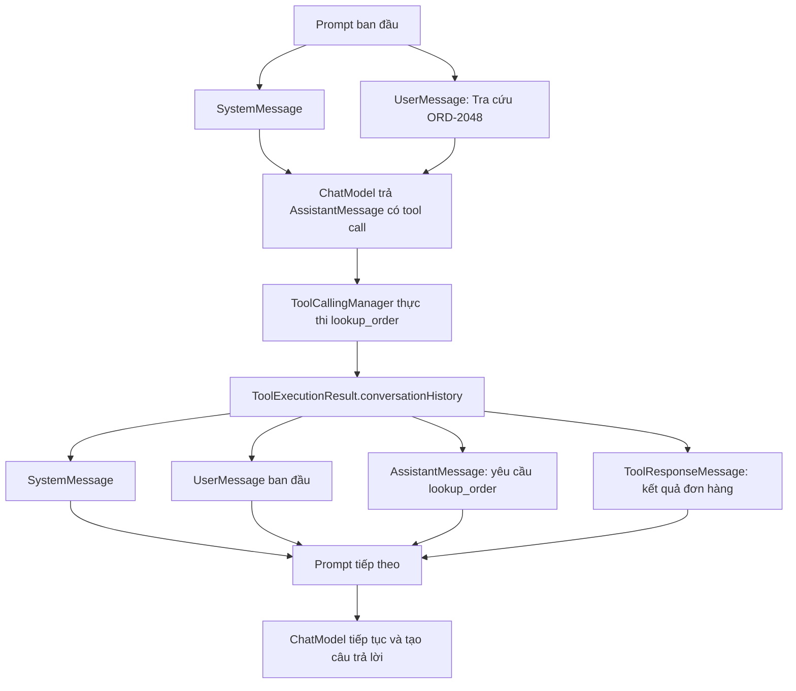

# Tự điều phối

## Xây dựng lượt gọi tiếp theo từ lịch sử đã cập nhật

Khi ứng dụng tự điều phối tool calling bằng `ChatModel`, sau mỗi lần thực thi công cụ, mô hình cần nhận lại toàn bộ ngữ cảnh cần thiết để tiếp tục suy luận. Spring AI cung cấp `ToolExecutionResult.conversationHistory()` để trả về danh sách message đã được cập nhật. Ứng dụng dùng danh sách này làm nội dung của `Prompt` tiếp theo.

Trong module `SPRING_AI_TOOL_CALLING`, mô hình chỉ tạo yêu cầu gọi công cụ; `ToolCallingManager` thực thi callback và trả kết quả. Ứng dụng chịu trách nhiệm xây dựng lượt gọi tiếp theo, giữ đúng thứ tự message, giữ lại cấu hình tool và `ToolContext`, rồi quyết định khi nào vòng lặp kết thúc.

Điểm cốt lõi của bài là dòng xử lý:

```java
ToolExecutionResult result = toolCallingManager.executeToolCalls(prompt, response);
prompt = new Prompt(result.conversationHistory(), chatOptions);
response = chatModel.call(prompt);
```

`conversationHistory()` đã chứa prompt ban đầu, yêu cầu gọi tool của mô hình và các tool response vừa thực thi. Vì vậy, ứng dụng dùng trực tiếp lịch sử này để tạo prompt mới, không tự nối lại các message cũ thêm lần nữa.

### 1. Vì sao cần xây dựng prompt tiếp theo?

`ChatModel` là API request/response cấp thấp. Trong Spring AI 2.x, `chatModel.call(prompt)` gửi prompt đến provider và trả response của mô hình. Nếu response có tool call, `ChatModel` không tự thực thi callback và cũng không tự gọi lại provider sau khi tool chạy.

Ứng dụng phải điều phối các bước:

1. Gửi câu hỏi cùng danh sách tool definitions đến mô hình.
2. Nhận response có một hoặc nhiều tool call.
3. Gọi `ToolCallingManager.executeToolCalls(prompt, response)` để thực thi.
4. Nhận `ToolExecutionResult` chứa lịch sử hội thoại đã cập nhật.
5. Tạo `Prompt` mới từ lịch sử đó và gửi lại mô hình.
6. Lặp lại cho đến khi response không còn tool call hoặc có điều kiện kết thúc khác.

Với `ChatClient`, `ToolCallingAdvisor` thực hiện vòng lặp này tự động. Tự điều phối bằng `ChatModel` phù hợp khi ứng dụng có workflow engine riêng, cần kiểm soát từng lượt hoặc cần tạm dừng giữa các bước để chờ một quyết định bên ngoài.

### 2. Lịch sử thay đổi như thế nào sau một lần gọi tool?

Giả sử người dùng hỏi: “Đơn hàng ORD-2048 đang ở đâu?”. Prompt ban đầu có system message và user message. Mô hình trả về một assistant message chứa yêu cầu gọi `lookup_order`. Sau khi callback thực thi, Spring AI thêm tool response tương ứng vào lịch sử.



Lịch sử sau thực thi thường có thứ tự như sau:

| Thứ tự | Message | Nguồn | Vai trò |
| --- | --- | --- | --- |
| 1 | `SystemMessage` | Prompt ban đầu | Hướng dẫn hành vi và phạm vi của mô hình |
| 2 | `UserMessage` | Prompt ban đầu | Câu hỏi người dùng |
| 3 | `AssistantMessage` có tool call | Response của mô hình | Ghi lại tên tool, arguments và tool call ID |
| 4 | `ToolResponseMessage` | `ToolCallingManager` | Kết quả thực thi gắn với tool call tương ứng |

Nếu mô hình gọi nhiều tool trong cùng một lượt, lịch sử giữ yêu cầu gọi tool và kết quả của từng tool theo đúng call ID. Khi nhận lịch sử này, mô hình có đủ thông tin để biết nó đã yêu cầu thao tác nào và mỗi thao tác trả về kết quả gì.

### 3. `ToolExecutionResult.conversationHistory()` chứa gì?

`ToolExecutionResult` là kết quả mà `ToolCallingManager` trả về sau khi xử lý tool calls. Phương thức `conversationHistory()` trả về danh sách message của cuộc trao đổi, bao gồm:

- Các message đã có trong prompt đầu vào.
- Assistant message của mô hình chứa yêu cầu gọi tool.
- Tool response chứa kết quả thực thi.

Nó là lịch sử đã cập nhật để tiếp tục cùng một lượt hội thoại. Ứng dụng không cần tự dựng lại assistant tool-call message hoặc tự tạo `ToolResponseMessage` khi đã dùng `ToolCallingManager`.

```java
ToolExecutionResult result =
    toolCallingManager.executeToolCalls(prompt, response);

List<Message> updatedHistory = result.conversationHistory();
```

`updatedHistory` là danh sách message đã được nối đúng theo giao thức tool calling. Dùng nó trực tiếp làm message list của prompt tiếp theo.

### 4. Tạo `Prompt` tiếp theo từ lịch sử đã cập nhật

Constructor `Prompt(List<Message>, ChatOptions)` cho phép kết hợp message history với cấu hình của lượt gọi. Trong Spring AI 2.1.0, ví dụ chuẩn là:

```java
Prompt nextPrompt = new Prompt(
    result.conversationHistory(),
    chatOptions);

ChatResponse nextResponse = chatModel.call(nextPrompt);
```

Hai phần của prompt có nhiệm vụ khác nhau:

- `result.conversationHistory()` mang nội dung hội thoại: system, user, assistant tool-call request và tool responses.
- `chatOptions` mang cấu hình request: tool callbacks, model options và `ToolContext`.

Không nên tạo prompt tiếp theo chỉ bằng `new Prompt(result.conversationHistory())` nếu request cần giữ tool callbacks hoặc context đã cấu hình. Với `ChatModel`, options ở cấp request thay thế default options của model; nếu bỏ options khi tạo prompt tiếp theo, ứng dụng có thể làm mất cấu hình cần cho các lượt sau.

### 5. Ví dụ đầy đủ: tra cứu đơn hàng và xây dựng lượt tiếp theo

Ví dụ dưới đây dùng `ChatModel` trực tiếp, `ToolCallingManager` và tool được tạo từ một object có method `@Tool`.

Ứng dụng có thể định nghĩa kiểu kết quả để biểu diễn rõ hai đường kết thúc: mô hình tạo câu trả lời cuối hoặc tool trả kết quả trực tiếp.

```java
record OrchestrationOutcome(
        ChatResponse modelResponse,
        List<Generation> directToolGenerations) {
}

OrchestrationOutcome ask(String question) {
ToolCallingManager toolCallingManager = ToolCallingManager.builder().build();

ToolCallback[] tools = ToolCallbacks.from(new OrderTools(orderService));

ToolCallingChatOptions chatOptions = ToolCallingChatOptions.builder()
    .toolCallbacks(tools)
    .toolContext(Map.of(
        "tenantId", authenticatedUser.tenantId(),
        "userId", authenticatedUser.id()))
    .build();

Prompt prompt = new Prompt(
    List.of(
        new SystemMessage("Tra cứu đơn hàng bằng công cụ được cung cấp. Không tự đoán trạng thái."),
        new UserMessage("Đơn hàng ORD-2048 đang ở đâu?")
    ),
    chatOptions);

ChatResponse response = chatModel.call(prompt);

int maxIterations = 8;
int iteration = 0;
while (response.hasToolCalls()) {
    if (iteration++ >= maxIterations) {
        throw new IllegalStateException("Vượt giới hạn vòng gọi công cụ.");
    }

    ToolExecutionResult result =
        toolCallingManager.executeToolCalls(prompt, response);

    if (result.returnDirect()) {
        // Kết quả tool là đầu ra cuối; không gọi model thêm.
        return new OrchestrationOutcome(
            null, ToolExecutionResult.buildGenerations(result));
    }

    prompt = new Prompt(result.conversationHistory(), chatOptions);
    response = chatModel.call(prompt);
}

return new OrchestrationOutcome(response, List.of());
}
```

Đoạn code minh họa phần cốt lõi của vòng lặp. Trong ứng dụng thực tế, nên bọc kết quả mô hình và kết quả `returnDirect` trong một kiểu kết quả của ứng dụng, đặt giới hạn số lượt, xử lý lỗi tool và ghi nhận request ID. Nếu chạy ngoài Spring Boot auto-configuration, cần tạo `ToolCallingManager` như ví dụ; khi dùng Spring Boot, có thể inject `DefaultToolCallingManager` đã được auto-configure.

### 6. Vì sao phải giữ nguyên `ChatOptions` giữa các lượt?

Lịch sử message không chứa toàn bộ cấu hình request. Ví dụ `ToolContext` được truyền riêng tới tool, không phải message mà mô hình đọc. Tool callbacks cũng được khai báo trong options để provider gửi tool definitions cho mô hình.

Giả sử lượt đầu có:

```java
ToolCallingChatOptions chatOptions = ToolCallingChatOptions.builder()
    .toolCallbacks(orderTools)
    .toolContext(Map.of(
        "tenantId", "tenant-a",
        "userId", "user-17"))
    .build();
```

Sau khi tool trả kết quả, nếu tạo prompt mới với options khác hoặc không có options, các lượt tiếp theo có thể không còn cùng danh sách tool hoặc cùng context. Hệ quả có thể là:

- Mô hình không còn thấy tool cần thiết để xử lý câu hỏi tiếp theo.
- Callback không nhận được `tenantId` hoặc `userId` cần thiết.
- Request dùng model parameters khác với lượt ban đầu.
- Quyền truy cập hoặc phạm vi dữ liệu không còn nhất quán trong cùng một lượt.

Vì vậy, hãy giữ options của request xuyên suốt vòng lặp. Nếu ứng dụng cần thay đổi options giữa các lượt, hãy làm điều đó có chủ đích và bảo đảm vẫn giữ callback, context và các giới hạn bảo mật cần thiết.

`ToolContext` nên được tạo từ danh tính đã xác thực ở server. Không lấy tenant, user hoặc role từ nội dung mô hình sinh ra. Callback/service vẫn phải kiểm tra quyền tại thời điểm thực thi; giữ context qua các lượt không thay thế kiểm tra quyền.

### 7. Không thêm trùng message vào lịch sử

Một lỗi thường gặp là lấy `result.conversationHistory()` rồi nối thêm prompt cũ hoặc assistant response vừa nhận lần nữa. Việc đó làm message xuất hiện lặp và phá vỡ thứ tự giao thức.

Ví dụ không nên làm:

```java
List<Message> messages = new ArrayList<>(prompt.getInstructions());
messages.addAll(result.conversationHistory()); // Lặp lại prompt ban đầu
messages.add(response.getResult().getOutput()); // Tool call đã nằm trong history

prompt = new Prompt(messages, chatOptions);
```

`conversationHistory()` đã chứa prompt gốc và assistant message có tool call. `ToolCallingManager` cũng đã thêm tool response. Vì vậy, chỉ cần:

```java
prompt = new Prompt(result.conversationHistory(), chatOptions);
```

Mỗi vòng mới thay prompt hiện tại bằng lịch sử đã cập nhật. Không nối lịch sử mới vào lịch sử cũ lần nữa.

### 8. Xử lý nhiều tool call trong cùng một lượt

Mô hình có thể yêu cầu nhiều công cụ trong một response. Ví dụ, câu hỏi về đơn hàng có thể cần `lookup_order` và `get_shipping_status`. `ToolCallingManager.executeToolCalls(...)` xử lý các yêu cầu đó và trả về lịch sử chứa assistant message với các tool calls cùng tool response tương ứng.

Ứng dụng không nên tự ghép kết quả theo thứ tự hoàn tất của thread hoặc theo tên tool. Tool response cần giữ đúng tool call ID để provider biết kết quả nào trả lời yêu cầu nào. Hãy dùng `ToolExecutionResult.conversationHistory()` do manager tạo.

```java
if (response.hasToolCalls()) {
    ToolExecutionResult result =
        toolCallingManager.executeToolCalls(prompt, response);

    prompt = new Prompt(result.conversationHistory(), chatOptions);
    response = chatModel.call(prompt);
}
```

Sau lượt tiếp theo, mô hình có thể yêu cầu thêm tool. Vì vậy, vòng lặp không nên chỉ được viết cho đúng một lần gọi. Cần lặp đến khi response không còn tool call hoặc một điều kiện dừng khác được kích hoạt.

### 9. Xử lý `returnDirect`

Một số tool trả kết quả đã đủ để ứng dụng sử dụng trực tiếp, không cần gửi lại mô hình để diễn giải. Khi đó, tool có thể đặt `returnDirect = true`.

Sau khi thực thi, kiểm tra:

```java
if (result.returnDirect()) {
    List<Generation> generations =
        ToolExecutionResult.buildGenerations(result);
    return new OrchestrationOutcome(null, generations);
}
```

`OrchestrationOutcome` là kiểu kết quả do ứng dụng định nghĩa trong ví dụ trước. Caller kiểm tra trường `directToolGenerations` để tạo đầu ra trực tiếp; nếu trường đó rỗng, caller đọc `modelResponse`.

`returnDirect()` chỉ trả về `true` khi tất cả tool calls trong lượt đó đều được cấu hình trả kết quả trực tiếp. Nếu có ít nhất một tool không direct, kết quả của lượt sẽ được gửi lại mô hình và vòng lặp tiếp tục.

Khi `returnDirect` là `true`, không tạo `Prompt` tiếp theo và không gọi lại `chatModel.call(...)`. Caller chịu trách nhiệm chuyển kết quả tool thành HTTP response, UI output hoặc định dạng đầu ra phù hợp.

### 10. Lịch sử của một lượt và lịch sử nhiều lượt người dùng

`ToolExecutionResult.conversationHistory()` quản lý lịch sử cần thiết để hoàn tất vòng tool calling hiện tại. Nếu ứng dụng cần nhớ nhiều câu hỏi liên tiếp, ứng dụng còn phải lưu kết quả cuối cùng sau khi vòng lặp kết thúc.

Ví dụ một lượt hoàn chỉnh:

```text
SystemMessage
UserMessage: Đơn hàng ORD-2048 ở đâu?
AssistantMessage: tool call lookup_order
ToolResponseMessage: trạng thái đơn hàng
AssistantMessage: Đơn hàng đang vận chuyển, dự kiến giao ngày mai.
```

Sau khi `chatModel.call(prompt)` trả về response cuối không còn tool call, assistant final message nằm trong `response`, chưa nằm trong `ToolExecutionResult` của vòng tool trước đó. Nếu ứng dụng giữ lịch sử qua các lượt người dùng, hãy thêm assistant final message vào kho hội thoại của ứng dụng sau khi đã xử lý response cuối.

Ví dụ:

```java
List<Message> completedTurn = new ArrayList<>(prompt.getInstructions());
completedTurn.add(response.getResult().getOutput());

conversationStore.save(conversationId, completedTurn);
```

Ở lượt người dùng tiếp theo, ứng dụng nạp lịch sử đã lưu, thêm `UserMessage` mới và tạo prompt với options phù hợp:

```java
List<Message> nextTurnMessages =
    new ArrayList<>(conversationStore.load(conversationId));
nextTurnMessages.add(new UserMessage("Còn đơn hàng ORD-2049 thì sao?"));

Prompt nextTurnPrompt = new Prompt(nextTurnMessages, chatOptions);
```

Đây là ví dụ quản lý lịch sử thủ công. Cần giới hạn độ dài lịch sử, loại bỏ hoặc tóm tắt các message cũ khi vượt context window, và bảo đảm không trộn lịch sử của hai người dùng hoặc hai tenant.

### 11. Không nhầm message history với `ToolContext`

Message history được gửi cho mô hình. `ToolContext` chứa dữ liệu runtime không dành cho mô hình, chẳng hạn tenant ID, user ID, request ID hoặc thông tin xác thực đã được ứng dụng kiểm tra.

Trong Spring AI 2.x, conversation history không còn được tự động thêm vào `ToolContext`. Đây là thay đổi có chủ đích: tool nên nhận đối số nghiệp vụ và context runtime cần thiết, còn việc quản lý hội thoại thuộc tầng orchestration/advisor.

| Dữ liệu | Nơi lưu/truyền | Mô hình có nhìn thấy? |
| --- | --- | --- |
| Câu hỏi người dùng | `Prompt` messages | Có |
| Assistant tool-call request | `Prompt` messages sau khi cập nhật | Có |
| Tool response | `Prompt` messages sau khi cập nhật | Có |
| `tenantId`, `userId` | `ToolContext` trong `ChatOptions` | Không |
| Tool callbacks và schema | `ToolCallingChatOptions` | Mô hình nhìn thấy schema, không nhìn thấy implementation |
| Token hoặc secret nội bộ | Secret store/configuration an toàn | Không gửi vào history hoặc tool result |

Khi tạo lượt gọi tiếp theo, hãy truyền lại options/context một cách có kiểm soát. Không đưa thông tin bí mật vào message history chỉ để giữ chúng qua các vòng.

### 12. Dùng `ChatClient` và `ToolCallingAdvisor` khi không cần tự điều phối

Nếu ứng dụng không cần kiểm soát từng bước, có thể để `ChatClient` quản lý vòng lặp:

```java
String answer = ChatClient.create(chatModel)
    .prompt()
    .user("Tra cứu đơn hàng ORD-2048")
    .tools(new OrderTools(orderService))
    .toolContext(Map.of(
        "tenantId", authenticatedUser.tenantId(),
        "userId", authenticatedUser.id()))
    .call()
    .content();
```

`DefaultChatClient` tự đăng ký `ToolCallingAdvisor` để thực thi tool call, cập nhật conversation history và gọi mô hình lại. Advisor giữ đầy đủ history bên trong vòng lặp theo mặc định. Ứng dụng không phải tự tạo `Prompt` mới cho mỗi tool response.

Nếu tự tạo `ToolCallingAdvisor` và đặt một memory advisor bên trong vòng lặp, có thể tắt history nội bộ bằng `disableInternalConversationHistory()` để memory advisor chịu trách nhiệm quản lý các message trung gian. Nếu memory advisor nằm bên ngoài vòng lặp, history nội bộ của `ToolCallingAdvisor` nên được giữ bật để mỗi lần gọi model đều nhận đủ tool calls và tool responses trước đó.

### 13. Streaming: tổng hợp từng lượt trước khi tạo prompt tiếp theo

Khi dùng `ChatModel.stream(prompt)`, tool-call arguments có thể đến thành nhiều chunk. Không thực thi công cụ khi JSON arguments còn chưa hoàn chỉnh. Hãy aggregate các chunk của một lượt thành `ChatResponse`, rồi kiểm tra `hasToolCalls()`.

Ví dụ theo cách dùng `MessageAggregator`:

```java
while (true) {
    AtomicReference<ChatResponse> aggregated = new AtomicReference<>();

    new MessageAggregator().aggregate(
        chatModel.stream(prompt).doOnNext(this::forwardChunkToClient),
        aggregated::set
    ).blockLast();

    ChatResponse response = aggregated.get();
    if (response == null || !response.hasToolCalls()) {
        break;
    }

    ToolExecutionResult result =
        toolCallingManager.executeToolCalls(prompt, response);

    if (result.returnDirect()) {
        break;
    }

    prompt = new Prompt(result.conversationHistory(), chatOptions);
}
```

Ví dụ dùng `.blockLast()` để minh họa orchestration tuần tự. Trong ứng dụng reactive, không chặn event loop; hãy compose các thao tác aggregate, execute tool và gọi model tiếp theo bằng Reactor. Dù dùng blocking hay reactive, nguyên tắc vẫn là chỉ tạo prompt mới sau khi đã aggregate response và thực thi xong tool calls của lượt hiện tại.

### 14. Lỗi thường gặp khi tạo lượt gọi tiếp theo

| Triệu chứng | Nguyên nhân | Cách xử lý |
| --- | --- | --- |
| Mô hình lặp lại cùng một tool call | Tool response không được thêm vào history hoặc history bị tạo sai | Dùng `result.conversationHistory()` làm prompt tiếp theo |
| Provider báo thiếu tool response hoặc sai tool call ID | Tự tạo message hoặc ghép kết quả sai thứ tự | Để `ToolCallingManager` tạo tool response |
| User/system message xuất hiện nhiều lần | Nối lịch sử mới vào prompt cũ dù history đã chứa message cũ | Thay prompt bằng history mới, không append lần nữa |
| Lượt sau không gọi được tool | Prompt mới không giữ `ToolCallingChatOptions` | Truyền lại cùng options hoặc cấu hình tương ứng |
| Tool không nhận được tenant/user | Context không được đưa vào options của prompt mới | Giữ `toolContext` theo request qua các lượt |
| Vòng lặp không dừng | Không có giới hạn iteration hoặc model liên tục yêu cầu tool | Đặt giới hạn số lượt và giới hạn tool call |
| Kết quả direct bị gửi lại mô hình | Không kiểm tra `result.returnDirect()` | Trả kết quả trực tiếp cho caller và dừng vòng lặp |
| Câu hỏi ở lượt sau không nhớ câu trả lời trước | Chỉ lưu tool execution history, không lưu assistant final message | Lưu final assistant message vào conversation store |

### 15. Kiểm thử lịch sử và prompt tiếp theo

Kiểm thử nên xác nhận cả nội dung message lẫn cấu hình request. Chỉ kiểm tra text cuối cùng không đủ để phát hiện việc lặp message hoặc mất `ToolContext`.

Các trường hợp cần có:

- Prompt ban đầu giữ đúng `SystemMessage` và `UserMessage`.
- Response có tool call dẫn đến đúng callback được thực thi.
- `conversationHistory()` chứa assistant tool-call request và tool response tương ứng.
- Prompt tiếp theo dùng đúng history và cùng `ChatOptions`.
- User/system message không bị nhân đôi qua nhiều vòng.
- Nhiều tool call giữ đúng call ID và thứ tự tool response.
- Mô hình có thể yêu cầu tool thêm ở lượt sau và vòng lặp tiếp tục.
- `returnDirect` kết thúc vòng lặp mà không gọi model thêm.
- Giới hạn số lượt dừng vòng lặp khi mô hình yêu cầu tool liên tục.
- Context của hai request đồng thời không bị trộn tenant hoặc user.
- Streaming chỉ thực thi sau khi response đã aggregate.
- Assistant final message được lưu vào conversation store cho lượt người dùng kế tiếp.

Ví dụ kiểm tra phần lịch sử được chuyển sang prompt mới:

```java
ToolExecutionResult result =
    toolCallingManager.executeToolCalls(prompt, responseWithToolCall);

Prompt nextPrompt = new Prompt(result.conversationHistory(), chatOptions);

assertThat(nextPrompt.getInstructions())
    .containsExactlyElementsOf(result.conversationHistory());
assertThat(nextPrompt.getOptions()).isSameAs(chatOptions);
```

Đây là minh họa cho assertion trên lịch sử và options; trong test thực tế, có thể kiểm tra cụ thể role, tool call ID, tool name và nội dung `ToolResponseMessage` thay vì chỉ so sánh toàn bộ list.

### 16. Quy trình thực hiện cho mỗi vòng lặp

1. Giữ `Prompt` hiện tại, bao gồm history và `ChatOptions` của request.
2. Gọi `chatModel.call(prompt)` để nhận response.
3. Nếu `response.hasToolCalls()` là `false`, phân loại response cuối và kết thúc lượt.
4. Nếu có tool calls, gọi `toolCallingManager.executeToolCalls(prompt, response)`.
5. Nếu `result.returnDirect()` là `true`, chuyển tool result cho caller và dừng.
6. Nếu cần tiếp tục, tạo prompt mới bằng `new Prompt(result.conversationHistory(), chatOptions)`.
7. Gọi model với prompt mới và lặp lại, đồng thời áp dụng giới hạn số lượt và timeout.
8. Khi đã có final assistant response, lưu nó cùng history đã hoàn tất nếu ứng dụng cần hỗ trợ nhiều lượt người dùng.

`ToolExecutionResult.conversationHistory()` là cầu nối giữa lần thực thi tool và lần gọi mô hình tiếp theo. Dùng đúng danh sách message này giúp giữ nguyên quan hệ giữa yêu cầu của mô hình và kết quả của ứng dụng. Truyền lại `ChatOptions` giúp giữ tool callbacks và `ToolContext`. Ứng dụng nhờ đó điều phối được nhiều vòng gọi mà không làm mất ngữ cảnh hoặc vô tình thực thi một tool ngoài phạm vi request.

### Tài liệu tham khảo

- [Spring AI 2.1.0 Reference — ChatModel Tool Calling](https://docs.spring.io/spring-ai/reference/api/tools/chatmodel-tool-calling.html)
- [Spring AI 2.1.0 Reference — Tool Calling](https://docs.spring.io/spring-ai/reference/api/tools.html)
- [Spring AI 2.1.0 API — ToolExecutionResult](https://docs.spring.io/spring-ai/docs/2.1.x/api/org/springframework/ai/model/tool/ToolExecutionResult.html)
- [Spring AI 2.1.0 API — DefaultToolExecutionResult](https://docs.spring.io/spring-ai/docs/2.1.x/api/org/springframework/ai/model/tool/DefaultToolExecutionResult.html)
- [Spring AI 2.1.0 Reference — ToolCallingAdvisor](https://docs.spring.io/spring-ai/reference/api/tools/tool-calling-advisor.html)
- [Spring AI 2.1.0 Reference — Chat Memory](https://docs.spring.io/spring-ai/reference/api/chat-memory.html)

Các ví dụ trong bài dựa trên Spring AI 2.1.0. Khi dùng phiên bản khác, hãy đối chiếu API của `ToolExecutionResult`, `ToolCallingChatOptions`, `Prompt` và cơ chế tool calling tương ứng; đặc biệt lưu ý Spring AI 1.x từng có vòng thực thi tool nội bộ trong từng `ChatModel`, còn Spring AI 2.x chuyển trách nhiệm điều phối lên caller hoặc `ToolCallingAdvisor`.
