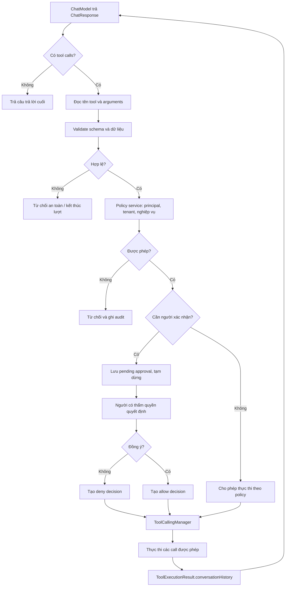

# Chèn bước kiểm tra chính sách hoặc xác nhận của người dùng

Trong một luồng tool calling, mô hình có thể đề nghị ứng dụng thực hiện thao tác có tác động thật: chuyển tiền, hủy đơn, gửi email, xóa tài liệu hoặc cập nhật hồ sơ. Yêu cầu từ mô hình chỉ là một đề xuất kèm arguments. Trước khi gọi dịch vụ nghiệp vụ, ứng dụng cần quyết định thao tác có hợp lệ theo chính sách hay không và có cần người dùng xác nhận hay không.

Với Spring AI, có thể đặt bước kiểm tra này trong vòng lặp do ứng dụng tự điều khiển bằng `ChatModel` và `ToolCallingManager`. Từ Spring AI 2.1.0, framework còn cung cấp cơ chế Tool Call Confirmation: `ToolCallConfirmationPolicy` xác định call nào cần xác nhận, `ToolCallingManager` tạm dừng cả batch trước khi thực thi, và ứng dụng tiếp tục bằng `ToolCallDecisions` sau khi nhận quyết định.

Điểm cần giữ rõ là ba quyết định khác nhau:

- **Validation:** arguments có đúng schema, kiểu dữ liệu và quy tắc miền không?
- **Authorization/policy:** principal và tenant hiện tại có quyền thực hiện thao tác trên tài nguyên này không; trạng thái nghiệp vụ có cho phép không?
- **Human confirmation:** một người có thẩm quyền đã xem chính xác hành động sắp xảy ra và đồng ý chưa?

Xác nhận của người dùng không thay thế phân quyền. Một người bấm “Đồng ý” cũng không thể cấp quyền truy cập mà tài khoản của họ không có.

## 1. Vị trí của policy gate trong manual tool loop

Khi điều khiển vòng lặp thủ công, ứng dụng nhìn thấy từng `ChatResponse` trước khi quyết định gọi `ToolCallingManager`. Đây là vị trí thích hợp để chèn policy service, yêu cầu xác nhận, kiểm tra ngân sách hoặc dừng quy trình.



Đối với một `AssistantMessage` có nhiều tool calls, cần đánh giá tất cả call trước khi thực thi batch. Cơ chế xác nhận của Spring AI 2.1.0 dừng toàn bộ các call trong cùng response nếu có ít nhất một call cần xác nhận; không call nào của response đó chạy trước khi ứng dụng gửi quyết định. Các tool calls ở những vòng trước có thể đã chạy, vì vậy phạm vi tạm dừng là batch hiện tại, không phải toàn bộ lượt người dùng.

## 2. Policy check khác với user confirmation

`ToolCallConfirmationPolicy` trả lời một câu hỏi hẹp: “Tool call này có cần một người quyết định trước khi chạy không?”. Policy nhận `AssistantMessage.ToolCall` và `ToolMetadata`; nó không nhận `ToolContext`, principal hay tenant.

Một policy nghiệp vụ của ứng dụng cần trả lời các câu hỏi khác:

- Người dùng hiện tại có quyền gọi tool này không?
- Người dùng có quyền truy cập đúng bản ghi hoặc tài nguyên được nêu trong arguments không?
- Tài khoản có đủ hạn mức, trạng thái đơn hàng có cho phép hủy, hoặc giao dịch có vượt giới hạn không?
- Chính sách có yêu cầu người quản lý hoặc một vai trò khác phê duyệt không?

Những kiểm tra phụ thuộc danh tính phải dùng thông tin xác thực do ứng dụng cấp, chẳng hạn principal và tenant từ security context hoặc `ToolContext`. Không lấy danh tính, role hay quyền từ arguments do mô hình tạo.

| Cơ chế | Dữ liệu đầu vào | Kết quả | Nơi nên dùng |
| --- | --- | --- | --- |
| JSON Schema / validation | Arguments do model gửi | Hợp lệ hoặc lỗi đầu vào | Ranh giới tool và service |
| `ToolCallConfirmationPolicy` | Tool call và metadata | Có cần chờ người xác nhận không | Chính sách xác nhận theo tool hoặc arguments |
| Policy/authorization service | Principal, tenant, tool, arguments, trạng thái nghiệp vụ | Allow, deny hoặc yêu cầu phê duyệt | Ứng dụng và service nghiệp vụ |
| `ToolCallDecision` | Key của tool call và quyết định đã có | Cho phép chạy hoặc trả kết quả từ chối cho model | Tiếp tục một batch đang chờ |

Không dùng `ToolCallConfirmationPolicy` làm authorization. Vì policy này không có principal hoặc tenant, nó không thể xác minh người gọi có quyền trên tài nguyên cụ thể.

## 3. Đánh dấu tool cần xác nhận

Từ Spring AI 2.1.0, có thể đánh dấu trực tiếp một method `@Tool` bằng `requiresConfirmation = true`. Tool chỉ đọc không cần xác nhận có thể để mặc định `false`.

```java
import org.springframework.ai.tool.annotation.Tool;
import org.springframework.ai.tool.annotation.ToolParam;
import org.springframework.ai.chat.model.ToolContext;
import org.springframework.stereotype.Component;

@Component
class PaymentTools {

    private final PaymentService paymentService;
    private final ActorResolver actorResolver;

    PaymentTools(PaymentService paymentService, ActorResolver actorResolver) {
        this.paymentService = paymentService;
        this.actorResolver = actorResolver;
    }

    @Tool(description = "Tra cứu số dư tài khoản")
    Balance getBalance(
            @ToolParam(description = "Mã tài khoản") String accountId,
            ToolContext toolContext) {
        return paymentService.getBalance(accountId, actorResolver.from(toolContext));
    }

    @Tool(
            description = "Chuyển tiền giữa hai tài khoản; chỉ thực hiện sau khi người dùng xác nhận",
            requiresConfirmation = true)
    TransferReceipt transferMoney(TransferRequest request, ToolContext toolContext) {
        return paymentService.transfer(request, actorResolver.from(toolContext));
    }
}
```

`ToolContext` do ứng dụng tạo từ security context đã xác thực; nó không xuất hiện trong JSON schema cho model. `ActorResolver` và `AuthenticatedActor` là kiểu do ứng dụng định nghĩa. `PaymentService` vẫn kiểm tra quyền tài khoản và tenant trước khi thực hiện.

Với tool được tạo bằng `FunctionToolCallback`, đặt cờ trong `ToolMetadata`:

```java
import org.springframework.ai.chat.model.ToolContext;

ToolCallback transferTool = FunctionToolCallback
        .builder("transferMoney", (TransferRequest request, ToolContext toolContext) ->
                paymentService.transfer(request, actorResolver.from(toolContext)))
        .description("Chuyển tiền giữa hai tài khoản")
        .inputType(TransferRequest.class)
        .toolMetadata(ToolMetadata.builder()
                .requiresConfirmation(true)
                .build())
        .build();
```

Tool metadata là dấu hiệu để policy mặc định yêu cầu xác nhận. Nó không kiểm tra hạn mức, quyền tài khoản hay tính hợp lệ của giao dịch; các bước đó vẫn thuộc ứng dụng và `PaymentService`.

## 4. Tạo ToolCallConfirmationPolicy theo metadata và arguments

Policy mặc định là `ToolCallConfirmationPolicy.fromToolMetadata()`. Có thể bổ sung các tool cần xác nhận theo tên bằng `forTools(...)`, hoặc viết policy xem xét arguments.

Ví dụ yêu cầu xác nhận với giao dịch trên 1.000.000 VND và mọi thao tác xóa hồ sơ:

```java
import java.math.BigDecimal;

import com.fasterxml.jackson.core.JsonProcessingException;
import com.fasterxml.jackson.databind.JsonNode;
import com.fasterxml.jackson.databind.ObjectMapper;
import org.springframework.ai.model.tool.ToolCallConfirmationPolicy;
import org.springframework.ai.model.tool.ToolCallingManager;
import org.springframework.context.annotation.Bean;
import org.springframework.context.annotation.Configuration;

@Configuration(proxyBeanMethods = false)
class ToolConfirmationConfiguration {

    @Bean
    ToolCallConfirmationPolicy largeTransferPolicy(ObjectMapper objectMapper) {
        return (toolCall, toolMetadata) -> {
            if (!"transferMoney".equals(toolCall.name())) {
                return false;
            }

            try {
                JsonNode arguments = objectMapper.readTree(toolCall.arguments());
                JsonNode amount = arguments.get("amountVnd");

                // Không đọc được amount thì yêu cầu xác nhận để fail safe.
                if (amount == null || !amount.isNumber()) {
                    return true;
                }

                return amount.decimalValue()
                        .compareTo(new BigDecimal("1000000")) > 0;
            }
            catch (JsonProcessingException exception) {
                return true;
            }
        };
    }

    @Bean
    ToolCallingManager toolCallingManager(
            ToolCallConfirmationPolicy largeTransferPolicy) {
        ToolCallConfirmationPolicy policy =
                ToolCallConfirmationPolicy.fromToolMetadata()
                        .or(ToolCallConfirmationPolicy.forTools("deleteCustomer"))
                        .or(largeTransferPolicy);

        return ToolCallingManager.builder()
                .toolCallConfirmationPolicy(policy)
                .build();
    }
}
```

Trong ví dụ, `toolCall.arguments()` là JSON do model tạo. Policy chỉ dùng giá trị đó để quyết định có cần con người xem xét không; nó không xác thực giao dịch và không thực hiện chuyển tiền. Nếu JSON sai hoặc thiếu `amountVnd`, policy yêu cầu xác nhận; schema validation và service vẫn phải từ chối dữ liệu không hợp lệ.

Có thể gắn manager này vào `ToolCallingAdvisor`:

```java
import org.springframework.ai.chat.client.ChatClient;
import org.springframework.ai.chat.client.advisor.ToolCallingAdvisor;
import org.springframework.ai.chat.model.ChatModel;

ChatClient chatClient = ChatClient.builder(chatModel)
        .defaultAdvisors(ToolCallingAdvisor.builder()
                .toolCallingManager(toolCallingManager)
                .build())
        .defaultTools(new PaymentTools(paymentService, actorResolver))
        .build();
```

Nếu dùng Spring Boot auto-configuration, manager mặc định đã tôn trọng `requiresConfirmation`. Có thể thêm tool theo tên bằng cấu hình:

```properties
spring.ai.tools.confirmation.enabled=true
spring.ai.tools.confirmation.tools=deleteFile,transferMoney
```

Tên trong property phải trùng tên mà model nhìn thấy, kể cả prefix do ứng dụng hoặc MCP provider thêm vào. Các policy bean, property và metadata được kết hợp theo phép OR: một policy nói cần xác nhận là đủ để dừng call. Muốn kiểm soát hoàn toàn policy, khai báo `ToolCallingManager` bean riêng.

## 5. Manual orchestration với ChatModel và ToolCallingManager

Khi cần chèn policy service, ghi tiến trình, dừng theo side channel hoặc quản lý phê duyệt ngoài request HTTP, có thể tự điều khiển từng vòng bằng `ChatModel`.

```java
import java.util.ArrayList;
import java.util.List;
import java.util.Map;

import org.springframework.ai.chat.messages.Message;
import org.springframework.ai.chat.messages.UserMessage;
import org.springframework.ai.chat.messages.AssistantMessage;
import org.springframework.ai.chat.model.ChatModel;
import org.springframework.ai.chat.model.ChatResponse;
import org.springframework.ai.chat.prompt.Prompt;
import org.springframework.ai.model.tool.ToolCallingChatOptions;
import org.springframework.ai.model.tool.ToolCallingManager;
import org.springframework.ai.model.tool.ToolCallConfirmationRequiredException;
import org.springframework.ai.model.tool.ToolCallDecisions;
import org.springframework.ai.model.tool.ToolExecutionResult;
import org.springframework.ai.tool.ToolCallback;

public LoopOutcome runTurn(
        ChatModel chatModel,
        ToolCallingManager toolCallingManager,
        ToolCallback[] callbacks,
        String question) {

    ToolCallingChatOptions options = ToolCallingChatOptions.builder()
            .toolCallbacks(callbacks)
            .toolContext(Map.of(
                    "principalId", authenticatedPrincipalId,
                    "tenantId", authenticatedTenantId))
            .build();

    List<Message> conversation = new ArrayList<>();
    conversation.add(new UserMessage(question));

    Prompt prompt = new Prompt(conversation, options);
    ChatResponse reply = chatModel.call(prompt);

    while (reply.hasToolCalls()) {
        ToolExecutionResult execution;
        try {
            execution = toolCallingManager.executeToolCalls(prompt, reply);
        }
        catch (ToolCallConfirmationRequiredException exception) {
            AssistantMessage assistant = reply.getResult().getOutput();
            List<String> allCallKeys = ToolCallDecisions.toolCallKeys(assistant);
            // Lưu prompt/reply nguyên vẹn, tất cả keys và subset đang chờ ở server-side.
            return LoopOutcome.awaitingApproval(
                    pendingApprovalStore.save(prompt, reply,
                            allCallKeys, exception.getToolCallIds(), authenticatedPrincipalId));
        }

        if (execution.returnDirect()) {
            return LoopOutcome.completedWithToolResult(execution);
        }

        prompt = new Prompt(execution.conversationHistory(), options);
        reply = chatModel.call(prompt);
    }

    return LoopOutcome.completedWithAssistantReply(reply);
}
```

Đây là khung điều phối; `LoopOutcome`, `pendingApprovalStore` và `authenticatedPrincipalId` là thành phần do ứng dụng định nghĩa. Cần inject principal đã xác thực vào service, không dùng biến global hoặc lấy principal từ prompt. Trong mỗi vòng, `ToolCallingManager` thực thi các tool call chưa bị policy chặn; nếu cần xác nhận, exception được ném trước khi bất kỳ call nào của response đó chạy.

`ToolExecutionResult.conversationHistory()` chứa lịch sử đến hết tool responses. Ứng dụng dùng danh sách này để tạo prompt cho vòng tiếp theo. Nếu `returnDirect()` là `true`, kết quả tool được trả thẳng cho caller thay vì gửi lại mô hình; điều kiện này chỉ đúng khi các call được cho phép đều có metadata `returnDirect` phù hợp.

### Chèn policy nghiệp vụ do ứng dụng sở hữu

Nếu policy cần principal, tenant hoặc trạng thái tài nguyên, hãy đánh giá từng call ở application layer bằng một policy service. Dùng `ToolCallDecisions.toolCallKeys(...)` để ghép đúng kết quả đánh giá với từng call. Quy trình có thể biểu diễn như sau:

```text
Với mỗi tool call trong AssistantMessage gốc:
    lấy key cùng vị trí từ ToolCallDecisions.toolCallKeys(...)
    outcome = policyService.evaluate(actor đã xác thực, tên tool, arguments)

    nếu outcome là DENY:
        lưu quyết định từ chối cùng message an toàn
    nếu outcome là REQUIRE_APPROVAL:
        lưu call ở trạng thái chờ; chưa thực thi batch
    nếu outcome là ALLOW:
        ghi nhận call đã qua policy của ứng dụng

nếu có ít nhất một call đang chờ:
    chờ người có thẩm quyền quyết định
ngược lại:
    chỉ tiếp tục khi mọi call đã có quyết định cuối cùng
```

Với Spring AI 2.1.0, có thể biểu diễn kết quả cuối của từng call bằng `ToolCallDecision.deny(...)` hoặc `ToolCallDecision.allow(...)`, rồi truyền đủ danh sách vào overload resume. Nếu dùng policy service riêng, đừng gọi overload resume với `allow` cho một call đang chờ người duyệt. Một call bị policy từ chối phải giữ quyết định deny dù người dùng muốn tiếp tục các call khác.

## 6. Nhận biết một response đang chờ xác nhận

Khi dùng `ChatClient` với `ToolCallingAdvisor`, advisor bắt `ToolCallConfirmationRequiredException` và trả lại `ChatResponse` đang chứa assistant tool calls. Có thể nhận biết response này bằng `ToolCallDecisions.awaitingDecision(...)`.

```java
import java.util.Map;
import java.util.List;

import org.springframework.ai.chat.model.ChatResponse;
import org.springframework.ai.model.tool.ToolCallDecisions;

ChatResponse reply = chatClient.prompt()
        .user("Chuyển 2.500.000 VND từ tài khoản A sang tài khoản B")
        .toolContext(Map.of(
                "principalId", authenticatedPrincipalId,
                "tenantId", authenticatedTenantId))
        .call()
        .chatResponse();

List<String> awaitingKeys = ToolCallDecisions.awaitingDecision(reply);
if (!awaitingKeys.isEmpty()) {
    // Chuyển sang luồng hiển thị yêu cầu xác nhận.
}
```

Hãy đọc `chatResponse()` hoặc `chatClientResponse()` để kiểm tra metadata. `content()` có thể rỗng khi vòng lặp tạm dừng và không cho biết response đang chờ xác nhận. Với streaming, metadata chờ xác nhận nằm trên chunk cuối; response đã aggregate không giữ danh sách key này.

Để hiển thị từng tool call, lấy message và key theo cùng thứ tự:

```java
import org.springframework.ai.chat.messages.AssistantMessage;
import org.springframework.ai.model.tool.ToolCallDecisions;

AssistantMessage assistant = reply.getResult().getOutput();
List<String> allKeys = ToolCallDecisions.toolCallKeys(assistant);

for (int i = 0; i < assistant.getToolCalls().size(); i++) {
    AssistantMessage.ToolCall toolCall = assistant.getToolCalls().get(i);
    String key = allKeys.get(i);

    // Tạo bản tóm tắt an toàn cho UI từ toolCall.name() và arguments.
    // Không dùng key làm bằng chứng danh tính hoặc quyền phê duyệt.
}
```

Key thường là tool-call ID. Nếu provider không cấp ID hoặc có ID trùng trong cùng response, Spring AI dùng key theo vị trí như `#0`, `#1`. Khi tiếp tục, phải dùng đúng reply đã lưu và giữ nguyên thứ tự các tool calls.

## 7. Hiển thị nội dung cần xác nhận

Người dùng phải hiểu chính xác điều gì sẽ xảy ra khi họ đồng ý. Một màn hình xác nhận nên trình bày:

- Tên hành động bằng ngôn ngữ nghiệp vụ, không chỉ tên method Java.
- Tài nguyên hoặc tài khoản bị tác động.
- Giá trị quan trọng như số tiền, đơn vị tiền, người nhận, thời hạn hoặc nội dung sẽ gửi.
- Hệ quả của thao tác và khả năng hoàn tác.
- Tool call nào đang được yêu cầu xác nhận, và tool call nào bị policy từ chối.
- Thời hạn phê duyệt và người có quyền phê duyệt.

Không hiển thị JSON thô như thể đó là nội dung đã được xác minh. Hãy parse arguments, validate schema và tạo bản tóm tắt có cấu trúc từ dữ liệu đã chuẩn hóa. Nếu arguments không hợp lệ, không tạo nút “Đồng ý”; trả lỗi cho luồng điều phối để yêu cầu model tạo lại hoặc dừng.

Không cho người dùng sửa trực tiếp arguments trong màn hình phê duyệt rồi gửi lại với cùng tool-call ID. Nếu họ muốn thay số tiền hoặc người nhận, yêu cầu tạo một tool call mới để policy đánh giá lại toàn bộ thao tác.

## 8. Tiếp tục batch với ToolCallDecisions

Sau khi người có thẩm quyền quyết định, ứng dụng tạo một `ToolCallDecision` cho **mọi** tool call trong response, không chỉ những call nằm trong danh sách `awaitingDecision`.

```java
import org.springframework.ai.model.tool.ToolCallDecision;
import org.springframework.ai.model.tool.ToolCallDecisions;

// Key minh họa; ứng dụng lấy key thực từ ToolCallDecisions.toolCallKeys(reply.getResult().getOutput()).
ToolCallDecisions decisions = ToolCallDecisions.of(
        ToolCallDecision.allow("call_transfer"),
        ToolCallDecision.deny("call_delete", "Người phê duyệt đã từ chối thao tác xóa."));

ToolExecutionResult result = toolCallingManager.executeToolCalls(
        pending.prompt(),
        pending.reply(),
        decisions);
```

`allow(key)` cho phép callback chạy. `deny(key)` trả thông báo từ chối mặc định cho model; `deny(key, message)` trả message do ứng dụng cung cấp dưới dạng kết quả của tool call. Message từ chối sẽ được gửi lại cho mô hình như tool output, vì vậy không đưa thông tin policy nội bộ, dữ liệu nhạy cảm hoặc chi tiết bảo mật vào đó.

Manager kiểm tra ba điều kiện trước khi thực thi:

1. Mỗi tool call của reply phải có đúng một decision, kể cả call không yêu cầu xác nhận.
2. Mỗi decision phải trỏ đến một key có trong reply.
3. Call được allow chỉ chạy với callback nằm trong `Prompt` đang tiếp tục; lúc resume không có fallback phân giải tool theo tên.

Policy không được đánh giá lại ở overload resume. Đây là chủ đích để thay đổi cấu hình giữa lúc chờ không làm một tool call lọt qua mà chưa có quyết định. Ứng dụng vẫn cần recheck quyền và điều kiện nghiệp vụ trong service ngay trước side effect.

Nếu ứng dụng tự triển khai `ToolCallingManager`, cần override/delegate cả overload `executeToolCalls(Prompt, ChatResponse, ToolCallDecisions)`. Implementation mặc định của interface ném `UnsupportedOperationException`; một wrapper chỉ delegate overload hai tham số sẽ không resume được batch đã chờ xác nhận.

### Khi có nhiều tool call trong cùng response

Giả sử model đề xuất ba thao tác:

| Tool call | Policy | Quyết định cuối |
| --- | --- | --- |
| Tra cứu trạng thái đơn hàng | Cho phép tự động | `allow` |
| Chuyển tiền | Cần người dùng xác nhận | `allow` hoặc `deny` theo quyết định |
| Xóa hồ sơ | Policy cấm | `deny` với message an toàn |

Nếu một call cần xác nhận, không call nào trong batch đó được thực thi trước khi batch được tiếp tục. Khi resume, ứng dụng gửi đủ ba decision. Manager chỉ chạy hai call được allow và trả kết quả từ chối cho call bị deny. Các call ở vòng trước của cùng lượt, nếu đã thực thi, không bị rollback tự động.

## 9. Lưu trạng thái chờ và resume an toàn

Spring AI không giữ tiến trình chờ phê duyệt ở phía framework. Pause là một response thông thường; resume là một lần gọi thông thường khác. Vì vậy, ứng dụng phải lưu trạng thái cần thiết ở phía server.

Một bản ghi pending approval có thể gồm:

| Trường | Mục đích |
| --- | --- |
| `approvalId` | ID ngẫu nhiên để client tham chiếu đến yêu cầu phê duyệt |
| `sessionId` / `conversationId` | Xác định cuộc hội thoại cần tiếp tục |
| `principalId`, `tenantId` | Chủ thể tạo yêu cầu và phạm vi dữ liệu đã xác thực |
| `prompt` hoặc conversation snapshot | Ngữ cảnh gốc cùng tool callbacks/options cần để resume |
| `pausedReply` | `ChatResponse` nguyên bản do model trả về, không cho client sửa |
| `toolCallKeys` | Danh sách key theo thứ tự gốc |
| `awaitingKeys` | Những call đang chờ xác nhận |
| `policySnapshot` | Kết quả kiểm tra policy và phiên bản policy đã áp dụng |
| `expiresAt`, `status` | Hạn phê duyệt và trạng thái xử lý |

Trạng thái có thể theo vòng đời:

```text
PENDING_POLICY
    -> WAITING_FOR_APPROVAL
    -> APPROVED / DENIED / EXPIRED
    -> EXECUTING
    -> COMPLETED / FAILED
```

Khi người dùng gửi quyết định, backend phải:

1. Tải pending record từ kho server-side bằng `approvalId`.
2. Xác thực người quyết định và kiểm tra họ có quyền phê duyệt hành động này.
3. Kiểm tra pending chưa hết hạn, chưa được xử lý và thuộc đúng user/tenant.
4. Claim trạng thái bằng cập nhật atomic hoặc compare-and-set để ngăn hai request đồng thời cùng resume.
5. Tạo đủ `ToolCallDecisions` từ policy result và quyết định của người phê duyệt.
6. Dùng `ToolCallingManager` với prompt và reply đã lưu để thực thi.
7. Lưu kết quả, đánh dấu trạng thái hoàn tất và tiếp tục hội thoại.

Không nhận `ChatResponse`, `AssistantMessage`, tool name hoặc arguments từ request phía client rồi truyền thẳng vào `executeToolCalls`. Người dùng có thể sửa response và tự tạo lệnh gọi tool với arguments tùy ý. Chỉ dùng reply nguyên bản được đọc từ kho mà end user không thể ghi.

## 10. Tiếp tục mô hình sau khi tool chạy

Khi manager thực thi các quyết định, `ToolExecutionResult.conversationHistory()` kết thúc bằng reply của assistant và `ToolResponseMessage` có kết quả cho từng call theo đúng thứ tự. Nếu ứng dụng tự giữ conversation, dùng lịch sử đó làm prompt cho vòng tiếp theo:

```java
ToolExecutionResult result = toolCallingManager.executeToolCalls(
        pending.prompt(), pending.reply(), decisions);

if (result.returnDirect()) {
    return result;
}

Prompt nextPrompt = new Prompt(result.conversationHistory(), pending.chatOptions());
ChatResponse nextReply = chatModel.call(nextPrompt);
```

Nếu `nextReply` tiếp tục chứa tool calls, lặp lại policy check và execution. Có thể nhiều lần dừng chờ phê duyệt trong một lượt.

Nếu dùng memory/session advisor để giữ hội thoại, cần tiếp tục theo đúng mô hình lưu trữ đó. Với `Session Memory`, bảo đảm session ID được kiểm tra quyền và tool results được nối vào đúng session. Nếu lượt có nhiều vòng trước khi dừng, paused reply chỉ chứa vòng dừng; các vòng trước phải được lưu trong memory chạy bên trong tool loop hoặc trong conversation store của ứng dụng để model không mất ngữ cảnh.

## 11. Kiểm tra quyền ở thời điểm thực thi

Phê duyệt là một quyết định tại một thời điểm. Giữa lúc người dùng đồng ý và lúc tool chạy, trạng thái tài nguyên hoặc policy có thể thay đổi. Vì vậy, callback/service phải kiểm tra lại các điều kiện quyết định trước side effect:

- Principal vẫn còn quyền thực hiện thao tác.
- Tài khoản, đơn hàng hoặc tài nguyên vẫn ở trạng thái cho phép.
- Hạn mức, số dư hoặc giá trị giao dịch vẫn hợp lệ.
- Arguments được chuẩn hóa vẫn trùng với nội dung người dùng đã phê duyệt.
- Policy version hoặc các điều kiện bắt buộc chưa thay đổi theo cách làm approval mất hiệu lực.

Có thể lưu hash của tool name cùng normalized arguments trong pending record. Khi resume, so sánh lại hash trước khi chạy. Không chỉ so sánh tên tool: hai call cùng tên nhưng khác tài khoản nhận hoặc số tiền là hai hành động khác nhau.

Ví dụ service vẫn phải kiểm tra quyền và trạng thái:

```java
public TransferReceipt transfer(
        TransferRequest request,
        AuthenticatedActor actor,
        String idempotencyKey) {

    authorizationService.assertCanTransfer(actor, request.sourceAccountId());
    accountService.assertOwnedByTenant(request.sourceAccountId(), actor.tenantId());
    transferPolicy.assertAllowed(request, actor);

    return transferService.execute(request, idempotencyKey);
}
```

`AuthenticatedActor` phải được tạo từ security context đáng tin cậy. `idempotencyKey` phải gắn với approval/action ID do server cấp. Không dùng tool-call ID từ model làm idempotency key duy nhất cho nghiệp vụ nếu vòng đời retry hoặc provider có thể tạo ID khác.

## 12. Timeout, từ chối và yêu cầu bị bỏ dở

Một approval không nên chờ vô thời hạn. Định nghĩa rõ:

- **Từ chối:** tạo deny decision và trả message an toàn cho model nếu muốn model phản hồi hoặc đề xuất phương án khác.
- **Hết hạn:** đánh dấu approval `EXPIRED`, không tự động allow. Có thể tạo deny result trước khi nhận lượt mới để transcript không còn tool call chưa có kết quả.
- **Người dùng hủy:** đánh dấu hủy và xử lý giống từ chối; không gọi tool.
- **Policy thay đổi:** recheck policy. Nếu hành động không còn hợp lệ, từ chối hoặc yêu cầu tạo tool call mới.
- **Lỗi khi resume:** phân biệt lỗi xảy ra trước side effect với kết quả không xác định sau side effect. Dùng idempotency và trạng thái thực thi để tránh chạy trùng.

Nếu người dùng gửi câu hỏi mới trong khi session còn pending tool calls, cần resolve hoặc từ chối các call cũ trước khi nối message mới. Provider thường không chấp nhận transcript có assistant tool calls chưa có tool results. Với Session Memory, `SessionTurnAdvisor` có thể thêm kết quả trung tính “No result was recorded for this tool call.” khi bắt đầu lượt mới; nếu cần model biết người dùng đã từ chối, ứng dụng nên ghi rõ deny result thay vì để cơ chế trung tính tự xử lý.

## 13. Bảo vệ approval khỏi replay và giả mạo

Spring AI không tự xác thực người phê duyệt và không chống replay. Nếu gửi cùng `ToolCallDecisions` hai lần, tool có thể chạy hai lần. Ứng dụng phải thực hiện các kiểm soát sau:

- Chỉ cho phép người dùng đã xác thực và có quyền approve đúng loại hành động.
- Approval phải gắn với một `approvalId`, session, tenant, tool call key và hash arguments cụ thể.
- Dùng atomic transition `WAITING_FOR_APPROVAL -> EXECUTING`; chỉ một request được claim thành công.
- Ghi nhận ai quyết định, quyết định nào, thời điểm, policy version và kết quả thực thi.
- Dùng idempotency key cho thao tác ghi; lưu kết quả theo key để retry không tạo side effect mới.
- Không cho client thay đổi paused reply, tool name hoặc arguments.
- Làm sạch nội dung deny message vì nó trở thành tool result mà mô hình sẽ đọc.
- Không ghi raw prompt, access token hoặc payload nhạy cảm vào audit/metrics mặc định.

Nếu hệ thống yêu cầu audit bắt buộc trước thao tác, phải ghi audit trước side effect hoặc dùng transactional outbox. Không coi log telemetry sau khi thực thi là bằng chứng phê duyệt hợp lệ.

## 14. Trường hợp dùng ChatClient tự động và trường hợp tự điều khiển

Không phải lúc nào cũng cần tắt vòng lặp tự động. Cơ chế xác nhận tích hợp của Spring AI 2.1.0 đã phối hợp với `ToolCallingAdvisor`:

| Nhu cầu | Cách phù hợp |
| --- | --- |
| Chỉ cần dừng các tool đã đánh dấu để người dùng xác nhận | Dùng `requiresConfirmation` và `ToolCallConfirmationPolicy` với `ChatClient` mặc định |
| Cần xác nhận theo arguments như số tiền hoặc loại thao tác | Dùng policy tùy chỉnh trên `ToolCallingManager` |
| Cần policy dựa trên principal/tenant, gọi hệ thống phê duyệt hoặc lưu trạng thái chờ riêng | Dùng manual orchestration hoặc lớp ứng dụng trước khi gọi manager |
| Cần duyệt từng bước, progress event, budget hoặc điều kiện dừng tùy biến | Tự điều khiển vòng lặp bằng `ChatModel` và `ToolCallingManager` |
| Chỉ cần ghi log hoặc progress UI | Cân nhắc hook/custom `ToolCallingAdvisor` trước khi tự viết toàn bộ vòng lặp |

Tự điều khiển vòng lặp làm ứng dụng chịu trách nhiệm giữ conversation history, giới hạn số vòng, xử lý `returnDirect`, lỗi, timeout và resume. Hãy dùng cách này khi bước kiểm soát thực sự cần can thiệp vào từng iteration.

### Khác biệt phiên bản

| Phiên bản Spring AI | Cách xử lý |
| --- | --- |
| 1.x và 2.0.x | Chưa có `ToolCallConfirmationPolicy`, `ToolCallDecisions` và overload resume tích hợp. Thực hiện gate ở application layer trước khi gọi `ToolCallingManager.executeToolCalls(...)`; lưu prompt/reply và tự quản lý trạng thái chờ. Nếu policy từ chối, không gọi tool; trả kết quả từ chối qua luồng điều phối do ứng dụng sở hữu hoặc kết thúc lượt an toàn. |
| 2.1.0 trở lên | Có `requiresConfirmation`, `ToolCallConfirmationPolicy`, `ToolCallConfirmationRequiredException`, `ToolCallDecisions` và `executeToolCalls(prompt, reply, decisions)`. Có thể dùng cùng `ToolCallingAdvisor` hoặc manual loop. |

Không dùng ví dụ API 2.1.0 với dependency 1.x/2.0.x mà không nâng cấp. Với phiên bản cũ, không gọi tool manager trước khi application gate đã cho phép; chính ứng dụng phải bảo đảm không có đường thực thi nào bỏ qua bước chờ.

## 15. Kiểm thử policy gate và confirmation flow

Kiểm thử riêng policy, trạng thái phê duyệt và tool execution. Một test chỉ xác nhận UI hiện nút “Đồng ý” không chứng minh tool bị chặn trước khi có quyết định.

| Trường hợp | Kết quả cần xác minh |
| --- | --- |
| Tool không cần xác nhận | Manager thực thi bình thường nếu policy/authorization cho phép |
| Tool có `requiresConfirmation` | Manager tạm dừng; không call nào của response chạy |
| Giao dịch vượt ngưỡng | Policy yêu cầu confirmation |
| Arguments sai hoặc thiếu `amountVnd` | Fail safe; không tự động bỏ qua bước xác nhận hoặc validation |
| Thiếu quyền principal/tenant | Service từ chối dù người dùng đã bấm đồng ý |
| Người dùng allow | Call được phép chạy đúng một lần |
| Người dùng deny | Callback không chạy; model nhận deny message |
| Batch có nhiều call | Có một decision cho mỗi call; call bị deny không chạy |
| Key không tồn tại hoặc thiếu decision | Manager từ chối trước thực thi |
| Prompt không mang callback tương ứng | Call không được resolve fallback khi resume |
| Approval hết hạn | Không thực thi |
| Replay hai request approve đồng thời | Chỉ một request claim trạng thái thành công |
| Crash sau side effect | Retry dùng idempotency để không tạo giao dịch thứ hai |
| Tool call không có ID | Resume dùng key vị trí `#0`, `#1` từ reply gốc |
| Session có pending pause | Lượt mới không nối vào transcript chưa được resolve |

Một bài integration test nên giả lập toàn bộ luồng: model trả tool call chuyển tiền, manager yêu cầu xác nhận, application lưu pending reply, user không có quyền approve bị từ chối, user có quyền approve được tiếp tục, service kiểm tra lại hạn mức, giao dịch được thực hiện một lần, kết quả được nối vào conversation history và model tạo câu trả lời cuối.

## 16. Checklist triển khai

- [ ] Phân biệt validation, authorization/business policy và human confirmation.
- [ ] Đánh dấu các tool có side effect bằng `requiresConfirmation` hoặc policy tương ứng.
- [ ] Định nghĩa ngưỡng và quy tắc confirmation rõ ràng; xử lý fail-safe khi arguments không parse được.
- [ ] Kiểm tra principal, tenant và quyền trên tài nguyên ở service.
- [ ] Dùng `chatResponse()` và `ToolCallDecisions.awaitingDecision(...)` để nhận biết pause.
- [ ] Hiển thị chính xác hành động, tài nguyên và giá trị quan trọng cho người phê duyệt.
- [ ] Lưu prompt/reply nguyên bản ở server-side; không nhận paused reply từ client.
- [ ] Tạo một `ToolCallDecision` cho mọi call của response.
- [ ] Kiểm tra approver, thời hạn, policy version và trạng thái pending trước resume.
- [ ] Chống replay bằng atomic state transition và idempotency key.
- [ ] Dùng lại prompt có đúng tool callbacks khi gọi `executeToolCalls` để resume.
- [ ] Nối `ToolExecutionResult.conversationHistory()` vào vòng gọi tiếp theo, trừ trường hợp `returnDirect`.
- [ ] Resolve pending approvals bị bỏ dở trước khi nhận lượt mới.
- [ ] Kiểm thử batch nhiều tool, deny, timeout, replay, policy change và lỗi sau side effect.

Chèn policy check hoặc xác nhận của người dùng có nghĩa là ứng dụng giữ quyền quyết định thời điểm tool được thực thi. Mô hình có thể đề nghị một thao tác, nhưng ứng dụng xác thực dữ liệu, kiểm tra quyền và trạng thái nghiệp vụ, yêu cầu phê duyệt khi cần, rồi mới chuyển quyết định cho `ToolCallingManager`. Cách tổ chức này giúp manual orchestration kiểm soát được side effect và vẫn duy trì đúng chuỗi tool call/result cho mô hình.

## Tài liệu tham khảo

- [Spring AI 2.1 — Tool Call Confirmation](https://docs.spring.io/spring-ai/reference/api/tools/tool-call-confirmation.html)
- [Spring AI 2.1 — Tool Calling](https://docs.spring.io/spring-ai/reference/api/tools.html)
- [Spring AI 2.1 — User-Controlled Tool Execution](https://docs.spring.io/spring-ai/reference/api/tools.html#_user_controlled_tool_execution)
- [ToolCallingManager API](https://docs.spring.io/spring-ai/docs/2.1.x/api/org/springframework/ai/model/tool/ToolCallingManager.html)
- [ToolCallDecisions API](https://docs.spring.io/spring-ai/docs/2.1.x/api/org/springframework/ai/model/tool/ToolCallDecisions.html)
- [ToolCallDecision API](https://docs.spring.io/spring-ai/docs/2.1.x/api/org/springframework/ai/model/tool/ToolCallDecision.html)
- [ToolCallConfirmationPolicy API](https://docs.spring.io/spring-ai/docs/2.1.x/api/org/springframework/ai/model/tool/ToolCallConfirmationPolicy.html)
