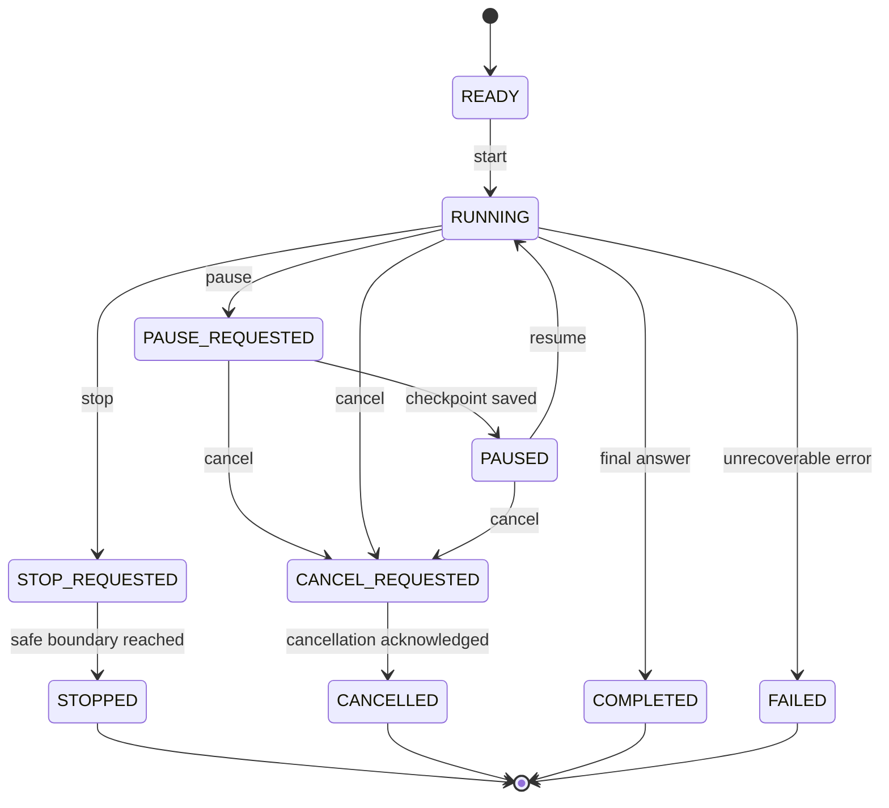

# Dừng, tạm hoãn hoặc hủy luồng theo trạng thái ứng dụng

Một vòng tool calling có thể cần chạy qua nhiều lần gọi mô hình và nhiều thao tác nghiệp vụ. Trong lúc vòng lặp đang chạy, trạng thái ứng dụng có thể thay đổi: người dùng yêu cầu dừng, hệ thống cần tạm hoãn để chờ dữ liệu hoặc phê duyệt, hoặc một điều kiện nghiệp vụ khiến luồng phải bị hủy.

Spring AI 2.x cung cấp vòng lặp tự động qua `ToolCallingAdvisor`, nhưng trạng thái của một workflow thuộc về ứng dụng. `ToolCallingAdvisor` không tự biết một đơn hàng đã bị hủy, một phiên đã hết hạn hay người dùng vừa nhấn nút dừng. Khi cần điều khiển chính xác theo trạng thái đó, ứng dụng phải kiểm tra trạng thái tại các ranh giới thực thi và lưu đủ dữ liệu để tiếp tục hoặc kết thúc đúng cách.

Spring AI 2.1.0 có cơ chế tạm dừng tool call để chờ xác nhận của con người, nhưng đây không phải một workflow state machine tổng quát. Pause theo lịch, trạng thái đơn hàng, ngân sách hoặc lệnh hủy vẫn cần được ứng dụng mô hình hóa và lưu trữ.

Bài học này dùng Spring AI 2.1.0 làm mốc API. Ta sẽ phân biệt dừng mềm, tạm hoãn có thể tiếp tục và hủy cuối cùng; sau đó xây dựng state machine, điều khiển vòng lặp thủ công bằng `ToolCallingManager`, dùng `ToolCallConfirmation` cho thao tác cần người duyệt và xử lý trường hợp callback đang chạy.

Sau bài học, bạn có thể:

- Mô hình hóa trạng thái `RUNNING`, `PAUSE_REQUESTED`, `STOP_REQUESTED` và `CANCEL_REQUESTED`.
- Chọn điểm kiểm tra trạng thái trước mỗi lần gọi mô hình và trước khi thực thi công cụ.
- Tạm hoãn một vòng lặp bằng checkpoint và tiếp tục từ đúng bước đang chờ.
- Dùng `ToolCallConfirmationRequiredException` để dừng trước khi chạy thao tác cần phê duyệt.
- Hủy luồng theo cách hợp tác với callback và service đang chạy.
- Tránh thực thi trùng, mất lịch sử hoặc để một request cũ tiếp tục sau khi trạng thái đã thay đổi.

## 1. Phân biệt dừng, tạm hoãn và hủy

Ba lệnh này có ý nghĩa khác nhau. Nếu dùng chung một cờ boolean `stopped`, ứng dụng sẽ khó quyết định có thể tiếp tục hay phải bỏ luồng.

| Lệnh | Ý nghĩa | Có thể tiếp tục? | Xử lý công việc đang chạy |
|---|---|---|---|
| **Dừng (stop)** | Kết thúc mềm tại ranh giới an toàn gần nhất | Không tự tiếp tục; tạo một kết quả `STOPPED` | Cho thao tác hiện tại hoàn tất rồi dừng, trừ khi nghiệp vụ có chính sách khác |
| **Tạm hoãn (pause)** | Lưu checkpoint và chờ một sự kiện hoặc thời điểm khác | Có, bằng lệnh resume | Dừng trước bước tiếp theo; lưu tool call đang chờ nếu chưa thực thi |
| **Hủy (cancel)** | Chấm dứt workflow và không cho tiếp tục | Không | Gửi tín hiệu hủy cho thao tác có hỗ trợ; thao tác đã commit có thể cần bù trừ |

Ví dụ:

- Người dùng nhấn “Dừng” vì đã nhận đủ câu trả lời. Ứng dụng hoàn tất tool batch hiện tại rồi không gọi mô hình thêm.
- Một quy trình cần quản lý duyệt ngân sách. Ứng dụng chuyển sang `PAUSED`, lưu yêu cầu đang chờ và tiếp tục sau khi có quyết định.
- Đơn hàng đã bị hủy ở hệ thống nghiệp vụ. Workflow chuyển sang `CANCELLED`; các vòng gọi và hành động tiếp theo phải bị chặn.

Không xem `pause` như một thread đang ngủ. Một workflow tạm hoãn nên trả quyền điều khiển cho ứng dụng, lưu checkpoint và chờ một request/event khác để tiếp tục. Cách này không giữ thread hoặc kết nối HTTP mở trong thời gian chờ.

## 2. Thiết kế state machine cho workflow

Trạng thái nên mô tả cả yêu cầu điều khiển lẫn trạng thái cuối sau khi ứng dụng đã xử lý yêu cầu đó.



Một enum có thể biểu diễn các trạng thái:

```java
public enum WorkflowStatus {
    READY,
    RUNNING,
    PAUSE_REQUESTED,
    PAUSED,
    STOP_REQUESTED,
    STOPPED,
    CANCEL_REQUESTED,
    CANCELLED,
    COMPLETED,
    FAILED
}
```

Các chuyển trạng thái cần được kiểm soát. Ví dụ, `resume` chỉ hợp lệ khi trạng thái hiện tại là `PAUSED`; không cho phép chuyển `CANCELLED` về `RUNNING`. Các lệnh stop, pause và cancel nên idempotent để client gửi lại request do timeout không làm workflow chuyển trạng thái bất thường.

Trong ứng dụng có nhiều instance, lưu trạng thái theo `workflowId` trong database hoặc kho trạng thái dùng chung. Dùng version hoặc optimistic locking để hai worker không đồng thời resume cùng một checkpoint. Không dùng một `AtomicBoolean` static cho toàn ứng dụng vì trạng thái của một người dùng có thể ảnh hưởng workflow của người khác.

## 3. Xác định các ranh giới an toàn để kiểm tra trạng thái

Một vòng lặp thủ công thường có các bước:

1. Gọi mô hình để nhận câu trả lời hoặc tool call.
2. Kiểm tra trạng thái ứng dụng.
3. Gọi `ToolCallingManager` để thực thi tool call.
4. Lưu tool result và cập nhật conversation history.
5. Kiểm tra trạng thái lần nữa trước khi gọi mô hình ở vòng tiếp theo.

Các điểm kiểm tra quan trọng:

| Điểm kiểm tra | Mục đích |
|---|---|
| Trước khi gọi mô hình | Không tạo thêm request khi workflow đã dừng, tạm hoãn hoặc bị hủy |
| Sau khi mô hình trả response | Không thực thi tool call nếu trạng thái vừa thay đổi |
| Trước mỗi hành động nghiệp vụ | Ngăn callback cũ chạy sau khi quyền hoặc trạng thái bị thu hồi |
| Sau khi tool batch hoàn tất | Lưu history rồi dừng hoặc tạm hoãn trước vòng tiếp theo |
| Ngay trước khi commit side effect | Giảm race condition giữa lệnh hủy và thao tác ghi |

Một lệnh pause hoặc cancel có thể đến trong lúc model request đang chạy. Ứng dụng kiểm tra trạng thái ngay sau khi response về. Nếu response chứa tool call, lưu nó ở trạng thái chờ; chỉ thực thi sau khi một workflow `PAUSED` được resume và kiểm tra lại quyền/trạng thái. Với `STOP_REQUESTED` hoặc `CANCEL_REQUESTED`, tool call đang chờ không được chạy.

`ToolCallingManager.executeToolCalls(...)` có thể thực thi nhiều tool call trong cùng một response. Kiểm tra trạng thái ngay trước lời gọi manager là ranh giới của cả batch. Nếu cần kiểm tra giữa từng callback trong batch, hãy đặt execution guard trong callback/service hoặc tự xây dựng bộ điều phối chi tiết hơn. Không giả định manager tự dừng giữa batch khi một cờ trạng thái thay đổi.

## 4. Khi nào cần điều khiển vòng lặp thủ công?

Với luồng đơn giản, `ChatClient` và `ToolCallingAdvisor` tự thực hiện các vòng gọi mô hình, chạy callback và đưa kết quả trở lại history. Đây là lựa chọn phù hợp cho phần lớn hội thoại.

Khi ứng dụng cần quyết định ở từng iteration — chẳng hạn pause theo trạng thái đơn hàng, dừng theo ngân sách hoặc lưu checkpoint sau từng tool — có thể dùng `ChatModel` trực tiếp. Trong Spring AI 2.x, `ChatModel.call(prompt)` trả về response có thể chứa tool call; `ChatModel` không tự thực thi các tool call đó. Ứng dụng gọi `ToolCallingManager` và tự tạo prompt tiếp theo.

```java
ToolCallback[] callbacks = ToolCallbacks.from(new OrderTools());

ToolCallingChatOptions options = ToolCallingChatOptions.builder()
    .toolCallbacks(callbacks)
    .build();

Prompt prompt = new Prompt(List.of(new UserMessage(question)), options);
ChatResponse response = chatModel.call(prompt);
```

Khi đã có response, ứng dụng kiểm tra `response.hasToolCalls()`. Nếu không có tool call, lượt mô hình đã tạo câu trả lời cuối. Nếu có tool call, ứng dụng kiểm tra trạng thái trước khi gọi `toolCallingManager.executeToolCalls(prompt, response)`.

Không tắt auto-registration của `ToolCallingAdvisor` rồi kỳ vọng tool call vẫn tự chạy. Khi dùng `ChatClient` nhưng tắt advisor, `.tools(...)` vẫn gửi định nghĩa công cụ cho mô hình, còn việc thực thi và vòng gọi tiếp theo thuộc về ứng dụng.

## 5. Xây dựng bộ điều khiển trạng thái

Một lớp điều khiển nhỏ giúp các callback, endpoint và orchestrator dùng chung quy tắc chuyển trạng thái:

```java
public interface WorkflowControlStore {

    WorkflowStatus status(String workflowId);

    boolean transition(
        String workflowId,
        WorkflowStatus expected,
        WorkflowStatus next
    );

    void markFailed(String workflowId, String errorCode);
}
```

`transition` nên là một thao tác compare-and-set ở tầng lưu trữ. Nếu trạng thái đã đổi bởi request khác, thao tác phải trả `false` để caller tải trạng thái mới và xử lý lại.

Các endpoint điều khiển không nên tự sửa nội dung hội thoại. Chúng chỉ gửi lệnh trạng thái:

```java
public void requestPause(String workflowId) {
    requireTransition(workflowId, WorkflowStatus.RUNNING,
        WorkflowStatus.PAUSE_REQUESTED);
}

public void requestStop(String workflowId) {
    requireTransition(workflowId, WorkflowStatus.RUNNING,
        WorkflowStatus.STOP_REQUESTED);
}

public void requestCancel(String workflowId) {
    WorkflowStatus current = controlStore.status(workflowId);
    if (current == WorkflowStatus.RUNNING
            || current == WorkflowStatus.PAUSE_REQUESTED
            || current == WorkflowStatus.PAUSED) {
        requireTransition(workflowId, current, WorkflowStatus.CANCEL_REQUESTED);
    }
}
```

Đây là ví dụ về API điều khiển; `requireTransition` cần kiểm tra quyền sở hữu workflow và xử lý xung đột trạng thái. Người dùng chỉ được dừng hoặc hủy workflow mà họ có quyền điều khiển.

## 6. Điều khiển vòng lặp bằng `ToolCallingManager`

Ví dụ sau minh họa một vòng lặp blocking. `CheckpointStore` là abstraction do ứng dụng xây dựng để lưu prompt, response có tool call hoặc conversation history sau khi callback hoàn tất.

```java
public RunOutcome run(String workflowId, Prompt initialPrompt) {
    Prompt prompt = initialPrompt;

    while (true) {
        WorkflowStatus beforeModel = controlStore.status(workflowId);
        if (beforeModel != WorkflowStatus.RUNNING) {
            return stopAtBoundary(workflowId, beforeModel, prompt, null);
        }

        ChatResponse response = chatModel.call(prompt);

        if (!response.hasToolCalls()) {
            WorkflowStatus afterModel = controlStore.status(workflowId);
            if (afterModel == WorkflowStatus.CANCEL_REQUESTED) {
                return markCancelled(workflowId);
            }
            // Không còn tool call hoặc vòng tiếp theo; hoàn tất nguyên tử.
            // Nếu pause/stop đến đúng lúc câu trả lời cuối về, chính sách này
            // ưu tiên kết quả đã hoàn tất; cancel vẫn được ưu tiên hơn.
            controlStore.markCompletedUnlessCancelled(workflowId, response);
            return RunOutcome.completed(response);
        }

        WorkflowStatus beforeTools = controlStore.status(workflowId);
        if (beforeTools != WorkflowStatus.RUNNING) {
            checkpointStore.savePendingToolCalls(workflowId, prompt, response);
            return stopAtBoundary(workflowId, beforeTools, prompt, response);
        }

        ToolExecutionResult result;
        try {
            result = toolCallingManager.executeToolCalls(prompt, response);
        }
        catch (ToolCallConfirmationRequiredException ex) {
            checkpointStore.savePendingConfirmation(workflowId, prompt, response);
            controlStore.transition(workflowId,
                WorkflowStatus.RUNNING, WorkflowStatus.PAUSED);
            return RunOutcome.awaitingApproval();
        }

        checkpointStore.saveConversationHistory(
            workflowId, result.conversationHistory()
        );

        WorkflowStatus afterTools = controlStore.status(workflowId);
        if (afterTools == WorkflowStatus.CANCEL_REQUESTED) {
            return markCancelledAfterCompletedActions(workflowId, result);
        }
        if (afterTools == WorkflowStatus.PAUSE_REQUESTED) {
            checkpointStore.saveReadyForNextModel(
                workflowId, result.conversationHistory()
            );
            controlStore.transition(workflowId,
                WorkflowStatus.PAUSE_REQUESTED, WorkflowStatus.PAUSED);
            return RunOutcome.paused();
        }
        if (afterTools == WorkflowStatus.STOP_REQUESTED) {
            controlStore.transition(workflowId,
                WorkflowStatus.STOP_REQUESTED, WorkflowStatus.STOPPED);
            return RunOutcome.stopped(result);
        }

        if (result.returnDirect()) {
            controlStore.transition(workflowId,
                WorkflowStatus.RUNNING, WorkflowStatus.COMPLETED);
            return RunOutcome.completedDirect(result);
        }

        prompt = new Prompt(result.conversationHistory(), initialPrompt.getOptions());
    }
}
```

Đây là skeleton của orchestrator; `RunOutcome`, `CheckpointStore` và `stopAtBoundary` là kiểu do ứng dụng định nghĩa. Trong triển khai thực tế, cần xử lý kết quả `transition` thất bại do concurrent update, lưu trạng thái `STOPPED`/`PAUSED`/`CANCELLED` đúng theo lệnh, và bảo đảm checkpoint được ghi trước khi trả quyền điều khiển cho caller.

Vòng lặp kiểm tra trạng thái trước model request và trước tool batch. Sau khi một batch chạy xong, nó lưu conversation history rồi quay lại đầu vòng; nếu đã có lệnh stop/pause/cancel, lần kiểm tra tiếp theo sẽ ngăn model request kế tiếp. Nếu cần phản ứng ngay giữa batch, từng callback phải tự kiểm tra trạng thái như phần tiếp theo.

## 7. Tạm hoãn và tiếp tục từ checkpoint

Một checkpoint phải cho biết workflow đang dừng ở bước nào. Tối thiểu cần lưu:

- `workflowId`, version và trạng thái hiện tại.
- Số iteration và thời điểm checkpoint.
- Conversation history đã hoàn tất tới thời điểm đó.
- Prompt/options cần dùng cho request tiếp theo.
- Nếu mô hình đã yêu cầu công cụ nhưng chưa thực thi: response có tool call và prompt mà nó trả lời.
- Nếu callback đã chạy: tool result đã ghi nhận để không thực thi lại.
- Context nghiệp vụ cần thiết để tiếp tục, không bao gồm secret không cần thiết.

Có thể mô hình hóa pha checkpoint:

```java
public enum CheckpointPhase {
    READY_FOR_MODEL,
    PENDING_TOOL_EXECUTION,
    READY_FOR_NEXT_MODEL,
    WAITING_FOR_CONFIRMATION
}
```

Khi resume, xử lý theo pha:

| Pha đã lưu | Hành động tiếp tục |
|---|---|
| `READY_FOR_MODEL` | Gọi mô hình với prompt đã lưu |
| `PENDING_TOOL_EXECUTION` | Thực thi đúng response đang chờ bằng `ToolCallingManager` |
| `READY_FOR_NEXT_MODEL` | Gọi mô hình với history đã có tool result |
| `WAITING_FOR_CONFIRMATION` | Áp dụng quyết định đã được xác thực rồi thực thi các call được cho phép |

Không resume bằng cách gửi lại prompt gốc nếu một tool call đã chạy. Làm như vậy có thể khiến mô hình yêu cầu cùng thao tác lần nữa. Với thao tác ghi, mỗi tool call cần idempotency key hoặc business key để chống thực thi trùng khi worker crash sau khi service đã commit nhưng trước khi checkpoint được lưu.

`Prompt`, `ChatResponse` và message tool call có cấu trúc riêng. Nếu checkpoint phải sống qua restart, hãy định nghĩa một DTO lưu trữ có version và serializer đã kiểm thử cho message/tool call đang dùng; không giả định mọi object Spring AI có thể serialize an toàn bằng Jackson mặc định. Có thể lưu dữ liệu trong Session Memory/event log cùng bản ghi continuation của workflow.

Khi nhận lệnh resume, thực hiện compare-and-set từ `PAUSED` sang `RUNNING`, lấy lease để chỉ một worker tiếp tục và tải checkpoint mới nhất. Nếu chuyển trạng thái thất bại, không chạy lại callback.

## 8. Dùng `ToolCallConfirmation` để tạm dừng chờ phê duyệt

Spring AI 2.1.0 có cơ chế pause tích hợp cho tool call cần con người phê duyệt. Đánh dấu phương thức có tác động phụ bằng `requiresConfirmation = true`:

```java
public class OrderTools {

    @Tool(
        description = "Hủy đơn hàng sau khi người có quyền xác nhận",
        requiresConfirmation = true
    )
    public String cancelOrder(String orderId) {
        return orderService.cancel(orderId);
    }

    @Tool(description = "Tra cứu trạng thái đơn hàng")
    public OrderStatus getOrderStatus(String orderId) {
        return orderService.getStatus(orderId);
    }
}
```

Trước khi thực thi, `ToolCallingManager` kiểm tra `ToolCallConfirmationPolicy`. Nếu response có một tool call cần xác nhận, manager ném `ToolCallConfirmationRequiredException`; không có tool call nào trong cùng response được thực thi. `ToolCallingAdvisor` bắt exception và trả response đang chờ về ứng dụng.

Ứng dụng nhận diện response đang chờ:

```java
ChatResponse reply = chatClient.prompt()
    .user("Hủy đơn hàng ORD-104")
    .tools(orderTools)
    .call()
    .chatResponse();

List<String> awaiting = ToolCallDecisions.awaitingDecision(reply);
if (!awaiting.isEmpty()) {
    // Lưu reply và prompt ở phía server; hiển thị yêu cầu cho người duyệt.
}
```

Sau khi xác thực người duyệt và thu thập một quyết định cho mỗi tool call của response, ứng dụng tiếp tục bằng cùng `ToolCallingManager`:

```java
ToolCallDecisions decisions = ToolCallDecisions.of(
    ToolCallDecision.allow("call_1"),
    ToolCallDecision.deny("call_2", "Đơn hàng không được phép hủy.")
);

ToolExecutionResult result = toolCallingManager.executeToolCalls(
    savedPrompt, savedReply, decisions
);
```

Các key trong ví dụ chỉ minh họa; dùng key thực tế từ `ToolCallDecisions.toolCallKeys(...)` hoặc metadata response. Khi resume, phải lấy `savedReply` từ kho phía server. Không nhận nguyên `ChatResponse` hoặc arguments từ browser rồi đưa thẳng vào manager vì client có thể sửa nội dung tool call.

`ToolCallConfirmation` dành cho phê duyệt một tool call. Pause theo trạng thái ứng dụng rộng hơn — ví dụ chờ một dịch vụ ngoài hoặc chờ đến thời gian bảo trì — vẫn cần checkpoint và state machine của ứng dụng.

Nếu ứng dụng thay `ToolCallingManager` mặc định bằng implementation riêng, hãy bảo đảm overload `executeToolCalls(prompt, reply, decisions)` cũng được delegate. Default implementation của overload này có thể ném `UnsupportedOperationException`; nếu bỏ qua, luồng resume sau phê duyệt sẽ thất bại dù lần pause đầu đã hoạt động.

## 9. Kiểm tra trạng thái ngay trong callback

Một batch có thể chứa nhiều tool call. Nếu cancel được yêu cầu sau khi callback đầu tiên chạy nhưng trước callback thứ hai, kiểm tra chỉ ở ngoài `executeToolCalls` sẽ không nhìn thấy thay đổi đó.

Đối với công cụ nhạy cảm, đưa `workflowId` và cancellation token do ứng dụng tạo vào `ToolContext`:

```java
ToolCallingChatOptions options = ToolCallingChatOptions.builder()
    .toolCallbacks(toolCallbacks)
    .toolContext(Map.of(
        "workflowId", workflowId,
        "cancellationToken", cancellationToken
    ))
    .build();
```

Phương thức `@Tool` nhận `ToolContext`, kiểm tra token rồi chuyển token cho service:

```java
@Tool(description = "Thực hiện một bước xử lý đơn hàng")
public ProcessingResult processOrder(
        OrderRequest request,
        ToolContext toolContext) {

    CancellationToken token = (CancellationToken) toolContext.getContext()
        .get("cancellationToken");

    token.throwIfCancellationRequested();
    return orderService.process(request, token);
}
```

`CancellationToken` là abstraction của ứng dụng. Service nên kiểm tra token trước các bước tốn thời gian và trước khi commit tác động phụ. `ToolContext` là dữ liệu do ứng dụng truyền; không yêu cầu mô hình tự sinh `workflowId`, tenant hoặc token trong JSON arguments.

Nếu callback là `FunctionToolCallback` với `Function<I, O>` đơn giản và không nhận `ToolContext`, có thể bọc callback bằng execution guard hoặc chuyển sang kiểu callback/adapter có hỗ trợ context. Dù chọn cách nào, service nghiệp vụ vẫn nên kiểm tra quyền và trạng thái ở ranh giới thực thi để những đường gọi khác cũng được bảo vệ.

## 10. Hủy một callback đang chạy

Hủy workflow không đồng nghĩa mọi thao tác đang chạy sẽ lập tức dừng. Một callback có thể đang gọi HTTP service, chạy truy vấn database hoặc thực hiện transaction. Đổi trạng thái workflow sang `CANCELLED` không tự thu hồi side effect đã xảy ra.

Thiết kế cancellation theo hướng hợp tác:

1. Endpoint hủy ghi `CANCEL_REQUESTED` và phát tín hiệu tới worker đang xử lý workflow.
2. Callback kiểm tra token tại các điểm có thể dừng an toàn.
3. Service truyền timeout/cancellation xuống HTTP client, database hoặc tác vụ nền nếu thư viện hỗ trợ.
4. Trước khi commit, service kiểm tra trạng thái và quyền một lần nữa.
5. Orchestrator ghi `CANCELLED` khi các tác vụ đã dừng hoặc đạt điểm kết thúc được định nghĩa.

Không dùng `Thread.stop()` để hủy callback. `Future.cancel(true)` chỉ gửi interrupt; code đang chạy phải kiểm tra interrupt hoặc sử dụng API có hỗ trợ hủy. Với Reactor, dispose subscription có thể hủy upstream và ngừng nhận chunk mới, nhưng không bảo đảm một blocking callback đã bắt đầu sẽ rollback hay dừng ngay.

Nếu callback đã commit side effect trước khi nhận tín hiệu cancel, ứng dụng cần quyết định có chấp nhận kết quả đó hay chạy một hành động bù trừ. Ví dụ, hủy một đơn đã gửi sang đối tác có thể cần gọi API hoàn tác riêng; không thể giả định transaction database của ứng dụng sẽ rollback được hệ thống ngoài.

## 11. Dừng một vòng streaming

Với `.stream()`, subscription trả về một `Disposable`. Ứng dụng có thể lưu subscription theo workflow và dispose khi người dùng yêu cầu hủy:

```java
Disposable subscription = chatClient.prompt()
    .user(question)
    .tools(orderTools)
    .stream()
    .content()
    .subscribe(
        this::publishToken,
        error -> markFailed(workflowId, error),
        () -> markCompletedIfStillRunning(workflowId)
    );

subscriptions.put(workflowId, subscription);
```

Khi nhận lệnh cancel:

```java
public void cancelStreamingWorkflow(String workflowId) {
    requestCancel(workflowId);

    Disposable subscription = subscriptions.remove(workflowId);
    if (subscription != null) {
        subscription.dispose();
    }
}
```

Đây là cơ chế hủy luồng reactive ở tầng vận chuyển. Nó ngừng subscriber và yêu cầu upstream hủy subscription; nó không thay thế state machine, checkpoint hoặc cancellation token trong service. Một tool call đã được thực thi trước khi dispose có thể vẫn hoàn tất.

Với `.call()` blocking, không có `Disposable` để hủy. Muốn hỗ trợ hủy từ request khác, hãy chạy orchestration trong worker có quản lý vòng đời, lưu workflow state dùng chung và để callback/service kiểm tra cancellation token. Không giữ một HTTP request thread mở trong khi chờ người dùng resume.

## 12. Dùng `ToolExecutionEligibilityChecker` khi vẫn giữ auto loop

Nếu chỉ cần ngăn một tool response bắt đầu vòng thực thi tiếp theo, có thể cung cấp `ToolExecutionEligibilityChecker` cho `ToolCallingAdvisor`:

```java
ToolExecutionEligibilityChecker checker = response ->
    response != null
        && response.hasToolCalls()
        && workflowControl.isRunning(workflowId);

ToolCallingAdvisor advisor = ToolCallingAdvisor.builder()
    .toolExecutionEligibilityChecker(checker)
    .build();
```

Khi checker trả `false`, advisor không chuyển response đó sang vòng thực thi tool tiếp theo. Nếu response vẫn chứa tool call, caller phải nhận diện đó là yêu cầu đang chờ, lưu checkpoint và xử lý theo trạng thái workflow. Không được xem response đó là câu trả lời cuối thông thường.

Checker là một điểm kiểm tra trước khi xử lý tool response; nó không hủy model request đang chạy, không ngắt một callback đã bắt đầu và không tự lưu checkpoint. Vì checker trong ví dụ đóng trên `workflowId`, cần tạo advisor theo phạm vi workflow hoặc dùng một cơ chế context an toàn theo request. Không dùng một biến mutable chung cho nhiều workflow.

Nếu cần kiểm tra trước từng model request, từng callback và sau mỗi batch, manual orchestration thường rõ ràng hơn. Có thể mở rộng `ToolCallingAdvisor` bằng hook hoặc custom advisor, nhưng ứng dụng vẫn phải tự lưu continuation state và định nghĩa hành vi cho mỗi trạng thái.

## 13. Tránh thực thi trùng khi pause hoặc cancel

Một tình huống dễ xảy ra khi service đã hoàn thành side effect nhưng worker bị dừng trước khi lưu tool result. Khi resume, ứng dụng có thể không biết callback đã chạy hay chưa và gọi lại lần nữa.

Các biện pháp giảm rủi ro:

- Tạo idempotency key ổn định cho từng tool call, ví dụ `workflowId + toolCallId`.
- Lưu trạng thái `PENDING`, `STARTED`, `SUCCEEDED` hoặc `FAILED` cho từng action.
- Ghi kết quả và checkpoint trong cùng transaction khi cả hai thuộc cùng database.
- Với hệ thống ngoài, dùng idempotency key của provider hoặc transactional outbox.
- Khi resume, kiểm tra action ledger trước khi gọi lại callback.
- Không phát hành hai worker cùng resume một checkpoint; dùng lease hoặc optimistic locking.

Cancel không thể đảm bảo hoàn tác side effect đã commit. Nếu nghiệp vụ cần hoàn tác, định nghĩa compensation action và ghi rõ trạng thái như `COMPENSATION_PENDING`/`COMPENSATED` trong workflow.

## 14. Kiểm thử điều khiển trạng thái

Kiểm thử nên bao phủ các trạng thái và thời điểm mà lệnh điều khiển có thể đến.

| Tình huống | Kết quả mong đợi |
|---|---|
| Stop trước model request | Không gọi mô hình; workflow thành `STOPPED` |
| Pause trước model request | Lưu prompt; workflow thành `PAUSED` và có thể resume |
| Pause sau model response có tool call | Lưu prompt + response; không callback nào chạy cho tới khi resume |
| Cancel sau model response | Không thực thi tool call đang chờ; workflow thành `CANCELLED` |
| Pause sau khi tool batch hoàn tất | Lưu history mới; resume từ lần gọi mô hình kế tiếp |
| Cancel trong callback dài | Token được truyền tới service; service dừng tại điểm hỗ trợ hủy |
| Tool call cần xác nhận | Manager pause cả batch trước khi callback chạy |
| Resume gửi hai lần đồng thời | Chỉ một worker lấy được lease và thực thi tiếp |
| Worker crash sau side effect | Idempotency key ngăn callback tạo side effect trùng |
| Cancel sau khi side effect đã commit | Workflow ghi nhận kết quả đã xảy ra hoặc chạy compensation |
| Stream subscription bị dispose | Ngừng phát chunk mới; service đang chạy vẫn theo cơ chế cancellation riêng |

Ngoài unit test cho state transition, cần integration test cho race condition giữa `requestCancel`, `executeToolCalls` và commit của service. Dùng latch hoặc test double để cố định thời điểm callback bắt đầu, gửi lệnh cancel rồi xác nhận callback phản ứng đúng theo hợp đồng.

## 15. Lỗi thường gặp

| Triệu chứng | Nguyên nhân | Cách xử lý |
|---|---|---|
| Đổi status thành `CANCELLED` nhưng tool vẫn chạy | Callback đã bắt đầu và không kiểm tra cancellation | Truyền cancellation token tới service và kiểm tra trước side effect |
| Pause xong resume lại chạy tool hai lần | Checkpoint lưu trước tool result hoặc resume từ prompt gốc | Lưu phase và idempotency key cho từng tool call |
| Workflow paused nhưng thread vẫn chờ | Dùng sleep/blocking wait thay vì checkpoint | Lưu trạng thái rồi trả quyền điều khiển cho ứng dụng |
| Tool call vẫn chạy sau khi stop | Chỉ kiểm tra trạng thái sau khi manager thực thi | Kiểm tra trước batch và trong callback/service |
| Một callback trong batch đã chạy khi callback khác cần duyệt | Tự xử lý từng callback trước khi biết toàn bộ batch cần confirmation | Dùng `ToolCallConfirmationPolicy`; manager kiểm tra trước và pause toàn batch |
| Resume không có history tool trước | Chỉ lưu câu trả lời text cuối | Lưu assistant tool call và tool response trong checkpoint/session history |
| Hai worker chạy cùng workflow | Không khóa hoặc compare-and-set khi resume | Dùng lease, version và transition nguyên tử |
| Dispose stream nhưng side effect vẫn hoàn tất | Hủy subscription không rollback callback | Cancellation cooperative và compensation ở tầng nghiệp vụ |

## 16. Checklist triển khai

- Mỗi workflow có ID, trạng thái, version và chủ sở hữu rõ ràng.
- Stop, pause và cancel có chuyển trạng thái và kết quả khác nhau.
- Trạng thái được lưu ở kho dùng chung nếu workflow chạy trên nhiều instance.
- Orchestrator kiểm tra trạng thái trước model request, trước tool batch và sau batch.
- Callback/service kiểm tra trạng thái ngay trước side effect.
- Pause lưu đủ prompt, response đang chờ hoặc history đã cập nhật để resume đúng pha.
- Resume dùng lease hoặc compare-and-set để tránh hai worker thực thi đồng thời.
- Tool call có side effect dùng idempotency key và action ledger.
- Cancel truyền tín hiệu tới callback dài và có chính sách cho side effect đã commit.
- Tool cần phê duyệt dùng `requiresConfirmation`/`ToolCallConfirmationPolicy`.
- Log ghi workflow ID, iteration, tool call ID và trạng thái; che arguments nhạy cảm.

## 17. Ghi nhớ

- `ToolCallingAdvisor` tự chạy vòng lặp, nhưng trạng thái workflow và quyền dừng thuộc về ứng dụng.
- Dừng mềm kết thúc tại ranh giới an toàn; pause lưu checkpoint để resume; cancel là trạng thái cuối và có thể cần cancellation cooperative.
- `ChatModel` trong Spring AI 2.x trả raw tool call; ứng dụng dùng `ToolCallingManager` để thực thi và tự điều khiển vòng tiếp theo.
- `ToolCallConfirmation` là cơ chế pause tích hợp cho phê duyệt: nếu một call trong response cần duyệt, không call nào của response chạy trước quyết định.
- Kiểm tra trạng thái ở đầu vòng là chưa đủ; callback/service phải bảo vệ cả side effect và thao tác dài.
- Resume cần checkpoint theo pha, idempotency key và khóa/lease để tránh thực thi trùng.
- Hủy subscription streaming không bảo đảm rollback hoặc ngắt một callback blocking đã chạy.

Khi workflow phụ thuộc vào trạng thái nghiệp vụ, hãy để ứng dụng điều khiển state machine và dùng `ToolCallingManager` ở các điểm cần quyết định. Lưu checkpoint tại ranh giới an toàn, xác minh trạng thái trước mỗi hành động và truyền cancellation tới service. Nhờ đó, luồng có thể dừng, tạm hoãn hoặc hủy mà không làm mất lịch sử hay vô tình lặp lại thao tác đã hoàn tất.

## Tài liệu tham khảo

- [Spring AI 2.1.0 — Tool Calling](https://docs.spring.io/spring-ai/reference/api/tools.html)
- [Spring AI 2.1.0 — ChatModel Tool Calling](https://docs.spring.io/spring-ai/reference/api/tools/chatmodel-tool-calling.html)
- [Spring AI 2.1.0 — ToolCallingAdvisor](https://docs.spring.io/spring-ai/reference/api/tools/tool-calling-advisor.html)
- [Spring AI 2.1.0 — Tool Call Confirmation](https://docs.spring.io/spring-ai/reference/api/tools/tool-call-confirmation.html)
