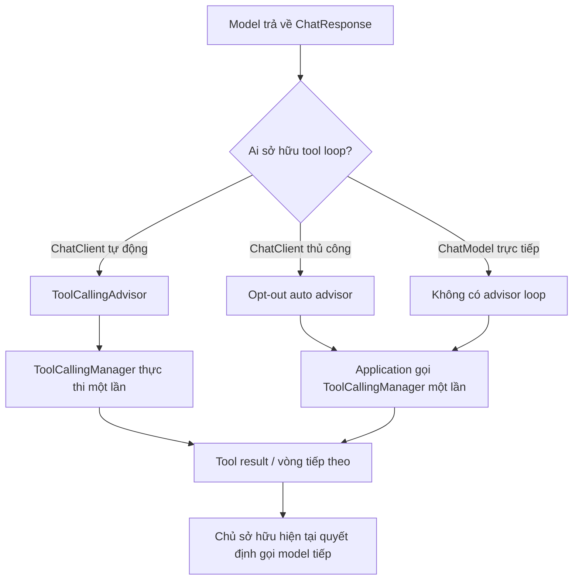

# Tránh thực thi hai lần khi kết hợp vòng lặp thủ công với advisor

Một tool call chỉ nên có một nơi chịu trách nhiệm thực thi. Trong Spring AI 2.x, `ChatClient` tự đăng ký `ToolCallingAdvisor` để điều phối vòng gọi công cụ. Nếu ứng dụng đồng thời tự chạy vòng lặp bằng `ToolCallingManager`, hoặc thêm một advisor khác cũng thực thi tool, cùng một yêu cầu có thể bị xử lý hai lần.

Điều này đặc biệt nguy hiểm với công cụ tạo tác động phụ như gửi thông báo, đặt hàng, hoàn tiền, cập nhật hồ sơ hoặc hủy giao dịch. Một lần gọi trùng có thể tạo hai giao dịch hoặc hai lần gửi thông tin ra ngoài. Cách xử lý là chọn rõ một chủ sở hữu vòng lặp cho từng request: để `ToolCallingAdvisor` điều phối tự động, hoặc tắt auto-registration và tự điều phối. Nếu mở rộng advisor, cần phân biệt advisor quan sát với advisor sở hữu vòng đời tool call.

Trong module `SPRING_AI_TOOL_CALLING`, ứng dụng chịu trách nhiệm thực thi callback và kiểm soát tác động nghiệp vụ. Advisor và `ToolCallingManager` là các thành phần điều phối; chúng không cung cấp bảo đảm exactly-once cho thao tác nghiệp vụ. Với tool ghi dữ liệu, vẫn cần idempotency ở service.

## 1. Quy tắc cốt lõi: một vòng lặp, một chủ sở hữu

Trong một request, chọn một trong các mô hình sau:

| Mô hình | Thành phần sở hữu vòng lặp | Ai gọi `ToolCallingManager`? |
|---|---|---|
| `ChatClient` tự động | `ToolCallingAdvisor` | Advisor gọi nội bộ |
| `ChatClient` tự điều phối | Application/orchestrator | Mã ứng dụng gọi một lần cho mỗi phản hồi có tool call |
| `ChatClient` với custom tool advisor | Custom advisor triển khai `ToolAdvisor` | Custom advisor gọi manager |
| `ChatModel` trực tiếp trong Spring AI 2.x | Application/orchestrator | Mã ứng dụng gọi manager |

Không để hai thành phần cùng sở hữu lifecycle của một tool call. Cụ thể, không để `ToolCallingAdvisor` tự chạy callback rồi lại đưa chính `ChatResponse` đã được xử lý cho một vòng lặp thủ công khác để thực thi lần nữa.



Vòng lặp tự động và vòng lặp thủ công đều hợp lệ. Lỗi xuất hiện khi cả hai cùng xử lý một phản hồi hoặc cùng được đăng ký trong một advisor chain mà không có ranh giới rõ ràng.

## 2. Vì sao có thể thực thi hai lần?

Spring AI 2.1 tự đăng ký `ToolCallingAdvisor` trong `DefaultChatClient` trừ khi auto-registration bị tắt hoặc advisor chain đã có một `ToolAdvisor`. Việc đăng ký tự động vẫn diễn ra khi công cụ được thêm tĩnh, theo request hoặc được một advisor khác inject vào lúc chạy.

Một số cấu hình dễ gây nhầm lẫn:

1. **Auto advisor + manual manager:** một custom advisor/hook giữ lại phản hồi trung gian có tool call sau khi một execution path đã xử lý nó, rồi chuyển cùng phản hồi đó cho `ToolCallingManager` lần nữa. Với request ChatClient bình thường, advisor thường trả kết quả cuối không còn tool call; lỗi xuất hiện khi ứng dụng tái sử dụng một response trung gian hoặc tự thực thi lại cùng tool call.
2. **Auto advisor + advisor thủ công thứ hai:** ứng dụng thêm `ToolCallingAdvisor` hoặc custom advisor có logic thực thi tool nhưng vẫn để auto-registration hoạt động.
3. **Custom advisor tự gọi manager nhưng không đánh dấu ownership:** advisor thực thi tool, nhưng không triển khai marker `ToolAdvisor`; `DefaultChatClient` có thể thêm `ToolCallingAdvisor` mặc định nữa.
4. **Manual loop không opt-out ở mọi lượt:** request đầu tiên tắt auto-registration, nhưng request tiếp theo quên cấu hình này. Từ lượt đó, advisor mặc định lại sở hữu vòng lặp.
5. **Retry/replay sau timeout:** callback đã hoàn thành tác động nghiệp vụ nhưng phản hồi bị mất; ứng dụng gửi lại cùng thao tác và service thực hiện lần nữa.

Ví dụ lỗi thường gặp trong một custom flow đang giữ lại cùng một response:

```java
ChatResponse rawResponse = responseCapturedByCustomHook;

ToolExecutionResult result =
        toolCallingManager.executeToolCalls(prompt, rawResponse);

// Lỗi: thực thi lại cùng tool call từ cùng response.
ToolExecutionResult duplicate =
        toolCallingManager.executeToolCalls(prompt, rawResponse);
```

Ví dụ giả định `rawResponse` là phản hồi trung gian đã được một execution path xử lý. Với đường tự động bình thường, `ToolCallingAdvisor` đã tiếp tục cho đến khi có câu trả lời cuối hoặc một điều kiện dừng. Caller nên sử dụng kết quả cuối của `ChatClient`, không lấy một phản hồi trung gian từ hook/custom advisor rồi tự thực thi lại tool call mà execution path trước đó đã xử lý. Nếu response còn tool call vì đang chờ confirmation, hãy tiếp tục đúng confirmation flow thay vì gọi callback trực tiếp.

## 3. ChatClient tự động: để ToolCallingAdvisor sở hữu toàn bộ vòng

Đây là lựa chọn đơn giản nhất cho ứng dụng hội thoại thông thường:

```java
String answer = chatClient.prompt()
        .user("Gửi biên nhận cho khách hàng của đơn ORD-2048")
        .tools(invoiceTools)
        .call()
        .content();
```

Trong cấu hình mặc định của Spring AI 2.1:

- `DefaultChatClient` tự đăng ký một `ToolCallingAdvisor` nếu advisor chain chưa có `ToolAdvisor`.
- Advisor gửi tool definitions đến model, nhận tool call, gọi `ToolCallingManager` và đưa tool response trở lại model.
- Advisor lặp cho đến khi model không còn tool call hoặc một điều kiện dừng như `returnDirect`/confirmation được áp dụng.
- Ứng dụng nhận phản hồi cuối qua `.content()` hoặc `chatClientResponse()`.

Khi dùng đường này, không gọi `ToolCallingManager` thủ công cho cùng phản hồi. Nếu cần cấu hình manager, resolver hoặc exception processor riêng, cung cấp một `ToolCallingAdvisor.Builder<?>` tùy chỉnh cho auto-configuration hoặc thay advisor mặc định theo extension point của phiên bản.

Không thêm một `ToolCallingAdvisor` thủ công chỉ vì nghĩ rằng `ChatClient` cần được yêu cầu bật tool loop. Trong Spring AI 2.x, cơ chế auto-registration đã đảm nhiệm việc đó.

## 4. ChatClient tự điều phối: phải tắt auto-registration theo từng request

Nếu ứng dụng cần tự kiểm tra từng lượt, ví dụ để ghi progress, áp dụng điều kiện giữa các lượt hoặc chờ một workflow bên ngoài, hãy tắt `ToolCallingAdvisor` tự động trên request:

```java
ChatClientResponse response = chatClient.prompt()
        .user(question)
        .options(chatOptions)
        .advisors(AdvisorParams.toolCallingAdvisorAutoRegister(false))
        .call()
        .chatClientResponse();
```

Khi auto-registration bị tắt, tool definitions vẫn được gửi cho model, nhưng tool call trong phản hồi không được tự thực thi. Mã ứng dụng trở thành chủ sở hữu vòng lặp và phải:

1. Kiểm tra `response.chatResponse().hasToolCalls()`.
2. Gọi `ToolCallingManager.executeToolCalls(...)` đúng một lần cho phản hồi đó.
3. Dùng `ToolExecutionResult.conversationHistory()` làm lịch sử cho lượt tiếp theo.
4. Gửi request tiếp theo với `AdvisorParams.toolCallingAdvisorAutoRegister(false)` một lần nữa.
5. Dừng khi model trả lời cuối hoặc khi `result.returnDirect()` là `true`.

**Phải giữ opt-out ở mọi request trong vòng lặp.** Nếu chỉ tắt ở request đầu tiên, một request tiếp theo có thể quay lại auto mode và làm quyền điều phối chuyển giữa application code và advisor giữa chừng.

## 5. Ví dụ manual loop đúng với ChatClient

Ví dụ dưới đây dùng cùng một tập tool options cho lần gọi đầu và các lượt tiếp theo. Nó giữ nguyên message history, tắt auto advisor ở mọi lượt và chỉ gọi manager một lần cho mỗi response có tool call.

```java
public ManualToolResult runManually(String systemText, String question) {
    ToolCallback[] tools = ToolCallbacks.from(invoiceTools);
    ChatOptions chatOptions = ToolCallingChatOptions.builder()
            .toolCallbacks(tools)
            .build();

    List<Message> initialMessages = List.of(
            new SystemMessage(systemText),
            new UserMessage(question));

    Prompt prompt = new Prompt(initialMessages, chatOptions);

    ChatClientResponse response = chatClient.prompt()
            .messages(initialMessages)
            .options(chatOptions)
            .advisors(AdvisorParams.toolCallingAdvisorAutoRegister(false))
            .call()
            .chatClientResponse();

    int round = 0;
    int maxRounds = 8;

    while (response.chatResponse() != null
            && response.chatResponse().hasToolCalls()) {

        if (++round > maxRounds) {
            throw new IllegalStateException("Đã vượt giới hạn tool calling.");
        }

        ToolExecutionResult result = toolCallingManager.executeToolCalls(
                prompt, response.chatResponse());

        if (result.returnDirect()) {
            return new ManualToolResult(
                    null, result.conversationHistory(), true);
        }

        prompt = new Prompt(result.conversationHistory(), chatOptions);

        response = chatClient.prompt()
                .messages(result.conversationHistory())
                .options(chatOptions)
                .advisors(AdvisorParams.toolCallingAdvisorAutoRegister(false))
                .call()
                .chatClientResponse();
    }

    String answer = response.chatResponse() == null
            ? null
            : response.chatResponse().getResult().getOutput().getText();

    return new ManualToolResult(answer, List.of(), false);
}

public record ManualToolResult(
        String answer,
        List<Message> directToolHistory,
        boolean direct) {
}
```

`chatClient`, `toolCallingManager` và `invoiceTools` được inject từ Spring; các import được lược bỏ. Ứng dụng cần ánh xạ `directToolHistory` sang kết quả của công cụ theo result contract riêng. Không gọi model thêm khi `direct=true`.

Nếu prompt có system message, memory hoặc context khác, hãy bảo đảm `Prompt` truyền cho manager và message list gửi qua ChatClient mô tả cùng một lượt hội thoại. Không dựng một history rút gọn khiến manager xử lý một phản hồi theo prompt khác với prompt đã tạo ra nó.

## 6. Đặt opt-out ở đúng phạm vi

Có hai cách tắt auto-registration:

```java
// Theo một request — phù hợp khi chỉ một use case tự điều phối.
.advisors(AdvisorParams.toolCallingAdvisorAutoRegister(false))
```

```yaml
# Toàn cục — áp dụng cho mọi request của ChatClient auto-configured.
spring:
  ai:
    chat:
      client:
        tool-calling:
          enabled: false
```

Ưu tiên opt-out theo request nếu phần lớn ứng dụng vẫn muốn dùng auto loop. Cấu hình toàn cục chỉ phù hợp khi mọi use case đều có orchestrator riêng hoặc một custom tool advisor được đăng ký có chủ đích.

Không nhầm property trên với việc tắt tool definitions. Khi auto-registration bị tắt, tool definitions vẫn có thể được gửi đến model; chỉ việc tự động thực thi tool response bị tắt. Caller phải tự xử lý các tool call còn lại.

## 7. Custom advisor: phân biệt advisor quan sát và advisor thực thi

Không phải advisor nào xuất hiện cùng tool calling cũng nên tự gọi `ToolCallingManager`.

**Advisor quan sát** chỉ ghi nhận request/response từng lượt, phát sự kiện progress hoặc thêm metrics. Nó không sở hữu tool lifecycle và không được gọi manager. Có thể đặt advisor quan sát ở bên trong `ToolCallingAdvisor` bằng order lớn hơn `ToolCallingAdvisor.DEFAULT_ORDER`:

```java
public class ToolCallObservingAdvisor implements CallAdvisor, StreamAdvisor {

    @Override
    public int getOrder() {
        return Ordered.HIGHEST_PRECEDENCE + 400;
    }

    @Override
    public ChatClientResponse adviseCall(
            ChatClientRequest request, CallAdvisorChain chain) {
        ChatClientResponse response = chain.nextCall(request);
        auditService.record(response);
        return response;
    }

    // adviseStream(...) có thể quan sát từng chunk tương tự.
}
```

Advisor này chỉ quan sát; `ToolCallingAdvisor` vẫn là chủ sở hữu duy nhất của vòng thực thi. Không gọi `ToolCallingManager` bên trong `adviseCall` hoặc `adviseStream` của một advisor quan sát.

**Advisor sở hữu tool lifecycle** thực sự thay thế cách điều phối mặc định. Trong Spring AI 2.1, custom advisor loại này phải triển khai marker `ToolAdvisor`:

```java
public final class CustomToolLoopAdvisor
        implements CallAdvisor, StreamAdvisor, ToolAdvisor {

    // Custom implementation sở hữu việc phát hiện tool call,
    // gọi manager, cập nhật history và quyết định vòng tiếp theo.
}
```

`ToolAdvisor` báo cho `DefaultChatClient` rằng chain đã có một thành phần sở hữu tool lifecycle. Auto-registration sẽ không thêm `ToolCallingAdvisor` mặc định nữa. Nếu custom advisor chỉ quan sát mà không thực thi, đừng triển khai marker này; để advisor mặc định tiếp tục quản lý vòng.

Đoạn mã trên là khung khai báo type; lớp thực tế cần triển khai đầy đủ các phương thức của `CallAdvisor` và `StreamAdvisor`, cùng logic vòng lặp và xử lý history.

## 8. Quy tắc một ToolAdvisor trong Spring AI 2.1

Trong Spring AI 2.1, `ToolCallingAdvisor` triển khai `ToolAdvisor`, và `DefaultChatClient` áp dụng invariant: mỗi advisor chain có đúng một tool advisor.

- Nếu chain chưa có `ToolAdvisor`, ChatClient thêm `ToolCallingAdvisor` mặc định.
- Nếu chain đã có một advisor triển khai `ToolAdvisor`, ChatClient bỏ qua auto-registration và dùng advisor đó.
- Nếu đăng ký hai custom advisor cùng triển khai `ToolAdvisor`, chain fail fast khi được tạo.

Invariant này giúp ngăn lỗi xếp chồng hai tool-calling advisor. Nó không phát hiện mọi trường hợp gọi `ToolCallingManager` thủ công trong application service. Vì vậy, code của ứng dụng vẫn phải tuân thủ quy tắc một chủ sở hữu cho mỗi response.

Ví dụ, trong Spring AI 2.1, nếu muốn cấu hình `ToolCallingAdvisor` riêng, hãy đăng ký nó một lần:

```java
ToolCallingAdvisor toolAdvisor = ToolCallingAdvisor.builder()
        .toolCallingManager(customToolCallingManager)
        .build();

ChatClient chatClient = ChatClient.builder(chatModel)
        .defaultAdvisors(toolAdvisor)
        .build();
```

Vì advisor đã triển khai `ToolAdvisor`, ChatClient không thêm một advisor mặc định thứ hai. Không cần vừa thêm advisor này vừa gọi `AdvisorParams.toolCallingAdvisorAutoRegister(false)` chỉ để tránh duplicate; marker đã thể hiện ownership. Nếu muốn tự điều phối ngoài advisor, hãy opt-out và không đăng ký tool advisor trong request đó.

## 9. Khác biệt phiên bản: Spring AI 2.0 và 2.1

Hành vi auto-registration đã thay đổi qua các bản 2.x:

| Phiên bản | Hành vi cần chú ý |
|---|---|
| Spring AI 1.x | `ChatModel` từng có internal tool execution loop; cách điều phối khác với kiến trúc advisor của 2.x |
| Spring AI 2.0 | `ChatClient` bắt đầu auto-register `ToolCallingAdvisor`; code cũ tự thêm advisor có thể vô tình có hai advisor trong chain |
| Spring AI 2.1 | Có marker `ToolAdvisor` và invariant một tool advisor; custom advisor sở hữu lifecycle phải triển khai marker để suppress auto-registration |

Upgrade notes ghi nhận rằng code đã tự thêm `ToolCallingAdvisor` trước khi auto-registration được bật có thể gặp advisor xuất hiện hai lần. Cách migration là bỏ đăng ký thủ công và dùng auto-registration, hoặc opt-out rồi đăng ký đúng một advisor tùy chỉnh. Từ 2.1, `ToolAdvisor` marker làm rõ ownership và kiểm tra xung đột tốt hơn.

Không áp dụng ví dụ 2.1 một cách máy móc cho bản 2.0.x cũ. Hãy kiểm tra đúng patch version, advisor chain và auto-configuration của dự án.

## 10. ChatModel trực tiếp không có ToolCallingAdvisor tự động

Trong Spring AI 2.x, `ChatModel.call(prompt)` và `ChatModel.stream(prompt)` trả phản hồi thô của model, kể cả tool call. Chúng không tự chạy callback và không có advisor chain của `ChatClient`.

Vì vậy, khi gọi `ChatModel` trực tiếp:

- Gửi tool definitions qua `ToolCallingChatOptions`.
- Kiểm tra `ChatResponse.hasToolCalls()`.
- Gọi `ToolCallingManager.executeToolCalls(...)` một lần.
- Dùng `conversationHistory()` để gọi model tiếp.
- Dừng khi không còn tool call hoặc `returnDirect()` được bật.

Không cần `AdvisorParams.toolCallingAdvisorAutoRegister(false)` cho đường `ChatModel` trực tiếp vì không có `DefaultChatClient` để auto-register advisor. Tuy nhiên, nếu application tự bọc `ChatModel` trong một custom advisor/orchestrator, vẫn phải đảm bảo chỉ một thành phần thực thi callback.

## 11. Không nhầm double advisor với retry hoặc replay nghiệp vụ

Ngay cả khi advisor chain chỉ có một tool advisor, tác động nghiệp vụ vẫn có thể lặp lại do:

- HTTP client retry request sau khi timeout.
- Queue hoặc workflow engine giao lại cùng một công việc.
- Người dùng gửi lại yêu cầu vì không thấy phản hồi.
- Model yêu cầu lại một tool sau khi nhận kết quả không rõ ràng.
- Ứng dụng resume một conversation từ checkpoint cũ và chạy lại tool call.
- Hai request đồng thời cùng yêu cầu một hành động.

`ToolCallingManager` điều phối việc gọi callback; không nên xem nó như một kho idempotency hoặc cơ chế exactly-once cho nghiệp vụ. Nếu gọi lại `executeToolCalls(...)` trên cùng một tool call, callback có thể được chạy lại. `ToolCall` ID hữu ích để ghép tool response với assistant message, nhưng không nên là bảo đảm duy nhất chống giao dịch trùng qua các lần model generation khác nhau.

Với công cụ ghi, hãy tạo idempotency key ở application/service layer, gắn với một hành động nghiệp vụ đã được xác định. Ví dụ, khi người dùng xác nhận gửi hóa đơn, server tạo `operationId`; mọi lần retry của cùng hành động dùng lại ID đó. Lưu trạng thái xử lý bằng unique constraint hoặc bảng idempotency và trả lại kết quả cũ nếu hành động đã hoàn tất.

```java
@Transactional
public InvoiceSendResult sendInvoiceOnce(
        String operationId, String orderId, String actorId) {

    Optional<InvoiceOperation> existing =
            operationRepository.findByOperationId(operationId);
    if (existing.isPresent()) {
        return existing.get().toResult();
    }

    authorizationService.requireCanSendInvoice(actorId, orderId);

    InvoiceOperation operation =
            operationRepository.save(InvoiceOperation.started(operationId, orderId));

    InvoiceSendResult result = invoiceService.send(orderId);
    operation.complete(result);
    return result;
}
```

Đoạn mã minh họa cần được triển khai với unique constraint cho `operationId` và xử lý tranh chấp đồng thời. Nếu gửi hóa đơn qua dịch vụ bên ngoài, transaction database không thể rollback tác động đã gửi; dùng transactional outbox hoặc idempotency key mà nhà cung cấp hỗ trợ để giữ an toàn khi retry.

Không lấy `operationId` trực tiếp từ arguments do model tự tạo. Server nên gắn ID với request, phiên xác nhận hoặc business command đã được kiểm tra. Mô hình chỉ cung cấp tham số nghiệp vụ như `orderId`; ứng dụng quyết định danh tính hành động và quyền thực thi.

## 12. Xử lý confirmation mà không chạy tool trước khi được duyệt

Với thao tác nhạy cảm, có thể dùng cơ chế Tool Call Confirmation của Spring AI thay vì tự chạy tool rồi mới yêu cầu xác nhận. Khi manager báo cần xác nhận, vòng tool calling tạm dừng; các tool call trong assistant reply chưa được thực thi.

Ứng dụng cần:

1. Nhận response có các tool call đang chờ quyết định.
2. Hiển thị nội dung hành động và tham số đã chuẩn hóa cho người có quyền phê duyệt.
3. Ghi nhận quyết định allow/deny gắn với actor, tài nguyên, tham số và thời hạn.
4. Gửi quyết định qua `ToolCallingManager` theo API confirmation của phiên bản.
5. Tiếp tục hội thoại với tool result đã được xử lý.

Không vừa để `ToolCallingAdvisor` tự chạy một tool không yêu cầu confirmation, vừa đưa cùng response cho manual executor để chạy lại. Cũng không tự gọi callback trực tiếp sau khi người dùng bấm duyệt nếu manager đang sở hữu bước tiếp tục thực thi. Hãy để cùng một manager/execution path áp dụng quyết định.

Confirmation và idempotency giải quyết hai vấn đề khác nhau: confirmation xác định người có quyền đồng ý hành động; idempotency ngăn cùng hành động được áp dụng lặp khi retry hoặc replay.

## 13. Kiểm thử để phát hiện thực thi trùng

Đừng chỉ kiểm tra câu trả lời cuối. Hãy đếm số lần callback được gọi và số lần tác động nghiệp vụ xảy ra.

| Ca kiểm thử | Thiết lập | Kỳ vọng |
|---|---|---|
| Auto mode | ChatClient có tool, không opt-out | Advisor thực thi callback; application không gọi manager lần nữa |
| Manual mode | Opt-out ở request đầu và mọi request tiếp theo | Manager thực thi mỗi tool call đúng một lần; advisor không tự chạy |
| Missing opt-out | Bỏ opt-out ở request tiếp theo | Test phát hiện quyền điều phối đã chuyển sang advisor mặc định |
| Explicit advisor | Thêm custom `ToolCallingAdvisor` trong 2.1 | Auto-registration bị suppress bởi `ToolAdvisor`; chỉ một advisor sở hữu loop |
| Custom owner | Custom loop advisor triển khai `ToolAdvisor` | Không có advisor mặc định thứ hai |
| Observer advisor | Advisor chỉ ghi metrics, order nằm trong loop | Observer chạy mỗi iteration; không tự thực thi callback |
| Duplicate response | Cố ý gọi manager hai lần với cùng response | Test chứng minh callback có thể chạy lại; business idempotency chặn tác động trùng |
| Retry sau timeout | Service đã hoàn thành nhưng caller không nhận response | Retry trả kết quả đã lưu, không gửi tác động lần hai |
| Parallel request | Hai request cùng operation ID chạy đồng thời | Unique constraint/idempotency bảo vệ một business effect |
| returnDirect | Tool trả trực tiếp | Manual loop dừng và không gọi model tiếp |
| Confirmation | Tool yêu cầu phê duyệt | Callback chưa chạy trước quyết định allow |

Ví dụ dùng counter để kiểm tra một lần gọi callback:

```java
AtomicInteger executions = new AtomicInteger();

@Tool(description = "Gửi một thông báo thử nghiệm.")
public String sendTestNotification(String message) {
    executions.incrementAndGet();
    return "sent";
}

// Sau khi chạy một ChatClient request với model giả lập trả đúng một tool call:
assertThat(executions).hasValue(1);
```

Trong integration test, model giả lập nên trả chuỗi phản hồi xác định: lần đầu yêu cầu gọi tool, lần tiếp theo trả final answer. Kiểm tra số lần gọi model, số lần manager được gọi và số lần service tạo tác động. Chạy test riêng cho auto mode và manual mode; không ghép cả hai cơ chế vào cùng một request chỉ để kiểm tra.

## 14. Quan sát quyền sở hữu vòng lặp trong log và trace

Khi điều tra sự cố, cần biết request đang chạy ở chế độ nào. Có thể ghi metadata:

- `toolLoopMode`: `advisor`, `manual` hoặc `custom-advisor`.
- `advisorType` và số lượng `ToolAdvisor` trong chain.
- `conversationId` hoặc correlation ID.
- `toolName`, tool call ID, operation ID và contract version.
- Số vòng model, số callback và kết quả thành công/thất bại.
- Idempotency outcome: `started`, `replayed`, `completed` hoặc `rejected`.

Không ghi raw arguments hoặc kết quả có thông tin cá nhân, token, dữ liệu thanh toán hay secret. Khi thấy cùng operation ID xuất hiện nhiều lần, cần phân biệt callback bị thực thi hai lần do hai loop owner với request retry/replay ở tầng vận chuyển.

## 15. Các lỗi thường gặp

| Cách cấu hình | Hậu quả | Điều chỉnh |
|---|---|---|
| ChatClient auto mode rồi gọi manager thủ công trên cùng tool call | Callback có thể chạy hai lần | Chỉ dùng kết quả cuối của advisor |
| Manual loop nhưng quên opt-out ở lượt sau | Auto advisor tiếp quản giữa vòng | Giữ `AdvisorParams.toolCallingAdvisorAutoRegister(false)` ở mọi request |
| Custom advisor gọi manager nhưng không triển khai `ToolAdvisor` | Auto advisor mặc định vẫn có thể được thêm | Implement marker trong 2.1 hoặc opt-out rõ ràng |
| Thêm explicit ToolCallingAdvisor mà không kiểm tra version | Có thể xếp chồng advisor ở bản chưa có invariant | Dùng auto mặc định hoặc cấu hình đúng một advisor |
| Hai custom ToolAdvisor trong cùng chain | Chain fail fast trong 2.1 | Chỉ giữ một tool lifecycle owner |
| Observer advisor tự gọi manager | Trùng với advisor đang sở hữu loop | Observer chỉ ghi nhận; đặt order bên trong loop |
| Dùng ChatModel trực tiếp nhưng chờ framework tự chạy tool | Tool call chỉ được trả về, callback không chạy | Tự điều phối qua ToolCallingManager |
| Tin rằng manager bảo đảm exactly-once | Retry/replay có thể lặp tác động | Dùng idempotency ở business service |
| Dùng tool call ID làm khóa chống trùng duy nhất | Model có thể tạo ID mới ở lần generation khác | Dùng operation ID do server quản lý |

## 16. Checklist trước khi phát hành

- Mỗi request xác định rõ `advisor`, `manual` hay `custom-advisor` là chủ sở hữu vòng lặp.
- Auto mode không gọi `ToolCallingManager` thủ công trên cùng response.
- Manual ChatClient mode tắt auto-registration ở request đầu và mọi request tiếp theo.
- Custom advisor sở hữu lifecycle triển khai `ToolAdvisor` trên Spring AI 2.1.
- Advisor chỉ quan sát không gọi manager và được đặt order phù hợp bên trong tool loop.
- Chain không có hai tool lifecycle owner.
- `returnDirect` và confirmation làm vòng lặp dừng/tiếp tục đúng cách.
- Callback được kiểm tra quyền ở service và không dựa vào tool visibility.
- Tool ghi có operation ID/idempotency và xử lý retry sau timeout.
- Integration test xác minh callback và business effect chỉ xảy ra một lần trong trường hợp bình thường.
- Có test replay/concurrency để chứng minh idempotency.
- Log/trace phân biệt được duplicate advisor execution với request retry/replay.

## 17. Tài liệu tham khảo

- [Spring AI 2.1 — Tool Calling](https://docs.spring.io/spring-ai/reference/api/tools.html): auto tool loop, manual execution, `AdvisorParams.toolCallingAdvisorAutoRegister(false)` và `ToolAdvisor` marker.
- [Spring AI 2.1 — ToolCallingAdvisor](https://docs.spring.io/spring-ai/reference/api/tools/tool-calling-advisor.html): single-`ToolAdvisor` invariant, advisor order, custom advisor và opt-out.
- [Spring AI 2.1 — ChatModel Tool Calling](https://docs.spring.io/spring-ai/reference/api/tools/chatmodel-tool-calling.html): manual loop khi gọi `ChatModel` trực tiếp.
- [Spring AI Upgrade Notes](https://docs.spring.io/spring-ai/reference/upgrade-notes.html): thay đổi auto-registration và migration từ code tự đăng ký advisor.
- [Spring AI — Tool Call Confirmation](https://docs.spring.io/spring-ai/reference/api/tools/tool-call-confirmation.html): tạm dừng vòng tool calling để chờ quyết định của người dùng.

Tránh thực thi hai lần bằng cách xác định một chủ sở hữu vòng lặp cho mỗi request. Dùng auto `ToolCallingAdvisor` cho luồng thông thường; tắt auto-registration ở mọi lượt nếu ứng dụng tự điều phối; hoặc triển khai đúng `ToolAdvisor` khi custom advisor sở hữu lifecycle. Sau cùng, bảo vệ thao tác ghi bằng idempotency vì một vòng lặp duy nhất vẫn có thể được gọi lại do retry hoặc replay.
