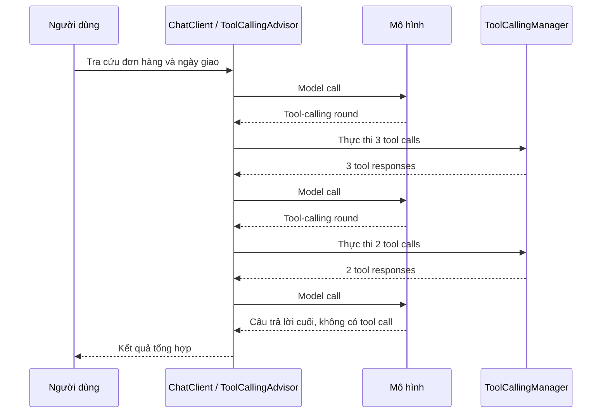

# Phân biệt số vòng gọi mô hình và tổng số lần gọi công cụ

Trong một request dùng tool calling, mô hình có thể được gọi nhiều lần và mỗi phản hồi của mô hình có thể yêu cầu thực thi một hoặc nhiều công cụ. Vì vậy, số lần gọi mô hình và tổng số lần gọi công cụ là hai đại lượng khác nhau. Một vòng gọi mô hình có thể tạo ra nhiều tool call; ngược lại, mô hình có thể được gọi thêm nhiều vòng để đọc kết quả công cụ và quyết định bước tiếp theo.

Spring AI 2.1.0 điều phối vòng lặp này bằng `ToolCallingAdvisor`. `DefaultToolCallingManager` có giới hạn số lần thực thi công cụ trong một turn: mặc định tối đa 40 lần cho mỗi tool và 150 lần cho tất cả tool cộng lại. Các giới hạn này đếm lần gọi công cụ, không đếm số request gửi đến mô hình. Nếu cần giới hạn số vòng gọi mô hình, ứng dụng phải đặt thêm ngân sách ở tầng điều phối.

Sau bài học, bạn có thể:

- Phân biệt model call, tool-calling round và tool call.
- Tính số lần gọi mô hình và số lần thực thi công cụ từ một luồng hội thoại.
- Hiểu cách Spring AI 2.1.0 đếm tool call trong phạm vi một turn.
- Cấu hình giới hạn cho từng tool và giới hạn tổng số tool call.
- Chọn cách xử lý khi vượt ngưỡng và hiểu các lần thực thi đã hoàn tất.
- Thiết kế giới hạn riêng cho số vòng gọi mô hình, thời gian, token và thao tác nghiệp vụ.

## 1. Ba khái niệm cần phân biệt

Trong bài này, dùng ba thuật ngữ với ý nghĩa cụ thể:

| Thuật ngữ | Định nghĩa | Ví dụ |
| --- | --- | --- |
| **Model call** (lần gọi mô hình) | Một request gửi đến `ChatModel` và một response tương ứng nhận về. | Gửi câu hỏi lần đầu; gửi kết quả tool để mô hình suy luận tiếp. |
| **Tool-calling round** (vòng mô hình yêu cầu tool) | Một model response có chứa ít nhất một tool call. | Mô hình trả về yêu cầu gọi `search_orders` và `get_customer`. |
| **Tool call** (yêu cầu gọi công cụ) | Một yêu cầu thực thi callback riêng, có tên tool và arguments. | Một lần gọi `search_orders` với `status=PAID`. |

Một tool-calling round có thể chứa nhiều tool call. Khi đó, mô hình chỉ được gọi một lần để tạo ra batch yêu cầu, nhưng ứng dụng phải thực thi từng tool call trong batch đó. Sau khi nhận kết quả, mô hình có thể được gọi thêm để tổng hợp dữ liệu hoặc yêu cầu công cụ khác.

Đừng dùng từ “số vòng” mà không nói rõ đang đếm model call hay vòng có tool call. Trong phần còn lại:

- `M`: tổng số model call trong một turn.
- `R`: số tool-calling round, tức số model response có tool call.
- `T`: tổng số tool call mô hình yêu cầu trong turn.
- `T_exec`: tổng số lần callback được gọi để thực thi trong turn, kể cả lần callback kết thúc bằng lỗi.
- `nᵢ`: số tool call trong tool-calling round thứ `i`.

Nếu vòng lặp kết thúc bình thường bằng một response không có tool call và không bị dừng sớm, ta có:

\[
M = R + 1
\]

\[
T = \sum_{i=1}^{R} n_i
\]

Trong luồng không bị từ chối, không vượt giới hạn và không gặp lỗi, `T_exec` thường bằng `T`. Nếu có xác nhận bị từ chối hoặc tool call bị chặn trước khi dispatch, hai số có thể khác nhau. Hai công thức này mô tả một luồng hoàn tất thông thường; `returnDirect`, xác nhận của người dùng, lỗi hoặc giới hạn thực thi có thể làm vòng lặp dừng trước khi có response cuối từ mô hình.

## 2. Ví dụ: ba model call nhưng năm tool call

Giả sử người dùng hỏi: “Tìm đơn hàng gần nhất của tôi, kiểm tra trạng thái thanh toán và cho biết ngày giao dự kiến”. Mô hình quyết định gọi hai công cụ tra cứu trong vòng đầu, sau đó gọi thêm hai công cụ trong vòng tiếp theo.



| Model call | Nội dung response | Tool call được yêu cầu trong response | Tổng tool call được yêu cầu lũy kế |
| --- | --- | ---: | ---: |
| #1 | Yêu cầu tra cứu đơn hàng, khách hàng và thanh toán | 3 | 3 |
| #2 | Yêu cầu tra cứu ngày giao và lịch sử vận chuyển | 2 | 5 |
| #3 | Câu trả lời cuối, không yêu cầu công cụ | 0 | 5 |

Kết quả:

- `M = 3` model calls.
- `R = 2` tool-calling rounds.
- `T = 5` tool calls được yêu cầu; nếu cả năm đều thực thi thành công thì `T_exec = 5`.

Nếu cấu hình `maxTotalToolCalls(4)`, request này vượt giới hạn vì mô hình yêu cầu năm tool call, dù mô hình chỉ được gọi ba lần. Nếu giới hạn model call là `2`, request cũng không thể hoàn tất vì cần model call thứ ba để tổng hợp kết quả.

## 3. Một model response có thể chứa nhiều tool call

Tool calling không nhất thiết đi theo mô hình một lần gọi mô hình rồi một lần gọi công cụ. Mô hình có thể trả về nhiều yêu cầu trong cùng một response, ví dụ:

```json
{
  "tool_calls": [
    {
      "id": "call_01",
      "name": "get_order",
      "arguments": { "orderId": "ORD-1008" }
    },
    {
      "id": "call_02",
      "name": "get_payment_status",
      "arguments": { "orderId": "ORD-1008" }
    },
    {
      "id": "call_03",
      "name": "get_delivery_estimate",
      "arguments": { "orderId": "ORD-1008" }
    }
  ]
}
```

Đây là một tool-calling round nhưng có ba tool call được yêu cầu. `ToolCallingManager` xử lý từng yêu cầu, ghép từng kết quả với tool call tương ứng và tạo lịch sử để mô hình tiếp tục. Giới hạn tổng số lần thực thi tool tính từng yêu cầu riêng biệt.

Một số model/provider có thể trả nhiều tool call trong một response. Không nên giả định mỗi response chỉ có một tool call hoặc mọi tool call luôn được thực thi theo thứ tự mà mô hình liệt kê. Nếu các thao tác phụ thuộc nhau, hãy thiết kế thành một công cụ nghiệp vụ có bước xử lý tuần tự rõ ràng hoặc yêu cầu mô hình chờ kết quả trước khi gọi bước sau.

## 4. Vòng lặp của ToolCallingAdvisor đếm điều gì?

Trong Spring AI 2.1.0, `ToolCallingAdvisor` quản lý vòng lặp theo phản hồi của mô hình:

1. Gửi prompt và tool definitions đến mô hình.
2. Nhận response.
3. Nếu response có tool call, chuyển các yêu cầu đến `ToolCallingManager`.
4. Thêm tool response vào lịch sử hội thoại.
5. Gọi mô hình tiếp với lịch sử đã cập nhật.
6. Lặp đến khi response không còn tool call hoặc có điều kiện dừng khác.

Điều kiện mặc định để tiếp tục vòng lặp là `chatResponse.hasToolCalls()`. `ToolExecutionEligibilityChecker` có thể thay đổi predicate này theo metadata/finish reason của provider. Nó quyết định một response có đủ điều kiện để bắt đầu vòng tool tiếp theo hay không; nó không phải bộ đếm số model call.

Builder của `ToolCallingAdvisor` có các cấu hình cho `ToolCallingManager`, eligibility checker, advisor order và conversation history. Không có một tùy chọn `maxModelCalls` trong builder mặc định của Spring AI 2.1.0. Vì vậy, không thể dùng `maxCallsPerTool` hoặc `maxTotalToolCalls` để thay thế giới hạn số vòng gọi mô hình.

## 5. Giới hạn tool call mặc định trong Spring AI 2.1.0

`DefaultToolCallingManager` giới hạn số lần công cụ được gọi trong một turn để ngăn vòng lặp chạy quá lâu hoặc mô hình liên tục yêu cầu cùng một công cụ.

| Phạm vi | Giới hạn mặc định trong Spring AI 2.1.0 |
| --- | ---: |
| Mỗi tool | 40 lần trong một turn |
| Tất cả tool cộng lại | 150 lần trong một turn |

Hai giới hạn này hoạt động đồng thời:

- Giới hạn per-tool ngăn một tool bị gọi lặp quá nhiều lần.
- Giới hạn tổng ngăn một turn gọi quá nhiều tool khác nhau hoặc phối hợp nhiều tool với nhau để vượt ngân sách.

Ví dụ: một turn gọi `search_orders` 41 lần và không gọi tool nào khác thì chạm giới hạn per-tool mặc định 40. Một turn gọi 30 lần `search_orders`, 30 lần `get_customer` và 30 lần `get_payment` có 90 tool call: chưa vượt giới hạn riêng của từng tool nhưng đã tiêu thụ 90/150 tổng số lần gọi.

Các giới hạn mặc định được áp dụng ngay cả khi bạn không gọi builder để cấu hình chúng. Đây là giới hạn trong phạm vi turn hiện tại, không phải hạn mức suốt vòng đời ứng dụng.

## 6. Cấu hình giới hạn riêng cho từng tool và tổng số tool call

Có thể cấu hình bằng `ToolCallingManager.Builder` rồi gắn manager vào `ToolCallingAdvisor`:

```java
ToolCallingManager toolCallingManager = ToolCallingManager.builder()
        .maxCallsPerTool(8)                 // Mặc định tối đa 8 lần cho mỗi tool
        .maxCallsPerTool("search_orders", 5) // Riêng search_orders tối đa 5 lần
        .maxTotalToolCalls(24)              // Tất cả tool cộng lại tối đa 24 lần
        .onLimitExceeded(ToolCallLimitBehavior.THROW)
        .build();

ToolCallingAdvisor toolCallingAdvisor = ToolCallingAdvisor.builder()
        .toolCallingManager(toolCallingManager)
        .build();

ChatClient chatClient = ChatClient.builder(chatModel)
        .defaultAdvisors(toolCallingAdvisor)
        .build();
```

Trong ví dụ, `search_orders` có giới hạn riêng là 5. Các tool khác dùng giới hạn mặc định mới là 8. Tổng số lần gọi mọi tool trong turn không vượt quá 24. Khi tự cung cấp `ToolCallingAdvisor`, `ChatClient` nhận biết `ToolAdvisor` marker và không tạo thêm advisor mặc định thứ hai.

Nếu ứng dụng dùng Spring Boot auto-configuration, có thể cấu hình bằng properties:

```properties
spring.ai.tools.limits.max-calls-per-tool-default=8
spring.ai.tools.limits.max-calls-per-tool.search_orders=5
spring.ai.tools.limits.max-total-tool-calls=24
spring.ai.tools.limits.on-limit-exceeded=THROW
```

Tên tool trong property per-tool phải khớp với tên callback được công bố cho mô hình. Khi đổi tên tool, hãy cập nhật property và test tương ứng.

## 7. Exclude tool khỏi giới hạn per-tool

Một số tool có thể cần được gọi nhiều lần trong một turn, chẳng hạn tool đọc trang tiếp theo của một tập dữ liệu lớn. Builder có `excludeToolFromLimit(...)` để bỏ giới hạn riêng cho tên tool đó:

```java
ToolCallingManager toolCallingManager = ToolCallingManager.builder()
        .maxCallsPerTool(8)
        .maxTotalToolCalls(40)
        .excludeToolFromLimit("read_next_page")
        .build();
```

`read_next_page` không bị giới hạn per-tool, nhưng mọi lần gọi nó vẫn tính vào `maxTotalToolCalls(40)`. Vì vậy, loại trừ khỏi giới hạn riêng không có nghĩa tool được chạy vô hạn trong turn.

Có thể tắt giới hạn per-tool hoặc tổng bằng `unlimitedCallsPerTool()` và `unlimitedTotalToolCalls()`, hoặc đặt giá trị `-1` trong properties tương ứng. Chỉ nên làm vậy khi đã có quota, timeout và giới hạn tài nguyên khác ở tầng ứng dụng. Bỏ giới hạn không làm vòng lặp an toàn hơn.

## 8. Phạm vi đếm là một turn, không phải toàn bộ lịch sử hội thoại

`DefaultToolCallingManager` tính giới hạn từ các `ToolResponseMessage` kể từ `UserMessage` gần nhất. Kết quả tool và error response được thêm vào lịch sử đều được tính; nếu exception được ném thẳng về caller thì turn có thể dừng trước khi có tool response tương ứng. Các tool response thuộc những turn cũ trong lịch sử hội thoại không làm tăng bộ đếm của turn mới.

Ví dụ:

| Nội dung lịch sử | Có tính vào giới hạn turn hiện tại? |
| --- | --- |
| Tool response sau user message hiện tại | Có |
| Tool response của turn trước, nằm trước user message mới nhất | Không |
| Tool response được thêm trong vòng lặp hiện tại | Có |
| Một model response cuối không có tool call | Không tăng bộ đếm tool call |

Manager tính lại số lượng từ lịch sử prompt của turn thay vì lưu một counter mutable dùng chung trong instance. Vì vậy, một `ToolCallingManager` có thể được chia sẻ giữa các request đồng thời mà không làm lẫn bộ đếm giữa người dùng. Khi tùy chỉnh cơ chế lịch sử, cần giữ đầy đủ tool response của turn hiện tại để việc đếm phản ánh đúng số lần thực thi.

## 9. Điều gì xảy ra khi vượt giới hạn tool call?

Mặc định, `onLimitExceeded` là `ToolCallLimitBehavior.THROW`. Khi vượt ngưỡng, `DefaultToolCallingManager` ném `ToolCallLimitExceededException`. Exception mang thông tin tên tool (giá trị `null` nếu vượt giới hạn tổng), ngưỡng bị chạm và phần kết quả đã thực thi thành công trong batch hiện tại.

Khi dùng `ToolCallingAdvisor`, advisor bắt exception này và trả tình trạng vượt giới hạn thành response cuối. Các tool call đã thực thi thành công trước thời điểm vượt ngưỡng được giữ lại trong metadata partial tool responses. Vì vậy, vượt giới hạn không đồng nghĩa mọi thao tác trong batch đã được rollback.

Có thể chọn `RETURN_ERROR_RESPONSE`:

```java
ToolCallingManager toolCallingManager = ToolCallingManager.builder()
        .maxCallsPerTool(8)
        .maxTotalToolCalls(24)
        .onLimitExceeded(ToolCallLimitBehavior.RETURN_ERROR_RESPONSE)
        .build();
```

Ở chế độ này, lần gọi vượt giới hạn bị bỏ qua và manager tạo một tool response báo lỗi để mô hình nhận biết. Mô hình có thể giải thích rằng đã chạm giới hạn hoặc thử một cách khác. Tuy nhiên, nếu mô hình tiếp tục yêu cầu cùng công cụ, số model call vẫn có thể tăng. Đây là lý do giới hạn tool call cần kết hợp với ngân sách model round.

Nếu gọi `ToolCallingManager.executeToolCalls(...)` trực tiếp trong vòng lặp tự viết, bạn cần xử lý exception hoặc cấu hình `RETURN_ERROR_RESPONSE` nếu muốn trả lỗi về mô hình. Không có `ToolCallingAdvisor` bao quanh để xử lý thay bạn.

## 10. Giới hạn số model call là ngân sách riêng

Trong Spring AI 2.1.0, `ToolCallingAdvisor` tiếp tục lặp khi response có tool call. `ToolCallingManager` có giới hạn per-tool và total-tool-call, nhưng builder mặc định của `ToolCallingAdvisor` không cung cấp `maxModelCalls` hoặc `maxIterations` để giới hạn trực tiếp số lần gọi mô hình.

Nếu nghiệp vụ cần giới hạn số model call, ví dụ tối đa 6 lần gọi mô hình cho mỗi yêu cầu, ứng dụng cần điều khiển ngân sách ở tầng điều phối:

- Dùng custom `ToolCallingAdvisor` với trạng thái đếm riêng cho từng request/turn và dừng trước khi gọi mô hình vượt ngân sách.
- Hoặc tắt auto-registration và tự điều phối vòng lặp bằng `ChatModel` cùng `ToolCallingManager`, tăng counter mỗi lần gọi model.

Không đặt một `AtomicInteger` dùng chung trong singleton `ToolExecutionEligibilityChecker` để đếm vòng. Nhiều request đồng thời sẽ dùng chung counter và làm lẫn ngân sách của các người dùng. `ToolExecutionEligibilityChecker` mặc định chỉ kiểm tra `hasToolCalls()`; nếu cần đếm, state phải gắn với đúng request hoặc session.

Ví dụ sau minh họa cách đếm model call khi tự điều phối bằng `ChatModel`:

```java
public String askWithModelCallBudget(String question, int maxModelCalls) {
    ToolCallingManager manager = ToolCallingManager.builder()
            .maxCallsPerTool(8)
            .maxTotalToolCalls(24)
            .onLimitExceeded(ToolCallLimitBehavior.THROW)
            .build();

    ToolCallingChatOptions options = ToolCallingChatOptions.builder()
            .toolCallbacks(allowedToolCallbacks)
            .build();

    Prompt prompt = new Prompt(question, options);

    for (int modelCall = 1; modelCall <= maxModelCalls; modelCall++) {
        ChatResponse response = chatModel.call(prompt);

        if (!response.hasToolCalls()) {
            return response.getResult().getOutput().getText();
        }

        if (modelCall == maxModelCalls) {
            throw new ModelCallBudgetExceededException(maxModelCalls);
        }

        ToolExecutionResult execution = manager.executeToolCalls(prompt, response);

        if (execution.returnDirect()) {
            // Ứng dụng trả kết quả tool trực tiếp theo định dạng của mình.
            return renderDirectToolResult(execution);
        }

        prompt = new Prompt(execution.conversationHistory(), options);
    }

    throw new IllegalStateException("Vòng lặp kết thúc ngoài dự kiến");
}
```

`ModelCallBudgetExceededException` và `renderDirectToolResult(...)` là thành phần do ứng dụng định nghĩa. Vòng lặp chỉ gọi `chatModel.call(...)` tối đa `maxModelCalls` lần. Nếu response cuối trong ngân sách vẫn yêu cầu tool, code dừng trước khi thực thi batch đó vì không còn ngân sách để gọi mô hình xử lý kết quả. Nếu dùng `returnDirect`, ứng dụng có thể trả kết quả tool mà không cần model call tiếp theo.

Ví dụ là cách điều phối mức thấp để làm rõ counter. Với `ChatClient` tự động, muốn giữ `ToolCallingAdvisor` mà vẫn áp dụng model-call budget thì cần custom advisor có state theo request hoặc một lớp orchestration bao quanh; không thể thay model-call limit bằng `maxTotalToolCalls`.

## 11. Những giới hạn khác không được thay thế bởi tool call limit

Giới hạn số tool call chỉ kiểm soát số lần `ToolCallback` được thực thi. Nó không trực tiếp giới hạn mọi chi phí và tài nguyên khác.

| Ngân sách | Đơn vị đếm | Ví dụ cơ chế kiểm soát |
| --- | --- | --- |
| Model call | Số request gửi mô hình | Per-turn model-call budget trong orchestrator |
| Tool call | Số callback invocation | `maxCallsPerTool`, `maxTotalToolCalls` |
| Provider retry | Số lần thử lại HTTP/API khi lỗi tạm thời | Retry policy, backoff, max attempts |
| Token | Prompt và completion tokens | Model/provider usage budget hoặc kiểm tra usage sau từng response |
| Thời gian | Thời lượng toàn turn và từng tool | Deadline, timeout, cancellation |
| Tài nguyên nghiệp vụ | Số bản ghi, số email, số giao dịch, số trang | Validation và quota trong service |
| Tác động phụ | Số lần ghi dữ liệu hoặc gọi hệ thống ngoài | Idempotency key, transaction, rate limit |

Một tool call có thể thực hiện nhiều thao tác nội bộ. Ví dụ một lần gọi `export_report` có thể đọc hàng trăm nghìn bản ghi, gọi nhiều dịch vụ và tạo một file lớn. Spring AI chỉ đếm một lần gọi callback. Service phải tự giới hạn kích thước báo cáo, thời gian truy vấn, số bản ghi và chi phí lưu trữ.

Provider retry cũng khác model round. Nếu một lần gọi mô hình bị timeout rồi HTTP client thử lại hai lần, đó là nhiều lần gửi request ở tầng mạng cho cùng một logical model call. Theo dõi cả logical call và transport attempts nếu cần tính chi phí hoặc chẩn đoán độ trễ.

## 12. returnDirect, xác nhận và lỗi có thể kết thúc loop sớm

Trong một vòng lặp hoàn tất bình thường, nếu có `R` response chứa tool call thì thường có `R + 1` model call, vì cần thêm một response cuối không có tool call. Nhưng có các trường hợp kết thúc sớm:

- **`returnDirect`:** nếu kết quả tool đã là kết quả cuối, `ToolCallingAdvisor` dừng loop và trả thẳng cho caller, không cần model call tiếp theo. Nếu một response chứa nhiều tool call, chế độ này chỉ được áp dụng khi tất cả tool trong batch đều bật `returnDirect`.
- **Confirmation:** nếu tool cần người dùng xác nhận, advisor tạm dừng loop và trả yêu cầu chờ quyết định. Sau khi người dùng cho phép hoặc từ chối, ứng dụng tiếp tục bằng request mới.
- **Tool call limit:** `THROW` có thể làm advisor trả response báo vượt giới hạn thay vì gọi mô hình tiếp.
- **Tool execution error:** exception processor có thể ném lỗi cho caller hoặc chuyển thông báo lỗi về mô hình; lựa chọn này ảnh hưởng việc loop có tiếp tục hay không.
- **Model/provider error:** lỗi gọi mô hình có thể kết thúc request hoặc kích hoạt retry policy ở tầng provider.

Vì vậy, khi thống kê cần ghi riêng số model call thực tế, số tool-calling round, số tool call được yêu cầu, số tool call thực thi thành công, số lần bị từ chối/vượt ngưỡng và số lần retry.

## 13. Quan sát và đo lường đúng hai loại số lượng

Để biết hệ thống đang tiêu tốn ngân sách ở đâu, hãy ghi metrics riêng cho model loop và tool execution:

| Metric gợi ý | Tăng khi nào? | Dùng để trả lời câu hỏi |
| --- | --- | --- |
| `model.calls.per_turn` | Mỗi lần ứng dụng gửi request đến mô hình | Một turn đã gọi mô hình bao nhiêu lần? |
| `tool.calling.rounds.per_turn` | Mỗi model response có tool call | Mô hình đã yêu cầu công cụ ở bao nhiêu vòng? |
| `tool.calls.requested.per_turn` | Mỗi tool call trong model response | Mô hình đã yêu cầu bao nhiêu lần gọi công cụ? |
| `tool.calls.executed.per_turn` | Mỗi callback invocation | Ứng dụng đã thực thi bao nhiêu lần gọi công cụ? |
| `tool.calls.per_name` | Mỗi callback invocation theo tên tool | Tool nào bị gọi lặp nhiều nhất? |
| `tool.execution.duration` | Mỗi lần thực thi callback | Tool nào chậm? |
| `tool.execution.errors` | Mỗi lần callback lỗi | Tool nào thường thất bại? |
| `model.retry.attempts` | Mỗi lần provider retry | Độ trễ do retry có tăng không? |
| `tokens.per_turn` | Cộng usage của các model response | Turn tiêu tốn bao nhiêu token? |

Spring AI 2.1.0 tích lũy token usage qua các lần gọi mô hình nội bộ của `ToolCallingAdvisor`. Vì vậy, usage trên response cuối phản ánh tổng usage của các lần gọi trong tool loop, không chỉ lượt model cuối cùng. Token usage là một ngân sách khác với số tool call.

Khi tạo metric label, dùng tên tool và loại kết quả có cardinality thấp. Không đưa arguments, user ID, tenant ID hoặc nội dung prompt vào metric label. Nếu cần truy vết một turn, dùng trace/correlation ID trong log hoặc trace có chính sách bảo vệ dữ liệu.

## 14. Ví dụ chọn ngân sách cho một tác vụ

Giả sử trợ lý hỗ trợ nhân viên tra cứu và đối chiếu đơn hàng. Một turn thông thường có thể cần:

- Tối đa 5 model calls để hỏi, tra cứu và tổng hợp.
- Tối đa 4 lần gọi `search_orders`.
- Tối đa 3 lần gọi `get_payment_status`.
- Tối đa 12 tool calls tổng cộng.
- Timeout tổng turn 25 giây.

Các giới hạn này bảo vệ các lớp khác nhau. Nếu mô hình lặp lại `search_orders`, per-tool cap ngăn nó gọi mãi. Nếu mô hình phân tán yêu cầu qua nhiều tool khác nhau, total cap chặn tổng số lần thực thi. Nếu mô hình tiếp tục yêu cầu thêm tool ở nhiều response liên tiếp, model-call budget dừng vòng lặp. Timeout giới hạn thời gian chờ ngay cả khi số lượng call vẫn nằm trong ngân sách.

Không nên đặt các giới hạn quá thấp đến mức luồng hợp lệ không thể hoàn tất. Hãy thu thập số liệu thực tế, xác định phân vị p95/p99 của model calls và tool calls trên mỗi turn, sau đó đặt ngưỡng có khoảng dự phòng và có cảnh báo khi gần chạm ngưỡng.

## 15. Kiểm thử số model call và số tool call độc lập

Dùng chat model giả để tạo chuỗi response có thể kiểm soát. Không cần gọi model thật để xác minh cách đếm.

| Kịch bản | Model calls | Tool-calling rounds | Tool calls | Kết quả mong đợi |
| --- | ---: | ---: | ---: | --- |
| Mô hình trả lời ngay | 1 | 0 | 0 | Không thực thi callback. |
| Một response yêu cầu một tool, sau đó trả lời | 2 | 1 | 1 | Một callback invocation và hai model calls. |
| Một response yêu cầu ba tool, sau đó trả lời | 2 | 1 | 3 | Một tool-calling round nhưng ba tool calls được yêu cầu. |
| Hai response yêu cầu lần lượt hai và ba tool, sau đó trả lời | 3 | 2 | 5 | Ba model calls, năm tool calls được yêu cầu. |
| Chạm per-tool limit | Tùy response | Tùy response | Bị chặn theo tên tool | Manager báo vượt giới hạn. |
| Chạm total limit bằng nhiều tool | Tùy response | Tùy response | Bị chặn theo tổng | Manager báo vượt giới hạn tổng. |
| Vượt model-call budget | Dừng tại ngân sách cấu hình | Có thể còn tool call | Tùy luồng | Orchestrator dừng trước model call vượt ngưỡng. |
| Provider retry | Logical model call không đổi | Không nhất thiết đổi | Không đổi | Retry được đo riêng ở tầng transport. |

Các assertion quan trọng:

1. Spy trên `ChatModel` để đếm số lần `call(...)`.
2. Spy trên từng `ToolCallback` để đếm số lần thực thi theo tên.
3. Xác minh một response chứa nhiều tool call chỉ tăng model-call counter một lần nhưng tăng tool-call counter theo số callback.
4. Xác minh giới hạn per-tool và total được áp dụng trong cùng một turn.
5. Xác minh turn mới bắt đầu lại bộ đếm, còn tool response từ turn cũ không cộng vào.
6. Xác minh `returnDirect`, confirmation và lỗi dừng loop đúng cách.
7. Xác minh request đồng thời không dùng chung model-round counter.

## Những điểm cần nhớ

- Model call là một request/response với mô hình; tool call là một yêu cầu thực thi callback.
- Một model response có thể chứa nhiều tool call. Do đó, số tool call có thể lớn hơn số tool-calling round.
- Với luồng hoàn tất bình thường, `M = R + 1`; `T` là tổng số call trong mọi tool-calling round, còn `T_exec` là số callback thực sự được gọi.
- Spring AI 2.1.0 mặc định giới hạn 40 lần mỗi tool và 150 lần tổng tất cả tool trong một turn.
- `maxCallsPerTool` và `maxTotalToolCalls` giới hạn callback invocation, không giới hạn số model call.
- `ToolCallingAdvisor` tiếp tục khi response có tool call; `ToolExecutionEligibilityChecker` là predicate, không phải bộ đếm model rounds.
- Muốn giới hạn model call, cần custom advisor hoặc tự điều phối vòng lặp với counter theo request.
- Tool-call limit không thay thế timeout, token budget, provider retry policy, quota nghiệp vụ và idempotency.

## Tài liệu tham khảo

- [Spring AI 2.1.0 Reference — Tool Calling](https://docs.spring.io/spring-ai/reference/2.1/api/tools.html)
- [Spring AI 2.1.0 Reference — ToolCallingAdvisor](https://docs.spring.io/spring-ai/reference/2.1/api/tools/tool-calling-advisor.html)
- [Spring AI 2.1.0 — Tool Call Limits](https://docs.spring.io/spring-ai/reference/2.1/api/tools.html)
- [Spring AI Upgrade Notes — Tool Call Limits and Accumulated Usage](https://docs.spring.io/spring-ai/reference/upgrade-notes.html)

Các giá trị mặc định và ví dụ cấu hình trong bài dựa trên Spring AI 2.1.0. Khi dùng phiên bản khác, hãy đối chiếu API và properties của đúng phiên bản; giới hạn model-call theo request vẫn cần được thiết kế ở tầng điều phối của ứng dụng.
