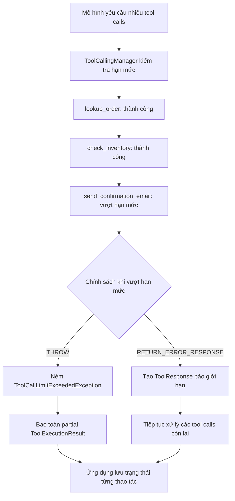
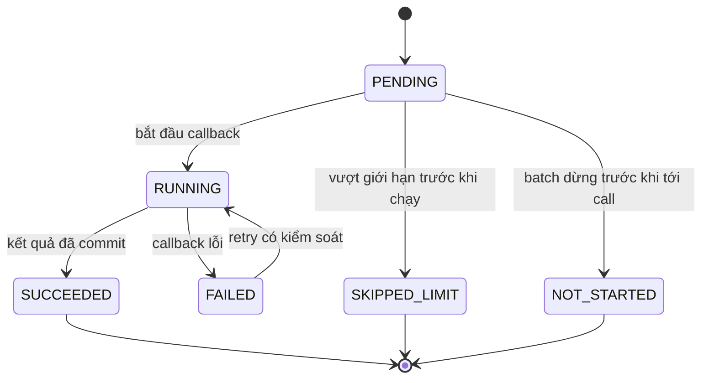

# Giới hạn thực thi

## Bảo toàn kết quả đã hoàn tất khi một phần lượt thực thi bị giới hạn

Một lượt tool calling có thể yêu cầu nhiều công cụ. Một số công cụ đã chạy thành công trước khi lượt thực thi chạm giới hạn số lần gọi. Khi đó, ứng dụng cần giữ lại kết quả đã hoàn tất, ghi rõ công cụ nào bị giới hạn và xác định phần việc nào chưa chạy.

Trong Spring AI 2.x, `DefaultToolCallingManager` hỗ trợ giới hạn số lần gọi theo từng tool và tổng số tool trong một lượt. Khi dùng chính sách `THROW`, manager ném `ToolCallLimitExceededException` nhưng vẫn mang theo `ToolExecutionResult` một phần. Khi dùng `RETURN_ERROR_RESPONSE`, manager tạo tool response báo giới hạn, bỏ qua lần gọi vượt hạn mức và tiếp tục xử lý các tool call còn lại trong batch.

Giới hạn thực thi là cơ chế bảo vệ vòng lặp khỏi chạy không kiểm soát. Nó không hoàn tác các thao tác đã chạy thành công. Vì vậy, ứng dụng cần tách trạng thái thành công, lỗi, bị giới hạn và chưa được thực thi; lưu lại kết quả có cấu trúc; đồng thời tránh chạy lại side effect đã hoàn tất khi tiếp tục hoặc retry.

### 1. Vì sao một lượt có thể chỉ hoàn tất một phần?

Giả sử người dùng yêu cầu: “Tra cứu đơn hàng, kiểm tra tồn kho và gửi email xác nhận”. Mô hình phát ra ba tool call trong cùng một response:

1. `lookup_order` đọc trạng thái đơn hàng.
2. `check_inventory` kiểm tra số lượng hàng.
3. `send_confirmation_email` gửi email.

Ứng dụng có thể hoàn tất hai công cụ đầu, nhưng công cụ thứ ba chạm giới hạn tổng nếu ngân sách của lượt chỉ còn đủ cho hai lần gọi. Hoặc mô hình có thể lặp lại `check_inventory` nhiều lần và chạm giới hạn riêng của tool đó trước khi yêu cầu tiếp theo được thực thi.



Hai chính sách có mục đích khác nhau. `THROW` dừng batch ngay tại điểm vượt giới hạn và trả thông tin một phần cho caller. `RETURN_ERROR_RESPONSE` cho mô hình biết một thao tác bị từ chối do hạn mức, rồi cho phép các thao tác còn lại trong batch tiếp tục được xử lý.

### 2. Hai loại giới hạn trong Spring AI

`DefaultToolCallingManager` có hai lớp giới hạn:

| Giới hạn | Mục đích | Giá trị mặc định trong Spring AI 2.0.2 |
| --- | --- | ---: |
| Số lần gọi một tool trong một lượt | Ngăn mô hình lặp quá nhiều lần cùng một công cụ | 40 lần/tool |
| Tổng số tool calls trong một lượt | Giới hạn tổng chi phí và số thao tác của toàn bộ lượt | 150 lần/lượt |

Có thể cấu hình giới hạn bằng builder:

```java
ToolCallingManager toolCallingManager = ToolCallingManager.builder()
    .maxCallsPerTool(40)
    .maxCallsPerTool("search_orders", 10)
    .excludeToolFromLimit("get_current_time")
    .maxTotalToolCalls(150)
    .onLimitExceeded(ToolCallLimitBehavior.THROW)
    .build();
```

`maxCallsPerTool(40)` đặt mức mặc định cho mỗi tool. Overload `maxCallsPerTool("search_orders", 10)` đặt mức riêng cho tool đó. `excludeToolFromLimit(...)` loại một tool khỏi giới hạn theo tên, nhưng tool đó vẫn được tính vào tổng số tool calls của lượt. Có thể dùng `unlimitedCallsPerTool()` hoặc `unlimitedTotalToolCalls()` để tắt một loại giới hạn; chỉ nên làm vậy khi có một giới hạn thay thế phù hợp ở tầng ứng dụng.

Có thể cấu hình bằng `application.properties`:

```properties
spring.ai.tools.limits.max-calls-per-tool-default=40
spring.ai.tools.limits.max-calls-per-tool.search_orders=10
spring.ai.tools.limits.excluded-tools=get_current_time
spring.ai.tools.limits.max-total-tool-calls=150
spring.ai.tools.limits.on-limit-exceeded=THROW
```

Tên tool trong property phải khớp với tên mà mô hình nhìn thấy trong `ToolDefinition`. Các giá trị `-1` có nghĩa là tắt giới hạn tương ứng. Không nên tắt giới hạn tổng chỉ vì một tool cần nhiều lần gọi; hãy đặt override theo tool nếu đó là workload hợp lệ.

### 3. Bộ đếm được tính theo từng lượt người dùng

Giới hạn được tính theo lượt hội thoại hiện tại, bắt đầu từ `UserMessage` gần nhất. `DefaultToolCallingManager` đếm các `ToolResponseMessage` xuất hiện sau message người dùng đó. Các tool response của những lượt cũ không làm tăng bộ đếm của lượt mới.

Điều này có một hệ quả quan trọng đối với điều phối thủ công: phải giữ đầy đủ lịch sử của lượt hiện tại khi tạo prompt tiếp theo. Nếu ứng dụng loại bỏ các tool response giữa vòng lặp, manager có thể không còn đủ dữ liệu để tính đúng số lần gọi đã dùng.

Các bộ đếm không được lưu trong field mutable của manager. Chúng được tính lại từ `prompt.getInstructions()` mỗi lần thực thi. Vì vậy, một `ToolCallingManager` có thể được chia sẻ giữa các request đồng thời; mỗi request vẫn cần giữ lịch sử riêng của nó.

```text
UserMessage: yêu cầu tra cứu đơn hàng
  AssistantMessage: gọi lookup_order
  ToolResponseMessage: lookup_order thành công        -> tính 1
  AssistantMessage: gọi check_inventory
  ToolResponseMessage: check_inventory thành công     -> tính 1

UserMessage: yêu cầu mới
  AssistantMessage: gọi lookup_order
  ToolResponseMessage: lookup_order thành công        -> bộ đếm lượt mới bắt đầu từ 1
```

Đừng nhầm giới hạn theo lượt với giới hạn theo phiên người dùng hoặc theo ngày. Nếu nghiệp vụ cần quota theo tenant, tài khoản, ngày hoặc chi phí token, ứng dụng phải triển khai bộ đếm riêng ở tầng nghiệp vụ.

### 4. Điều gì xảy ra khi dùng `THROW`?

`THROW` là hành vi mặc định. Khi manager phát hiện một tool call vượt giới hạn, nó ném `ToolCallLimitExceededException` và dừng xử lý batch tại vị trí đó.

Exception mang theo:

- `getToolName()`: tên tool vượt giới hạn; giá trị `null` nếu vượt giới hạn tổng của lượt.
- `getLimit()`: số lần gọi tối đa đã bị chạm.
- `getPartialToolExecutionResult()`: kết quả thực thi một phần, gồm các tool response đã hoàn tất trước đó và một tool response tổng hợp thông báo lần gọi bị giới hạn.
- `buildGeneration()`: tạo một `Generation` đại diện cho lần lượt bị dừng vì giới hạn.

Các kết quả đã thành công được giữ lại trong `ToolExecutionResult` một phần. Manager không xóa chúng chỉ vì một tool call sau đó vượt giới hạn.

```java
try {
    ToolExecutionResult result =
        toolCallingManager.executeToolCalls(prompt, chatResponse);

    prompt = new Prompt(result.conversationHistory(), chatOptions);
    chatResponse = chatModel.call(prompt);
}
catch (ToolCallLimitExceededException ex) {
    ToolExecutionResult partial = ex.getPartialToolExecutionResult();

    executionStore.recordLimitExceeded(
        ex.getToolName(),
        ex.getLimit(),
        partial.conversationHistory());

    // Chuyển trạng thái và kết quả đã hoàn tất cho tầng ứng dụng.
    return buildPartialOutcome(partial, ex);
}
```

`executionStore` và `buildPartialOutcome` là thành phần do ứng dụng định nghĩa. Ví dụ này minh họa rằng caller cần giữ partial result và thông tin hạn mức trước khi kết thúc request.

Không nên tự động gửi `partial.conversationHistory()` trở lại mô hình như thể batch đã hoàn tất. Khi `THROW` dừng giữa một response có nhiều tool calls, những tool calls phía sau điểm vượt hạn mức có thể chưa được thực thi. Hãy kiểm tra danh sách call gốc và kết quả từng call, ghi nhận các thao tác chưa chạy, rồi quyết định một lượt tiếp tục mới có kiểm soát.

### 5. `ToolCallingAdvisor` bảo toàn kết quả một phần như thế nào?

Khi dùng `ChatClient`, `ToolCallingAdvisor` sở hữu vòng lặp. Nếu `DefaultToolCallingManager` ném `ToolCallLimitExceededException`, advisor bắt exception và trả về response cuối biểu diễn việc vượt giới hạn.

Response này có một `Generation` duy nhất được tạo bằng `ex.buildGeneration()`. Nội dung generation là thông báo vượt giới hạn. Các tool response đã thành công trước đó được đặt trong metadata dưới key `ToolCallLimitExceededException.METADATA_PARTIAL_TOOL_RESPONSES`.

Spring AI dùng một generation duy nhất để tránh trường hợp caller đọc `getResult()` hoặc generation đầu tiên rồi nhầm kết quả tool thành công là câu trả lời thay thế cho lỗi giới hạn. Thành công một phần được giữ riêng trong metadata, không được trộn thành các generation ngang hàng với thông báo lỗi.

Ví dụ nhận diện response kết thúc do giới hạn:

```java
ChatClientResponse clientResponse = chatClient.prompt()
    .user("Tra cứu đơn hàng và gửi email xác nhận.")
    .call()
    .chatClientResponse();

Generation generation = clientResponse.chatResponse().getResult();
ChatGenerationMetadata metadata = generation.getMetadata();

if (ToolCallLimitExceededException.FINISH_REASON.equals(
        metadata.getFinishReason())) {

    @SuppressWarnings("unchecked")
    List<ToolResponseMessage.ToolResponse> partialResponses =
        metadata.get(ToolCallLimitExceededException.METADATA_PARTIAL_TOOL_RESPONSES);

    if (partialResponses != null && !partialResponses.isEmpty()) {
        executionStore.recordPartialResponses(partialResponses);
    }
}
```

`ChatGenerationMetadata.get(key)` trả về giá trị metadata theo key. Khi đọc metadata tổng hợp, nên kiểm tra key tồn tại và xử lý trường hợp không có dữ liệu. Đừng chỉ đọc `generation.getOutput().getText()` rồi bỏ qua `partialToolResponses`, vì như vậy caller sẽ chỉ nhìn thấy thông báo vượt giới hạn mà bỏ sót kết quả đã hoàn tất.

### 6. Phân biệt kết quả thành công, lỗi giới hạn và thao tác chưa chạy

Một batch có thể có nhiều trạng thái. Ứng dụng nên giữ trạng thái cho từng tool call thay vì chỉ lưu một cờ `success` cho toàn lượt.

| Trạng thái | Ý nghĩa | Ví dụ |
| --- | --- | --- |
| `SUCCEEDED` | Callback đã chạy và trả kết quả hợp lệ | Tra cứu đơn hàng trả về trạng thái vận chuyển |
| `FAILED` | Callback đã chạy nhưng thất bại | Service kho bị timeout |
| `SKIPPED_LIMIT` | Manager không gọi callback vì đã vượt hạn mức | `send_confirmation_email` bị từ chối do giới hạn |
| `NOT_STARTED` | Batch bị dừng trước khi tới tool call này | Tool call đứng sau vị trí vượt giới hạn khi dùng `THROW` |
| `PENDING_CONFIRMATION` | Cần người dùng cho phép trước khi chạy | Hoàn tiền hoặc hủy đơn cần xác nhận |

Ví dụ bảng thực thi:

| Tool call ID | Tool | Trạng thái | Kết quả |
| --- | --- | --- | --- |
| `call-01` | `lookup_order` | `SUCCEEDED` | Đơn hàng đang vận chuyển |
| `call-02` | `check_inventory` | `SUCCEEDED` | Còn 4 sản phẩm |
| `call-03` | `send_confirmation_email` | `SKIPPED_LIMIT` | Đã chạm giới hạn gửi email trong lượt |
| `call-04` | `create_follow_up_task` | `NOT_STARTED` | Batch dừng trước khi gọi |

Không được diễn giải `SKIPPED_LIMIT` hoặc `NOT_STARTED` thành `FAILED` nếu callback chưa chạy. Cũng không được diễn giải cả lượt là thành công chỉ vì có một số tool đã thành công.

### 7. Dùng `RETURN_ERROR_RESPONSE` để mô hình tiếp tục

Nếu muốn mô hình nhận biết giới hạn và tiếp tục xử lý các công cụ còn lại, cấu hình:

```java
ToolCallingManager toolCallingManager = ToolCallingManager.builder()
    .maxCallsPerTool(40)
    .maxTotalToolCalls(150)
    .onLimitExceeded(ToolCallLimitBehavior.RETURN_ERROR_RESPONSE)
    .build();
```

Khi một tool call vượt giới hạn, manager:

1. Không gọi callback vượt hạn mức.
2. Tạo `ToolResponseMessage.ToolResponse` chứa thông báo giới hạn cho tool call đó.
3. Tiếp tục xử lý các tool calls còn lại trong cùng batch.
4. Trả `ToolExecutionResult` bình thường cho caller.

Ứng dụng có thể tiếp tục vòng lặp bằng lịch sử đã cập nhật:

```java
ToolExecutionResult result =
    toolCallingManager.executeToolCalls(prompt, chatResponse);

prompt = new Prompt(result.conversationHistory(), chatOptions);
chatResponse = chatModel.call(prompt);
```

Mô hình sẽ nhìn thấy tool response báo giới hạn và có thể trả lời người dùng hoặc chọn một cách khác. Ví dụ, nếu `search_orders` đã chạm giới hạn, mô hình có thể giải thích rằng không thể tra cứu thêm trong lượt hiện tại, trong khi các tool độc lập khác vẫn có thể được xử lý.

`RETURN_ERROR_RESPONSE` không có nghĩa tăng giới hạn hoặc chạy lại tool bị từ chối. Nó chỉ biến lần gọi vượt hạn mức thành một tool response lỗi để vòng hội thoại có thể tiếp tục. Các tool call còn lại vẫn phải tuân theo giới hạn tương ứng.

Có thể cấu hình property:

```properties
spring.ai.tools.limits.on-limit-exceeded=RETURN_ERROR_RESPONSE
```

Đối với code gọi trực tiếp `ToolCallingManager.executeToolCalls(...)`, `RETURN_ERROR_RESPONSE` đặc biệt hữu ích vì không có `ToolCallingAdvisor` ở ngoài để bắt exception và tạo response cuối thay cho caller.

### 8. Chọn `THROW` hay `RETURN_ERROR_RESPONSE`?

| Tiêu chí | `THROW` | `RETURN_ERROR_RESPONSE` |
| --- | --- | --- |
| Khi chạm giới hạn | Ném exception và dừng batch ngay | Tạo tool error response và tiếp tục batch |
| Kết quả đã hoàn tất trước đó | Có trong partial `ToolExecutionResult` và metadata | Có trong conversation history bình thường |
| Tool call vượt giới hạn | Có error response trong partial result | Bị bỏ qua và có error response |
| Tool call phía sau trong cùng batch | Không được xử lý sau điểm dừng | Tiếp tục được xét và thực thi nếu còn hạn mức |
| Hành vi vòng lặp `ChatClient` | Advisor trả response cuối báo giới hạn | Mô hình nhận lỗi tool và có thể tiếp tục |
| Phù hợp với | Dừng rõ ràng để ứng dụng xử lý một phần | Cho mô hình tự điều chỉnh khi một tool bị giới hạn |

Chọn `THROW` khi việc vượt hạn mức cần một quyết định ở tầng ứng dụng, chẳng hạn yêu cầu xác nhận, hiển thị trạng thái một phần hoặc chuyển sang quy trình bù trừ. Chọn `RETURN_ERROR_RESPONSE` khi mô hình có thể xử lý việc thiếu một kết quả và tiếp tục với các công cụ còn lại.

Không nên chọn chính sách chỉ dựa trên việc muốn tránh exception. Hãy xem thao tác nào đã chạy, thao tác nào còn lại, có side effect hay không và người dùng cần được thông báo ở mức nào.

### 9. Giới hạn không rollback thao tác đã hoàn tất

Giới hạn tool call là cơ chế điều phối. Nó không mở một transaction bao trùm toàn bộ batch và không hoàn tác các thao tác đã thực thi.

Ví dụ, `update_shipping_address` đã cập nhật địa chỉ thành công, sau đó `send_customer_notification` bị giới hạn. Địa chỉ mới vẫn được lưu trong hệ thống nghiệp vụ. Nếu ứng dụng retry toàn bộ batch, `update_shipping_address` có thể chạy lần thứ hai.

Để tránh lặp side effect, hãy thiết kế callback có tính idempotent khi có thể:

- Nhận một operation ID do ứng dụng tạo và lưu cùng kết quả.
- Kiểm tra operation ID trước khi thực hiện lại thao tác.
- Ghi nhận trạng thái `RUNNING`, `SUCCEEDED`, `FAILED` hoặc `SKIPPED_LIMIT`.
- Dùng transaction cho từng thao tác nghiệp vụ cần tính nguyên tử.
- Với side effect bên ngoài như gửi email hoặc thanh toán, dùng idempotency key và outbox/inbox pattern nếu dịch vụ hỗ trợ.
- Chỉ retry các thao tác đã xác định là chưa chạy hoặc thất bại theo chính sách retry; không retry mù quáng toàn bộ batch.

Tool call ID giúp liên kết kết quả với yêu cầu do mô hình phát ra. Tuy nhiên, ID do mô hình tạo có thể khác giữa hai lần model retry. Với side effect, nên dùng operation ID hoặc business command ID do ứng dụng quản lý làm idempotency key ổn định.

### 10. Lưu sổ thực thi để khôi phục một phần

Một cách triển khai thực tế là lưu từng lần gọi tool vào execution ledger. Ledger giúp ứng dụng biết thao tác nào đã hoàn tất ngay cả khi request HTTP bị ngắt hoặc tiến trình dừng sau một số callback.

Ví dụ cấu trúc bản ghi:

| Trường | Mục đích |
| --- | --- |
| `conversationId` | Liên kết với cuộc hội thoại |
| `turnId` | Xác định lượt người dùng hiện tại |
| `toolCallId` | Liên kết với tool call của mô hình |
| `toolName` | Tên tool được yêu cầu |
| `operationId` | Khóa idempotency do ứng dụng tạo |
| `status` | `RUNNING`, `SUCCEEDED`, `FAILED`, `SKIPPED_LIMIT`, `NOT_STARTED` |
| `resultReference` | Tham chiếu tới kết quả có cấu trúc đã lưu |
| `startedAt`, `completedAt` | Thời điểm thực thi |
| `limitType`, `limitValue` | Loại và giá trị giới hạn nếu bị chặn |

Luồng lưu trạng thái:



Ledger nên lưu kết quả gốc hoặc tham chiếu tới kết quả trong hệ thống nghiệp vụ. Không chỉ lưu câu trả lời cuối của mô hình, vì phần diễn giải có thể bỏ sót một kết quả hoặc mô tả sai trạng thái thực thi.

### 11. Tạo phản hồi một phần cho người dùng

Khi một phần thao tác đã thành công, ứng dụng nên thông báo rõ phần nào đã hoàn tất và phần nào bị giới hạn. Ví dụ:

> Đã tra cứu đơn hàng ORD-2048 và xác nhận còn 4 sản phẩm trong kho. Hệ thống chưa gửi email xác nhận vì lượt này đã chạm giới hạn thực thi. Bạn có thể yêu cầu gửi email trong một lượt mới.

Phản hồi như vậy cần dựa trên execution ledger hoặc partial tool responses đã xác minh. Không yêu cầu mô hình tự suy ra tool nào đã chạy từ một thông báo lỗi tổng quát.

Nếu dùng `ToolCallingAdvisor` với `THROW`, response cuối chứa thông báo giới hạn và metadata chứa các tool responses đã thành công trước đó. Ứng dụng có thể dùng metadata để dựng trạng thái chi tiết. Nếu dùng `RETURN_ERROR_RESPONSE`, mô hình sẽ nhận lỗi tool và có thể tạo câu trả lời cuối; ứng dụng vẫn nên lấy trạng thái nghiệp vụ từ ledger khi cần bảo đảm tính chính xác.

### 12. Tiếp tục trong lượt mới mà không thực thi lặp

Sau khi một lượt bị giới hạn, ứng dụng có thể mở một lượt mới sau khi đã xử lý kết quả một phần. Trước khi gửi prompt mới:

1. Đọc các bản ghi `SUCCEEDED` và giữ nguyên kết quả.
2. Xác định các thao tác `SKIPPED_LIMIT` và `NOT_STARTED`.
3. Kiểm tra các thao tác `RUNNING` có bị bỏ dở do timeout hoặc process crash không.
4. Kiểm tra idempotency trước khi retry side effect.
5. Tạo yêu cầu tiếp tục chỉ chứa các thao tác còn cần thiết.
6. Bắt đầu lượt mới với giới hạn mới theo chính sách ứng dụng.

Ví dụ, nếu tra cứu đơn hàng và tồn kho đã thành công, lượt tiếp theo chỉ cần yêu cầu gửi email. Không yêu cầu mô hình gọi lại hai công cụ đọc dữ liệu đã hoàn tất trừ khi dữ liệu cần được làm mới.

Giới hạn được tính lại từ `UserMessage` gần nhất. Việc tạo lượt mới cho phép lượt mới có ngân sách tool riêng, nhưng không có nghĩa thao tác đã thành công trong lượt trước được xóa hoặc được phép chạy lại không kiểm soát.

### 13. Kết hợp với `returnDirect`

`returnDirect` và tool call limit giải quyết hai vấn đề khác nhau:

- `returnDirect` quyết định có gửi kết quả tool về mô hình hay trả trực tiếp cho caller.
- Tool call limit quyết định một callback có được phép chạy thêm trong lượt hiện tại hay không.

Nếu một batch có tool call thành công rồi một call khác vượt hạn mức, `returnDirect` không làm mất giới hạn và cũng không rollback kết quả trước đó. Với `THROW`, caller vẫn cần xử lý `ToolCallLimitExceededException` và partial result. Với `RETURN_ERROR_RESPONSE`, manager trả tool response cho call bị giới hạn và xử lý các call còn lại theo giới hạn.

Không coi một partial result là kết quả direct hoàn chỉnh nếu batch đã bị dừng vì giới hạn. Hãy kiểm tra trạng thái limit breach riêng biệt trước khi trả kết quả cho client.

### 14. Kiểm thử bảo toàn kết quả một phần

Kiểm thử cần chứng minh rằng kết quả đã hoàn tất vẫn còn sau khi giới hạn bị chạm và tool vượt hạn mức không bị gọi.

**Kiểm thử cấu hình hạn mức:**

- Giới hạn riêng của tool được áp dụng đúng.
- Giới hạn tổng áp dụng trên tất cả tool.
- Tool được loại khỏi giới hạn riêng vẫn bị tính vào giới hạn tổng.
- Bộ đếm bắt đầu lại ở `UserMessage` mới.
- Bộ đếm không bị mất khi vòng lặp tiếp tục bằng history đầy đủ.

**Kiểm thử `THROW`:**

- Callback thành công trước điểm vượt giới hạn được giữ trong partial result.
- Tool vượt hạn mức không được gọi.
- Exception cung cấp đúng tool name và limit; `toolName` là `null` nếu vượt giới hạn tổng.
- Partial result có thông báo giới hạn và các kết quả thành công trước đó.
- `ToolCallingAdvisor` trả một generation với finish reason của exception.
- Các partial responses xuất hiện trong metadata key `METADATA_PARTIAL_TOOL_RESPONSES`.

**Kiểm thử `RETURN_ERROR_RESPONSE`:**

- Tool vượt hạn mức bị bỏ qua.
- Tool response báo giới hạn được tạo.
- Các tool call còn lại trong batch vẫn được xét.
- Mô hình nhận tool error response và có thể tạo câu trả lời cuối.

**Kiểm thử tính bền vững nghiệp vụ:**

- Side effect đã thành công không chạy lần hai khi retry.
- Tool call chưa chạy được phân biệt với tool call thất bại.
- Execution ledger khôi phục được trạng thái sau timeout hoặc process restart.
- Kết quả người dùng nhìn thấy phản ánh chính xác thành công một phần.

Ví dụ kiểm thử manager với một callback đã thành công trước khi chạm giới hạn:

```java
ToolCallingManager manager = ToolCallingManager.builder()
    .maxCallsPerTool(1)
    .maxTotalToolCalls(10)
    .onLimitExceeded(ToolCallLimitBehavior.THROW)
    .build();

assertThatThrownBy(() -> manager.executeToolCalls(prompt, responseWithRepeatedToolCalls))
    .isInstanceOf(ToolCallLimitExceededException.class)
    .satisfies(error -> {
        ToolCallLimitExceededException limitError =
            (ToolCallLimitExceededException) error;

        assertThat(limitError.getToolName()).isEqualTo("lookup_order");
        assertThat(limitError.getLimit()).isEqualTo(1);
        assertThat(limitError.getPartialToolExecutionResult().conversationHistory())
            .isNotEmpty();
    });
```

Test này là khung minh họa; `prompt` và `responseWithRepeatedToolCalls` cần được dựng sao cho lịch sử lượt hiện tại chưa có tool response, còn response chứa số lần gọi đủ để vượt giới hạn. Test callback riêng để xác nhận số lần thực thi thực tế và kết quả đã lưu.

### 15. Quan sát và vận hành giới hạn

Theo dõi giới hạn ở cả cấp tool và cấp lượt:

- Số lần gọi theo từng tool và từng lượt.
- Số lần chạm giới hạn riêng và giới hạn tổng.
- Số callback thành công trước khi lượt bị dừng.
- Số tool call bị `SKIPPED_LIMIT` hoặc `NOT_STARTED`.
- Thời gian thực thi và tỷ lệ lỗi từng tool.
- Số lần retry, idempotency hit và thao tác cần bù trừ.

Spring AI cung cấp Micrometer observation cho tool execution dưới tên `spring.ai.tool`, bao gồm tool name và thời gian thực thi. Có thể bật log DEBUG cho chẩn đoán:

```properties
logging.level.org.springframework.ai=DEBUG
```

Không nên log toàn bộ arguments hoặc kết quả nếu chúng chứa dữ liệu cá nhân, token hoặc thông tin nghiệp vụ nhạy cảm. Dùng request ID, tool call ID, operation ID và trạng thái để truy vết.

### 16. Những lỗi thiết kế thường gặp

| Lỗi | Hậu quả | Cách khắc phục |
| --- | --- | --- |
| Chỉ đọc thông báo limit và bỏ qua metadata partial | Mất kết quả đã thành công khỏi góc nhìn của caller | Đọc `getPartialToolExecutionResult()` hoặc `METADATA_PARTIAL_TOOL_RESPONSES` |
| Coi limit breach là rollback | Hệ thống vẫn giữ side effect đã thực thi | Lưu ledger và thiết kế bù trừ/idempotency |
| Retry toàn bộ batch | Tạo giao dịch, email hoặc cập nhật lặp | Chỉ retry thao tác chưa chạy hoặc có idempotency |
| Dùng `THROW` nhưng gửi partial history thẳng lại model | Có thể thiếu tool responses cho các call chưa được xử lý | Đối soát call gốc, hoàn tất hoặc từ chối các call còn lại trước khi tiếp tục |
| Dùng `RETURN_ERROR_RESPONSE` nhưng không kiểm tra trạng thái cuối | Mô hình có thể mô tả thiếu chính xác thao tác đã hoàn tất | Đối chiếu với execution ledger |
| Cắt bỏ tool responses của lượt hiện tại | Bộ đếm có thể không còn phản ánh số lần gọi đã dùng | Giữ history đầy đủ từ `UserMessage` gần nhất |
| Tắt mọi giới hạn để tránh lỗi | Vòng lặp có thể tăng chi phí hoặc chạy không dừng | Điều chỉnh per-tool limit và total limit theo workload |

### 17. Quy trình xử lý khi chạm giới hạn

1. Xác định loại giới hạn: per-tool hay total-per-turn.
2. Thu thập các tool response đã hoàn tất và tool call ID tương ứng.
3. Ghi trạng thái call vượt giới hạn và các call chưa bắt đầu.
4. Giữ nguyên kết quả nghiệp vụ đã commit; không rollback giả định.
5. Chọn `THROW` nếu ứng dụng cần dừng để xử lý partial outcome, hoặc `RETURN_ERROR_RESPONSE` nếu mô hình có thể tiếp tục an toàn.
6. Khi retry hoặc tiếp tục, dùng operation ID/idempotency key để tránh side effect lặp.
7. Trả phản hồi cho người dùng với trạng thái thành công một phần rõ ràng.
8. Theo dõi limit metrics để điều chỉnh hạn mức dựa trên dữ liệu vận hành.

Giới hạn tool call bảo vệ ứng dụng khỏi vòng lặp quá dài và thao tác vượt ngân sách. `ToolCallLimitExceededException` cùng partial `ToolExecutionResult` giúp giữ lại những gì đã hoàn tất trước khi batch bị dừng. Khi chọn `RETURN_ERROR_RESPONSE`, mô hình có thể nhận biết công cụ bị giới hạn và tiếp tục với các công cụ còn lại. Trong cả hai trường hợp, ứng dụng vẫn phải lưu kết quả nghiệp vụ, phân biệt thao tác chưa chạy với thao tác thất bại và bảo đảm retry không thực hiện side effect lần thứ hai.

### Tài liệu tham khảo

- [Spring AI 2.0.2 Reference — Tool Calling and Tool Call Limits](https://docs.spring.io/spring-ai/reference/api/tools.html)
- [Spring AI 2.0.2 Reference — ToolCallingAdvisor](https://docs.spring.io/spring-ai/reference/api/tools/tool-calling-advisor.html)
- [Spring AI 2.0.2 API — ToolCallLimitExceededException](https://docs.spring.io/spring-ai/docs/current/api/org/springframework/ai/model/tool/ToolCallLimitExceededException.html)
- [Spring AI 2.0.2 API — ToolCallLimitBehavior](https://docs.spring.io/spring-ai/docs/current/api/org/springframework/ai/model/tool/ToolCallLimitBehavior.html)
- [Spring AI 2.0.2 API — ToolExecutionResult](https://docs.spring.io/spring-ai/docs/current/api/org/springframework/ai/model/tool/ToolExecutionResult.html)

Các giá trị mặc định và API trong bài dựa trên Spring AI 2.0.2. `ToolCallLimitExceededException` và `ToolCallLimitBehavior` có từ 2.0.1. Hãy đối chiếu đúng phiên bản dependency của ứng dụng trước khi áp dụng property hoặc builder option.
